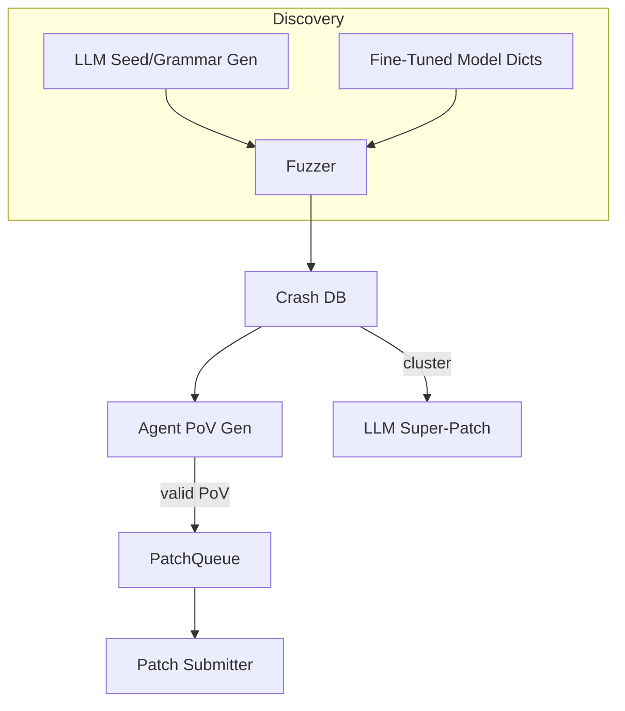

# AI-Assisted Fuzzing & Ugunduzi wa Kiotomatiki wa Athari za Usalama

{{#include ../banners/hacktricks-training.md}}

## Muhtasari
Large-language models (LLMs) zinaweza kuongeza kwa kiasi kikubwa uwezo wa mifumo ya kawaida ya utafiti wa athari za usalama kwa kutengeneza ingizo zenye maana ya kisemantiki, kuboresha sarufi, kuchanganua data za crash, na hata kupendekeza marekebisho yanayoshughulikia hitilafu nyingi. Ukurasa huu unakusanya mbinu bora zaidi zilizobainika katika fainali za DARPA’s AI Cyber Challenge (AIxCC) na tafiti nyingine za umma.<sup>[[4]](#references)</sup><sup>[[5]](#references)</sup>

Yafuatayo si maelezo ya mfumo maalum wa mashindano, bali ni muhtasari wa mbinu ili uweze kuzitumia tena katika taratibu zako za kazi.

---

## 1. Ingizo za Awali Zilizozalishwa na LLM

Fuzzers za kawaida zinazoongozwa na coverage (AFL++, libFuzzer, Honggfuzz…) huanza na mkusanyiko mdogo wa ingizo za awali na kubadilisha byte bila mpango. Muundo wa ingizo lengwa unapokuwa changamano (SQL, URLs, itifaki maalum za binary), mabadiliko ya nasibu kwa kawaida huharibu sintaksia kabla matawi ya kuvutia hayajafikiwa.

LLMs zinaweza kutatua tatizo hili la kuanzisha kwa kutoa *vizalishaji vya ingizo za awali* – hati fupi zinazotoa **ingizo sahihi kisintaksia lakini zinazohusiana na usalama**. Kwa mfano:

```prompt
SYSTEM: You are a helpful security engineer.
USER:
Write a Python3 program that prints 200 unique SQL injection strings targeting common anti-pattern mistakes (missing quotes, numeric context, stacked queries).  Ensure length ≤ 256 bytes / string so they survive common length limits.
```

```python
# gen_sqli_seeds.py (truncated)
PAYLOADS = [
    "1 OR 1=1 -- ",
    "' UNION SELECT NULL,NULL--",
    "0; DROP TABLE users;--",
    ...
]
for p in PAYLOADS:
    print(p)
```

Iendeshe mara moja na uweke matokeo moja kwa moja kwenye corpus ya awali ya fuzzer:

```bash
python3 gen_sqli_seeds.py > seeds.txt
afl-fuzz -i seeds.txt -o findings/ -- ./target @@
```

Benefits:
1. Uhalali wa kisemantiki → coverage ya kina zaidi mapema.
2. Inaweza kuzalishwa upya: rekebisha prompt ili kulenga XSS, path traversal, binary blobs, n.k.
3. Nafuu (< 1 ¢ kwa GPT-3.5).

### Vidokezo
* Iagize model *itofautishe* urefu na encoding ya payload (UTF-8, URL-encoded, UTF-16-LE) ili kukwepa filters za juu juu.
* Omba *script moja inayojitosheleza* – huepusha hitilafu za uumbizaji wa JSON.

---

## 2. Grammar-Evolution Fuzzing

Toleo lenye nguvu zaidi ni kuruhusu LLM **kuibua grammar** badala ya seeds halisi. Workflow (“Grammar Guy” pattern) ni:

1. Tengeneza grammar ya awali ya ANTLR/Peach/LibFuzzer kupitia prompt.
2. Fanya fuzzing kwa dakika N na ukusanye vipimo vya coverage (edges / blocks zilizofikiwa).
3. Fupisha maeneo ya programu ambayo hayajafunikwa na urudishe muhtasari huo kwenye model:
   ```prompt
   The previous grammar triggered 12 % of the program edges.  Functions not reached: parse_auth, handle_upload.  Add / modify rules to cover these.
   ```
4. Unganisha rules mpya, fanya fuzzing tena, rudia.

Muundo wa pseudo-code:

```python
for epoch in range(MAX_EPOCHS):
    grammar = llm.refine(grammar, feedback=coverage_stats)
    save(grammar, f"grammar_{epoch}.txt")
    coverage_stats = run_fuzzer(grammar)
```

Mambo muhimu:
* Weka *bajeti* – kila uboreshaji hutumia tokens.
* Tumia maagizo ya `diff` + `patch` ili modeli ihariri badala ya kuandika upya.
* Simama Δcoverage < ε inapokuwa kweli.

---

## 3. Uhandisi wa Harness ya Local-LLM libFuzzer

Kwa source ambayo haiwezi kutoka kwenye workstation ya mchambuzi, code model ya ndani inaweza kuandaa adapter ndogo kati ya bytes za fuzzer na API ya C/C++. Mpaka muhimu wa usalama uwe wazi: **modeli huandika na kurekebisha miundombinu ya majaribio; mutation inayoongozwa na coverage huchunguza inputs; sanitizers huripoti operesheni batili; binadamu hukagua harness na kuchunguza matokeo**.<sup>[[9]](#references)</sup>

Kwa mbinu za corpus, feedback, snapshot na stateful-fuzzing katika kiwango cha engine ambazo hazitegemei LLM, angalia [Fuzzing Methodology](../generic-methodologies-and-resources/fuzzing.md).

Anza na declaration halisi iliyonakiliwa kutoka kwenye header ya lengo na uweke masharti ya muundo wa matokeo. Prompt finyu hupunguza API zilizobuniwa na kurahisisha ukaguzi wa matokeo:<sup>[[8]](#references)[[9]](#references)</sup>

```prompt
Write a libFuzzer target for this exact declaration:
int parse_records(const uint8_t *data, size_t size);

Output only C code. Implement LLVMFuzzerTestOneInput, include the
declaration, pass data and size unchanged, and do not use files,
network access, randomness, clocks, threads, or persistent state.
```

Kwa parser ya byte ghafi, matokeo yanayotarajiwa hayapaswi kuwa changamano zaidi ya:<sup>[[6]](#references)[[9]](#references)</sup>

```c
#include <stddef.h>
#include <stdint.h>

extern int parse_records(const uint8_t *, size_t);

int LLVMFuzzerTestOneInput(const uint8_t *data, size_t size) {
    (void)parse_records(data, size);
    return 0;
}
```

Compilation ni lango la kwanza tu la uthibitishaji. Kagua kila target iliyozalishwa kwa kuzingatia masharti haya kabla ya kutumia muda wa CPU kuendesha:<sup>[[6]](#references)[[8]](#references)[[9]](#references)</sup>

- **API halisi:** linganisha aina, sheria za umiliki, uanzishaji, usafishaji na utaratibu wa kuita na header halisi pamoja na sehemu zilizopo zinazoita API hiyo.
- **Usalama wa harness:** linda kila usomaji kutoka `data`; matokeo ya sanitizer lazima yatokane na target, si glue code iliyozalishwa.
- **Uwezo wa kurudiwa:** fanya matokeo yawe chaguo za `data` na `size`; ondoa I/O ya nje, muda, randomness isiyodhibitiwa, thread zisizojiunga na hali inayodumu kati ya miito.
- **Ufanisi:** anzisha hali isiyobadilika na inayohitaji gharama kubwa mara moja tu, ikiwa hilo haliathiri tabia; weka kikomo cha ukubwa wa ingizo, zima logging na uachilie allocations za kila ingizo.
- **Ufikikaji:** hakikisha kwamba functions na matawi yaliyokusudiwa yanatekelezwa. Target inayokompili lakini inajaribu tu njia za kukataa ni hitilafu isiyoonekana.

### Target zinazozingatia muundo: hifadhi masharti bila kuficha bugs

Ikiwa ingizo nyingi ghafi zinashindwa kwenye ukaguzi wa magic, urefu, version au checksum, tumia fuzz bytes kama nyenzo za sehemu zenye aina maalum kisha unda upya object halali. Weka constants za format zisizobadilika, acha sehemu za kisemantiki na payload bytes zibadilike, kisha hesabu metadata ya integrity kutokana na payload iliyoundwa upya. `FuzzedDataProvider` husaidia kutumia thamani zenye aina maalum zilizo na mipaka, huku adapter ikiendelea kuwajibika kwa kuweka kikomo kwa allocation na conversion zozote zinazozalishwa.<sup>[[9]](#references)</sup>

<details>
<summary>Mfano wa target ya C++ inayozingatia muundo</summary>

```cpp
#include <fuzzer/FuzzedDataProvider.h>
#include <stddef.h>
#include <stdint.h>
#include <vector>

extern "C" int parse_message(const uint8_t *, size_t);

extern "C" int LLVMFuzzerTestOneInput(const uint8_t *data, size_t size) {
    FuzzedDataProvider fdp(data, size);
    uint8_t version = fdp.ConsumeIntegral<uint8_t>();
    auto body = fdp.ConsumeRemainingBytes<uint8_t>();
    if (body.size() > UINT16_MAX) body.resize(UINT16_MAX);
    uint16_t len = static_cast<uint16_t>(body.size());
    std::vector<uint8_t> msg = {0x8b, 'M', 'S', 'G', version,
                                static_cast<uint8_t>(len >> 8),
                                static_cast<uint8_t>(len)};
    msg.insert(msg.end(), body.begin(), body.end());
    (void)parse_message(msg.data(), msg.size());
    return 0;
}
```

</details>

Usitumie target moja inayorekebisha muundo kwa kila swali. Dumisha target moja inayokokotoa lengths/checksums ili kuchunguza deep valid states, na nyingine inayofanya metadata **iliyotangazwa** idhibitiwe na fuzzer huku ikiwekea mipaka tu ya usomaji na allocations zinazofanywa na harness. Target ya pili huhifadhi attack surfaces za mismatched-length na bad-integrity ambazo automatic repair ingeziondoa.<sup>[[9]](#references)</sup>

### Seeds, dictionaries, sanitizers, na feedback ya coverage

Iombe model itengeneze script inayoandika binary seeds badala ya kuiomba ichapishe binary moja kwa moja. Tumia seeds za objects zilizo empty, minimal, typical, na boundary-valid; kisha toa magic values, tags, enum encodings, na parser keywords na kuziweka kwenye dictionary iliyokaguliwa. libFuzzer inakubali dictionary hiyo kwa `-dict=`, na huhifadhi mutations zinazoonyesha coverage mpya kwenye corpus.<sup>[[6]](#references)[[9]](#references)</sup>

```text
magic="\x8bMSG"
version_min="\x00"
version_max="\xff"
config_tag="CONFIG"
```

Jenga target ileile kwa instrumentation inayokamilishana. ASan na UBSan zinaweza kushiriki binary moja ya fuzzing; tumia build tofauti ya MSan na uweke instrumentation kwenye dependencies zake ili kuepuka reports zinazosababishwa na code isiyo na instrumentation.<sup>[[6]](#references)[[9]](#references)</sup>

```bash
clang++ -g -O1 -fsanitize=fuzzer,address,undefined \
  -fno-sanitize-recover=undefined target.cc harness.cc -o fuzz_target
./fuzz_target corpus -dict=msg.dict -max_len=65535

clang++ -g -O1 -fsanitize=fuzzer,memory \
  target.cc harness.cc -o fuzz_target_msan
```

Chukulia coverage kama kipimo cha kila toleo la model. Katika matokeo ya libFuzzer, `cov`/`ft` zinazoanza kuwa flat mapema na corpus isiyobadilika kwa kawaida huashiria framing isiyofaa, early return yenye vizuizi vingi mno, au call isiyo sahihi; `exec/s` ya chini huashiria setup, I/O, allocation, au state iliyovuja kuwa ghali. `NEW` huthibitisha tu kuwa kipengele cha coverage kimebadilika, si kwamba parser iliyokusudiwa imefikiwa.<sup>[[6]](#references)[[9]](#references)</sup>

Kwa feedback ya kiwango cha source, tengeneza build yenye coverage, fanya fuzzing, kisha ipe model functions ambazo hazijafunikwa pamoja na masharti yanayozilinda. Thibitisha tofauti za harness/seed/dictionary na upime tena:<sup>[[7]](#references)[[8]](#references)[[9]](#references)</sup>

```bash
clang++ -g -O1 -fsanitize=fuzzer \
  -fprofile-instr-generate -fcoverage-mapping target.cc harness.cc -o fuzz_cov
mkdir -p profiles
LLVM_PROFILE_FILE='profiles/%p.profraw' ./fuzz_cov -max_total_time=300 corpus
llvm-profdata merge -sparse profiles/*.profraw -o fuzz.profdata
llvm-cov report ./fuzz_cov -instr-profile=fuzz.profdata
llvm-cov show ./fuzz_cov -instr-profile=fuzz.profdata \
  --show-branches=count --region-coverage-lt=1 target.cc
```

Mzunguko unaoweza kupanuliwa ni **zalisha → compile/link → fanya smoke-test chini ya sanitizers → pima target coverage → toa muktadha mdogo zaidi unaohusiana wa coverage/source → rekebisha → pima tena**. OSS-Fuzz-Gen hutumia kanuni hiyo hiyo kwa kutathmini targets zilizozalishwa kulingana na uwezo wa ku-compile, hitilafu za runtime, coverage na uboreshaji wa coverage dhidi ya targets zilizopo, badala ya kukubali code inayoonekana kuaminika bila kuipima.<sup>[[7]](#references)[[8]](#references)</sup>

---

<a id="3-agent-based-pov-exploit-generation" hidden>3. Uzalishaji wa PoV (Exploit) kwa kutumia Agents</a>

## 4. Uzalishaji wa PoV (Exploit) kwa kutumia Agents

Baada ya crash kupatikana, bado unahitaji **proof-of-vulnerability (PoV)** inayosababisha crash hiyo kwa njia inayoweza kurudiwa kwa uhakika.

Mbinu inayoweza kupanuliwa ni kuanzisha workers wengi wepesi (processes, threads, au containers), kila mmoja akitumia model au usanidi tofauti wa sampling. Utafiti wa waliofika fainali wa AIxCC unatoa mifano halisi ya ukubwa: timu moja ilitumia **maelfu ya agents zinazofanya kazi kwa wakati mmoja** kuzalisha PoV kwa kutumia AI kwanza, huku nyingine ikiratibu **agents 300–500 za fuzzing** na kutumia LLMs kwa reasoning ya kisemantiki ya kiwango cha juu.<sup>[[4]](#references)</sup>

Mchakato:
1. Static/dynamic analysis huzalisha *wagombea wa hitilafu* (struct yenye crash PC, sehemu ya input, na ujumbe wa sanitizer).
2. Orchestrator husambaza wagombea kwa agents.
3. Hatua za reasoning za agent:
   a. Zalisha tena hitilafu hiyo ndani ya mazingira ya karibu kwa kutumia `gdb` + input.
   b. Pendekeza payload ndogo zaidi ya exploit.
   c. Thibitisha exploit ndani ya sandbox. Ikifaulu → wasilisha.
4. Majaribio yaliyoshindwa **huongezwa tena kwenye foleni kama seeds mpya** za coverage fuzzing (mzunguko wa mrejesho).

Faida:
* Kufanya kazi sambamba huficha kutotegemewa kwa agent mmoja.
* Kurekebisha kiotomatiki temp / ukubwa wa model kulingana na kiwango cha mafanikio kilichoonekana.

---

<a id="4-directed-fuzzing-with-fine-tuned-code-models" hidden>4. Directed Fuzzing kwa kutumia Code Models Zilizofanyiwa Fine-Tuning</a>

## 5. Directed Fuzzing kwa kutumia Code Models Zilizofanyiwa Fine-Tuning

Fanya fine-tuning ya model yenye open weights (kwa mfano, Llama-7B) kwa kutumia source ya C/C++ iliyopewa lebo za mifumo ya vulnerability (integer overflow, buffer copy, format string). Kisha:

1. Fanya static analysis ili kupata orodha ya functions + AST.
2. Ipe model prompt: *“Toa entries za mutation dictionary ambazo zina uwezekano wa kuvunja usalama wa memory katika function X”*.
3. Ingiza tokens hizo kwenye `AFL_CUSTOM_MUTATOR` maalum.

Mfano wa output ya wrapper ya `sprintf`:
```
{"pattern":"%99999999s"}
{"pattern":"AAAAAAAA....<1024>....%n"}
```

Kwa majaribio, hii hupunguza muda hadi crash kwa zaidi ya mara 2 kwenye malengo halisi.

---

<a id="5-ai-guided-patching-strategies" hidden>5. Mikakati ya Kuweka Patch kwa Mwongozo wa AI</a>

## 6. Mikakati ya Kuweka Patch kwa Mwongozo wa AI

<a id="51-super-patches" hidden>5.1 Super Patches</a>

### 6.1 Super Patches
Iombe modeli i*kusanye katika makundi* alama za crash na ipendekeze **patch moja** inayoondoa chanzo cha kawaida cha tatizo.  Iwasilishe mara moja, rekebisha hitilafu kadhaa → punguza adhabu za usahihi katika mazingira ambako kila patch isiyo sahihi hugharimu pointi.

Muhtasari wa prompt:
```
Here are 10 stack traces + file snippets.  Identify the shared mistake and generate a unified diff fixing all occurrences.
```

{{#ref}}
../generic-methodologies-and-resources/fuzzing.md
{{#endref}}

<a id="52-speculative-patch-ratio" hidden>5.2 Uwiano wa Speculative Patch</a>

### 6.2 Uwiano wa Speculative Patch
Tekeleza foleni inayopishanisha patches zilizothibitishwa kwa PoV na patches za *speculative* (zisizo na PoV) kwa uwiano wa 1:N unaolingana na kanuni za utoaji alama (kwa mfano, 2 speculative : 1 confirmed). Mfumo wa gharama hufuatilia adhabu dhidi ya pointi na hurekebisha N kiotomatiki.

---

<a id="6-deterministic-file-by-file-ai-code-review" hidden>6. Ukaguzi wa Msimbo wa AI wa Faili kwa Faili kwa Utaratibu Thabiti</a>

## 7. Ukaguzi wa Msimbo wa AI wa Faili kwa Faili kwa Utaratibu Thabiti

Tatizo linalojitokeza mara nyingi katika ukaguzi unaosaidiwa na AI ni kumwomba agent mmoja achunguze repository nzima na kutumaini atachagua faili na maneno sahihi ya grep. Mbinu inayotegemeka zaidi ni **kulazimisha ukaguzi wa repository nzima**:<sup>[[1]](#references)</sup>

1. Orodhesha faili za source.
2. Tuma **faili moja kwa wakati mmoja** pamoja na muktadha wa chini kabisa (entrypoint, imports, routes/callers zilizo karibu).
3. Hitaji **ripoti yenye muundo maalum** kwa kila faili: sources, sink, uthibitishaji unaokosekana, masharti ya awali ya exploit, na kiwango cha uhakika.<sup>[[3]](#references)</sup>
4. Ondoa ripoti zinazojirudia kulingana na **muundo wa source→sink** na uthibitishe mwenyewe zile zilizo hatarishi zaidi.

Mbinu hii hutumia tokeni nyingi na hutoa kelele, lakini ni bora sana katika kubaini **hitilafu rahisi za source/sink zenye athari kubwa** ambazo ukaguzi mpana wa agent mara nyingi hukosa.

### Mifumo ya triage inayofaa kupewa kipaumbele

- **Dynamic PHP include/dispatch**: majina ya route/controller/module yanayodhibitiwa na mshambuliaji yanapopitishwa hadi `require_once()`, `include()`, au `include_once()` bila allowlist madhubuti na canonicalisation ya path.
- **Utekelezaji wa shell katika workflows za admin/account**: usernames, domains, akaunti za FTP, au vitambulisho vingine vinavyofika kwenye `exec()`, `system()`, `shell_exec()`, `passthru()`, `proc_open()`, au `popen()`.
- **Kuingiza data yenye muundo kutoka vyanzo vingi**: parameter ileile inapokubaliwa kutoka `$_GET`, `$_POST`, JSON, XML, au body parsers za framework, kisha kutumiwa tena kwenye filesystem au OS-command sinks.

### Aina mbili za vitendo za hitilafu ambazo mbinu hii hubaini vizuri

- **PHP controller-dispatch LFI/RCE**: ikiwa jina la controller linalodhibitiwa na request linaunganishwa na `require_once()` bila allowlist/path normalisation, mfuatano wa traversal kama `../` unaweza kufanya PHP ijumuishe faili ya `.php` ya ndani isiyokusudiwa. Ikiwa mshambuliaji anaweza kuelekeza include kwenye faili ya PHP aliyoweka au inayomfaa kwa namna nyingine, LFI hugeuka kuwa utekelezaji wa msimbo. Angalia [File Inclusion / Path Traversal](../pentesting-web/file-inclusion/README.md).<sup>[[1]](#references)</sup>
- **Command injection iliyothibitishwa kwenye hosting/admin panels**: ikiwa sehemu za usimamizi wa akaunti kama usernames zinawekwa ndani ya shell commands, mtumiaji aliyethibitishwa mwenye ruhusa ndogo anaweza kubadilisha kitendo cha kawaida cha kuunda/kufuta akaunti na kukifanya RCE. Athari huongezeka paneli inapotekeleza command hiyo kama service account yenye ruhusa kubwa zaidi. Angalia [Command Injection](../pentesting-web/command-injection.md).<sup>[[1]](#references)</sup>

### Vidokezo vya vitendo vya ukaguzi

- Tumia LLM kama **mkaguzi wa source/sink kwanza**, si kama jenereta ya exploit.
- Iombe itaje wazi **sehemu inayodhibitiwa na mshambuliaji**, **pengo la normalization/validation**, na **sink hatari**.
- Kwa repos kubwa, ukaguzi thabiti wa kila faili kivyake mara nyingi hutegemeka zaidi kuliko kuendesha agent mmoja huru, hata kama agent huyo anatumia model yenye nguvu zaidi.<sup>[[2]](#references)</sup>
- Tarajia matokeo dhaifu zaidi kwenye **Broken Access Control** na hitilafu nyingine za business logic ambapo uwezekano wa exploit hutegemea dhana zinazohusisha faili nyingi, maana ya roles, au threat models mahususi za bidhaa.

---

## 8. Ukaguzi wa Kernel Unaongozwa na Mifumo kwa Kutumia Oracle Iliyowekewa Instrumentation

Kwa target yenye ukubwa wa kernel, usimwombe agent atafute hitilafu zozote kwenye tree nzima. Workflow inayotumia tokeni kwa ufanisi zaidi hubadilisha maarifa ya kihistoria ya vulnerability kuwa static queries, hupanga matokeo kulingana na attack surface iliyo wazi, na hutumia kernel yenye instrumentation kama oracle ya utekelezaji.<sup>[[11]](#references)</sup>

### Pattern database → CodeQL/Semgrep → ukaguzi mahususi

Tengeneza knowledge base ndogo yenye APIs hatari, mifumo ya uthibitishaji inayokosekana, mtiririko hatari wa source-to-sink, na maumbo ya hitilafu yaliyowahi kurekebishwa. Iombe model ibadilishe **pattern moja kwa wakati mmoja** kuwa heuristic za ukaguzi na kanuni za CodeQL/Semgrep, kisha endesha kanuni hizo thabiti kwenye tree nzima. Panga na uondoe matokeo yanayojirudia kabla ya kurudisha msimbo kwa model; matokeo ghafi ya scanner yanaweza kuwa na maelfu ya wagombea wasio na thamani kubwa. Angalia leseni ya sasa ya CodeQL kabla ya kutumia mbinu hii nje ya targets zinazostahiki za utafiti au open-source.<sup>[[11]](#references)</sup>

Pangilia vipaumbele vya subsystems kwa kutumia **msongamano wa rule-hit** na **uwezekano wa mshambuliaji kuzifikia**, badala ya kuhesabu hits pekee. Interfaces za kernel zinazoweza kufikiwa na michakato isiyo na upendeleo, sandboxes, containers, jails, au mazingira ya guest zinapaswa kupewa uzito mkubwa kuliko msimbo wa ndani pekee. Weka kipande cha ukaguzi kidogo vya kutosha ili agent aweze kukumbuka callers, validators, na kanuni za muda wa uhai; na iombe ichunguze aina mahususi ya vulnerability au muundo wa control-flow badala ya “tafuta vulnerability yoyote.” Interfaces za zamani zenye upendeleo huvutia zaidi hasa pale ambapo boundary mpya ya containment huzifanya zifikike kwa root user aliye kwenye namespace au jail.<sup>[[11]](#references)</sup>

Kwa kila mgombea, hitaji rekodi ya wazi ya mtiririko wa field kabla ya kujaribu kufanya exploitation.<sup>[[11]](#references)</sup>

```text
entrypoint -> privilege check -> parser -> validation/normalization
           -> later rewrite -> dangerous sink
attacker controls: <fields and lengths>
constraints:       <values rewritten, rejected, or preserved>
observable result: <sanitizer report, assertion, panic, or clean exit>
```

### Tumia telemetry ya KASAN kama oracle ya dhana

Endesha kernel lengwa katika VM ya muda mfupi huku KASAN na assertions muhimu za uchunguzi zikiwa zimewashwa. Agent inapaswa kurudia mzunguko wa **dhana kuhusu source → kichochezi kidogo zaidi cha userland → utekelezaji wa VM → trace ya KASAN/assertion → dhana iliyorekebishwa** hadi corruption inayoshukiwa ithibitishwe tena au ikataliwe. Rudisha tu stack trace husika na source iliyo karibu katika kila marudio; hii huhifadhi muktadha wa kufikiri huku ikifanya ushahidi wa wakati wa utekelezaji, si imani ya model, kuwa kigezo cha kukubali.<sup>[[11]](#references)</sup>

Build yenye instrumentation si mazingira ya mwisho ya kutathmini uwezekano wa exploit. Assertions zinaweza kusimamisha utekelezaji kabla ya operesheni inayosababisha corruption, ilhali assertion hiyo hiyo inaweza kuondolewa wakati wa kucompile kernel ya production. Jaribu tena kichochezi kilekile bila mabadiliko kwenye configuration halisi ya production, rekodi build na configuration ya kernel, na tenganisha **ufikikaji**, **memory corruption**, **primitive inayodhibitika**, na **athari za usalama** kama madai tofauti.<sup>[[11]](#references)[[12]](#references)</sup>

CVE-2026-3038 ni mfano muhimu wa uthibitishaji, si kiolezo cha exploit. Ombi la FreeBSD `RTM_GET` lisilohitaji ruhusa maalum lingeweza kuhifadhi sockaddr ya `RTAX_AUTHOR` iliyozidi ukubwa kupitia uthibitishaji teule na uandikaji upya wa jibu, hadi `rtsock_msg_buffer()` ikanakili `sa_len` iliyodhibitiwa na mtumiaji kwenye `sockaddr_storage` ya stack yenye ukubwa wa baiti 128. Nakala ya juu kabisa ya baiti 255 ilisababisha overwrite ya baiti 127; assertion ya uchunguzi iligundua urefu usio sahihi kwenye build yenye instrumentation, ilhali kernel ya GENERIC ilifikia nakala hiyo kisha ikapata panic wakati canary iliyoharibiwa ilipokaguliwa. Hii inathibitisha denial of service isiyohitaji ruhusa maalum, si privilege escalation ya moja kwa moja: udhibiti wa kuaminika ungehitaji kwanza primitive nyingine, kama kufichua canary. Tazama [Stack Canaries](../binary-exploitation/common-binary-protections-and-bypasses/stack-canaries/index.html) kwa mpaka unaohusiana na binary exploitation.<sup>[[11]](#references)[[12]](#references)[[13]](#references)</sup>

### Kataa udanganyifu wa masharti ya awali ya exploit

Kabla ya kukubali PoV au exploit, mwombe mkaguzi/agent tofauti ajaribu kuibatilisha kwa kutumia vigezo vilivyowekwa. Ukaguzi lazima uthibitishe masharti yote yafuatayo.<sup>[[11]](#references)</sup>

- Source ya target, kernel na module iliyo hatarini havikubadilishwa ili kufanya njia hiyo ifikike.
- Hakuna helper module, synthetic gadget, mitigation iliyozimwa, ruhusa za ziada au interface isiyopatikana iliyoongezwa.
- Kichochezi kinaanza kwa utambulisho wa mpigaji na masharti ya containment yanayodaiwa, kwenye snapshot safi.
- Matokeo yanayodaiwa bado yanategemea bug: kuondoa field iliyoharibika au kurekebisha bug pekee lazima kuvunje mnyororo.
- Crash, overread au overwrite inaripotiwa kama primitive hiyo pekee; code execution au privilege escalation huhitaji ushahidi huru.

Ukaguzi huu wa mwisho wa hali mbadala hubaini maonyesho yanayojizungusha: ikiwa masharti ya awali tayari yanatoa athari inayodaiwa (kwa mfano, kutekeleza maudhui ya SUID yaliyotolewa na mshambuliaji kutoka kwenye filesystem iliyowekwa bila `nosuid`), basi bug ya usalama wa memory haikusababisha athari hiyo.<sup>[[11]](#references)</sup>

---

## Utafiti Unaoweza Kukaguliwa Unaosaidiwa na Agent kwenye Codebase Zisizofahamika

[graph-first fuzz-target workflow](../generic-methodologies-and-resources/fuzzing.md#graph-first-fuzz-target-selection-and-mutation-triage) tayari inashughulikia ufikikaji wa entrypoint, huku [agentic SAST pipelines](../network-services-pentesting/pentesting-web/code-review-tools.md#agentic-sast-pipelines) zikishughulikia ukaguzi wa hatua kwa hatua na vigezo vya ushahidi. Weka matokeo hayo ya kithibitisho tofauti na dhana za model ili kila lead iliyokubaliwa ihifadhi maeneo ya source, ushahidi wa njia na kipimo cha wakati wa utekelezaji.<sup>[[10]](#references)</sup>

### Linganisha ushahidi wa muda wa uhai wa object bila kubuni mtiririko wa data

Uchanganuzi tuli unaweza kupata urefu unaodhibitiwa na mshambuliaji ukihifadhiwa kwenye function moja na field ileile ya object ikifikia copy sink baadaye, lakini ukashindwa kuthibitisha uhusiano huo kwenye callbacks, reconnects au muda wa uhai wa object. Hifadhi matokeo hayo mawili kando, yapange kwa object/field na ufanye edge inayokosekana kuwa swali dhahiri la triage. Agent inaweza kupendekeza uhusiano huo, lakini ukaguzi wa source au runtime instrumentation lazima uthibitishe.<sup>[[10]](#references)</sup>

Kwa kila mgombea, rekodi:

- entrypoint halisi na baiti zinazodhibitiwa na mshambuliaji;
- kila producer wa field husika, pamoja na uthibitishaji maalum kwa kila producer;
- sink, uwezo wa destination na masharti ya build/runtime yanayohitajika ili kuifikia;
- call stack halisi kutoka entrypoint iliyo wazi, si mwito wa moja kwa moja wa harness pekee;
- matokeo madogo zaidi ya wakati wa utekelezaji yanayothibitisha au kukataa dhana.

Njia inayoonekana kuwa salama haiondoi hatari ya field kwa ujumla. Producer wa pili anaweza kujaza field hiyo bila kikomo kilichowekwa kwenye njia ya kwanza. Jaribu njia hizo kivyake na endesha harness kwa chaguo za build zinazolingana na deployment kwa sababu debug assertions zinaweza kubadilisha memory corruption ya production kuwa abort ya mapema inayotokea kwenye majaribio pekee.<sup>[[10]](#references)</sup>

### Vigezo vya vipimo vya kufichua na kutumia vibaya

Kwa memory disclosure inayoshukiwa kuwa haijaanzishwa, jaza allocations mpya kwa baiti inayotambulika na uthibitishe kuwa marker hiyo hiyo inafika kwenye packet iliyotolewa. Kwa exploitation, hitaji vigezo vilivyopimwa kama **controlled overwrite → useful victim object → disclosure → pointer/base recovery → control-flow hijack → composed payload**. Agent huendelea tu pale harness inapothibitisha sifa ya sasa; simulizi linaloonekana kuwa linalowezekana si kigezo kilichopitwa. [FreeRDP case](../binary-exploitation/libc-heap/heap-overflow.md#cross-path-length-reuse-and-stale-output-disclosure) inaonyesha njia na masharti ya build yanayopaswa kuhifadhiwa wakati wa uthibitishaji.<sup>[[10]](#references)</sup>

---

Kwa case study ya kernel inayotumia uthibitishaji wa hatua kwa hatua wa L0–L4 katika uundaji wa exploit unaosaidiwa na LLM, tazama:

{{#ref}}
../binary-exploitation/freebsd-kernel-exploitation-vnet-jail-escape.md
{{#endref}}

## Kuyaunganisha Yote
CRS (Cyber Reasoning System) ya mwanzo hadi mwisho inaweza kuunganisha vipengele hivi kama ifuatavyo:



---

## References

- [1] [Project Black - AI ya ndani kwa Usalama wa Mtandao: Kugundua phpIPAM LFI na myVesta Authenticated RCE](https://projectblack.io/blog/local-ai-for-cyber-security)
- [2] [Strix](https://github.com/usestrix/strix)
- [3] [Ujuzi wa security-review wa jumuiya ya GitHub Copilot](https://github.com/github/awesome-copilot/blob/main/skills/security-review/SKILL.md)
- [4] [Trail of Bits – Fainali za AIxCC: Muhtasari wa matukio](https://blog.trailofbits.com/2025/08/07/aixcc-finals-tale-of-the-tape/)
- [5] [Mahojiano ya waliofuzu fainali za AIxCC ya CTF Radiooo](https://www.youtube.com/@ctfradiooo)
- [6] [LLVM — libFuzzer: maktaba ya fuzz testing inayoongozwa na coverage](https://llvm.org/docs/LibFuzzer.html)
- [7] [Google — OSS-Fuzz-Gen](https://github.com/google/oss-fuzz-gen)
- [8] [Google Online Security Blog — Kuinua kiwango cha Fuzzing: Kugundua Vulnerabilities zaidi kwa kutumia AI](https://security.googleblog.com/2024/11/leveling-up-fuzzing-finding-more.html)
- [9] [8kSec — Uzalishaji wa Fuzzing Harness kwa msaada wa AI kwa kutumia LLM ya ndani](https://8ksec.io/ai-assisted-fuzzing-harness-local-llm)
- [10] [Quarkslab — Kutoka kwa AI Agents hadi RCE: Kuunda Workflow ya utafiti wa Vulnerability](https://blog.quarkslab.com/from-ai-agents-to-rce-building-a-vulnerability-research-workflow.html)
- [11] [Praetorian — FreeBSoD: Kutumia Language Models Kugundua na kutumia hitilafu za kernel (Sehemu ya 1 kati ya 2)](https://praetorian.com/blog/ai-vulnerability-research-freebsd-kernel)
- [12] [FreeBSD-SA-26:05.route — DoS ya ndani na uwezekano wa privilege escalation kupitia routing sockets](https://www.freebsd.org/security/advisories/FreeBSD-SA-26:05.route.asc)
- [13] [Kiraka cha chanzo cha FreeBSD-SA-26:05.route](https://security.FreeBSD.org/patches/SA-26:05/route.patch)
{{#include ../banners/hacktricks-training.md}}
