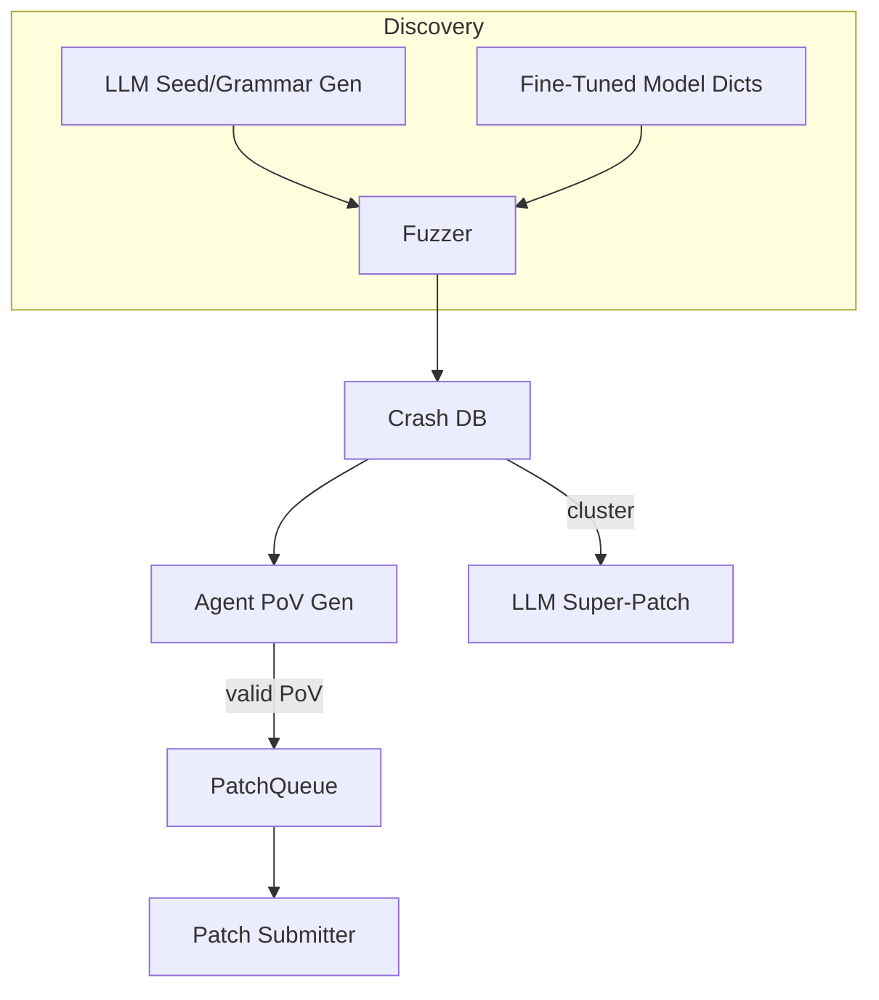

# AI辅助 Fuzzing 与自动化漏洞发现

{{#include ../banners/hacktricks-training.md}}

## 概述
大型语言模型（LLM）可以通过生成语义丰富的输入、演进语法、分析崩溃数据，甚至提出修复多个 bug 的补丁，大幅增强传统漏洞研究流程。本页汇总了 DARPA 的 AI Cyber Challenge（AIxCC）决赛及其他公开研究中观察到的最有效模式。<sup>[[4]](#references)</sup><sup>[[5]](#references)</sup>

以下内容并非对某个特定竞赛系统的描述，而是对相关技术的抽象，以便你能在自己的工作流中复现这些方法。

---

## 1. LLM 生成的种子输入

传统的覆盖率引导型 Fuzzer（AFL++、libFuzzer、Honggfuzz……）会从少量种子组成的语料库开始，并盲目地变异字节。当目标输入格式复杂（如 SQL、URL、自定义二进制协议）时，随机变异通常会在到达有趣的分支之前破坏语法。

LLM 可以通过生成*种子生成器*来解决这个启动问题——也就是输出**语法正确且与安全相关的输入**的简短脚本。例如：

```prompt
SYSTEM: You are a helpful security engineer.
USER:
Write a Python3 program that prints 200 unique SQL injection strings targeting common anti-pattern mistakes (missing quotes, numeric context, stacked queries).  Ensure length ≤ 256 bytes / string so they survive common length limits.
```

```python
# gen_sqli_seeds.py (truncated)
PAYLOADS = [
    "1 OR 1=1 -- ",
    "' UNION SELECT NULL,NULL--",
    "0; DROP TABLE users;--",
    ...
]
for p in PAYLOADS:
    print(p)
```

运行一次，并将输出直接放入 fuzzer 的初始语料库：

```bash
python3 gen_sqli_seeds.py > seeds.txt
afl-fuzz -i seeds.txt -o findings/ -- ./target @@
```

Benefits:
1. 语义有效性 → 更早获得更深入的覆盖率。
2. 可重新生成：调整 prompt，聚焦于 XSS、路径遍历、二进制 blob 等。
3. 成本低（使用 GPT-3.5 不到 1 ¢）。

### Tips
* 指示模型*多样化* payload 的长度和编码（UTF-8、URL 编码、UTF-16-LE），以绕过浅层过滤器。
* 要求生成*单个自包含脚本*，避免 JSON 格式问题。

---

## 2. Grammar-Evolution Fuzzing

一种更强大的变体是让 LLM **演进 grammar**，而不是生成具体的 seeds。工作流（“Grammar Guy”模式）如下：

1. 通过 prompt 生成初始的 ANTLR/Peach/LibFuzzer grammar。
2. Fuzz N 分钟并收集覆盖率指标（命中的 edges / blocks）。
3. 总结尚未覆盖的程序区域，并将总结反馈给模型：
   ```prompt
   The previous grammar triggered 12 % of the program edges.  Functions not reached: parse_auth, handle_upload.  Add / modify rules to cover these.
   ```
4. 合并新规则，重新 fuzz，重复。

伪代码框架：

```python
for epoch in range(MAX_EPOCHS):
    grammar = llm.refine(grammar, feedback=coverage_stats)
    save(grammar, f"grammar_{epoch}.txt")
    coverage_stats = run_fuzzer(grammar)
```

关键要点：
* 保持 *预算* ——每次优化都会消耗 tokens。
* 使用 `diff` + `patch` 指令，让模型编辑而不是重写。
* 当 Δcoverage < ε 时停止。

---

## 3. 本地 LLM libFuzzer Harness 工程

对于不能离开分析人员工作站的源代码，本地代码模型可以起草一个小型适配器，将 fuzzer 字节转换为 C/C++ API 调用。明确的安全边界很重要：**模型编写并修订测试基础设施；coverage-guided mutation 探索输入；sanitizer 报告无效操作；人工审查 harness 并对发现的问题进行分类**。<sup>[[9]](#references)</sup>

有关不依赖 LLM 的引擎级 corpus、反馈、snapshot 和有状态 fuzzing 技术，请参阅通用 [Fuzzing Methodology](../generic-methodologies-and-resources/fuzzing.md)。

从目标头文件中原样复制准确的声明，并限制输出格式。范围明确的提示可减少虚构 API 的情况，并使结果易于审查：<sup>[[8]](#references)[[9]](#references)</sup>

```prompt
Write a libFuzzer target for this exact declaration:
int parse_records(const uint8_t *data, size_t size);

Output only C code. Implement LLVMFuzzerTestOneInput, include the
declaration, pass data and size unchanged, and do not use files,
network access, randomness, clocks, threads, or persistent state.
```

对于原始字节解析器，预期结果不应复杂于：<sup>[[6]](#references)[[9]](#references)</sup>

```c
#include <stddef.h>
#include <stdint.h>

extern int parse_records(const uint8_t *, size_t);

int LLVMFuzzerTestOneInput(const uint8_t *data, size_t size) {
    (void)parse_records(data, size);
    return 0;
}
```

编译只是第一道验证关卡。在为每个生成的目标消耗 CPU 时间之前，请根据以下不变量逐一检查：<sup>[[6]](#references)[[8]](#references)[[9]](#references)</sup>

- **Exact API：** 将类型、所有权规则、初始化、清理和调用约定与真实头文件及现有调用方进行比较。
- **Harness 安全性：** 对从 `data` 读取的每个位置进行防护；sanitizer 发现的问题必须源自目标，而不是生成的 glue。
- **可重复性：** 让结果仅由 `data` 和 `size` 决定；移除外部 I/O、时间、不可控的随机性、未 join 的线程，以及在调用之间保留的状态。
- **吞吐量：** 仅在不会影响行为时初始化一次开销较大的不可变状态，限制输入大小，抑制日志记录，并释放每个输入对应的分配。
- **可达性：** 确认预期函数和分支确实会执行。目标虽能编译，却只触发拒绝路径，就是无声失败。

### 结构感知型目标：保留不变量，但不掩盖 bug

如果大多数原始输入都会在 magic、长度、版本或 checksum 检查处失败，请将 fuzz 字节用作**类型化字段素材**，并据此重建有效对象。固定格式常量，让语义字段和 payload 字节保持可变，并根据重建后的 payload 推导完整性元数据。`FuzzedDataProvider` 可用于消耗有界的类型化值，而 adapter 仍负责限制任何生成的分配和转换。<sup>[[9]](#references)</sup>

<details>
<summary>结构感知型 C++ target 示例</summary>

```cpp
#include <fuzzer/FuzzedDataProvider.h>
#include <stddef.h>
#include <stdint.h>
#include <vector>

extern "C" int parse_message(const uint8_t *, size_t);

extern "C" int LLVMFuzzerTestOneInput(const uint8_t *data, size_t size) {
    FuzzedDataProvider fdp(data, size);
    uint8_t version = fdp.ConsumeIntegral<uint8_t>();
    auto body = fdp.ConsumeRemainingBytes<uint8_t>();
    if (body.size() > UINT16_MAX) body.resize(UINT16_MAX);
    uint16_t len = static_cast<uint16_t>(body.size());
    std::vector<uint8_t> msg = {0x8b, 'M', 'S', 'G', version,
                                static_cast<uint8_t>(len >> 8),
                                static_cast<uint8_t>(len)};
    msg.insert(msg.end(), body.begin(), body.end());
    (void)parse_message(msg.data(), msg.size());
    return 0;
}
```

</details>

不要对每个问题都使用同一个会修复结构的 target。维护一个 target，用于推导长度/校验和，以探索深层的有效状态；另一个 target 则让 fuzzer 控制**声明的**元数据，只对 harness 自身的读取和内存分配进行边界限制。第二个 target 保留了长度不匹配和完整性校验错误的攻击面，否则自动修复会将其抹去。<sup>[[9]](#references)</sup>

### Seeds、字典、sanitizer 和 coverage 反馈

让模型生成一个写入二进制 seeds 的脚本，而不是让它直接输出二进制内容。为对象准备空、最小、典型和边界有效的 seeds；然后提取 magic 值、标签、枚举编码和解析器关键字，整理成经过审核的字典。libFuzzer 可通过 `-dict=` 接受该字典，并会将能发现新 coverage 的变异保留在 corpus 中。<sup>[[6]](#references)[[9]](#references)</sup>

```text
magic="\x8bMSG"
version_min="\x00"
version_max="\xff"
config_tag="CONFIG"
```

使用互补的插桩构建同一目标。ASan 和 UBSan 可以共用一个 fuzzing 二进制；MSan 则应单独构建，并对其依赖项进行插桩，以避免未插桩代码导致误报。<sup>[[6]](#references)[[9]](#references)</sup>

```bash
clang++ -g -O1 -fsanitize=fuzzer,address,undefined \
  -fno-sanitize-recover=undefined target.cc harness.cc -o fuzz_target
./fuzz_target corpus -dict=msg.dict -max_len=65535

clang++ -g -O1 -fsanitize=fuzzer,memory \
  target.cc harness.cc -o fuzz_target_msan
```

将 coverage 作为评估每次模型修订的指标。在 libFuzzer 输出中，cov/ft 早早趋于平坦且语料库静态不变，通常意味着 framing 不正确、过早 return 条件过于严格，或调用了错误的函数；exec/s 偏低则说明初始化、I/O、内存分配开销过大，或状态泄漏。`NEW` 只能证明某个 coverage 特征发生了变化，不能证明目标 parser 已被触发。<sup>[[6]](#references)[[9]](#references)</sup>

要获得源码级反馈，先构建 coverage 版本并对其进行 fuzzing，然后只向模型提供未覆盖的函数及其保护条件。验证生成的 harness/seed/dictionary diff，并再次测量：<sup>[[7]](#references)[[8]](#references)[[9]](#references)</sup>

```bash
clang++ -g -O1 -fsanitize=fuzzer \
  -fprofile-instr-generate -fcoverage-mapping target.cc harness.cc -o fuzz_cov
mkdir -p profiles
LLVM_PROFILE_FILE='profiles/%p.profraw' ./fuzz_cov -max_total_time=300 corpus
llvm-profdata merge -sparse profiles/*.profraw -o fuzz.profdata
llvm-cov report ./fuzz_cov -instr-profile=fuzz.profdata
llvm-cov show ./fuzz_cov -instr-profile=fuzz.profdata \
  --show-branches=count --region-coverage-lt=1 target.cc
```

因此，可扩展的循环是 **generate → compile/link → 在 sanitizers 下进行 smoke-test → 测量目标覆盖率 → 提供最小且相关的覆盖率/源代码上下文 → revise → re-measure**。OSS-Fuzz-Gen 也应用了同一原则：它会评估生成的目标是否可编译、是否出现运行时故障、覆盖率如何，以及相较于现有目标覆盖率是否有所提升，而不是仅凭代码看起来合理就接受它。<sup>[[7]](#references)[[8]](#references)</sup>

---

<a id="3-agent-based-pov-exploit-generation" hidden>3. Agent-Based PoV (Exploit) Generation</a>

## 4. Agent-Based PoV（Exploit）生成

找到 crash 后，你仍然需要一个能稳定触发它的 **proof-of-vulnerability (PoV)**。

一种可扩展的方法是启动大量轻量级 worker（进程、线程或容器），每个 worker 使用不同的 model 或采样配置。AIxCC finalist survey 给出了具体的规模示例：一支团队使用 **数千个并发 agent** 进行 AI 优先的 PoV 生成；另一支团队则协调 **300–500 个 fuzzing agent**，并将 LLM 用于更高层次的语义推理。<sup>[[4]](#references)</sup>

Pipeline:
1. Static/dynamic analysis 生成 *bug candidates*（包含 crash PC、input slice、sanitizer 消息的 struct）。
2. Orchestrator 将候选分发给 agent。
3. Agent 的推理步骤：
   a. 使用 `gdb` + input 在本地复现 bug。
   b. 提出最小 exploit payload。
   c. 在 sandbox 中验证 exploit。若成功 → 提交。
4. 失败的尝试会作为新的 seed **重新排队**，用于 coverage fuzzing（反馈循环）。

优势：
* 并行化可以弥补单个 agent 的不可靠性。
* 根据观察到的成功率自动调整临时参数 / model 大小。

---

<a id="4-directed-fuzzing-with-fine-tuned-code-models" hidden>4. Directed Fuzzing with Fine-Tuned Code Models</a>

## 5. 使用 Fine-Tuned Code Model 进行 Directed Fuzzing

使用带有漏洞模式标签（integer overflow、buffer copy、format string）的 C/C++ 源代码，对 open-weight model（例如 Llama-7B）进行 fine-tune。然后：

1. 运行 static analysis，获取函数列表 + AST。
2. 提示 model：*“给出可能破坏函数 X 中 memory safety 的 mutation dictionary 条目”*。
3. 将这些 token 插入自定义的 `AFL_CUSTOM_MUTATOR`。

`sprintf` wrapper 的输出示例：
```
{"pattern":"%99999999s"}
{"pattern":"AAAAAAAA....<1024>....%n"}
```

在真实目标上进行实测，这能将触发崩溃所需的时间缩短一半以上。

---

<a id="5-ai-guided-patching-strategies" hidden>5. AI 引导的修补策略</a>

## 6. AI 引导的修补策略

<a id="51-super-patches" hidden>5.1 超级补丁</a>

### 6.1 超级补丁
让模型对崩溃特征进行*聚类*，并提出一个能够消除共同根因的**单一补丁**。一次提交，修复多个漏洞 → 在每个错误补丁都会扣分的环境中，减少准确性惩罚。

提示词大纲：
```
Here are 10 stack traces + file snippets.  Identify the shared mistake and generate a unified diff fixing all occurrences.
```

{{#ref}}
../generic-methodologies-and-resources/fuzzing.md
{{#endref}}

<a id="52-speculative-patch-ratio" hidden>5.2 推测性补丁比例</a>

### 6.2 推测性补丁比例
实现一个队列，让经 PoV 验证确认的补丁与*推测性*补丁（无 PoV）按 1:​N 的比例交错排列，并根据评分规则调整比例（例如，2 个推测性补丁 : 1 个已确认补丁）。成本模型会监控惩罚与得分，并自动调整 N。

---

<a id="6-deterministic-file-by-file-ai-code-review" hidden>6. 逐文件确定性 AI 代码审查</a>

## 7. 逐文件确定性 AI 代码审查

AI 辅助审查中常见的一种失败模式是让一个 agent 检查整个仓库，并寄望它能选对文件和 grep 关键词。更可靠的模式是**强制覆盖整个仓库**：<sup>[[1]](#references)</sup>

1. 枚举源文件。
2. 一次发送**一个文件**，并附上最少量的上下文（入口点、导入项、附近的路由/调用方）。
3. 要求每个文件都提供**结构化报告**：source、sink、缺失的验证、利用前提和置信度。<sup>[[3]](#references)</sup>
4. 按**source→sink 模式**对报告去重，并手动验证高风险项。

这种方法耗费 token 且会产生噪声，但很擅长发现广泛的 agentic 审查经常漏掉的**简单、高影响 source/sink 漏洞**。

### 值得优先处理的分类模式

- **动态 PHP include/dispatch**：攻击者可控的路由/控制器/模块名称流入 `require_once()`、`include()` 或 `include_once()`，却没有严格的 allowlist 和路径规范化。
- **管理/账户工作流中的 shell 执行**：用户名、域名、FTP 账户或其他标识符传入 `exec()`、`system()`、`shell_exec()`、`passthru()`、`proc_open()` 或 `popen()`。
- **结构化输入汇流**：同一个参数可从 `$_GET`、`$_POST`、JSON、XML 或框架的 body parser 接收，之后又被用于文件系统或 OS 命令 sink。

### 这种方法擅长发现的两类实用漏洞

- **PHP controller-dispatch LFI/RCE**：如果请求控制的控制器名称未经 allowlist 或路径规范化便被拼接进 `require_once()`，则 `../` 等遍历序列可能使 PHP 包含意料之外的本地 `.php` 文件。如果攻击者能让 include 指向预先放置的或其他有用的 PHP 文件，LFI 就会变成代码执行。参见 [文件包含 / 路径遍历](../pentesting-web/file-inclusion/README.md)。<sup>[[1]](#references)</sup>
- **托管/管理面板中的已认证命令注入**：如果用户名等账户管理字段被嵌入 shell 命令，低权限的已认证用户可能把常规的创建/删除操作变成 RCE。若面板以权限更高的服务账户执行该命令，影响会更大。参见 [命令注入](../pentesting-web/command-injection.md)。<sup>[[1]](#references)</sup>

### 实用审查说明

- 首先将 LLM 用作 **source/sink 审查工具**，而不是 exploit 生成器。
- 要求它明确列出**攻击者可控字段**、**规范化/验证缺口**和**危险 sink**。
- 对于大型仓库，即使单次自主 agent 运行使用了更强的模型，逐文件确定性审查通常也更可靠。<sup>[[2]](#references)</sup>
- 对于 **Broken Access Control** 等业务逻辑漏洞，若可利用性取决于跨文件假设、角色语义或产品特定的威胁模型，预期审查效果会较弱。

---

## 8. 使用插桩 oracle 进行模式引导的内核审计

对于内核规模的目标，不要让 agent 在整个代码树中任意寻找漏洞。更节省 token 的工作流是将历史漏洞知识转化为静态查询，根据暴露的攻击面为结果排序，并使用插桩内核作为执行 oracle。<sup>[[11]](#references)</sup>

### 模式数据库 → CodeQL/Semgrep → 聚焦审查

建立一个小型知识库，其中包含危险 API、缺失验证模式、高风险 source-to-sink 流，以及此前修复过的漏洞形态。要求模型**一次处理一种模式**，将其转化为审查启发式和 CodeQL/Semgrep 规则，然后用这些确定性规则扫描整个代码树。将匹配结果分组并去重后，再把代码交给模型；原始扫描器输出可能包含数千个价值很低的候选项。在符合条件的研究目标或开源目标之外使用此方法前，请先确认 CodeQL 当前的许可证。<sup>[[11]](#references)</sup>

同时根据**规则命中密度**和**攻击者可达性**来确定子系统优先级，而不是只看命中数量。非特权进程、sandbox、container、jail 或 guest 上下文可访问的内核接口，应比仅供内部使用的代码获得更高权重。将审查单元控制在足够小的范围内，确保 agent 能保留调用方、验证器和生命周期规则等上下文；并提示它检查指定的漏洞类别或控制流模式，而不是“找出任何漏洞”。当较新的隔离边界使旧式特权接口可被命名空间或 jail 中的 root 用户访问时，这些接口尤其值得关注。<sup>[[11]](#references)</sup>

尝试利用每个候选项之前，都要求提供明确的字段流记录。<sup>[[11]](#references)</sup>

```text
entrypoint -> privilege check -> parser -> validation/normalization
           -> later rewrite -> dangerous sink
attacker controls: <fields and lengths>
constraints:       <values rewritten, rejected, or preserved>
observable result: <sanitizer report, assertion, panic, or clean exit>
```

### 将 KASAN telemetry 用作假设判定器

在启用了 KASAN 和有用诊断断言的临时 VM 中运行目标内核。Agent 应反复执行 **源代码假设 → 最小 userland 触发器 → VM 执行 → KASAN/断言跟踪 → 修订假设**，直到复现或排除疑似损坏。每次迭代只返回相关的 stack trace 和附近的源代码；这样既能保留推理所需的上下文，也能让运行时证据而非模型置信度成为验收标准。<sup>[[11]](#references)</sup>

插桩构建并非最终的可利用性环境。断言可能在造成损坏的操作之前终止执行，而同一断言在生产内核中可能已被编译移除。使用完全相同的触发器，在精确的生产配置上重新测试，记录内核构建版本和配置，并将**可达性**、**内存损坏**、**受控原语**和**安全影响**作为不同主张分别说明。<sup>[[11]](#references)[[12]](#references)</sup>

CVE-2026-3038 是一个有用的验证案例，而不是 exploit 模板。非特权 FreeBSD `RTM_GET` 请求可通过选择性验证和回复重写，使超大的 `RTAX_AUTHOR` sockaddr 得以保留，直到 `rtsock_msg_buffer()` 将其由用户控制的 `sa_len` 复制到 128 字节的栈上 `sockaddr_storage` 中。最大 255 字节的复制会造成 127 字节覆盖；插桩构建中的诊断断言检测到了错误长度，而 GENERIC 内核则执行了复制，随后在检查被破坏的 canary 时 panic。这证明了非特权拒绝服务，但不能单独证明权限提升：要实现可靠控制，首先还需要 canary 泄露等其他原语。有关相应的 binary-exploitation 边界，请参阅 [Stack Canaries](../binary-exploitation/common-binary-protections-and-bypasses/stack-canaries/index.html)。<sup>[[11]](#references)[[12]](#references)[[13]](#references)</sup>

### 拒绝在 exploit 前提上作弊

在接受 PoV 或 exploit 之前，让独立审查者/agent 按照固定标准尝试证伪。审查必须确认以下所有条件。<sup>[[11]](#references)</sup>

- 未修改目标源代码、内核或易受攻击的模块来使该路径变得可达。
- 未引入辅助模块、合成 gadget、已禁用的缓解措施、额外权限或不可用接口。
- 在干净快照中，触发器以所声称的调用者身份和隔离限制启动。
- 所声称的结果仍依赖该漏洞：移除畸形字段或仅修补该漏洞，都必须中断利用链。
- 崩溃、越界读取或覆盖只能报告为相应原语；代码执行或权限提升需要独立证据。

最后这项反事实检查可以揭露循环论证式的演示：如果前置条件已经赋予了所声称的影响（例如，从未以 `nosuid` 挂载的文件系统执行攻击者提供的 SUID 内容），那么内存安全漏洞并未造成该影响。<sup>[[11]](#references)</sup>

---

## 在陌生代码库上开展可审计的 Agent 辅助研究

[以图为先的 fuzz target 工作流](../generic-methodologies-and-resources/fuzzing.md#graph-first-fuzz-target-selection-and-mutation-triage)已涵盖入口点可达性，[agentic SAST 流水线](../network-services-pentesting/pentesting-web/code-review-tools.md#agentic-sast-pipelines)则涵盖分阶段审查和证据门槛。将这些确定性结果与模型假设分开保存，以便每条晋级的线索都保留源代码位置、路径证据和动态测量结果。<sup>[[10]](#references)</sup>

### 关联对象生命周期证据，但不要臆造数据流

静态分析可能发现，攻击者可控的长度在一个函数中被存储，而同一对象字段很久之后又到达复制 sink，但无法证明它们之间存在跨回调、重连或对象生命周期的关联。分别保留这两项发现，按对象/字段聚类，并将缺失的边明确列为分流审查问题。Agent 可以提出这种关联，但必须通过源代码审查或运行时插桩加以证明。<sup>[[10]](#references)</sup>

对每个候选项，记录：

- 具体入口点和攻击者可控的字节；
- 相关字段的每个生产者，包括针对每个生产者的验证逻辑；
- sink、目标容量以及到达该 sink 所需的构建/运行时条件；
- 来自暴露入口点的真实调用栈，而不只是直接调用 harness 的调用栈；
- 能确认或否定该假设的最小动态结果。

一条看似安全的路径并不能证明某个字段在全局范围内都安全。第二个生产者可能在没有经过第一条路径的边界检查时填充同一字段。应分别测试各条路径，并使用与部署环境等效的构建选项运行 harness，因为 debug 断言可能会把生产环境中的内存损坏变成仅在测试中发生的提前中止。<sup>[[10]](#references)</sup>

### 泄露与利用的测量门槛

对于疑似未初始化内存泄露，使用可识别的字节填充新分配的内存，并验证数据包中实际输出了确切的标记。对于利用，要求通过测量满足相应门槛，例如 **受控覆盖 → 有用的受害对象 → 泄露 → 指针/基址恢复 → 控制流劫持 → 组合 payload**。只有 harness 证明当前属性后，agent 才能继续推进；看似合理的叙述不算通过门槛。[FreeRDP 案例](../binary-exploitation/libc-heap/heap-overflow.md#cross-path-length-reuse-and-stale-output-disclosure)展示了验证时必须保留的路径和构建约束。<sup>[[10]](#references)</sup>

---

有关将分阶段 L0–L4 验证应用于 LLM 辅助 exploit 开发的内核案例研究，请参阅：

{{#ref}}
../binary-exploitation/freebsd-kernel-exploitation-vnet-jail-escape.md
{{#endref}}

## 综合起来
一个端到端的 CRS (Cyber Reasoning System) 可以按如下方式连接各个组件：



---

## References

- [1] [Project Black - 网络安全本地 AI：发现 phpIPAM LFI 和 myVesta 认证 RCE](https://projectblack.io/blog/local-ai-for-cyber-security)
- [2] [Strix](https://github.com/usestrix/strix)
- [3] [GitHub Copilot 社区安全审查技能](https://github.com/github/awesome-copilot/blob/main/skills/security-review/SKILL.md)
- [4] [Trail of Bits – AIxCC 决赛：赛况实录](https://blog.trailofbits.com/2025/08/07/aixcc-finals-tale-of-the-tape/)
- [5] [CTF Radiooo AIxCC 决赛选手访谈](https://www.youtube.com/@ctfradiooo)
- [6] [LLVM — libFuzzer：用于覆盖率引导模糊测试的库](https://llvm.org/docs/LibFuzzer.html)
- [7] [Google — OSS-Fuzz-Gen](https://github.com/google/oss-fuzz-gen)
- [8] [Google Online Security Blog — 提升模糊测试水平：借助 AI 发现更多漏洞](https://security.googleblog.com/2024/11/leveling-up-fuzzing-finding-more.html)
- [9] [8kSec — 使用本地 LLM 辅助生成模糊测试 Harness](https://8ksec.io/ai-assisted-fuzzing-harness-local-llm)
- [10] [Quarkslab — 从 AI Agents 到 RCE：构建漏洞研究工作流](https://blog.quarkslab.com/from-ai-agents-to-rce-building-a-vulnerability-research-workflow.html)
- [11] [Praetorian — FreeBSoD：利用语言模型查找并利用内核漏洞（第 1 部分，共 2 部分）](https://praetorian.com/blog/ai-vulnerability-research-freebsd-kernel)
- [12] [FreeBSD-SA-26:05.route — 通过路由套接字导致本地 DoS 和可能的权限提升](https://www.freebsd.org/security/advisories/FreeBSD-SA-26:05.route.asc)
- [13] [FreeBSD-SA-26:05.route 源码补丁](https://security.FreeBSD.org/patches/SA-26:05/route.patch)
{{#include ../banners/hacktricks-training.md}}
