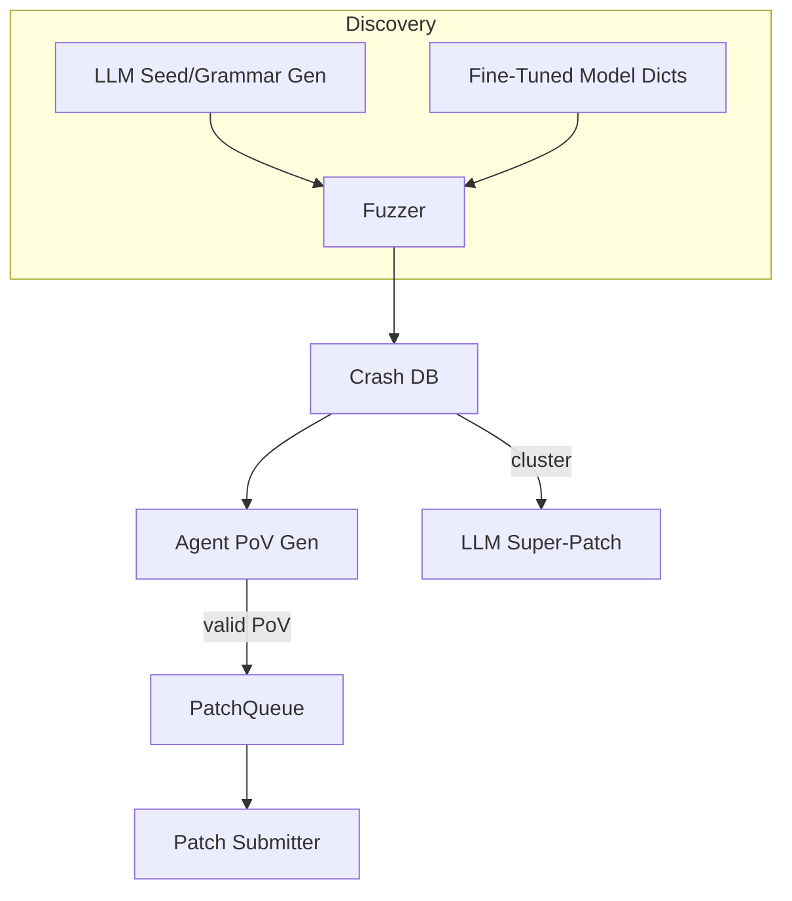

# Fuzzing Inayosaidiwa na AI na Ugunduzi wa Kiotomatiki wa Udhaifu

{{#include ../banners/hacktricks-training.md}}

## Muhtasari
Large-language models (LLMs) zinaweza kuongeza kwa kiasi kikubwa uwezo wa mikondo ya jadi ya utafiti wa udhaifu kwa kuzalisha inputs zenye maana ya kisemantiki, kuboresha grammars, kuchanganua data za crash, na hata kupendekeza patches zinazoshughulikia bugs nyingi. Ukurasa huu unakusanya mbinu zenye ufanisi zaidi zilizoonekana katika fainali za DARPA’s AI Cyber Challenge (AIxCC) na utafiti mwingine wa umma.<sup>[[4]](#references)</sup><sup>[[5]](#references)</sup>

Yafuatayo si maelezo ya mfumo maalum wa mashindano, bali ni muhtasari wa mbinu ili uweze kuzitumia tena katika workflows zako.

---

## 1. Seed Inputs Zinazozalishwa na LLM

Coverage-guided fuzzers za jadi (AFL++, libFuzzer, Honggfuzz…) huanza na corpus ndogo ya seeds na kubadilisha bytes bila mpangilio. Format ya input ya target inapokuwa changamano (SQL, URLs, binary protocols maalum), mabadiliko ya nasibu kwa kawaida huharibu syntax kabla matawi ya kuvutia hayajafikiwa.

LLMs zinaweza kutatua tatizo hili la kuanzisha kwa kutengeneza *seed generators* – scripts fupi zinazotoa **inputs zilizo sahihi kisintaksia lakini zinazohusiana na usalama**. Kwa mfano:

```prompt
SYSTEM: You are a helpful security engineer.
USER:
Write a Python3 program that prints 200 unique SQL injection strings targeting common anti-pattern mistakes (missing quotes, numeric context, stacked queries).  Ensure length ≤ 256 bytes / string so they survive common length limits.
```

```python
# gen_sqli_seeds.py (truncated)
PAYLOADS = [
    "1 OR 1=1 -- ",
    "' UNION SELECT NULL,NULL--",
    "0; DROP TABLE users;--",
    ...
]
for p in PAYLOADS:
    print(p)
```

Endesha mara moja kisha peleka matokeo moja kwa moja kwenye corpus ya awali ya fuzzer:

```bash
python3 gen_sqli_seeds.py > seeds.txt
afl-fuzz -i seeds.txt -o findings/ -- ./target @@
```

Faida:
1. Uhalali wa kisemantiki → coverage ya kina zaidi mapema.
2. Inaweza kuzalishwa upya: rekebisha prompt ili kulenga XSS, path traversal, binary blobs, n.k.
3. Gharama nafuu (< 1 ¢ kwa GPT-3.5).

### Vidokezo
* Ielekeze modeli *itofautishe* urefu wa payload na encoding (UTF-8, URL-encoded, UTF-16-LE) ili kukwepa filters za juu juu.
* Iombe itoe *script moja inayojitosheleza* – huepusha hitilafu za uumbizaji wa JSON.

---

## 2. Grammar-Evolution Fuzzing

Toleo lenye nguvu zaidi ni kuiruhusu LLM **iboreshe grammar** badala ya seed halisi. Mchakato (“Grammar Guy” pattern) ni:

1. Tengeneza grammar ya awali ya ANTLR/Peach/LibFuzzer kupitia prompt.
2. Fanya fuzzing kwa dakika N na ukusanye vipimo vya coverage (edges / blocks zilizoguswa).
3. Fupisha maeneo ya programu ambayo hayajafunikwa na urudishe muhtasari huo kwenye modeli:
   ```prompt
   The previous grammar triggered 12 % of the program edges.  Functions not reached: parse_auth, handle_upload.  Add / modify rules to cover these.
   ```
4. Unganisha sheria mpya, fanya fuzzing tena, rudia.

Muundo wa pseudo-code:

```python
for epoch in range(MAX_EPOCHS):
    grammar = llm.refine(grammar, feedback=coverage_stats)
    save(grammar, f"grammar_{epoch}.txt")
    coverage_stats = run_fuzzer(grammar)
```

Mambo muhimu:
* Dumisha *bajeti* – kila uboreshaji hutumia tokens.
* Tumia maagizo ya `diff` + `patch` ili model ifanye marekebisho badala ya kuandika upya.
* Simama wakati Δcoverage < ε.

---

## 3. Uhandisi wa Harness ya libFuzzer ya Local-LLM

Kwa msimbo ambao hauwezi kuondoka kwenye workstation ya mchambuzi, code model ya ndani inaweza kuandika rasimu ya adapter ndogo kati ya byte za fuzzer na API ya C/C++. Mpaka wa usalama unaofaa uko wazi: **model huandika na kurekebisha miundombinu ya majaribio; coverage-guided mutation huchunguza inputs; sanitizers huripoti operesheni batili; binadamu hukagua harness na kuchambua matokeo yaliyopatikana**.<sup>[[9]](#references)</sup>

Kwa mbinu za corpus, feedback, snapshot na stateful-fuzzing za kiwango cha engine ambazo hazitegemei LLM, tazama [Mbinu ya Fuzzing](../generic-methodologies-and-resources/fuzzing.md).

Anza na tamko halisi lililonakiliwa kutoka kwenye header ya programu lengwa na uweke masharti ya umbizo la matokeo. Prompt finyu hupunguza API zilizobuniwa na kurahisisha ukaguzi wa matokeo:<sup>[[8]](#references)[[9]](#references)</sup>

```prompt
Write a libFuzzer target for this exact declaration:
int parse_records(const uint8_t *data, size_t size);

Output only C code. Implement LLVMFuzzerTestOneInput, include the
declaration, pass data and size unchanged, and do not use files,
network access, randomness, clocks, threads, or persistent state.
```

Kwa parser ya byte ghafi, matokeo yanayotarajiwa hayapaswi kuwa magumu zaidi ya:<sup>[[6]](#references)[[9]](#references)</sup>

```c
#include <stddef.h>
#include <stdint.h>

extern int parse_records(const uint8_t *, size_t);

int LLVMFuzzerTestOneInput(const uint8_t *data, size_t size) {
    (void)parse_records(data, size);
    return 0;
}
```

Compilation ni hatua ya kwanza tu ya uthibitishaji. Kagua kila target iliyozalishwa ili kuona kama inazingatia masharti haya kabla ya kuitumia CPU:<sup>[[6]](#references)[[8]](#references)[[9]](#references)</sup>

- **API halisi:** linganisha aina, kanuni za umiliki, uanzishaji, usafishaji na calling convention na header halisi pamoja na sehemu zilizopo zinazoitumia.
- **Usalama wa harness:** linda kila usomaji kutoka `data`; matokeo ya sanitizer lazima yatokane na target, si glue code iliyozalishwa.
- **Kurudiwa kwa matokeo:** hakikisha matokeo yanategemea `data` na `size`; ondoa I/O ya nje, muda, randomness isiyodhibitiwa, thread ambazo hazijajiunga, na hali inayobaki kati ya miito.
- **Throughput:** anzisha hali ghali zisizobadilika mara moja tu ikiwa hilo haliwezi kuathiri tabia, weka kikomo cha ukubwa wa ingizo, zima logging na uachilie allocations za kila ingizo.
- **Ufikikaji:** hakikisha functions na branches zilizokusudiwa zinatekelezwa. Target inayokompile lakini inajaribu tu njia za kukataa ni hitilafu isiyoonekana.

### Targets zinazotambua muundo: hifadhi masharti bila kuficha bugs

Ikiwa inputs nyingi ghafi hazipiti kizuizi cha magic, urefu, version au checksum, tumia fuzz bytes kama nyenzo za typed fields na ujenge upya object halali. Weka constants za format zisizobadilika, acha semantic fields na payload bytes zibadilike, kisha kokotoa integrity metadata kutoka kwenye payload iliyojengwa upya. `FuzzedDataProvider` ni muhimu kwa kutumia typed values zenye mipaka, huku adapter ikiendelea kuwajibika kwa kuweka kikomo kwa allocation na conversion yoyote inayozalishwa.<sup>[[9]](#references)</sup>

<details>
<summary>Mfano wa C++ target inayotambua muundo</summary>

```cpp
#include <fuzzer/FuzzedDataProvider.h>
#include <stddef.h>
#include <stdint.h>
#include <vector>

extern "C" int parse_message(const uint8_t *, size_t);

extern "C" int LLVMFuzzerTestOneInput(const uint8_t *data, size_t size) {
    FuzzedDataProvider fdp(data, size);
    uint8_t version = fdp.ConsumeIntegral<uint8_t>();
    auto body = fdp.ConsumeRemainingBytes<uint8_t>();
    if (body.size() > UINT16_MAX) body.resize(UINT16_MAX);
    uint16_t len = static_cast<uint16_t>(body.size());
    std::vector<uint8_t> msg = {0x8b, 'M', 'S', 'G', version,
                                static_cast<uint8_t>(len >> 8),
                                static_cast<uint8_t>(len)};
    msg.insert(msg.end(), body.begin(), body.end());
    (void)parse_message(msg.data(), msg.size());
    return 0;
}
```

</details>

Usitumie target moja inayorekebisha muundo kwa kila swali. Dumisha target moja inayokokotoa urefu/checksum ili kuchunguza hali halali za ndani zaidi, na nyingine inayoweka metadata **iliyotangazwa** chini ya udhibiti wa fuzzer huku ikiwekea kikomo usomaji na ugawaji wa kumbukumbu wa harness pekee. Target ya pili huhifadhi maeneo ya mashambulizi ya urefu usiolingana na uadilifu mbovu ambayo marekebisho ya kiotomatiki yangeondoa.<sup>[[9]](#references)</sup>

### Mbegu, dictionaries, sanitizers, na maoni ya coverage

Iambie modeli itengeneze script inayoandika mbegu za binary badala ya kuiomba ichapishe binary moja kwa moja. Tumia objects tupu, za chini kabisa, za kawaida na halali za mipaka kama mbegu; kisha toa thamani za magic, tags, usimbaji wa enum na maneno muhimu ya parser na uziweke kwenye dictionary iliyokaguliwa. libFuzzer hupokea dictionary hiyo kwa `-dict=`, na huhifadhi kwenye corpus mutations zinazofichua coverage mpya.<sup>[[6]](#references)[[9]](#references)</sup>

```text
magic="\x8bMSG"
version_min="\x00"
version_max="\xff"
config_tag="CONFIG"
```

Jenga target ileile kwa instrumentation inayokamilishana. ASan na UBSan zinaweza kutumia binary moja ya fuzzing; tumia build tofauti ya MSan na uweke instrumentation kwenye dependencies zake ili kuepuka ripoti zinazosababishwa na code isiyo na instrumentation.<sup>[[6]](#references)[[9]](#references)</sup>

```bash
clang++ -g -O1 -fsanitize=fuzzer,address,undefined \
  -fno-sanitize-recover=undefined target.cc harness.cc -o fuzz_target
./fuzz_target corpus -dict=msg.dict -max_len=65535

clang++ -g -O1 -fsanitize=fuzzer,memory \
  target.cc harness.cc -o fuzz_target_msan
```

Chukulia coverage kama kipimo cha kila toleo la model. Katika matokeo ya libFuzzer, `cov`/`ft` zisizobadilika mapema na corpus tuli kwa kawaida humaanisha framing isiyo sahihi, early return yenye vizuizi vikali kupita kiasi, au call isiyo sahihi; `exec/s` ya chini huashiria setup, I/O, allocation ghali, au state iliyovuja. `NEW` huthibitisha tu kuwa kipengele cha coverage kimebadilika, si kwamba parser iliyokusudiwa imefikiwa.<sup>[[6]](#references)[[9]](#references)</sup>

Kwa feedback ya kiwango cha source, tengeneza build ya coverage, ifanyie fuzzing, kisha mpe model functions ambazo hazijafunikwa pekee pamoja na masharti yanayozilinda. Kagua diff ya harness/seed/dictionary inayotokana na hilo na upime tena:<sup>[[7]](#references)[[8]](#references)[[9]](#references)</sup>

```bash
clang++ -g -O1 -fsanitize=fuzzer \
  -fprofile-instr-generate -fcoverage-mapping target.cc harness.cc -o fuzz_cov
mkdir -p profiles
LLVM_PROFILE_FILE='profiles/%p.profraw' ./fuzz_cov -max_total_time=300 corpus
llvm-profdata merge -sparse profiles/*.profraw -o fuzz.profdata
llvm-cov report ./fuzz_cov -instr-profile=fuzz.profdata
llvm-cov show ./fuzz_cov -instr-profile=fuzz.profdata \
  --show-branches=count --region-coverage-lt=1 target.cc
```

Mzunguko unaoweza kupanuliwa ni **zalisha → compile/link → fanya smoke-test chini ya sanitizers → pima target coverage → toa muktadha mdogo zaidi unaohusika wa coverage/source → rekebisha → pima tena**. OSS-Fuzz-Gen hutumia kanuni hiyo hiyo kwa kutathmini targets zilizozalishwa kwa uwezo wa ku-compile, hitilafu za runtime, coverage, na uboreshaji wa coverage ikilinganishwa na targets zilizopo, badala ya kukubali code inayoonekana kufaa bila kuikagua.<sup>[[7]](#references)[[8]](#references)</sup>

---

## 4. Uzalishaji wa PoV (Exploit) Unaotegemea Agent

Baada ya crash kupatikana, bado unahitaji **proof-of-vulnerability (PoV)** inayoiwasha kwa uhakika.

Mbinu inayoweza kupanuliwa ni kuanzisha workers wengi wepesi (processes, threads, au containers), kila mmoja akitumia model au usanidi tofauti wa sampling. Utafiti wa washiriki waliofika fainali za AIxCC unatoa mifano halisi ya ukubwa: timu moja ilitumia **maelfu ya agents wanaofanya kazi kwa wakati mmoja** kwa ajili ya uzalishaji wa PoV unaoongozwa na AI, huku nyingine ikiratibu **agents 300–500 za fuzzing** na kutumia LLMs kwa reasoning ya kisemantiki ya kiwango cha juu.<sup>[[4]](#references)</sup>

Mtiririko wa kazi:
1. Static/dynamic analysis hutengeneza *wagombea wa hitilafu* (struct yenye crash PC, input slice, ujumbe wa sanitizer).
2. Orchestrator husambaza wagombea kwa agents.
3. Hatua za reasoning za Agent:
   a. Zalisha tena hitilafu ndani ya mazingira ya eneo husika kwa `gdb` + input.
   b. Pendekeza exploit payload ndogo zaidi.
   c. Thibitisha exploit kwenye sandbox. Ikifaulu → iwasilishe.
4. Majaribio yaliyoshindwa **huwekwa tena kwenye foleni kama seeds mpya** kwa coverage fuzzing (mzunguko wa feedback).

Faida:
* Uendeshaji sambamba huficha kutotegemewa kwa agent mmoja.
* Auto-tuning ya temp / ukubwa wa model kulingana na kiwango cha mafanikio kilichozingatiwa.

---

## 5. Directed Fuzzing kwa Kutumia Code Models Zilizofanyiwa Fine-Tuning

Fanya fine-tuning ya model yenye open-weight (k.m. Llama-7B) kwa kutumia source ya C/C++ iliyo na lebo za mifumo ya vulnerability (integer overflow, buffer copy, format string). Kisha:

1. Endesha static analysis ili kupata orodha ya functions + AST.
2. Ipe model prompt: *“Toa maingizo ya mutation dictionary yanayoweza kuvunja memory safety kwenye function X”*.
3. Ingiza tokens hizo kwenye `AFL_CUSTOM_MUTATOR` maalum.

Mfano wa matokeo kwa wrapper ya `sprintf`:
```
{"pattern":"%99999999s"}
{"pattern":"AAAAAAAA....<1024>....%n"}
```

Kwa majaribio, hii hupunguza muda hadi crash kwa zaidi ya mara 2 kwenye malengo halisi.

---

## 6. Mikakati ya Kurekebisha Inayoongozwa na AI

### 6.1 Super Patches
Iombe model *icluster* saini za crash na ipendekeze **patch moja** inayoondoa chanzo cha msingi cha pamoja.  Wasilisha mara moja, rekebisha hitilafu kadhaa → adhabu chache za usahihi katika mazingira ambamo kila patch isiyo sahihi hugharimu pointi.

Muhtasari wa prompt:
```
Here are 10 stack traces + file snippets.  Identify the shared mistake and generate a unified diff fixing all occurrences.
```

### 6.2 Uwiano wa Speculative Patch
Tekeleza foleni ambamo patch zilizothibitishwa kwa PoV na patch za *speculative* (zisizo na PoV) hupishana kwa uwiano wa 1:​N unaolingana na kanuni za utoaji alama (kwa mfano, 2 speculative : 1 confirmed). Muundo wa gharama hufuatilia adhabu dhidi ya pointi na hujirekebisha N.

---

## 7. Ukaguzi wa Msimbo wa AI wa Kiamuzi, Faili baada ya Faili

Hali moja ya kawaida ya kushindwa katika ukaguzi unaosaidiwa na AI ni kumwomba agent mmoja achunguze repository nzima na kutarajia achague faili na maneno sahihi ya grep. Mbinu inayotegemeka zaidi ni **kulazimisha ufikiaji wa repository nzima**:<sup>[[1]](#references)</sup>

1. Orodhesha faili za source.
2. Tuma **faili moja kwa wakati mmoja** pamoja na muktadha mdogo (entrypoint, imports, routes/callers zilizo karibu).
3. Hitaji **ripoti yenye muundo** kwa kila faili: sources, sink, uthibitishaji unaokosekana, masharti ya exploit na kiwango cha uhakika.<sup>[[3]](#references)</sup>
4. Ondoa ripoti zinazojirudia kwa kutumia **muundo wa source→sink** na uthibitishe mwenyewe zile zenye hatari kubwa.

Hii hutumia token nyingi na huwa na kelele, lakini ni bora sana katika kubaini **hitilafu rahisi zenye athari kubwa za source/sink** ambazo ukaguzi mpana wa agentic mara nyingi hukosa.

### Miundo ya triage inayofaa kupewa kipaumbele

- **PHP include/dispatch inayobadilika**: majina ya route/controller/module yanayodhibitiwa na mshambuliaji na kupitishwa kwenye `require_once()`, `include()`, au `include_once()` bila allowlist madhubuti na urekebishaji wa canonical wa path.
- **Utekelezaji wa shell katika mtiririko wa kazi za admin/akaunti**: usernames, domains, akaunti za FTP, au vitambulishi vingine vinavyofika kwenye `exec()`, `system()`, `shell_exec()`, `passthru()`, `proc_open()`, au `popen()`.
- **Uingizaji wa data iliyopangwa kutoka vyanzo vingi**: parameter ileile inayokubaliwa kupitia `$_GET`, `$_POST`, JSON, XML, au vichanganuzi vya body vya framework, kisha kutumiwa tena kwenye sink za filesystem au amri za OS.

### Aina mbili za vitendo za hitilafu ambazo mbinu hii hubaini vizuri

- **PHP controller-dispatch LFI/RCE**: jina la controller linalodhibitiwa na ombi likiunganishwa na `require_once()` bila allowlist/urekebishaji wa path, mfuatano wa traversal kama `../` unaweza kusababisha PHP ijumuisha faili ya `.php` ya ndani isiyokusudiwa. Mshambuliaji akiweza kuelekeza include kwenye faili ya PHP aliyoweka au faili nyingine yenye manufaa, LFI hugeuka kuwa utekelezaji wa msimbo. Angalia [File Inclusion / Path Traversal](../pentesting-web/file-inclusion/README.md).<sup>[[1]](#references)</sup>
- **Command injection iliyothibitishwa katika paneli za hosting/admin**: sehemu za usimamizi wa akaunti kama usernames zikiingizwa kwenye amri za shell, mtumiaji aliyeingia mwenye ruhusa ndogo anaweza kubadilisha kitendo cha kawaida cha kuunda/kufuta na kukifanya RCE. Athari huongezeka paneli inapotekeleza amri hiyo kama akaunti ya huduma yenye ruhusa zaidi. Angalia [Command Injection](../pentesting-web/command-injection.md).<sup>[[1]](#references)</sup>

### Vidokezo vya vitendo vya ukaguzi

- Tumia LLM kama **mkaguzi wa source/sink kwanza**, si kama jenereta ya exploit.
- Iombe itaje wazi **sehemu inayodhibitiwa na mshambuliaji**, **pengo la urekebishaji/uthibitishaji**, na **sink hatari**.
- Kwa repository kubwa, ukaguzi wa kiamuzi wa faili moja baada ya nyingine mara nyingi hutegemeka zaidi kuliko kuendesha agent mmoja huru, hata kama agent huyo anatumia modeli yenye nguvu zaidi.<sup>[[2]](#references)</sup>
- Tarajia matokeo dhaifu zaidi kuhusu **Broken Access Control** na hitilafu nyingine za mantiki ya biashara ambazo uwezekano wa kuzitumia hutegemea dhana za faili mbalimbali, maana ya role, au miundo mahususi ya vitisho vya bidhaa.

---

## Utafiti Unaokaguliwa kwa Usaidizi wa Agent kwenye Codebase Zisizofahamika

[graph-first fuzz-target workflow](../generic-methodologies-and-resources/fuzzing.md#graph-first-fuzz-target-selection-and-mutation-triage) tayari inashughulikia ufikikaji wa entrypoint, huku [agentic SAST pipelines](../network-services-pentesting/pentesting-web/code-review-tools.md#agentic-sast-pipelines) zikishughulikia ukaguzi wa hatua kwa hatua na masharti ya ushahidi. Weka matokeo hayo ya kiamuzi kando na dhana za modeli ili kila lead iliyokubaliwa ihifadhi maeneo ya source, ushahidi wa path na kipimo cha runtime.<sup>[[10]](#references)</sup>

### Linganisha ushahidi wa muda wa maisha ya object bila kubuni mtiririko wa data

Uchambuzi tuli unaweza kubaini kuwa urefu unaodhibitiwa na mshambuliaji umehifadhiwa katika function moja na kwamba field hiyohiyo ya object inafika kwenye sink ya kunakili baadaye, lakini ukashindwa kuthibitisha uhusiano huo katika callbacks, miunganisho mipya au muda wa maisha wa object. Hifadhi matokeo hayo kando, yapange kulingana na object/field, na uweke edge inayokosekana kama swali bayana la triage. Agent inaweza kupendekeza uhusiano huo, lakini ukaguzi wa source au instrumentation ya runtime lazima uuthibitishe.<sup>[[10]](#references)</sup>

Kwa kila mgombea, rekodi:

- entrypoint halisi na bytes zinazodhibitiwa na mshambuliaji;
- kila producer wa field husika, pamoja na uthibitishaji mahususi kwa kila producer;
- sink, uwezo wa destination na masharti ya build/runtime yanayohitajika ili kufikia sink;
- call stack halisi kutoka kwenye entrypoint iliyo wazi, si mwito wa moja kwa moja wa harness pekee;
- matokeo madogo zaidi ya runtime yanayothibitisha au kukanusha dhana hiyo.

Njia inayoonekana salama haiondoi hatari ya field hiyo kwa ujumla. Producer mwingine anaweza kujaza field hiyohiyo bila kikomo cha urefu kilichotumika kwenye njia ya kwanza. Jaribu njia hizo kivyake na endesha harness kwa chaguo za build zinazolingana na mazingira ya deployment, kwa sababu debug assertions zinaweza kubadilisha uharibifu wa kumbukumbu wa production na kuufanya usimame mapema kwenye jaribio pekee.<sup>[[10]](#references)</sup>

### Masharti ya vipimo kwa ufichuaji na exploitation

Kwa ufichuaji unaoshukiwa wa kumbukumbu isiyoanzishwa, jaza allocations mpya kwa byte inayotambulika na uthibitishe kuwa marker halisi inafika kwenye packet inayotumwa. Kwa exploitation, hitaji masharti yaliyopimwa kama **controlled overwrite → useful victim object → disclosure → pointer/base recovery → control-flow hijack → composed payload**. Agent huendelea tu baada ya harness kuthibitisha sifa ya sasa; maelezo yanayoonekana kuwa ya kuaminika hayahesabiki kama sharti lililotimizwa. [FreeRDP case](../binary-exploitation/libc-heap/heap-overflow.md#cross-path-length-reuse-and-stale-output-disclosure) inaonyesha njia na masharti ya build yanayopaswa kuhifadhiwa wakati wa uthibitishaji.<sup>[[10]](#references)</sup>

---

## Kuunganisha Yote
CRS (Cyber Reasoning System) ya mwanzo hadi mwisho inaweza kuunganisha vipengele hivi kama ifuatavyo:



---

## References

- [1] [Project Black - AI ya ndani kwa Usalama wa Mtandao: Kugundua LFI katika phpIPAM na RCE iliyothibitishwa katika myVesta](https://projectblack.io/blog/local-ai-for-cyber-security)
- [2] [Strix](https://github.com/usestrix/strix)
- [3] [Ujuzi wa ukaguzi wa usalama wa jamii ya GitHub Copilot](https://github.com/github/awesome-copilot/blob/main/skills/security-review/SKILL.md)
- [4] [Trail of Bits – Fainali za AIxCC: Muhtasari wa matukio](https://blog.trailofbits.com/2025/08/07/aixcc-finals-tale-of-the-tape/)
- [5] [Mahojiano na waliofuzu fainali za CTF Radiooo AIxCC](https://www.youtube.com/@ctfradiooo)
- [6] [LLVM — libFuzzer: maktaba ya majaribio ya fuzz yanayoongozwa na coverage](https://llvm.org/docs/LibFuzzer.html)
- [7] [Google — OSS-Fuzz-Gen](https://github.com/google/oss-fuzz-gen)
- [8] [Blogu ya Usalama Mtandaoni ya Google — Kuboresha Fuzzing: Kugundua Athari Zaidi kwa AI](https://security.googleblog.com/2024/11/leveling-up-fuzzing-finding-more.html)
- [9] [8kSec — Uzalishaji wa Harness ya Fuzzing kwa Usaidizi wa AI kwa kutumia LLM ya Ndani](https://8ksec.io/ai-assisted-fuzzing-harness-local-llm)
- [10] [Quarkslab — Kutoka kwa Mawakala wa AI hadi RCE: Kuunda Mchakato wa Utafiti wa Athari za Usalama](https://blog.quarkslab.com/from-ai-agents-to-rce-building-a-vulnerability-research-workflow.html)
{{#include ../banners/hacktricks-training.md}}
