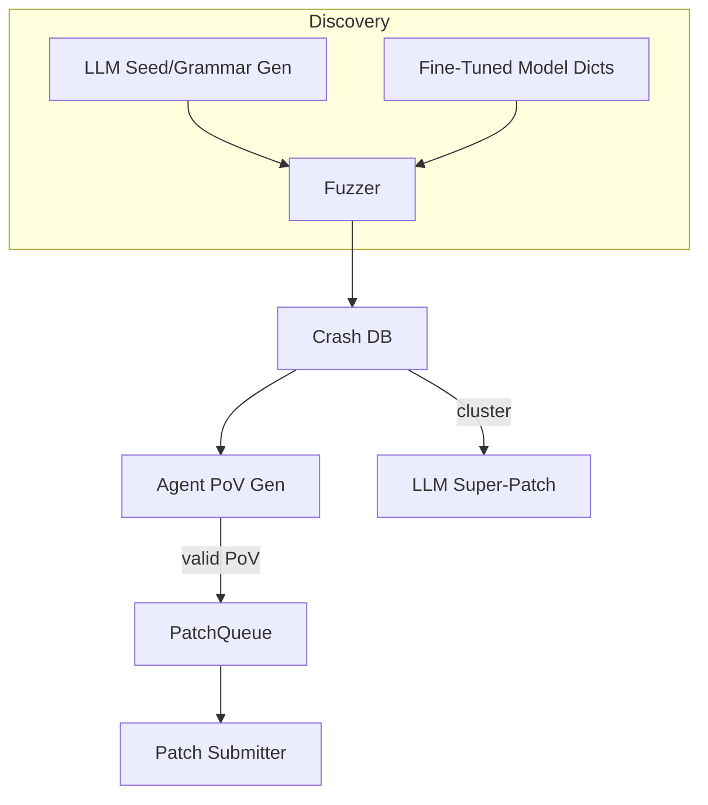

# Fuzzing wspomagany przez AI i automatyczne wykrywanie podatności

{{#include ../banners/hacktricks-training.md}}

## Przegląd
Duże modele językowe (LLM) mogą znacznie usprawnić tradycyjne procesy badania podatności, generując bogate semantycznie dane wejściowe, rozwijając gramatyki, analizując dane o awariach, a nawet proponując poprawki usuwające wiele błędów. Ta strona zbiera najskuteczniejsze wzorce zaobserwowane podczas finałów AI Cyber Challenge (AIxCC) organizowanych przez DARPA oraz w innych publicznych badaniach.<sup>[[4]](#references)</sup><sup>[[5]](#references)</sup>

Poniżej nie opisano konkretnego systemu konkursowego, lecz przedstawiono techniki w formie ogólnej, aby można je było odtworzyć we własnych procesach.

---

## 1. Dane wejściowe początkowe generowane przez LLM

Tradycyjne fuzzery sterowane pokryciem (AFL++, libFuzzer, Honggfuzz…) zaczynają od niewielkiego korpusu danych wejściowych i bezrefleksyjnie mutują bajty. Gdy format danych wejściowych programu docelowego jest złożony (SQL, adresy URL, niestandardowe protokoły binarne), losowe mutacje zwykle psują składnię, zanim zostaną osiągnięte interesujące gałęzie programu.

LLM mogą rozwiązać ten problem początkowy, generując *generatory danych wejściowych* — krótkie skrypty, które tworzą **poprawne składniowo dane wejściowe istotne z punktu widzenia bezpieczeństwa**. Na przykład:

```prompt
SYSTEM: You are a helpful security engineer.
USER:
Write a Python3 program that prints 200 unique SQL injection strings targeting common anti-pattern mistakes (missing quotes, numeric context, stacked queries).  Ensure length ≤ 256 bytes / string so they survive common length limits.
```

```python
# gen_sqli_seeds.py (truncated)
PAYLOADS = [
    "1 OR 1=1 -- ",
    "' UNION SELECT NULL,NULL--",
    "0; DROP TABLE users;--",
    ...
]
for p in PAYLOADS:
    print(p)
```

Uruchom raz i przekaż wynik bezpośrednio do początkowego corpus fuzera:

```bash
python3 gen_sqli_seeds.py > seeds.txt
afl-fuzz -i seeds.txt -o findings/ -- ./target @@
```

Korzyści:
1. Poprawność semantyczna → większe pokrycie już na wczesnym etapie.
2. Możliwość ponownego generowania: zmień prompt, aby skupić się na XSS, path traversal, binary blobs itp.
3. Niski koszt (< 1 ¢ przy GPT-3.5).

### Wskazówki
* Poleć modelowi *zróżnicować* długość i kodowanie payloadów (UTF-8, URL-encoded, UTF-16-LE), aby ominąć powierzchowne filtry.
* Poproś o *pojedynczy, samodzielny skrypt* — unikniesz problemów z formatowaniem JSON.

---

## 2. Grammar-Evolution Fuzzing

Potężniejszy wariant polega na tym, by LLM **ewoluował gramatykę** zamiast konkretnych seedów. Przepływ pracy (wzorzec „Grammar Guy”):

1. Wygeneruj początkową gramatykę ANTLR/Peach/LibFuzzer za pomocą promptu.
2. Prowadź fuzzing przez N minut i zbieraj metryki pokrycia (trafione krawędzie / bloki).
3. Podsumuj niepokryte obszary programu i przekaż podsumowanie modelowi:
   ```prompt
   The previous grammar triggered 12 % of the program edges.  Functions not reached: parse_auth, handle_upload.  Add / modify rules to cover these.
   ```
4. Scal nowe reguły, ponownie uruchom fuzzing i powtórz.

Szkielet pseudokodu:

```python
for epoch in range(MAX_EPOCHS):
    grammar = llm.refine(grammar, feedback=coverage_stats)
    save(grammar, f"grammar_{epoch}.txt")
    coverage_stats = run_fuzzer(grammar)
```

Key points:
* Zachowaj *budżet* — każde udoskonalenie zużywa tokeny.
* Używaj instrukcji `diff` + `patch`, aby model edytował zamiast przepisywać.
* Zatrzymaj się, gdy Δcoverage < ε.

---

## 3. Projektowanie harnessu libFuzzer z lokalnym LLM

Jeśli kod źródłowy nie może opuścić stacji roboczej analityka, lokalny model kodujący może przygotować niewielki adapter między bajtami fuzzera a API C/C++. Istotna granica bezpieczeństwa jest jasno określona: **model tworzy i poprawia infrastrukturę testową; mutacja sterowana pokryciem eksploruje dane wejściowe; sanitizery zgłaszają nieprawidłowe operacje; człowiek przegląda harness i analizuje wyniki**.<sup>[[9]](#references)</sup>

Techniki fuzzingu na poziomie silnika dotyczące korpusu, informacji zwrotnej, migawek i fuzzingu stanowego, które nie zależą od LLM, opisano w ogólnej [metodologii fuzzingu](../generic-methodologies-and-resources/fuzzing.md).

Zacznij od dokładnej deklaracji skopiowanej z nagłówka celu i określ format wyjściowy. Wąski prompt ogranicza wymyślanie API i ułatwia przegląd wyniku:<sup>[[8]](#references)[[9]](#references)</sup>

```prompt
Write a libFuzzer target for this exact declaration:
int parse_records(const uint8_t *data, size_t size);

Output only C code. Implement LLVMFuzzerTestOneInput, include the
declaration, pass data and size unchanged, and do not use files,
network access, randomness, clocks, threads, or persistent state.
```

W przypadku parsera surowych bajtów oczekiwany rezultat nie powinien być bardziej skomplikowany niż:<sup>[[6]](#references)[[9]](#references)</sup>

```c
#include <stddef.h>
#include <stdint.h>

extern int parse_records(const uint8_t *, size_t);

int LLVMFuzzerTestOneInput(const uint8_t *data, size_t size) {
    (void)parse_records(data, size);
    return 0;
}
```

Kompilacja to dopiero pierwszy etap walidacji. Zanim poświęcisz na cel czas procesora, sprawdź każdy wygenerowany cel pod kątem tych niezmienników:<sup>[[6]](#references)[[8]](#references)[[9]](#references)</sup>

- **Dokładne API:** porównaj typy, zasady zarządzania własnością, inicjalizację, zwalnianie zasobów i konwencję wywołań z rzeczywistym nagłówkiem oraz istniejącymi wywołującymi.
- **Bezpieczeństwo harnessa:** zabezpiecz każdy odczyt z `data`; problemy wykryte przez sanitizer muszą pochodzić z celu, a nie z wygenerowanego kodu pośredniczącego.
- **Powtarzalność:** wynik musi być funkcją `data` i `size`; usuń zewnętrzne operacje wejścia/wyjścia, zależność od czasu, niekontrolowaną losowość, niezakończone wątki oraz stan zachowywany między wywołaniami.
- **Przepustowość:** inicjalizuj kosztowny, niezmienny stan tylko raz — i tylko wtedy, gdy nie wpływa to na zachowanie; ogranicz rozmiar wejścia, wyłącz logowanie i zwalniaj alokacje związane z każdym wejściem.
- **Osiągalność:** sprawdź, czy wykonywane są zamierzone funkcje i gałęzie. Cel, który się kompiluje, ale wykonuje tylko ścieżki odrzucające, to cicha porażka.

### Cele świadome struktury: zachowuj niezmienniki, nie ukrywając błędów

Jeśli większość surowych danych wejściowych nie przechodzi kontroli magicznej wartości, długości, wersji lub sumy kontrolnej, użyj bajtów fuzzingu jako materiału dla typowanych pól i zbuduj poprawny obiekt. Ustaw stałe formatu, pozostaw pola semantyczne i bajty ładunku zmienne, a metadane integralności wylicz na podstawie odtworzonego ładunku. `FuzzedDataProvider` przydaje się do pobierania ograniczonych wartości typowanych, natomiast adapter nadal odpowiada za ograniczanie każdej alokacji i konwersji.<sup>[[9]](#references)</sup>

<details>
<summary>Przykład celu C++ świadomego struktury</summary>

```cpp
#include <fuzzer/FuzzedDataProvider.h>
#include <stddef.h>
#include <stdint.h>
#include <vector>

extern "C" int parse_message(const uint8_t *, size_t);

extern "C" int LLVMFuzzerTestOneInput(const uint8_t *data, size_t size) {
    FuzzedDataProvider fdp(data, size);
    uint8_t version = fdp.ConsumeIntegral<uint8_t>();
    auto body = fdp.ConsumeRemainingBytes<uint8_t>();
    if (body.size() > UINT16_MAX) body.resize(UINT16_MAX);
    uint16_t len = static_cast<uint16_t>(body.size());
    std::vector<uint8_t> msg = {0x8b, 'M', 'S', 'G', version,
                                static_cast<uint8_t>(len >> 8),
                                static_cast<uint8_t>(len)};
    msg.insert(msg.end(), body.begin(), body.end());
    (void)parse_message(msg.data(), msg.size());
    return 0;
}
```

</details>

Nie używaj jednego celu naprawiającego strukturę dla każdego pytania. Utrzymuj jeden cel, który wylicza długości/sumy kontrolne, aby eksplorować głębokie, poprawne stany, oraz drugi, który pozostawia metadane **deklarowane** pod kontrolą fuzzera, ograniczając jedynie odczyty i alokacje wykonywane przez harness. Drugi cel zachowuje powierzchnie ataku związane z niezgodnymi długościami i nieprawidłową integralnością, które automatyczna naprawa w przeciwnym razie by wyeliminowała.<sup>[[9]](#references)</sup>

### Ziarna, słowniki, sanitizery i informacja zwrotna o pokryciu

Poproś model o wygenerowanie skryptu zapisującego binarne ziarna, zamiast proszenia go o bezpośrednie wypisanie danych binarnych. Przygotuj puste, minimalne, typowe i poprawne obiekty z wartościami granicznymi, a następnie wyodrębnij wartości magiczne, tagi, kodowania enumów i słowa kluczowe parsera do sprawdzonego słownika. libFuzzer przyjmuje ten słownik za pomocą `-dict=` i zachowuje w korpusie mutacje, które ujawniają nowe pokrycie.<sup>[[6]](#references)[[9]](#references)</sup>

```text
magic="\x8bMSG"
version_min="\x00"
version_max="\xff"
config_tag="CONFIG"
```

Zbuduj ten sam cel z uzupełniającą instrumentacją. ASan i UBSan mogą współdzielić plik binarny do fuzzingu; użyj osobnej kompilacji MSan i zinstrumentuj jej zależności, aby uniknąć zgłoszeń powodowanych przez niezainstrumentowany kod.<sup>[[6]](#references)[[9]](#references)</sup>

```bash
clang++ -g -O1 -fsanitize=fuzzer,address,undefined \
  -fno-sanitize-recover=undefined target.cc harness.cc -o fuzz_target
./fuzz_target corpus -dict=msg.dict -max_len=65535

clang++ -g -O1 -fsanitize=fuzzer,memory \
  target.cc harness.cc -o fuzz_target_msan
```

Traktuj pokrycie jako miarę oceny każdej wersji modelu. W wynikach libFuzzer wczesne wypłaszczenie `cov`/`ft` i statyczny corpus zwykle wskazują na nieprawidłowe ramkowanie, zbyt restrykcyjny wczesny zwrot albo niewłaściwe wywołanie; niskie `exec/s` wskazuje na kosztowną konfigurację, operacje I/O, alokację lub wyciek stanu. `NEW` dowodzi jedynie, że zmieniła się cecha pokrycia, a nie że osiągnięto zamierzony parser.<sup>[[6]](#references)[[9]](#references)</sup>

Aby uzyskać informację zwrotną na poziomie kodu źródłowego, przygotuj build z pomiarem pokrycia, uruchom fuzzing i przekaż modelowi tylko niepokryte funkcje wraz z warunkami, które je chronią. Zweryfikuj wynikowe różnice w harnessie, seedach i dictionary, a następnie ponownie wykonaj pomiar:<sup>[[7]](#references)[[8]](#references)[[9]](#references)</sup>

```bash
clang++ -g -O1 -fsanitize=fuzzer \
  -fprofile-instr-generate -fcoverage-mapping target.cc harness.cc -o fuzz_cov
mkdir -p profiles
LLVM_PROFILE_FILE='profiles/%p.profraw' ./fuzz_cov -max_total_time=300 corpus
llvm-profdata merge -sparse profiles/*.profraw -o fuzz.profdata
llvm-cov report ./fuzz_cov -instr-profile=fuzz.profdata
llvm-cov show ./fuzz_cov -instr-profile=fuzz.profdata \
  --show-branches=count --region-coverage-lt=1 target.cc
```

Skalowalna pętla wygląda więc tak: **generuj → kompiluj/linkuj → wykonaj smoke test z włączonymi sanitizerami → zmierz coverage celu → przekaż możliwie najmniejszy istotny kontekst coverage/źródła → popraw → zmierz ponownie**. OSS-Fuzz-Gen stosuje tę samą zasadę: ocenia wygenerowane cele pod kątem możliwości kompilacji, błędów w czasie działania, coverage i poprawy coverage względem istniejących celów, zamiast uznawać wiarygodnie wyglądający kod za poprawny.<sup>[[7]](#references)[[8]](#references)</sup>

---

<a id="3-agent-based-pov-exploit-generation" hidden>3. Generowanie PoV (exploit) oparte na agentach</a>

## 4. Generowanie PoV (exploit) oparte na agentach

Po znalezieniu crasha nadal potrzebujesz **proof-of-vulnerability (PoV)**, który deterministycznie go wywołuje.

Skalowalne podejście polega na uruchomieniu wielu lekkich workerów (procesów, wątków lub kontenerów), z których każdy korzysta z innego modelu lub konfiguracji próbkowania. Przegląd finalistów AIxCC podaje konkretne przykłady takiej skali: jeden zespół użył **tysięcy równoległych agentów** do generowania PoV z wykorzystaniem AI, a inny koordynował pracę **300–500 agentów fuzzingowych**, rezerwując LLM-y do wnioskowania semantycznego na wyższym poziomie.<sup>[[4]](#references)</sup>

Pipeline:
1. Analiza statyczna/dynamiczna generuje *kandydatów na błędy* (struct z crash PC, wycinkiem wejścia i komunikatem sanitizera).
2. Orchestrator rozdziela kandydatów między agentów.
3. Etapy wnioskowania agenta:
   a. Odtwórz błąd lokalnie za pomocą `gdb` i wejścia.
   b. Zaproponuj minimalny exploit payload.
   c. Zweryfikuj exploit w sandboxie. Jeśli się powiedzie → prześlij.
4. Nieudane próby są **ponownie dodawane do kolejki jako nowe seedy** do fuzzingu coverage (pętla sprzężenia zwrotnego).

Zalety:
* Równoległość ogranicza skutki zawodności pojedynczego agenta.
* Automatyczne dostrajanie temp / rozmiaru modelu na podstawie obserwowanego wskaźnika powodzenia.

---

<a id="4-directed-fuzzing-with-fine-tuned-code-models" hidden>4. Ukierunkowany fuzzing z dostrojonymi modelami kodu</a>

## 5. Ukierunkowany fuzzing z dostrojonymi modelami kodu

Dostrój model open-weight (np. Llama-7B) na kodzie źródłowym C/C++ oznaczonym wzorcami podatności (przepełnienie liczby całkowitej, kopiowanie bufora, format string). Następnie:

1. Uruchom analizę statyczną, aby uzyskać listę funkcji i AST.
2. Podpowiedz modelowi: *„Podaj wpisy słownika mutacji, które mogą naruszyć bezpieczeństwo pamięci w funkcji X”*.
3. Wstaw te tokeny do niestandardowego `AFL_CUSTOM_MUTATOR`.

Przykładowy wynik dla wrappera `sprintf`:
```
{"pattern":"%99999999s"}
{"pattern":"AAAAAAAA....<1024>....%n"}
```

Empirycznie skraca czas do awarii ponad 2-krotnie na rzeczywistych celach.

---

<a id="5-ai-guided-patching-strategies" hidden>5. Strategie patchowania wspomaganego przez AI</a>

## 6. Strategie patchowania wspomaganego przez AI

<a id="51-super-patches" hidden>5.1 Superpatche</a>

### 6.1 Superpatche
Poproś model o *pogrupowanie* sygnatur awarii i zaproponowanie **pojedynczego patcha**, który usuwa wspólną przyczynę źródłową. Zgłoś go raz, napraw kilka błędów → mniej kar za brak dokładności w środowiskach, w których każdy błędny patch kosztuje punkty.

Zarys promptu:
```
Here are 10 stack traces + file snippets.  Identify the shared mistake and generate a unified diff fixing all occurrences.
```

{{#ref}}
../generic-methodologies-and-resources/fuzzing.md
{{#endref}}

<a id="52-speculative-patch-ratio" hidden>5.2 Współczynnik poprawek spekulacyjnych</a>

### 6.2 Współczynnik poprawek spekulacyjnych
Zaimplementuj kolejkę, w której potwierdzone poprawki zweryfikowane przez PoV są przeplatane *spekulacyjnymi* poprawkami (bez PoV) w stosunku 1:N dostosowanym do zasad punktacji (np. 2 spekulacyjne : 1 potwierdzona). Model kosztów monitoruje kary i punkty oraz samodzielnie dostosowuje N.

---

<a id="6-deterministic-file-by-file-ai-code-review" hidden>6. Determinny przegląd kodu AI plik po pliku</a>

## 7. Deterministyczny przegląd kodu AI plik po pliku

Częstym błędem w przeglądach wspomaganych przez AI jest proszenie jednego agenta o przeanalizowanie całego repozytorium z nadzieją, że wybierze właściwe pliki i terminy do wyszukania. Bardziej niezawodny schemat polega na **wymuszeniu pokrycia repozytorium**:<sup>[[1]](#references)</sup>

1. Wylicz pliki źródłowe.
2. Przekazuj **po jednym pliku naraz** wraz z minimalnym kontekstem (entrypoint, importy, sąsiednie trasy/wywołujący).
3. Wymagaj **ustrukturyzowanego raportu** dla każdego pliku: źródła, sink, brakująca walidacja, warunki wstępne exploita i poziom pewności.<sup>[[3]](#references)</sup>
4. Deduplikuj raporty według **wzorca source→sink** i ręcznie weryfikuj te obarczone wysokim ryzykiem.

Ta metoda zużywa dużo tokenów i generuje szum, ale jest bardzo skuteczna w wykrywaniu **prostych błędów source/sink o dużym wpływie**, które często umykają szerokim przeglądom agentic.

### Wzorce do priorytetowego triage’u

- **Dynamiczne dołączanie i dispatch w PHP**: nazwy tras/kontrolerów/modułów kontrolowane przez atakującego trafiają do `require_once()`, `include()` lub `include_once()` bez ścisłej allowlisty i kanonikalizacji ścieżek.
- **Uruchamianie poleceń powłoki w procesach administracyjnych i kontowych**: nazwy użytkowników, domeny, konta FTP lub inne identyfikatory trafiają do `exec()`, `system()`, `shell_exec()`, `passthru()`, `proc_open()` lub `popen()`.
- **Łączenie ustrukturyzowanych danych wejściowych**: ten sam parametr jest przyjmowany z `$_GET`, `$_POST`, JSON, XML lub parserów treści żądań frameworka, a następnie używany w sinkach systemu plików lub poleceń systemu operacyjnego.

### Dwie praktyczne klasy błędów, które ta metoda dobrze wykrywa

- **LFI/RCE przez dispatch kontrolera PHP**: jeśli nazwa kontrolera kontrolowana przez żądanie jest łączona z `require_once()` bez allowlisty/normalizacji ścieżki, sekwencje traversal, takie jak `../`, mogą sprawić, że PHP dołączy niezamierzony lokalny plik `.php`. Jeśli atakujący może wskazać spreparowany lub w inny sposób przydatny plik PHP, LFI prowadzi do wykonania kodu. Zobacz [File Inclusion / Path Traversal](../pentesting-web/file-inclusion/README.md).<sup>[[1]](#references)</sup>
- **Uwierzytelnione command injection w panelach hostingowych/administracyjnych**: jeśli pola zarządzania kontami, takie jak nazwy użytkowników, są wstawiane do poleceń powłoki, uwierzytelniony użytkownik o niskich uprawnieniach może zmienić zwykłą operację tworzenia/usuwania w RCE. Wpływ jest większy, gdy panel uruchamia polecenie jako konto usługi o wyższych uprawnieniach. Zobacz [Command Injection](../pentesting-web/command-injection.md).<sup>[[1]](#references)</sup>

### Praktyczne uwagi dotyczące przeglądu

- Najpierw używaj LLM jako **recenzenta source/sink**, a nie generatora exploitów.
- Poproś go o jawne wskazanie **pola kontrolowanego przez atakującego**, **braku normalizacji/walidacji** oraz **niebezpiecznego sinka**.
- W dużych repozytoriach deterministyczny przegląd plik po pliku jest często bardziej niezawodny niż pojedyncze uruchomienie autonomicznego agenta, nawet jeśli korzysta ono z mocniejszego modelu.<sup>[[2]](#references)</sup>
- Spodziewaj się słabszych wyników w przypadku **Broken Access Control** i innych błędów logiki biznesowej, w których możliwość exploita zależy od założeń obejmujących wiele plików, semantyki ról lub modeli zagrożeń specyficznych dla produktu.

---

## Przepływy zadań dla mobilnych punktów wejścia

Pojedynczy prompt obejmujący całe repozytorium często miesza modele zagrożeń i gubi ścieżkę od zewnętrznie dostępnego komponentu do wrażliwego sinka. Lepszy schemat pracy dzieli audyt na przepływy zadań ze stanem: najpierw klasyfikuje aplikacje/komponenty, następnie sporządza wykaz punktów wejścia kontrolowanych przez atakującego, uzupełnia każdy punkt wejścia o metadane dotyczące osiągalności, a na końcu sprawdza je pod kątem klas podatności specyficznych dla danej platformy. Mobilne przepływy zadań GitHub Security Lab realizują ten schemat dla repozytoriów Android, iOS i wieloplatformowych.<sup>[[14]](#references)[[15]](#references)</sup>

W przypadku Androida zapisz co najmniej:<sup>[[14]](#references)[[15]](#references)</sup>

- eksportowane Activities, Services, Receivers i Providers, wraz z uprawnieniami;
- akcje intentów, schematy/hosty/ścieżki deep linków, filtry MIME i App Links;
- działania kontrolowane przez atakującego, URI danych, `ClipData`, extras i flagi nadawania uprawnień do URI;
- dane wejściowe nawigacji WebView i mostki `addJavascriptInterface`;
- dalsze operacje uprzywilejowane, importowane zasoby i docelowe adresy sieciowe.

Następnie sklasyfikuj każdy punkt wejścia w kontekście. Jawnie sprawdź autoryzację wywołującego/zachowanie confused deputy, przekierowanie intentów, podszywanie się pod broadcast lub ujawnianie danych, niebezpieczne importy, skrypty WebView i ekspozycję mostków oraz przenoszenie poświadczeń lub plików cookie między originami. Wykonaj zarówno **przegląd według ścisłej listy kontrolnej**, jak i **szerszy przegląd adversarial**. Powiąż ustalenia z [Intent Injection](../mobile-pentesting/android-app-pentesting/intent-injection.md) i [WebView Attacks](../mobile-pentesting/android-app-pentesting/webview-attacks.md), zamiast powielać szczegóły exploita.<sup>[[15]](#references)</sup>

Obecne przepływy zadań open source można uruchomić z ich Codespace za pomocą:<sup>[[14]](#references)</sup>

```bash
./scripts/audit/run_audit.sh owner/repository
```

Wyniki są zapisywane w SQLite w tabeli `audit_result`.<sup>[[14]](#references)</sup> Traktuj wiersze oznaczone jako podatne jako **tropy**, a nie potwierdzone ustalenia. W przypadku każdej tropy wymagaj od modelu wskazania źródła kontrolowanego przez atakującego, wrażliwego sinka, warunków wstępnych i spodziewanego wpływu, a następnie poproś go o utworzenie minimalnego PoC. Uruchom ten PoC na oryginalnej kompilacji z debuggerem lub instrumentacją. Pozwala to wykryć typowe błędy analizy statycznej, takie jak nieosiągalne gałęzie, nierealistyczny stan aplikacji, utrata pierwszeństwa danych z pamięci zewnętrznej względem danych prywatnych oraz zabezpieczenia, które istotnie zmniejszają poziom zagrożenia.<sup>[[15]](#references)</sup>

---

## 8. Audyt jądra ukierunkowany wzorcami z użyciem instrumentowanej wyroczni

W przypadku celu wielkości jądra nie proś agenta o wyszukiwanie dowolnych błędów w całym drzewie. Bardziej oszczędny pod względem tokenów workflow przekształca wiedzę o historycznych podatnościach w zapytania statyczne, szereguje wyniki według dostępnej powierzchni ataku i wykorzystuje instrumentowane jądro jako wyrocznię wykonania.<sup>[[11]](#references)</sup>

### Baza wzorców → CodeQL/Semgrep → ukierunkowany przegląd

Zbuduj niewielką bazę wiedzy zawierającą niebezpieczne API, wzorce braku walidacji, ryzykowne przepływy od źródła do sinka oraz schematy wcześniej naprawionych błędów. Poproś model o przekształcanie **jednego wzorca naraz** w heurystyki przeglądu i reguły CodeQL/Semgrep, a następnie uruchom te deterministyczne reguły na całym drzewie. Pogrupuj i usuń duplikaty wyników, zanim przekażesz kod modelowi; surowe wyniki skanera mogą zawierać tysiące kandydatów o niewielkiej wartości. Przed użyciem tego podejścia poza kwalifikującymi się celami badawczymi lub open source sprawdź aktualną licencję CodeQL.<sup>[[11]](#references)</sup>

Nadaj priorytety podsystemom, uwzględniając zarówno **gęstość trafień reguł**, jak i **osiągalność przez atakującego**, zamiast opierać się wyłącznie na liczbie trafień. Większą wagę przypisuj interfejsom jądra osiągalnym z procesów bez uprawnień, sandboxów, kontenerów, jaili lub kontekstów gościa niż kodowi dostępnеmu wyłącznie wewnętrznie. Utrzymuj zakres przeglądu na tyle mały, by agent mógł uwzględnić funkcje wywołujące, walidatory i reguły zarządzania czasem życia, a zamiast prośby „znajdź dowolną podatność” określ konkretną klasę podatności lub wzorzec przepływu sterowania. Szczególnie interesujące są starsze interfejsy uprzywilejowane, gdy nowsza granica izolacji udostępnia je użytkownikowi root w przestrzeni nazw lub jailu.<sup>[[11]](#references)</sup>

W przypadku każdego kandydata wymagaj jawnego zapisu przepływu danych między polami, zanim podejmiesz próbę eksploatacji.<sup>[[11]](#references)</sup>

```text
entrypoint -> privilege check -> parser -> validation/normalization
           -> later rewrite -> dangerous sink
attacker controls: <fields and lengths>
constraints:       <values rewritten, rejected, or preserved>
observable result: <sanitizer report, assertion, panic, or clean exit>
```

### Użyj telemetrii KASAN jako wyroczni do weryfikacji hipotez

Uruchom docelowy kernel w jednorazowej maszynie wirtualnej z włączonym KASAN i przydatnymi asercjami diagnostycznymi. Agent powinien iterować według schematu **hipoteza dotycząca kodu źródłowego → minimalny wyzwalacz w userlandzie → wykonanie w maszynie wirtualnej → ślad KASAN/asercji → zaktualizowana hipoteza**, aż podejrzewane uszkodzenie zostanie odtworzone albo odrzucone. W każdej iteracji zwracaj tylko istotny ślad stosu i sąsiadujący kod źródłowy; zachowuje to kontekst potrzebny do rozumowania, a jednocześnie sprawia, że kryterium akceptacji stanowią dowody z wykonania, a nie pewność modelu.<sup>[[11]](#references)</sup>

Build z instrumentacją nie jest środowiskiem, w którym ostatecznie ocenia się możliwość wykorzystania podatności. Asercje mogą zatrzymać wykonanie przed operacją powodującą uszkodzenie, a ta sama asercja może być wyłączona w kernelu produkcyjnym. Ponownie przetestuj niezmieniony wyzwalacz z dokładną konfiguracją produkcyjną, zapisz build i konfigurację kernela oraz traktuj **osiągalność ścieżki**, **uszkodzenie pamięci**, **kontrolowany prymityw** i **wpływ na bezpieczeństwo** jako osobne twierdzenia.<sup>[[11]](#references)[[12]](#references)</sup>

CVE-2026-3038 to przydatny przykład weryfikacyjny, a nie szablon exploita. Nieuprzywilejowane żądanie FreeBSD `RTM_GET` mogło zachować zbyt duży `sockaddr` `RTAX_AUTHOR` mimo selektywnej walidacji i przepisywania odpowiedzi, aż `rtsock_msg_buffer()` skopiowało kontrolowane przez użytkownika `sa_len` do 128-bajtowego obszaru stosu `sockaddr_storage`. Kopia o maksymalnym rozmiarze 255 bajtów powodowała nadpisanie 127 bajtów; w buildzie z instrumentacją asercja diagnostyczna wykrywała nieprawidłową długość, podczas gdy kernel GENERIC wykonywał kopię, a następnie panikował przy sprawdzaniu uszkodzonego canary. Dowodzi to nieuprzywilejowanej odmowy usługi, a nie samodzielnej eskalacji uprawnień: niezawodne przejęcie kontroli wymagałoby najpierw innego prymitywu, takiego jak ujawnienie wartości canary. Zobacz [Stack Canaries](../binary-exploitation/common-binary-protections-and-bypasses/stack-canaries/index.html), aby poznać odpowiadające temu ograniczenie w binary exploitation.<sup>[[11]](#references)[[12]](#references)[[13]](#references)</sup>

### Odrzucaj oszukiwanie przez spełnianie warunków wstępnych exploita

Zanim zaakceptujesz PoV lub exploit, poproś niezależnego recenzenta/agenta o próbę obalenia go według ustalonych kryteriów. Recenzja musi potwierdzić wszystkie poniższe warunki.<sup>[[11]](#references)</sup>

- Kod źródłowy celu, kernel ani podatny moduł nie zostały zmodyfikowane w celu ułatwienia osiągnięcia danej ścieżki.
- Nie wprowadzono żadnego modułu pomocniczego, syntetycznego gadżetu, wyłączonego mechanizmu łagodzącego, dodatkowych uprawnień ani niedostępnego interfejsu.
- Wyzwalacz uruchamia się z deklarowaną tożsamością wywołującego i ograniczeniami izolacji, na czystej migawce.
- Deklarowany wynik nadal zależy od błędu: usunięcie nieprawidłowego pola lub załatanie samego błędu musi przerwać łańcuch.
- Awarię, odczyt poza zakresem lub nadpisanie należy zgłaszać wyłącznie jako dany prymityw; wykonanie kodu lub eskalacja uprawnień wymagają niezależnych dowodów.

Ta ostatnia kontrola kontrfaktyczna pozwala wykrywać demonstracje oparte na błędnym kole: jeśli warunki wstępne już zapewniają deklarowany wpływ (na przykład uruchomienie dostarczonej przez atakującego zawartości SUID z systemu plików zamontowanego bez `nosuid`), błąd bezpieczeństwa pamięci nie spowodował tego wpływu.<sup>[[11]](#references)</sup>

---

## Audytowalne badania nieznanych baz kodu wspomagane przez agentów

Opisany już [workflow wyboru celów fuzzingu, zaczynający się od grafu](../generic-methodologies-and-resources/fuzzing.md#graph-first-fuzz-target-selection-and-mutation-triage), obejmuje osiągalność punktów wejścia, a [agentowe potoki SAST](../network-services-pentesting/pentesting-web/code-review-tools.md#agentic-sast-pipelines) — etapową analizę i bramki dowodowe. Oddziel te deterministyczne wyniki od hipotez modelu, aby każdy zaakceptowany trop zachował lokalizacje w kodzie źródłowym, dowody dotyczące ścieżki i pomiar dynamiczny.<sup>[[10]](#references)</sup>

### Koreluj dowody dotyczące czasu życia obiektów, nie wymyślając przepływu danych

Analiza statyczna może znaleźć kontrolowaną przez atakującego długość zapisywaną w jednej funkcji oraz to samo pole obiektu docierające znacznie później do miejsca kopiowania, ale nie wykazać związku między nimi na przestrzeni callbacków, ponownych połączeń lub czasu życia obiektu. Zachowaj oba ustalenia osobno, grupuj je według obiektu/pola i jawnie wskaż brakujące ogniwo jako pytanie do weryfikacji. Agent może zasugerować taki związek, ale musi go potwierdzić analiza kodu źródłowego lub instrumentacja w czasie wykonania.<sup>[[10]](#references)</sup>

Dla każdego potencjalnego problemu zapisz:

- konkretny punkt wejścia i bajty kontrolowane przez atakującego;
- każdy element zapisujący istotne pole, wraz z walidacją specyficzną dla danego elementu;
- miejsce docelowe, pojemność bufora oraz warunki builda/czasu wykonania wymagane do osiągnięcia tego miejsca;
- rzeczywisty stos wywołań od ujawnionego punktu wejścia, a nie tylko bezpośrednie wywołanie harnessu;
- najmniejszy wynik dynamiczny, który potwierdza lub odrzuca hipotezę.

Pozornie bezpieczna ścieżka nie gwarantuje bezpieczeństwa pola w całym programie. Drugi element zapisujący może wypełnić to samo pole bez ograniczenia zastosowanego w pierwszej ścieżce. Testuj ścieżki niezależnie i uruchamiaj harness z opcjami builda odpowiadającymi wdrożeniu, ponieważ asercje debugowania mogą zmienić produkcyjne uszkodzenie pamięci w przedwczesne przerwanie występujące wyłącznie podczas testów.<sup>[[10]](#references)</sup>

### Bramki pomiarowe dla ujawnienia danych i eksploatacji

W przypadku podejrzenia ujawnienia niezainicjalizowanej pamięci wypełnij świeżo przydzielone obszary rozpoznawalnym bajtem i sprawdź, czy dokładnie ten znacznik trafia do wysyłanego pakietu. Wymagaj zmierzonych etapów weryfikacji podczas eksploatacji, takich jak **kontrolowane nadpisanie → użyteczny obiekt ofiary → ujawnienie → odzyskanie wskaźnika/bazy → przejęcie przepływu sterowania → złożony payload**. Agent może przejść dalej tylko wtedy, gdy harness potwierdzi bieżącą właściwość; wiarygodnie brzmiąca narracja nie oznacza zaliczenia etapu. [Przypadek FreeRDP](../binary-exploitation/libc-heap/heap-overflow.md#cross-path-length-reuse-and-stale-output-disclosure) pokazuje ścieżkę i ograniczenia builda, które należy zachować podczas weryfikacji.<sup>[[10]](#references)</sup>

---

Przykład analizy kernela, w którym etapowa walidacja L0–L4 stosowana jest do wspomaganego przez LLM tworzenia exploita, znajdziesz tutaj:

{{#ref}}
../binary-exploitation/freebsd-kernel-exploitation-vnet-jail-escape.md
{{#endref}}

## Łącząc wszystko
Kompleksowy CRS (Cyber Reasoning System) może połączyć komponenty w następujący sposób:



---

## References

- [1] [Project Black - Lokalna AI dla cyberbezpieczeństwa: Znajdowanie LFI w phpIPAM i uwierzytelnionego RCE w myVesta](https://projectblack.io/blog/local-ai-for-cyber-security)
- [2] [Strix](https://github.com/usestrix/strix)
- [3] [Umiejętność security-review społeczności GitHub Copilot](https://github.com/github/awesome-copilot/blob/main/skills/security-review/SKILL.md)
- [4] [Trail of Bits – Finały AIxCC: przebieg rywalizacji](https://blog.trailofbits.com/2025/08/07/aixcc-finals-tale-of-the-tape/)
- [5] [CTF Radiooo — wywiady z finalistami AIxCC](https://www.youtube.com/@ctfradiooo)
- [6] [LLVM — libFuzzer: biblioteka do testów fuzzingowych sterowanych pokryciem](https://llvm.org/docs/LibFuzzer.html)
- [7] [Google — OSS-Fuzz-Gen](https://github.com/google/oss-fuzz-gen)
- [8] [Blog Google Online Security — Ulepszanie fuzzingu: znajdowanie większej liczby podatności za pomocą AI](https://security.googleblog.com/2024/11/leveling-up-fuzzing-finding-more.html)
- [9] [8kSec — Fuzzing wspomagany przez AI: generowanie harnessów za pomocą lokalnego LLM](https://8ksec.io/ai-assisted-fuzzing-harness-local-llm)
- [10] [Quarkslab — Od agentów AI do RCE: tworzenie workflow do badania podatności](https://blog.quarkslab.com/from-ai-agents-to-rce-building-a-vulnerability-research-workflow.html)
- [11] [Praetorian — FreeBSoD: wykorzystanie modeli językowych do znajdowania i wykorzystywania błędów jądra (część 1 z 2)](https://praetorian.com/blog/ai-vulnerability-research-freebsd-kernel)
- [12] [FreeBSD-SA-26:05.route — lokalny DoS i możliwa eskalacja uprawnień przez gniazda routingu](https://www.freebsd.org/security/advisories/FreeBSD-SA-26:05.route.asc)
- [13] [Poprawka źródłowa FreeBSD-SA-26:05.route](https://security.FreeBSD.org/patches/SA-26:05/route.patch)
- [14] [GitHub Security Lab - SecLab Taskflows](https://github.com/GitHubSecurityLab/seclab-taskflows)
- [15] [GitHub Security Lab - Jak znaleźliśmy 24 podatności w Androidzie za pomocą open-source’owego agenta bezpieczeństwa AI](https://github.blog/security/how-we-found-24-android-vulnerabilities-using-our-open-source-ai-security-agent)
{{#include ../banners/hacktricks-training.md}}
