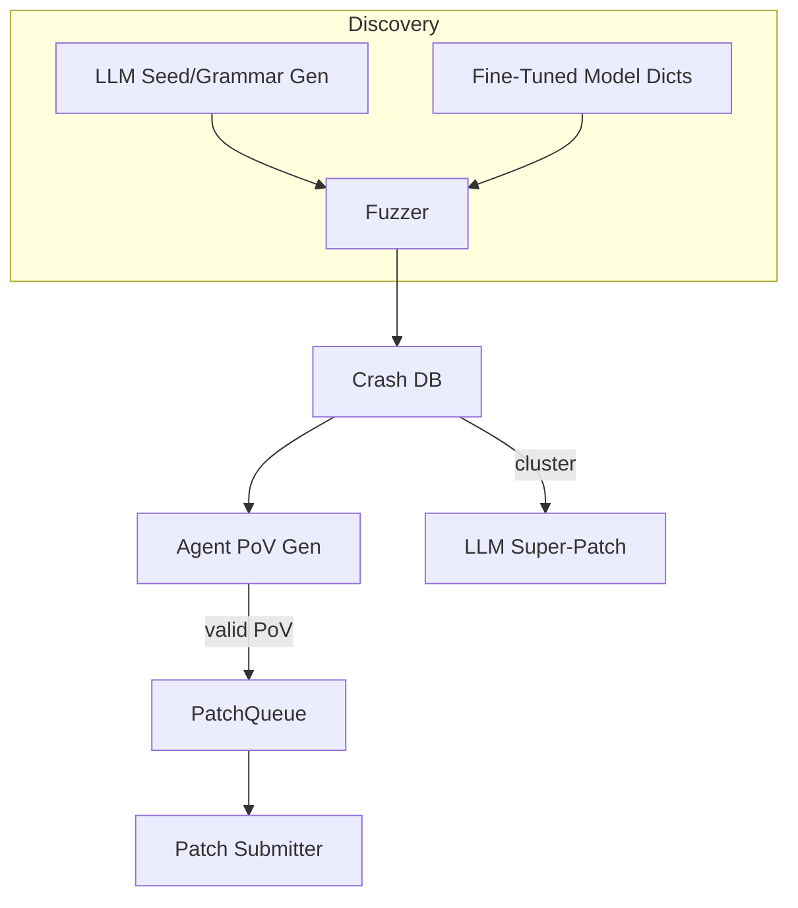

# KI-gestütztes Fuzzing & automatisierte Schwachstellen-Entdeckung

{{#include ../banners/hacktricks-training.md}}

## Überblick
Large Language Models (LLMs) können traditionelle Schwachstellenforschungs-Pipelines deutlich verstärken, indem sie semantisch reichhaltige Eingaben generieren, Grammatiken weiterentwickeln, Crash-Daten analysieren und sogar Patches für mehrere Bugs vorschlagen.<sup>[[4]](#references)</sup><sup>[[5]](#references)</sup>

Im Folgenden wird kein bestimmtes Wettbewerbssystem beschrieben, sondern eine Abstraktion der wirksamsten Techniken, damit Sie diese in Ihren eigenen Workflows reproduzieren können.

---

## 1. Von LLMs generierte Seed-Inputs

Traditionelle coverage-guided Fuzzer (AFL++, libFuzzer, Honggfuzz …) beginnen mit einem kleinen Seed-Korpus und mutieren Bytes blind. Ist das Eingabeformat des Ziels komplex (SQL, URLs, benutzerdefinierte Binärprotokolle), zerstören zufällige Mutationen meist die Syntax, bevor interessante Zweige erreicht werden.

LLMs können dieses Bootstrap-Problem lösen, indem sie *Seed-Generatoren* ausgeben – kurze Skripte, die **syntaktisch korrekte, aber sicherheitsrelevante Eingaben** erzeugen. Zum Beispiel:

```prompt
SYSTEM: You are a helpful security engineer.
USER:
Write a Python3 program that prints 200 unique SQL injection strings targeting common anti-pattern mistakes (missing quotes, numeric context, stacked queries).  Ensure length ≤ 256 bytes / string so they survive common length limits.
```

```python
# gen_sqli_seeds.py (truncated)
PAYLOADS = [
    "1 OR 1=1 -- ",
    "' UNION SELECT NULL,NULL--",
    "0; DROP TABLE users;--",
    ...
]
for p in PAYLOADS:
    print(p)
```

Einmal ausführen und die Ausgabe direkt in den initialen Corpus des Fuzzers einspeisen:

```bash
python3 gen_sqli_seeds.py > seeds.txt
afl-fuzz -i seeds.txt -o findings/ -- ./target @@
```

Vorteile:
1. Semantische Gültigkeit → frühzeitig tiefere Abdeckung.
2. Erneut generierbar: Passe den Prompt an, um den Fokus auf XSS, Path Traversal, Binary Blobs usw. zu legen.
3. Günstig (< 1 ¢ mit GPT-3.5).

### Tipps
* Weise das Modell an, Payload-Länge und Encoding (UTF-8, URL-encoded, UTF-16-LE) zu *variieren*, um oberflächliche Filter zu umgehen.
* Bitte um ein *einzelnes, eigenständiges Skript* – das vermeidet Probleme mit dem JSON-Format.

---

## 2. Grammar-Evolution-Fuzzing

Eine leistungsfähigere Variante besteht darin, das LLM eine Grammatik **weiterentwickeln** zu lassen, anstatt konkrete Seeds zu verwenden. Der Workflow (Muster „Grammar Guy“) sieht folgendermaßen aus:

1. Generiere per Prompt eine anfängliche ANTLR-/Peach-/LibFuzzer-Grammatik.
2. Führe für N Minuten Fuzzing aus und erfasse Coverage-Metriken (getroffene Edges / Blocks).
3. Fasse nicht abgedeckte Programmbereiche zusammen und gib die Zusammenfassung an das Modell zurück:
   ```prompt
   The previous grammar triggered 12 % of the program edges.  Functions not reached: parse_auth, handle_upload.  Add / modify rules to cover these.
   ```
4. Führe die neuen Regeln zusammen, fuzz erneut und wiederhole den Vorgang.

Pseudocode-Grundgerüst:

```python
for epoch in range(MAX_EPOCHS):
    grammar = llm.refine(grammar, feedback=coverage_stats)
    save(grammar, f"grammar_{epoch}.txt")
    coverage_stats = run_fuzzer(grammar)
```

Wichtige Punkte:
* Ein *Budget* einhalten – jede Verfeinerung verbraucht Tokens.
* `diff`- und `patch`-Anweisungen verwenden, damit das Modell Änderungen vornimmt, statt alles neu zu schreiben.
* Beenden, wenn Δcoverage < ε.

---

## 3. Entwicklung von libFuzzer-Harnesses mit lokalen LLMs

Wenn Quellcode den Arbeitsplatz eines Analysts nicht verlassen darf, kann ein lokales Code-Modell den kleinen Adapter zwischen Fuzzer-Bytes und einer C/C++-API entwerfen. Die Sicherheitsgrenze ist klar: **Das Modell schreibt und überarbeitet die Testinfrastruktur; Coverage-guided Mutation erkundet Eingaben; Sanitizer melden ungültige Operationen; ein Mensch prüft das Harness und triagiert die Ergebnisse**.<sup>[[9]](#references)</sup>

Informationen zu Engine-Techniken für Corpus, Feedback, Snapshots und Stateful Fuzzing, die nicht von einem LLM abhängen, findest du in der allgemeinen [Fuzzing Methodology](../generic-methodologies-and-resources/fuzzing.md).

Beginne mit der exakten Deklaration aus dem Header des Ziels und schränke das Ausgabeformat ein. Ein eng gefasster Prompt verringert die Wahrscheinlichkeit erfundener APIs und erleichtert die Überprüfung des Ergebnisses:<sup>[[8]](#references)[[9]](#references)</sup>

```prompt
Write a libFuzzer target for this exact declaration:
int parse_records(const uint8_t *data, size_t size);

Output only C code. Implement LLVMFuzzerTestOneInput, include the
declaration, pass data and size unchanged, and do not use files,
network access, randomness, clocks, threads, or persistent state.
```

Für einen Parser für Rohbytes sollte das erwartete Ergebnis nicht komplizierter sein als:<sup>[[6]](#references)[[9]](#references)</sup>

```c
#include <stddef.h>
#include <stdint.h>

extern int parse_records(const uint8_t *, size_t);

int LLVMFuzzerTestOneInput(const uint8_t *data, size_t size) {
    (void)parse_records(data, size);
    return 0;
}
```

Die Kompilierung ist nur die erste Validierungsstufe. Überprüfe jedes generierte Target anhand dieser Invarianten, bevor du CPU-Zeit dafür aufwendest:<sup>[[6]](#references)[[8]](#references)[[9]](#references)</sup>

- **Exakte API:** Vergleiche Typen, Ownership-Regeln, Initialisierung, Teardown und Calling Convention mit dem echten Header und den vorhandenen Aufrufern.
- **Harness-Sicherheit:** Sichere jeden Lesezugriff auf `data` ab; Sanitizer-Befunde müssen im Target entstehen, nicht im generierten Glue-Code.
- **Reproduzierbarkeit:** Das Ergebnis muss eine Funktion von `data` und `size` sein; entferne externe I/O, Zeit, unkontrollierten Zufall, nicht beendete Threads und zwischen Aufrufen erhaltenen Zustand.
- **Durchsatz:** Initialisiere teuren unveränderlichen Zustand nur dann einmalig, wenn dies das Verhalten nicht beeinflussen kann, begrenze die Eingabegröße, unterdrücke Logging und gib pro Eingabe allokierten Speicher frei.
- **Erreichbarkeit:** Überprüfe, ob die vorgesehenen Funktionen und Branches ausgeführt werden. Ein Target, das kompiliert, aber nur Ablehnungspfade durchläuft, ist ein stiller Fehlschlag.

### Strukturorientierte Targets: Invarianten bewahren, ohne Bugs zu verbergen

Wenn die meisten rohen Eingaben an einer Magic-, Längen-, Versions- oder Prüfsummenprüfung scheitern, verwende die Fuzz-Bytes als Material für typisierte Felder und baue ein gültiges Objekt neu auf. Setze Formatkonstanten fest, lasse semantische Felder und Payload-Bytes veränderbar und leite Integritätsmetadaten aus der rekonstruierten Payload ab. `FuzzedDataProvider` ist nützlich, um begrenzte typisierte Werte zu entnehmen; der Adapter bleibt jedoch dafür verantwortlich, jede erzeugte Allokation und Konvertierung zu begrenzen.<sup>[[9]](#references)</sup>

<details>
<summary>Beispiel für ein strukturorientiertes C++-Target</summary>

```cpp
#include <fuzzer/FuzzedDataProvider.h>
#include <stddef.h>
#include <stdint.h>
#include <vector>

extern "C" int parse_message(const uint8_t *, size_t);

extern "C" int LLVMFuzzerTestOneInput(const uint8_t *data, size_t size) {
    FuzzedDataProvider fdp(data, size);
    uint8_t version = fdp.ConsumeIntegral<uint8_t>();
    auto body = fdp.ConsumeRemainingBytes<uint8_t>();
    if (body.size() > UINT16_MAX) body.resize(UINT16_MAX);
    uint16_t len = static_cast<uint16_t>(body.size());
    std::vector<uint8_t> msg = {0x8b, 'M', 'S', 'G', version,
                                static_cast<uint8_t>(len >> 8),
                                static_cast<uint8_t>(len)};
    msg.insert(msg.end(), body.begin(), body.end());
    (void)parse_message(msg.data(), msg.size());
    return 0;
}
```

</details>

Verwende nicht für jede Frage dasselbe strukturreparierende Target. Nutze ein Target, das Längen und Prüfsummen ableitet, um tiefe gültige Zustände zu erkunden, und ein weiteres, bei dem der Fuzzer die **deklarierten** Metadaten kontrolliert und nur die eigenen Lese- und Allokationsvorgänge des Harness begrenzt. Das zweite Target erhält Angriffspunkte mit nicht übereinstimmenden Längen und fehlerhafter Integrität, die durch automatische Reparatur andernfalls beseitigt würden.<sup>[[9]](#references)</sup>

### Seeds, Wörterbücher, Sanitizer und Coverage-Feedback

Bitte das Modell, ein Skript zu erstellen, das binäre Seeds schreibt, statt es direkt Binärdaten ausgeben zu lassen. Erstelle Seeds für leere, minimale, typische und gültige Grenzfall-Objekte. Extrahiere dann Magic Values, Tags, Enum-Kodierungen und Parser-Schlüsselwörter in ein geprüftes Wörterbuch. libFuzzer akzeptiert dieses Wörterbuch mit `-dict=` und behält Mutationen, die neue Coverage im Corpus sichtbar machen.<sup>[[6]](#references)[[9]](#references)</sup>

```text
magic="\x8bMSG"
version_min="\x00"
version_max="\xff"
config_tag="CONFIG"
```

Baue dasselbe Ziel mit ergänzender Instrumentierung. ASan und UBSan können sich ein Fuzzing-Binary teilen; verwende einen separaten MSan-Build und instrumentiere dessen Abhängigkeiten, um Meldungen durch nicht instrumentierten Code zu vermeiden.<sup>[[6]](#references)[[9]](#references)</sup>

```bash
clang++ -g -O1 -fsanitize=fuzzer,address,undefined \
  -fno-sanitize-recover=undefined target.cc harness.cc -o fuzz_target
./fuzz_target corpus -dict=msg.dict -max_len=65535

clang++ -g -O1 -fsanitize=fuzzer,memory \
  target.cc harness.cc -o fuzz_target_msan
```

Behandle die Coverage als Evaluator für jede Modellrevision. Bei libFuzzer-Ausgaben deuten früh stagnierende Werte für `cov`/`ft` und ein statischer Corpus normalerweise auf ein fehlerhaftes Framing, einen zu restriktiven frühen Return oder den falschen Aufruf hin; eine niedrige `exec/s`-Rate deutet auf aufwendiges Setup, I/O, Allokationen oder geleakten Zustand hin. `NEW` beweist lediglich, dass sich ein Coverage-Feature geändert hat, nicht, dass der beabsichtigte Parser erreicht wurde.<sup>[[6]](#references)[[9]](#references)</sup>

Für Feedback auf Quellcodeebene erstelle einen Coverage-Build, fuzze ihn und gib dem Modell nur die nicht abgedeckten Funktionen samt ihren Bedingungen. Überprüfe den resultierenden Harness-/Seed-/Dictionary-Diff und miss erneut:<sup>[[7]](#references)[[8]](#references)[[9]](#references)</sup>

```bash
clang++ -g -O1 -fsanitize=fuzzer \
  -fprofile-instr-generate -fcoverage-mapping target.cc harness.cc -o fuzz_cov
mkdir -p profiles
LLVM_PROFILE_FILE='profiles/%p.profraw' ./fuzz_cov -max_total_time=300 corpus
llvm-profdata merge -sparse profiles/*.profraw -o fuzz.profdata
llvm-cov report ./fuzz_cov -instr-profile=fuzz.profdata
llvm-cov show ./fuzz_cov -instr-profile=fuzz.profdata \
  --show-branches=count --region-coverage-lt=1 target.cc
```

Die skalierbare Schleife lautet daher **generieren → kompilieren/verlinken → Smoke-Test unter Sanitizern → Target-Coverage messen → den kleinsten relevanten Coverage-/Quellcodekontext bereitstellen → überarbeiten → erneut messen**. OSS-Fuzz-Gen wendet dasselbe Prinzip an, indem es generierte Targets auf Kompilierbarkeit, Laufzeitfehler, Coverage und Verbesserungen der Coverage gegenüber bestehenden Targets prüft, statt plausibel wirkenden Code einfach für bare Münze zu nehmen.<sup>[[7]](#references)[[8]](#references)</sup>

---

<a id="3-agent-based-pov-exploit-generation" hidden>3. Agentenbasierte PoV- (Exploit-)Generierung</a>

## 4. Agentenbasierte PoV- (Exploit-)Generierung

Nachdem ein Crash gefunden wurde, brauchst du weiterhin einen **Proof of Vulnerability (PoV)**, der ihn deterministisch auslöst.

Ein skalierbarer Ansatz besteht darin, viele schlanke Worker (Prozesse, Threads oder Container) zu starten, die jeweils ein anderes Modell oder eine andere Sampling-Konfiguration verwenden. Die AIxCC-Finalistenumfrage nennt konkrete Beispiele für diese Größenordnung: Ein Team verwendete **Tausende parallele Agenten** für die AI-first-PoV-Generierung, während ein anderes **300–500 Fuzzing-Agenten** koordinierte und LLMs für übergeordnete semantische Schlussfolgerungen reservierte.<sup>[[4]](#references)</sup>

Pipeline:
1. Statische/dynamische Analyse erstellt *Bug-Kandidaten* (struct mit Crash-PC, Eingabeausschnitt, Sanitizer-Meldung).
2. Der Orchestrator verteilt die Kandidaten an die Agenten.
3. Schlussfolgerungsschritte des Agenten:
   a. Bug lokal mit `gdb` und Eingabe reproduzieren.
   b. Minimales Exploit-Payload vorschlagen.
   c. Exploit in einer Sandbox validieren. Bei Erfolg → einreichen.
4. Fehlgeschlagene Versuche werden als **neue Seeds** für Coverage-Fuzzing erneut in die Warteschlange gestellt (Feedback-Schleife).

Vorteile:
* Parallelisierung gleicht die Unzuverlässigkeit einzelner Agenten aus.
* Automatische Anpassung von temp und Modellgröße anhand der beobachteten Erfolgsrate.

---

<a id="4-directed-fuzzing-with-fine-tuned-code-models" hidden>4. Gezieltes Fuzzing mit feinabgestimmten Code-Modellen</a>

## 5. Gezieltes Fuzzing mit feinabgestimmten Code-Modellen

Ein Open-Weight-Modell (z. B. Llama-7B) mit C/C++-Quellcode feinabstimmen, der anhand von Schwachstellenmustern (Integer Overflow, Buffer Copy, Format String) annotiert wurde. Dann:

1. Statische Analyse ausführen, um eine Funktionsliste und einen AST zu erhalten.
2. Das Modell prompten: *„Gib Einträge für ein Mutationswörterbuch an, die wahrscheinlich die Speichersicherheit in Funktion X verletzen“*.
3. Diese Tokens in einen benutzerdefinierten `AFL_CUSTOM_MUTATOR` einfügen.

Beispielausgabe für einen `sprintf`-Wrapper:
```
{"pattern":"%99999999s"}
{"pattern":"AAAAAAAA....<1024>....%n"}
```

Empirisch verkürzt dies die Zeit bis zum Absturz bei realen Zielen um mehr als das Zweifache.

---

<a id="5-ai-guided-patching-strategies" hidden>5. KI-gestützte Patch-Strategien</a>

## 6. KI-gestützte Patch-Strategien

<a id="51-super-patches" hidden>5.1 Super-Patches</a>

### 6.1 Super-Patches
Bitte das Modell, Crash-Signaturen zu *gruppieren* und einen **einzigen Patch** vorzuschlagen, der die gemeinsame Grundursache behebt. Einmal einreichen, mehrere Bugs beheben → weniger Genauigkeitsabzüge in Umgebungen, in denen jeder falsche Patch Punkte kostet.

Prompt-Entwurf:
```
Here are 10 stack traces + file snippets.  Identify the shared mistake and generate a unified diff fixing all occurrences.
```

{{#ref}}
../generic-methodologies-and-resources/fuzzing.md
{{#endref}}

<a id="52-speculative-patch-ratio" hidden>5.2 Quote spekulativer Patches</a>

### 6.2 Quote spekulativer Patches
Implementiere eine Warteschlange, in der bestätigte, durch PoV validierte Patches und *spekulative* Patches (ohne PoV) in einem an die Bewertungsregeln angepassten Verhältnis von 1:​N abwechseln (z. B. 2 spekulative : 1 bestätigter Patch). Ein Kostenmodell überwacht Strafen und Punkte und passt N automatisch an.

---

Für deterministische, dateiweise Quellcode-Reviews, mobile Entry-Point-Taskflows, Kernel-Pattern-Audits und evidenzbasierte Vulnerability-Validierung siehe [KI-gestütztes Quellcode-Review und Vulnerability-Validierung](AI-Assisted-Source-Review-and-Vulnerability-Validation.md).

---

## Debugger-gestützte Crash-Triage

Mona-v3-Workflows für Crash-Triage, Funktionsanalyse und kontrollierte Heap-Chunk-Erreichbarkeit finden sich unter [Exploiting Tools](../binary-exploitation/basic-stack-binary-exploitation-methodology/tools/#mona-v3-debugger-context-requests-for-crash-triage).

---

## Alles zusammenführen
Ein End-to-End-CRS (Cyber Reasoning System) kann die Komponenten etwa folgendermaßen verbinden:



---

## References

- [4] [Trail of Bits – AIxCC-Finale: Eine Bestandsaufnahme](https://blog.trailofbits.com/2025/08/07/aixcc-finals-tale-of-the-tape/)
- [5] [CTF Radiooo – Interviews mit AIxCC-Finalisten](https://www.youtube.com/@ctfradiooo)
- [6] [LLVM — libFuzzer: Eine Bibliothek für coverage-guided Fuzz-Tests](https://llvm.org/docs/LibFuzzer.html)
- [7] [Google — OSS-Fuzz-Gen](https://github.com/google/oss-fuzz-gen)
- [8] [Google Online Security Blog — Fuzzing auf ein neues Niveau heben: Mit KI mehr Schwachstellen finden](https://security.googleblog.com/2024/11/leveling-up-fuzzing-finding-more.html)
- [9] [8kSec — KI-gestützte Generierung von Fuzzing-Harnesses mit einem lokalen LLM](https://8ksec.io/ai-assisted-fuzzing-harness-local-llm)
{{#include ../banners/hacktricks-training.md}}
