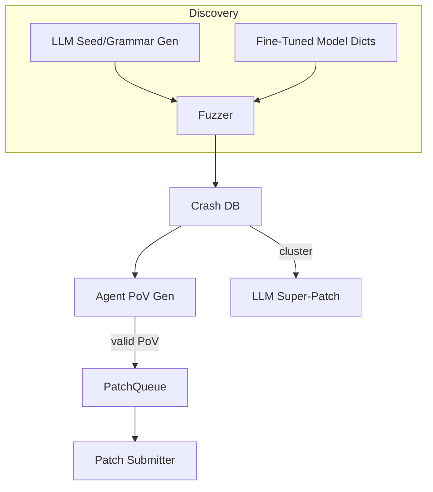

# AI-सहायित Fuzzing और स्वचालित Vulnerability Discovery

{{#include ../banners/hacktricks-training.md}}

## अवलोकन
Large-language models (LLMs) semantically rich inputs जनरेट करके, grammars को विकसित करके, crash data पर तर्क करके और यहाँ तक कि multi-bug patches सुझाकर पारंपरिक vulnerability-research pipelines को बहुत अधिक शक्तिशाली बना सकते हैं। इस पेज में DARPA के AI Cyber Challenge (AIxCC) finals और अन्य सार्वजनिक शोध के दौरान देखे गए सबसे प्रभावी patterns संकलित किए गए हैं।<sup>[[4]](#references)</sup><sup>[[5]](#references)</sup>

आगे किसी एक विशिष्ट competition system का वर्णन नहीं है, बल्कि इन techniques का एक अमूर्तन है, ताकि आप इन्हें अपने workflows में दोहरा सकें।

---

## 1. LLM-जनरेट किए गए Seed Inputs

पारंपरिक coverage–guided fuzzers (AFL++, libFuzzer, Honggfuzz…) seeds के एक छोटे corpus से शुरुआत करते हैं और bytes को बिना सोचे-समझे mutate करते हैं। जब target input format जटिल होता है (SQL, URLs, custom binary protocols), तो random mutations आमतौर पर syntax को इस तरह बिगाड़ देती हैं कि दिलचस्प branches तक पहुँचना संभव नहीं होता।

LLMs इस bootstrap समस्या को हल कर सकते हैं—वे *seed generators* नाम की छोटी scripts बनाते हैं, जो **syntax-सही लेकिन security की दृष्टि से प्रासंगिक inputs** आउटपुट करती हैं। उदाहरण के लिए:

```prompt
SYSTEM: You are a helpful security engineer.
USER:
Write a Python3 program that prints 200 unique SQL injection strings targeting common anti-pattern mistakes (missing quotes, numeric context, stacked queries).  Ensure length ≤ 256 bytes / string so they survive common length limits.
```

```python
# gen_sqli_seeds.py (truncated)
PAYLOADS = [
    "1 OR 1=1 -- ",
    "' UNION SELECT NULL,NULL--",
    "0; DROP TABLE users;--",
    ...
]
for p in PAYLOADS:
    print(p)
```

इसे एक बार चलाएँ और आउटपुट को सीधे fuzzer के initial corpus में डालें:

```bash
python3 gen_sqli_seeds.py > seeds.txt
afl-fuzz -i seeds.txt -o findings/ -- ./target @@
```

Benefits:
1. Semantic validity → शुरुआत में ही बेहतर coverage.
2. दोबारा generate किया जा सकता है: XSS, path traversal, binary blobs आदि पर ध्यान केंद्रित करने के लिए prompt में बदलाव करें।
3. सस्ता (< GPT-3.5 के साथ 1 ¢).

### Tips
* सतही filters को bypass करने के लिए model को payload की लंबाई और encoding (UTF-8, URL-encoded, UTF-16-LE) में *विविधता* लाने का निर्देश दें।
* एक *single self-contained script* माँगें — इससे JSON formatting की दिक्कतों से बचा जा सकता है।

---

## 2. Grammar-Evolution Fuzzing

इसका एक अधिक शक्तिशाली variant यह है कि ठोस seeds के बजाय LLM से **grammar evolve** करवाया जाए। Workflow (“Grammar Guy” pattern) यह है:

1. Prompt के ज़रिए शुरुआती ANTLR/Peach/LibFuzzer grammar generate करें।
2. N मिनट तक fuzz करें और coverage metrics (hit हुए edges / blocks) इकट्ठा करें।
3. प्रोग्राम के उन हिस्सों का सारांश बनाएँ जो अभी तक cover नहीं हुए हैं और उस सारांश को model को वापस दें:
   ```prompt
   The previous grammar triggered 12 % of the program edges.  Functions not reached: parse_auth, handle_upload.  Add / modify rules to cover these.
   ```
4. नए rules merge करें, फिर से fuzz करें, दोहराएँ।

Pseudo-code skeleton:

```python
for epoch in range(MAX_EPOCHS):
    grammar = llm.refine(grammar, feedback=coverage_stats)
    save(grammar, f"grammar_{epoch}.txt")
    coverage_stats = run_fuzzer(grammar)
```

मुख्य बातें:
* एक *बजट* रखें – हर refinement में tokens खर्च होते हैं।
* मॉडल को दोबारा लिखने के बजाय संपादन करने के लिए `diff` + `patch` निर्देशों का उपयोग करें।
* Δcoverage < ε होने पर रुकें।

---

## 3. Local-LLM libFuzzer Harness इंजीनियरिंग

ऐसे source code के लिए जिसे analyst के workstation से बाहर नहीं जाना चाहिए, एक local code model fuzzer bytes और C/C++ API के बीच छोटा adapter तैयार कर सकता है। उपयोगी security boundary स्पष्ट है: **model test infrastructure लिखता और संशोधित करता है; coverage-guided mutation inputs को explore करता है; sanitizers invalid operations की रिपोर्ट करते हैं; एक human harness की समीक्षा करता है और findings को triage करता है**।<sup>[[9]](#references)</sup>

Engine-level corpus, feedback, snapshot और stateful-fuzzing तकनीकों के लिए, जो LLM पर निर्भर नहीं करतीं, सामान्य [Fuzzing Methodology](../generic-methodologies-and-resources/fuzzing.md) देखें।

Target header से हूबहू declaration कॉपी करके शुरू करें और output format सीमित रखें। एक संकीर्ण prompt गढ़े हुए APIs को कम करता है और परिणाम की समीक्षा आसान बनाता है:<sup>[[8]](#references)[[9]](#references)</sup>

```prompt
Write a libFuzzer target for this exact declaration:
int parse_records(const uint8_t *data, size_t size);

Output only C code. Implement LLVMFuzzerTestOneInput, include the
declaration, pass data and size unchanged, and do not use files,
network access, randomness, clocks, threads, or persistent state.
```

Raw byte parser के लिए, अपेक्षित परिणाम इससे अधिक जटिल नहीं होना चाहिए:<sup>[[6]](#references)[[9]](#references)</sup>

```c
#include <stddef.h>
#include <stdint.h>

extern int parse_records(const uint8_t *, size_t);

int LLVMFuzzerTestOneInput(const uint8_t *data, size_t size) {
    (void)parse_records(data, size);
    return 0;
}
```

संकलन केवल पहला validation gate है। CPU समय खर्च करने से पहले, हर generated target की इन invariants के अनुसार समीक्षा करें:<sup>[[6]](#references)[[8]](#references)[[9]](#references)</sup>

- **सटीक API:** types, ownership rules, initialization, teardown और calling convention की तुलना वास्तविक header और मौजूदा callers से करें।
- **Harness की सुरक्षा:** `data` से हर read को guard करें; sanitizer की findings target से आनी चाहिए, generated glue से नहीं।
- **दोहराने योग्य परिणाम:** परिणाम को `data` और `size` का function बनाएं; external I/O, समय, अनियंत्रित randomness, join न किए गए threads और calls के बीच बने रहने वाली state हटाएं।
- **Throughput:** महंगी immutable state को केवल तभी एक बार initialize करें, जब इससे behavior प्रभावित न हो; input size सीमित रखें, logging बंद करें और हर input के लिए किए गए allocations को free करें।
- **Reachability:** पुष्टि करें कि अपेक्षित functions और branches execute होते हैं। जो target compile तो होता है, लेकिन केवल rejection paths को exercise करता है, वह बिना किसी संकेत के विफल होता है।

### संरचना-जागरूक targets: bugs छिपाए बिना invariants बनाए रखें

अगर ज़्यादातर raw inputs magic, length, version या checksum gate पर विफल होते हैं, तो fuzz bytes को **typed field material** के रूप में इस्तेमाल करें और एक valid object फिर से बनाएं। Format constants को स्थिर रखें, semantic fields और payload bytes को mutable छोड़ें, और reconstructed payload से integrity metadata निकालें। `FuzzedDataProvider` सीमित typed values को consume करने में उपयोगी है, जबकि किसी भी generated allocation और conversion को सीमित रखने की ज़िम्मेदारी adapter की रहती है।<sup>[[9]](#references)</sup>

<details>
<summary>Structure-aware C++ target का उदाहरण</summary>

```cpp
#include <fuzzer/FuzzedDataProvider.h>
#include <stddef.h>
#include <stdint.h>
#include <vector>

extern "C" int parse_message(const uint8_t *, size_t);

extern "C" int LLVMFuzzerTestOneInput(const uint8_t *data, size_t size) {
    FuzzedDataProvider fdp(data, size);
    uint8_t version = fdp.ConsumeIntegral<uint8_t>();
    auto body = fdp.ConsumeRemainingBytes<uint8_t>();
    if (body.size() > UINT16_MAX) body.resize(UINT16_MAX);
    uint16_t len = static_cast<uint16_t>(body.size());
    std::vector<uint8_t> msg = {0x8b, 'M', 'S', 'G', version,
                                static_cast<uint8_t>(len >> 8),
                                static_cast<uint8_t>(len)};
    msg.insert(msg.end(), body.begin(), body.end());
    (void)parse_message(msg.data(), msg.size());
    return 0;
}
```

</details>

हर प्रश्न के लिए एक ही structure-repairing target का उपयोग न करें। एक target ऐसा रखें जो गहन valid states को एक्सप्लोर करने के लिए lengths/checksums निकालता हो, और दूसरा ऐसा जो **declared** metadata को fuzzer-controlled रखे, जबकि केवल harness की अपनी reads और allocations को सीमित करे। दूसरा target mismatched-length और bad-integrity attack surfaces को बनाए रखता है, जिन्हें automatic repair अन्यथा मिटा देगा।<sup>[[9]](#references)</sup>

### Seeds, dictionaries, sanitizers, और coverage feedback

मॉडल से ऐसा script बनाने को कहें जो binary seeds लिखे—उसे सीधे binary प्रिंट करने को न कहें। खाली, न्यूनतम, सामान्य और boundary-valid objects के लिए seeds बनाएं; फिर magic values, tags, enum encodings और parser keywords को निकालकर एक reviewed dictionary में रखें। libFuzzer उस dictionary को `-dict=` के साथ स्वीकार करता है और corpus में उन mutations को बनाए रखता है जो नई coverage उजागर करती हैं।<sup>[[6]](#references)[[9]](#references)</sup>

```text
magic="\x8bMSG"
version_min="\x00"
version_max="\xff"
config_tag="CONFIG"
```

पूरक instrumentation के साथ वही target बनाएँ। ASan और UBSan एक fuzzing binary साझा कर सकते हैं; uninstrumented code के कारण होने वाली reports से बचने के लिए अलग MSan build बनाएँ और उसकी dependencies को instrument करें।<sup>[[6]](#references)[[9]](#references)</sup>

```bash
clang++ -g -O1 -fsanitize=fuzzer,address,undefined \
  -fno-sanitize-recover=undefined target.cc harness.cc -o fuzz_target
./fuzz_target corpus -dict=msg.dict -max_len=65535

clang++ -g -O1 -fsanitize=fuzzer,memory \
  target.cc harness.cc -o fuzz_target_msan
```

हर model revision के लिए coverage को evaluator मानें। libFuzzer output में शुरुआत से सपाट `cov`/`ft` और static corpus आमतौर पर खराब framing, बहुत ज़्यादा restrictive early return, या गलत call का संकेत देते हैं; कम `exec/s` महंगे setup, I/O, allocation, या leak हुए state की ओर इशारा करता है। `NEW` सिर्फ यह साबित करता है कि coverage feature बदला है, यह नहीं कि इच्छित parser तक पहुँचा गया।<sup>[[6]](#references)[[9]](#references)</sup>

Source-level feedback के लिए coverage build बनाएँ, उसे fuzz करें, और model को केवल uncovered functions तथा उनकी guarding conditions दें। परिणामी harness/seed/dictionary diff की जाँच करें और दोबारा मापें:<sup>[[7]](#references)[[8]](#references)[[9]](#references)</sup>

```bash
clang++ -g -O1 -fsanitize=fuzzer \
  -fprofile-instr-generate -fcoverage-mapping target.cc harness.cc -o fuzz_cov
mkdir -p profiles
LLVM_PROFILE_FILE='profiles/%p.profraw' ./fuzz_cov -max_total_time=300 corpus
llvm-profdata merge -sparse profiles/*.profraw -o fuzz.profdata
llvm-cov report ./fuzz_cov -instr-profile=fuzz.profdata
llvm-cov show ./fuzz_cov -instr-profile=fuzz.profdata \
  --show-branches=count --region-coverage-lt=1 target.cc
```

इसलिए scalable loop है **generate → compile/link → sanitizers के तहत smoke-test → target coverage मापें → सबसे छोटा प्रासंगिक coverage/source context दें → revise → फिर से मापें**। OSS-Fuzz-Gen इसी सिद्धांत को लागू करता है: यह generated targets को compilability, runtime failures, coverage और मौजूदा targets की तुलना में coverage improvement के आधार पर परखता है—सिर्फ़ ऊपर से सही लगने वाले code को स्वीकार नहीं करता।<sup>[[7]](#references)[[8]](#references)</sup>

---

## 4. Agent-आधारित PoV (Exploit) Generation

Crash मिलने के बाद भी आपको **proof-of-vulnerability (PoV)** चाहिए, जो उसे deterministically trigger करे।

एक scalable तरीका है कई lightweight workers (processes, threads या containers) शुरू करना, जिनमें से हर worker अलग model या sampling configuration इस्तेमाल करे। AIxCC finalist survey में scale के ठोस उदाहरण दिए गए हैं: एक team ने AI-first PoV generation के लिए **हज़ारों concurrent agents** इस्तेमाल किए, जबकि दूसरी ने **300–500 fuzzing agents** orchestrate किए और उच्च-स्तरीय semantic reasoning के लिए LLMs आरक्षित रखे।<sup>[[4]](#references)</sup>

Pipeline:
1. Static/dynamic analysis से *bug candidates* मिलते हैं (crash PC, input slice, sanitizer msg वाला struct)।
2. Orchestrator candidates को agents में बाँटता है।
3. Agent के reasoning steps:
   a. `gdb` + input से locally bug को reproduce करें।
   b. न्यूनतम exploit payload सुझाएँ।
   c. Sandbox में exploit validate करें। सफल होने पर → submit करें।
4. असफल प्रयासों को coverage fuzzing के लिए **नए seeds के रूप में फिर से queue किया जाता है** (feedback loop)।

फ़ायदे:
* Parallelisation से किसी एक agent की अविश्वसनीयता का असर कम होता है।
* देखी गई success-rate के आधार पर temp / model size की auto-tuning।

---

## 5. Fine-Tuned Code Models के साथ Directed Fuzzing

Vulnerability patterns (integer overflow, buffer copy, format string) से label किए गए C/C++ source पर open-weight model (जैसे Llama-7B) को fine-tune करें। फिर:

1. Function list + AST पाने के लिए static analysis चलाएँ।
2. Model को prompt दें: *“Function X में memory safety तोड़ने की संभावना वाले mutation dictionary entries दें”*।
3. उन tokens को custom `AFL_CUSTOM_MUTATOR` में डालें।

`sprintf` wrapper के लिए उदाहरण output:
```
{"pattern":"%99999999s"}
{"pattern":"AAAAAAAA....<1024>....%n"}
```

व्यावहारिक परीक्षणों में, वास्तविक targets पर इससे crash होने में लगने वाला समय 2× से अधिक कम हो जाता है।

---

## 6. AI-निर्देशित Patching Strategies

### 6.1 Super Patches
मॉडल से crash signatures को *cluster* करने और ऐसा **एक patch** सुझाने को कहें, जो मूल साझा कारण को दूर करे। एक बार submit करें, कई bugs ठीक करें → उन environments में accuracy penalties कम लगेंगी, जहाँ हर गलत patch पर points कटते हैं।

Prompt की रूपरेखा:
```
Here are 10 stack traces + file snippets.  Identify the shared mistake and generate a unified diff fixing all occurrences.
```

{{#ref}}
../generic-methodologies-and-resources/fuzzing.md
{{#endref}}

### 6.2 Speculative Patch Ratio
एक queue लागू करें जिसमें पुष्टि किए गए PoV-validated patches और *speculative* patches (बिना PoV) को 1:N अनुपात में बारी-बारी से रखा जाए और scoring rules के अनुसार अनुपात तय किया जाए (जैसे, 2 speculative : 1 confirmed)। एक cost model penalties बनाम points पर नज़र रखता है और N को अपने-आप समायोजित करता है।

---

## 7. Deterministic फ़ाइल-दर-फ़ाइल AI Code Review

AI-assisted review में एक आम विफलता यह है कि किसी एक agent से पूरा repository जाँचने को कहा जाए और उम्मीद की जाए कि वह सही files और grep terms चुन लेगा। इससे अधिक भरोसेमंद तरीका है **repository coverage को बाध्य करना**:<sup>[[1]](#references)</sup>

1. Source files की सूची बनाएँ।
2. **एक बार में एक file** के साथ न्यूनतम context (entrypoint, imports, आस-पास के routes/callers) भेजें।
3. हर file के लिए **structured report** माँगें: sources, sink, missing validation, exploit preconditions और confidence।<sup>[[3]](#references)</sup>
4. Reports को **source→sink pattern** के आधार पर deduplicate करें और उच्च-जोखिम वाले मामलों को खुद validate करें।

इसमें tokens की खपत अधिक होती है और शोर भी रहता है, लेकिन यह **सरल, बड़े प्रभाव वाले source/sink bugs** खोजने में बहुत प्रभावी है, जिन्हें व्यापक agentic reviews अक्सर नहीं पकड़ पाते।

### प्राथमिकता देने योग्य triage patterns

- **Dynamic PHP include/dispatch**: attacker के नियंत्रण वाले route/controller/module नामों का `require_once()`, `include()` या `include_once()` तक पहुँचना, बिना सख्त allowlisting और path canonicalisation के।
- **Admin/account workflows में shell execution**: usernames, domains, FTP accounts या अन्य identifiers का `exec()`, `system()`, `shell_exec()`, `passthru()`, `proc_open()` या `popen()` तक पहुँचना।
- **Structured input fan-in**: एक ही parameter को `$_GET`, `$_POST`, JSON, XML या framework body parsers से स्वीकार करना और बाद में filesystem या OS-command sinks में दोबारा इस्तेमाल करना।

### इस तरीके से मिलने वाले दो व्यावहारिक bug classes

- **PHP controller-dispatch LFI/RCE**: यदि request के नियंत्रण वाला controller name बिना allowlist/path normalisation के `require_once()` में जोड़ा जाता है, तो `../` जैसी traversal sequences से PHP कोई अनचाही स्थानीय `.php` file शामिल कर सकता है। यदि attacker include को किसी पहले से रखी गई या अन्यथा उपयोगी PHP file की ओर निर्देशित कर सकता है, तो LFI code execution में बदल जाता है। देखें [File Inclusion / Path Traversal](../pentesting-web/file-inclusion/README.md)।<sup>[[1]](#references)</sup>
- **Hosting/admin panels में authenticated command injection**: यदि usernames जैसे account-management fields को shell commands में जोड़ा जाता है, तो कम privileges वाला authenticated user सामान्य create/delete action को RCE में बदल सकता है। यदि panel command को अधिक privileges वाले service account के रूप में चलाता है, तो इसका प्रभाव बढ़ जाता है। देखें [Command Injection](../pentesting-web/command-injection.md)।<sup>[[1]](#references)</sup>

### व्यावहारिक review नोट्स

- LLM का इस्तेमाल पहले **source/sink reviewer** के रूप में करें, exploit generator के रूप में नहीं।
- उससे स्पष्ट रूप से **attacker-controlled field**, **normalization/validation gap** और **खतरनाक sink** की सूची देने को कहें।
- बड़े repos में, एक अकेले autonomous agent run की तुलना में deterministic per-file review अक्सर अधिक भरोसेमंद होता है—भले ही autonomous run में अधिक शक्तिशाली model इस्तेमाल किया गया हो।<sup>[[2]](#references)</sup>
- **Broken Access Control** और अन्य business-logic bugs पर कमजोर नतीजों की अपेक्षा रखें, जहाँ exploitability कई files में फैली धारणाओं, role semantics या product-specific threat models पर निर्भर करती है।

---

## 8. Instrumented Oracle के साथ Pattern-Guided Kernel Auditing

Kernel-जैसे बड़े target के लिए, agent से पूरे tree में मनमाने bugs खोजने को न कहें। अधिक token-efficient workflow में पुराने vulnerabilities की जानकारी को static queries में बदला जाता है, exposed attack surface के आधार पर नतीजों को प्राथमिकता दी जाती है और instrumented kernel को execution oracle की तरह इस्तेमाल किया जाता है।<sup>[[11]](#references)</sup>

### Pattern database → CodeQL/Semgrep → केंद्रित review

एक छोटा knowledge base बनाएँ जिसमें खतरनाक APIs, missing-validation patterns, जोखिमपूर्ण source-to-sink flows और पहले ठीक किए गए bug patterns शामिल हों। Model से कहें कि वह **एक बार में एक pattern** को review heuristics और CodeQL/Semgrep rules में बदले, फिर उन deterministic rules को पूरे tree पर चलाएँ। Matches को model को code वापस देने से पहले group और deduplicate करें; scanner का raw output हज़ारों कम-मूल्य वाले candidates दे सकता है। पात्र research या open-source targets के बाहर इस तरीके का उपयोग करने से पहले CodeQL का मौजूदा license जाँचें।<sup>[[11]](#references)</sup>

केवल hit count के बजाय **rule-hit density** और **attacker reachability**, दोनों के आधार पर subsystems को प्राथमिकता दें। Unprivileged processes, sandboxes, containers, jails या guest contexts से reachable kernel interfaces को केवल internal code की तुलना में अधिक महत्व दें। Review unit इतना छोटा रखें कि agent callers, validators और lifetime rules को याद रख सके; और “find any vulnerability” कहने के बजाय किसी नामित vulnerability class या control-flow pattern के लिए prompt करें। पुराने privileged interfaces विशेष रूप से दिलचस्प होते हैं, जब कोई नया containment boundary उन्हें namespaced या jailed root user के लिए reachable बना देता है।<sup>[[11]](#references)</sup>

हर candidate के लिए exploitation का प्रयास करने से पहले स्पष्ट field-flow record माँगें।<sup>[[11]](#references)</sup>

```text
entrypoint -> privilege check -> parser -> validation/normalization
           -> later rewrite -> dangerous sink
attacker controls: <fields and lengths>
constraints:       <values rewritten, rejected, or preserved>
observable result: <sanitizer report, assertion, panic, or clean exit>
```

### KASAN telemetry को hypothesis oracle के रूप में इस्तेमाल करें

लक्ष्य kernel को KASAN और उपयोगी diagnostic assertions सक्षम करके disposable VM में चलाएँ। Agent को **source hypothesis → न्यूनतम userland trigger → VM execution → KASAN/assertion trace → संशोधित hypothesis** के चक्र में तब तक काम करना चाहिए, जब तक संदिग्ध corruption reproduce या reject न हो जाए। हर iteration में केवल प्रासंगिक stack trace और उसके आसपास का source लौटाएँ; इससे reasoning के लिए संदर्भ बना रहता है और acceptance gate model के confidence के बजाय runtime evidence होता है।<sup>[[11]](#references)</sup>

Instrumented build, exploitability जाँचने का अंतिम वातावरण नहीं है। Assertions, corruption करने वाले operation से पहले execution रोक सकती हैं, जबकि वही assertion production kernel में compile out हो सकती है। अपरिवर्तित trigger को exact production configuration पर दोबारा जाँचें, kernel build और configuration दर्ज करें, और **reachability**, **memory corruption**, **controlled primitive** तथा **security impact** को अलग-अलग दावों के रूप में रखें।<sup>[[11]](#references)[[12]](#references)</sup>

CVE-2026-3038, exploit template के बजाय validation का एक उपयोगी उदाहरण है। एक unprivileged FreeBSD `RTM_GET` request, चुनिंदा validation और reply rewriting के दौरान oversized `RTAX_AUTHOR` sockaddr को बनाए रख सकती थी। इसके बाद `rtsock_msg_buffer()` ने user-controlled `sa_len` को 128-byte stack `sockaddr_storage` में copy किया। अधिकतम 255-byte copy से 127-byte overwrite हुआ; instrumented build में diagnostic assertion ने गलत length पकड़ ली, जबकि GENERIC kernel copy तक पहुँचा और फिर corrupted canary की जाँच के दौरान panic हो गया। इससे unprivileged denial of service साबित होता है, अपने-आप privilege escalation नहीं: भरोसेमंद control के लिए पहले किसी दूसरे primitive की ज़रूरत होती, जैसे canary disclosure। संबंधित binary-exploitation सीमा के लिए [Stack Canaries](../binary-exploitation/common-binary-protections-and-bypasses/stack-canaries/index.html) देखें।<sup>[[11]](#references)[[12]](#references)[[13]](#references)</sup>

### Exploit की prerequisites को धोखे से पूरा करने का दावा खारिज करें

किसी PoV या exploit को स्वीकार करने से पहले, अलग reviewer/agent से तय मानदंडों के आधार पर उसे गलत साबित करने का प्रयास करवाएँ। समीक्षा में नीचे दी गई सभी शर्तों की पुष्टि होनी चाहिए।<sup>[[11]](#references)</sup>

- उस path को reachable बनाने के लिए target source, kernel या vulnerable module में बदलाव नहीं किया गया था।
- कोई helper module, synthetic gadget, disabled mitigation, अतिरिक्त privilege या अनुपलब्ध interface नहीं जोड़ा गया था।
- Trigger, clean snapshot पर दावा की गई caller identity और containment restrictions के साथ शुरू होता है।
- दावा किया गया परिणाम bug पर निर्भर रहता है: malformed field हटाने या केवल bug को patch करने से chain टूटनी चाहिए।
- Crash, overread या overwrite को केवल उसी primitive के रूप में रिपोर्ट किया गया है; code execution या privilege escalation के लिए स्वतंत्र evidence चाहिए।

यह आखिरी counterfactual जाँच circular demonstrations पकड़ती है: अगर prerequisites पहले से ही दावा किए गए impact की अनुमति देते हैं (उदाहरण के लिए, `nosuid` के बिना mount किए गए filesystem से attacker द्वारा दिया गया SUID content चलाना), तो memory-safety bug ने वह impact पैदा नहीं किया।<sup>[[11]](#references)</sup>

---

## अपरिचित Codebases पर Auditable Agent-Assisted Research

[graph-first fuzz-target workflow](../generic-methodologies-and-resources/fuzzing.md#graph-first-fuzz-target-selection-and-mutation-triage) में entrypoint reachability शामिल है, जबकि [agentic SAST pipelines](../network-services-pentesting/pentesting-web/code-review-tools.md#agentic-sast-pipelines) चरणबद्ध समीक्षा और evidence gates को कवर करती हैं। इन deterministic नतीजों को model की hypotheses से अलग रखें, ताकि आगे बढ़ाए गए हर lead के साथ source locations, path evidence और dynamic measurement मौजूद रहें।<sup>[[10]](#references)</sup>

### Data flow गढ़े बिना object-lifetime evidence को जोड़ें

Static analysis में पता चल सकता है कि attacker-controlled length एक function में store की गई और वही object field बहुत बाद में copy sink तक पहुँची, लेकिन callbacks, reconnects या object lifetime के पार इनका संबंध साबित न हो। दोनों findings को अलग-अलग सुरक्षित रखें, object/field के आधार पर समूहित करें और छूटे हुए संबंध को triage का स्पष्ट सवाल बनाएँ। Agent इस संबंध का सुझाव दे सकता है, लेकिन इसे source review या runtime instrumentation से साबित करना होगा।<sup>[[10]](#references)</sup>

हर candidate के लिए दर्ज करें:

- ठोस entrypoint और attacker-controlled bytes;
- संबंधित field के हर producer, जिसमें हर producer के लिए लागू validation शामिल हो;
- sink, destination capacity और वहाँ तक पहुँचने के लिए ज़रूरी build/runtime conditions;
- exposed entrypoint से मिला वास्तविक call stack, केवल direct harness invocation नहीं;
- hypothesis की पुष्टि या उसे खारिज करने वाला सबसे छोटा dynamic result।

कोई path सुरक्षित दिखे, तो इसका मतलब यह नहीं कि field हर जगह सुरक्षित है। दूसरा producer वही field, पहले path की bound के बिना भर सकता है। Paths को अलग-अलग जाँचें और deployment-equivalent build options के साथ harness चलाएँ, क्योंकि debug assertions production memory corruption को test-only early abort में बदल सकती हैं।<sup>[[10]](#references)</sup>

### Disclosure और exploitation के लिए measurement gates

Uninitialized-memory disclosure के संदेह में, नई allocations को पहचानने योग्य byte से भरें और पुष्टि करें कि वही marker emitted packet तक पहुँचता है। Exploitation के लिए **controlled overwrite → उपयोगी victim object → disclosure → pointer/base recovery → control-flow hijack → composed payload** जैसे measured gates अनिवार्य करें। Agent तभी आगे बढ़े, जब harness मौजूदा property साबित करे; विश्वसनीय लगने वाली कहानी, gate पास होने का प्रमाण नहीं है। Validation के दौरान बनाए रखने योग्य path और build constraints के लिए [FreeRDP case](../binary-exploitation/libc-heap/heap-overflow.md#cross-path-length-reuse-and-stale-output-disclosure) देखें।<sup>[[10]](#references)</sup>

---

## सब कुछ एक साथ जोड़ना

End-to-end CRS (Cyber Reasoning System) components को इस तरह जोड़ सकता है:



---

## References

- [1] [Project Black - साइबर सुरक्षा के लिए स्थानीय AI: phpIPAM LFI और myVesta में प्रमाणीकृत RCE खोजना](https://projectblack.io/blog/local-ai-for-cyber-security)
- [2] [Strix](https://github.com/usestrix/strix)
- [3] [GitHub Copilot community security-review skill](https://github.com/github/awesome-copilot/blob/main/skills/security-review/SKILL.md)
- [4] [Trail of Bits – AIxCC फ़ाइनल: मुकाबले का लेखा-जोखा](https://blog.trailofbits.com/2025/08/07/aixcc-finals-tale-of-the-tape/)
- [5] [CTF Radiooo AIxCC फ़ाइनलिस्ट के साक्षात्कार](https://www.youtube.com/@ctfradiooo)
- [6] [LLVM — libFuzzer: coverage-guided fuzz testing के लिए एक लाइब्रेरी](https://llvm.org/docs/LibFuzzer.html)
- [7] [Google — OSS-Fuzz-Gen](https://github.com/google/oss-fuzz-gen)
- [8] [Google Online Security Blog — Fuzzing को बेहतर बनाना: AI की मदद से अधिक vulnerabilities खोजना](https://security.googleblog.com/2024/11/leveling-up-fuzzing-finding-more.html)
- [9] [8kSec — स्थानीय LLM के साथ AI-सहायता प्राप्त fuzzing harness जनरेशन](https://8ksec.io/ai-assisted-fuzzing-harness-local-llm)
- [10] [Quarkslab — AI एजेंट से RCE तक: vulnerability research वर्कफ़्लो बनाना](https://blog.quarkslab.com/from-ai-agents-to-rce-building-a-vulnerability-research-workflow.html)
- [11] [Praetorian — FreeBSoD: kernel bugs खोजने और exploit करने के लिए language models का उपयोग (भाग 1 में से 2)](https://praetorian.com/blog/ai-vulnerability-research-freebsd-kernel)
- [12] [FreeBSD-SA-26:05.route — routing sockets के ज़रिए स्थानीय DoS और संभावित privilege escalation](https://www.freebsd.org/security/advisories/FreeBSD-SA-26:05.route.asc)
- [13] [FreeBSD-SA-26:05.route स्रोत पैच](https://security.FreeBSD.org/patches/SA-26:05/route.patch)
{{#include ../banners/hacktricks-training.md}}
