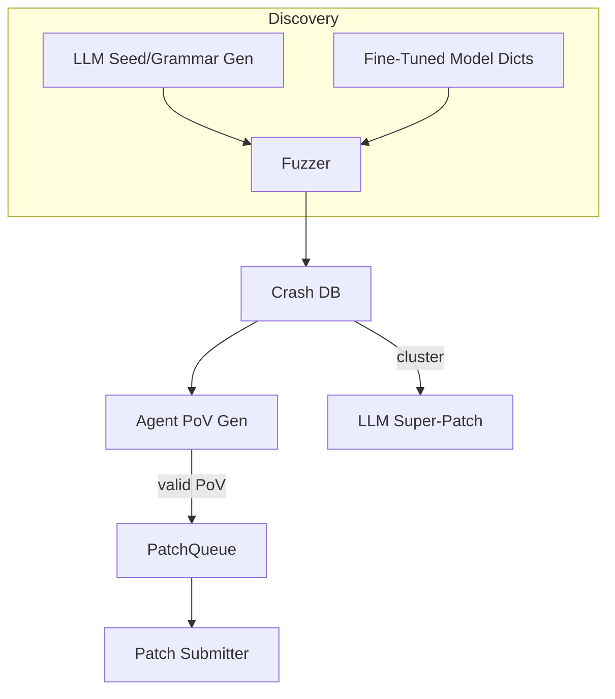

# Fuzzing за допомогою ШІ та автоматизоване виявлення вразливостей

{{#include ../banners/hacktricks-training.md}}

## Огляд
Великі мовні моделі (LLM) можуть значно посилити традиційні процеси дослідження вразливостей: генерувати семантично насичені вхідні дані, розвивати граматики, аналізувати дані про збої та навіть пропонувати виправлення кількох помилок. На цій сторінці зібрано найефективніші методи, виявлені під час фіналу DARPA AI Cyber Challenge (AIxCC) та інших публічних досліджень.<sup>[[4]](#references)</sup><sup>[[5]](#references)</sup>

Далі описано не конкретну систему для певного змагання, а узагальнено методи, щоб ви могли відтворити їх у власних робочих процесах.

---

## 1. Вхідні зразки, згенеровані LLM

Традиційні фазери, керовані покриттям (AFL++, libFuzzer, Honggfuzz…), починають із невеликого корпусу початкових зразків і сліпо змінюють байти. Коли формат вхідних даних цілі складний (SQL, URL-адреси, користувацькі бінарні протоколи), випадкові зміни зазвичай порушують синтаксис, перш ніж вдається дійти до цікавих гілок.

LLM можуть допомогти розв’язати цю проблему початкового запуску, створюючи *генератори початкових зразків* — короткі скрипти, що виводять **синтаксично коректні, але важливі з погляду безпеки вхідні дані**. Наприклад:

```prompt
SYSTEM: You are a helpful security engineer.
USER:
Write a Python3 program that prints 200 unique SQL injection strings targeting common anti-pattern mistakes (missing quotes, numeric context, stacked queries).  Ensure length ≤ 256 bytes / string so they survive common length limits.
```

```python
# gen_sqli_seeds.py (truncated)
PAYLOADS = [
    "1 OR 1=1 -- ",
    "' UNION SELECT NULL,NULL--",
    "0; DROP TABLE users;--",
    ...
]
for p in PAYLOADS:
    print(p)
```

Запустіть один раз і передайте вивід безпосередньо до початкового корпусу фаззера:

```bash
python3 gen_sqli_seeds.py > seeds.txt
afl-fuzz -i seeds.txt -o findings/ -- ./target @@
```

Переваги:
1. Семантична коректність → глибше покриття на ранньому етапі.
2. Можна генерувати повторно: змінюйте prompt, щоб зосередитися на XSS, path traversal, бінарних blobs тощо.
3. Дешево (< 1 ¢ з GPT-3.5).

### Поради
* Попросіть модель *урізноманітнити* довжину payload і кодування (UTF-8, URL-encoded, UTF-16-LE), щоб обійти поверхневі фільтри.
* Попросіть створити *один самодостатній скрипт* — це допоможе уникнути проблем із форматуванням JSON.

---

## 2. Grammar-Evolution Fuzzing

Потужніший варіант — попросити LLM **розвивати граматику**, а не конкретні seeds. Робочий процес (патерн «Grammar Guy»):

1. Згенеруйте початкову граматику ANTLR/Peach/LibFuzzer за допомогою prompt.
2. Запускайте fuzzing протягом N хвилин і збирайте метрики покриття (пройдені edges / blocks).
3. Підсумуйте непокриті ділянки програми й передайте підсумок назад моделі:
   ```prompt
   The previous grammar triggered 12 % of the program edges.  Functions not reached: parse_auth, handle_upload.  Add / modify rules to cover these.
   ```
4. Об’єднайте нові правила, повторно запустіть fuzzing і повторюйте.

Каркас псевдокоду:

```python
for epoch in range(MAX_EPOCHS):
    grammar = llm.refine(grammar, feedback=coverage_stats)
    save(grammar, f"grammar_{epoch}.txt")
    coverage_stats = run_fuzzer(grammar)
```

Ключові моменти:
* Дотримуйтеся *бюджету* — кожне уточнення потребує токенів.
* Використовуйте інструкції `diff` + `patch`, щоб модель редагувала, а не переписувала.
* Зупиніться, коли Δcoverage < ε.

---

## 3. Розробка harness для libFuzzer із локальною LLM

Якщо вихідний код не можна передавати за межі робочої станції аналітика, локальна кодова модель може створити невеликий адаптер між байтами fuzz-тестера та API на C/C++. Межі безпеки тут чітко визначені: **модель пише й доопрацьовує тестову інфраструктуру; мутації з керуванням покриттям досліджують вхідні дані; санітайзери виявляють некоректні операції; людина перевіряє harness і сортує результати**.<sup>[[9]](#references)</sup>

Щоб дізнатися про методи роботи з корпусом, зворотним зв’язком, знімками стану та fuzz-тестуванням зі збереженням стану на рівні рушія, які не залежать від LLM, див. загальну [методологію fuzzing](../generic-methodologies-and-resources/fuzzing.md).

Почніть із точного оголошення, скопійованого із заголовка цільового коду, і задайте обмежений формат виводу. Вузький промпт зменшує ймовірність вигаданих API та полегшує перевірку результату:<sup>[[8]](#references)[[9]](#references)</sup>

```prompt
Write a libFuzzer target for this exact declaration:
int parse_records(const uint8_t *data, size_t size);

Output only C code. Implement LLVMFuzzerTestOneInput, include the
declaration, pass data and size unchanged, and do not use files,
network access, randomness, clocks, threads, or persistent state.
```

Для парсера сирих байтів очікуваний результат не має бути складнішим за:<sup>[[6]](#references)[[9]](#references)</sup>

```c
#include <stddef.h>
#include <stdint.h>

extern int parse_records(const uint8_t *, size_t);

int LLVMFuzzerTestOneInput(const uint8_t *data, size_t size) {
    (void)parse_records(data, size);
    return 0;
}
```

Компіляція — лише перший етап перевірки. Перш ніж витрачати на ціль процесорний час, перевірте кожну згенеровану ціль на відповідність таким інваріантам:<sup>[[6]](#references)[[8]](#references)[[9]](#references)</sup>

- **Точний API:** порівняйте типи, правила володіння, ініціалізацію, завершення роботи та угоду виклику з реальним заголовковим файлом і наявними місцями виклику.
- **Безпека harness:** захистіть кожне читання з `data`; результати sanitizer мають походити з цілі, а не зі згенерованого glue-коду.
- **Повторюваність:** зробіть результат функцією `data` і `size`; усуньте зовнішній ввід-вивід, час, неконтрольовану випадковість, нез’єднані потоки та стан, що зберігається між викликами.
- **Пропускна здатність:** ініціалізуйте дорогий незмінний стан лише один раз і лише якщо це не впливає на поведінку, обмежте розмір вводу, вимкніть журналювання та звільняйте виділену для кожного вводу пам’ять.
- **Досяжність:** перевірте, що виконуються потрібні функції та гілки. Ціль, яка компілюється, але виконує лише шляхи відхилення, — це прихована помилка.

### Структурно-орієнтовані цілі: зберігайте інваріанти, не приховуючи помилок

Якщо більшість необроблених вводів не проходять перевірку magic-значення, довжини, версії чи контрольної суми, використовуйте байти fuzz-вводу як **матеріал для типізованих полів** і перебудовуйте коректний об’єкт. Зафіксуйте константи формату, залиште семантичні поля та байти корисного навантаження змінними й обчислюйте метадані цілісності на основі реконструйованого корисного навантаження. `FuzzedDataProvider` зручно використовувати для отримання обмежених типізованих значень, а адаптер відповідає за обмеження будь-якого згенерованого виділення пам’яті та перетворення.<sup>[[9]](#references)</sup>

<details>
<summary>Приклад структурно-орієнтованої цілі C++</summary>

```cpp
#include <fuzzer/FuzzedDataProvider.h>
#include <stddef.h>
#include <stdint.h>
#include <vector>

extern "C" int parse_message(const uint8_t *, size_t);

extern "C" int LLVMFuzzerTestOneInput(const uint8_t *data, size_t size) {
    FuzzedDataProvider fdp(data, size);
    uint8_t version = fdp.ConsumeIntegral<uint8_t>();
    auto body = fdp.ConsumeRemainingBytes<uint8_t>();
    if (body.size() > UINT16_MAX) body.resize(UINT16_MAX);
    uint16_t len = static_cast<uint16_t>(body.size());
    std::vector<uint8_t> msg = {0x8b, 'M', 'S', 'G', version,
                                static_cast<uint8_t>(len >> 8),
                                static_cast<uint8_t>(len)};
    msg.insert(msg.end(), body.begin(), body.end());
    (void)parse_message(msg.data(), msg.size());
    return 0;
}
```

</details>

Не використовуйте одну ціль із виправленням структур для кожного запитання. Підтримуйте одну ціль, яка обчислює довжини й контрольні суми, щоб досліджувати глибокі валідні стани, та іншу, у якій **заявлені** метадані контролює фуззер, а обмежуються лише власні читання й виділення пам’яті harness. Друга ціль зберігає поверхні атак із невідповідною довжиною та некоректною цілісністю, які автоматичне виправлення інакше усунуло б.<sup>[[9]](#references)</sup>

### Seeds, словники, санітайзери та зворотний зв’язок за покриттям

Попросіть модель створити скрипт, який записує бінарні seeds, а не виводить бінарні дані безпосередньо. Створюйте seeds для порожніх, мінімальних, типових і гранично валідних об’єктів; потім витягніть магічні значення, теги, кодування enum і ключові слова парсера до перевіреного словника. libFuzzer приймає такий словник через `-dict=` і зберігає в корпусі мутації, що відкривають нове покриття.<sup>[[6]](#references)[[9]](#references)</sup>

```text
magic="\x8bMSG"
version_min="\x00"
version_max="\xff"
config_tag="CONFIG"
```

Зберіть ту саму ціль із додатковим інструментуванням. ASan і UBSan можуть використовувати один бінарний файл для fuzzing; для MSan створіть окрему збірку та інструментуйте її залежності, щоб уникнути звітів, спричинених неінструментованим кодом.<sup>[[6]](#references)[[9]](#references)</sup>

```bash
clang++ -g -O1 -fsanitize=fuzzer,address,undefined \
  -fno-sanitize-recover=undefined target.cc harness.cc -o fuzz_target
./fuzz_target corpus -dict=msg.dict -max_len=65535

clang++ -g -O1 -fsanitize=fuzzer,memory \
  target.cc harness.cc -o fuzz_target_msan
```

Розглядайте покриття як критерій оцінювання кожної ревізії моделі. У виводі libFuzzer ранні пласкі значення `cov`/`ft` і незмінний корпус зазвичай свідчать про неправильне формування даних, надто обмежувальну ранню умову повернення або неправильний виклик; низьке значення `exec/s` вказує на дорогі підготовчі операції, I/O, виділення пам’яті або витік стану. `NEW` лише доводить, що змінилася ознака покриття, а не те, що було досягнуто потрібного парсера.<sup>[[6]](#references)[[9]](#references)</sup>

Для зворотного зв’язку на рівні вихідного коду створіть збірку з покриттям, запустіть fuzzing і передайте моделі лише непокриті функції та умови, які їх захищають. Перевірте зміни в harness/seed/dictionary і знову виміряйте результати:<sup>[[7]](#references)[[8]](#references)[[9]](#references)</sup>

```bash
clang++ -g -O1 -fsanitize=fuzzer \
  -fprofile-instr-generate -fcoverage-mapping target.cc harness.cc -o fuzz_cov
mkdir -p profiles
LLVM_PROFILE_FILE='profiles/%p.profraw' ./fuzz_cov -max_total_time=300 corpus
llvm-profdata merge -sparse profiles/*.profraw -o fuzz.profdata
llvm-cov report ./fuzz_cov -instr-profile=fuzz.profdata
llvm-cov show ./fuzz_cov -instr-profile=fuzz.profdata \
  --show-branches=count --region-coverage-lt=1 target.cc
```

Масштабований цикл має такий вигляд: **генерація → компіляція/лінкування → smoke-test із санітайзерами → вимірювання покриття цілі → надання найменшого доречного контексту покриття/вихідного коду → перегляд → повторне вимірювання**. OSS-Fuzz-Gen дотримується того самого принципу: оцінює згенеровані цілі за можливістю компіляції, помилками під час виконання, покриттям і покращенням покриття порівняно з наявними цілями, а не приймає правдоподібний на вигляд код без перевірки.<sup>[[7]](#references)[[8]](#references)</sup>

---

<a id="3-agent-based-pov-exploit-generation" hidden>3. Agent-Based PoV (Exploit) Generation</a>

## 4. Створення PoV (експлойту) агентами

Після виявлення збою вам усе ще потрібен **proof-of-vulnerability (PoV)**, який детерміновано його відтворює.

Масштабований підхід — запустити багато легковагових workers (процесів, потоків або контейнерів), кожен із яких використовує окрему модель або конфігурацію вибірки. В огляді фіналістів AIxCC наведено конкретні приклади масштабування: одна команда використовувала **тисячі паралельних агентів** для PoV-генерації з пріоритетом AI, тоді як інша оркеструвала **300–500 fuzzing-агентів**, залишаючи LLM для семантичного аналізу вищого рівня.<sup>[[4]](#references)</sup>

Pipeline:
1. Статичний/динамічний аналіз формує *кандидатів на помилки* (struct із crash PC, фрагментом input, повідомленням sanitizer).
2. Orchestrator розподіляє кандидатів між агентами.
3. Кроки міркування агента:
   a. Локально відтворити помилку за допомогою `gdb` + input.
   b. Запропонувати мінімальний payload для експлойту.
   c. Перевірити експлойт у sandbox. Якщо успішно → надіслати.
4. Невдалі спроби **повторно додаються до черги як нові seeds** для coverage fuzzing (цикл зворотного зв’язку).

Переваги:
* Паралелізація приховує ненадійність окремого агента.
* Автоматичне налаштування temp / розміру моделі на основі спостережуваного відсотка успіху.

---

<a id="4-directed-fuzzing-with-fine-tuned-code-models" hidden>4. Directed Fuzzing with Fine-Tuned Code Models</a>

## 5. Спрямований fuzzing за допомогою донавчених моделей коду

Виконайте fine-tuning моделі з відкритими вагами (наприклад, Llama-7B) на вихідному коді C/C++, позначеному шаблонами вразливостей (переповнення цілих чисел, копіювання буфера, format string). Потім:

1. Запустіть статичний аналіз, щоб отримати список функцій + AST.
2. Запропонуйте моделі: *«Надай елементи словника мутацій, які можуть порушити безпеку пам’яті у функції X»*.
3. Вставте ці токени в користувацький `AFL_CUSTOM_MUTATOR`.

Приклад результату для обгортки `sprintf`:
```
{"pattern":"%99999999s"}
{"pattern":"AAAAAAAA....<1024>....%n"}
```

Емпірично це скорочує час до збою більш ніж удвічі на реальних цілях.

---

<a id="5-ai-guided-patching-strategies" hidden>5. Стратегії виправлень за допомогою AI</a>

## 6. Стратегії виправлень за допомогою AI

<a id="51-super-patches" hidden>5.1 Супервиправлення</a>

### 6.1 Супервиправлення
Попросіть модель *кластеризувати* сигнатури збоїв і запропонувати **єдине виправлення**, яке усуває спільну першопричину. Подайте його один раз і виправте кілька помилок → менше штрафів за точність у середовищах, де кожне неправильне виправлення коштує балів.

Структура запиту:
```
Here are 10 stack traces + file snippets.  Identify the shared mistake and generate a unified diff fixing all occurrences.
```

{{#ref}}
../generic-methodologies-and-resources/fuzzing.md
{{#endref}}

<a id="52-speculative-patch-ratio" hidden>5.2 Співвідношення спекулятивних патчів</a>

### 6.2 Співвідношення спекулятивних патчів
Реалізуйте чергу, у якій підтверджені патчі, перевірені PoV, і *спекулятивні* патчі (без PoV) чергуються у співвідношенні 1:N, налаштованому відповідно до правил оцінювання (наприклад, 2 спекулятивні : 1 підтверджений). Модель витрат відстежує штрафи та бали й автоматично коригує N.

---

Щоб виконати детермінований аналіз вихідного коду файл за файлом, розібрати taskflow точок входу мобільних застосунків, перевірити шаблони ядра та провести валідацію вразливостей із вимогою наявності доказів, див. [Аналіз вихідного коду за допомогою ШІ та валідація вразливостей](AI-Assisted-Source-Review-and-Vulnerability-Validation.md).

---

## Сортування збоїв за допомогою налагоджувача

Процеси Mona v3 для сортування збоїв, аналізу функцій і контрольованого досягнення heap-чанків описано в розділі [Інструменти експлуатації](../binary-exploitation/basic-stack-binary-exploitation-methodology/tools/#mona-v3-debugger-context-requests-for-crash-triage).

---

## Об’єднання всіх компонентів
Наскрізну CRS (систему кіберміркувань) можна зібрати, наприклад, так:



---

## References

- [4] [Trail of Bits — Фінал AIxCC: історія випробувань](https://blog.trailofbits.com/2025/08/07/aixcc-finals-tale-of-the-tape/)
- [5] [Інтерв’ю CTF Radiooo з фіналістами AIxCC](https://www.youtube.com/@ctfradiooo)
- [6] [LLVM — libFuzzer: бібліотека для fuzz-тестування з керуванням за покриттям](https://llvm.org/docs/LibFuzzer.html)
- [7] [Google — OSS-Fuzz-Gen](https://github.com/google/oss-fuzz-gen)
- [8] [Блог Google Online Security — Виводимо fuzzing на новий рівень: пошук більшої кількості вразливостей за допомогою AI](https://security.googleblog.com/2024/11/leveling-up-fuzzing-finding-more.html)
- [9] [8kSec — Генерація harness для fuzzing за допомогою локальної LLM](https://8ksec.io/ai-assisted-fuzzing-harness-local-llm)
{{#include ../banners/hacktricks-training.md}}
