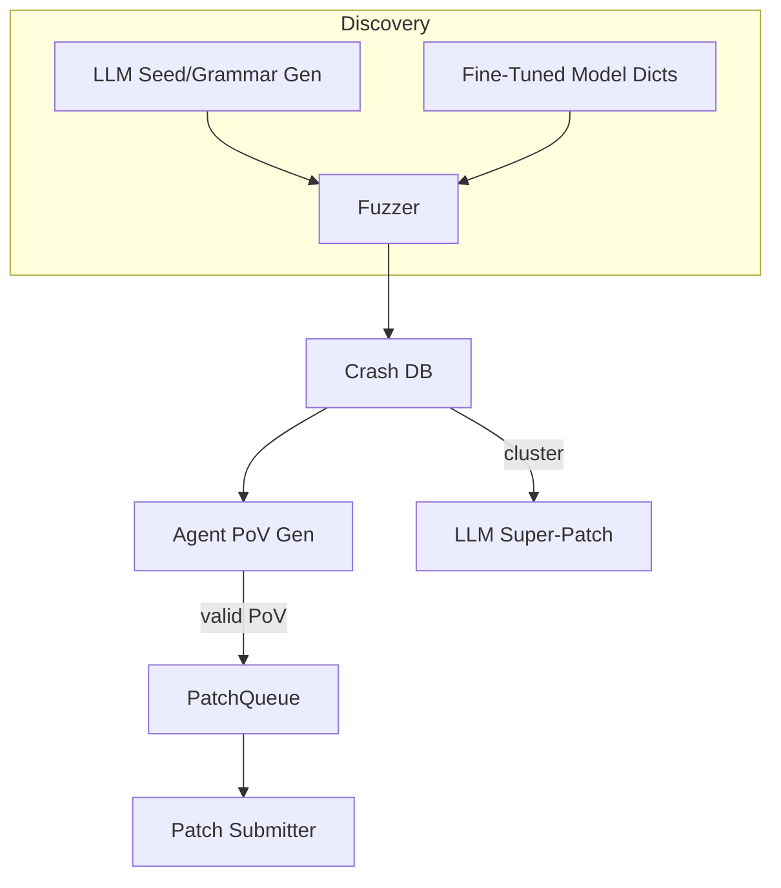

# AI-unterstütztes Fuzzing & automatisierte Schwachstellenerkennung

{{#include ../banners/hacktricks-training.md}}

## Überblick
Large Language Models (LLMs) können herkömmliche Schwachstellenforschungs-Pipelines erheblich verbessern, indem sie semantisch reichhaltige Eingaben generieren, Grammatiken weiterentwickeln, Crash-Daten auswerten und sogar Patches für mehrere Bugs vorschlagen. Diese Seite fasst die effektivsten Muster zusammen, die während des Finales der DARPA AI Cyber Challenge (AIxCC) und in anderen öffentlichen Forschungsarbeiten beobachtet wurden.<sup>[[4]](#references)</sup><sup>[[5]](#references)</sup>

Im Folgenden wird kein bestimmtes Wettbewerbssystem beschrieben, sondern eine Abstraktion der Techniken, damit du sie in deinen eigenen Workflows reproduzieren kannst.

---

## 1. Von LLMs generierte Seed-Eingaben

Herkömmliche coverage-guided Fuzzer (AFL++, libFuzzer, Honggfuzz …) starten mit einem kleinen Seed-Korpus und mutieren blind Bytes. Wenn das Eingabeformat des Ziels komplex ist (SQL, URLs, benutzerdefinierte Binärprotokolle), zerstören zufällige Mutationen meist die Syntax, bevor interessante Branches erreicht werden.

LLMs können dieses Bootstrap-Problem lösen, indem sie *Seed-Generatoren* erstellen – kurze Skripte, die **syntaktisch korrekte, aber sicherheitsrelevante Eingaben** ausgeben. Zum Beispiel:

```prompt
SYSTEM: You are a helpful security engineer.
USER:
Write a Python3 program that prints 200 unique SQL injection strings targeting common anti-pattern mistakes (missing quotes, numeric context, stacked queries).  Ensure length ≤ 256 bytes / string so they survive common length limits.
```

```python
# gen_sqli_seeds.py (truncated)
PAYLOADS = [
    "1 OR 1=1 -- ",
    "' UNION SELECT NULL,NULL--",
    "0; DROP TABLE users;--",
    ...
]
for p in PAYLOADS:
    print(p)
```

Einmal ausführen und die Ausgabe direkt in den initialen Corpus des Fuzzers einspeisen:

```bash
python3 gen_sqli_seeds.py > seeds.txt
afl-fuzz -i seeds.txt -o findings/ -- ./target @@
```

Vorteile:
1. Semantische Gültigkeit → frühere tiefergehende Abdeckung.
2. Erneut generierbar: Passe den Prompt an, um den Fokus auf XSS, Path Traversal, binäre Blobs usw. zu legen.
3. Günstig (< 1 ¢ mit GPT-3.5).

### Tipps
* Weise das Modell an, Payload-Länge und Encoding (UTF-8, URL-encoded, UTF-16-LE) zu *variieren*, um oberflächliche Filter zu umgehen.
* Bitte um ein *einzelnes eigenständiges Skript* – das vermeidet Probleme bei der JSON-Formatierung.

---

## 2. Grammar-Evolution-Fuzzing

Eine leistungsfähigere Variante besteht darin, das LLM eine Grammar **weiterentwickeln** zu lassen, statt konkrete Seeds zu verwenden. Der Workflow (Muster „Grammar Guy“) sieht so aus:

1. Generiere per Prompt eine initiale ANTLR-/Peach-/LibFuzzer-Grammar.
2. Führe N Minuten lang Fuzzing durch und erfasse Coverage-Metriken (getroffene Edges / Blocks).
3. Fasse nicht abgedeckte Programmbereiche zusammen und gib die Zusammenfassung an das Modell zurück:
   ```prompt
   The previous grammar triggered 12 % of the program edges.  Functions not reached: parse_auth, handle_upload.  Add / modify rules to cover these.
   ```
4. Führe die neuen Regeln zusammen, fuzz erneut und wiederhole den Vorgang.

Pseudo-Code-Skelett:

```python
for epoch in range(MAX_EPOCHS):
    grammar = llm.refine(grammar, feedback=coverage_stats)
    save(grammar, f"grammar_{epoch}.txt")
    coverage_stats = run_fuzzer(grammar)
```

Wichtige Punkte:
* Ein *Budget* einhalten – jede Verfeinerung verbraucht Tokens.
* `diff`- und `patch`-Anweisungen verwenden, damit das Modell Änderungen vornimmt, statt den Inhalt neu zu schreiben.
* Beenden, wenn Δcoverage < ε.

---

## 3. Lokales libFuzzer-Harness-Engineering mit LLMs

Wenn Quellcode den Arbeitsplatz eines Analysten nicht verlassen darf, kann ein lokales Code-Modell den kleinen Adapter zwischen Fuzzer-Bytes und einer C/C++-API entwerfen. Die Sicherheitsgrenze ist klar: **Das Modell schreibt und überarbeitet die Testinfrastruktur; coverage-gesteuerte Mutation untersucht Eingaben; Sanitizer melden ungültige Operationen; ein Mensch überprüft das Harness und triagiert die Ergebnisse**.<sup>[[9]](#references)</sup>

Engine-seitige Techniken für Corpus, Feedback, Snapshots und stateful-fuzzing, die nicht von einem LLM abhängen, findest du in der allgemeinen [Fuzzing Methodology](../generic-methodologies-and-resources/fuzzing.md).

Beginne mit der exakten Deklaration aus dem Header des Ziels und schränke das Ausgabeformat ein. Ein eng gefasster Prompt reduziert erfundene APIs und erleichtert die Überprüfung des Ergebnisses:<sup>[[8]](#references)[[9]](#references)</sup>

```prompt
Write a libFuzzer target for this exact declaration:
int parse_records(const uint8_t *data, size_t size);

Output only C code. Implement LLVMFuzzerTestOneInput, include the
declaration, pass data and size unchanged, and do not use files,
network access, randomness, clocks, threads, or persistent state.
```

Bei einem Parser für Rohbytes sollte das erwartete Ergebnis nicht komplizierter sein als:<sup>[[6]](#references)[[9]](#references)</sup>

```c
#include <stddef.h>
#include <stdint.h>

extern int parse_records(const uint8_t *, size_t);

int LLVMFuzzerTestOneInput(const uint8_t *data, size_t size) {
    (void)parse_records(data, size);
    return 0;
}
```

Die Kompilierung ist nur das erste Validierungstor. Prüfe jedes generierte Target anhand dieser Invarianten, bevor du CPU-Zeit dafür aufwendest:<sup>[[6]](#references)[[8]](#references)[[9]](#references)</sup>

- **Exakte API:** Vergleiche Typen, Ownership-Regeln, Initialisierung, Teardown und Calling Convention mit dem tatsächlichen Header und vorhandenen Aufrufern.
- **Sicherheit des Harness:** Sichere jeden Lesezugriff auf `data` ab; Sanitizer-Befunde müssen im Target und nicht im generierten Glue entstehen.
- **Wiederholbarkeit:** Das Ergebnis muss eine Funktion von `data` und `size` sein. Entferne externe I/O, Zeit, unkontrollierte Zufallswerte, nicht verbundene Threads und Zustände, die zwischen Aufrufen bestehen bleiben.
- **Durchsatz:** Initialisiere teuren unveränderlichen Zustand nur einmal, wenn sich dadurch das Verhalten nicht ändern kann; begrenze die Eingabegröße, unterdrücke Logging und gib pro Eingabe allokierten Speicher frei.
- **Erreichbarkeit:** Überprüfe, ob die vorgesehenen Funktionen und Branches ausgeführt werden. Ein Target, das kompiliert, aber nur Ablehnungspfade durchläuft, ist ein stiller Fehlschlag.

### Strukturaware Targets: Invarianten bewahren, ohne Bugs zu verbergen

Wenn die meisten Raw Inputs an einer Magic-, Längen-, Versions- oder Prüfsummenprüfung scheitern, verwende die Fuzz-Bytes als **typisiertes Feldmaterial** und baue ein gültiges Objekt neu auf. Setze Formatkonstanten fest, lass semantische Felder und Payload-Bytes veränderlich und leite Integritätsmetadaten aus der rekonstruierten Payload ab. `FuzzedDataProvider` eignet sich zum Einlesen begrenzter typisierter Werte; der Adapter bleibt dafür verantwortlich, jede generierte Allokation und Konvertierung zu begrenzen.<sup>[[9]](#references)</sup>

<details>
<summary>Beispiel für ein strukturaware C++-Target</summary>

```cpp
#include <fuzzer/FuzzedDataProvider.h>
#include <stddef.h>
#include <stdint.h>
#include <vector>

extern "C" int parse_message(const uint8_t *, size_t);

extern "C" int LLVMFuzzerTestOneInput(const uint8_t *data, size_t size) {
    FuzzedDataProvider fdp(data, size);
    uint8_t version = fdp.ConsumeIntegral<uint8_t>();
    auto body = fdp.ConsumeRemainingBytes<uint8_t>();
    if (body.size() > UINT16_MAX) body.resize(UINT16_MAX);
    uint16_t len = static_cast<uint16_t>(body.size());
    std::vector<uint8_t> msg = {0x8b, 'M', 'S', 'G', version,
                                static_cast<uint8_t>(len >> 8),
                                static_cast<uint8_t>(len)};
    msg.insert(msg.end(), body.begin(), body.end());
    (void)parse_message(msg.data(), msg.size());
    return 0;
}
```

</details>

Verwende nicht für jede Frage dasselbe Target zur Strukturreparatur. Nutze ein Target, das Längen und Prüfsummen ableitet, um tiefe, gültige Zustände zu erkunden, und ein weiteres, bei dem die **deklarierte** Metadatenstruktur vom Fuzzer gesteuert wird und nur die eigenen Lese- und Allokationsvorgänge des Harness begrenzt werden. Das zweite Target erhält Angriffsflächen mit abweichenden Längen und fehlerhafter Integrität, die durch automatische Reparatur sonst beseitigt würden.<sup>[[9]](#references)</sup>

### Seeds, Dictionaries, Sanitizer und Coverage-Feedback

Bitte das Modell, ein Skript zu erstellen, das binäre Seeds schreibt, statt es direkt Binärdaten ausgeben zu lassen. Erstelle Seeds für leere, minimale, typische und gültige Objekte an den Grenzen; extrahiere anschließend Magic Values, Tags, Enum-Kodierungen und Parser-Schlüsselwörter in ein geprüftes Dictionary. libFuzzer akzeptiert dieses Dictionary mit `-dict=` und behält Mutationen, die neue Coverage im Corpus aufdecken.<sup>[[6]](#references)[[9]](#references)</sup>

```text
magic="\x8bMSG"
version_min="\x00"
version_max="\xff"
config_tag="CONFIG"
```

Erstellen Sie dasselbe Ziel mit ergänzender Instrumentierung. ASan und UBSan können sich eine Fuzzing-Binärdatei teilen; verwenden Sie einen separaten MSan-Build und instrumentieren Sie dessen Abhängigkeiten, um Meldungen zu vermeiden, die durch nicht instrumentierten Code verursacht werden.<sup>[[6]](#references)[[9]](#references)</sup>

```bash
clang++ -g -O1 -fsanitize=fuzzer,address,undefined \
  -fno-sanitize-recover=undefined target.cc harness.cc -o fuzz_target
./fuzz_target corpus -dict=msg.dict -max_len=65535

clang++ -g -O1 -fsanitize=fuzzer,memory \
  target.cc harness.cc -o fuzz_target_msan
```

Betrachte die Coverage als Bewertungsmaßstab für jede Modellrevision. In der libFuzzer-Ausgabe deuten ein frühzeitig abgeflachtes `cov`/`ft` und ein statischer Corpus meist auf ein fehlerhaftes Framing, einen zu restriktiven frühen Return oder den falschen Aufruf hin; eine niedrige `exec/s`-Rate deutet auf aufwendiges Setup, I/O, Speicherallokationen oder geleakten Zustand hin. `NEW` beweist nur, dass sich ein Coverage-Feature geändert hat, nicht, dass der gewünschte Parser erreicht wurde.<sup>[[6]](#references)[[9]](#references)</sup>

Erstelle für Feedback auf Quellcodeebene einen Coverage-Build, fuzze ihn und gib dem Modell nur die nicht abgedeckten Funktionen samt ihren Schutzbedingungen. Überprüfe die resultierenden Änderungen an Harness, Seed und Dictionary und miss erneut:<sup>[[7]](#references)[[8]](#references)[[9]](#references)</sup>

```bash
clang++ -g -O1 -fsanitize=fuzzer \
  -fprofile-instr-generate -fcoverage-mapping target.cc harness.cc -o fuzz_cov
mkdir -p profiles
LLVM_PROFILE_FILE='profiles/%p.profraw' ./fuzz_cov -max_total_time=300 corpus
llvm-profdata merge -sparse profiles/*.profraw -o fuzz.profdata
llvm-cov report ./fuzz_cov -instr-profile=fuzz.profdata
llvm-cov show ./fuzz_cov -instr-profile=fuzz.profdata \
  --show-branches=count --region-coverage-lt=1 target.cc
```

Die skalierbare Schleife lautet daher **generieren → kompilieren/verknüpfen → unter Sanitizern einem Rauchtest unterziehen → die Target-Coverage messen → den kleinsten relevanten Coverage-/Quellcodekontext bereitstellen → überarbeiten → erneut messen**. OSS-Fuzz-Gen wendet dasselbe Prinzip an, indem es generierte Targets auf Kompilierbarkeit, Laufzeitfehler, Coverage und Coverage-Verbesserungen gegenüber bestehenden Targets prüft, statt plausibel wirkenden Code einfach für bare Münze zu nehmen.<sup>[[7]](#references)[[8]](#references)</sup>

---

<a id="3-agent-based-pov-exploit-generation" hidden>3. Agent-Based PoV (Exploit) Generation</a>

## 4. Agent-Based PoV (Exploit) Generation

Nachdem ein Crash gefunden wurde, brauchst du immer noch einen **Proof of Vulnerability (PoV)**, der ihn deterministisch auslöst.

Ein skalierbarer Ansatz besteht darin, viele leichtgewichtige Worker (Prozesse, Threads oder Container) zu starten, die jeweils ein anderes Modell oder eine andere Sampling-Konfiguration verwenden. Die Umfrage unter den AIxCC-Finalisten liefert konkrete Beispiele für den Umfang: Ein Team setzte **Tausende nebenläufige Agents** für die AI-first-PoV-Generierung ein, während ein anderes **300–500 Fuzzing-Agents** orchestrierte und LLMs für übergeordnete semantische Schlussfolgerungen reservierte.<sup>[[4]](#references)</sup>

Pipeline:
1. Statische/dynamische Analyse erzeugt *Bug-Kandidaten* (Struct mit Crash-PC, Input-Slice und Sanitizer-Meldung).
2. Der Orchestrator verteilt die Kandidaten an Agents.
3. Schlussfolgerungsschritte des Agents:
   a. Bug lokal mit `gdb` + Input reproduzieren.
   b. Ein minimales Exploit-Payload vorschlagen.
   c. Exploit in einer Sandbox validieren. Bei Erfolg → einreichen.
4. Fehlgeschlagene Versuche werden als **neue Seeds für Coverage-Fuzzing erneut eingereiht** (Feedback-Schleife).

Vorteile:
* Parallelisierung gleicht die Unzuverlässigkeit einzelner Agents aus.
* Automatische Anpassung von Temperatur/Modellgröße anhand der beobachteten Erfolgsrate.

---

<a id="4-directed-fuzzing-with-fine-tuned-code-models" hidden>4. Directed Fuzzing with Fine-Tuned Code Models</a>

## 5. Directed Fuzzing with Fine-Tuned Code Models

Ein Open-Weight-Modell (z. B. Llama-7B) mit C/C++-Quellcode feinabstimmen, der mit Schwachstellenmustern (Integer Overflow, Buffer Copy, Format String) gekennzeichnet ist. Anschließend:

1. Statische Analyse ausführen, um eine Funktionsliste und den AST zu erhalten.
2. Das Modell auffordern: *„Gib Mutation-Dictionary-Einträge an, die wahrscheinlich die Memory Safety in Funktion X verletzen“*.
3. Diese Tokens in einen benutzerdefinierten `AFL_CUSTOM_MUTATOR` einfügen.

Beispielausgabe für einen `sprintf`-Wrapper:
```
{"pattern":"%99999999s"}
{"pattern":"AAAAAAAA....<1024>....%n"}
```

Empirisch verkürzt dies die Zeit bis zum Crash bei realen Zielen um mehr als das Zweifache.

---

<a id="5-ai-guided-patching-strategies" hidden>5. KI-gestützte Patch-Strategien</a>

## 6. KI-gestützte Patch-Strategien

<a id="51-super-patches" hidden>5.1 Super Patches</a>

### 6.1 Super Patches
Bitte das Modell, Crash-Signaturen zu *clustern* und einen **einzigen Patch** vorzuschlagen, der die gemeinsame Grundursache behebt. Einmal einreichen, mehrere Bugs beheben → weniger Genauigkeitsabzüge in Umgebungen, in denen jeder falsche Patch Punkte kostet.

Prompt-Gliederung:
```
Here are 10 stack traces + file snippets.  Identify the shared mistake and generate a unified diff fixing all occurrences.
```

{{#ref}}
../generic-methodologies-and-resources/fuzzing.md
{{#endref}}

<a id="52-speculative-patch-ratio" hidden>5.2 Spekulatives Patch-Verhältnis</a>

### 6.2 Spekulatives Patch-Verhältnis
Implementiere eine Warteschlange, in der durch PoV bestätigte und validierte Patches mit *spekulativen* Patches (ohne PoV) in einem an die Bewertungsregeln angepassten Verhältnis von 1:​N abwechseln (z. B. 2 spekulative : 1 bestätigter Patch). Ein Kostenmodell überwacht Strafen im Verhältnis zu Punkten und passt N automatisch an.

---

<a id="6-deterministic-file-by-file-ai-code-review" hidden>6. Deterministische dateiweise KI-Codeprüfung</a>

## 7. Deterministische dateiweise KI-Codeprüfung

Ein häufiges Problem bei KI-gestützter Codeprüfung ist, einen Agenten mit der Untersuchung eines ganzen Repositorys zu beauftragen und darauf zu hoffen, dass er die richtigen Dateien und grep-Begriffe auswählt. Ein zuverlässigeres Muster besteht darin, die Repository-Abdeckung **zu erzwingen**:<sup>[[1]](#references)</sup>

1. Quelldateien auflisten.
2. **Jeweils eine Datei** zusammen mit minimalem Kontext senden (Einstiegspunkt, Imports, benachbarte Routen/Aufrufer).
3. Für jede Datei einen **strukturierten Bericht** verlangen: Quellen, sink, fehlende Validierung, Exploit-Voraussetzungen und Konfidenz.<sup>[[3]](#references)</sup>
4. Berichte nach **source→sink-Muster** deduplizieren und die risikoreichen Fälle manuell validieren.

Das verbraucht viele Tokens und erzeugt Rauschen, ist aber sehr effektiv beim Aufdecken **einfacher, besonders folgenreicher Source/Sink-Bugs**, die bei breit angelegten agentischen Prüfungen oft übersehen werden.

### Triage-Muster, die Priorität verdienen

- **Dynamisches PHP-Include/Dispatch**: Vom Angreifer kontrollierte Routen-/Controller-/Modulnamen gelangen ohne strikte Allowlist und Pfadkanonisierung in `require_once()`, `include()` oder `include_once()`.
- **Shell-Ausführung in Admin-/Account-Workflows**: Benutzernamen, Domains, FTP-Accounts oder andere Bezeichner gelangen in `exec()`, `system()`, `shell_exec()`, `passthru()`, `proc_open()` oder `popen()`.
- **Zusammenführung strukturierter Eingaben**: Derselbe Parameter wird aus `$_GET`, `$_POST`, JSON, XML oder Framework-Body-Parsern akzeptiert und später in Dateisystem- oder OS-Befehl-Sinks wiederverwendet.

### Zwei praktische Bug-Klassen, die sich mit dieser Methode gut finden lassen

- **LFI/RCE durch PHP-Controller-Dispatch**: Wird ein vom Request kontrollierter Controllername ohne Allowlist/Pfadnormalisierung an `require_once()` angehängt, können Traversal-Sequenzen wie `../` dazu führen, dass PHP eine unbeabsichtigte lokale `.php`-Datei einbindet. Kann der Angreifer das Include auf eine platzierte oder anderweitig nützliche PHP-Datei richten, wird aus der LFI Codeausführung. Siehe [File Inclusion / Path Traversal](../pentesting-web/file-inclusion/README.md).<sup>[[1]](#references)</sup>
- **Authentifizierte Command Injection in Hosting-/Admin-Panels**: Werden Felder zur Accountverwaltung wie Benutzernamen in Shell-Befehle eingebettet, kann ein authentifizierter Benutzer mit geringen Berechtigungen eine normale Erstellungs-/Löschaktion in RCE umwandeln. Die Auswirkungen sind größer, wenn das Panel den Befehl als privilegierteres Dienstkonto ausführt. Siehe [Command Injection](../pentesting-web/command-injection.md).<sup>[[1]](#references)</sup>

### Praktische Hinweise zur Prüfung

- Verwende das LLM zunächst als **Source/Sink-Prüfer**, nicht als Exploit-Generator.
- Fordere es auf, das **vom Angreifer kontrollierte Feld**, die **Lücke bei Normalisierung/Validierung** und den **gefährlichen Sink** ausdrücklich aufzulisten.
- Bei großen Repos ist eine deterministische dateiweise Prüfung oft zuverlässiger als ein einzelner autonomer Agentenlauf, selbst wenn dieser ein leistungsfähigeres Modell verwendet.<sup>[[2]](#references)</sup>
- Rechne mit schwächeren Ergebnissen bei **Broken Access Control** und anderen Business-Logic-Bugs, bei denen die Ausnutzbarkeit von dateiübergreifenden Annahmen, Rollenbedeutungen oder produktspezifischen Bedrohungsmodellen abhängt.

---

## 8. Mustergeleitete Kernel-Prüfung mit instrumentiertem Oracle

Bei einem Ziel von der Größe eines Kernels solltest du einen Agenten nicht auffordern, beliebige Bugs im gesamten Quellbaum zu finden. Ein token-effizienterer Workflow wandelt Wissen über historische Schwachstellen in statische Abfragen um, ordnet die Ergebnisse nach exponierter Angriffsfläche und verwendet einen instrumentierten Kernel als Ausführungsoracle.<sup>[[11]](#references)</sup>

### Musterdatenbank → CodeQL/Semgrep → gezielte Prüfung

Erstelle eine kleine Wissensdatenbank mit gefährlichen APIs, Mustern fehlender Validierung, riskanten Source-to-Sink-Datenflüssen und zuvor behobenen Bug-Mustern. Bitte das Modell, **jeweils ein Muster** in Prüfheuristiken und CodeQL-/Semgrep-Regeln zu übersetzen, und führe diese deterministischen Regeln dann im gesamten Quellbaum aus. Gruppiere und dedupliziere die Treffer, bevor du den Code an das Modell zurückgibst; die rohe Scannerausgabe kann Tausende wenig wertvoller Kandidaten enthalten. Prüfe die aktuelle Lizenz von CodeQL, bevor du diesen Ansatz außerhalb geeigneter Forschungs- oder Open-Source-Ziele verwendest.<sup>[[11]](#references)</sup>

Priorisiere Subsysteme sowohl anhand der **Regeltreffer-Dichte** als auch der **Erreichbarkeit durch Angreifer**, nicht allein anhand der Trefferzahl. Kernel-Schnittstellen, die für nicht privilegierte Prozesse, Sandboxes, Container, Jails oder Gastkontexte erreichbar sind, sollten stärker gewichtet werden als ausschließlich intern verwendeter Code. Halte die Prüfeinheit klein genug, damit der Agent Aufrufer, Validatoren und Lebensdauerregeln berücksichtigen kann, und fordere eine bestimmte Schwachstellenklasse oder ein Kontrollflussmuster statt „eine beliebige Schwachstelle zu finden“. Ältere privilegierte Schnittstellen sind besonders interessant, wenn eine neuere Containment-Grenze sie für einen namespaced oder in einem Jail befindlichen Root-Benutzer erreichbar macht.<sup>[[11]](#references)</sup>

Verlange für jeden Kandidaten vor einem Exploit-Versuch einen expliziten Datenflussnachweis.<sup>[[11]](#references)</sup>

```text
entrypoint -> privilege check -> parser -> validation/normalization
           -> later rewrite -> dangerous sink
attacker controls: <fields and lengths>
constraints:       <values rewritten, rejected, or preserved>
observable result: <sanitizer report, assertion, panic, or clean exit>
```

### KASAN-Telemetrie als Hypothesen-Orakel verwenden

Führe den Zielkernel in einer temporären VM mit aktiviertem KASAN und nützlichen Diagnose-Assertions aus. Der Agent sollte die folgende Schleife durchlaufen: **Quellcodehypothese → minimaler Userland-Trigger → VM-Ausführung → KASAN-/Assertion-Trace → überarbeitete Hypothese**, bis die vermutete Beschädigung reproduziert oder widerlegt ist. Gib bei jeder Iteration nur den relevanten Stack-Trace und den benachbarten Quellcode zurück. So bleibt der Kontext für die Analyse erhalten, während Laufzeitbelege – nicht das Vertrauen des Modells – als Akzeptanzkriterium dienen.<sup>[[11]](#references)</sup>

Ein instrumentierter Build ist nicht die Umgebung, in der die Exploitability abschließend bewertet wird. Assertions können die Ausführung vor der Operation stoppen, die die Beschädigung verursacht, während dieselbe Assertion im Produktionskernel deaktiviert sein kann. Teste denselben, unveränderten Trigger erneut mit der exakten Produktionskonfiguration, protokolliere Kernel-Build und Konfiguration und behandle **Erreichbarkeit**, **Speicherbeschädigung**, **kontrolliertes Primitiv** und **Sicherheitsauswirkung** als getrennte Aussagen.<sup>[[11]](#references)[[12]](#references)</sup>

CVE-2026-3038 ist ein nützliches Validierungsbeispiel, aber keine Exploit-Vorlage. Eine nicht privilegierte FreeBSD-`RTM_GET`-Anfrage konnte eine übergroße `RTAX_AUTHOR`-sockaddr durch selektive Validierung und die Umschreibung der Antwort beibehalten, bis `rtsock_msg_buffer()` ihr benutzergesteuertes `sa_len` in eine 128 Byte große `sockaddr_storage` auf dem Stack kopierte. Das Maximum von 255 Byte führte zu einem 127-Byte-Overwrite; im instrumentierten Build erkannte eine Diagnose-Assertion die ungültige Länge, während ein GENERIC-Kernel den Kopiervorgang erreichte und anschließend beim Prüfen des beschädigten Canarys in Panik geriet. Dies belegt einen nicht privilegierten Denial of Service, aber keine eigenständige Privilegienausweitung: Für zuverlässige Kontrolle wäre zunächst ein weiteres Primitiv nötig, etwa ein Canary-Leak. Die entsprechende Grenze bei Binary Exploitation wird unter [Stack Canaries](../binary-exploitation/common-binary-protections-and-bypasses/stack-canaries/index.html) erläutert.<sup>[[11]](#references)[[12]](#references)[[13]](#references)</sup>

### Exploit-Voraussetzungen nicht künstlich erfüllen

Lass vor der Annahme eines PoV oder Exploits einen unabhängigen Reviewer/Agenten versuchen, ihn anhand fester Kriterien zu widerlegen. Die Prüfung muss alle folgenden Bedingungen bestätigen.<sup>[[11]](#references)</sup>

- Zielquellcode, Kernel und verwundbares Modul wurden nicht geändert, um den Pfad erreichbar zu machen.
- Es wurden weder ein Hilfsmodul, ein synthetisches Gadget, eine deaktivierte Mitigation, zusätzliche Privilegien noch eine nicht verfügbare Schnittstelle eingeführt.
- Der Trigger startet mit der behaupteten Identität des Aufrufers und den Einschränkungen der Isolation in einem sauberen Snapshot.
- Das behauptete Ergebnis hängt weiterhin vom Bug ab: Wird das fehlerhafte Feld entfernt oder ausschließlich der Bug gepatcht, muss die Kette scheitern.
- Ein Crash, Overread oder Overwrite wird nur als genau dieses Primitiv ausgewiesen; Codeausführung oder Privilegienausweitung erfordern unabhängige Belege.

Diese letzte kontrafaktische Prüfung deckt zirkuläre Demonstrationen auf: Wenn die Voraussetzungen die behauptete Auswirkung bereits ermöglichen (zum Beispiel die Ausführung von angreifergestellten SUID-Inhalten auf einem Dateisystem, das ohne `nosuid` gemountet wurde), hat der Memory-Safety-Bug diese Auswirkung nicht verursacht.<sup>[[11]](#references)</sup>

---

## Nachvollziehbare agentengestützte Analyse unbekannter Codebasen

Der [Graph-first-Workflow zur Auswahl von Fuzzing-Zielen](../generic-methodologies-and-resources/fuzzing.md#graph-first-fuzz-target-selection-and-mutation-triage) behandelt bereits die Erreichbarkeit von Einstiegspunkten, während [agentische SAST-Pipelines](../network-services-pentesting/pentesting-web/code-review-tools.md#agentic-sast-pipelines) gestufte Prüfungen und Evidenz-Gates abdecken. Halte diese deterministischen Ergebnisse getrennt von den Hypothesen des Modells, damit jede weiterverfolgte Spur Quellcodepositionen, Pfadbelege und eine dynamische Messung enthält.<sup>[[10]](#references)</sup>

### Belege zur Objektlebensdauer abgleichen, ohne Datenflüsse zu erfinden

Die statische Analyse kann feststellen, dass eine angreifergesteuerte Länge in einer Funktion gespeichert wird und dass dasselbe Objektfeld viel später einen Copy-Sink erreicht, ohne jedoch die Verbindung über Callbacks, Reconnects oder die Objektlebensdauer hinweg nachweisen zu können. Halte beide Befunde getrennt fest, gruppiere sie nach Objekt und Feld und formuliere die fehlende Verbindung als explizite Triage-Frage. Der Agent darf den Zusammenhang vorschlagen, aber eine Quellcodeprüfung oder Laufzeitinstrumentierung muss ihn belegen.<sup>[[10]](#references)</sup>

Erfasse für jeden Kandidaten:

- den konkreten Einstiegspunkt und die angreifergesteuerten Bytes;
- jeden Producer des relevanten Felds, einschließlich der für jeden Producer spezifischen Validierung;
- den Sink, die Kapazität des Ziels und die Build-/Laufzeitbedingungen, die für die Erreichbarkeit nötig sind;
- einen echten Call-Stack vom exponierten Einstiegspunkt, nicht nur einen direkten Harness-Aufruf;
- das kleinste dynamische Ergebnis, das die Hypothese bestätigt oder widerlegt.

Ein scheinbar sicherer Pfad macht ein Feld nicht generell unbedenklich. Ein zweiter Producer kann dasselbe Feld ohne die Begrenzung des ersten Pfads befüllen. Teste Pfade unabhängig voneinander und führe den Harness mit deployment-äquivalenten Build-Optionen aus, da Debug-Assertions eine produktive Speicherbeschädigung in einen frühen, nur im Test auftretenden Abbruch verwandeln können.<sup>[[10]](#references)</sup>

### Mess-Gates für Disclosure und Exploitation

Bei vermuteter Offenlegung nicht initialisierten Speichers fülle frische Allokationen mit einem erkennbaren Byte und überprüfe, ob exakt dieser Marker das ausgegebene Paket erreicht. Für Exploitation sind gemessene Gates erforderlich, etwa **kontrollierter Overwrite → geeignetes Victim-Objekt → Disclosure → Wiederherstellung von Pointer/Basisadresse → Control-Flow-Hijack → zusammengesetzte Payload**. Ein Agent geht nur dann zum nächsten Schritt über, wenn der Harness die aktuelle Eigenschaft belegt; eine plausible Darstellung gilt nicht als bestandenes Gate. Der [FreeRDP-Fall](../binary-exploitation/libc-heap/heap-overflow.md#cross-path-length-reuse-and-stale-output-disclosure) zeigt die Pfad- und Build-Einschränkungen, die bei der Validierung erhalten bleiben müssen.<sup>[[10]](#references)</sup>

---

Ein Kernel-Fallbeispiel zur gestuften L0–L4-Validierung bei der LLM-gestützten Exploit-Entwicklung findest du unter:

{{#ref}}
../binary-exploitation/freebsd-kernel-exploitation-vnet-jail-escape.md
{{#endref}}

## Alles zusammenführen
Ein durchgängiges CRS (Cyber Reasoning System) kann die Komponenten beispielsweise wie folgt verbinden:



---

## References

- [1] [Project Black – Lokale AI für Cyber Security: phpIPAM-LFI und authentifiziertes myVesta-RCE finden](https://projectblack.io/blog/local-ai-for-cyber-security)
- [2] [Strix](https://github.com/usestrix/strix)
- [3] [GitHub Copilot Community-Skill für Security-Reviews](https://github.com/github/awesome-copilot/blob/main/skills/security-review/SKILL.md)
- [4] [Trail of Bits – AIxCC-Finale: Eine Bilanz](https://blog.trailofbits.com/2025/08/07/aixcc-finals-tale-of-the-tape/)
- [5] [CTF Radiooo: Interviews mit AIxCC-Finalisten](https://www.youtube.com/@ctfradiooo)
- [6] [LLVM — libFuzzer: Eine Bibliothek für coverage-guided Fuzz-Tests](https://llvm.org/docs/LibFuzzer.html)
- [7] [Google — OSS-Fuzz-Gen](https://github.com/google/oss-fuzz-gen)
- [8] [Google Online Security Blog — Fuzzing verbessern: Mit AI mehr Schwachstellen finden](https://security.googleblog.com/2024/11/leveling-up-fuzzing-finding-more.html)
- [9] [8kSec — KI-gestützte Generierung von Fuzzing-Harnesses mit einem lokalen LLM](https://8ksec.io/ai-assisted-fuzzing-harness-local-llm)
- [10] [Quarkslab — Von AI-Agents zu RCE: Aufbau eines Workflows für die Schwachstellenforschung](https://blog.quarkslab.com/from-ai-agents-to-rce-building-a-vulnerability-research-workflow.html)
- [11] [Praetorian — FreeBSoD: Sprachmodelle nutzen, um Kernel-Bugs zu finden und auszunutzen (Teil 1 von 2)](https://praetorian.com/blog/ai-vulnerability-research-freebsd-kernel)
- [12] [FreeBSD-SA-26:05.route — Lokales DoS und mögliche Rechteausweitung über Routing-Sockets](https://www.freebsd.org/security/advisories/FreeBSD-SA-26:05.route.asc)
- [13] [FreeBSD-SA-26:05.route-Quellcode-Patch](https://security.FreeBSD.org/patches/SA-26:05/route.patch)
{{#include ../banners/hacktricks-training.md}}
