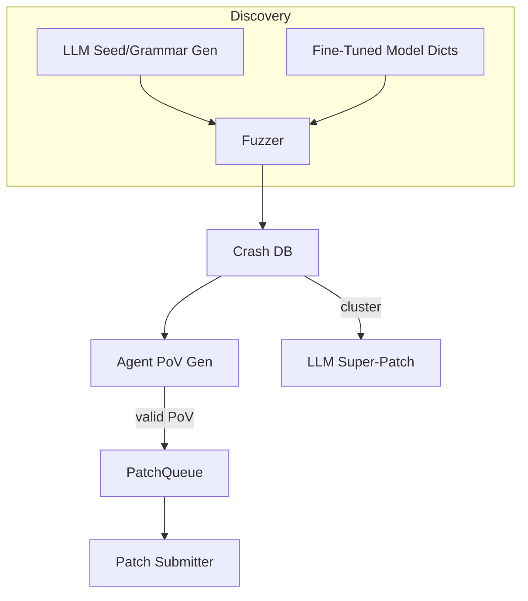

# AI-Assisted Fuzzing & Automated Vulnerability Discovery

{{#include ../banners/hacktricks-training.md}}

## 概要
大規模言語モデル（LLM）は、意味的に豊かな入力の生成、文法の進化、クラッシュデータの推論、さらには複数のバグに対応するパッチの提案によって、従来の脆弱性調査パイプラインを大幅に強化できます。このページでは、DARPAのAI Cyber Challenge（AIxCC）決勝やその他の公開研究で確認された、最も効果的なパターンをまとめます。<sup>[[4]](#references)</sup><sup>[[5]](#references)</sup>

以下では、特定の競技システムについて説明するのではなく、独自のワークフローで再現できるように、各種手法を抽象化して紹介します。

---

## 1. LLMが生成するシード入力

従来のカバレッジガイド型ファザー（AFL++、libFuzzer、Honggfuzzなど）は、少数のシードコーパスから開始し、バイト列を無作為に変異させます。ターゲットの入力形式が複雑な場合（SQL、URL、独自のバイナリプロトコルなど）、無作為な変異では通常、興味深い分岐に到達する前に構文が壊れてしまいます。

LLMは、*シードジェネレーター*、つまり**構文的に正しく、セキュリティ上重要な入力を出力する**短いスクリプトを生成することで、この初期化の問題を解決できます。たとえば、次のようになります。

```prompt
SYSTEM: You are a helpful security engineer.
USER:
Write a Python3 program that prints 200 unique SQL injection strings targeting common anti-pattern mistakes (missing quotes, numeric context, stacked queries).  Ensure length ≤ 256 bytes / string so they survive common length limits.
```

```python
# gen_sqli_seeds.py (truncated)
PAYLOADS = [
    "1 OR 1=1 -- ",
    "' UNION SELECT NULL,NULL--",
    "0; DROP TABLE users;--",
    ...
]
for p in PAYLOADS:
    print(p)
```

一度実行し、出力を fuzzer の初期コーパスに直接投入します:

```bash
python3 gen_sqli_seeds.py > seeds.txt
afl-fuzz -i seeds.txt -o findings/ -- ./target @@
```

Benefits:
1. Semantic validity → 初期段階からより深くカバレッジを得られる。
2. 再生成可能: プロンプトを調整して、XSS、path traversal、binary blobs などに焦点を当てられる。
3. 低コスト（GPT-3.5で 1 ¢ 未満）。

### Tips
* 表面的なフィルターを回避できるよう、payload の長さとエンコーディング（UTF-8、URL-encoded、UTF-16-LE）を*多様化*するようモデルに指示する。
* *自己完結型の単一スクリプト*を求める。JSON の形式上の問題を避けられる。

---

## 2. Grammar-Evolution Fuzzing

より強力な手法として、具体的な seed の代わりに、LLM に**文法を進化**させる方法がある。ワークフロー（「Grammar Guy」パターン）は次のとおり。

1. プロンプトを使って、初期の ANTLR/Peach/LibFuzzer 文法を生成する。
2. N 分間 fuzzing を実行し、カバレッジ指標（ヒットした edge / block）を収集する。
3. 未カバーのプログラム領域を要約し、その要約をモデルにフィードバックする。
   ```prompt
   The previous grammar triggered 12 % of the program edges.  Functions not reached: parse_auth, handle_upload.  Add / modify rules to cover these.
   ```
4. 新しいルールを統合し、再度 fuzzing を行い、繰り返します。

擬似コードの骨組み：

```python
for epoch in range(MAX_EPOCHS):
    grammar = llm.refine(grammar, feedback=coverage_stats)
    save(grammar, f"grammar_{epoch}.txt")
    coverage_stats = run_fuzzer(grammar)
```

要点:
* *budget* を維持する – 各改良でトークンを消費します。
* モデルに書き直しではなく編集をさせるため、`diff` + `patch` の指示を使います。
* Δcoverage < ε になったら停止します。

---

## 3. Local-LLM libFuzzer Harness の設計

解析者のワークステーションから外部に持ち出せないソースコードでは、ローカルのコードモデルを使って、fuzzer のバイト列と C/C++ API の間をつなぐ小さなアダプターを作成できます。重要なのは、セキュリティ上の境界を明確にすることです。**モデルはテスト用インフラストラクチャを作成・修正し、coverage-guided mutation が入力を探索し、sanitizer が不正な操作を報告し、人間がハーネスをレビューして検出事項をトリアージします**。<sup>[[9]](#references)</sup>

LLM に依存しない、エンジンレベルのコーパス、フィードバック、スナップショット、ステートフル fuzzing の手法については、一般的な [Fuzzing Methodology](../generic-methodologies-and-resources/fuzzing.md) を参照してください。

まず、対象ヘッダーから正確な宣言をコピーし、出力形式を制限します。範囲を絞ったプロンプトにより、存在しない API の捏造を減らし、結果をレビューしやすくできます。<sup>[[8]](#references)[[9]](#references)</sup>

```prompt
Write a libFuzzer target for this exact declaration:
int parse_records(const uint8_t *data, size_t size);

Output only C code. Implement LLVMFuzzerTestOneInput, include the
declaration, pass data and size unchanged, and do not use files,
network access, randomness, clocks, threads, or persistent state.
```

生バイトパーサーでは、期待される結果は次のように複雑である必要はありません:<sup>[[6]](#references)[[9]](#references)</sup>

```c
#include <stddef.h>
#include <stdint.h>

extern int parse_records(const uint8_t *, size_t);

int LLVMFuzzerTestOneInput(const uint8_t *data, size_t size) {
    (void)parse_records(data, size);
    return 0;
}
```

Compilationは最初の検証ゲートにすぎません。CPU時間を費やす前に、生成された各ターゲットが以下の不変条件を満たしているか確認してください:<sup>[[6]](#references)[[8]](#references)[[9]](#references)</sup>

- **正確なAPI:** 型、所有権のルール、初期化、ティアダウン、呼び出し規約を、実際のヘッダーおよび既存の呼び出し元と照合します。
- **Harnessの安全性:** `data`からの読み取りをすべてガードします。sanitizerの検出結果は、生成されたglueではなくターゲットに起因する必要があります。
- **再現性:** 結果が`data`と`size`だけで決まるようにします。外部I/O、時刻、制御されていない乱数、joinされていないスレッド、呼び出し間で残る状態を取り除きます。
- **スループット:** 動作に影響しない場合に限り、高コストな不変状態を一度だけ初期化し、入力サイズに上限を設け、ログ出力を抑制し、入力ごとの割り当てを解放します。
- **到達可能性:** 意図した関数や分岐が実行されることを確認します。コンパイルできても拒否パスしか実行しないターゲットは、気づかれにくい失敗です。

### 構造を考慮したターゲット: バグを隠さずに不変条件を維持する

多くの生入力がmagic、長さ、バージョン、チェックサムのゲートで失敗する場合は、fuzz bytesを**型付きフィールドの素材**として使い、有効なオブジェクトを再構築します。フォーマット定数を固定し、セマンティックフィールドとペイロードのバイト列は変更可能なままにし、再構築したペイロードから整合性メタデータを導出します。`FuzzedDataProvider`は上限付きの型付き値の読み取りに便利ですが、生成される割り当てや変換に上限を設ける責任は、引き続きadapterにあります。<sup>[[9]](#references)</sup>

<details>
<summary>構造を考慮したC++ターゲットの例</summary>

```cpp
#include <fuzzer/FuzzedDataProvider.h>
#include <stddef.h>
#include <stdint.h>
#include <vector>

extern "C" int parse_message(const uint8_t *, size_t);

extern "C" int LLVMFuzzerTestOneInput(const uint8_t *data, size_t size) {
    FuzzedDataProvider fdp(data, size);
    uint8_t version = fdp.ConsumeIntegral<uint8_t>();
    auto body = fdp.ConsumeRemainingBytes<uint8_t>();
    if (body.size() > UINT16_MAX) body.resize(UINT16_MAX);
    uint16_t len = static_cast<uint16_t>(body.size());
    std::vector<uint8_t> msg = {0x8b, 'M', 'S', 'G', version,
                                static_cast<uint8_t>(len >> 8),
                                static_cast<uint8_t>(len)};
    msg.insert(msg.end(), body.begin(), body.end());
    (void)parse_message(msg.data(), msg.size());
    return 0;
}
```

</details>

すべての質問に対して、構造を修復するターゲットを1つだけ使わないでください。深い有効状態を探索するために長さやチェックサムを導出するターゲットと、ハーネス自身の読み取りとメモリ割り当てだけを制限し、**宣言された**メタデータはfuzzerに制御させるターゲットを別々に用意します。2つ目のターゲットでは、長さの不一致や整合性チェックの失敗という攻撃面が保たれます。これらは自動修復すると失われます。<sup>[[9]](#references)</sup>

### シード、辞書、サニタイザ、カバレッジフィードバック

モデルにはバイナリを直接出力させるのではなく、バイナリシードを書き込むスクリプトを生成させます。空、最小、一般的、境界条件を満たすオブジェクトをシードにし、その後、マジック値、タグ、enumのエンコーディング、パーサーのキーワードを抽出して、レビュー済みの辞書にまとめます。libFuzzerは`-dict=`でその辞書を受け取り、新しいカバレッジを見つけたミューテーションをコーパスに保持します。<sup>[[6]](#references)[[9]](#references)</sup>

```text
magic="\x8bMSG"
version_min="\x00"
version_max="\xff"
config_tag="CONFIG"
```

補完的な instrumentation を使って、同じターゲットをビルドします。ASan と UBSan は同じ fuzzing バイナリで併用できます。未 instrument のコードが原因のレポートを避けるため、MSan は別途ビルドし、その依存関係も instrument してください。<sup>[[6]](#references)[[9]](#references)</sup>

```bash
clang++ -g -O1 -fsanitize=fuzzer,address,undefined \
  -fno-sanitize-recover=undefined target.cc harness.cc -o fuzz_target
./fuzz_target corpus -dict=msg.dict -max_len=65535

clang++ -g -O1 -fsanitize=fuzzer,memory \
  target.cc harness.cc -o fuzz_target_msan
```

各モデルのrevisionはcoverageを評価基準にします。libFuzzerの出力で`cov`/`ft`が序盤から横ばいで、corpusも変化しない場合は、frameの不備、早すぎるreturn条件の制約が強すぎること、または呼び出し先の誤りが考えられます。`exec/s`が低い場合は、コストの高いsetup、I/O、allocation、またはstateのリークが原因の可能性があります。`NEW`が示すのはcoverage featureが変化したことだけであり、意図したparserに到達した証明にはなりません。<sup>[[6]](#references)[[9]](#references)</sup>

source-level feedbackを得るには、coverage buildを作成してfuzzし、未カバーの関数と、それらを制御する条件だけをモデルに渡します。生成されたharness/seed/dictionaryのdiffを検証し、再度測定します。<sup>[[7]](#references)[[8]](#references)[[9]](#references)</sup>

```bash
clang++ -g -O1 -fsanitize=fuzzer \
  -fprofile-instr-generate -fcoverage-mapping target.cc harness.cc -o fuzz_cov
mkdir -p profiles
LLVM_PROFILE_FILE='profiles/%p.profraw' ./fuzz_cov -max_total_time=300 corpus
llvm-profdata merge -sparse profiles/*.profraw -o fuzz.profdata
llvm-cov report ./fuzz_cov -instr-profile=fuzz.profdata
llvm-cov show ./fuzz_cov -instr-profile=fuzz.profdata \
  --show-branches=count --region-coverage-lt=1 target.cc
```

スケーラブルなループは、したがって **生成 → compile/link → sanitizer 下での smoke-test → target coverage の測定 → 最小限の関連する coverage/source context の提供 → 修正 → 再測定** となります。OSS-Fuzz-Gen も同じ原則を適用し、もっともらしいコードをそのまま受け入れるのではなく、生成した target のコンパイル可能性、runtime failure、coverage、および既存 target に対する coverage の改善を評価します。<sup>[[7]](#references)[[8]](#references)</sup>

---

## 4. エージェントベースの PoV (Exploit) 生成

crash が見つかった後も、それを確実に発生させる **proof-of-vulnerability (PoV)** が必要です。

スケーラブルな方法は、多数の軽量 worker（process、thread、または container）を起動し、それぞれ異なる model または sampling configuration を使わせることです。AIxCC finalist survey には、規模の具体例が示されています。あるチームは AI-first PoV 生成に **数千の同時稼働 agent** を使用し、別のチームは **300–500 の fuzzing agent** を統括し、より高度な意味的推論には LLM を利用しました。<sup>[[4]](#references)</sup>

Pipeline:
1. Static/dynamic analysis により *bug candidate* を生成（crash PC、input slice、sanitizer msg を含む struct）。
2. Orchestrator が candidate を agent に配布。
3. Agent の推論ステップ:
   a. `gdb` + input を使って bug をローカルで再現。
   b. 最小限の exploit payload を提案。
   c. sandbox 内で exploit を検証。成功したら → submit。
4. 失敗した試行は、coverage fuzzing 用の新しい seed として **再キューイング** されます（feedback loop）。

利点:
* 並列化により、単一 agent の信頼性の低さを補います。
* 観測された成功率に基づいて、temp / model size を自動調整します。

---

## 5. Fine-Tuned Code Model による Directed Fuzzing

脆弱性パターン（integer overflow、buffer copy、format string）のラベルを付けた C/C++ source で、open-weight model（例: Llama-7B）を fine-tune します。その後:

1. Static analysis を実行して、function list + AST を取得。
2. Model にプロンプトを送信: *「function X の memory safety を破る可能性が高い mutation dictionary のエントリーを提示してください」*。
3. それらの token をカスタム `AFL_CUSTOM_MUTATOR` に挿入。

`sprintf` wrapper に対する出力例:
```
{"pattern":"%99999999s"}
{"pattern":"AAAAAAAA....<1024>....%n"}
```

実環境のターゲットでは、経験的にクラッシュまでの時間が2倍以上短縮されます。

---

## 6. AI誘導型パッチ戦略

### 6.1 スーパー・パッチ
モデルにクラッシュシグネチャを*クラスタリング*させ、共通の根本原因を取り除く**単一のパッチ**を提案させます。一度の提出で複数のバグを修正できるため、誤ったパッチごとに減点される環境では、精度に対するペナルティを抑えられます。

プロンプトの概要:
```
Here are 10 stack traces + file snippets.  Identify the shared mistake and generate a unified diff fixing all occurrences.
```

{{#ref}}
../generic-methodologies-and-resources/fuzzing.md
{{#endref}}

### 6.2 推測的パッチ比率
PoVで検証済みの確定パッチと、PoVのない*推測的*パッチを、スコアリングルールに合わせて調整した1:Nの比率（例: 推測的パッチ2件 : 確定パッチ1件）で交互に処理するキューを実装します。コストモデルがペナルティとポイントを監視し、Nを自動調整します。

---

## 7. 決定論的なファイル単位のAIコードレビュー

AI支援レビューでよくある失敗は、1つのagentにリポジトリ全体を調査させ、適切なファイルやgrep用語を選ぶことを期待することです。より信頼性の高い方法は、**リポジトリ全体を漏れなく調査することを強制する**ことです:<sup>[[1]](#references)</sup>

1. ソースファイルを列挙します。
2. **一度に1ファイルずつ**、最小限のコンテキスト（entrypoint、imports、近隣のroutes/callers）とともに渡します。
3. 各ファイルについて、sources、sink、検証不足、exploitの前提条件、確信度を含む**構造化レポート**を必須にします。<sup>[[3]](#references)</sup>
4. **source→sinkパターン**でレポートを重複排除し、リスクの高いものを手動で検証します。

トークン消費が多くノイズもありますが、広範なagentic reviewでは見落とされがちな**単純で影響の大きいsource/sinkバグ**を発見するうえで非常に効果的です。

### 優先度を上げる価値のあるトリアージパターン

- **動的なPHP include/dispatch**: 攻撃者が制御するroute/controller/module名が、厳格なallowlistやパスの正規化を経ずに`require_once()`、`include()`、`include_once()`へ渡される。
- **admin/accountワークフローでのshell実行**: usernames、domains、FTP accountsなどの識別子が`exec()`、`system()`、`shell_exec()`、`passthru()`、`proc_open()`、`popen()`に渡される。
- **構造化入力の集約**: 同じパラメータが`$_GET`、`$_POST`、JSON、XML、またはframeworkのbody parserから受け付けられ、後でfilesystemやOS-command sinkに再利用される。

### この方法で見つけやすい実用的なバグクラス2つ

- **PHP controller-dispatch LFI/RCE**: requestで制御されるcontroller名がallowlistやパス正規化なしに`require_once()`へ連結される場合、`../`などのtraversal sequenceによって、意図しないローカル`.php`ファイルをPHPにincludeさせることができます。攻撃者が、配置した、または別の方法で利用可能なPHPファイルをincludeさせられる場合、LFIはコード実行につながります。[File Inclusion / Path Traversal](../pentesting-web/file-inclusion/README.md)を参照してください。<sup>[[1]](#references)</sup>
- **hosting/admin panelでの認証済みcommand injection**: usernamesなどのアカウント管理フィールドがshell commandに埋め込まれている場合、低権限の認証済みユーザーが通常の作成・削除操作をRCEにつなげられる可能性があります。panelがより高い権限を持つservice accountとしてcommandを実行する場合、影響はさらに大きくなります。[Command Injection](../pentesting-web/command-injection.md)を参照してください。<sup>[[1]](#references)</sup>

### 実用的なレビューの注意点

- LLMは、まずexploit生成器ではなく**source/sink reviewer**として使います。
- **攻撃者が制御するフィールド**、**正規化/検証の不足**、**危険なsink**を明示的に列挙するよう指示します。
- 大規模なリポジトリでは、より強力なモデルを使う場合でも、単一の自律agentによる実行より、決定論的なファイル単位のレビューのほうが信頼性が高いことがよくあります。<sup>[[2]](#references)</sup>
- exploitabilityがファイル間の前提、roleの意味、または製品固有の脅威モデルに依存する**Broken Access Control**やその他のビジネスロジックバグでは、結果が弱くなることを想定してください。

---

## 8. 計測機能付きoracleによるパターン誘導型kernel監査

kernel規模のターゲットでは、tree全体から任意のバグを見つけるようagentに指示しないでください。よりトークン効率の高いワークフローでは、過去の脆弱性に関する知識を静的クエリに変換し、露出した攻撃対象領域に基づいて結果を順位付けし、計測機能付きkernelを実行oracleとして使用します。<sup>[[11]](#references)</sup>

### パターンデータベース → CodeQL/Semgrep → 集中的なレビュー

危険なAPI、検証不足のパターン、リスクのあるsource-to-sinkフロー、過去に修正されたバグの形状を含む、小規模なナレッジベースを構築します。モデルには**一度に1つのパターンずつ**レビュー用ヒューリスティックやCodeQL/Semgrepルールに変換するよう指示し、その後、それらの決定論的なルールをtree全体に実行します。結果をまとめて重複排除してからコードをモデルに渡してください。scannerの生出力には、価値の低い候補が何千件も含まれることがあります。対象が適格なresearchまたはopen-source対象の範囲外である場合、この方法を使う前にCodeQLの現在のライセンスを確認してください。<sup>[[11]](#references)</sup>

ヒット数だけでなく、**ルールのヒット密度**と**攻撃者からの到達可能性**の両方を使ってsubsystemに優先順位を付けます。非特権プロセス、sandbox、container、jail、guest contextから到達可能なkernel interfaceは、内部専用のコードより重視します。agentがcaller、validator、lifetimeのルールを保持できる程度にレビュー単位を小さく保ち、「脆弱性を何でも見つけて」ではなく、明示した脆弱性クラスやcontrol-flowパターンについて調べるよう指示します。新しいcontainment boundaryによってnamespacedまたはjailed root userから到達可能になっている場合、古い特権interfaceは特に注目に値します。<sup>[[11]](#references)</sup>

各候補について、exploitを試みる前に、明示的なfield-flow記録を必須にします。<sup>[[11]](#references)</sup>

```text
entrypoint -> privilege check -> parser -> validation/normalization
           -> later rewrite -> dangerous sink
attacker controls: <fields and lengths>
constraints:       <values rewritten, rejected, or preserved>
observable result: <sanitizer report, assertion, panic, or clean exit>
```

### 仮説オラクルとしてKASAN telemetryを使う

KASANと有用な診断用アサーションを有効にした使い捨てVMで、対象のkernelを実行します。エージェントは、疑われる破損が再現または否定されるまで、**ソース仮説 → 最小限のuserlandトリガー → VMでの実行 → KASAN/assertionのトレース → 仮説の修正**を繰り返します。各反復では、関連するstack traceとその周辺のソースだけを返してください。これにより推論に必要なコンテキストを保ちながら、モデルの確信度ではなく実行時の証拠を判定基準にできます。<sup>[[11]](#references)</sup>

計装済みビルドは、最終的なexploitability評価環境ではありません。アサーションによって破壊操作の前に実行が停止する一方、同じアサーションがproduction kernelではコンパイル時に除去されている場合があります。変更していないトリガーを、正確なproduction構成に対して再テストし、kernelのビルドと構成を記録してください。また、**到達可能性**、**メモリ破壊**、**制御可能なプリミティブ**、**セキュリティへの影響**を別々の主張として区別してください。<sup>[[11]](#references)[[12]](#references)</sup>

CVE-2026-3038は、exploitのテンプレートではなく、有用な検証例です。権限のないFreeBSD `RTM_GET`リクエストは、選択的な検証と応答の書き換えをすり抜けて、サイズ超過の`RTAX_AUTHOR` sockaddrを保持できました。その後、`rtsock_msg_buffer()`がユーザー制御の`sa_len`を128バイトのstack `sockaddr_storage`にコピーしました。最大255バイトのコピーによって127バイトの上書きが発生しました。計装済みビルドでは診断用アサーションが不正な長さを検出しましたが、GENERIC kernelではコピーが実行され、その後、破損したcanaryの検査時にpanicが発生しました。これは権限のないユーザーによるdenial of serviceを証明しますが、単独でのprivilege escalationを証明するものではありません。確実に制御するには、まずcanary disclosureなどの別のプリミティブが必要です。対応するbinary-exploitation上の境界については、[Stack Canaries](../binary-exploitation/common-binary-protections-and-bypasses/stack-canaries/index.html)を参照してください。<sup>[[11]](#references)[[12]](#references)[[13]](#references)</sup>

### exploitの前提条件を偽装した検証を排除する

PoVやexploitを受け入れる前に、別のreviewer/agentに固定基準に照らして反証を試みさせてください。レビューでは、以下の条件をすべて確認する必要があります。<sup>[[11]](#references)</sup>

- 経路を到達可能にするために、対象のソース、kernel、脆弱なmoduleが変更されていない。
- helper module、合成gadget、無効化されたmitigation、追加の権限、利用できないinterfaceが導入されていない。
- クリーンなsnapshot上で、主張する呼び出し元のidentityと隔離制約からトリガーが開始される。
- 主張する結果が依然としてバグに依存している。malformed fieldを取り除くか、バグだけをpatchすると、攻撃の連鎖が成立しなくなる。
- crash、overread、overwriteは、それぞれ該当するプリミティブとしてのみ報告されている。code executionやprivilege escalationには独立した証拠が必要である。

最後の反実仮想チェックは、循環した実証を見つけるのに役立ちます。前提条件だけですでに主張する影響が得られている場合（たとえば、`nosuid`なしでmountされたfilesystem上の攻撃者提供のSUIDコンテンツを実行する場合）、そのメモリ安全性バグがその影響を生み出したわけではありません。<sup>[[11]](#references)</sup>

---

## 不慣れなコードベースにおける監査可能なエージェント支援型リサーチ

[graph-first fuzz-target workflow](../generic-methodologies-and-resources/fuzzing.md#graph-first-fuzz-target-selection-and-mutation-triage)ではすでにentrypointへの到達可能性を扱っており、[agentic SAST pipelines](../network-services-pentesting/pentesting-web/code-review-tools.md#agentic-sast-pipelines)では段階的なレビューと証拠ゲートを扱っています。これらの決定論的な結果はモデルの仮説と分けて管理し、採用するすべての候補にソース位置、経路の証拠、動的測定値を保持してください。<sup>[[10]](#references)</sup>

### data flowを捏造せずにobjectのlifetimeに関する証拠を関連付ける

静的解析では、ある関数で攻撃者制御の長さが保存され、ずっと後に同じobject fieldがcopy sinkに到達することを検出できても、callback、再接続、objectのlifetimeをまたいだつながりを証明できない場合があります。両方の検出結果を個別に保持し、object/fieldごとにクラスタリングして、不足しているedgeを明示的なtriage上の確認事項にしてください。エージェントはその関係を提案できますが、ソースレビューまたはruntime instrumentationによる証明が必要です。<sup>[[10]](#references)</sup>

候補ごとに、以下を記録してください。

- 具体的なentrypointと、攻撃者が制御するbyte列。
- 関連fieldのすべてのproducerと、各producerに固有の検証。
- sink、destinationの容量、および到達に必要なbuild/runtime条件。
- 露出したentrypointからの実際のcall stack。直接のharness呼び出しだけでは不十分です。
- 仮説を確認または否定する、最小限の動的結果。

一見安全な経路があっても、field全体の安全性が保証されるわけではありません。別のproducerが、最初の経路にある上限チェックなしで同じfieldに値を設定する可能性があります。経路を個別にテストし、debug assertionによってproductionでのメモリ破壊がテスト時だけの早期中断に変わらないよう、deployment相当のbuild optionsでharnessを実行してください。<sup>[[10]](#references)</sup>

### disclosureとexploitabilityの測定ゲート

初期化されていないメモリのdisclosureが疑われる場合は、新しいallocationを識別可能なbyteで埋め、正確にそのmarkerが出力されるpacketに到達することを確認してください。exploitabilityについては、**制御可能なoverwrite → 有用なvictim object → disclosure → pointer/baseの復元 → control-flow hijack → payloadの合成**など、測定可能なゲートを必須にしてください。harnessが現在の性質を証明した場合にのみ、エージェントは次に進みます。もっともらしい説明だけではゲート通過になりません。[FreeRDPの事例](../binary-exploitation/libc-heap/heap-overflow.md#cross-path-length-reuse-and-stale-output-disclosure)は、検証時に維持すべき経路とbuild上の制約を示しています。<sup>[[10]](#references)</sup>

---

## 全体のまとめ
end-to-endのCRS（Cyber Reasoning System）は、コンポーネントを次のように連携させられます。



---

## References

- [1] [Project Black - サイバーセキュリティ向けローカルAI：phpIPAMのLFIとmyVestaの認証済みRCEを発見](https://projectblack.io/blog/local-ai-for-cyber-security)
- [2] [Strix](https://github.com/usestrix/strix)
- [3] [GitHub Copilot コミュニティのsecurity-reviewスキル](https://github.com/github/awesome-copilot/blob/main/skills/security-review/SKILL.md)
- [4] [Trail of Bits – AIxCC決勝：勝負の記録](https://blog.trailofbits.com/2025/08/07/aixcc-finals-tale-of-the-tape/)
- [5] [CTF RadioooによるAIxCCファイナリストへのインタビュー](https://www.youtube.com/@ctfradiooo)
- [6] [LLVM — libFuzzer：カバレッジガイド付きファジングテスト用ライブラリ](https://llvm.org/docs/LibFuzzer.html)
- [7] [Google — OSS-Fuzz-Gen](https://github.com/google/oss-fuzz-gen)
- [8] [Google Online Security Blog — ファジングをレベルアップ：AIでより多くの脆弱性を発見](https://security.googleblog.com/2024/11/leveling-up-fuzzing-finding-more.html)
- [9] [8kSec — ローカルLLMによるAI支援型ファジングハーネス生成](https://8ksec.io/ai-assisted-fuzzing-harness-local-llm)
- [10] [Quarkslab — AIエージェントからRCEまで：脆弱性リサーチのワークフロー構築](https://blog.quarkslab.com/from-ai-agents-to-rce-building-a-vulnerability-research-workflow.html)
- [11] [Praetorian — FreeBSoD：言語モデルを活用したカーネルバグの発見と悪用（全2部の第1部）](https://praetorian.com/blog/ai-vulnerability-research-freebsd-kernel)
- [12] [FreeBSD-SA-26:05.route — ルーティングソケット経由のローカルDoSと権限昇格の可能性](https://www.freebsd.org/security/advisories/FreeBSD-SA-26:05.route.asc)
- [13] [FreeBSD-SA-26:05.route ソースパッチ](https://security.FreeBSD.org/patches/SA-26:05/route.patch)
{{#include ../banners/hacktricks-training.md}}
