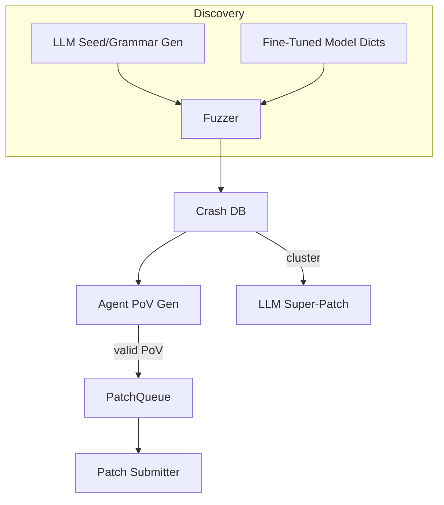

# Фаззинг за допомогою AI та автоматизоване виявлення вразливостей

{{#include ../banners/hacktricks-training.md}}

## Огляд
Великі мовні моделі (LLM) можуть значно посилити традиційні процеси дослідження вразливостей: генерувати семантично насичені вхідні дані, розвивати граматики, аналізувати дані про збої й навіть пропонувати виправлення, що усувають кілька помилок. На цій сторінці зібрано найефективніші підходи, виявлені під час фіналу AI Cyber Challenge (AIxCC) від DARPA та інших публічних досліджень.<sup>[[4]](#references)</sup><sup>[[5]](#references)</sup>

Далі описано не одну конкретну систему змагання, а узагальнення методів, які ви можете відтворити у власних робочих процесах.

---

## 1. Генерація початкових вхідних даних за допомогою LLM

Традиційні coverage-guided фаззери (AFL++, libFuzzer, Honggfuzz…) починають із невеликого корпусу seed-даних і бездумно мутують байти. Коли формат вхідних даних цільової програми складний (SQL, URL-адреси, власні бінарні протоколи), випадкові мутації зазвичай порушують синтаксис ще до того, як буде досягнуто цікавих гілок виконання.

LLM можуть розв’язати цю проблему початкового запуску, створюючи *генератори seed-даних* — короткі скрипти, що виводять **синтаксично коректні, але важливі з погляду безпеки вхідні дані**. Наприклад:

```prompt
SYSTEM: You are a helpful security engineer.
USER:
Write a Python3 program that prints 200 unique SQL injection strings targeting common anti-pattern mistakes (missing quotes, numeric context, stacked queries).  Ensure length ≤ 256 bytes / string so they survive common length limits.
```

```python
# gen_sqli_seeds.py (truncated)
PAYLOADS = [
    "1 OR 1=1 -- ",
    "' UNION SELECT NULL,NULL--",
    "0; DROP TABLE users;--",
    ...
]
for p in PAYLOADS:
    print(p)
```

Запустіть один раз і безпосередньо передайте вивід до початкового корпусу фаззера:

```bash
python3 gen_sqli_seeds.py > seeds.txt
afl-fuzz -i seeds.txt -o findings/ -- ./target @@
```

Benefits:
1. Семантична валідність → глибше покриття на ранніх етапах.
2. Можна генерувати повторно: змініть prompt, щоб зосередитися на XSS, path traversal, binary blobs тощо.
3. Дешево (< 1 ¢ з GPT-3.5).

### Поради
* Попросіть модель урізноманітнити довжину payload і кодування (UTF-8, URL-encoded, UTF-16-LE), щоб обходити поверхневі фільтри.
* Попросіть створити один самодостатній скрипт — це допоможе уникнути проблем із форматуванням JSON.

---

## 2. Grammar-Evolution Fuzzing

Потужніший варіант — попросити LLM **еволюціонувати граматику**, а не конкретні seeds. Робочий процес (патерн “Grammar Guy”):

1. Згенеруйте початкову граматику ANTLR/Peach/LibFuzzer за допомогою prompt.
2. Виконуйте fuzzing протягом N хвилин і збирайте метрики покриття (досягнуті ребра / блоки).
3. Підсумуйте непокриті ділянки програми й передайте цей підсумок моделі:
   ```prompt
   The previous grammar triggered 12 % of the program edges.  Functions not reached: parse_auth, handle_upload.  Add / modify rules to cover these.
   ```
4. Об’єднайте нові правила, виконайте re-fuzz і повторіть.

Каркас псевдокоду:

```python
for epoch in range(MAX_EPOCHS):
    grammar = llm.refine(grammar, feedback=coverage_stats)
    save(grammar, f"grammar_{epoch}.txt")
    coverage_stats = run_fuzzer(grammar)
```

Ключові моменти:
* Дотримуйтеся *бюджету* — кожне уточнення витрачає токени.
* Використовуйте інструкції `diff` + `patch`, щоб модель редагувала, а не переписувала.
* Зупиніться, коли Δcoverage < ε.

---

## 3. Розробка libFuzzer Harness для локальної LLM

Якщо вихідний код не може залишати робочу станцію аналітика, локальна кодова модель може створити невеликий адаптер між байтами fuzzer і API C/C++. Межі безпеки мають бути чітко визначені: **модель пише та доопрацьовує тестову інфраструктуру; мутації з керуванням покриттям досліджують вхідні дані; санітайзери повідомляють про некоректні операції; людина перевіряє harness і сортує результати**.<sup>[[9]](#references)</sup>

Про методи роботи з corpus, зворотним зв’язком, snapshot і stateful fuzzing на рівні рушія, які не залежать від LLM, див. загальну [методологію fuzzing](../generic-methodologies-and-resources/fuzzing.md).

Почніть із точного оголошення, скопійованого із заголовка цільової програми, і задайте обмеження для формату виводу. Вузький запит зменшує ймовірність вигаданих API та спрощує перевірку результату:<sup>[[8]](#references)[[9]](#references)</sup>

```prompt
Write a libFuzzer target for this exact declaration:
int parse_records(const uint8_t *data, size_t size);

Output only C code. Implement LLVMFuzzerTestOneInput, include the
declaration, pass data and size unchanged, and do not use files,
network access, randomness, clocks, threads, or persistent state.
```

Для парсера сирих байтів очікуваний результат має бути не складнішим за:<sup>[[6]](#references)[[9]](#references)</sup>

```c
#include <stddef.h>
#include <stdint.h>

extern int parse_records(const uint8_t *, size_t);

int LLVMFuzzerTestOneInput(const uint8_t *data, size_t size) {
    (void)parse_records(data, size);
    return 0;
}
```

Компіляція — лише перший етап перевірки. Перш ніж витрачати на ціль CPU-час, перевірте кожну згенеровану ціль на відповідність таким інваріантам:<sup>[[6]](#references)[[8]](#references)[[9]](#references)</sup>

- **Точний API:** звірте типи, правила володіння, ініціалізацію, звільнення ресурсів і угоду про виклик із реальним заголовним файлом та наявними викликами.
- **Безпечність harness:** захистіть кожне читання з `data`; помилки, виявлені sanitizer-ом, мають виникати в цілі, а не в згенерованому glue-коді.
- **Відтворюваність:** результат має бути функцією від `data` і `size`; усуньте зовнішній ввід-вивід, залежність від часу, неконтрольовану випадковість, нез’єднані потоки й стан, що зберігається між викликами.
- **Пропускна здатність:** ініціалізуйте дорогий незмінний стан лише один раз і лише якщо це не впливає на поведінку, обмежте розмір вводу, вимкніть логування та звільняйте виділену для кожного вводу пам’ять.
- **Досяжність:** перевірте, чи виконуються потрібні функції та гілки. Ціль, яка компілюється, але проходить лише шляхами відхилення, — це непомітна помилка.

### Цілі, що враховують структуру: зберігайте інваріанти, не приховуючи помилки

Якщо більшість необроблених входів не проходять перевірку magic-значення, довжини, версії або контрольної суми, використовуйте байти fuzz-вводу як **матеріал для типізованих полів** і перебудовуйте валідний об’єкт. Фіксуйте константи формату, залишайте семантичні поля й байти даних змінними та обчислюйте метадані цілісності на основі перебудованих даних. `FuzzedDataProvider` зручно використовувати для отримання обмежених типізованих значень, а адаптер відповідає за обмеження будь-якого згенерованого виділення пам’яті та перетворення.<sup>[[9]](#references)</sup>

<details>
<summary>Приклад C++-цілі, що враховує структуру</summary>

```cpp
#include <fuzzer/FuzzedDataProvider.h>
#include <stddef.h>
#include <stdint.h>
#include <vector>

extern "C" int parse_message(const uint8_t *, size_t);

extern "C" int LLVMFuzzerTestOneInput(const uint8_t *data, size_t size) {
    FuzzedDataProvider fdp(data, size);
    uint8_t version = fdp.ConsumeIntegral<uint8_t>();
    auto body = fdp.ConsumeRemainingBytes<uint8_t>();
    if (body.size() > UINT16_MAX) body.resize(UINT16_MAX);
    uint16_t len = static_cast<uint16_t>(body.size());
    std::vector<uint8_t> msg = {0x8b, 'M', 'S', 'G', version,
                                static_cast<uint8_t>(len >> 8),
                                static_cast<uint8_t>(len)};
    msg.insert(msg.end(), body.begin(), body.end());
    (void)parse_message(msg.data(), msg.size());
    return 0;
}
```

</details>

Не використовуйте одну ціль із виправленням структури для кожного запитання. Підтримуйте одну ціль, яка обчислює довжини/контрольні суми, щоб досліджувати глибокі валідні стани, і ще одну, у якій fuzzer контролює **оголошені** метадані, а обмежуються лише власні читання й виділення пам’яті harness. Друга ціль зберігає поверхні атак із невідповідними довжинами та некоректною цілісністю даних, які автоматичне виправлення інакше усунуло б.<sup>[[9]](#references)</sup>

### Початкові файли, словники, санітайзери та зворотний зв’язок за покриттям

Попросіть модель згенерувати скрипт, який записує бінарні початкові файли, а не виводить їх безпосередньо. Підготуйте порожні, мінімальні, типові та гранично валідні об’єкти, а потім витягніть магічні значення, теги, кодування enum і ключові слова парсера до перевіреного словника. libFuzzer приймає такий словник із параметром `-dict=` і зберігає в корпусі мутації, які відкривають нове покриття.<sup>[[6]](#references)[[9]](#references)</sup>

```text
magic="\x8bMSG"
version_min="\x00"
version_max="\xff"
config_tag="CONFIG"
```

Зберіть ту саму ціль із додатковою інструментацією. ASan і UBSan можна використовувати в одному fuzzing-бінарному файлі; для MSan створіть окрему збірку та інструментуйте її залежності, щоб уникнути звітів, спричинених неінструментованим кодом.<sup>[[6]](#references)[[9]](#references)</sup>

```bash
clang++ -g -O1 -fsanitize=fuzzer,address,undefined \
  -fno-sanitize-recover=undefined target.cc harness.cc -o fuzz_target
./fuzz_target corpus -dict=msg.dict -max_len=65535

clang++ -g -O1 -fsanitize=fuzzer,memory \
  target.cc harness.cc -o fuzz_target_msan
```

Розглядайте покриття як критерій оцінювання кожної версії моделі. У виводі libFuzzer ранні пласкі показники `cov`/`ft` і статичний корпус зазвичай свідчать про неправильне формування вхідних даних, надто обмежувальне раннє повернення або неправильний виклик; низький `exec/s` вказує на затратне налаштування, I/O, виділення пам’яті або витік стану. `NEW` лише доводить, що змінилася певна функція покриття, а не те, що було досягнуто потрібного парсера.<sup>[[6]](#references)[[9]](#references)</sup>

Щоб отримати зворотний зв’язок на рівні вихідного коду, створіть збірку з покриттям, запустіть fuzzing і надайте моделі лише непокриті функції та умови, що їх обмежують. Перевірте відмінності в harness/seed/dictionary, а потім знову виміряйте результат:<sup>[[7]](#references)[[8]](#references)[[9]](#references)</sup>

```bash
clang++ -g -O1 -fsanitize=fuzzer \
  -fprofile-instr-generate -fcoverage-mapping target.cc harness.cc -o fuzz_cov
mkdir -p profiles
LLVM_PROFILE_FILE='profiles/%p.profraw' ./fuzz_cov -max_total_time=300 corpus
llvm-profdata merge -sparse profiles/*.profraw -o fuzz.profdata
llvm-cov report ./fuzz_cov -instr-profile=fuzz.profdata
llvm-cov show ./fuzz_cov -instr-profile=fuzz.profdata \
  --show-branches=count --region-coverage-lt=1 target.cc
```

Масштабований цикл, отже, такий: **генерація → компіляція/лінкування → smoke-тестування із санітайзерами → вимірювання покриття цілі → надання найменшого релевантного контексту покриття/вихідного коду → доопрацювання → повторне вимірювання**. OSS-Fuzz-Gen застосовує той самий принцип: оцінює згенеровані цілі за компільованістю, помилками під час виконання, покриттям і покращенням покриття порівняно з наявними цілями, а не приймає правдоподібний код на віру.<sup>[[7]](#references)[[8]](#references)</sup>

---

<a id="3-agent-based-pov-exploit-generation" hidden>3. Генерація PoV (експлойтів) на основі агентів</a>

## 4. Генерація PoV (експлойтів) на основі агентів

Після виявлення збою вам усе ще потрібен **proof-of-vulnerability (PoV)**, який детерміновано його відтворює.

Масштабований підхід — запустити багато легковагих робочих процесів (процесів, потоків або контейнерів), кожен із яких використовує окрему модель або конфігурацію семплювання. Огляд фіналістів AIxCC наводить конкретні приклади масштабування: одна команда використовувала **тисячі паралельних агентів** для генерації PoV з пріоритетом AI, тоді як інша координувала **300–500 агентів fuzzing** і залишала LLM для семантичного аналізу вищого рівня.<sup>[[4]](#references)</sup>

Конвеєр:
1. Статичний/динамічний аналіз знаходить *кандидатів на вразливість* (структуру з адресою інструкції збою, фрагментом вхідних даних і повідомленням санітайзера).
2. Оркестратор розподіляє кандидатів між агентами.
3. Кроки міркування агента:
   a. Відтворити помилку локально за допомогою `gdb` і вхідних даних.
   b. Запропонувати мінімальне навантаження експлойта.
   c. Перевірити експлойт у sandbox. Якщо успішно → надіслати.
4. Невдалі спроби **повторно ставляться в чергу як нові сіди** для fuzzing з покриттям (цикл зворотного зв’язку).

Переваги:
* Паралелізація приховує ненадійність окремого агента.
* Автоналаштування temp / розміру моделі на основі спостережуваного відсотка успіху.

---

<a id="4-directed-fuzzing-with-fine-tuned-code-models" hidden>4. Спрямований fuzzing за допомогою донавчених моделей коду</a>

## 5. Спрямований fuzzing за допомогою донавчених моделей коду

Донавчіть модель з відкритими вагами (наприклад, Llama-7B) на вихідному коді C/C++ з розміченими шаблонами вразливостей (цілочисельне переповнення, копіювання буфера, format string). Потім:

1. Виконайте статичний аналіз, щоб отримати список функцій і AST.
2. Запитайте модель: *«Надай записи словника мутацій, які можуть порушити безпеку пам’яті у функції X»*.
3. Вставте ці токени у власний `AFL_CUSTOM_MUTATOR`.

Приклад результату для обгортки `sprintf`:
```
{"pattern":"%99999999s"}
{"pattern":"AAAAAAAA....<1024>....%n"}
```

Емпірично це скорочує час до збою більш ніж удвічі на реальних цілях.

---

<a id="5-ai-guided-patching-strategies" hidden>5. Стратегії виправлення коду за допомогою ШІ</a>

## 6. Стратегії виправлення коду за допомогою ШІ

<a id="51-super-patches" hidden>5.1 Суперпатчі</a>

### 6.1 Суперпатчі
Попросіть модель *кластеризувати* сигнатури збоїв і запропонувати **єдиний патч**, що усуває спільну першопричину. Надішліть один раз і виправте кілька багів → менше штрафів за точність у середовищах, де кожен неправильний патч коштує балів.

Структура промпту:
```
Here are 10 stack traces + file snippets.  Identify the shared mistake and generate a unified diff fixing all occurrences.
```

{{#ref}}
../generic-methodologies-and-resources/fuzzing.md
{{#endref}}

<a id="52-speculative-patch-ratio" hidden>5.2 Коефіцієнт спекулятивних патчів</a>

### 6.2 Коефіцієнт спекулятивних патчів
Створіть чергу, у якій підтверджені патчі, перевірені PoV, чергуються зі *спекулятивними* патчами (без PoV) у співвідношенні 1:​N, налаштованому відповідно до правил оцінювання (наприклад, 2 спекулятивні : 1 підтверджений). Модель витрат відстежує штрафи та бали й автоматично коригує N.

---

<a id="6-deterministic-file-by-file-ai-code-review" hidden>6. Детермінований AI-аналіз коду по файлах</a>

## 7. Детермінований AI-аналіз коду по файлах

Поширена причина невдач під час AI-аналізу — попросити одного агента перевірити весь репозиторій і сподіватися, що він вибере потрібні файли й пошукові терміни. Надійніший підхід — **примусово охопити весь репозиторій**:<sup>[[1]](#references)</sup>

1. Перелічіть файли з вихідним кодом.
2. Передавайте **по одному файлу** з мінімальним контекстом (точка входу, імпорти, суміжні маршрути/місця виклику).
3. Вимагайте для кожного файлу **структурований звіт**: джерела, стоки, відсутня валідація, передумови експлуатації та рівень упевненості.<sup>[[3]](#references)</sup>
4. Видаляйте дублікати звітів за **шаблоном source→sink** і вручну перевіряйте найризикованіші з них.

Цей підхід потребує багато токенів і дає чимало шуму, але дуже ефективно виявляє **прості вразливості source/sink із серйозними наслідками**, які часто пропускають широкі агентні перевірки.

### Шаблони для тріажу, яким варто надати пріоритет

- **Динамічне підключення/диспетчеризація в PHP**: контрольовані зловмисником назви маршрутів/контролерів/модулів передаються в `require_once()`, `include()` або `include_once()` без суворого списку дозволених значень і канонізації шляхів.
- **Виконання shell-команд в адміністративних сценаріях/робочих процесах облікових записів**: імена користувачів, домени, FTP-акаунти або інші ідентифікатори потрапляють у `exec()`, `system()`, `shell_exec()`, `passthru()`, `proc_open()` або `popen()`.
- **Злиття структурованих даних**: один і той самий параметр приймається з `$_GET`, `$_POST`, JSON, XML або через парсери тіла запиту у фреймворку, а згодом використовується в файлових операціях або системних командах.

### Два практичні класи вразливостей, які цей метод добре виявляє

- **LFI/RCE через диспетчеризацію PHP-контролерів**: якщо контрольована запитом назва контролера додається до `require_once()` без списку дозволених значень або нормалізації шляху, послідовності обходу каталогів на кшталт `../` можуть змусити PHP підключити небажаний локальний файл `.php`. Якщо зловмисник може вказати на підготовлений або іншим чином корисний PHP-файл, LFI перетворюється на виконання коду. Див. [File Inclusion / Path Traversal](../pentesting-web/file-inclusion/README.md).<sup>[[1]](#references)</sup>
- **Автентифіковане впровадження команд в панелях хостингу/адміністрування**: якщо поля керування обліковими записами, як-от імена користувачів, вставляються в shell-команди, автентифікований користувач із низькими привілеями може перетворити звичайну дію створення/видалення на RCE. Ризик зростає, якщо панель виконує команду від імені службового облікового запису з вищими привілеями. Див. [Command Injection](../pentesting-web/command-injection.md).<sup>[[1]](#references)</sup>

### Практичні нотатки щодо перевірки

- Спершу використовуйте LLM як **аналізатор source/sink**, а не як генератор експлойтів.
- Просіть явно вказати **контрольоване зловмисником поле**, **прогалину в нормалізації/валідації** та **небезпечний сток**.
- У великих репозиторіях детермінована перевірка по файлах часто надійніша за один запуск автономного агента, навіть якщо той використовує потужнішу модель.<sup>[[2]](#references)</sup>
- Очікуйте слабших результатів для **Broken Access Control** та інших вразливостей бізнес-логіки, де можливість експлуатації залежить від припущень між файлами, семантики ролей або специфічних для продукту моделей загроз.

---

## 8. Аудит ядра за шаблонами з інструментованим оракулом

Для цілі розміром із ядро не просіть агента шукати довільні вразливості по всьому дереву коду. Ефективніший за витратами токенів процес перетворює знання про історичні вразливості на статичні запити, ранжує результати за доступністю атакувальної поверхні й використовує інструментоване ядро як оракул виконання.<sup>[[11]](#references)</sup>

### База шаблонів → CodeQL/Semgrep → цілеспрямована перевірка

Створіть невелику базу знань із небезпечними API, шаблонами відсутньої валідації, ризикованими потоками від джерела до стоку та формами раніше виправлених помилок. Просіть модель перетворювати **по одному шаблону за раз** на евристики перевірки й правила CodeQL/Semgrep, а потім запускайте ці детерміновані правила на всьому дереві коду. Згрупуйте збіги й видаліть дублікати, перш ніж передавати код моделі: сирий вивід сканера може містити тисячі малоцінних кандидатів. Перед використанням цього підходу поза межами відповідних дослідницьких проєктів або цілей з відкритим кодом перевірте актуальну ліцензію CodeQL.<sup>[[11]](#references)</sup>

Визначайте пріоритетність підсистем за **щільністю збігів із правилами** та **доступністю для зловмисника**, а не лише за кількістю збігів. Інтерфейси ядра, доступні непривілейованим процесам, пісочницям, контейнерам, jail-середовищам або гостьовим контекстам, важливіші за код, доступний лише внутрішнім компонентам. Залишайте одиницю перевірки достатньо малою, щоб агент міг врахувати місця виклику, валідатори й правила керування життєвим циклом, і просіть перевірити конкретний клас вразливості або шаблон потоку керування, а не «знайти будь-яку вразливість». Особливо цікаві застарілі привілейовані інтерфейси, якщо нова межа ізоляції робить їх доступними користувачу root у namespace або jail-середовищі.<sup>[[11]](#references)</sup>

Для кожного кандидата вимагайте явний запис потоку даних між полями, перш ніж переходити до спроби експлуатації.<sup>[[11]](#references)</sup>

```text
entrypoint -> privilege check -> parser -> validation/normalization
           -> later rewrite -> dangerous sink
attacker controls: <fields and lengths>
constraints:       <values rewritten, rejected, or preserved>
observable result: <sanitizer report, assertion, panic, or clean exit>
```

### Використовуйте телеметрію KASAN як оракул для перевірки гіпотез

Запустіть цільове ядро у одноразовій VM з увімкненими KASAN і корисними діагностичними перевірками. Агент має повторювати цикл **гіпотеза щодо коду → мінімальний тригер із userland → виконання у VM → трасування KASAN/перевірок → уточнена гіпотеза**, доки підозрюване пошкодження не буде відтворено або спростовано. На кожній ітерації повертайте лише відповідне трасування стека й фрагмент коду поруч із ним; так зберігається контекст для міркувань, а критерієм прийняття стають дані виконання, а не впевненість моделі.<sup>[[11]](#references)</sup>

Збірка з інструментуванням не є середовищем для остаточної оцінки експлуатованості. Перевірки можуть зупинити виконання до операції, що спричиняє пошкодження, тоді як та сама перевірка може бути вимкнена під час компіляції production-ядра. Повторно перевірте той самий тригер без змін із точною production-конфігурацією, зафіксуйте збірку й конфігурацію ядра та розглядайте **досяжність**, **пошкодження пам’яті**, **керовану примітиву** й **вплив на безпеку** як окремі твердження.<sup>[[11]](#references)[[12]](#references)</sup>

CVE-2026-3038 — корисний приклад для валідації, а не шаблон експлойта. Неавторизований запит FreeBSD `RTM_GET` міг зберегти завеликий sockaddr `RTAX_AUTHOR` через вибіркову валідацію та переписування відповіді, доки `rtsock_msg_buffer()` не скопіювала кероване користувачем значення `sa_len` у стековий `sockaddr_storage` розміром 128 байтів. Максимальне копіювання 255 байтів спричиняло перезапис на 127 байтів; діагностична перевірка виявляла некоректну довжину в збірці з інструментуванням, тоді як ядро GENERIC доходило до копіювання, а потім аварійно завершувало роботу під час перевірки пошкодженого canary. Це доводить можливість відмови в обслуговуванні з правами звичайного користувача, але не саме по собі підвищення привілеїв: для надійного контролю спершу знадобилася б інша примітива, наприклад розкриття значення canary. Відповідну межу бінарної експлуатації описано в розділі [Stack Canaries](../binary-exploitation/common-binary-protections-and-bypasses/stack-canaries/index.html).<sup>[[11]](#references)[[12]](#references)[[13]](#references)</sup>

### Відхиляйте обхід передумов експлойта

Перш ніж приймати PoV або експлойт, доручіть окремому рецензенту/агенту спробувати його спростувати за фіксованими критеріями. Рецензент має підтвердити всі наведені нижче умови.<sup>[[11]](#references)</sup>

- Цільовий код, ядро та вразливий модуль не змінювали, щоб зробити шлях досяжним.
- Не додавали допоміжний модуль, синтетичний gadget, вимкнений механізм захисту, додаткові привілеї чи недоступний інтерфейс.
- Тригер запускається з указаною ідентичністю користувача та обмеженнями ізоляції на чистому знімку системи.
- Заявлений результат і далі залежить від помилки: видалення некоректного поля або виправлення лише цієї помилки має розірвати ланцюжок.
- Збій, читання за межами буфера чи перезапис слід описувати лише як відповідну примітиву; виконання коду або підвищення привілеїв потребують незалежних доказів.

Ця остання контрфактична перевірка виявляє циклічні демонстрації: якщо передумови вже забезпечують заявлений вплив (наприклад, виконання вмісту SUID, наданого атакувальником, із файлової системи, змонтованої без `nosuid`), помилка безпеки пам’яті не спричинила цей вплив.<sup>[[11]](#references)</sup>

---

## Аудитовне дослідження незнайомих кодових баз за допомогою агентів

У [graph-first fuzz-target workflow](../generic-methodologies-and-resources/fuzzing.md#graph-first-fuzz-target-selection-and-mutation-triage) уже розглянуто досяжність точок входу, а в [agentic SAST pipelines](../network-services-pentesting/pentesting-web/code-review-tools.md#agentic-sast-pipelines) — поетапний аналіз і пороги доказовості. Зберігайте ці детерміновані результати окремо від гіпотез моделі, щоб кожна висунута на розгляд зачіпка мала прив’язки до коду, докази проходження шляху та динамічне вимірювання.<sup>[[10]](#references)</sup>

### Зіставляйте докази життєвого циклу об’єкта, не вигадуючи потік даних

Статичний аналіз може виявити, що керована атакувальником довжина зберігається в одній функції, а те саме поле об’єкта значно пізніше доходить до точки копіювання, але не довести цей зв’язок через callback-функції, повторні підключення або життєвий цикл об’єкта. Зберігайте обидва результати окремо, групуйте їх за об’єктом/полем і явно формулюйте відсутній зв’язок як запитання для тріажу. Агент може припустити цей зв’язок, але його мають довести аналіз коду або інструментування під час виконання.<sup>[[10]](#references)</sup>

Для кожного кандидата зафіксуйте:

- конкретну точку входу й байти, контрольовані атакувальником;
- усіх виробників відповідного поля, зокрема валідацію, специфічну для кожного виробника;
- точку використання, місткість призначення та умови збірки/виконання, потрібні для досягнення цієї точки;
- реальний стек викликів від відкритої точки входу, а не лише прямий виклик harness;
- найменший динамічний результат, що підтверджує або спростовує гіпотезу.

Шлях, який здається безпечним, не означає, що поле загалом безпечне. Інший виробник може заповнити те саме поле без обмеження довжини, наявного в першому шляху. Перевіряйте шляхи окремо й запускайте harness з параметрами збірки, еквівалентними параметрам середовища розгортання, оскільки діагностичні перевірки можуть перетворити пошкодження пам’яті в production на передчасне переривання лише під час тестування.<sup>[[10]](#references)</sup>

### Пороги вимірювання для розкриття даних і експлуатації

Якщо підозрюється розкриття неініціалізованої пам’яті, заповнюйте нові виділені ділянки впізнаваним байтом і перевіряйте, чи доходить точний маркер до пакета, що надсилається. Для експлуатації вимагайте вимірюваних порогів, наприклад **контрольований перезапис → корисний об’єкт-жертва → розкриття даних → відновлення вказівника/базової адреси → перехоплення потоку керування → складений payload**. Агент переходить далі лише тоді, коли harness доводить поточну властивість; правдоподібний опис не означає, що поріг пройдено. У [FreeRDP case](../binary-exploitation/libc-heap/heap-overflow.md#cross-path-length-reuse-and-stale-output-disclosure) показано шлях і обмеження збірки, які потрібно зберігати під час валідації.<sup>[[10]](#references)</sup>

---

Приклад застосування поетапної валідації L0–L4 до розробки експлойтів за допомогою LLM для випадку з ядром наведено тут:

{{#ref}}
../binary-exploitation/freebsd-kernel-exploitation-vnet-jail-escape.md
{{#endref}}

## Усе разом
Наскрізна CRS (Cyber Reasoning System) може поєднати компоненти так:



---

## References

- [1] [Project Black — Локальний AI для кібербезпеки: пошук LFI у phpIPAM і автентифікованого RCE у myVesta](https://projectblack.io/blog/local-ai-for-cyber-security)
- [2] [Strix](https://github.com/usestrix/strix)
- [3] [Спільнотна навичка security-review для GitHub Copilot](https://github.com/github/awesome-copilot/blob/main/skills/security-review/SKILL.md)
- [4] [Trail of Bits — Фінал AIxCC: розбір подій](https://blog.trailofbits.com/2025/08/07/aixcc-finals-tale-of-the-tape/)
- [5] [Інтерв’ю CTF Radiooo з фіналістами AIxCC](https://www.youtube.com/@ctfradiooo)
- [6] [LLVM — libFuzzer: бібліотека для fuzz-тестування з керуванням покриттям](https://llvm.org/docs/LibFuzzer.html)
- [7] [Google — OSS-Fuzz-Gen](https://github.com/google/oss-fuzz-gen)
- [8] [Блог Google про онлайн-безпеку — Вдосконалення fuzzing: пошук більшої кількості вразливостей за допомогою AI](https://security.googleblog.com/2024/11/leveling-up-fuzzing-finding-more.html)
- [9] [8kSec — Генерація harness для fuzzing за допомогою AI та локальної LLM](https://8ksec.io/ai-assisted-fuzzing-harness-local-llm)
- [10] [Quarkslab — Від AI-агентів до RCE: створення робочого процесу дослідження вразливостей](https://blog.quarkslab.com/from-ai-agents-to-rce-building-a-vulnerability-research-workflow.html)
- [11] [Praetorian — FreeBSoD: використання мовних моделей для пошуку й експлуатації помилок ядра (частина 1 із 2)](https://praetorian.com/blog/ai-vulnerability-research-freebsd-kernel)
- [12] [FreeBSD-SA-26:05.route — Локальний DoS і можливе підвищення привілеїв через сокети маршрутизації](https://www.freebsd.org/security/advisories/FreeBSD-SA-26:05.route.asc)
- [13] [Патч вихідного коду FreeBSD-SA-26:05.route](https://security.FreeBSD.org/patches/SA-26:05/route.patch)
{{#include ../banners/hacktricks-training.md}}
