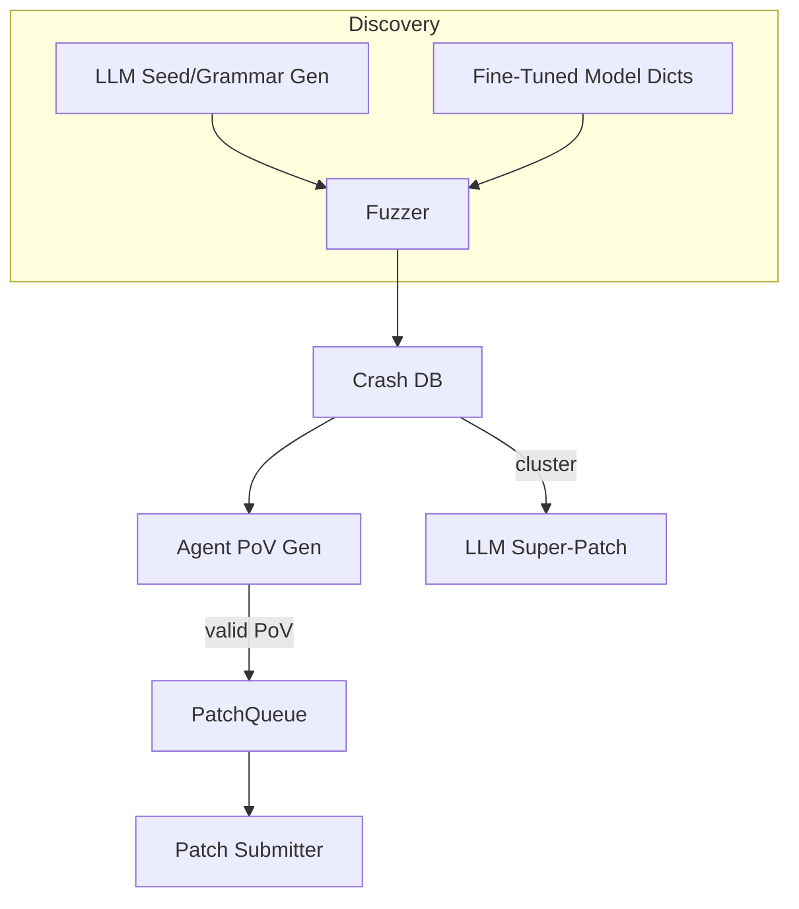

# AI 辅助模糊测试与自动化漏洞发现

{{#include ../banners/hacktricks-training.md}}

## 概述
大型语言模型（LLM）可以通过生成语义丰富的输入、演进语法、分析崩溃数据，甚至提出修复多个漏洞的补丁，大幅增强传统漏洞研究流程。本页汇总了 DARPA 的 AI Cyber Challenge (AIxCC) 决赛及其他公开研究中观察到的最有效模式。<sup>[[4]](#references)</sup><sup>[[5]](#references)</sup>

以下内容并非对某个特定竞赛系统的介绍，而是对相关技术的抽象，方便你在自己的工作流中复现。

---

## 1. LLM 生成的种子输入

传统的覆盖率引导型 fuzzer（AFL++、libFuzzer、Honggfuzz 等）从少量种子语料库开始，并盲目地变异字节。当目标输入格式复杂（SQL、URL、自定义二进制协议）时，随机变异通常会在触及有趣的分支之前破坏语法。

LLM 可以通过生成*种子生成器*来解决这个启动问题——也就是输出**语法正确且与安全相关的输入**的短脚本。例如：

```prompt
SYSTEM: You are a helpful security engineer.
USER:
Write a Python3 program that prints 200 unique SQL injection strings targeting common anti-pattern mistakes (missing quotes, numeric context, stacked queries).  Ensure length ≤ 256 bytes / string so they survive common length limits.
```

```python
# gen_sqli_seeds.py (truncated)
PAYLOADS = [
    "1 OR 1=1 -- ",
    "' UNION SELECT NULL,NULL--",
    "0; DROP TABLE users;--",
    ...
]
for p in PAYLOADS:
    print(p)
```

运行一次，并将输出直接输入 fuzzer 的初始语料库：

```bash
python3 gen_sqli_seeds.py > seeds.txt
afl-fuzz -i seeds.txt -o findings/ -- ./target @@
```

优点：
1. 语义有效 → 更早获得更深入的覆盖率。
2. 可重新生成：调整 prompt，即可聚焦于 XSS、路径遍历、二进制 blob 等。
3. 成本低（使用 GPT-3.5 时低于 1 ¢）。

### 提示
* 指示模型对 payload 的长度和编码（UTF-8、URL 编码、UTF-16-LE）进行*多样化*，以绕过表层过滤器。
* 要求生成*单个独立脚本*，避免 JSON 格式问题。

---

## 2. Grammar-Evolution Fuzzing

一种更强大的变体是让 LLM **演化 grammar**，而不是生成具体的种子。工作流程（“Grammar Guy”模式）如下：

1. 通过 prompt 生成初始的 ANTLR/Peach/LibFuzzer grammar。
2. Fuzz N 分钟，并收集覆盖率指标（命中的边/块）。
3. 总结尚未覆盖的程序区域，并将摘要反馈给模型：
   ```prompt
   The previous grammar triggered 12 % of the program edges.  Functions not reached: parse_auth, handle_upload.  Add / modify rules to cover these.
   ```
4. 合并新规则，重新进行 fuzz，重复。

伪代码框架：

```python
for epoch in range(MAX_EPOCHS):
    grammar = llm.refine(grammar, feedback=coverage_stats)
    save(grammar, f"grammar_{epoch}.txt")
    coverage_stats = run_fuzzer(grammar)
```

要点：
* 保持*预算*——每次细化都会消耗 tokens。
* 使用 `diff` + `patch` 指令，让模型编辑而不是重写。
* 当 Δcoverage < ε 时停止。

---

## 3. 本地 LLM libFuzzer Harness 工程

对于不能离开分析人员工作站的源代码，本地代码模型可以起草一个小型适配器，将 fuzzer 字节传递给 C/C++ API。明确的安全边界很重要：**模型编写并修改测试基础设施；coverage-guided mutation 探索输入；sanitizer 报告无效操作；人工审查 harness 并对发现的问题进行分类**。<sup>[[9]](#references)</sup>

有关不依赖 LLM 的引擎级 corpus、反馈、快照和 stateful-fuzzing 技术，请参阅通用的 [Fuzzing 方法论](../generic-methodologies-and-resources/fuzzing.md)。

从目标头文件中复制确切的声明，并限制输出格式。范围明确的提示可以减少模型虚构 API 的情况，也便于审查：<sup>[[8]](#references)[[9]](#references)</sup>

```prompt
Write a libFuzzer target for this exact declaration:
int parse_records(const uint8_t *data, size_t size);

Output only C code. Implement LLVMFuzzerTestOneInput, include the
declaration, pass data and size unchanged, and do not use files,
network access, randomness, clocks, threads, or persistent state.
```

对于原始字节解析器，预期结果不应比以下内容更复杂：<sup>[[6]](#references)[[9]](#references)</sup>

```c
#include <stddef.h>
#include <stdint.h>

extern int parse_records(const uint8_t *, size_t);

int LLVMFuzzerTestOneInput(const uint8_t *data, size_t size) {
    (void)parse_records(data, size);
    return 0;
}
```

编译只是第一道验证关卡。在为任何目标消耗 CPU 时间之前，请根据以下不变量逐一检查生成的目标：<sup>[[6]](#references)[[8]](#references)[[9]](#references)</sup>

- **API 完全一致：** 对照真实头文件和现有调用方，检查类型、所有权规则、初始化、清理和调用约定。
- **Harness 安全：** 对从 `data` 读取的每个操作进行保护；sanitizer 发现的问题必须源自目标本身，而不是生成的胶水代码。
- **可重复性：** 让结果仅取决于 `data` 和 `size`；移除外部 I/O、时间、不可控的随机性、未 join 的线程，以及会在调用之间保留的状态。
- **吞吐量：** 仅在不会影响行为时，才初始化一次开销较大的不可变状态；限制输入大小、抑制日志，并释放每次输入所分配的内存。
- **可达性：** 验证预期函数和分支确实会执行。目标虽然能编译，却只触发拒绝路径，就是一种隐蔽的失败。

### 结构感知型目标：保留不变量，但不掩盖 bug

如果大多数原始输入都无法通过 magic、长度、版本或校验和检查关卡，就将 fuzz 字节用作**类型化字段的素材**，并重建有效对象。固定格式常量，让语义字段和 payload 字节保持可变，并根据重建后的 payload 派生完整性元数据。`FuzzedDataProvider` 可用于消费有界的类型化值，而适配器仍有责任限制生成的分配量和转换操作。<sup>[[9]](#references)</sup>

<details>
<summary>结构感知型 C++ 目标示例</summary>

```cpp
#include <fuzzer/FuzzedDataProvider.h>
#include <stddef.h>
#include <stdint.h>
#include <vector>

extern "C" int parse_message(const uint8_t *, size_t);

extern "C" int LLVMFuzzerTestOneInput(const uint8_t *data, size_t size) {
    FuzzedDataProvider fdp(data, size);
    uint8_t version = fdp.ConsumeIntegral<uint8_t>();
    auto body = fdp.ConsumeRemainingBytes<uint8_t>();
    if (body.size() > UINT16_MAX) body.resize(UINT16_MAX);
    uint16_t len = static_cast<uint16_t>(body.size());
    std::vector<uint8_t> msg = {0x8b, 'M', 'S', 'G', version,
                                static_cast<uint8_t>(len >> 8),
                                static_cast<uint8_t>(len)};
    msg.insert(msg.end(), body.begin(), body.end());
    (void)parse_message(msg.data(), msg.size());
    return 0;
}
```

</details>

不要针对每个问题都使用同一个会修复结构的目标。维护一个目标来推导长度/校验和，以探索深层的有效状态；另一个目标则让 **声明的** 元数据由 fuzzer 控制，只限制 harness 自身的读取和分配。第二个目标保留长度不匹配和完整性校验错误的攻击面，而自动修复会将这些攻击面抹去。<sup>[[9]](#references)</sup>

### Seeds、字典、sanitizers 和覆盖率反馈

让模型生成一个用于写入二进制 seeds 的脚本，而不是让它直接打印二进制内容。为对象准备空、最小、典型和边界有效的 seeds；然后提取 magic 值、标签、枚举编码和解析器关键字，整理成经过审核的字典。libFuzzer 可通过 `-dict=` 接受该字典，并将能发现新覆盖率的变异保留在语料库中。<sup>[[6]](#references)[[9]](#references)</sup>

```text
magic="\x8bMSG"
version_min="\x00"
version_max="\xff"
config_tag="CONFIG"
```

使用互补的插桩构建同一个目标。ASan 和 UBSan 可以共用一个 fuzzing 二进制文件；MSan 则应单独构建，并对其依赖项进行插桩，以避免未插桩代码导致误报。<sup>[[6]](#references)[[9]](#references)</sup>

```bash
clang++ -g -O1 -fsanitize=fuzzer,address,undefined \
  -fno-sanitize-recover=undefined target.cc harness.cc -o fuzz_target
./fuzz_target corpus -dict=msg.dict -max_len=65535

clang++ -g -O1 -fsanitize=fuzzer,memory \
  target.cc harness.cc -o fuzz_target_msan
```

将 coverage 作为评估每次模型修订的指标。在 libFuzzer 输出中，`cov`/`ft` 早早趋于平稳且语料库静态不变，通常意味着 framing 不当、过早返回条件过于严格，或调用错误；`exec/s` 偏低则说明 setup、I/O、内存分配开销过大，或状态泄漏。`NEW` 只能证明某个 coverage feature 发生了变化，并不能证明已到达目标 parser。<sup>[[6]](#references)[[9]](#references)</sup>

要获得源码级反馈，先构建 coverage 版本并进行 fuzzing，然后只向模型提供尚未覆盖的函数及其保护条件。检查生成的 harness/seed/dictionary diff，并再次测量：<sup>[[7]](#references)[[8]](#references)[[9]](#references)</sup>

```bash
clang++ -g -O1 -fsanitize=fuzzer \
  -fprofile-instr-generate -fcoverage-mapping target.cc harness.cc -o fuzz_cov
mkdir -p profiles
LLVM_PROFILE_FILE='profiles/%p.profraw' ./fuzz_cov -max_total_time=300 corpus
llvm-profdata merge -sparse profiles/*.profraw -o fuzz.profdata
llvm-cov report ./fuzz_cov -instr-profile=fuzz.profdata
llvm-cov show ./fuzz_cov -instr-profile=fuzz.profdata \
  --show-branches=count --region-coverage-lt=1 target.cc
```

因此，可扩展的循环是 **生成 → 编译/链接 → 在 sanitizers 下进行冒烟测试 → 测量目标覆盖率 → 提供最精简且相关的覆盖率/源代码上下文 → 修订 → 重新测量**。OSS-Fuzz-Gen 遵循同一原则：评估生成的目标是否可编译、是否会在运行时失败、覆盖率如何，以及相较于现有目标是否提升覆盖率，而不是仅凭代码看起来合理就接受它。<sup>[[7]](#references)[[8]](#references)</sup>

---

<a id="3-agent-based-pov-exploit-generation" hidden>3. 基于 Agent 的 PoV (Exploit) 生成</a>

## 4. 基于 Agent 的 PoV (Exploit) 生成

找到 crash 后，你仍然需要一个**漏洞证明 (PoV)**，以确定性地触发它。

一种可扩展的方法是启动许多轻量级 worker（进程、线程或容器），每个 worker 使用不同的模型或采样配置。AIxCC 决赛队伍调查报告给出了具体的规模示例：一支队伍使用了**数千个并发 agent**进行 AI 优先的 PoV 生成；另一支队伍则协调了 **300–500 个 fuzzing agent**，并将 LLM 留给更高层次的语义推理。<sup>[[4]](#references)</sup>

流程：
1. 静态/动态分析生成*漏洞候选项*（包含 crash PC、输入片段和 sanitizer 消息的结构体）。
2. Orchestrator 将候选项分发给各个 agent。
3. Agent 的推理步骤：
   a. 使用 `gdb` 和输入在本地复现漏洞。
   b. 提出最小 exploit payload。
   c. 在 sandbox 中验证 exploit。成功则提交。
4. 失败的尝试会作为新 seeds **重新排队**，用于 coverage fuzzing（反馈循环）。

优点：
* 并行化可弥补单个 agent 的不可靠性。
* 根据观察到的成功率自动调整 temp / 模型大小。

---

<a id="4-directed-fuzzing-with-fine-tuned-code-models" hidden>4. 使用微调代码模型进行定向 Fuzzing</a>

## 5. 使用微调代码模型进行定向 Fuzzing

使用带有漏洞模式标签（整数溢出、缓冲区复制、格式字符串）的 C/C++ 源代码，对开放权重模型（例如 Llama-7B）进行微调。然后：

1. 运行静态分析，获取函数列表和 AST。
2. 提示模型：*“给出可能破坏函数 X 内存安全性的 mutation 字典条目。”*
3. 将这些 token 插入自定义的 `AFL_CUSTOM_MUTATOR`。

`sprintf` wrapper 的输出示例：
```
{"pattern":"%99999999s"}
{"pattern":"AAAAAAAA....<1024>....%n"}
```

在真实目标上，实测可将触发崩溃所需的时间缩短 2 倍以上。

---

<a id="5-ai-guided-patching-strategies" hidden>5. AI 引导的补丁策略</a>

## 6. AI 引导的补丁策略

<a id="51-super-patches" hidden>5.1 超级补丁</a>

### 6.1 超级补丁
让模型对崩溃特征进行*聚类*，并提出一个**单一补丁**，消除共同的根本原因。一次提交，修复多个 bug → 在每个错误补丁都会扣分的环境中，减少准确率惩罚。

提示词大纲：
```
Here are 10 stack traces + file snippets.  Identify the shared mistake and generate a unified diff fixing all occurrences.
```

{{#ref}}
../generic-methodologies-and-resources/fuzzing.md
{{#endref}}

<a id="52-speculative-patch-ratio" hidden>5.2 推测性补丁比例</a>

### 6.2 推测性补丁比例
实现一个队列，以 1:​N 的比例交错排列已确认且经 PoV 验证的补丁和*推测性*补丁（无 PoV）；根据评分规则调整该比例（例如，2 个推测性补丁 : 1 个已确认补丁）。成本模型会监控惩罚与得分，并自动调整 N。

---

<a id="6-deterministic-file-by-file-ai-code-review" hidden>6. 逐文件确定性 AI 代码审查</a>

## 7. 逐文件确定性 AI 代码审查

AI 辅助审查中一种常见的失败模式，是让一个 agent 检查整个代码库，并寄希望于它能选对文件和 grep 关键词。更可靠的模式是**强制覆盖整个代码库**：<sup>[[1]](#references)</sup>

1. 列出所有源文件。
2. 每次只发送**一个文件**及最少的上下文（入口点、导入、附近的路由/调用方）。
3. 要求每个文件都提供**结构化报告**：source、sink、缺失的验证、利用前提条件和置信度。<sup>[[3]](#references)</sup>
4. 按**source→sink 模式**对报告去重，并手动验证高风险项。

这种方法会消耗大量 token，也会产生不少噪声，但非常擅长发现广泛的 agentic 审查经常遗漏的**简单且影响重大的 source/sink 漏洞**。

### 值得优先排查的分类模式

- **动态 PHP include/dispatch**：攻击者可控的路由/控制器/模块名称流入 `require_once()`、`include()` 或 `include_once()`，但没有严格的 allowlist 和路径规范化。
- **管理/账户工作流中的 Shell 执行**：用户名、域名、FTP 账户或其他标识符传递到 `exec()`、`system()`、`shell_exec()`、`passthru()`、`proc_open()` 或 `popen()`。
- **结构化输入汇聚**：同一个参数可通过 `$_GET`、`$_POST`、JSON、XML 或框架的 body parser 接收，之后又被用于文件系统或 OS 命令 sink。

### 此方法擅长发现的两类实用漏洞

- **PHP 控制器分发中的 LFI/RCE**：如果请求可控的控制器名称未经 allowlist/路径规范化就被拼接到 `require_once()` 中，攻击者可利用 `../` 等遍历序列，让 PHP 包含非预期的本地 `.php` 文件。如果攻击者能让 include 指向预先放置的或其他有用的 PHP 文件，LFI 就会变成代码执行。参见 [File Inclusion / Path Traversal](../pentesting-web/file-inclusion/README.md)。<sup>[[1]](#references)</sup>
- **托管/管理面板中的已认证命令注入**：如果用户名等账户管理字段被嵌入 Shell 命令，低权限的已认证用户可能利用普通的创建/删除操作实现 RCE。如果面板以权限更高的服务账户执行该命令，影响会更大。参见 [Command Injection](../pentesting-web/command-injection.md)。<sup>[[1]](#references)</sup>

### 实用审查建议

- 首先将 LLM 用作 **source/sink 审查器**，而不是漏洞利用生成器。
- 要求它明确列出**攻击者可控字段**、**规范化/验证缺口**和**危险 sink**。
- 对大型代码库而言，确定性的逐文件审查通常比单次自主 agent 运行更可靠，即使后者使用了更强的模型也是如此。<sup>[[2]](#references)</sup>
- 对于 **Broken Access Control** 和其他业务逻辑漏洞，若可利用性取决于跨文件假设、角色语义或产品特定的威胁模型，预期审查效果会较弱。

---

## 移动端入口任务流

一次覆盖整个代码库的提示通常会混杂不同的威胁模型，并丢失从外部可访问组件到敏感 sink 的路径。更有效的工作流是将审计拆分为有状态的任务流：先对应用/组件分类，再盘点攻击者可控的入口点，为每个入口点补充可达性元数据，最后针对平台特定的漏洞类别逐一审查。GitHub Security Lab 的移动端任务流为 Android、iOS 和跨平台代码库实现了这一模式。<sup>[[14]](#references)[[15]](#references)</sup>

对于 Android，至少记录以下内容：<sup>[[14]](#references)[[15]](#references)</sup>

- 导出的 Activities、Services、Receivers 和 Providers，包括权限；
- intent actions、deep-link schemes/hosts/paths、MIME filters 和 App Links；
- 攻击者可控的 actions、data URIs、`ClipData`、extras 和 URI-grant flags；
- WebView 导航输入和 `addJavascriptInterface` bridges；
- 下游特权操作、导入的资源和网络目标。

然后结合上下文对每个入口点分类。明确检查调用方授权/混淆代理行为、intent 重定向、广播欺骗或信息泄露、不安全导入、WebView 脚本与 bridge 暴露，以及跨源的凭证或 cookie 流转。执行一次**严格清单检查**和一次**更广泛的对抗性检查**。将发现关联到 [Intent Injection](../mobile-pentesting/android-app-pentesting/intent-injection.md) 和 [WebView Attacks](../mobile-pentesting/android-app-pentesting/webview-attacks.md)，而不是重复描述漏洞利用细节。<sup>[[15]](#references)</sup>

可以从 Codespace 启动当前的开源任务流：<sup>[[14]](#references)</sup>

```bash
./scripts/audit/run_audit.sh owner/repository
```

结果会写入 SQLite 的 `audit_result` 表。<sup>[[14]](#references)</sup> 将标记为 vulnerable 的行视为**线索**，而非已验证的发现。对于每条线索，要求模型说明攻击者可控的来源、敏感 sink、前置条件和预期影响，然后让它创建一个最小 PoC。在调试器或插桩环境下，针对原始构建执行该 PoC。这可以发现常见的静态分析错误，例如不可达分支、不现实的应用状态、外部存储数据的优先级低于私有数据，以及会显著降低严重性的缓解措施。<sup>[[15]](#references)</sup>

---

## 8. 使用插桩 Oracle 进行模式引导的内核审计

对于内核规模的目标，不要让 agent 在整个代码树中寻找任意 bug。更节省 token 的工作流是将历史漏洞知识转化为静态查询，根据暴露的攻击面为结果排序，并使用插桩内核作为执行 oracle。<sup>[[11]](#references)</sup>

### 模式数据库 → CodeQL/Semgrep → 定向审查

构建一个小型知识库，包含危险 API、缺少验证的模式、存在风险的 source-to-sink 数据流，以及先前已修复的 bug 形态。让模型**一次处理一种模式**，将其转化为审查启发式规则和 CodeQL/Semgrep 规则，然后用这些确定性规则扫描整个代码树。在把代码交给模型之前，先对匹配结果分组并去重；原始扫描器输出可能包含数千条价值较低的候选项。在符合条件的研究目标或开源目标之外使用此方法前，请先确认 CodeQL 当前的许可条款。<sup>[[11]](#references)</sup>

根据**规则命中密度**和**攻击者可达性**确定子系统优先级，而不只是看命中数量。可由非特权进程、sandbox、container、jail 或 guest 上下文访问的内核接口，其权重应高于仅供内部使用的代码。审查单元应足够小，以便 agent 记住调用方、验证器和生命周期规则；提示时应指定某个漏洞类别或控制流模式，而不是要求“找出任意漏洞”。当较新的隔离边界使旧版特权接口可被命名空间或 jail 中的 root 用户访问时，这些接口尤其值得关注。<sup>[[11]](#references)</sup>

对于每个候选项，在尝试利用之前，要求提供明确的字段流记录。<sup>[[11]](#references)</sup>

```text
entrypoint -> privilege check -> parser -> validation/normalization
           -> later rewrite -> dangerous sink
attacker controls: <fields and lengths>
constraints:       <values rewritten, rejected, or preserved>
observable result: <sanitizer report, assertion, panic, or clean exit>
```

### 将 KASAN telemetry 用作假设判定器

在启用了 KASAN 和实用诊断断言的一次性 VM 中运行目标内核。Agent 应反复执行 **源码假设 → 最小 userland 触发器 → VM 执行 → KASAN/断言跟踪 → 修订假设**，直到疑似损坏被复现或排除。每轮只返回相关的堆栈跟踪和附近源码；这样既能保留推理所需的上下文，也能确保以运行时证据而非模型置信度作为验收门槛。<sup>[[11]](#references)</sup>

插桩构建并非最终的 exploitability 环境。断言可能会在造成损坏的操作发生前终止执行，而同一断言在 production kernel 中可能已被编译掉。使用完全相同的触发器对照确切的 production 配置重新测试，记录内核构建和配置，并将**可达性**、**内存损坏**、**可控原语**和**安全影响**作为不同主张分别说明。<sup>[[11]](#references)[[12]](#references)</sup>

CVE-2026-3038 是一个有用的验证示例，而非 exploit 模板。一个非特权 FreeBSD `RTM_GET` 请求可以利用选择性验证和回复重写，使超大的 `RTAX_AUTHOR` sockaddr 一直保留下来，直到 `rtsock_msg_buffer()` 将用户可控的 `sa_len` 复制到 128 字节的栈上 `sockaddr_storage`。最大 255 字节的复制会造成 127 字节的覆盖；插桩构建中的诊断断言捕获了错误长度，而 GENERIC 内核则执行到复制操作，并在检查被破坏的 canary 时 panic。这证明了非特权拒绝服务，但不能单独证明权限提升：可靠控制首先需要另一个原语，例如 canary disclosure。对应的 binary-exploitation 边界请参见 [Stack Canaries](../binary-exploitation/common-binary-protections-and-bypasses/stack-canaries/index.html)。<sup>[[11]](#references)[[12]](#references)[[13]](#references)</sup>

### 拒绝伪造 exploit 前置条件

在接受 PoV 或 exploit 之前，让另一位 reviewer/agent 按照固定标准尝试证伪。审查必须确认以下所有条件。<sup>[[11]](#references)</sup>

- 未修改目标源码、内核或易受攻击的模块来使该路径变得可达。
- 未引入任何 helper module、合成 gadget、已禁用的 mitigation、额外权限或不可用接口。
- 触发器从干净快照启动，使用所声称的调用者身份和限制条件。
- 所声称的结果仍依赖该 bug：移除格式错误的字段或只修补该 bug，都必须能中断利用链。
- 崩溃、越界读取或覆盖只能按相应原语报告；代码执行或权限提升需要独立证据。

最后这个反事实检查可以发现循环论证式的演示：如果前置条件已经带来了所声称的影响（例如，从未以 `nosuid` 挂载的文件系统执行攻击者提供的 SUID 内容），那么内存安全 bug 并未造成该影响。<sup>[[11]](#references)</sup>

---

## 在陌生代码库中开展可审计的 Agent 辅助研究

[graph-first fuzz-target workflow](../generic-methodologies-and-resources/fuzzing.md#graph-first-fuzz-target-selection-and-mutation-triage) 已覆盖入口点可达性，而 [agentic SAST pipelines](../network-services-pentesting/pentesting-web/code-review-tools.md#agentic-sast-pipelines) 则涵盖分阶段审查和证据门槛。将这些确定性结果与模型的假设分开保存，确保每个升级处理的线索都保留源码位置、路径证据和动态测量结果。<sup>[[10]](#references)</sup>

### 关联对象生命周期证据，但不臆造数据流

静态分析可能发现，攻击者可控的长度在一个函数中被存储，而很久之后，同一对象字段又到达一个 copy sink，但却无法证明它们之间跨越 callbacks、reconnects 或对象生命周期的联系。分别保留这两项发现，按对象/字段聚类，并将缺失的边明确列为 triage 问题。Agent 可以提出这种关联，但必须通过源码审查或运行时插桩来证明。<sup>[[10]](#references)</sup>

对于每个候选项，记录：

- 具体入口点和攻击者可控的字节；
- 相关字段的每个生产者，包括针对每个生产者的验证逻辑；
- sink、目标容量，以及到达该 sink 所需的构建/运行时条件；
- 来自暴露入口点的真实调用栈，而不只是直接调用 harness 的结果；
- 用于确认或排除假设的最小动态测试结果。

某条路径看起来安全，并不能证明该字段在所有路径中都安全。第二个生产者可能会填充同一字段，却没有第一条路径中的边界限制。应分别测试各条路径，并使用与部署环境等效的构建选项运行 harness，因为 debug assertions 可能会让 production 中的内存损坏变成仅在测试中发生的提前中止。<sup>[[10]](#references)</sup>

### Disclosure 和 exploitation 的测量门槛

对于疑似未初始化内存 disclosure，使用可识别的字节填充新分配的内存，并验证确切标记是否到达发出的数据包。对于 exploitation，要求通过测量验证各项门槛，例如 **controlled overwrite → 有用的 victim object → disclosure → 指针/基址恢复 → 控制流劫持 → 组合 payload**。只有 harness 证明当前属性后，Agent 才能推进；看似合理的叙述不算通过门槛。[FreeRDP case](../binary-exploitation/libc-heap/heap-overflow.md#cross-path-length-reuse-and-stale-output-disclosure) 展示了验证时必须保留的路径和构建限制。<sup>[[10]](#references)</sup>

---

有关将分阶段 L0–L4 验证应用于 LLM 辅助 exploit 开发的内核案例研究，请参见：

{{#ref}}
../binary-exploitation/freebsd-kernel-exploitation-vnet-jail-escape.md
{{#endref}}

## 借助调试器进行崩溃 triage

关于崩溃 triage、函数分析和可控 heap chunk 可达性的 Mona v3 工作流，请参见 [Exploiting Tools](../binary-exploitation/basic-stack-binary-exploitation-methodology/tools/#mona-v3-debugger-context-requests-for-crash-triage)。

---

## 综合运用
端到端的 CRS（Cyber Reasoning System）可以按如下方式连接各个组件：



---

## References

- [1] [Project Black - 用于网络安全的本地 AI：发现 phpIPAM LFI 和 myVesta 已认证 RCE](https://projectblack.io/blog/local-ai-for-cyber-security)
- [2] [Strix](https://github.com/usestrix/strix)
- [3] [GitHub Copilot 社区安全审查 skill](https://github.com/github/awesome-copilot/blob/main/skills/security-review/SKILL.md)
- [4] [Trail of Bits – AIxCC 决赛：实战记录](https://blog.trailofbits.com/2025/08/07/aixcc-finals-tale-of-the-tape/)
- [5] [CTF Radiooo AIxCC 决赛选手访谈](https://www.youtube.com/@ctfradiooo)
- [6] [LLVM — libFuzzer：用于覆盖率引导模糊测试的库](https://llvm.org/docs/LibFuzzer.html)
- [7] [Google — OSS-Fuzz-Gen](https://github.com/google/oss-fuzz-gen)
- [8] [Google Online Security Blog — 提升模糊测试能力：借助 AI 发现更多漏洞](https://security.googleblog.com/2024/11/leveling-up-fuzzing-finding-more.html)
- [9] [8kSec — 使用本地 LLM 辅助生成模糊测试 Harness](https://8ksec.io/ai-assisted-fuzzing-harness-local-llm)
- [10] [Quarkslab — 从 AI Agent 到 RCE：构建漏洞研究工作流](https://blog.quarkslab.com/from-ai-agents-to-rce-building-a-vulnerability-research-workflow.html)
- [11] [Praetorian — FreeBSoD：利用语言模型发现并利用内核漏洞（共 2 部分，第 1 部分）](https://praetorian.com/blog/ai-vulnerability-research-freebsd-kernel)
- [12] [FreeBSD-SA-26:05.route — 通过路由套接字触发本地 DoS 和可能的权限提升](https://www.freebsd.org/security/advisories/FreeBSD-SA-26:05.route.asc)
- [13] [FreeBSD-SA-26:05.route 源码补丁](https://security.FreeBSD.org/patches/SA-26:05/route.patch)
- [14] [GitHub Security Lab - SecLab Taskflows](https://github.com/GitHubSecurityLab/seclab-taskflows)
- [15] [GitHub Security Lab - 我们如何使用开源 AI 安全 Agent 发现 24 个 Android 漏洞](https://github.blog/security/how-we-found-24-android-vulnerabilities-using-our-open-source-ai-security-agent)
{{#include ../banners/hacktricks-training.md}}
