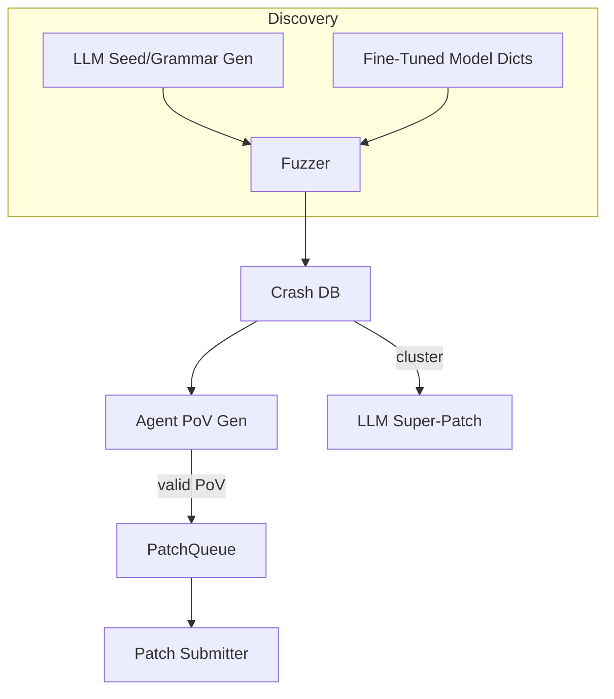

# AI-ondersteunde Fuzzing & Geoutomatiseerde Kwesbaarheidsontdekking

{{#include ../banners/hacktricks-training.md}}

## Oorsig
Groottaalmodelle (LLM's) kan tradisionele navorsingswerkvloeie vir kwesbaarhede aansienlik versterk deur semanties ryk invoer te genereer, grammatikas te ontwikkel, oor crash-data te redeneer en selfs pleisters vir verskeie foute voor te stel. Hierdie bladsy versamel die doeltreffendste patrone wat tydens DARPA se eindrondte van die AI Cyber Challenge (AIxCC) en ander openbare navorsing waargeneem is.<sup>[[4]](#references)</sup><sup>[[5]](#references)</sup>

Wat volg, is nie ’n beskrywing van een spesifieke kompetisiestelsel nie, maar ’n abstraksie van die tegnieke sodat jy dit in jou eie werkvloeie kan toepas.

---

## 1. LLM-gegenereerde Seed-insette

Tradisionele coverage-guided fuzzers (AFL++, libFuzzer, Honggfuzz…) begin met ’n klein corpus van seeds en muteer grepe blindelings. Wanneer die teiken se invoerformaat kompleks is (SQL, URL's, pasgemaakte binêre protokolle), breek ewekansige mutasies gewoonlik die sintaksis voordat interessante takke bereik word.

LLM's kan hierdie aanvangsprobleem oplos deur *seed-generators* uit te voer – kort skripte wat **sintaksisgeldige, maar sekuriteitsrelevante invoer** lewer. Byvoorbeeld:

```prompt
SYSTEM: You are a helpful security engineer.
USER:
Write a Python3 program that prints 200 unique SQL injection strings targeting common anti-pattern mistakes (missing quotes, numeric context, stacked queries).  Ensure length ≤ 256 bytes / string so they survive common length limits.
```

```python
# gen_sqli_seeds.py (truncated)
PAYLOADS = [
    "1 OR 1=1 -- ",
    "' UNION SELECT NULL,NULL--",
    "0; DROP TABLE users;--",
    ...
]
for p in PAYLOADS:
    print(p)
```

Voer dit een keer uit en voer die uitvoer direk in die fuzzer se aanvanklike korpus in:

```bash
python3 gen_sqli_seeds.py > seeds.txt
afl-fuzz -i seeds.txt -o findings/ -- ./target @@
```

Voordele:
1. Semantiese geldigheid → dieper dekking vroeg.
2. Kan weer gegenereer word: pas die prompt aan om op XSS, path traversal, binary blobs, ens. te fokus.
3. Goedkoop (< 1 ¢ met GPT-3.5).

### Wenke
* Gee die model opdrag om die payload-lengte en -enkodering te *varieer* (UTF-8, URL-encoded, UTF-16-LE) om oppervlakkige filters te omseil.
* Vra vir ’n *enkele selfstandige script* – vermy probleme met JSON-formatering.

---

## 2. Grammar-Evolution Fuzzing

’n Kragtiger variant is om die LLM ’n **grammatika te laat ontwikkel** in plaas van konkrete seeds. Die werkvloei (“Grammar Guy”-patroon) is:

1. Genereer ’n aanvanklike ANTLR/Peach/LibFuzzer-grammatika via ’n prompt.
2. Fuzz vir N minute en versamel dekkingsmetrieke (getrefde edges / blocks).
3. Som ongedekte programareas op en voer die opsomming terug aan die model:
   ```prompt
   The previous grammar triggered 12 % of the program edges.  Functions not reached: parse_auth, handle_upload.  Add / modify rules to cover these.
   ```
4. Voeg die nuwe reëls saam, fuzz weer, herhaal.

Pseudo-code-skelet:

```python
for epoch in range(MAX_EPOCHS):
    grammar = llm.refine(grammar, feedback=coverage_stats)
    save(grammar, f"grammar_{epoch}.txt")
    coverage_stats = run_fuzzer(grammar)
```

Sleutelpunte:
* Hou ’n *begroting* – elke verfyning gebruik tokens.
* Gebruik `diff` + `patch`-instruksies sodat die model wysigings maak eerder as om alles te herskryf.
* Stop wanneer Δcoverage < ε.

---

## 3. Plaaslike-LLM libFuzzer-harnas-ingenieurswese

Vir bronkode wat nie ’n ontleder se werkstasie mag verlaat nie, kan ’n plaaslike kodemodel die klein adapter tussen fuzzer-grepe en ’n C/C++-API opstel. Die nuttige sekuriteitsgrens is duidelik: **die model skryf en hersien toetsinfrastruktuur; dekking-geleide mutasie verken insette; sanitizers rapporteer ongeldige bewerkings; ’n mens hersien die harnas en triageer bevindinge**.<sup>[[9]](#references)</sup>

Vir enjinvlak-korpus-, terugvoer-, momentopname- en toestandvolle-fuzzing-tegnieke wat nie van ’n LLM afhanklik is nie, sien die algemene [Fuzzing Methodology](../generic-methodologies-and-resources/fuzzing.md).

Begin met die presiese deklarasie wat uit die teiken se header gekopieer is, en beperk die uitvoerformaat. ’n Noue prompt verminder uitgedinkte API’s en maak die resultaat maklik om na te gaan:<sup>[[8]](#references)[[9]](#references)</sup>

```prompt
Write a libFuzzer target for this exact declaration:
int parse_records(const uint8_t *data, size_t size);

Output only C code. Implement LLVMFuzzerTestOneInput, include the
declaration, pass data and size unchanged, and do not use files,
network access, randomness, clocks, threads, or persistent state.
```

Vir ’n ontleder van rou grepe behoort die verwagte resultaat nie ingewikkelder te wees as:<sup>[[6]](#references)[[9]](#references)</sup>

```c
#include <stddef.h>
#include <stdint.h>

extern int parse_records(const uint8_t *, size_t);

int LLVMFuzzerTestOneInput(const uint8_t *data, size_t size) {
    (void)parse_records(data, size);
    return 0;
}
```

Samestelling is slegs die eerste validasiehek. Gaan elke gegenereerde teiken na hierdie invariantes na voordat jy SVE-tyd daaraan bestee:<sup>[[6]](#references)[[8]](#references)[[9]](#references)</sup>

- **Presiese API:** Vergelyk tipes, eienaarskapsreëls, inisialisering, afbreek en oproepkonvensie met die werklike koplêer en bestaande aanroepers.
- **Harnasveiligheid:** Beveilig elke leesaksie vanaf `data`; sanitizer-bevindings moet in die teiken ontstaan, nie in gegenereerde gomkode nie.
- **Herhaalbaarheid:** Maak die resultaat ’n funksie van `data` en `size`; verwyder eksterne I/O, tyd, onbeheerde ewekansigheid, drade wat nie saamgevoeg is nie, en toestand wat tussen oproepe voortbestaan.
- **Deurset:** Inisialiseer duur onveranderlike toestand slegs een keer wanneer dit nie gedrag kan beïnvloed nie, beperk die invoergrootte, onderdruk logging en maak toekennings per invoer vry.
- **Bereikbaarheid:** Verifieer dat die bedoelde funksies en vertakkings uitgevoer word. ’n Teiken wat saamgestel word, maar slegs verwerpingspaaie oefen, is ’n stille mislukking.

### Struktuurbewuste teikens: behou invariantes sonder om foute te verberg

As die meeste rou invoere by ’n hek vir magic, lengte, weergawe of kontrolesom faal, gebruik die fuzz-grepe as **getipeerde veldmateriaal** en bou ’n geldige objek weer op. Stel formaatkonstantes vas, laat semantiese velde en loonvraggrepe veranderlik, en lei integriteitsmetadata af van die gerekonstrueerde loonvrag. `FuzzedDataProvider` is nuttig om begrensde getipeerde waardes te verbruik, terwyl die adapter verantwoordelik bly vir die beperking van enige gegenereerde toekenning en omskakeling.<sup>[[9]](#references)</sup>

<details>
<summary>Voorbeeld van ’n struktuurbewuste C++-teiken</summary>

```cpp
#include <fuzzer/FuzzedDataProvider.h>
#include <stddef.h>
#include <stdint.h>
#include <vector>

extern "C" int parse_message(const uint8_t *, size_t);

extern "C" int LLVMFuzzerTestOneInput(const uint8_t *data, size_t size) {
    FuzzedDataProvider fdp(data, size);
    uint8_t version = fdp.ConsumeIntegral<uint8_t>();
    auto body = fdp.ConsumeRemainingBytes<uint8_t>();
    if (body.size() > UINT16_MAX) body.resize(UINT16_MAX);
    uint16_t len = static_cast<uint16_t>(body.size());
    std::vector<uint8_t> msg = {0x8b, 'M', 'S', 'G', version,
                                static_cast<uint8_t>(len >> 8),
                                static_cast<uint8_t>(len)};
    msg.insert(msg.end(), body.begin(), body.end());
    (void)parse_message(msg.data(), msg.size());
    return 0;
}
```

</details>

Moenie vir elke vraag een struktuurherstellende teiken gebruik nie. Handhaaf een teiken wat lengtes/tjeksomme aflei om diep geldige toestande te verken, en ’n ander een wat die **verklaarde** metadata deur die fuzzer beheer laat word terwyl slegs die harnas se eie leesbewerkings en geheuetoewysings beperk word. Die tweede teiken behou aanvalsvlakke met lengtes wat nie ooreenstem nie en met ongeldige integriteit, wat outomatiese herstel andersins sou uitwis.<sup>[[9]](#references)</sup>

### Seeds, woordeboeke, sanitizers en terugvoer oor dekking

Vra die model om ’n script te genereer wat binêre seeds skryf, eerder as om dit te vra om binêre data direk uit te druk. Seed leë, minimale, tipiese en grensgeldige objekte; onttrek dan magiese waardes, tags, enum-koderings en parser-sleutelwoorde in ’n nagegane woordeboek. libFuzzer aanvaar daardie woordeboek met `-dict=`, en hou mutasies wat nuwe dekking in die corpus blootlê.<sup>[[6]](#references)[[9]](#references)</sup>

```text
magic="\x8bMSG"
version_min="\x00"
version_max="\xff"
config_tag="CONFIG"
```

Bou dieselfde teiken met aanvullende instrumentering. ASan en UBSan kan ’n fuzzing-binêre lêer deel; gebruik ’n aparte MSan-bou en instrumenteer die afhanklikhede daarvan om verslae te vermy wat deur nie-geinstrumenteerde kode veroorsaak word.<sup>[[6]](#references)[[9]](#references)</sup>

```bash
clang++ -g -O1 -fsanitize=fuzzer,address,undefined \
  -fno-sanitize-recover=undefined target.cc harness.cc -o fuzz_target
./fuzz_target corpus -dict=msg.dict -max_len=65535

clang++ -g -O1 -fsanitize=fuzzer,memory \
  target.cc harness.cc -o fuzz_target_msan
```

Behandel coverage as die evalueerder vir elke modelhersiening. In libFuzzer-uitvoer dui vroeë plat `cov`/`ft` en ’n statiese corpus gewoonlik op swak framing, ’n te beperkende vroeë terugkeer, of die verkeerde oproep; ’n lae `exec/s` dui op duur opstelling, I/O, allokasie of uitgelekte toestand. `NEW` bewys slegs dat ’n coverage-funksie verander het, nie dat die bedoelde parser bereik is nie.<sup>[[6]](#references)[[9]](#references)</sup>

Vir terugvoer op bronvl vlak, maak ’n coverage-bou, fuzz dit en gee die model slegs die ongedekte funksies plus hul voorwaardes. Verifieer die gevolglike verskil in die harness/saadwoordeboek en meet weer:<sup>[[7]](#references)[[8]](#references)[[9]](#references)</sup>

```bash
clang++ -g -O1 -fsanitize=fuzzer \
  -fprofile-instr-generate -fcoverage-mapping target.cc harness.cc -o fuzz_cov
mkdir -p profiles
LLVM_PROFILE_FILE='profiles/%p.profraw' ./fuzz_cov -max_total_time=300 corpus
llvm-profdata merge -sparse profiles/*.profraw -o fuzz.profdata
llvm-cov report ./fuzz_cov -instr-profile=fuzz.profdata
llvm-cov show ./fuzz_cov -instr-profile=fuzz.profdata \
  --show-branches=count --region-coverage-lt=1 target.cc
```

Die skaalbare lus is dus **genereer → compileer/skakel → rooktoets onder sanitizers → meet teikendekking → verskaf die kleinste relevante dekking-/bronkontext → hersien → meet weer**. OSS-Fuzz-Gen pas dieselfde beginsel toe deur gegenereerde teikens te evalueer vir kompileerbaarheid, looptydfoute, dekking en dekkingverbetering teenoor bestaande teikens, eerder as om geloofwaardige kode bloot op sigwaarde te aanvaar.<sup>[[7]](#references)[[8]](#references)</sup>

---

## 4. Agentgebaseerde PoV (Exploit)-generering

Nadat ’n crash gevind is, het jy steeds ’n **proof-of-vulnerability (PoV)** nodig wat dit deterministies veroorsaak.

’n Skaalbare benadering is om baie liggewig-werkers (prosesse, drade of houers) te begin, elk met ’n ander model of steekproefkonfigurasie. Die AIxCC-finaliste-opname gee konkrete voorbeelde van die skaal: een span het **duisende gelyktydige agents** vir AI-eerste PoV-generering gebruik, terwyl ’n ander **300–500 fuzzing-agents** georkestreer het en LLMs vir hoërvlak-semantiese redenering gereserveer het.<sup>[[4]](#references)</sup>

Pyplyn:
1. Statiese/dinamiese analise lewer *foutkandidate* op (struct met crash-PC, inset-slice, sanitizer-boodskap).
2. Orkestreerder versprei kandidate na agents.
3. Agent se redenasiestappe:
   a. Reproduseer fout plaaslik met `gdb` + inset.
   b. Stel ’n minimale exploit-payload voor.
   c. Valideer exploit in sandbox. Indien suksesvol → dien in.
4. Mislukte pogings word **heringevouer as nuwe seeds** vir coverage-fuzzing (terugvoerlus).

Voordele:
* Parallelisering verberg die onbetroubaarheid van ’n enkele agent.
* Outomatiese verstelling van temp / modelgrootte op grond van die waargenome sukseskoers.

---

## 5. Gerigte fuzzing met fynafgestelde kodemodelle

Fynafstel ’n model met oop gewigte (bv. Llama-7B) op C/C++-bronkode wat met kwesbaarheidspatrone geëtiketteer is (integer overflow, buffer copy, format string). Doen dan die volgende:

1. Voer statiese analise uit om ’n funksielys + AST te kry.
2. Vra die model: *“Gee mutation dictionary-inskrywings wat waarskynlik geheueveiligheid in funksie X sal breek”*.
3. Voeg daardie tokens by ’n pasgemaakte `AFL_CUSTOM_MUTATOR`.

Voorbeelduitset vir ’n `sprintf`-wrapper:
```
{"pattern":"%99999999s"}
{"pattern":"AAAAAAAA....<1024>....%n"}
```

Empiries verkort dit time-to-crash met >2× op werklike teikens.

---

## 6. AI-Geleide Patching-strategieë

### 6.1 Super Patches
Vra die model om crash signatures te *groepeer* en ’n **enkele patch** voor te stel wat die gemeenskaplike hoofoorsaak uitskakel. Dien dit een keer in, herstel verskeie foute → minder akkuraatheidsaftrekkings in omgewings waar elke verkeerde patch punte kos.

Prompt-uiteensetting:
```
Here are 10 stack traces + file snippets.  Identify the shared mistake and generate a unified diff fixing all occurrences.
```

### 6.2 Spekulatiewe pleisterverhouding
Implementeer ’n tou waarin bevestigde, PoV-gevalideerde pleisters en *spekulatiewe* pleisters (geen PoV nie) afgewissel word teen ’n 1:​N-verhouding wat by die puntetoekenningsreëls aangepas is (bv. 2 spekulatiewe : 1 bevestigde). ’n Kostemodel monitor strawwe teenoor punte en pas N outomaties aan.

---

## 7. Deterministiese KI-kodehersiening lêer vir lêer

’n Algemene foutmodus met KI-ondersteunde hersiening is om een agent te vra om ’n hele bewaarplek te inspekteer en te hoop dat dit die regte lêers en grep-terme kies. ’n Betroubaarder patroon is om **dekking van die bewaarplek af te dwing**:<sup>[[1]](#references)</sup>

1. Lys die bronlêers.
2. Stuur **een lêer op ’n slag** plus minimale konteks (ingangspunt, imports, nabygeleë roetes/aanroepers).
3. Vereis ’n **gestruktureerde verslag** vir elke lêer: bronne, sink, ontbrekende validering, voorvereistes vir uitbuiting en vertroue.<sup>[[3]](#references)</sup>
4. Ontdubbel verslae volgens die **source→sink-patroon** en valideer die hoërisiko-gevalle self.

Dit gebruik baie tokens en lewer geraas op, maar is baie doeltreffend om **eenvoudige source/sink-foute met groot impak** op te spoor wat breë agentiese hersienings dikwels mis.

### Triagepatrone wat voorkeur verdien

- **Dinamiese PHP-insluiting/versending**: aanvallerbeheerde roete-/beheerder-/module-name vloei na `require_once()`, `include()` of `include_once()` sonder streng toelaatlysbeheer en kanonisering van paaie.
- **Shell-uitvoering in admin-/rekeningwerkvloeie**: gebruikersname, domeine, FTP-rekeninge of ander identifiseerders bereik `exec()`, `system()`, `shell_exec()`, `passthru()`, `proc_open()` of `popen()`.
- **Samevoeging van gestruktureerde invoer**: dieselfde parameter word aanvaar vanaf `$_GET`, `$_POST`, JSON, XML of raamwerk-liggaamontleders en later hergebruik in lêerstelsel- of OS-opdragsinks.

### Twee praktiese foutklasse wat hierdie metode goed vind

- **PHP-beheerderversending-LFI/RCE**: as ’n versoekbeheerde beheerdernaam sonder ’n toelaatlys of padnormalisering aaneengeryg word in `require_once()`, kan deurloopreekse soos `../` PHP ’n onbedoelde plaaslike `.php`-lêer laat insluit. As die aanvaller die insluiting na ’n geplante of andersins bruikbare PHP-lêer kan rig, word die LFI kode-uitvoering. Sien [File Inclusion / Path Traversal](../pentesting-web/file-inclusion/README.md).<sup>[[1]](#references)</sup>
- **Geoutentiseerde opdraginspuiting in gasheer-/adminpanele**: as rekeningbestuurvelde soos gebruikersname in shell-opdragte ingevoeg word, kan ’n geoutentiseerde gebruiker met lae voorregte ’n gewone skep-/skrapaksie in RCE omskep. Die impak neem toe wanneer die paneel die opdrag as ’n meer bevoorregte diensrekening uitvoer. Sien [Command Injection](../pentesting-web/command-injection.md).<sup>[[1]](#references)</sup>

### Praktiese hersieningsnotas

- Gebruik die LLM eers as ’n **source/sink-hersiener**, nie as ’n exploit-generator nie.
- Vra dit om uitdruklik die **aanvallerbeheerde veld**, die **gaping in normalisering/validering** en die **gevaarlike sink** te lys.
- Vir groot bewaarplekke is deterministiese hersiening lêer vir lêer dikwels betroubaarder as ’n enkele outonome agentlopie, selfs wanneer laasgenoemde ’n sterker model gebruik.<sup>[[2]](#references)</sup>
- Verwag swakker resultate met **Broken Access Control** en ander besigheidslogikafoute waar uitbuitbaarheid afhang van aannames oor verskeie lêers, rolsemantiek of produkspesifieke bedreigingsmodelle.

---

## Ouditbare agentondersteunde navorsing oor onbekende kodebasisse

Die [graph-first fuzz-target workflow](../generic-methodologies-and-resources/fuzzing.md#graph-first-fuzz-target-selection-and-mutation-triage) dek reeds bereikbaarheid van ingangspunte, terwyl [agentic SAST pipelines](../network-services-pentesting/pentesting-web/code-review-tools.md#agentic-sast-pipelines) gefaseerde hersiening en bewyshekke dek. Hou daardie deterministiese resultate apart van die model se hipoteses sodat elke bevorderde leidraad bronliggings, padbewyse en ’n dinamiese meting behou.<sup>[[10]](#references)</sup>

### Korreleer bewyse oor objekleeftyd sonder om datavloei te versin

Statiese ontleding kan vind dat ’n aanvallerbeheerde lengte in een funksie gestoor word en dat dieselfde objekveld veel later ’n kopieersink bereik, maar dalk nie die verband oor terugroepe, herverbindings of die objek se leeftyd bewys nie. Hou albei bevindings apart, groepeer volgens objek/veld en maak die ontbrekende skakel ’n uitdruklike triagevraag. Die agent mag die verband voorstel, maar bronhersiening of looptydinstrumentasie moet dit bewys.<sup>[[10]](#references)</sup>

Teken vir elke kandidaat die volgende aan:

- die konkrete ingangspunt en aanvallerbeheerde grepe;
- elke produsent van die betrokke veld, insluitend die validering wat spesifiek vir elke produsent geld;
- die sink, bestemmingskapasiteit en bou-/looptydvoorwaardes wat nodig is om dit te bereik;
- ’n werklike oproepstapel vanaf die blootgestelde ingangspunt, nie net ’n direkte harness-aanroep nie;
- die kleinste dinamiese resultaat wat die hipotese bevestig of verwerp.

’n Pad wat veilig lyk, maak nie ’n veld wêreldwyd veilig nie. ’n Tweede produsent kan dieselfde veld invul sonder die grenskontrole van die eerste pad. Toets paaie afsonderlik en voer die harness uit met bouopsies wat met die ontplooiing ooreenstem, aangesien debug-asserte ’n produksiegeheuekorrupsie in ’n vroeë, slegs-toetsafbreking kan omskep.<sup>[[10]](#references)</sup>

### Meethekke vir openbaarmaking en uitbuiting

Vul vars geheuetoekennings vir vermoedelike openbaarmaking van ongeïnisialiseerde geheue met ’n herkenbare greep en verifieer dat die presiese merker die uitgestuurde pakkie bereik. Vereis vir uitbuiting gemete hekke soos **beheerde oorskrywing → bruikbare slagofferobjek → openbaarmaking → wyser-/basisherwinning → beheer-vloei-kaping → saamgestelde payload**. ’n Agent vorder slegs wanneer die harness die huidige eienskap bewys; ’n geloofwaardige storie beteken nie dat ’n hek geslaag is nie. Die [FreeRDP case](../binary-exploitation/libc-heap/heap-overflow.md#cross-path-length-reuse-and-stale-output-disclosure) wys die pad en boubeperkings wat tydens validering behou moet word.<sup>[[10]](#references)</sup>

---

## Alles bymekaarbring
’n End-tot-end CRS (Cyber Reasoning System) kan die komponente soos volg verbind:



---

## References

- [1] [Project Black - Plaaslike KI vir kuberveiligheid: Vind phpIPAM LFI en geverifieerde myVesta RCE](https://projectblack.io/blog/local-ai-for-cyber-security)
- [2] [Strix](https://github.com/usestrix/strix)
- [3] [GitHub Copilot se community security-review-vaardigheid](https://github.com/github/awesome-copilot/blob/main/skills/security-review/SKILL.md)
- [4] [Trail of Bits – AIxCC-eindronde: Vergelyking](https://blog.trailofbits.com/2025/08/07/aixcc-finals-tale-of-the-tape/)
- [5] [CTF Radiooo AIxCC-finalis-onderhoude](https://www.youtube.com/@ctfradiooo)
- [6] [LLVM — libFuzzer: ’n biblioteek vir dekkinggeleide fuzz-toetsing](https://llvm.org/docs/LibFuzzer.html)
- [7] [Google — OSS-Fuzz-Gen](https://github.com/google/oss-fuzz-gen)
- [8] [Google Online Security Blog — Verbeter fuzzing: Vind meer kwesbaarhede met KI](https://security.googleblog.com/2024/11/leveling-up-fuzzing-finding-more.html)
- [9] [8kSec — KI-ondersteunde generering van fuzzing-harnasse met ’n plaaslike LLM](https://8ksec.io/ai-assisted-fuzzing-harness-local-llm)
- [10] [Quarkslab — Van KI-agente tot RCE: Bou ’n werkvloei vir kwesbaarheidsnavorsing](https://blog.quarkslab.com/from-ai-agents-to-rce-building-a-vulnerability-research-workflow.html)
{{#include ../banners/hacktricks-training.md}}
