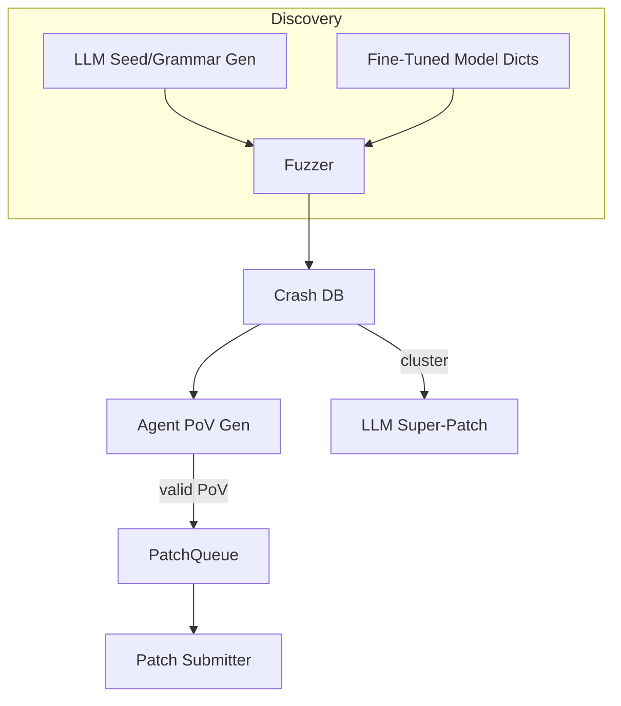

# AI-सहायित Fuzzing और स्वचालित Vulnerability खोज

{{#include ../banners/hacktricks-training.md}}

## अवलोकन
Large-language models (LLMs) semantically rich inputs बनाकर, grammars को विकसित करके, crash data पर reasoning करके और यहाँ तक कि multi-bug patches सुझाकर पारंपरिक vulnerability-research pipelines को बहुत अधिक प्रभावी बना सकते हैं। इस पेज में DARPA के AI Cyber Challenge (AIxCC) finals और अन्य सार्वजनिक शोध के दौरान देखे गए सबसे प्रभावी तरीकों का संकलन है।<sup>[[4]](#references)</sup><sup>[[5]](#references)</sup>

आगे किसी एक विशिष्ट प्रतियोगिता प्रणाली का विवरण नहीं, बल्कि उन techniques का सार दिया गया है जिन्हें आप अपने workflows में दोहरा सकते हैं।

---

## 1. LLM द्वारा जनरेट किए गए Seed Inputs

पारंपरिक coverage–guided fuzzers (AFL++, libFuzzer, Honggfuzz…) seeds के एक छोटे corpus से शुरुआत करते हैं और bytes को बिना सोचे-समझे mutate करते हैं। जब target input format जटिल हो (SQL, URLs, custom binary protocols), तो random mutations आमतौर पर दिलचस्प branches तक पहुँचने से पहले ही syntax तोड़ देते हैं।

LLMs seed generators—यानी ऐसे छोटे scripts जो **syntax-correct लेकिन security-relevant inputs** बनाते हैं—तैयार करके इस bootstrap समस्या को हल कर सकते हैं। उदाहरण के लिए:

```prompt
SYSTEM: You are a helpful security engineer.
USER:
Write a Python3 program that prints 200 unique SQL injection strings targeting common anti-pattern mistakes (missing quotes, numeric context, stacked queries).  Ensure length ≤ 256 bytes / string so they survive common length limits.
```

```python
# gen_sqli_seeds.py (truncated)
PAYLOADS = [
    "1 OR 1=1 -- ",
    "' UNION SELECT NULL,NULL--",
    "0; DROP TABLE users;--",
    ...
]
for p in PAYLOADS:
    print(p)
```

एक बार चलाएँ और आउटपुट सीधे fuzzer के प्रारंभिक corpus में दें:

```bash
python3 gen_sqli_seeds.py > seeds.txt
afl-fuzz -i seeds.txt -o findings/ -- ./target @@
```

Benefits:
1. Semantic validity → शुरुआत में ही अधिक गहरा coverage.
2. दोबारा जनरेट किया जा सकता है: XSS, path traversal, binary blobs आदि पर फ़ोकस करने के लिए prompt में बदलाव करें।
3. सस्ता (< GPT-3.5 के साथ 1 ¢)।

### Tips
* सतही filters को bypass करने के लिए model को payload की लंबाई और encoding (UTF-8, URL-encoded, UTF-16-LE) में *विविधता* लाने का निर्देश दें।
* एक *single self-contained script* माँगें — इससे JSON formatting की दिक्कतें नहीं होंगी।

---

## 2. Grammar-Evolution Fuzzing

एक अधिक शक्तिशाली तरीके में, ठोस seeds के बजाय LLM से **grammar विकसित** करवाया जाता है। इसका workflow (“Grammar Guy” pattern) है:

1. Prompt के ज़रिए एक शुरुआती ANTLR/Peach/LibFuzzer grammar जनरेट करें।
2. N मिनट तक fuzz करें और coverage metrics (hit हुए edges / blocks) इकट्ठा करें।
3. uncovered program areas का सारांश बनाएँ और उसे model को वापस दें:
   ```prompt
   The previous grammar triggered 12 % of the program edges.  Functions not reached: parse_auth, handle_upload.  Add / modify rules to cover these.
   ```
4. नए नियम merge करें, फिर से fuzz करें, दोहराएँ।

Pseudo-code skeleton:

```python
for epoch in range(MAX_EPOCHS):
    grammar = llm.refine(grammar, feedback=coverage_stats)
    save(grammar, f"grammar_{epoch}.txt")
    coverage_stats = run_fuzzer(grammar)
```

मुख्य बिंदु:
* एक *बजट* रखें – हर refinement में tokens खर्च होते हैं।
* मॉडल से दोबारा लिखवाने के बजाय संपादन करवाने के लिए `diff` + `patch` निर्देशों का उपयोग करें।
* Δcoverage < ε होने पर रुकें।

---

## 3. Local-LLM libFuzzer Harness इंजीनियरिंग

ऐसे source के लिए जिसे analyst के workstation से बाहर नहीं भेजा जा सकता, local code model fuzzer bytes और C/C++ API के बीच छोटा adapter तैयार कर सकता है। उपयोगी security boundary स्पष्ट है: **मॉडल test infrastructure लिखता और संशोधित करता है; coverage-guided mutation inputs को explore करता है; sanitizers अमान्य operations की रिपोर्ट करते हैं; एक मानव harness की समीक्षा करता है और findings की triage करता है**।<sup>[[9]](#references)</sup>

ऐसी engine-level corpus, feedback, snapshot और stateful-fuzzing तकनीकों के लिए जो LLM पर निर्भर नहीं करतीं, सामान्य [Fuzzing Methodology](../generic-methodologies-and-resources/fuzzing.md) देखें।

लक्ष्य header से हूबहू declaration कॉपी करके शुरुआत करें और output format को सीमित रखें। संकीर्ण prompt से गढ़े हुए APIs कम होते हैं और परिणाम की समीक्षा करना आसान होता है:<sup>[[8]](#references)[[9]](#references)</sup>

```prompt
Write a libFuzzer target for this exact declaration:
int parse_records(const uint8_t *data, size_t size);

Output only C code. Implement LLVMFuzzerTestOneInput, include the
declaration, pass data and size unchanged, and do not use files,
network access, randomness, clocks, threads, or persistent state.
```

कच्चे byte parser के लिए, अपेक्षित परिणाम इससे अधिक जटिल नहीं होना चाहिए:<sup>[[6]](#references)[[9]](#references)</sup>

```c
#include <stddef.h>
#include <stdint.h>

extern int parse_records(const uint8_t *, size_t);

int LLVMFuzzerTestOneInput(const uint8_t *data, size_t size) {
    (void)parse_records(data, size);
    return 0;
}
```

Compilation केवल पहला validation gate है। CPU time खर्च करने से पहले हर generated target को इन invariants के अनुसार जाँचें:<sup>[[6]](#references)[[8]](#references)[[9]](#references)</sup>

- **Exact API:** types, ownership rules, initialization, teardown और calling convention की तुलना वास्तविक header और मौजूदा callers से करें।
- **Harness safety:** `data` से हर read को guard करें; sanitizer findings target में उत्पन्न होने चाहिए, generated glue में नहीं।
- **Repeatability:** परिणाम `data` और `size` का function होना चाहिए; external I/O, time, uncontrolled randomness, unjoined threads और calls के बीच बने रहने वाले state को हटाएँ।
- **Throughput:** महँगे immutable state को केवल तभी एक बार initialize करें जब इससे behavior प्रभावित न हो, input size सीमित रखें, logging दबाएँ और हर input के लिए किए गए allocations को free करें।
- **Reachability:** सत्यापित करें कि इच्छित functions और branches execute हों। ऐसा target जो compile तो होता है, लेकिन केवल rejection paths को exercise करता है, एक खामोश विफलता है।

### Structure-aware targets: bugs छिपाए बिना invariants बनाए रखें

अगर अधिकांश raw inputs किसी magic, length, version या checksum gate पर fail हो जाते हैं, तो fuzz bytes को **typed field material** की तरह इस्तेमाल करें और एक valid object दोबारा बनाएँ। Format constants तय रखें, semantic fields और payload bytes को mutable रहने दें, और reconstructed payload से integrity metadata derive करें। `FuzzedDataProvider` bounded typed values consume करने के लिए उपयोगी है, जबकि किसी भी generated allocation और conversion को सीमित रखने की ज़िम्मेदारी adapter की रहती है।<sup>[[9]](#references)</sup>

<details>
<summary>Structure-aware C++ target का उदाहरण</summary>

```cpp
#include <fuzzer/FuzzedDataProvider.h>
#include <stddef.h>
#include <stdint.h>
#include <vector>

extern "C" int parse_message(const uint8_t *, size_t);

extern "C" int LLVMFuzzerTestOneInput(const uint8_t *data, size_t size) {
    FuzzedDataProvider fdp(data, size);
    uint8_t version = fdp.ConsumeIntegral<uint8_t>();
    auto body = fdp.ConsumeRemainingBytes<uint8_t>();
    if (body.size() > UINT16_MAX) body.resize(UINT16_MAX);
    uint16_t len = static_cast<uint16_t>(body.size());
    std::vector<uint8_t> msg = {0x8b, 'M', 'S', 'G', version,
                                static_cast<uint8_t>(len >> 8),
                                static_cast<uint8_t>(len)};
    msg.insert(msg.end(), body.begin(), body.end());
    (void)parse_message(msg.data(), msg.size());
    return 0;
}
```

</details>

हर सवाल के लिए एक ही structure-repairing target का उपयोग न करें। एक target ऐसा रखें जो गहरी valid states को explore करने के लिए lengths/checksums निकालता हो, और दूसरा ऐसा जो **घोषित** metadata को fuzzer-controlled रखे और केवल harness के अपने reads और allocations को सीमित करे। दूसरा target mismatched-length और bad-integrity attack surfaces को बनाए रखता है, जिन्हें automatic repair अन्यथा मिटा देता।<sup>[[9]](#references)</sup>

### Seeds, dictionaries, sanitizers, और coverage feedback

मॉडल से binary को सीधे प्रिंट करने के बजाय binary seeds लिखने वाली script बनाने को कहें। खाली, न्यूनतम, सामान्य और boundary-valid objects के seeds बनाएँ; फिर magic values, tags, enum encodings और parser keywords को निकालकर एक reviewed dictionary में रखें। libFuzzer इस dictionary को `-dict=` के साथ स्वीकार करता है और corpus में उन mutations को बनाए रखता है जो नई coverage उजागर करते हैं।<sup>[[6]](#references)[[9]](#references)</sup>

```text
magic="\x8bMSG"
version_min="\x00"
version_max="\xff"
config_tag="CONFIG"
```

पूरक instrumentation के साथ वही target बनाएँ। ASan और UBSan एक ही fuzzing binary साझा कर सकते हैं; uninstrumented code के कारण रिपोर्ट से बचने के लिए अलग MSan build बनाएँ और उसकी dependencies को instrument करें।<sup>[[6]](#references)[[9]](#references)</sup>

```bash
clang++ -g -O1 -fsanitize=fuzzer,address,undefined \
  -fno-sanitize-recover=undefined target.cc harness.cc -o fuzz_target
./fuzz_target corpus -dict=msg.dict -max_len=65535

clang++ -g -O1 -fsanitize=fuzzer,memory \
  target.cc harness.cc -o fuzz_target_msan
```

प्रत्येक model revision का मूल्यांकन coverage के आधार पर करें। libFuzzer output में `cov`/`ft` का शुरुआत में सपाट रहना और corpus का स्थिर रहना आम तौर पर खराब framing, बहुत अधिक प्रतिबंधित early return, या गलत call का संकेत है; कम `exec/s` महंगे setup, I/O, allocation, या leaked state की ओर इशारा करता है। `NEW` केवल यह साबित करता है कि कोई coverage feature बदला है, यह नहीं कि इच्छित parser तक पहुँचा गया।<sup>[[6]](#references)[[9]](#references)</sup>

source-level feedback के लिए coverage build बनाएं, उसे fuzz करें, और model को केवल uncovered functions तथा उनकी guarding conditions दें। परिणामी harness/seed/dictionary diff की जाँच करें और फिर से मापें:<sup>[[7]](#references)[[8]](#references)[[9]](#references)</sup>

```bash
clang++ -g -O1 -fsanitize=fuzzer \
  -fprofile-instr-generate -fcoverage-mapping target.cc harness.cc -o fuzz_cov
mkdir -p profiles
LLVM_PROFILE_FILE='profiles/%p.profraw' ./fuzz_cov -max_total_time=300 corpus
llvm-profdata merge -sparse profiles/*.profraw -o fuzz.profdata
llvm-cov report ./fuzz_cov -instr-profile=fuzz.profdata
llvm-cov show ./fuzz_cov -instr-profile=fuzz.profdata \
  --show-branches=count --region-coverage-lt=1 target.cc
```

इसलिए scalable loop है **generate → compile/link → sanitizers के तहत smoke-test → target coverage मापें → coverage/source का सबसे छोटा प्रासंगिक context दें → संशोधित करें → फिर से मापें**। OSS-Fuzz-Gen भी इसी सिद्धांत पर काम करता है: यह generated targets को compilability, runtime failures, coverage और मौजूदा targets की तुलना में coverage improvement के आधार पर परखता है, न कि plausibly दिखने वाले code को बिना जाँच स्वीकार करता है।<sup>[[7]](#references)[[8]](#references)</sup>

---

<a id="3-agent-based-pov-exploit-generation" hidden>3. Agent-Based PoV (Exploit) जनरेशन</a>

## 4. Agent-Based PoV (Exploit) जनरेशन

Crash मिलने के बाद भी आपको एक **proof-of-vulnerability (PoV)** चाहिए, जो उसे deterministically trigger करे।

एक scalable तरीका है कई lightweight workers (processes, threads या containers) चलाना, जिनमें से हर एक अलग model या sampling configuration का इस्तेमाल करे। AIxCC finalist survey में scale के ठोस उदाहरण दिए गए हैं: एक टीम ने AI-first PoV generation के लिए **हज़ारों concurrent agents** इस्तेमाल किए, जबकि दूसरी ने **300–500 fuzzing agents** orchestrate किए और उच्च-स्तरीय semantic reasoning के लिए LLMs आरक्षित रखे।<sup>[[4]](#references)</sup>

Pipeline:
1. Static/dynamic analysis से *bug candidates* बनते हैं (crash PC, input slice और sanitizer msg वाला struct)।
2. Orchestrator candidates को agents में बाँटता है।
3. Agent के reasoning steps:
   a. `gdb` + input से bug को locally reproduce करें।
   b. न्यूनतम exploit payload सुझाएँ।
   c. Sandbox में exploit validate करें। यदि सफल हो → submit करें।
4. असफल प्रयासों को coverage fuzzing के लिए **नए seeds के रूप में फिर से queue में रखा जाता है** (feedback loop)।

फायदे:
* Parallelisation से single-agent की अविश्वसनीयता का असर कम होता है।
* देखी गई success-rate के आधार पर temp / model size का auto-tuning।

---

<a id="4-directed-fuzzing-with-fine-tuned-code-models" hidden>4. Fine-Tuned Code Models के साथ Directed Fuzzing</a>

## 5. Fine-Tuned Code Models के साथ Directed Fuzzing

Vulnerability patterns (integer overflow, buffer copy, format string) के साथ label किए गए C/C++ source पर open-weight model (जैसे Llama-7B) को fine-tune करें। फिर:

1. Function list + AST पाने के लिए static analysis चलाएँ।
2. Model को prompt दें: *“ऐसी mutation dictionary entries दें जिनसे function X में memory safety टूटने की संभावना हो”*।
3. उन tokens को custom `AFL_CUSTOM_MUTATOR` में डालें।

`sprintf` wrapper के लिए output का उदाहरण:
```
{"pattern":"%99999999s"}
{"pattern":"AAAAAAAA....<1024>....%n"}
```

अनुभवजन्य रूप से, वास्तविक targets पर इससे crash तक पहुँचने का समय 2× से अधिक कम हो जाता है।

---

<a id="5-ai-guided-patching-strategies" hidden>5. AI-निर्देशित Patching रणनीतियाँ</a>

## 6. AI-निर्देशित Patching रणनीतियाँ

<a id="51-super-patches" hidden>5.1 Super Patches</a>

### 6.1 Super Patches
मॉडल से crash signatures को *क्लस्टर* करने और सामान्य root cause को हटाने वाला **एक single patch** सुझाने के लिए कहें। एक बार सबमिट करें, कई bugs ठीक करें → उन environments में accuracy penalties कम होंगी जहाँ हर गलत patch पर points कटते हैं।

Prompt की रूपरेखा:
```
Here are 10 stack traces + file snippets.  Identify the shared mistake and generate a unified diff fixing all occurrences.
```

{{#ref}}
../generic-methodologies-and-resources/fuzzing.md
{{#endref}}

<a id="52-speculative-patch-ratio" hidden>5.2 Speculative Patch Ratio</a>

### 6.2 Speculative Patch Ratio
एक queue लागू करें, जिसमें पुष्ट PoV-validated patches और *speculative* patches (बिना PoV) को 1:N अनुपात में बारी-बारी से रखा जाए; इस अनुपात को scoring rules के अनुसार समायोजित करें (जैसे, 2 speculative : 1 confirmed)। एक cost model penalties की तुलना points से करता है और N को अपने-आप समायोजित करता है।

---

निश्चित, फ़ाइल-दर-फ़ाइल source review, mobile entry-point taskflows, kernel pattern audits और evidence-gated vulnerability validation के लिए, [AI-assisted source review and vulnerability validation](AI-Assisted-Source-Review-and-Vulnerability-Validation.md) देखें।

---

## Debugger-assisted crash triage

Crash triage, function analysis और नियंत्रित heap-chunk reachability के लिए Mona v3 workflows, [Exploiting Tools](../binary-exploitation/basic-stack-binary-exploitation-methodology/tools/#mona-v3-debugger-context-requests-for-crash-triage) में दिए गए हैं।

---

## सब कुछ एक साथ जोड़ना
एक end-to-end CRS (Cyber Reasoning System) के components को इस तरह जोड़ा जा सकता है:



---

## References

- [4] [Trail of Bits – AIxCC फ़ाइनल: मुकाबले का लेखा-जोखा](https://blog.trailofbits.com/2025/08/07/aixcc-finals-tale-of-the-tape/)
- [5] [CTF Radiooo AIxCC फ़ाइनलिस्ट के इंटरव्यू](https://www.youtube.com/@ctfradiooo)
- [6] [LLVM — libFuzzer: coverage-guided fuzz testing के लिए एक लाइब्रेरी](https://llvm.org/docs/LibFuzzer.html)
- [7] [Google — OSS-Fuzz-Gen](https://github.com/google/oss-fuzz-gen)
- [8] [Google Online Security Blog — Fuzzing को बेहतर बनाना: AI से और अधिक vulnerabilities खोजना](https://security.googleblog.com/2024/11/leveling-up-fuzzing-finding-more.html)
- [9] [8kSec — Local LLM के साथ AI-सहायित Fuzzing Harness जनरेशन](https://8ksec.io/ai-assisted-fuzzing-harness-local-llm)
{{#include ../banners/hacktricks-training.md}}
