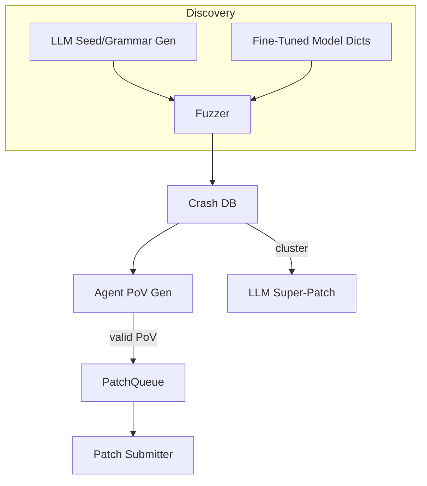

# AI-Assisted Fuzzing & Otomatik Zafiyet Keşfi

{{#include ../banners/hacktricks-training.md}}

## Genel Bakış
Büyük dil modelleri (LLM'ler), anlamsal açıdan zengin girdiler oluşturarak, gramerleri geliştirerek, crash verileri üzerinde akıl yürüterek ve hatta birden fazla bug içeren yamalar önererek geleneksel zafiyet araştırma süreçlerini büyük ölçüde hızlandırabilir. Bu sayfada, DARPA’nın AI Cyber Challenge (AIxCC) finallerinde ve diğer kamuya açık araştırmalarda gözlemlenen en etkili kalıplar derlenmiştir.<sup>[[4]](#references)</sup><sup>[[5]](#references)</sup>

Aşağıda belirli bir yarışma sisteminin açıklaması değil, kendi iş akışlarınızda yeniden uygulayabilmeniz için tekniklerin bir soyutlaması yer alıyor.

---

## 1. LLM Tarafından Oluşturulan Seed Girdileri

Geleneksel coverage–guided fuzzer'lar (AFL++, libFuzzer, Honggfuzz…) küçük bir seed corpus ile başlar ve baytları rastgele mutate eder. Hedef girdi biçimi karmaşık olduğunda (SQL, URL'ler, özel ikili protokoller), rastgele mutasyonlar genellikle ilgi çekici dallara ulaşılmadan önce sözdizimini bozar.

LLM'ler, **sözdizimi doğru ancak güvenlik açısından önemli girdiler** üreten kısa script'ler olan *seed generator*'lar oluşturarak bu başlangıç sorununu çözebilir. Örneğin:

```prompt
SYSTEM: You are a helpful security engineer.
USER:
Write a Python3 program that prints 200 unique SQL injection strings targeting common anti-pattern mistakes (missing quotes, numeric context, stacked queries).  Ensure length ≤ 256 bytes / string so they survive common length limits.
```

```python
# gen_sqli_seeds.py (truncated)
PAYLOADS = [
    "1 OR 1=1 -- ",
    "' UNION SELECT NULL,NULL--",
    "0; DROP TABLE users;--",
    ...
]
for p in PAYLOADS:
    print(p)
```

Bir kez çalıştırın ve çıktıyı doğrudan fuzzer'ın başlangıç corpus'una besleyin:

```bash
python3 gen_sqli_seeds.py > seeds.txt
afl-fuzz -i seeds.txt -o findings/ -- ./target @@
```

Benefits:
1. Semantic validity → erken aşamada daha derin kapsam.
2. Yeniden üretilebilir: XSS, path traversal, binary blobs vb. konulara odaklanmak için prompt'u değiştirin.
3. Ucuz (< 1 ¢ with GPT-3.5).

### Tips
* Yüzeysel filtreleri aşmak için modele payload uzunluğunu ve encoding'i (UTF-8, URL-encoded, UTF-16-LE) *çeşitlendirmesini* söyleyin.
* Tek bir *self-contained script* isteyin; böylece JSON biçimlendirme sorunlarını önlersiniz.

---

## 2. Grammar-Evolution Fuzzing

Daha güçlü bir yaklaşım, somut seed'ler yerine LLM'nin bir grammar'ı **evrimleştirmesini** sağlamaktır. İş akışı (“Grammar Guy” pattern) şöyledir:

1. Prompt aracılığıyla başlangıçta bir ANTLR/Peach/LibFuzzer grammar'ı oluşturun.
2. N dakika fuzzing yapın ve coverage metriklerini (hit edilen edge / block'ları) toplayın.
3. Kapsanmamış program alanlarını özetleyin ve özeti modele geri gönderin:
   ```prompt
   The previous grammar triggered 12 % of the program edges.  Functions not reached: parse_auth, handle_upload.  Add / modify rules to cover these.
   ```
4. Yeni kuralları birleştirin, yeniden fuzzing yapın ve tekrarlayın.

Sözde kod iskeleti:

```python
for epoch in range(MAX_EPOCHS):
    grammar = llm.refine(grammar, feedback=coverage_stats)
    save(grammar, f"grammar_{epoch}.txt")
    coverage_stats = run_fuzzer(grammar)
```

Önemli noktalar:
* Bir *bütçe* belirleyin – her iyileştirme token kullanır.
* Modelin baştan yazmak yerine düzenleme yapması için `diff` + `patch` talimatları kullanın.
* Δcoverage < ε olduğunda durun.

---

## 3. Yerel-LLM libFuzzer Harness Mühendisliği

Analist iş istasyonunun dışına çıkarılamayacak kaynak kodlar için yerel bir code model, fuzzer baytları ile bir C/C++ API’si arasındaki küçük adaptörü taslak olarak hazırlayabilir. Yararlı güvenlik sınırı açıktır: **model test altyapısını yazar ve gözden geçirir; coverage-guided mutation girdileri keşfeder; sanitizer’lar geçersiz işlemleri bildirir; bir insan harness’i inceler ve bulguları triage eder**.<sup>[[9]](#references)</sup>

LLM’ye bağlı olmayan engine düzeyindeki corpus, feedback, snapshot ve stateful-fuzzing teknikleri için genel [Fuzzing Metodolojisi](../generic-methodologies-and-resources/fuzzing.md) bölümüne bakın.

Hedef header’dan alınan tam bildirimle başlayın ve çıktı biçimini kısıtlayın. Dar kapsamlı bir prompt, uydurma API’leri azaltır ve sonucu incelemeyi kolaylaştırır:<sup>[[8]](#references)[[9]](#references)</sup>

```prompt
Write a libFuzzer target for this exact declaration:
int parse_records(const uint8_t *data, size_t size);

Output only C code. Implement LLVMFuzzerTestOneInput, include the
declaration, pass data and size unchanged, and do not use files,
network access, randomness, clocks, threads, or persistent state.
```

Ham bayt ayrıştırıcısı için beklenen sonuç bundan daha karmaşık olmamalıdır:<sup>[[6]](#references)[[9]](#references)</sup>

```c
#include <stddef.h>
#include <stdint.h>

extern int parse_records(const uint8_t *, size_t);

int LLVMFuzzerTestOneInput(const uint8_t *data, size_t size) {
    (void)parse_records(data, size);
    return 0;
}
```

Derleme yalnızca ilk doğrulama aşamasıdır. CPU zamanı harcamadan önce oluşturulan her hedefi şu değişmezlere göre gözden geçirin:<sup>[[6]](#references)[[8]](#references)[[9]](#references)</sup>

- **API'nin birebir eşleşmesi:** Türleri, sahiplik kurallarını, başlatmayı, temizlemeyi ve çağrı kuralını gerçek başlık dosyası ve mevcut çağıranlarla karşılaştırın.
- **Harness güvenliği:** `data` üzerinden yapılan her okumayı korumaya alın; sanitizer bulguları oluşturulan glue kodundan değil, hedeften kaynaklanmalıdır.
- **Tekrarlanabilirlik:** Sonucu `data` ve `size` değerlerinin bir fonksiyonu hâline getirin; harici G/Ç'yi, zamanı, kontrolsüz rastgeleliği, birleştirilmemiş thread'leri ve çağrılar arasında korunan durumu kaldırın.
- **İşlem hızı:** Davranışı etkilemeyeceğinden emin olduğunuz durumlarda pahalı, değişmez durumu yalnızca bir kez başlatın; girdi boyutunu sınırlandırın, loglamayı devre dışı bırakın ve girdi başına yapılan bellek tahsislerini serbest bırakın.
- **Erişilebilirlik:** Amaçlanan işlevlerin ve dalların çalıştığını doğrulayın. Derlenen ancak yalnızca ret yollarını çalıştıran bir hedef sessiz bir başarısızlıktır.

### Yapı farkındalıklı hedefler: hataları gizlemeden değişmezleri koruyun

Ham girdilerin çoğu magic, uzunluk, sürüm veya checksum denetiminde başarısız oluyorsa fuzz baytlarını **türlü alan verisi** olarak kullanın ve geçerli bir nesne oluşturun. Biçim sabitlerini sabitleyin, anlamsal alanları ve payload baytlarını değiştirilebilir bırakın, bütünlük meta verilerini yeniden oluşturulan payload'dan türetin. `FuzzedDataProvider`, sınırlandırılmış tür değerlerini tüketmek için kullanışlıdır; oluşturulan tüm bellek tahsislerini ve dönüşümleri sınırlamak ise hâlâ adapter'ın sorumluluğundadır.<sup>[[9]](#references)</sup>

<details>
<summary>Yapı farkındalıklı C++ hedefi örneği</summary>

```cpp
#include <fuzzer/FuzzedDataProvider.h>
#include <stddef.h>
#include <stdint.h>
#include <vector>

extern "C" int parse_message(const uint8_t *, size_t);

extern "C" int LLVMFuzzerTestOneInput(const uint8_t *data, size_t size) {
    FuzzedDataProvider fdp(data, size);
    uint8_t version = fdp.ConsumeIntegral<uint8_t>();
    auto body = fdp.ConsumeRemainingBytes<uint8_t>();
    if (body.size() > UINT16_MAX) body.resize(UINT16_MAX);
    uint16_t len = static_cast<uint16_t>(body.size());
    std::vector<uint8_t> msg = {0x8b, 'M', 'S', 'G', version,
                                static_cast<uint8_t>(len >> 8),
                                static_cast<uint8_t>(len)};
    msg.insert(msg.end(), body.begin(), body.end());
    (void)parse_message(msg.data(), msg.size());
    return 0;
}
```

</details>

Her soru için yapıyı onaran tek bir target kullanmayın. Derin ve geçerli durumları keşfetmek için uzunlukları/checksum'ları türeten bir target, fuzzer'ın **bildirdiği** metadata'yı kontrol ettiği ve yalnızca harness'in kendi okumalarını ve tahsislerini sınırlandırdığı başka bir target bulundurun. İkinci target, otomatik onarımın aksi hâlde ortadan kaldıracağı uzunluk uyuşmazlığı ve hatalı bütünlük denetimi saldırı yüzeylerini korur.<sup>[[9]](#references)</sup>

### Seed'ler, sözlükler, sanitizer'lar ve coverage geri bildirimi

Modelden doğrudan binary yazdırmasını istemek yerine binary seed'ler yazan bir script üretmesini isteyin. Boş, minimal, tipik ve geçerli sınır değerli nesnelerle seed oluşturun; ardından magic değerlerini, tag'leri, enum kodlamalarını ve parser anahtar sözcüklerini incelenmiş bir sözlüğe çıkarın. libFuzzer bu sözlüğü `-dict=` ile kabul eder ve corpus'ta yeni coverage ortaya çıkaran mutasyonları tutar.<sup>[[6]](#references)[[9]](#references)</sup>

```text
magic="\x8bMSG"
version_min="\x00"
version_max="\xff"
config_tag="CONFIG"
```

Aynı hedefi tamamlayıcı enstrümantasyonla derleyin. ASan ve UBSan aynı fuzzing ikilisini paylaşabilir; enstrümante edilmemiş koddan kaynaklanan raporları önlemek için ayrı bir MSan derlemesi yapın ve bağımlılıklarını enstrümante edin.<sup>[[6]](#references)[[9]](#references)</sup>

```bash
clang++ -g -O1 -fsanitize=fuzzer,address,undefined \
  -fno-sanitize-recover=undefined target.cc harness.cc -o fuzz_target
./fuzz_target corpus -dict=msg.dict -max_len=65535

clang++ -g -O1 -fsanitize=fuzzer,memory \
  target.cc harness.cc -o fuzz_target_msan
```

Her model revizyonunu değerlendirirken coverage'ı ölçüt olarak kullanın. libFuzzer çıktısında `cov`/`ft` değerlerinin başlangıçta düz seyretmesi ve corpus'un değişmemesi genellikle hatalı framing'e, aşırı kısıtlayıcı bir erken dönüşe veya yanlış çağrıya işaret eder; düşük `exec/s` ise maliyetli kurulum, I/O, allocation ya da sızan state'e işaret eder. `NEW`, yalnızca bir coverage özelliğinin değiştiğini kanıtlar; amaçlanan parser'a ulaşıldığını değil.<sup>[[6]](#references)[[9]](#references)</sup>

Kaynak düzeyinde geri bildirim için coverage derlemesi oluşturun, fuzzing yapın ve modele yalnızca kapsanmayan işlevleri ve bunları koruyan koşulları verin. Ortaya çıkan harness/seed/dictionary diff'ini doğrulayın ve yeniden ölçüm yapın:<sup>[[7]](#references)[[8]](#references)[[9]](#references)</sup>

```bash
clang++ -g -O1 -fsanitize=fuzzer \
  -fprofile-instr-generate -fcoverage-mapping target.cc harness.cc -o fuzz_cov
mkdir -p profiles
LLVM_PROFILE_FILE='profiles/%p.profraw' ./fuzz_cov -max_total_time=300 corpus
llvm-profdata merge -sparse profiles/*.profraw -o fuzz.profdata
llvm-cov report ./fuzz_cov -instr-profile=fuzz.profdata
llvm-cov show ./fuzz_cov -instr-profile=fuzz.profdata \
  --show-branches=count --region-coverage-lt=1 target.cc
```

Ölçeklenebilir döngü bu nedenle **oluştur → derle/bağla → sanitizer’lar altında duman testi yap → hedef kapsamasını ölç → ilgili en küçük kapsam/kaynak bağlamını sağla → gözden geçir → yeniden ölç** şeklindedir. OSS-Fuzz-Gen de aynı ilkeyi uygular: makul görünen kodu olduğu gibi kabul etmek yerine, oluşturulan hedefleri derlenebilirlik, çalışma zamanı hataları, kapsama ve mevcut hedeflere kıyasla kapsama iyileşmesi açısından değerlendirir.<sup>[[7]](#references)[[8]](#references)</sup>

---

## 4. Agent Tabanlı PoV (Exploit) Oluşturma

Bir crash bulunduktan sonra, bunu deterministik olarak tetikleyen bir **vulnerability proof (PoV)** oluşturmanız gerekir.

Ölçeklenebilir bir yaklaşım; her biri farklı bir model veya örnekleme yapılandırması kullanan çok sayıda hafif worker’ı (process, thread veya container) başlatmaktır. AIxCC finalistleri anketi, ölçeğe ilişkin somut örnekler sunuyor: bir ekip, AI-first PoV oluşturma için **binlerce eşzamanlı agent** kullanırken başka bir ekip **300–500 fuzzing agent** koordine etti ve LLM’leri üst düzey anlamsal akıl yürütme için ayırdı.<sup>[[4]](#references)</sup>

Pipeline:
1. Static/dynamic analysis, *bug adayları* üretir (crash PC, input dilimi ve sanitizer mesajı içeren struct).
2. Orchestrator, adayları agent’lara dağıtır.
3. Agent’ın akıl yürütme adımları:
   a. Bug’ı yerel olarak `gdb` + input ile yeniden oluştur.
   b. En küçük exploit payload’ını öner.
   c. Exploit’i sandbox’ta doğrula. Başarılıysa → gönder.
4. Başarısız girişimler, coverage fuzzing için **yeni seed’ler olarak yeniden kuyruğa alınır** (geri bildirim döngüsü).

Avantajları:
* Paralelleştirme, tek bir agent’ın güvenilmezliğini dengeler.
* Gözlemlenen başarı oranına göre temp/model boyutu otomatik ayarlanır.

---

## 5. İnce Ayarlı Code Model’leriyle Yönlendirilmiş Fuzzing

Vulnerability pattern’leriyle (integer overflow, buffer copy, format string) etiketlenmiş C/C++ kaynak koduyla açık ağırlıklı bir modeli (ör. Llama-7B) fine-tune edin. Ardından:

1. Function listesi + AST elde etmek için static analysis çalıştırın.
2. Modele şu prompt’u verin: *“X function’ında memory safety’yi bozma olasılığı yüksek mutation dictionary girdileri ver”*.
3. Bu token’ları özel bir `AFL_CUSTOM_MUTATOR` içine ekleyin.

Bir `sprintf` wrapper’ı için örnek çıktı:
```
{"pattern":"%99999999s"}
{"pattern":"AAAAAAAA....<1024>....%n"}
```

Deneysel olarak bu, gerçek hedeflerde crash'e kadar geçen süreyi >2× kısaltır.

---

## 6. AI Rehberli Patch Stratejileri

### 6.1 Süper Patch'ler
Modelden crash imzalarını *kümelemesini* ve ortak temel nedeni ortadan kaldıran **tek bir patch** önermesini isteyin. Bir kez gönderin, birkaç hatayı düzeltin → her hatalı patch'in puan kaybettirdiği ortamlarda daha az doğruluk cezası.

Prompt taslağı:
```
Here are 10 stack traces + file snippets.  Identify the shared mistake and generate a unified diff fixing all occurrences.
```

### 6.2 Spekülatif Patch Oranı
Doğrulanmış, PoV ile geçerliliği onaylanmış patch’ler ile *spekülatif* patch’lerin (PoV olmadan) puanlama kurallarına göre ayarlanmış 1:N oranında (ör. 2 spekülatif : 1 doğrulanmış) sırayla işlendiği bir kuyruk oluşturun. Bir maliyet modeli, cezaları puanlarla karşılaştırır ve N değerini otomatik olarak ayarlar.

---

## 7. Deterministik Dosya Dosya AI Kod İncelemesi

AI destekli incelemelerde sık görülen bir başarısızlık durumu, tek bir ajandan tüm depoyu incelemesini istemek ve doğru dosyaları ve grep terimlerini seçmesini ummaktır. Daha güvenilir bir yöntem, **depo kapsamını zorunlu kılmaktır**:<sup>[[1]](#references)</sup>

1. Kaynak dosyaları listeleyin.
2. Her seferinde **tek bir dosyayı** ve asgari bağlamı (entrypoint, import’lar, yakındaki rotalar/çağrılar) gönderin.
3. Her dosya için **yapılandırılmış bir rapor** isteyin: kaynaklar, sink, eksik doğrulama, exploit önkoşulları ve güven düzeyi.<sup>[[3]](#references)</sup>
4. Raporları **source→sink örüntüsüne** göre tekilleştirin ve yüksek riskli olanları elle doğrulayın.

Bu yöntem çok token harcar ve gürültülüdür, ancak geniş kapsamlı agentic incelemelerin sıklıkla gözden kaçırdığı **basit, yüksek etkili source/sink hatalarını** ortaya çıkarmada oldukça etkilidir.

### Öncelik vermeye değer triage örüntüleri

- **Dinamik PHP include/dispatch**: saldırgan denetimindeki rota/controller/module adlarının, katı bir allowlist ve yol kanonikleştirmesi olmadan `require_once()`, `include()` veya `include_once()` fonksiyonlarına aktarılması.
- **Admin/hesap iş akışlarında shell çalıştırma**: kullanıcı adlarının, domain’lerin, FTP hesaplarının veya diğer tanımlayıcıların `exec()`, `system()`, `shell_exec()`, `passthru()`, `proc_open()` ya da `popen()` fonksiyonlarına ulaşması.
- **Yapılandırılmış girdilerin bir araya gelmesi**: aynı parametrenin `$_GET`, `$_POST`, JSON, XML veya framework body parser’larından kabul edilip daha sonra dosya sistemi ya da OS-command sink’lerinde yeniden kullanılması.

### Bu yöntemin iyi bulduğu iki pratik bug sınıfı

- **PHP controller-dispatch LFI/RCE**: İstek denetimindeki bir controller adı allowlist/path normalleştirmesi olmadan `require_once()` içine birleştirilirse `../` gibi traversal dizileri PHP’nin istenmeyen bir yerel `.php` dosyasını include etmesine yol açabilir. Saldırgan include işlemini önceden yerleştirilmiş veya başka bir şekilde yararlı bir PHP dosyasına yönlendirebiliyorsa LFI, code execution’a dönüşür. Bkz. [File Inclusion / Path Traversal](../pentesting-web/file-inclusion/README.md).<sup>[[1]](#references)</sup>
- **Hosting/admin panellerinde kimlik doğrulamalı command injection**: Kullanıcı adları gibi hesap yönetimi alanları shell komutlarına gömülürse, düşük ayrıcalıklı kimlik doğrulamalı bir kullanıcı normal bir oluşturma/silme işlemini RCE’ye dönüştürebilir. Panel komutu daha ayrıcalıklı bir servis hesabı olarak çalıştırdığında etki artar. Bkz. [Command Injection](../pentesting-web/command-injection.md).<sup>[[1]](#references)</sup>

### Pratik inceleme notları

- LLM’yi önce exploit generator olarak değil, **source/sink inceleyicisi** olarak kullanın.
- Açıkça **saldırganın denetimindeki alanı**, **normalleştirme/doğrulama eksikliğini** ve **tehlikeli sink’i** listelemesini isteyin.
- Büyük depolarda, deterministik dosya dosya inceleme, daha güçlü bir model kullansa bile, çoğunlukla tek bir otonom ajan çalıştırmasından daha güvenilirdir.<sup>[[2]](#references)</sup>
- Exploit edilebilirliğin dosyalar arası varsayımlara, rol anlamlarına veya ürüne özgü tehdit modellerine bağlı olduğu **Broken Access Control** ve diğer iş mantığı bug’larında daha zayıf sonuçlar bekleyin.

---

## Tanıdık Olmayan Codebase’lerde Denetlenebilir, Ajan Destekli Araştırma

[Graph-first fuzz-target iş akışı](../generic-methodologies-and-resources/fuzzing.md#graph-first-fuzz-target-selection-and-mutation-triage) entrypoint erişilebilirliğini, [agentic SAST pipeline’ları](../network-services-pentesting/pentesting-web/code-review-tools.md#agentic-sast-pipelines) ise aşamalı inceleme ve kanıt eşiklerini zaten ele alıyor. Her öne çıkarılan bulgu kaynak konumlarını, yol kanıtlarını ve dinamik bir ölçümü korusun diye bu deterministik sonuçları modelin hipotezlerinden ayrı tutun.<sup>[[10]](#references)</sup>

### Veri akışı uydurmadan nesne yaşam süresi kanıtlarını ilişkilendirin

Statik analiz, saldırgan denetimindeki bir uzunluğun bir fonksiyonda saklandığını ve aynı nesne alanının çok daha sonra bir kopyalama sink’ine ulaştığını bulabilir; ancak callback’ler, yeniden bağlantılar veya nesne yaşam süresi boyunca aradaki bağlantıyı kanıtlayamayabilir. Her iki bulguyu ayrı ayrı koruyun, nesne/alan bazında kümelendirin ve eksik bağlantıyı açık bir triage sorusu hâline getirin. Ajan ilişkiyi öne sürebilir, ancak kaynak kod incelemesi veya runtime instrumentation bunu kanıtlamalıdır.<sup>[[10]](#references)</sup>

Her aday için şunları kaydedin:

- somut entrypoint ve saldırgan denetimindeki byte’lar;
- her producer için geçerli doğrulama da dâhil olmak üzere ilgili alanın tüm producer’ları;
- sink, hedef kapasitesi ve erişmek için gereken build/runtime koşulları;
- yalnızca doğrudan harness çağrısı değil, dışarıya açık entrypoint’ten başlayan gerçek bir call stack;
- hipotezi doğrulayan veya reddeden en küçük dinamik sonuç.

Görünüşte güvenli bir yol, bir alanı genel olarak güvenli hâle getirmez. İkinci bir producer aynı alanı ilk yolun sınırlandırması olmadan doldurabilir. Yolları ayrı ayrı test edin ve harness’i dağıtım ortamına eşdeğer build seçenekleriyle çalıştırın; çünkü debug assertion’ları, üretimde bellek bozulmasına yol açan bir durumu test ortamında erken bir abort’a dönüştürebilir.<sup>[[10]](#references)</sup>

### İfşa ve exploitation için ölçüm eşikleri

Başlatılmamış bellek ifşası şüphesinde, yeni allocation’ları tanınabilir bir byte ile doldurun ve tam olarak bu işaretçinin gönderilen pakete ulaştığını doğrulayın. Exploitation için **kontrollü overwrite → yararlı victim object → disclosure → pointer/base kurtarma → control-flow hijack → birleştirilmiş payload** gibi ölçülebilir eşikler isteyin. Ajan yalnızca harness mevcut özelliği kanıtladığında ilerler; makul görünen bir anlatı, eşiğin geçildiği anlamına gelmez. [FreeRDP vakası](../binary-exploitation/libc-heap/heap-overflow.md#cross-path-length-reuse-and-stale-output-disclosure), doğrulama sırasında korunması gereken yolu ve build kısıtlarını gösterir.<sup>[[10]](#references)</sup>

---

## Hepsini Bir Araya Getirmek
Uçtan uca bir CRS (Cyber Reasoning System), bileşenleri şu şekilde bağlayabilir:



---

## References

- [1] [Project Black - Siber Güvenlik için Yerel AI: phpIPAM LFI ve myVesta Kimliği Doğrulanmış RCE'yi Bulma](https://projectblack.io/blog/local-ai-for-cyber-security)
- [2] [Strix](https://github.com/usestrix/strix)
- [3] [GitHub Copilot topluluğunun security-review becerisi](https://github.com/github/awesome-copilot/blob/main/skills/security-review/SKILL.md)
- [4] [Trail of Bits – AIxCC finalleri: Karşılaştırmalı değerlendirme](https://blog.trailofbits.com/2025/08/07/aixcc-finals-tale-of-the-tape/)
- [5] [CTF Radiooo AIxCC finalistleriyle röportajlar](https://www.youtube.com/@ctfradiooo)
- [6] [LLVM — libFuzzer: kapsam güdümlü fuzz testing için bir kütüphane](https://llvm.org/docs/LibFuzzer.html)
- [7] [Google — OSS-Fuzz-Gen](https://github.com/google/oss-fuzz-gen)
- [8] [Google Online Security Blog — Fuzzing'i bir üst seviyeye taşıma: AI ile daha fazla güvenlik açığı bulma](https://security.googleblog.com/2024/11/leveling-up-fuzzing-finding-more.html)
- [9] [8kSec — Yerel LLM ile AI destekli fuzzing harness oluşturma](https://8ksec.io/ai-assisted-fuzzing-harness-local-llm)
- [10] [Quarkslab — AI ajanlarından RCE'ye: Güvenlik açığı araştırma iş akışı oluşturma](https://blog.quarkslab.com/from-ai-agents-to-rce-building-a-vulnerability-research-workflow.html)
{{#include ../banners/hacktricks-training.md}}
