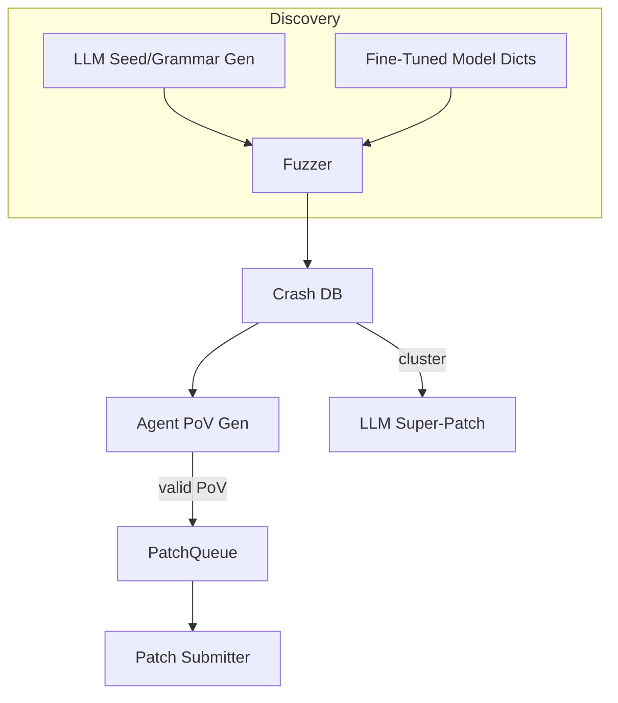

# AI-ondersteunde Fuzzing & Geoutomatiseerde kwesbaarheidsontdekking

{{#include ../banners/hacktricks-training.md}}

## Oorsig
Groottaalmodelle (LLMs) kan tradisionele navorsingspyplyne vir kwesbaarhede aansienlik versterk deur semanties ryk insette te genereer, grammatika te ontwikkel, oor crash-data te redeneer en selfs pleisters vir verskeie foute voor te stel. Hierdie bladsy versamel die doeltreffendste patrone wat tydens DARPA se AI Cyber Challenge (AIxCC)-eindronde en ander openbare navorsing waargeneem is.<sup>[[4]](#references)</sup><sup>[[5]](#references)</sup>

Wat volg, is nie ’n beskrywing van een spesifieke kompetisiestelsel nie, maar ’n abstraksie van die tegnieke sodat jy dit in jou eie werkvloeie kan herhaal.

---

## 1. Saadinsette wat deur LLMs gegenereer word

Tradisionele coverage-guided fuzzers (AFL++, libFuzzer, Honggfuzz…) begin met ’n klein korpus saadinsette en muteer grepe blindelings. Wanneer die teikeninsetformaat kompleks is (SQL, URLs, pasgemaakte binêre protokolle), breek ewekansige mutasies gewoonlik die sintaksis voordat interessante vertakkings bereik word.

LLMs kan hierdie aanvangsprobleem oplos deur *seed generators* te lewer – kort skripte wat **sintaksisgeldige, maar sekuriteitsrelevante insette** uitvoer. Byvoorbeeld:

```prompt
SYSTEM: You are a helpful security engineer.
USER:
Write a Python3 program that prints 200 unique SQL injection strings targeting common anti-pattern mistakes (missing quotes, numeric context, stacked queries).  Ensure length ≤ 256 bytes / string so they survive common length limits.
```

```python
# gen_sqli_seeds.py (truncated)
PAYLOADS = [
    "1 OR 1=1 -- ",
    "' UNION SELECT NULL,NULL--",
    "0; DROP TABLE users;--",
    ...
]
for p in PAYLOADS:
    print(p)
```

Voer dit een keer uit en voer die uitvoer direk in die fuzzer se aanvanklike korpus in:

```bash
python3 gen_sqli_seeds.py > seeds.txt
afl-fuzz -i seeds.txt -o findings/ -- ./target @@
```

Benefits:
1. Semantiese geldigheid → dieper dekking vroegtydig.
2. Kan weer gegenereer word: pas die prompt aan om op XSS, path traversal, binary blobs, ens. te fokus.
3. Goedkoop (< 1 ¢ met GPT-3.5).

### Wenke
* Gee die model opdrag om die payload-lengte en encoding (UTF-8, URL-encoded, UTF-16-LE) te *varieer* om oppervlakkige filters te omseil.
* Vra vir ’n *enkele selfstandige script* – dit vermy probleme met JSON-formatering.

---

## 2. Grammar-Evolution Fuzzing

’n Kragtiger variant is om die LLM ’n grammar te laat **ontwikkel** in plaas van konkrete seeds. Die werkvloei (“Grammar Guy”-patroon) is:

1. Genereer ’n aanvanklike ANTLR/Peach/LibFuzzer-grammar met ’n prompt.
2. Fuzz vir N minute en versamel dekkingsmaatstawwe (getreffe edges / blocks).
3. Som ongedekte programareas op en voer die opsomming terug aan die model:
   ```prompt
   The previous grammar triggered 12 % of the program edges.  Functions not reached: parse_auth, handle_upload.  Add / modify rules to cover these.
   ```
4. Voeg die nuwe reëls saam, re-fuzz, herhaal.

Pseudo-code skeleton:

```python
for epoch in range(MAX_EPOCHS):
    grammar = llm.refine(grammar, feedback=coverage_stats)
    save(grammar, f"grammar_{epoch}.txt")
    coverage_stats = run_fuzzer(grammar)
```

Key points:
* Hou ’n *budget* – elke verfyning gebruik tokens.
* Gebruik `diff` + `patch`-instruksies sodat die model wysigings aanbring eerder as om te herskryf.
* Stop wanneer Δcoverage < ε.

---

## 3. Local-LLM libFuzzer-harnasingenieurswese

Vir bronkode wat nie ’n ontleder se werkstasie mag verlaat nie, kan ’n plaaslike kodemodel die klein adapter tussen fuzzer-grepe en ’n C/C++-API opstel. Die nuttige sekuriteitsgrens is eksplisiet: **die model skryf en hersien toetsinfrastruktuur; coverage-guided mutation verken invoere; sanitizers rapporteer ongeldige bewerkings; ’n mens hersien die harnas en triageer bevindings**.<sup>[[9]](#references)</sup>

Vir engine-vlak-tegnieke vir corpus, feedback, snapshot en stateful fuzzing wat nie van ’n LLM afhanklik is nie, sien die algemene [Fuzzing Methodology](../generic-methodologies-and-resources/fuzzing.md).

Begin met die presiese deklarasie wat uit die teiken se header gekopieer is en beperk die uitvoerformaat. ’n Eng prompt verminder uitgedinkte API’s en maak die resultaat maklik om te hersien:<sup>[[8]](#references)[[9]](#references)</sup>

```prompt
Write a libFuzzer target for this exact declaration:
int parse_records(const uint8_t *data, size_t size);

Output only C code. Implement LLVMFuzzerTestOneInput, include the
declaration, pass data and size unchanged, and do not use files,
network access, randomness, clocks, threads, or persistent state.
```

Vir ’n parser vir rou grepe behoort die verwagte resultaat nie ingewikkelder as dit te wees nie:<sup>[[6]](#references)[[9]](#references)</sup>

```c
#include <stddef.h>
#include <stdint.h>

extern int parse_records(const uint8_t *, size_t);

int LLVMFuzzerTestOneInput(const uint8_t *data, size_t size) {
    (void)parse_records(data, size);
    return 0;
}
```

Kompilasie is slegs die eerste valideringshek. Gaan elke gegenereerde target aan die hand van hierdie invariante na voordat jy SVE-tyd daaraan bestee:<sup>[[6]](#references)[[8]](#references)[[9]](#references)</sup>

- **Presiese API:** vergelyk tipes, eienaarskapsreëls, initialisering, afbreek, en calling convention met die werklike header en bestaande callers.
- **Harness-veiligheid:** beskerm elke leesbewerking vanaf `data`; sanitizer-bevindinge moet in die target ontstaan, nie in gegenereerde glue nie.
- **Herhaalbaarheid:** maak die resultaat ’n funksie van `data` en `size`; verwyder eksterne I/O, tyd, onbeheerde randomness, nie-aangeslote threads en toestand wat tussen oproepe voortduur.
- **Deurset:** initialiseer duur, onveranderlike toestand net een keer, en slegs wanneer dit nie gedrag kan beïnvloed nie; beperk die insetgrootte, onderdruk logging en maak toekennings per inset vry.
- **Bereikbaarheid:** verifieer dat die bedoelde funksies en takke uitgevoer word. ’n Target wat kompileer maar slegs verwerpingpaaie toets, is ’n stille mislukking.

### Struktuurbewuste targets: behou invariante sonder om foute te verberg

As die meeste rou insette ’n magic-, lengte-, weergawe- of checksum-hek misluk, gebruik die fuzz-grepe as getipeerde veldmateriaal en bou ’n geldige objek weer op. Stel formaatkonstantes vas, laat semantiese velde en payload-grepe veranderlik, en lei integriteitmetadata af van die gerekonstrueerde payload. `FuzzedDataProvider` is nuttig om begrensde getipeerde waardes te verbruik, terwyl die adapter steeds verantwoordelik is om enige gegenereerde toekenning en omskakeling te beperk.<sup>[[9]](#references)</sup>

<details>
<summary>Voorbeeld van ’n struktuurbewuste C++-target</summary>

```cpp
#include <fuzzer/FuzzedDataProvider.h>
#include <stddef.h>
#include <stdint.h>
#include <vector>

extern "C" int parse_message(const uint8_t *, size_t);

extern "C" int LLVMFuzzerTestOneInput(const uint8_t *data, size_t size) {
    FuzzedDataProvider fdp(data, size);
    uint8_t version = fdp.ConsumeIntegral<uint8_t>();
    auto body = fdp.ConsumeRemainingBytes<uint8_t>();
    if (body.size() > UINT16_MAX) body.resize(UINT16_MAX);
    uint16_t len = static_cast<uint16_t>(body.size());
    std::vector<uint8_t> msg = {0x8b, 'M', 'S', 'G', version,
                                static_cast<uint8_t>(len >> 8),
                                static_cast<uint8_t>(len)};
    msg.insert(msg.end(), body.begin(), body.end());
    (void)parse_message(msg.data(), msg.size());
    return 0;
}
```

</details>

Moenie vir elke vraag een target gebruik wat strukture herstel nie. Hou een target wat lengtes/tjeksomme aflei om diep, geldige toestande te verken, en ’n ander wat die **verklaarde** metadata deur die fuzzer laat beheer, terwyl slegs die harness se eie leesbewerkings en geheuetoewysings beperk word. Die tweede target behou aanvalsvlakke met lengtes wat nie ooreenstem nie en foutiewe integriteitsdata wat outomatiese herstel andersins sou uitwis.<sup>[[9]](#references)</sup>

### Seeds, woordeboeke, sanitiseerders en terugvoer oor dekking

Vra die model om ’n script te genereer wat binêre seeds skryf, eerder as om dit te vra om binêre data direk uit te druk. Gebruik leë, minimale, tipiese en geldige grensobjekte as seeds; haal dan magiese waardes, tags, enum-koderings en parser-sleutelwoorde uit om ’n nagegane woordeboek saam te stel. libFuzzer aanvaar dié woordeboek met `-dict=`, en hou mutasies wat nuwe dekking in die corpus oplewer.<sup>[[6]](#references)[[9]](#references)</sup>

```text
magic="\x8bMSG"
version_min="\x00"
version_max="\xff"
config_tag="CONFIG"
```

Bou dieselfde teiken met aanvullende instrumentering. ASan en UBSan kan ’n fuzzing-binêre lêer deel; gebruik ’n aparte MSan-bou en instrumenteer die afhanklikhede daarvan om verslae weens kode wat nie geïnstrumenteer is nie, te vermy.<sup>[[6]](#references)[[9]](#references)</sup>

```bash
clang++ -g -O1 -fsanitize=fuzzer,address,undefined \
  -fno-sanitize-recover=undefined target.cc harness.cc -o fuzz_target
./fuzz_target corpus -dict=msg.dict -max_len=65535

clang++ -g -O1 -fsanitize=fuzzer,memory \
  target.cc harness.cc -o fuzz_target_msan
```

Behandel dekking as die maatstaf vir elke modelweergawe. In libFuzzer-uitvoer dui ’n vroeë platlyn in `cov`/`ft` en ’n statiese corpus gewoonlik op swak framing, ’n te beperkende vroeë terugkeer, of die verkeerde oproep; ’n lae `exec/s` dui op duur opstelling, I/O, allokasie of ’n state leak. `NEW` bewys net dat ’n dekkingseienskap verander het, nie dat die bedoelde parser bereik is nie.<sup>[[6]](#references)[[9]](#references)</sup>

Vir terugvoer op bronvlakk maak ’n dekkingsbou, fuzz daarmee en gee die model net die funksies wat nog nie gedek is nie, saam met hul voorwaardes. Verifieer die resulterende harness/seed/dictionary-diff en meet weer:<sup>[[7]](#references)[[8]](#references)[[9]](#references)</sup>

```bash
clang++ -g -O1 -fsanitize=fuzzer \
  -fprofile-instr-generate -fcoverage-mapping target.cc harness.cc -o fuzz_cov
mkdir -p profiles
LLVM_PROFILE_FILE='profiles/%p.profraw' ./fuzz_cov -max_total_time=300 corpus
llvm-profdata merge -sparse profiles/*.profraw -o fuzz.profdata
llvm-cov report ./fuzz_cov -instr-profile=fuzz.profdata
llvm-cov show ./fuzz_cov -instr-profile=fuzz.profdata \
  --show-branches=count --region-coverage-lt=1 target.cc
```

Die skaalbare siklus is dus **genereer → compileer/skakel → voer rooktoets onder sanitizers uit → meet teikendekking → verskaf die kleinste relevante konteks oor dekking/broncode → hersien → meet weer**. OSS-Fuzz-Gen pas dieselfde beginsel toe deur gegenereerde teikens te evalueer vir kompileerbaarheid, looptydfoute, dekking en dekkingverbetering teenoor bestaande teikens, eerder as om geloofwaardige kode op sigwaarde te aanvaar.<sup>[[7]](#references)[[8]](#references)</sup>

---

<a id="3-agent-based-pov-exploit-generation" hidden>3. PoV (Exploit)-generering gebaseer op agente</a>

## 4. PoV (Exploit)-generering gebaseer op agente

Nadat ’n crash gevind is, het jy steeds ’n **proof-of-vulnerability (PoV)** nodig wat dit deterministies aktiveer.

’n Skaalbare benadering is om baie liggewigwerkers (prosesse, drade of houers) te begin, elk met ’n ander model of steekproefkonfigurasie. Die AIxCC-finalisopname gee konkrete voorbeelde van die skaal: een span het **duisende gelyktydige agente** vir AI-first PoV-generering gebruik, terwyl ’n ander **300–500 fuzzing-agente** georkestreer het en LLM’s vir redenasie op ’n hoër semantiese vlak gereserveer het.<sup>[[4]](#references)</sup>

Pyplyn:
1. Statiese/dinamiese ontleding lewer *foutkandidate* op (struct met crash-PC, invoersnit, sanitizer-boodskap).
2. Orkestraat versprei kandidate aan agente.
3. Agent se redenasiestappe:
   a. Reproduseer fout plaaslik met `gdb` + invoer.
   b. Stel ’n minimale exploit-payload voor.
   c. Valideer exploit in ’n sandbox.  Indien suksesvol → dien in.
4. Mislukte pogings word **weer as nuwe sade vir coverage-fuzzing in die tou geplaas** (terugvoerlus).

Voordele:
* Parallelisering verberg die onbetroubaarheid van ’n enkele agent.
* Outomatiese instel van temp / modelgrootte op grond van die waargenome sukseskoers.

---

<a id="4-directed-fuzzing-with-fine-tuned-code-models" hidden>4. Gerigte fuzzing met fyningestelde kodemodelle</a>

## 5. Gerigte fuzzing met fyningestelde kodemodelle

Fyninstel ’n model met oop gewigte (bv. Llama-7B) op C/C++-bronkode wat met kwesbaarheidspatrone gemerk is (heelgetaloorloop, buff kopie, formaatstring).  Doen dan die volgende:

1. Voer statiese ontleding uit om ’n funksielys + AST te kry.
2. Vra die model: *“Gee mutasiewoordeboekinskrywings wat waarskynlik geheueveiligheid in funksie X sal skend”*.
3. Voeg daardie tekens by ’n pasgemaakte `AFL_CUSTOM_MUTATOR`.

Voorbeelduitvoer vir ’n `sprintf`-omhulsel:
```
{"pattern":"%99999999s"}
{"pattern":"AAAAAAAA....<1024>....%n"}
```

Empiries gesproke verkort dit die tyd-tot-crash met >2× op werklike teikens.

---

<a id="5-ai-guided-patching-strategies" hidden>5. AI-geleide patchstrategieë</a>

## 6. AI-geleide patchstrategieë

<a id="51-super-patches" hidden>5.1 Super Patches</a>

### 6.1 Super Patches
Vra die model om crash-handtekeninge te *groepeer* en ’n **enkele patch** voor te stel wat die gemeenskaplike hoofoorsaak uitskakel. Dien dit een keer in, los verskeie foute op → minder akkuraatheidsboetes in omgewings waar elke verkeerde patch punte kos.

Promptskets:
```
Here are 10 stack traces + file snippets.  Identify the shared mistake and generate a unified diff fixing all occurrences.
```

{{#ref}}
../generic-methodologies-and-resources/fuzzing.md
{{#endref}}

<a id="52-speculative-patch-ratio" hidden>5.2 Spekulatiewe Patch-verhouding</a>

### 6.2 Spekulatiewe Patch-verhouding
Implementeer ’n tou waarin bevestigde, PoV-gevalideerde patches en *spekulatiewe* patches (sonder PoV) afgewissel word teen ’n 1:​N-verhouding wat volgens die puntetoekenningsreëls ingestel word (bv. 2 spekulatiewe : 1 bevestigde). ’n Kostemodel monitor strafpunte teenoor punte en pas N outomaties aan.

---

<a id="6-deterministic-file-by-file-ai-code-review" hidden>6. Deterministiese lêer-vir-lêer AI-kodehersiening</a>

## 7. Deterministiese lêer-vir-lêer AI-kodehersiening

’n Algemene mislukkingswyse in AI-ondersteunde hersiening is om een agent te vra om ’n hele repository te inspekteer en te hoop dat dit die regte lêers en grep-terme kies. ’n Betroubaarder patroon is om **dekking van die repository af te dwing**:<sup>[[1]](#references)</sup>

1. Lys die bronlêers.
2. Stuur **een lêer op ’n slag** plus minimale konteks (entrypoint, imports, nabygeleë routes/callers).
3. Vereis ’n **gestruktureerde verslag** vir elke lêer: sources, sink, ontbrekende validering, uitbuitingsvoorwaardes en vertroue.<sup>[[3]](#references)</sup>
4. Verwyder duplikate uit verslae volgens **source→sink-patroon** en valideer die hoërisiko-verslae met die hand.

Dit gebruik baie tokens en lewer geraas op, maar is baie doeltreffend om **eenvoudige, hoë-impak source/sink-foute** op te spoor wat breë agentiese hersienings dikwels mis.

### Triage-patrone wat prioriteit verdien

- **Dinamiese PHP-insluiting/dispatch**: aanvallerbeheerde route-/controller-/module-name wat na `require_once()`, `include()` of `include_once()` vloei sonder ’n streng allowlist en kanonisering van paaie.
- **Shell-uitvoering in admin-/rekeningwerkvloeie**: usernames, domains, FTP-accounts of ander identifiseerders wat `exec()`, `system()`, `shell_exec()`, `passthru()`, `proc_open()` of `popen()` bereik.
- **Saamvloeiing van gestruktureerde invoer**: dieselfde parameter word aanvaar vanaf `$_GET`, `$_POST`, JSON, XML of framework-body-parsers en later hergebruik in lêerstelsel- of OS-opdrag-sinks.

### Twee praktiese foutklasse wat hierdie metode goed opspoor

- **PHP controller-dispatch LFI/RCE**: as ’n versoekbeheerde controller-name in `require_once()` aaneengeskakel word sonder ’n allowlist/normalisering van paaie, kan traversal-reekse soos `../` PHP ’n onbedoelde plaaslike `.php`-lêer laat insluit. As die aanvaller die insluiting na ’n geplante of andersins bruikbare PHP-lêer kan rig, word die LFI kode-uitvoering. Sien [File Inclusion / Path Traversal](../pentesting-web/file-inclusion/README.md).<sup>[[1]](#references)</sup>
- **Geoutentiseerde command injection in hosting-/admin-panele**: as rekeningbestuurvelde soos usernames in shell-opdragte ingebed word, kan ’n geoutentiseerde gebruiker met lae voorregte ’n gewone skep-/skrapaksie in RCE verander. Die impak neem toe wanneer die paneel die opdrag as ’n diensrekening met meer voorregte uitvoer. Sien [Command Injection](../pentesting-web/command-injection.md).<sup>[[1]](#references)</sup>

### Praktiese hersieningsnotas

- Gebruik die LLM eers as ’n **source/sink-hersiener**, nie as ’n exploitgenerator nie.
- Vra dit om die **aanvallerbeheerde veld**, die **leemte in normalisering/validering** en die **gevaarlike sink** uitdruklik te lys.
- Vir groot repos is deterministiese hersiening per lêer dikwels betroubaarder as ’n enkele outonome agentlopie, selfs wanneer laasgenoemde ’n sterker model gebruik.<sup>[[2]](#references)</sup>
- Verwag swakker resultate met **Broken Access Control** en ander besigheidslogika-foute waar uitbuitbaarheid afhang van aannames oor verskeie lêers, rolsemantiek of produkspesifieke bedreigingsmodelle.

---

## 8. Patroongestuurde kernel-ouditering met ’n geïnstrumenteerde oracle

Vir ’n kernel-grootte teiken, moenie ’n agent vra om arbitrêre foute oor die hele boom te vind nie. ’n Meer tokendoeltreffende werkvloei omskep kennis van historiese kwesbaarhede in statiese navrae, rangskik die resultate volgens blootgestelde aanvaloppervlak en gebruik ’n geïnstrumenteerde kernel as uitvoeringsoracle.<sup>[[11]](#references)</sup>

### Patroondatabasis → CodeQL/Semgrep → gefokusde hersiening

Bou ’n klein kennisbasis met gevaarlike APIs, patrone van ontbrekende validering, riskante source-to-sink-vloei en vorme van foute wat voorheen reggestel is. Vra die model om **een patroon op ’n slag** in hersieningsheuristieke en CodeQL/Semgrep-reëls om te skakel, en voer dan daardie deterministiese reëls oor die volledige boom uit. Groepeer die ooreenstemmings en verwyder duplikate voordat jy kode aan die model teruggee; rou skandeerderuitsette kan duisende kandidate met min waarde bevat. Gaan CodeQL se huidige lisensie na voordat jy hierdie benadering buite geskikte navorsings- of oopbron-teikens gebruik.<sup>[[11]](#references)</sup>

Prioritiseer subsisteme volgens beide **reëltreftdigtheid** en **aanvallerbereikbaarheid**, nie net volgens die aantal treffers nie. Kernel-koppelvlakke wat bereikbaar is vanaf prosesse met lae voorregte, sandboxes, containers, jails of guest-kontekste verdien meer gewig as kode wat net intern bereikbaar is. Hou die hersieningseenheid klein genoeg sodat die agent callers, validators en leeftydreëls kan onthou, en vra vir ’n benoemde kwesbaarheidsklas of beheervloeipatroon in plaas van “vind enige kwesbaarheid”. Verouderde geprivilegieerde koppelvlakke is besonder interessant wanneer ’n nuwer inperkinggrens dit bereikbaar maak vir ’n namespaced- of jail-rootgebruiker.<sup>[[11]](#references)</sup>

Vereis vir elke kandidaat ’n uitdruklike veldvloeirekord voordat jy probeer om dit uit te buit.<sup>[[11]](#references)</sup>

```text
entrypoint -> privilege check -> parser -> validation/normalization
           -> later rewrite -> dangerous sink
attacker controls: <fields and lengths>
constraints:       <values rewritten, rejected, or preserved>
observable result: <sanitizer report, assertion, panic, or clean exit>
```

### Gebruik KASAN-telemetrie as ’n hipotese-orakel

Laat die teikenkernel in ’n weggooibare VM loop met KASAN en nuttige diagnostiese assertions geaktiveer. Die agent moet herhaal deur **br onhipotese → minimale userland-sneller → VM-uitvoering → KASAN-/assertion-naspeuring → hersiene hipotese** totdat die vermoedelike korrupsie gereproduseer of verwerp is. Gee slegs die relevante stack trace en nabygeleë bronkode vir elke iterasie terug; dit behou konteks vir redenasie en verseker dat looptydbewyse, nie modelvertroue nie, die aanvaardingsmaatstaf is.<sup>[[11]](#references)</sup>

’n Geinstrumenteerde bou is nie die finale exploitability-omgewing nie. Assertions kan uitvoering stop voordat die korrumperende bewerking plaasvind, terwyl dieselfde assertion moontlik uit ’n produksiekernel weggelaat is. Toets die onveranderde sneller weer teen die presiese produksiekonfigurasie, teken die kernelbou en -konfigurasie aan, en onderskei **bereikbaarheid**, **geheuekorrupsie**, **beheerde primitief** en **sekuriteitsimpak** as afsonderlike aansprake.<sup>[[11]](#references)[[12]](#references)</sup>

CVE-2026-3038 is ’n nuttige valideringsvoorbeeld, nie ’n exploit-sjabloon nie. ’n Onbevoorregte FreeBSD `RTM_GET`-versoek kon ’n oorgroot `RTAX_AUTHOR`-sockaddr deur selektiewe validering en antwoordherskrywing behou totdat `rtsock_msg_buffer()` die gebruikerbeheerde `sa_len` na ’n 128-greep-stapel-`sockaddr_storage` gekopieer het. Die maksimum kopie van 255 grepe het ’n oorwriting van 127 grepe veroorsaak; ’n diagnostiese assertion het die verkeerde lengte in die geinstrumenteerde bou opgevang, terwyl ’n GENERIC-kernel die kopie bereik het en daarna gepanikeer het toe die beskadigde canary nagegaan is. Dit bewys ’n onbevoorregte diensweiering, nie selfstandige voorregte-eskalasie nie: betroubare beheer sou eers ’n ander primitief, soos ’n canary-lek, vereis. Sien [Stack Canaries](../binary-exploitation/common-binary-protections-and-bypasses/stack-canaries/index.html) vir die ooreenstemmende grens van binary exploitation.<sup>[[11]](#references)[[12]](#references)[[13]](#references)</sup>

### Verwerp kullery met exploit-voorvereistes

Laat ’n afsonderlike beoordelaar/agent probeer om ’n PoV of exploit op grond van vaste kriteria te weerlê voordat dit aanvaar word. Die beoordeling moet al die volgende voorwaardes bevestig.<sup>[[11]](#references)</sup>

- Die teikenbron, kernel en kwesbare module is nie gewysig om die pad bereikbaar te maak nie.
- Geen helpermodule, sintetiese gadget, gedeaktiveerde versagting, bykomende voorreg of onbeskikbare koppelvlak is bekendgestel nie.
- Die sneller begin met die beweerde oproeperidentiteit en inperkingsbeperkings, op ’n skoon momentopname.
- Die beweerde resultaat hang steeds van die fout af: die verwydering van die misvormde veld of die regstelling van slegs die fout moet die ketting breek.
- ’n Omval, oorlees of oorwriting word slegs as daardie primitief gerapporteer; kode-uitvoering of voorregte-eskalasie vereis onafhanklike bewyse.

Hierdie laaste kontrafeitlike kontrole vang sirkelredenasies in demonstrasies op: indien die voorvereistes reeds die beweerde impak moontlik maak (byvoorbeeld, uitvoering van aanvaller-verskafte SUID-inhoud vanaf ’n lêerstelsel wat sonder `nosuid` gemonteer is), het die geheueveskafheidsfout nie daardie impak veroorsaak nie.<sup>[[11]](#references)</sup>

---

## Ouditbare agentondersteunde navorsing oor onbekende kodebasisse

Die [graph-first fuzz-target workflow](../generic-methodologies-and-resources/fuzzing.md#graph-first-fuzz-target-selection-and-mutation-triage) dek reeds toegangspuntbereikbaarheid, terwyl [agentic SAST pipelines](../network-services-pentesting/pentesting-web/code-review-tools.md#agentic-sast-pipelines) gefaseerde hersiening en bewyshekke dek. Hou dié deterministiese resultate apart van die model se hipoteses sodat elke bevorderde leidraad bronliggings, padbewyse en ’n dinamiese meting behou.<sup>[[10]](#references)</sup>

### Korrelleer bewyse oor objeklewensduur sonder om datavloei te versin

Statiese analise kan vind dat ’n aanvallerbeheerde lengte in een funksie gestoor word en dat dieselfde objekveld veel later ’n kopieersink bereik, maar dalk nie daarin slaag om die verband oor callbacks, herkoppelings of objeklewensduur heen te bewys nie. Bewaar albei bevindings afsonderlik, groepeer volgens objek/veld en maak die ontbrekende skakel ’n eksplisiete triagevraag. Die agent mag die verband voorstel, maar bronkodehersiening of looptydinstrumentasie moet dit bewys.<sup>[[10]](#references)</sup>

Teken vir elke kandidaat die volgende aan:

- die konkrete toegangspunt en aanvallerbeheerde grepe;
- elke produsent van die betrokke veld, met inbegrip van validering wat spesifiek vir elke produsent is;
- die sink, bestemmingskapasiteit en bou-/looptydvoorwaardes wat nodig is om dit te bereik;
- ’n werklike oproepstapel vanaf die blootgestelde toegangspunt, nie slegs ’n direkte harness-aanroeping nie;
- die kleinste dinamiese resultaat wat die hipotese bevestig of verwerp.

’n Pad wat veilig lyk, maak nie ’n veld wêreldwyd veilig nie. ’n Tweede produsent kan dieselfde veld vul sonder die grenskontrole van die eerste pad. Toets paaie afsonderlik en laat die harness met ontplooiingsekwivalente bouopsies loop, aangesien debug-assertions ’n produksiegeheuekorrupsie in ’n vroeë, slegs-toets-afbreking kan omskep.<sup>[[10]](#references)</sup>

### Metingshekke vir openbaarmaking en exploitation

Vul vir vermoedelike openbaarmaking van ongeïnisialiseerde geheue vars toekennings met ’n herkenbare greep en bevestig dat die presiese merker in die uitgestuurde pakkie verskyn. Vereis vir exploitation gemete hekke soos **beheerde oorwriting → nuttige slagofferobjek → openbaarmaking → wyser-/basisherwinning → beheer-vloei-kaping → saamgestelde payload**. ’n Agent vorder slegs wanneer die harness die huidige eienskap bewys; ’n aanneemlike vertelling beteken nie dat ’n hek geslaag is nie. Die [FreeRDP case](../binary-exploitation/libc-heap/heap-overflow.md#cross-path-length-reuse-and-stale-output-disclosure) wys die pad- en boubeperkings wat tydens validering behoue moet bly.<sup>[[10]](#references)</sup>

---

Vir ’n kernelgevallestudie wat gefaseerde L0–L4-validering op LLM-ondersteunde exploit-ontwikkeling toepas, sien:

{{#ref}}
../binary-exploitation/freebsd-kernel-exploitation-vnet-jail-escape.md
{{#endref}}

## Alles bymekaarbring
’n End-tot-end CRS (Cyber Reasoning System) kan die komponente soos volg aan mekaar koppel:



---

## References

- [1] [Project Black - Plaaslike AI vir Kubersekuriteit: Vind phpIPAM LFI en geauthentiseerde myVesta RCE](https://projectblack.io/blog/local-ai-for-cyber-security)
- [2] [Strix](https://github.com/usestrix/strix)
- [3] [GitHub Copilot-gemeenskap se security-review-vaardigheid](https://github.com/github/awesome-copilot/blob/main/skills/security-review/SKILL.md)
- [4] [Trail of Bits – AIxCC-eindronde: ’n Vergelyking](https://blog.trailofbits.com/2025/08/07/aixcc-finals-tale-of-the-tape/)
- [5] [CTF Radiooo AIxCC-finaliste-onderhoude](https://www.youtube.com/@ctfradiooo)
- [6] [LLVM — libFuzzer: ’n biblioteek vir dekking-gestuurde fuzz testing](https://llvm.org/docs/LibFuzzer.html)
- [7] [Google — OSS-Fuzz-Gen](https://github.com/google/oss-fuzz-gen)
- [8] [Google Online Security Blog — Verbeter fuzzing: Vind meer kwesbaarhede met AI](https://security.googleblog.com/2024/11/leveling-up-fuzzing-finding-more.html)
- [9] [8kSec — AI-ondersteunde fuzzing-harnasgenerering met ’n plaaslike LLM](https://8ksec.io/ai-assisted-fuzzing-harness-local-llm)
- [10] [Quarkslab — Van AI-agente tot RCE: Bou ’n kwesbaarheidsnavorsingswerkvloei](https://blog.quarkslab.com/from-ai-agents-to-rce-building-a-vulnerability-research-workflow.html)
- [11] [Praetorian — FreeBSoD: Gebruik taalmodelle om kernelfoute te vind en uit te buit (Deel 1 van 2)](https://praetorian.com/blog/ai-vulnerability-research-freebsd-kernel)
- [12] [FreeBSD-SA-26:05.route — Plaaslike DoS en moontlike regteverhoging via roeteringsokette](https://www.freebsd.org/security/advisories/FreeBSD-SA-26:05.route.asc)
- [13] [FreeBSD-SA-26:05.route-bronkodepatch](https://security.FreeBSD.org/patches/SA-26:05/route.patch)
{{#include ../banners/hacktricks-training.md}}
