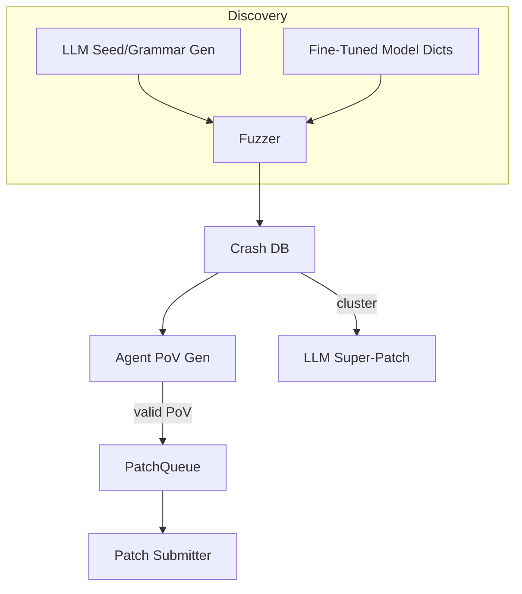

# AI支援ファジングと自動脆弱性発見

{{#include ../banners/hacktricks-training.md}}

## 概要
大規模言語モデル（LLM）は、意味的に豊かな入力の生成、文法の進化、クラッシュデータの推論、さらには複数のバグをまとめて修正するパッチの提案によって、従来の脆弱性調査パイプラインを大幅に強化できます。このページでは、DARPAのAI Cyber Challenge（AIxCC）決勝戦やその他の公開研究で確認された、特に効果的なパターンを紹介します。<sup>[[4]](#references)</sup><sup>[[5]](#references)</sup>

以下では、特定の競技システムについて説明するのではなく、独自のワークフローで再現できるよう、これらの手法を抽象化して解説します。

---

## 1. LLMが生成するシード入力

従来のカバレッジガイド型ファザー（AFL++、libFuzzer、Honggfuzzなど）は、小規模なシードコーパスから始め、バイト列を盲目的に変異させます。対象の入力形式が複雑な場合（SQL、URL、独自のバイナリプロトコルなど）、ランダムな変異では、興味深い分岐に到達する前に構文が壊れてしまうことがよくあります。

LLMは、構文的に正しく、かつセキュリティ上重要な入力を出力する短いスクリプト、つまり*シード生成器*を作成することで、この初期化の問題を解決できます。たとえば、次のようになります。

```prompt
SYSTEM: You are a helpful security engineer.
USER:
Write a Python3 program that prints 200 unique SQL injection strings targeting common anti-pattern mistakes (missing quotes, numeric context, stacked queries).  Ensure length ≤ 256 bytes / string so they survive common length limits.
```

```python
# gen_sqli_seeds.py (truncated)
PAYLOADS = [
    "1 OR 1=1 -- ",
    "' UNION SELECT NULL,NULL--",
    "0; DROP TABLE users;--",
    ...
]
for p in PAYLOADS:
    print(p)
```

一度実行し、その出力を fuzzer の初期コーパスに直接与える：

```bash
python3 gen_sqli_seeds.py > seeds.txt
afl-fuzz -i seeds.txt -o findings/ -- ./target @@
```

Benefits:
1. Semantic validity → 早期により深いカバレッジを実現。
2. 再生成可能: promptを調整して、XSS、path traversal、binary blobsなどに焦点を当てられる。
3. 低コスト（GPT-3.5なら 1 ¢ 未満）。

### Tips
* 表面的なフィルターを回避するため、payloadの長さやエンコーディング（UTF-8、URL-encoded、UTF-16-LE）を*多様化*するようモデルに指示する。
* *単一の自己完結型スクリプト*を求める。JSONのフォーマット上の問題を避けられる。

---

## 2. Grammar-Evolution Fuzzing

より強力な方法は、具体的なseedではなく、LLMに**grammarを進化**させることだ。ワークフロー（「Grammar Guy」パターン）は次のとおり。

1. promptを使って、初期のANTLR/Peach/LibFuzzer grammarを生成する。
2. N分間fuzzingし、カバレッジ指標（ヒットしたedge / block）を収集する。
3. 未カバーのプログラム領域を要約し、その要約をモデルにフィードバックする。
   ```prompt
   The previous grammar triggered 12 % of the program edges.  Functions not reached: parse_auth, handle_upload.  Add / modify rules to cover these.
   ```
4. 新しいルールをマージし、再度 fuzz して繰り返す。

疑似コードの骨組み：

```python
for epoch in range(MAX_EPOCHS):
    grammar = llm.refine(grammar, feedback=coverage_stats)
    save(grammar, f"grammar_{epoch}.txt")
    coverage_stats = run_fuzzer(grammar)
```

要点:
* *budget* を維持する。各改良でトークンを消費する。
* モデルに書き直させるのではなく編集させるため、`diff` + `patch` の指示を使う。
* Δcoverage < ε になったら停止する。

---

## 3. ローカルLLM libFuzzerハーネスの設計

アナリストのワークステーション外に持ち出せないソースコードの場合、ローカルのコードモデルを使って、fuzzerのバイト列とC/C++ APIをつなぐ小さなアダプターを作成できる。重要なセキュリティ境界は明確だ。**モデルがテスト用インフラを作成・改訂し、coverage-guided mutationが入力を探索し、sanitizerが不正な操作を報告し、人間がハーネスをレビューして検出結果をトリアージする**。<sup>[[9]](#references)</sup>

LLMに依存しないエンジンレベルのコーパス、フィードバック、スナップショット、ステートフルfuzzingの手法については、一般的な[Fuzzing Methodology](../generic-methodologies-and-resources/fuzzing.md)を参照。

対象のヘッダーから正確な宣言をコピーすることから始め、出力形式を制約する。範囲を絞ったプロンプトにより、存在しないAPIが作られるのを防ぎ、結果をレビューしやすくできる。<sup>[[8]](#references)[[9]](#references)</sup>

```prompt
Write a libFuzzer target for this exact declaration:
int parse_records(const uint8_t *data, size_t size);

Output only C code. Implement LLVMFuzzerTestOneInput, include the
declaration, pass data and size unchanged, and do not use files,
network access, randomness, clocks, threads, or persistent state.
```

生のバイトパーサーでは、期待される結果は次の程度より複雑であってはなりません:<sup>[[6]](#references)[[9]](#references)</sup>

```c
#include <stddef.h>
#include <stdint.h>

extern int parse_records(const uint8_t *, size_t);

int LLVMFuzzerTestOneInput(const uint8_t *data, size_t size) {
    (void)parse_records(data, size);
    return 0;
}
```

Compilation は最初の検証ゲートにすぎません。CPU 時間を費やす前に、生成されたすべての target が次の不変条件を満たしているか確認してください:<sup>[[6]](#references)[[8]](#references)[[9]](#references)</sup>

- **Exact API:** 実際のヘッダーや既存の呼び出し元と、型、所有権ルール、初期化、終了処理、呼び出し規約を照合します。
- **Harness safety:** `data` から読み取る箇所すべてにガードを設けます。sanitizer の検出結果は、生成された glue ではなく target に起因する必要があります。
- **Repeatability:** 結果が `data` と `size` のみに依存するようにします。外部 I/O、時刻、制御されていない乱数、join されないスレッド、呼び出し間で残る状態を取り除きます。
- **Throughput:** 振る舞いに影響しない場合に限り、高コストな不変状態を一度だけ初期化し、入力サイズに上限を設け、ログ出力を抑制し、入力ごとの割り当てを解放します。
- **Reachability:** 意図した関数や分岐が実行されることを確認します。コンパイルできても拒否パスしかテストしない target は、気づきにくい失敗です。

### Structure-aware targets: 不変条件を保ちつつ、バグを隠さない

大半の生入力が magic、長さ、バージョン、チェックサムのゲートで失敗する場合は、fuzz bytes を**型付きフィールドの素材**として使い、有効なオブジェクトを再構築します。形式定数は固定し、意味を持つフィールドと payload のバイト列は変更可能なままにして、再構築した payload から整合性メタデータを導出します。`FuzzedDataProvider` は、上限付きの型付き値を取り出すのに便利ですが、生成される割り当てや変換の上限を設定する責任は引き続き adapter にあります。<sup>[[9]](#references)</sup>

<details>
<summary>Example structure-aware C++ target</summary>

```cpp
#include <fuzzer/FuzzedDataProvider.h>
#include <stddef.h>
#include <stdint.h>
#include <vector>

extern "C" int parse_message(const uint8_t *, size_t);

extern "C" int LLVMFuzzerTestOneInput(const uint8_t *data, size_t size) {
    FuzzedDataProvider fdp(data, size);
    uint8_t version = fdp.ConsumeIntegral<uint8_t>();
    auto body = fdp.ConsumeRemainingBytes<uint8_t>();
    if (body.size() > UINT16_MAX) body.resize(UINT16_MAX);
    uint16_t len = static_cast<uint16_t>(body.size());
    std::vector<uint8_t> msg = {0x8b, 'M', 'S', 'G', version,
                                static_cast<uint8_t>(len >> 8),
                                static_cast<uint8_t>(len)};
    msg.insert(msg.end(), body.begin(), body.end());
    (void)parse_message(msg.data(), msg.size());
    return 0;
}
```

</details>

すべての質問に対して、構造を修復する単一のターゲットを使わないでください。長さやチェックサムを導出して有効な深部状態を探索するターゲットと、ハーネス自身の読み取りとメモリ確保だけを制限しつつ、**宣言された**メタデータをfuzzerが制御するもう一つのターゲットを用意してください。2つ目のターゲットでは、長さの不一致や整合性の不備に対する攻撃対象領域を維持できます。自動修復では、こうした要素が取り除かれてしまいます。<sup>[[9]](#references)</sup>

### シード、辞書、サニタイザー、カバレッジフィードバック

モデルには、バイナリを直接出力させるのではなく、バイナリシードを書き出すスクリプトを生成するよう依頼してください。空、最小、典型的なオブジェクトと、境界値が有効なオブジェクトをシードとして用意し、マジック値、タグ、enumのエンコーディング、パーサーのキーワードを抽出して、レビュー済みの辞書にまとめます。libFuzzerでは`-dict=`でこの辞書を指定でき、カバレッジを新たに広げる変異をコーパスに保持します。<sup>[[6]](#references)[[9]](#references)</sup>

```text
magic="\x8bMSG"
version_min="\x00"
version_max="\xff"
config_tag="CONFIG"
```

補完的な instrumentation を使って同じ target をビルドします。ASan と UBSan は同じ fuzzing binary で使用できます。未計測コードが原因の報告を避けるため、別途 MSan 用のビルドを作成し、その依存関係も instrument します。<sup>[[6]](#references)[[9]](#references)</sup>

```bash
clang++ -g -O1 -fsanitize=fuzzer,address,undefined \
  -fno-sanitize-recover=undefined target.cc harness.cc -o fuzz_target
./fuzz_target corpus -dict=msg.dict -max_len=65535

clang++ -g -O1 -fsanitize=fuzzer,memory \
  target.cc harness.cc -o fuzz_target_msan
```

各モデルのリビジョンは、coverageを評価基準として扱います。libFuzzerの出力で`cov`/`ft`が序盤から横ばいで、corpusがほとんど変化しない場合は、フレーミングの不備、早すぎる段階での制限が厳しいreturn、または呼び出す関数の誤りが考えられます。`exec/s`が低い場合は、高コストなセットアップ、I/O、メモリ割り当て、または状態のリークが原因かもしれません。`NEW`が示すのはcoverage featureが変化したことだけであり、意図したparserに到達した証拠にはなりません。<sup>[[6]](#references)[[9]](#references)</sup>

ソースレベルのフィードバックには、coverage buildを作成してfuzzし、未カバーの関数と、それらを保護する条件だけをモデルに渡します。生成されたharness/seed/dictionaryのdiffを検証し、もう一度計測します。<sup>[[7]](#references)[[8]](#references)[[9]](#references)</sup>

```bash
clang++ -g -O1 -fsanitize=fuzzer \
  -fprofile-instr-generate -fcoverage-mapping target.cc harness.cc -o fuzz_cov
mkdir -p profiles
LLVM_PROFILE_FILE='profiles/%p.profraw' ./fuzz_cov -max_total_time=300 corpus
llvm-profdata merge -sparse profiles/*.profraw -o fuzz.profdata
llvm-cov report ./fuzz_cov -instr-profile=fuzz.profdata
llvm-cov show ./fuzz_cov -instr-profile=fuzz.profdata \
  --show-branches=count --region-coverage-lt=1 target.cc
```

スケーラブルなループは、したがって **生成 → compile/link → sanitizer の下で smoke-test → target coverage を測定 → 関連性の高い最小限の coverage/source context を提供 → 改訂 → 再測定** となります。OSS-Fuzz-Gen も同じ原則を適用し、もっともらしいコードを額面どおりに受け入れるのではなく、生成した target のコンパイル可能性、runtime failure、coverage、既存の target に対する coverage の改善を評価します。<sup>[[7]](#references)[[8]](#references)</sup>

---

## 4. Agent-Based PoV (Exploit) の生成

クラッシュを発見した後も、それを確実に発生させる **proof-of-vulnerability (PoV)** が必要です。

スケーラブルなアプローチは、多数の軽量 worker（process、thread、container）を起動し、それぞれに異なる model または sampling configuration を使わせることです。AIxCC finalist survey には、具体的な規模の例が示されています。あるチームは AI-first の PoV 生成に **数千の同時稼働 agent** を使用し、別のチームは **300～500 の fuzzing agent** を連携させ、より高度な意味的推論に LLM を活用しました。<sup>[[4]](#references)</sup>

Pipeline:
1. Static/dynamic analysis により *bug candidate*（crash PC、input slice、sanitizer msg を含む struct）を生成する。
2. Orchestrator が candidate を agent に配布する。
3. Agent の推論手順:
   a. `gdb` と input を使って bug をローカルで再現する。
   b. 最小限の exploit payload を提案する。
   c. Sandbox 内で exploit を検証する。成功したら → submit。
4. 失敗した試行は、coverage fuzzing の新しい seed として **再キューイング** される（feedback loop）。

利点:
* 並列化によって、単一 agent の信頼性の低さを補える。
* 観測された成功率に基づいて、temp/model size を自動調整できる。

---

## 5. Fine-Tuned Code Model による Directed Fuzzing

脆弱性パターン（integer overflow、buffer copy、format string）のラベルを付けた C/C++ source を使って、open-weight model（例: Llama-7B）を fine-tune します。次に:

1. Static analysis を実行し、function list と AST を取得する。
2. Model に prompt を与える: *“Give mutation dictionary entries that are likely to break memory safety in function X”*。
3. それらの token をカスタム `AFL_CUSTOM_MUTATOR` に挿入する。

`sprintf` wrapper に対する出力例:
```
{"pattern":"%99999999s"}
{"pattern":"AAAAAAAA....<1024>....%n"}
```

実際のターゲットでは、これによりクラッシュまでの時間が 2 倍以上短縮されます。

---

## 6. AI によるパッチ戦略の誘導

### 6.1 Super Patches
モデルにクラッシュシグネチャを*クラスタリング*し、共通の根本原因を取り除く**単一のパッチ**を提案するよう依頼します。一度提出するだけで複数のバグを修正できるため、誤ったパッチごとにポイントが減点される環境では、精度に対するペナルティを抑えられます。

プロンプトの概要：
```
Here are 10 stack traces + file snippets.  Identify the shared mistake and generate a unified diff fixing all occurrences.
```

### 6.2 推測パッチ比率
PoVで検証済みの確定パッチと、*推測的な*パッチ（PoVなし）を、スコアリングルールに合わせて調整した1:Nの比率（例: 推測的パッチ2件 : 確定パッチ1件）で交互に処理するキューを実装します。コストモデルでペナルティとポイントを監視し、Nを自動調整します。

---

## 7. 決定論的なファイル単位のAIコードレビュー

AI支援レビューでよくある失敗は、エージェントにリポジトリ全体を調査させ、適切なファイルやgrep用語を選んでくれることを期待することです。より信頼性の高い方法は、**リポジトリ全体の網羅を強制する**ことです。<sup>[[1]](#references)</sup>

1. ソースファイルを列挙します。
2. **一度に1ファイルずつ**、最小限のコンテキスト（エントリーポイント、imports、近接するルートや呼び出し元）を添えて送ります。
3. ファイルごとに、source、sink、検証の欠落、悪用の前提条件、確信度を含む**構造化レポート**を求めます。<sup>[[3]](#references)</sup>
4. **source→sinkのパターン**でレポートを重複排除し、リスクの高いものを手動で検証します。

この方法はトークン消費が多く、ノイズも発生しますが、広範なagentic reviewでは見落とされがちな**単純で影響の大きいsource/sinkのバグ**を見つけるのに非常に効果的です。

### 優先的に確認する価値のあるトリアージパターン

- **動的なPHP include/dispatch**: 攻撃者が制御するroute/controller/module名が、厳密なallowlistやパスの正規化なしに`require_once()`、`include()`、`include_once()`へ渡される。
- **admin/accountワークフローにおけるシェル実行**: ユーザー名、ドメイン、FTPアカウントなどの識別子が、`exec()`、`system()`、`shell_exec()`、`passthru()`、`proc_open()`、`popen()`に渡される。
- **構造化入力の集約**: 同じパラメーターが`$_GET`、`$_POST`、JSON、XML、またはフレームワークのbody parserから受け入れられ、その後ファイルシステムやOSコマンドのsinkで再利用される。

### この方法で見つけやすい実用的なバグクラス2つ

- **PHP controller-dispatch LFI/RCE**: リクエストで制御できるcontroller名が、allowlistやパス正規化なしに`require_once()`へ連結されると、`../`のようなtraversalシーケンスで意図しないローカル`.php`ファイルをPHPにincludeさせられる場合があります。攻撃者が用意した、または他の用途に使えるPHPファイルをincludeさせられる場合、LFIからコード実行に至ります。[File Inclusion / Path Traversal](../pentesting-web/file-inclusion/README.md)を参照してください。<sup>[[1]](#references)</sup>
- **ホスティング/adminパネルにおける認証済みcommand injection**: ユーザー名などのアカウント管理フィールドがシェルコマンドに埋め込まれていると、権限の低い認証済みユーザーが、通常の作成・削除操作をRCEに利用できる場合があります。パネルがより高い権限を持つサービスアカウントとしてコマンドを実行する場合、影響はさらに大きくなります。[Command Injection](../pentesting-web/command-injection.md)を参照してください。<sup>[[1]](#references)</sup>

### 実践的なレビューのポイント

- LLMは、まずexploit生成ではなく**source/sinkレビュー**に使います。
- **攻撃者が制御するフィールド**、**正規化/検証の不足**、**危険なsink**を明示的に列挙するよう求めます。
- 大規模なリポジトリでは、より強力なモデルを使う場合でも、単一の自律エージェント実行より、決定論的なファイル単位のレビューのほうが信頼性が高いことがよくあります。<sup>[[2]](#references)</sup>
- **Broken Access Control**や、ファイルをまたぐ前提、ロールの意味、製品固有の脅威モデルによって悪用可能性が決まるその他のビジネスロジックのバグでは、結果が弱くなることを想定してください。

---

## 不慣れなコードベースを対象とする、監査可能なエージェント支援調査

[graph-first fuzz-target workflow](../generic-methodologies-and-resources/fuzzing.md#graph-first-fuzz-target-selection-and-mutation-triage)では、エントリーポイントへの到達可能性をすでに扱っており、[agentic SAST pipelines](../network-services-pentesting/pentesting-web/code-review-tools.md#agentic-sast-pipelines)では段階的なレビューとエビデンスゲートを扱っています。これらの決定論的な結果はモデルの仮説と分けて保持し、採用したすべての手がかりにソース位置、パスのエビデンス、動的測定値が残るようにします。<sup>[[10]](#references)</sup>

### データフローを捏造せずにオブジェクトのライフタイムに関するエビデンスを関連付ける

静的解析では、攻撃者が制御する長さがある関数で保存され、同じオブジェクトフィールドがずっと後にcopy sinkへ到達することを検出できても、callback、再接続、またはオブジェクトのライフタイムをまたいだつながりを証明できない場合があります。両方の検出結果を別々に保持し、オブジェクト/フィールドごとにまとめ、不足しているエッジを明示的なトリアージ項目にします。エージェントがその関係を提案することはできますが、ソースレビューまたはランタイム計測で証明する必要があります。<sup>[[10]](#references)</sup>

各候補について、次の内容を記録します。

- 具体的なエントリーポイントと、攻撃者が制御するバイト列。
- 該当フィールドのすべての生成元と、それぞれの生成元に固有の検証。
- sink、宛先の容量、および到達に必要なビルド/ランタイム条件。
- 公開されたエントリーポイントからの実際のコールスタック。直接のharness呼び出しだけでは不十分です。
- 仮説を裏付ける、または否定する最小限の動的結果。

一見安全なパスが見つかっても、フィールド全体が安全だとは判断できません。2つ目の生成元が、最初のパスで設定された上限を使わずに同じフィールドへ値を設定する可能性があります。パスは個別にテストし、デプロイ時と同等のビルドオプションでharnessを実行してください。debug assertionによって、本番環境ならメモリ破壊に至る問題が、テスト時にのみ早期abortすることがあります。<sup>[[10]](#references)</sup>

### 開示とexploitに関する測定ゲート

初期化されていないメモリの開示が疑われる場合は、新しいallocationを識別可能なバイトで埋め、その正確なマーカーが送信パケットに届くことを確認します。exploitでは、**制御可能な上書き → 有用なvictim object → 開示 → ポインター/ベースアドレスの復元 → 制御フローの乗っ取り → ペイロードの組み立て**など、測定可能なゲートを必須とします。エージェントが次に進めるのは、harnessで現在の性質が証明された場合のみです。もっともらしい説明だけではゲートを通過したことになりません。[FreeRDPの事例](../binary-exploitation/libc-heap/heap-overflow.md#cross-path-length-reuse-and-stale-output-disclosure)では、検証中に維持すべきパスとビルド上の制約を示しています。<sup>[[10]](#references)</sup>

---

## 全体の組み立て
エンドツーエンドのCRS（Cyber Reasoning System）は、次のようにコンポーネントを連携させます。



---

## References

- [1] [Project Black - サイバーセキュリティ向けローカルAI: phpIPAM LFIとmyVesta Authenticated RCEの発見](https://projectblack.io/blog/local-ai-for-cyber-security)
- [2] [Strix](https://github.com/usestrix/strix)
- [3] [GitHub Copilot community security-review skill](https://github.com/github/awesome-copilot/blob/main/skills/security-review/SKILL.md)
- [4] [Trail of Bits – AIxCC決勝: 勝負の全容](https://blog.trailofbits.com/2025/08/07/aixcc-finals-tale-of-the-tape/)
- [5] [CTF Radiooo AIxCCファイナリストインタビュー](https://www.youtube.com/@ctfradiooo)
- [6] [LLVM — libFuzzer: カバレッジガイド付きファズテスト用ライブラリ](https://llvm.org/docs/LibFuzzer.html)
- [7] [Google — OSS-Fuzz-Gen](https://github.com/google/oss-fuzz-gen)
- [8] [Google Online Security Blog — Fuzzingの強化: AIで脆弱性をさらに発見する](https://security.googleblog.com/2024/11/leveling-up-fuzzing-finding-more.html)
- [9] [8kSec — ローカルLLMによるAI支援型ファズハーネス生成](https://8ksec.io/ai-assisted-fuzzing-harness-local-llm)
- [10] [Quarkslab — AIエージェントからRCEへ: 脆弱性調査ワークフローの構築](https://blog.quarkslab.com/from-ai-agents-to-rce-building-a-vulnerability-research-workflow.html)
{{#include ../banners/hacktricks-training.md}}
