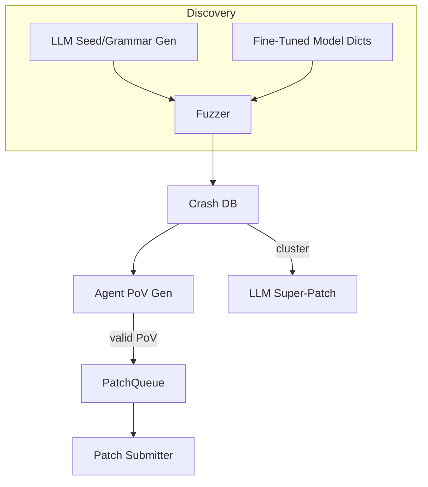

# AI 辅助模糊测试与自动化漏洞发现

{{#include ../banners/hacktricks-training.md}}

## 概述
大型语言模型（LLM）可以通过生成语义丰富的输入、演进语法、分析崩溃数据，甚至提出修复多个 bug 的补丁，大幅增强传统漏洞研究流程。本页汇集了 DARPA AI Cyber Challenge（AIxCC）决赛及其他公开研究中观察到的最有效模式。<sup>[[4]](#references)</sup><sup>[[5]](#references)</sup>

下面介绍的并非某个特定竞赛系统，而是对相关技术的抽象，方便你在自己的工作流中复现。

---

## 1. LLM 生成的种子输入

传统的覆盖率引导型 fuzzer（AFL++、libFuzzer、Honggfuzz……）从少量种子语料库开始，并盲目地变异字节。当目标输入格式较复杂（SQL、URL、自定义二进制协议）时，随机变异通常会在触达有趣的分支之前破坏语法。

LLM 可以通过生成*种子生成器*来解决这个启动问题——这类简短脚本会输出**语法正确且与安全相关的输入**。例如：

```prompt
SYSTEM: You are a helpful security engineer.
USER:
Write a Python3 program that prints 200 unique SQL injection strings targeting common anti-pattern mistakes (missing quotes, numeric context, stacked queries).  Ensure length ≤ 256 bytes / string so they survive common length limits.
```

```python
# gen_sqli_seeds.py (truncated)
PAYLOADS = [
    "1 OR 1=1 -- ",
    "' UNION SELECT NULL,NULL--",
    "0; DROP TABLE users;--",
    ...
]
for p in PAYLOADS:
    print(p)
```

运行一次，并将输出直接作为 fuzzer 的初始语料库：

```bash
python3 gen_sqli_seeds.py > seeds.txt
afl-fuzz -i seeds.txt -o findings/ -- ./target @@
```

Benefits:
1. 语义有效性 → 更早获得更深入的覆盖率。
2. 可重新生成：调整 prompt，即可聚焦于 XSS、path traversal、binary blobs 等。
3. 成本低（使用 GPT-3.5 时不到 1 ¢）。

### Tips
* 指示模型让 payload 的长度和编码（UTF-8、URL-encoded、UTF-16-LE）*多样化*，以绕过表层过滤器。
* 要求生成*单个自包含脚本*——避免 JSON 格式问题。

---

## 2. Grammar-Evolution Fuzzing

一种更强大的变体是让 LLM **演进 grammar**，而不是生成具体的 seed。工作流程（“Grammar Guy”模式）如下：

1. 通过 prompt 生成初始的 ANTLR/Peach/LibFuzzer grammar。
2. Fuzz N 分钟，并收集覆盖率指标（命中的 edges / blocks）。
3. 总结尚未覆盖的程序区域，并将总结反馈给模型：
   ```prompt
   The previous grammar triggered 12 % of the program edges.  Functions not reached: parse_auth, handle_upload.  Add / modify rules to cover these.
   ```
4. 合并新规则，重新 fuzz，重复此过程。

伪代码骨架：

```python
for epoch in range(MAX_EPOCHS):
    grammar = llm.refine(grammar, feedback=coverage_stats)
    save(grammar, f"grammar_{epoch}.txt")
    coverage_stats = run_fuzzer(grammar)
```

关键要点：
* 保持 *预算* ——每次迭代都会消耗 tokens。
* 使用 `diff` + `patch` 指令，让模型编辑而不是重写。
* 当 Δcoverage < ε 时停止。

---

## 3. 本地 LLM libFuzzer Harness 工程

对于不能离开分析人员工作站的源代码，本地代码模型可以起草一个小型适配器，用于在 fuzzer 字节与 C/C++ API 之间进行转换。关键的安全边界应明确：**模型编写并修订测试基础设施；coverage-guided mutation 探索输入；sanitizer 报告无效操作；由人工审查 harness 并对发现的问题进行分类**。<sup>[[9]](#references)</sup>

有关不依赖 LLM 的引擎级语料库、反馈、快照和有状态 fuzzing 技术，请参阅通用的 [Fuzzing Methodology](../generic-methodologies-and-resources/fuzzing.md)。

从目标头文件中复制的确切声明开始，并限制输出格式。范围狭窄的提示可以减少虚构的 API，也让结果更容易审查：<sup>[[8]](#references)[[9]](#references)</sup>

```prompt
Write a libFuzzer target for this exact declaration:
int parse_records(const uint8_t *data, size_t size);

Output only C code. Implement LLVMFuzzerTestOneInput, include the
declaration, pass data and size unchanged, and do not use files,
network access, randomness, clocks, threads, or persistent state.
```

对于原始字节解析器，预期结果不应比以下内容更复杂：<sup>[[6]](#references)[[9]](#references)</sup>

```c
#include <stddef.h>
#include <stdint.h>

extern int parse_records(const uint8_t *, size_t);

int LLVMFuzzerTestOneInput(const uint8_t *data, size_t size) {
    (void)parse_records(data, size);
    return 0;
}
```

编译只是第一道验证关卡。在花费 CPU 时间之前，请根据以下不变量检查每个生成的目标：<sup>[[6]](#references)[[8]](#references)[[9]](#references)</sup>

- **Exact API：** 对照真实头文件和现有调用方，检查类型、所有权规则、初始化、清理以及调用约定。
- **Harness 安全性：** 对从 `data` 读取的每个位置都进行保护；sanitizer 发现的问题必须源自目标，而不是生成的胶水代码。
- **可重复性：** 确保结果仅由 `data` 和 `size` 决定；移除外部 I/O、时间、不受控的随机性、未 join 的线程，以及在调用之间留存的状态。
- **吞吐量：** 只有在不会影响行为时，才初始化一次开销大的不可变状态；限制输入大小，抑制日志，并释放每次输入所分配的内存。
- **可达性：** 验证预期的函数和分支确实会执行。目标即使编译成功，但只触发拒绝路径，也是隐性失败。

### 结构感知目标：保留不变量，但不掩盖漏洞

如果大多数原始输入都无法通过 magic、长度、版本或校验和检查关卡，就将 fuzz 字节作为**类型化字段素材**，并重建有效对象。固定格式常量，让语义字段和 payload 字节保持可变，并根据重建后的 payload 计算完整性元数据。`FuzzedDataProvider` 可用于读取有界的类型化值，而适配器仍负责限制生成的分配和转换。<sup>[[9]](#references)</sup>

<details>
<summary>结构感知 C++ target 示例</summary>

```cpp
#include <fuzzer/FuzzedDataProvider.h>
#include <stddef.h>
#include <stdint.h>
#include <vector>

extern "C" int parse_message(const uint8_t *, size_t);

extern "C" int LLVMFuzzerTestOneInput(const uint8_t *data, size_t size) {
    FuzzedDataProvider fdp(data, size);
    uint8_t version = fdp.ConsumeIntegral<uint8_t>();
    auto body = fdp.ConsumeRemainingBytes<uint8_t>();
    if (body.size() > UINT16_MAX) body.resize(UINT16_MAX);
    uint16_t len = static_cast<uint16_t>(body.size());
    std::vector<uint8_t> msg = {0x8b, 'M', 'S', 'G', version,
                                static_cast<uint8_t>(len >> 8),
                                static_cast<uint8_t>(len)};
    msg.insert(msg.end(), body.begin(), body.end());
    (void)parse_message(msg.data(), msg.size());
    return 0;
}
```

</details>

不要对每个问题都使用同一个会修复结构的 target。维护一个会推导长度/校验和以探索深层有效状态的 target，另一个则让 fuzzer 控制**声明的**元数据，同时仅限制 harness 自身的读取和分配。第二个 target 保留了自动修复原本会抹去的长度不匹配和完整性错误攻击面。<sup>[[9]](#references)</sup>

### 种子、字典、sanitizer 和覆盖率反馈

让模型生成写入二进制种子的脚本，而不是让它直接输出二进制内容。为对象准备空、最小、典型和边界有效的种子；然后提取 magic 值、标签、枚举编码和解析器关键字，整理成经过审查的字典。libFuzzer 可通过 `-dict=` 接受该字典，并将能发现新覆盖率的变异保留在语料库中。<sup>[[6]](#references)[[9]](#references)</sup>

```text
magic="\x8bMSG"
version_min="\x00"
version_max="\xff"
config_tag="CONFIG"
```

使用互补的插桩方式构建同一目标。ASan 和 UBSan 可以共用一个 fuzzing 二进制文件；单独构建 MSan 版本，并对其依赖项进行插桩，以避免未插桩代码导致误报。<sup>[[6]](#references)[[9]](#references)</sup>

```bash
clang++ -g -O1 -fsanitize=fuzzer,address,undefined \
  -fno-sanitize-recover=undefined target.cc harness.cc -o fuzz_target
./fuzz_target corpus -dict=msg.dict -max_len=65535

clang++ -g -O1 -fsanitize=fuzzer,memory \
  target.cc harness.cc -o fuzz_target_msan
```

将 coverage 作为评估每次模型修订的指标。在 libFuzzer 输出中，早期趋平的 `cov`/`ft` 和静态语料通常意味着 framing 不正确、过早返回条件过于严格，或调用错误；较低的 `exec/s` 则表明 setup、I/O、内存分配开销过大，或状态泄漏。`NEW` 只能证明某个 coverage 特征发生了变化，并不能证明已到达预期的 parser。<sup>[[6]](#references)[[9]](#references)</sup>

要获取源码级反馈，请构建 coverage 版本并进行 fuzzing，然后只向模型提供未覆盖的函数及其保护条件。检查生成的 harness/seed/dictionary 差异，并再次测量：<sup>[[7]](#references)[[8]](#references)[[9]](#references)</sup>

```bash
clang++ -g -O1 -fsanitize=fuzzer \
  -fprofile-instr-generate -fcoverage-mapping target.cc harness.cc -o fuzz_cov
mkdir -p profiles
LLVM_PROFILE_FILE='profiles/%p.profraw' ./fuzz_cov -max_total_time=300 corpus
llvm-profdata merge -sparse profiles/*.profraw -o fuzz.profdata
llvm-cov report ./fuzz_cov -instr-profile=fuzz.profdata
llvm-cov show ./fuzz_cov -instr-profile=fuzz.profdata \
  --show-branches=count --region-coverage-lt=1 target.cc
```

因此，可扩展的循环是 **生成 → 编译/链接 → 在 sanitizers 下进行冒烟测试 → 测量目标覆盖率 → 提供最小且相关的覆盖率/源代码上下文 → 修改 → 重新测量**。OSS-Fuzz-Gen 应用相同原则：评估生成的目标是否可编译、是否出现运行时故障、覆盖率如何，以及相较于现有目标的覆盖率提升，而不是仅凭代码看起来合理就接受它。<sup>[[7]](#references)[[8]](#references)</sup>

---

## 4. 基于 Agent 的 PoV（Exploit）生成

发现 crash 后，你仍然需要一个能够确定性触发它的**漏洞证明（PoV）**。

一种可扩展的方法是启动许多轻量级 worker（进程、线程或容器），每个 worker 使用不同的模型或采样配置。AIxCC 决赛入围团队的调查给出了具体的规模示例：一个团队使用了**数千个并发 agent**来优先通过 AI 生成 PoV；另一个团队则编排了 **300–500 个 fuzzing agent**，并将 LLM 用于更高层次的语义推理。<sup>[[4]](#references)</sup>

Pipeline:
1. 静态/动态分析生成 *bug 候选项*（包含 crash PC、输入片段、sanitizer 消息的 struct）。
2. Orchestrator 将候选项分发给 agent。
3. Agent 推理步骤：
   a. 使用 `gdb` 和输入在本地复现 bug。
   b. 提出最小 exploit payload。
   c. 在 sandbox 中验证 exploit。若成功 → 提交。
4. 失败的尝试会作为新 seeds **重新排队**，用于 coverage fuzzing（反馈循环）。

优势：
* 并行化可以弥补单个 agent 的不可靠性。
* 根据观察到的成功率自动调整 temp / model size。

---

## 5. 使用微调后的代码模型进行定向 Fuzzing

使用带有漏洞模式标签（整数溢出、缓冲区复制、格式字符串）的 C/C++ 源代码，对开放权重模型（例如 Llama-7B）进行微调。然后：

1. 运行静态分析，获取函数列表和 AST。
2. 提示模型：*“给出可能破坏函数 X 内存安全性的 mutation dictionary 条目”*。
3. 将这些 tokens 插入自定义的 `AFL_CUSTOM_MUTATOR`。

`sprintf` wrapper 的输出示例：
```
{"pattern":"%99999999s"}
{"pattern":"AAAAAAAA....<1024>....%n"}
```

实测表明，这能让真实目标的崩溃时间缩短 2 倍以上。

---

## 6. AI-Guided Patching Strategies

### 6.1 Super Patches
让模型对崩溃特征进行*聚类*，并提出一个**单一 patch** 来消除共同的根本原因。一次提交，修复多个 bug → 在每次错误 patch 都会扣分的环境中，减少准确性惩罚。

Prompt 大纲：
```
Here are 10 stack traces + file snippets.  Identify the shared mistake and generate a unified diff fixing all occurrences.
```

{{#ref}}
../generic-methodologies-and-resources/fuzzing.md
{{#endref}}

### 6.2 Speculative Patch Ratio
实现一个队列，让已确认并经 PoV 验证的补丁与*推测性*补丁（无 PoV）按根据评分规则调整的 1:​N 比例交错排列（例如 2 个推测性补丁 : 1 个已确认补丁）。成本模型会监控惩罚与得分，并自动调整 N。

---

## 7. 确定性的逐文件 AI 代码审查

AI 辅助审查中一种常见的失败模式，是让一个 agent 检查整个代码仓库，并指望它选对文件和 grep 关键词。更可靠的模式是**强制覆盖整个代码仓库**：<sup>[[1]](#references)</sup>

1. 枚举源文件。
2. 一次发送**一个文件**，并附上最少量的上下文（入口点、导入项、邻近的路由/调用方）。
3. 要求每个文件都提供**结构化报告**：sources、sink、缺失的验证、利用前提和置信度。<sup>[[3]](#references)</sup>
4. 按**source→sink 模式**对报告去重，并手动验证高风险项。

这种方法消耗大量 token，也会产生不少噪声，但在发现**简单且影响重大的 source/sink 漏洞**方面非常有效，而宽泛的 agentic 审查常常会漏掉这类问题。

### 值得优先排查的分类模式

- **动态 PHP include/dispatch**：攻击者控制的路由/控制器/模块名称流入 `require_once()`、`include()` 或 `include_once()`，但没有严格的 allowlist 和路径规范化。
- **管理/账户工作流中的 shell 执行**：用户名、域名、FTP 账户或其他标识符传入 `exec()`、`system()`、`shell_exec()`、`passthru()`、`proc_open()` 或 `popen()`。
- **结构化输入汇聚**：同一个参数通过 `$_GET`、`$_POST`、JSON、XML 或框架的 body parser 接收，之后又被用于文件系统或 OS 命令 sink。

### 这种方法特别擅长发现的两类实际漏洞

- **PHP controller-dispatch LFI/RCE**：如果请求控制的 controller 名称被拼接进 `require_once()`，却没有 allowlist/路径规范化，`../` 等遍历序列就可能让 PHP 引入非预期的本地 `.php` 文件。如果攻击者能让 include 指向预先放置的或其他有用的 PHP 文件，LFI 就会变成代码执行。参见 [File Inclusion / Path Traversal](../pentesting-web/file-inclusion/README.md)。<sup>[[1]](#references)</sup>
- **hosting/admin panel 中的已认证命令注入**：如果用户名等账户管理字段被嵌入 shell 命令，低权限的已认证用户就可能通过普通的创建/删除操作实现 RCE。如果面板以权限更高的服务账户身份执行命令，影响会更大。参见 [Command Injection](../pentesting-web/command-injection.md)。<sup>[[1]](#references)</sup>

### 实际审查注意事项

- 首先将 LLM 用作 **source/sink 审查工具**，而不是 exploit 生成器。
- 要求它明确列出**攻击者可控字段**、**规范化/验证缺失之处**和**危险 sink**。
- 对于大型代码仓库，即使单个自主 agent 使用了更强的模型，确定性的逐文件审查通常也更可靠。<sup>[[2]](#references)</sup>
- 如果是 **Broken Access Control** 和其他业务逻辑漏洞，应预期审查效果较弱；这类漏洞的可利用性往往取决于跨文件假设、角色语义或产品特定的威胁模型。

---

## 8. 使用插桩 Oracle 进行模式引导的内核审计

对于内核规模的目标，不要让 agent 在整个代码树中随意寻找漏洞。更节省 token 的工作流是将历史漏洞知识转化为静态查询，根据暴露的攻击面为结果排序，并使用插桩内核作为执行 oracle。<sup>[[11]](#references)</sup>

### 模式数据库 → CodeQL/Semgrep → 专项审查

建立一个小型知识库，记录危险 API、缺少验证的模式、有风险的 source-to-sink 数据流，以及过去修复过的漏洞形态。让模型**一次处理一个模式**，将其转化为审查启发式规则以及 CodeQL/Semgrep 规则，然后用这些确定性规则扫描整个代码树。将匹配结果分组并去重后，再把代码交给模型；原始扫描器输出可能包含数千个价值较低的候选项。在符合条件的研究目标或开源目标以外使用此方法之前，请确认 CodeQL 当前的许可条款。<sup>[[11]](#references)</sup>

优先级排序应同时考虑**规则命中密度**和**攻击者可达性**，而不应只看命中数量。非特权进程、sandbox、容器、jail 或 guest 环境可访问的内核接口，应比仅供内部使用的代码获得更高权重。审查单元应足够小，使 agent 能够保留调用方、验证逻辑和生命周期规则等上下文；提示中应指定漏洞类别或控制流模式，而不是泛泛地要求“寻找任何漏洞”。当新的隔离边界使旧版特权接口可被 namespaced 或 jail 中的 root 用户访问时，这些接口尤其值得关注。<sup>[[11]](#references)</sup>

对于每个候选项，在尝试利用之前，都应要求提供明确的字段流记录。<sup>[[11]](#references)</sup>

```text
entrypoint -> privilege check -> parser -> validation/normalization
           -> later rewrite -> dangerous sink
attacker controls: <fields and lengths>
constraints:       <values rewritten, rejected, or preserved>
observable result: <sanitizer report, assertion, panic, or clean exit>
```

### 将 KASAN telemetry 用作假设判定器

在启用了 KASAN 和有用诊断断言的临时 VM 中运行目标内核。Agent 应不断迭代 **源码假设 → 最小 userland 触发器 → VM 执行 → KASAN/断言跟踪 → 修正后的假设**，直到复现或排除疑似损坏。每轮仅返回相关堆栈跟踪及附近源码；这样既保留推理所需的上下文，也能让运行时证据而非模型置信度成为验收标准。<sup>[[11]](#references)</sup>

插桩构建并非最终的可利用性环境。断言可能在造成损坏的操作发生前就终止执行，而同一断言在生产内核中可能被编译掉。使用完全相同的触发器对照确切的生产配置重新测试，记录内核构建版本和配置，并将 **可达性**、**内存损坏**、**受控原语** 和 **安全影响** 作为独立主张加以区分。<sup>[[11]](#references)[[12]](#references)</sup>

CVE-2026-3038 是一个有用的验证示例，而不是利用模板。非特权 FreeBSD `RTM_GET` 请求可通过选择性验证和回复重写，让超大的 `RTAX_AUTHOR` sockaddr 一直保留下来，直到 `rtsock_msg_buffer()` 将由用户控制的 `sa_len` 拷贝到 128 字节的栈上 `sockaddr_storage` 中。最大 255 字节的拷贝会造成 127 字节的越界写；插桩构建中的诊断断言会捕获错误长度，而 GENERIC 内核则会执行拷贝，并在检查被破坏的 canary 时触发 panic。这证明了非特权拒绝服务，并不能单独证明权限提升：要实现可靠控制，首先还需要另一个原语，例如 canary 泄露。有关相应的二进制利用边界，请参见 [Stack Canaries](../binary-exploitation/common-binary-protections-and-bypasses/stack-canaries/index.html)。<sup>[[11]](#references)[[12]](#references)[[13]](#references)</sup>

### 拒绝通过作弊满足利用前提

在接受 PoV 或 exploit 前，应让独立审查者/agent 按照固定标准尝试证伪。审查必须确认以下所有条件。<sup>[[11]](#references)</sup>

- 未修改目标源码、内核或易受攻击的模块来使该路径变得可达。
- 未引入辅助模块、合成 gadget、被禁用的缓解措施、额外权限或不可用接口。
- 在干净快照上，触发器以所声称的调用者身份和限制条件启动。
- 所声称的结果仍依赖该 bug：移除格式错误的字段或仅修复该 bug，都必须能中断利用链。
- 崩溃、越界读或越界写只能按相应原语报告；代码执行或权限提升需要独立证据。

最后这个反事实检查可以发现循环论证式的演示：如果前提条件已经赋予了所声称的影响（例如，从未以 `nosuid` 挂载的文件系统执行攻击者提供的 SUID 内容），那么内存安全 bug 并未造成该影响。<sup>[[11]](#references)</sup>

---

## 对陌生代码库开展可审计的 Agent 辅助研究

[graph-first fuzz-target workflow](../generic-methodologies-and-resources/fuzzing.md#graph-first-fuzz-target-selection-and-mutation-triage) 已涵盖入口点可达性，而 [agentic SAST pipelines](../network-services-pentesting/pentesting-web/code-review-tools.md#agentic-sast-pipelines) 则涵盖分阶段审查和证据关卡。将这些确定性结果与模型假设分开保存，确保每条晋升的线索都保留源码位置、路径证据和动态测量结果。<sup>[[10]](#references)</sup>

### 关联对象生命周期证据，但不要臆造数据流

静态分析可能发现，攻击者控制的长度在一个函数中被存储，而同一对象字段很久以后到达了一个拷贝 sink，却无法证明这两者之间存在跨回调、重连或对象生命周期的关联。分别保留这两项发现，按对象/字段聚类，并将缺失的关联边明确列为分流审查问题。Agent 可以提出这种关联，但必须通过源码审查或运行时插桩加以证明。<sup>[[10]](#references)</sup>

对于每个候选项，记录：

- 具体入口点和攻击者可控的字节；
- 相关字段的所有生产者，包括针对每个生产者的专属验证；
- sink、目标容量，以及抵达该处所需的构建/运行时条件；
- 从对外暴露的入口点获得的真实调用栈，而不只是直接调用 harness 的结果；
- 能确认或否定该假设的最小动态结果。

某条看似安全的路径不能证明某个字段整体上安全。第二个生产者可能在未采用第一条路径边界检查的情况下填充同一字段。应分别测试各条路径，并使用与部署等效的构建选项运行 harness，因为 debug 断言可能将生产环境中的内存损坏转变为仅在测试中出现的提前中止。<sup>[[10]](#references)</sup>

### 信息泄露与利用的测量关卡

对于疑似未初始化内存泄露，使用可识别的字节填充新分配的内存，并验证确切标记是否到达发出的数据包。对于利用，要求通过测量确认各关卡，例如 **受控覆盖 → 有用的受害对象 → 信息披露 → 指针/基址恢复 → 控制流劫持 → 组合 payload**。只有在 harness 证明当前属性后，Agent 才能继续；看似合理的叙述不算通过关卡。[FreeRDP case](../binary-exploitation/libc-heap/heap-overflow.md#cross-path-length-reuse-and-stale-output-disclosure) 展示了验证期间必须保留的路径和构建约束。<sup>[[10]](#references)</sup>

---

## 综合运用

端到端的 CRS（Cyber Reasoning System）可以按如下方式连接各组件：



---

## References

- [1] [Project Black - 用于网络安全的本地 AI：发现 phpIPAM LFI 和 myVesta 认证 RCE](https://projectblack.io/blog/local-ai-for-cyber-security)
- [2] [Strix](https://github.com/usestrix/strix)
- [3] [GitHub Copilot 社区 security-review skill](https://github.com/github/awesome-copilot/blob/main/skills/security-review/SKILL.md)
- [4] [Trail of Bits – AIxCC 决赛：赛事回顾](https://blog.trailofbits.com/2025/08/07/aixcc-finals-tale-of-the-tape/)
- [5] [CTF Radiooo AIxCC 决赛选手访谈](https://www.youtube.com/@ctfradiooo)
- [6] [LLVM — libFuzzer：用于覆盖率引导 fuzz testing 的库](https://llvm.org/docs/LibFuzzer.html)
- [7] [Google — OSS-Fuzz-Gen](https://github.com/google/oss-fuzz-gen)
- [8] [Google Online Security Blog — 提升 Fuzzing：借助 AI 发现更多漏洞](https://security.googleblog.com/2024/11/leveling-up-fuzzing-finding-more.html)
- [9] [8kSec — 使用本地 LLM 辅助生成 Fuzzing Harness](https://8ksec.io/ai-assisted-fuzzing-harness-local-llm)
- [10] [Quarkslab — 从 AI Agents 到 RCE：构建漏洞研究工作流](https://blog.quarkslab.com/from-ai-agents-to-rce-building-a-vulnerability-research-workflow.html)
- [11] [Praetorian — FreeBSoD：利用语言模型发现并利用内核漏洞（共 2 部分，第 1 部分）](https://praetorian.com/blog/ai-vulnerability-research-freebsd-kernel)
- [12] [FreeBSD-SA-26:05.route — 通过 routing sockets 导致本地 DoS 和可能的权限提升](https://www.freebsd.org/security/advisories/FreeBSD-SA-26:05.route.asc)
- [13] [FreeBSD-SA-26:05.route 源码补丁](https://security.FreeBSD.org/patches/SA-26:05/route.patch)
{{#include ../banners/hacktricks-training.md}}
