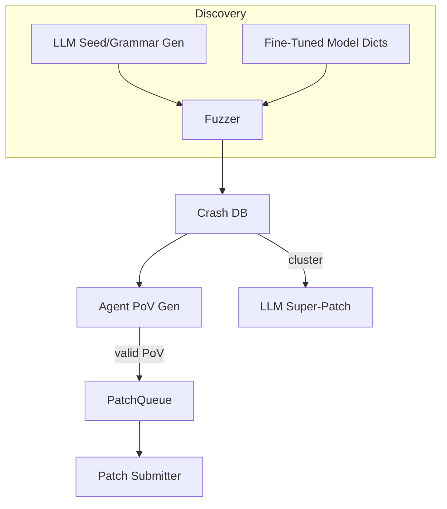

# AI-ondersteunde Fuzzing & Outomatiese Kwesbaarheidsontdekking

{{#include ../banners/hacktricks-training.md}}

## Oorsig
Groottaalmodelle (LLM's) kan tradisionele kwesbaarheidsnavorsingspyplyne aansienlik versterk deur semanties ryk invoer te genereer, grammatikas te ontwikkel, crash-data te ontleed en selfs pleisters vir verskeie foute voor te stel. Hierdie bladsy versamel die doeltreffendste patrone wat tydens DARPA se AI Cyber Challenge (AIxCC)-eindronde en ander openbare navorsing waargeneem is.<sup>[[4]](#references)</sup><sup>[[5]](#references)</sup>

Wat volg, is nie 'n beskrywing van een spesifieke kompetisiestelsel nie, maar 'n abstraksie van die tegnieke sodat jy dit in jou eie werkvloeie kan toepas.

---

## 1. LLM-gegenereerde Seed-invoer

Tradisionele coverage-guided fuzzers (AFL++, libFuzzer, Honggfuzz…) begin met 'n klein corpus van seeds en muteer grepe blindelings. Wanneer die teiken se invoerformaat kompleks is (SQL, URL's, pasgemaakte binêre protokolle), breek ewekansige mutasies gewoonlik die sintaksis voordat interessante vertakkings bereik word.

LLM's kan hierdie bootstrap-probleem oplos deur *seed generators* uit te voer – kort skripte wat **sintaksis-korrekte maar sekuriteitsrelevante invoer** lewer. Byvoorbeeld:

```prompt
SYSTEM: You are a helpful security engineer.
USER:
Write a Python3 program that prints 200 unique SQL injection strings targeting common anti-pattern mistakes (missing quotes, numeric context, stacked queries).  Ensure length ≤ 256 bytes / string so they survive common length limits.
```

```python
# gen_sqli_seeds.py (truncated)
PAYLOADS = [
    "1 OR 1=1 -- ",
    "' UNION SELECT NULL,NULL--",
    "0; DROP TABLE users;--",
    ...
]
for p in PAYLOADS:
    print(p)
```

Voer dit een keer uit en voer die uitvoer direk in die fuzzer se aanvanklike corpus in:

```bash
python3 gen_sqli_seeds.py > seeds.txt
afl-fuzz -i seeds.txt -o findings/ -- ./target @@
```

Voordele:
1. Semantiese geldigheid → dieper dekking vroegtydig.
2. Hergenereerbaar: pas die prompt aan om op XSS, path traversal, binary blobs, ens. te fokus.
3. Goedkoop (< 1 ¢ met GPT-3.5).

### Wenke
* Gee die model opdrag om payload-lengte en -enkodering te *diversifiseer* (UTF-8, URL-encoded, UTF-16-LE) om oppervlakkige filters te omseil.
* Vra vir ’n *enkele selfstandige script* – dit vermy haakplekke met JSON-formatering.

---

## 2. Grammar-Evolution Fuzzing

’n Kragtiger variant is om die LLM ’n grammar te laat **ontwikkel** in plaas van konkrete seeds. Die werkvloei (“Grammar Guy”-patroon) is:

1. Genereer ’n aanvanklike ANTLR/Peach/LibFuzzer-grammar via ’n prompt.
2. Fuzz vir N minute en versamel dekkingsmaatstawwe (getreëde edges / blocks).
3. Som ongedekte programareas op en voer die opsomming terug na die model:
   ```prompt
   The previous grammar triggered 12 % of the program edges.  Functions not reached: parse_auth, handle_upload.  Add / modify rules to cover these.
   ```
4. Voeg die nuwe reëls saam, fuzz weer, herhaal.

Pseudo-code-skelet:

```python
for epoch in range(MAX_EPOCHS):
    grammar = llm.refine(grammar, feedback=coverage_stats)
    save(grammar, f"grammar_{epoch}.txt")
    coverage_stats = run_fuzzer(grammar)
```

Kernpunte:
* Hou ’n *begroting* – elke verfyning gebruik tokens.
* Gebruik `diff` + `patch`-instruksies sodat die model wysigings maak eerder as om alles te herskryf.
* Stop wanneer Δcoverage < ε.

---

## 3. Plaaslike-LLM libFuzzer-harness-ingenieurswese

Vir bronkode wat nie ’n ontleder se werkstasie mag verlaat nie, kan ’n plaaslike kodemodel die klein adapter tussen fuzzer-grepe en ’n C/C++-API opstel. Die nuttige sekuriteitsgrens is duidelik: **die model skryf en hersien toetsinfrastruktuur; coverage-guided mutation verken invoere; sanitizers rapporteer ongeldige bewerkings; ’n mens hersien die harness en triageer bevindinge**.<sup>[[9]](#references)</sup>

Sien die algemene [Fuzzing Methodology](../generic-methodologies-and-resources/fuzzing.md) vir tegnieke op enjinnovlak vir corpus, terugvoer, snapshot en stateful-fuzzing wat nie van ’n LLM afhanklik is nie.

Begin met die presiese deklarasie wat uit die teiken se header gekopieer is en beperk die uitvoerformaat. ’n Eng prompt verminder uitgedinkte API’s en maak die resultaat maklik om te hersien:<sup>[[8]](#references)[[9]](#references)</sup>

```prompt
Write a libFuzzer target for this exact declaration:
int parse_records(const uint8_t *data, size_t size);

Output only C code. Implement LLVMFuzzerTestOneInput, include the
declaration, pass data and size unchanged, and do not use files,
network access, randomness, clocks, threads, or persistent state.
```

Vir 'n rougreep-ontleder behoort die verwagte resultaat nie ingewikkelder as dit te wees nie:<sup>[[6]](#references)[[9]](#references)</sup>

```c
#include <stddef.h>
#include <stdint.h>

extern int parse_records(const uint8_t *, size_t);

int LLVMFuzzerTestOneInput(const uint8_t *data, size_t size) {
    (void)parse_records(data, size);
    return 0;
}
```

Samestelling is slegs die eerste valideringshek. Kontroleer elke gegenereerde teiken aan die hand van hierdie invariantes voordat jy SVE-tyd daaraan bestee:<sup>[[6]](#references)[[8]](#references)[[9]](#references)</sup>

- **Presiese API:** vergelyk tipes, eienaarskapreëls, inisialisering, afbreek en oproepkonvensie met die werklike header en bestaande oproepers.
- **Veilige harnas:** beskerm elke lees uit `data`; bevindinge van sanitiseerders moet in die teiken ontstaan, nie in die gegenereerde gomkode nie.
- **Herhaalbaarheid:** maak die resultaat ’n funksie van `data` en `size`; verwyder eksterne I/O, tyd, onbeheerde ewekansigheid, drade wat nie saamgevoeg is nie, en toestand wat tussen oproepe voortbestaan.
- **Deurset:** inisialiseer duur, onveranderlike toestand slegs een keer wanneer dit nie gedrag kan beïnvloed nie, beperk insetgrootte, onderdruk aantekening en maak toewysings per inset vry.
- **Bereikbaarheid:** verifieer dat die bedoelde funksies en vertakkings uitgevoer word. ’n Teiken wat saamstel maar slegs verwerpingspaaie toets, is ’n stille mislukking.

### Struktuurbewuste teikens: behou invariantes sonder om foute te verberg

As die meeste rou insette by ’n hek vir magic, lengte, weergawe of kontrolesom faal, gebruik die fuzz-grepe as getipeerde veldmateriaal en herbou ’n geldige objek. Stel formaatkonstantes vas, laat semantiese velde en loonvraggrepe veranderbaar, en lei integriteitsmetadata af van die herboude loonvrag. `FuzzedDataProvider` is nuttig om begrensde getipeerde waardes te verbruik, terwyl die adapter steeds verantwoordelik is om enige gegenereerde toewysing en omskakeling te beperk.<sup>[[9]](#references)</sup>

<details>
<summary>Voorbeeld van ’n struktuurbewuste C++-teiken</summary>

```cpp
#include <fuzzer/FuzzedDataProvider.h>
#include <stddef.h>
#include <stdint.h>
#include <vector>

extern "C" int parse_message(const uint8_t *, size_t);

extern "C" int LLVMFuzzerTestOneInput(const uint8_t *data, size_t size) {
    FuzzedDataProvider fdp(data, size);
    uint8_t version = fdp.ConsumeIntegral<uint8_t>();
    auto body = fdp.ConsumeRemainingBytes<uint8_t>();
    if (body.size() > UINT16_MAX) body.resize(UINT16_MAX);
    uint16_t len = static_cast<uint16_t>(body.size());
    std::vector<uint8_t> msg = {0x8b, 'M', 'S', 'G', version,
                                static_cast<uint8_t>(len >> 8),
                                static_cast<uint8_t>(len)};
    msg.insert(msg.end(), body.begin(), body.end());
    (void)parse_message(msg.data(), msg.size());
    return 0;
}
```

</details>

Gebruik nie een struktuurherstellende teiken vir elke vraag nie. Hou een teiken wat lengtes/tjeksomme aflei om diep, geldige toestande te verken, en ’n ander een wat die **verklaarde** metadata deur die fuzzer laat beheer, terwyl slegs die harnas se eie leesbewerkings en geheuetoewysings beperk word. Die tweede teiken behou aanvalsvlakke met lengtes wat nie ooreenstem nie en swak integriteit, wat outomatiese herstel andersins sou uitwis.<sup>[[9]](#references)</sup>

### Saadwaardes, woordeboeke, sanitizers en terugvoer oor dekking

Vra die model om ’n script te genereer wat binêre saadwaardes skryf, eerder as om dit te vra om binêre data direk uit te druk. Gebruik leë, minimale, tipiese en geldige grensgeval-objekte as saadwaardes; onttrek dan magic-waardes, tags, enum-koderings en parser-sleutelwoorde na ’n nagegane woordeboek. libFuzzer aanvaar daardie woordeboek met `-dict=`, en behou mutasies wat nuwe dekking in die corpus blootlê.<sup>[[6]](#references)[[9]](#references)</sup>

```text
magic="\x8bMSG"
version_min="\x00"
version_max="\xff"
config_tag="CONFIG"
```

Bou dieselfde teiken met aanvullende instrumentering. ASan en UBSan kan ’n fuzzing-binêr deel; gebruik ’n aparte MSan-bou en instrumenteer die afhanklikhede daarvan om verslae weens ongeïnstrumenteerde kode te vermy.<sup>[[6]](#references)[[9]](#references)</sup>

```bash
clang++ -g -O1 -fsanitize=fuzzer,address,undefined \
  -fno-sanitize-recover=undefined target.cc harness.cc -o fuzz_target
./fuzz_target corpus -dict=msg.dict -max_len=65535

clang++ -g -O1 -fsanitize=fuzzer,memory \
  target.cc harness.cc -o fuzz_target_msan
```

Gebruik dekking as maatstaf vir elke modelhersiening. In libFuzzer-uitvoer dui ’n vroeë plat cov/ft-verloop en ’n statiese corpus gewoonlik op swak framing, ’n té beperkende vroeë return of die verkeerde call; ’n lae exec/s dui op duur opstelling, I/O, allokasie of toestand wat uitlek. NEW bewys slegs dat ’n dekkingseienskap verander het, nie dat die bedoelde parser bereik is nie.<sup>[[6]](#references)[[9]](#references)</sup>

Vir terugvoer op bronkodevlak, bou met coverage-instrumentasie, fuzz dit en gee die model slegs die ongedekte funksies saam met hul voorwaardes. Verifieer die harness/seed/dictionary-diff en meet weer:<sup>[[7]](#references)[[8]](#references)[[9]](#references)</sup>

```bash
clang++ -g -O1 -fsanitize=fuzzer \
  -fprofile-instr-generate -fcoverage-mapping target.cc harness.cc -o fuzz_cov
mkdir -p profiles
LLVM_PROFILE_FILE='profiles/%p.profraw' ./fuzz_cov -max_total_time=300 corpus
llvm-profdata merge -sparse profiles/*.profraw -o fuzz.profdata
llvm-cov report ./fuzz_cov -instr-profile=fuzz.profdata
llvm-cov show ./fuzz_cov -instr-profile=fuzz.profdata \
  --show-branches=count --region-coverage-lt=1 target.cc
```

Die skaalbare siklus is dus **genereer → compileer/koppel → smoke-test onder sanitizers → meet target coverage → verskaf die kleinste relevante coverage-/bron-konteks → hersien → meet weer**. OSS-Fuzz-Gen pas dieselfde beginsel toe deur gegenereerde targets te evalueer vir compileerbaarheid, runtime-foute, coverage en coverage-verbetering teenoor bestaande targets, eerder as om geloofwaardige kode op sigwaarde te aanvaar.<sup>[[7]](#references)[[8]](#references)</sup>

---

<a id="3-agent-based-pov-exploit-generation" hidden>3. Agent-Based PoV (Exploit) Generation</a>

## 4. Agent-Based PoV (Exploit) Generation

Nadat ’n crash gevind is, het jy steeds ’n **proof-of-vulnerability (PoV)** nodig wat dit deterministies veroorsaak.

’n Skaalbare benadering is om baie liggewig-werkers (prosesse, drade of containers) te begin, waar elkeen ’n ander model of sampling-konfigurasie gebruik. Die AIxCC-finaliste-opname gee konkrete voorbeelde van die skaal: een span het **duisende gelyktydige agents** vir AI-first PoV-generering gebruik, terwyl ’n ander **300–500 fuzzing-agents** georkestreer het en LLM’s vir redenasie op ’n hoër semantiese vlak gereserveer het.<sup>[[4]](#references)</sup>

Pypelyn:
1. Statiese/dinamiese analise lewer *bug-kandidate* op (struct met crash PC, input-slice, sanitizer-boodskap).
2. Orchestrator versprei kandidate aan agents.
3. Agent se redenasiestappe:
   a. Reproduseer die bug plaaslik met `gdb` + input.
   b. Stel ’n minimale exploit-payload voor.
   c. Valideer die exploit in ’n sandbox.  As dit slaag → dien in.
4. Mislukte pogings word **weer as nuwe seeds in die tou geplaas** vir coverage-fuzzing (terugvoerlus).

Voordele:
* Parallelisering verberg die onbetroubaarheid van ’n enkele agent.
* Outomatiese instel van temp / modelgrootte op grond van die waargenome sukseskoers.

---

<a id="4-directed-fuzzing-with-fine-tuned-code-models" hidden>4. Directed Fuzzing with Fine-Tuned Code Models</a>

## 5. Directed Fuzzing with Fine-Tuned Code Models

Fine-tune ’n model met oop gewigte (bv. Llama-7B) op C/C++-bronkode wat met kwesbaarheidspatrone gemerk is (integer overflow, buffer copy, format string). Doen dan die volgende:

1. Voer statiese analise uit om ’n funksielys + AST te kry.
2. Vra die model: *“Gee mutation dictionary-inskrywings wat waarskynlik memory safety in funksie X sal breek”*.
3. Voeg daardie tokens in ’n pasgemaakte `AFL_CUSTOM_MUTATOR` in.

Voorbeelduitset vir ’n `sprintf`-wrapper:
```
{"pattern":"%99999999s"}
{"pattern":"AAAAAAAA....<1024>....%n"}
```

Empiries verkort dit time-to-crash met >2× op werklike teikens.

---

<a id="5-ai-guided-patching-strategies" hidden>5. KI-geleide patchstrategieë</a>

## 6. KI-geleide patchstrategieë

<a id="51-super-patches" hidden>5.1 Superpatches</a>

### 6.1 Superpatches
Vra die model om crash-handtekeninge te *groepeer* en ’n **enkele patch** voor te stel wat die gemeenskaplike hoofoorsaak uitskakel. Dien dit een keer in en herstel verskeie foute → minder akkuraatheidsboetes in omgewings waar elke verkeerde patch punte kos.

Uiteensetting van die prompt:
```
Here are 10 stack traces + file snippets.  Identify the shared mistake and generate a unified diff fixing all occurrences.
```

{{#ref}}
../generic-methodologies-and-resources/fuzzing.md
{{#endref}}

<a id="52-speculative-patch-ratio" hidden>5.2 Speculative Patch Ratio</a>

### 6.2 Verhouding van spekulatiewe patches
Implementeer ’n tou waarin bevestigde, PoV-gevalideerde patches en *spekulatiewe* patches (geen PoV nie) teen ’n 1:​N-verhouding afgewissel word, aangepas volgens die puntetoekenningsreëls (bv. 2 spekulatiewe : 1 bevestigde). ’n Kostemodel monitor boetes teenoor punte en pas N outomaties aan.

---

Vir deterministiese lêer-vir-lêer-bronhersiening, mobiele toegangspunt-taskflows, kernelpatroon-oudits en bewysgebaseerde kwesbaarheidsvalidering, sien [KI-ondersteunde bronhersiening en kwesbaarheidsvalidering](AI-Assisted-Source-Review-and-Vulnerability-Validation.md).

---

## Debugger-gesteunde crashtriage

Mona v3-werkvloeie vir crashtriage, funksie-ontleding en beheerde bereikbaarheid van heap-chunks word beskryf in [Exploiting Tools](../binary-exploitation/basic-stack-binary-exploitation-methodology/tools/#mona-v3-debugger-context-requests-for-crash-triage).

---

## Alles saamgevoeg
’n End-tot-end CRS (Cyber Reasoning System) kan die komponente soos volg aan mekaar koppel:



---

## References

- [4] [Trail of Bits – AIxCC-eindronde: die verhaal van die stryd](https://blog.trailofbits.com/2025/08/07/aixcc-finals-tale-of-the-tape/)
- [5] [CTF Radiooo-onderhoude met AIxCC-finaliste](https://www.youtube.com/@ctfradiooo)
- [6] [LLVM — libFuzzer: ’n biblioteek vir dekkinggeleide fuzz-toetsing](https://llvm.org/docs/LibFuzzer.html)
- [7] [Google — OSS-Fuzz-Gen](https://github.com/google/oss-fuzz-gen)
- [8] [Google Online Security Blog — Neem fuzzing na ’n hoër vlak: vind meer kwesbaarhede met AI](https://security.googleblog.com/2024/11/leveling-up-fuzzing-finding-more.html)
- [9] [8kSec — AI-ondersteunde generering van fuzz-harnasse met ’n plaaslike LLM](https://8ksec.io/ai-assisted-fuzzing-harness-local-llm)
{{#include ../banners/hacktricks-training.md}}
