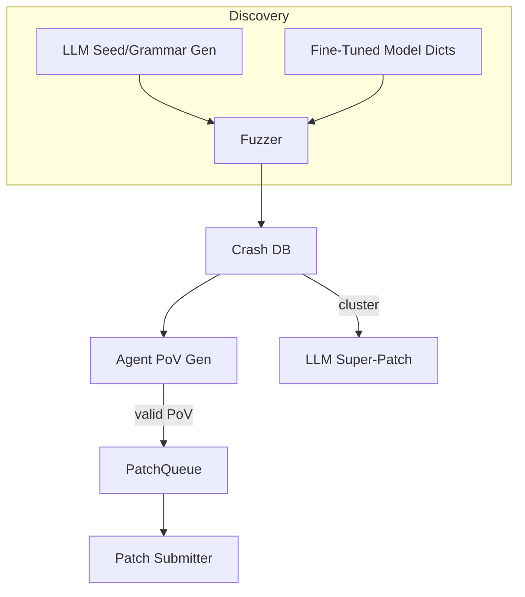

# Fuzzing με τη βοήθεια AI & Αυτοματοποιημένος εντοπισμός ευπαθειών

{{#include ../banners/hacktricks-training.md}}

## Επισκόπηση
Τα μεγάλα γλωσσικά μοντέλα (LLMs) μπορούν να ενισχύσουν σημαντικά τις παραδοσιακές διαδικασίες έρευνας ευπαθειών, δημιουργώντας σημασιολογικά πλούσια inputs, εξελίσσοντας γραμματικές, συλλογίζοντας πάνω σε δεδομένα από crashes και προτείνοντας ακόμη και patches για πολλαπλά bugs. Αυτή η σελίδα συγκεντρώνει τα πιο αποτελεσματικά μοτίβα που παρατηρήθηκαν στους τελικούς του AI Cyber Challenge (AIxCC) της DARPA και σε άλλες δημόσιες έρευνες.<sup>[[4]](#references)</sup><sup>[[5]](#references)</sup>

Αυτό που ακολουθεί δεν περιγράφει ένα συγκεκριμένο σύστημα διαγωνισμού, αλλά παρουσιάζει μια αφαιρετική περιγραφή των τεχνικών, ώστε να μπορείτε να τις αναπαράγετε στις δικές σας ροές εργασίας.

---

## 1. Seed inputs που δημιουργούνται από LLM

Οι παραδοσιακοί coverage-guided fuzzers (AFL++, libFuzzer, Honggfuzz…) ξεκινούν με ένα μικρό corpus από seeds και μεταλλάσσουν bytes στα τυφλά. Όταν η μορφή input του στόχου είναι σύνθετη (SQL, URLs, προσαρμοσμένα binary protocols), οι τυχαίες μεταλλάξεις συνήθως καταστρέφουν τη σύνταξη πριν προσεγγιστούν ενδιαφέροντα branches.

Τα LLM μπορούν να λύσουν αυτό το πρόβλημα εκκίνησης δημιουργώντας *seed generators* – σύντομα scripts που παράγουν **inputs με σωστή σύνταξη αλλά σχετικά με την ασφάλεια**. Για παράδειγμα:

```prompt
SYSTEM: You are a helpful security engineer.
USER:
Write a Python3 program that prints 200 unique SQL injection strings targeting common anti-pattern mistakes (missing quotes, numeric context, stacked queries).  Ensure length ≤ 256 bytes / string so they survive common length limits.
```

```python
# gen_sqli_seeds.py (truncated)
PAYLOADS = [
    "1 OR 1=1 -- ",
    "' UNION SELECT NULL,NULL--",
    "0; DROP TABLE users;--",
    ...
]
for p in PAYLOADS:
    print(p)
```

Εκτελέστε μία φορά και τροφοδοτήστε την έξοδο απευθείας στο αρχικό corpus του fuzzer:

```bash
python3 gen_sqli_seeds.py > seeds.txt
afl-fuzz -i seeds.txt -o findings/ -- ./target @@
```

Benefits:
1. Σημασιολογική εγκυρότητα → βαθύτερη κάλυψη από νωρίς.
2. Αναπαράγεται εκ νέου: τροποποιήστε το prompt ώστε να εστιάζει σε XSS, path traversal, binary blobs κ.λπ.
3. Χαμηλό κόστος (< 1 ¢ με GPT-3.5).

### Tips
* Δώστε οδηγίες στο μοντέλο να *ποικίλλει* το μήκος των payloads και την κωδικοποίηση (UTF-8, URL-encoded, UTF-16-LE), ώστε να παρακάμπτει επιφανειακά φίλτρα.
* Ζητήστε ένα *αυτοτελές script* – αποφεύγονται προβλήματα μορφοποίησης JSON.

---

## 2. Grammar-Evolution Fuzzing

Μια ισχυρότερη παραλλαγή είναι να αφήσετε το LLM να **εξελίξει μια γραμματική** αντί για συγκεκριμένα seeds. Η ροή εργασίας (μοτίβο «Grammar Guy») είναι η εξής:

1. Δημιουργήστε μια αρχική γραμματική ANTLR/Peach/LibFuzzer μέσω prompt.
2. Κάντε Fuzz για N λεπτά και συλλέξτε μετρικές κάλυψης (edges / blocks που καλύφθηκαν).
3. Συνοψίστε τα ακάλυπτα τμήματα του προγράμματος και δώστε τη σύνοψη ξανά στο μοντέλο:
   ```prompt
   The previous grammar triggered 12 % of the program edges.  Functions not reached: parse_auth, handle_upload.  Add / modify rules to cover these.
   ```
4. Συγχωνεύστε τους νέους κανόνες, εκτελέστε ξανά fuzzing και επαναλάβετε.

Σκελετός ψευδοκώδικα:

```python
for epoch in range(MAX_EPOCHS):
    grammar = llm.refine(grammar, feedback=coverage_stats)
    save(grammar, f"grammar_{epoch}.txt")
    coverage_stats = run_fuzzer(grammar)
```

Βασικά σημεία:
* Διατηρήστε ένα *budget* — κάθε refinement χρησιμοποιεί tokens.
* Χρησιμοποιήστε οδηγίες `diff` + `patch`, ώστε το μοντέλο να επεξεργάζεται τον κώδικα αντί να τον ξαναγράφει.
* Σταματήστε όταν Δcoverage < ε.

---

## 3. Σχεδιασμός harness για τοπικό LLM με libFuzzer

Όταν ο πηγαίος κώδικας δεν μπορεί να φύγει από τον σταθμό εργασίας του αναλυτή, ένα τοπικό code model μπορεί να συντάξει τον μικρό adapter ανάμεσα στα bytes του fuzzer και σε ένα C/C++ API. Το χρήσιμο όριο ασφαλείας είναι σαφές: **το μοντέλο συντάσσει και αναθεωρεί την υποδομή δοκιμών· η coverage-guided mutation εξερευνά τις εισόδους· οι sanitizers αναφέρουν μη έγκυρες λειτουργίες· ένας άνθρωπος ελέγχει το harness και αξιολογεί τα ευρήματα**.<sup>[[9]](#references)</sup>

Για τεχνικές corpus, feedback, snapshot και stateful fuzzing σε επίπεδο engine, οι οποίες δεν εξαρτώνται από LLM, δείτε τη γενική [Μεθοδολογία Fuzzing](../generic-methodologies-and-resources/fuzzing.md).

Ξεκινήστε με την ακριβή δήλωση που έχει αντιγραφεί από το header του στόχου και περιορίστε τη μορφή εξόδου. Ένα στοχευμένο prompt μειώνει τις επινοημένες API και διευκολύνει την ανασκόπηση του αποτελέσματος:<sup>[[8]](#references)[[9]](#references)</sup>

```prompt
Write a libFuzzer target for this exact declaration:
int parse_records(const uint8_t *data, size_t size);

Output only C code. Implement LLVMFuzzerTestOneInput, include the
declaration, pass data and size unchanged, and do not use files,
network access, randomness, clocks, threads, or persistent state.
```

Για έναν parser ακατέργαστων bytes, το αναμενόμενο αποτέλεσμα δεν θα πρέπει να είναι πιο περίπλοκο από:<sup>[[6]](#references)[[9]](#references)</sup>

```c
#include <stddef.h>
#include <stdint.h>

extern int parse_records(const uint8_t *, size_t);

int LLVMFuzzerTestOneInput(const uint8_t *data, size_t size) {
    (void)parse_records(data, size);
    return 0;
}
```

Η μεταγλώττιση είναι μόνο το πρώτο στάδιο επικύρωσης. Ελέγξτε κάθε παραγόμενο στόχο ως προς τις ακόλουθες αμετάβλητες συνθήκες προτού αφιερώσετε χρόνο CPU σε αυτόν:<sup>[[6]](#references)[[8]](#references)[[9]](#references)</sup>

- **Ακριβές API:** συγκρίνετε τους τύπους, τους κανόνες διαχείρισης ιδιοκτησίας, την αρχικοποίηση, τον τερματισμό και τη σύμβαση κλήσης με την πραγματική κεφαλίδα και τις υπάρχουσες κλήσεις.
- **Ασφάλεια του harness:** προστατεύστε κάθε ανάγνωση από το `data`· τα ευρήματα του sanitizer πρέπει να προέρχονται από τον στόχο και όχι από τον κώδικα-συνδετικό που δημιουργήθηκε.
- **Επαναληψιμότητα:** κάντε το αποτέλεσμα συνάρτηση των `data` και `size`· αφαιρέστε την εξωτερική είσοδο/έξοδο, την εξάρτηση από τον χρόνο, την ανεξέλεγκτη τυχαιότητα, τα νήματα που δεν έχουν ολοκληρωθεί με `join` και την κατάσταση που διατηρείται μεταξύ κλήσεων.
- **Ρυθμαπόδοση:** αρχικοποιήστε την αμετάβλητη κατάσταση υψηλού κόστους μόνο μία φορά, μόνο εφόσον αυτό δεν επηρεάζει τη συμπεριφορά· περιορίστε το μέγεθος της εισόδου, απενεργοποιήστε την καταγραφή και αποδεσμεύστε τις εκχωρήσεις μνήμης ανά είσοδο.
- **Προσπελασιμότητα:** επαληθεύστε ότι εκτελούνται οι επιδιωκόμενες συναρτήσεις και διακλαδώσεις. Ένας στόχος που μεταγλωττίζεται αλλά ασκεί μόνο διαδρομές απόρριψης αποτελεί σιωπηλή αποτυχία.

### Στόχοι με επίγνωση της δομής: διατηρήστε τις αμετάβλητες συνθήκες χωρίς να αποκρύπτετε σφάλματα

Αν οι περισσότερες ακατέργαστες είσοδοι αποτυγχάνουν σε κάποιον έλεγχο magic, μήκους, έκδοσης ή checksum, χρησιμοποιήστε τα bytes του fuzzer ως **υλικό για τυποποιημένα πεδία** και ανακατασκευάστε ένα έγκυρο αντικείμενο. Ορίστε σταθερές μορφής, αφήστε τα σημασιολογικά πεδία και τα bytes του payload μεταβλητά και υπολογίστε τα μεταδεδομένα ακεραιότητας από το ανακατασκευασμένο payload. Το `FuzzedDataProvider` είναι χρήσιμο για την κατανάλωση οριοθετημένων, τυποποιημένων τιμών, ενώ ο adapter παραμένει υπεύθυνος για τον περιορισμό κάθε εκχώρησης μνήμης και μετατροπής που δημιουργείται.<sup>[[9]](#references)</sup>

<details>
<summary>Παράδειγμα στόχου C++ με επίγνωση της δομής</summary>

```cpp
#include <fuzzer/FuzzedDataProvider.h>
#include <stddef.h>
#include <stdint.h>
#include <vector>

extern "C" int parse_message(const uint8_t *, size_t);

extern "C" int LLVMFuzzerTestOneInput(const uint8_t *data, size_t size) {
    FuzzedDataProvider fdp(data, size);
    uint8_t version = fdp.ConsumeIntegral<uint8_t>();
    auto body = fdp.ConsumeRemainingBytes<uint8_t>();
    if (body.size() > UINT16_MAX) body.resize(UINT16_MAX);
    uint16_t len = static_cast<uint16_t>(body.size());
    std::vector<uint8_t> msg = {0x8b, 'M', 'S', 'G', version,
                                static_cast<uint8_t>(len >> 8),
                                static_cast<uint8_t>(len)};
    msg.insert(msg.end(), body.begin(), body.end());
    (void)parse_message(msg.data(), msg.size());
    return 0;
}
```

</details>

Μην χρησιμοποιείτε έναν στόχο που επιδιορθώνει τη δομή για κάθε ερώτημα. Διατηρήστε έναν στόχο που υπολογίζει μήκη/αθροίσματα ελέγχου, ώστε να εξερευνά έγκυρες καταστάσεις σε βάθος, και έναν άλλον που αφήνει τα **δηλωμένα** μεταδεδομένα υπό τον έλεγχο του fuzzer, περιορίζοντας μόνο τις αναγνώσεις και τις δεσμεύσεις μνήμης του ίδιου του harness. Ο δεύτερος στόχος διατηρεί επιφάνειες επίθεσης με ασύμφωνα μήκη και εσφαλμένη ακεραιότητα, τις οποίες διαφορετικά θα εξάλειφε η αυτόματη επιδιόρθωση.<sup>[[9]](#references)</sup>

### Seeds, dictionaries, sanitizers και feedback κάλυψης

Ζητήστε από το μοντέλο να δημιουργήσει ένα script που γράφει binary seeds, αντί να του ζητήσετε να εκτυπώσει απευθείας binary δεδομένα. Χρησιμοποιήστε seeds για κενά, ελάχιστα, τυπικά και έγκυρα οριακά αντικείμενα· στη συνέχεια, εξαγάγετε magic values, tags, κωδικοποιήσεις enum και λέξεις-κλειδιά parser σε ένα dictionary που έχει ελεγχθεί. Το libFuzzer δέχεται αυτό το dictionary με `-dict=` και διατηρεί στο corpus τις μεταλλάξεις που αποκαλύπτουν νέα κάλυψη.<sup>[[6]](#references)[[9]](#references)</sup>

```text
magic="\x8bMSG"
version_min="\x00"
version_max="\xff"
config_tag="CONFIG"
```

Κάντε build τον ίδιο στόχο με συμπληρωματικό instrumentation. Τα ASan και UBSan μπορούν να συνυπάρχουν στο ίδιο fuzzing binary· χρησιμοποιήστε ξεχωριστό build για το MSan και κάντε instrumentation και στις εξαρτήσεις του, ώστε να αποφύγετε αναφορές που προκαλούνται από μη instrumented κώδικα.<sup>[[6]](#references)[[9]](#references)</sup>

```bash
clang++ -g -O1 -fsanitize=fuzzer,address,undefined \
  -fno-sanitize-recover=undefined target.cc harness.cc -o fuzz_target
./fuzz_target corpus -dict=msg.dict -max_len=65535

clang++ -g -O1 -fsanitize=fuzzer,memory \
  target.cc harness.cc -o fuzz_target_msan
```

Αντιμετωπίστε την κάλυψη ως κριτήριο αξιολόγησης για κάθε αναθεώρηση του μοντέλου. Στην έξοδο του libFuzzer, οι τιμές `cov`/`ft` που παραμένουν επίπεδες από νωρίς και ένα στατικό corpus συνήθως υποδεικνύουν κακή διαμόρφωση του framing, υπερβολικά περιοριστικό early return ή λανθασμένη κλήση· χαμηλό `exec/s` υποδεικνύει δαπανηρή προετοιμασία, I/O, εκχωρήσεις μνήμης ή state που δεν αποδεσμεύεται. Το `NEW` αποδεικνύει μόνο ότι άλλαξε ένα χαρακτηριστικό κάλυψης, όχι ότι έγινε προσπέλαση στον επιδιωκόμενο parser.<sup>[[6]](#references)[[9]](#references)</sup>

Για feedback σε επίπεδο πηγαίου κώδικα, δημιουργήστε ένα build με coverage, κάντε fuzzing και δώστε στο μοντέλο μόνο τις συναρτήσεις που δεν καλύφθηκαν μαζί με τις συνθήκες που τις προστατεύουν. Επαληθεύστε τις διαφορές στο harness/seed/dictionary και μετρήστε ξανά:<sup>[[7]](#references)[[8]](#references)[[9]](#references)</sup>

```bash
clang++ -g -O1 -fsanitize=fuzzer \
  -fprofile-instr-generate -fcoverage-mapping target.cc harness.cc -o fuzz_cov
mkdir -p profiles
LLVM_PROFILE_FILE='profiles/%p.profraw' ./fuzz_cov -max_total_time=300 corpus
llvm-profdata merge -sparse profiles/*.profraw -o fuzz.profdata
llvm-cov report ./fuzz_cov -instr-profile=fuzz.profdata
llvm-cov show ./fuzz_cov -instr-profile=fuzz.profdata \
  --show-branches=count --region-coverage-lt=1 target.cc
```

Ο κλιμακώσιμος βρόχος είναι επομένως **generate → compile/link → smoke-test υπό sanitizers → μέτρηση κάλυψης στόχου → παροχή του μικρότερου σχετικού context κάλυψης/πηγαίου κώδικα → αναθεώρηση → νέα μέτρηση**. Το OSS-Fuzz-Gen εφαρμόζει την ίδια αρχή, αξιολογώντας τους generated στόχους ως προς τη δυνατότητα μεταγλώττισης, τις αποτυχίες κατά την εκτέλεση, την κάλυψη και τη βελτίωση της κάλυψης σε σχέση με τους υπάρχοντες στόχους, αντί να αποδέχεται άκριτα κώδικα που απλώς φαίνεται εύλογος.<sup>[[7]](#references)[[8]](#references)</sup>

---

## 4. Δημιουργία PoV (Exploit) με βάση agents

Αφού εντοπιστεί ένα crash, χρειάζεστε ακόμη ένα **proof-of-vulnerability (PoV)** που να το προκαλεί με ντετερμινιστικό τρόπο.

Μια κλιμακώσιμη προσέγγιση είναι η εκκίνηση πολλών ελαφριών workers (processes, threads ή containers), καθένας από τους οποίους χρησιμοποιεί διαφορετικό model ή sampling configuration. Η έρευνα φιναλίστ του AIxCC δίνει συγκεκριμένα παραδείγματα κλίμακας: μία ομάδα χρησιμοποίησε **χιλιάδες ταυτόχρονους agents** για AI-first δημιουργία PoV, ενώ μια άλλη οργάνωσε **300–500 fuzzing agents** και επιφύλαξε τα LLMs για συλλογιστική σημασιολογίας υψηλότερου επιπέδου.<sup>[[4]](#references)</sup>

Pipeline:
1. Η στατική/δυναμική ανάλυση παράγει *υποψήφια bugs* (struct με crash PC, τμήμα input, μήνυμα sanitizer).
2. Ο orchestrator κατανέμει τα υποψήφια bugs στους agents.
3. Βήματα συλλογιστικής του agent:
   a. Αναπαραγωγή του bug τοπικά με `gdb` + input.
   b. Πρόταση ελάχιστου exploit payload.
   c. Επικύρωση του exploit σε sandbox.  Αν πετύχει → υποβολή.
4. Οι αποτυχημένες προσπάθειες **μπαίνουν ξανά στην ουρά ως νέα seeds** για coverage fuzzing (βρόχος ανατροφοδότησης).

Πλεονεκτήματα:
* Η παραλληλοποίηση αντισταθμίζει την αναξιοπιστία ενός μεμονωμένου agent.
* Αυτόματη προσαρμογή του temp / μεγέθους του model με βάση το παρατηρούμενο ποσοστό επιτυχίας.

---

## 5. Directed Fuzzing με Fine-Tuned Code Models

Κάντε fine-tune σε ένα open-weight model (π.χ. Llama-7B) με C/C++ source code επισημασμένο με μοτίβα ευπαθειών (integer overflow, buffer copy, format string). Στη συνέχεια:

1. Εκτελέστε static analysis για να λάβετε τη λίστα συναρτήσεων + AST.
2. Κάντε prompt στο model: *“Δώσε καταχωρίσεις mutation dictionary που είναι πιθανό να παραβιάσουν την ασφάλεια μνήμης στη συνάρτηση X”*.
3. Εισαγάγετε αυτά τα tokens σε ένα προσαρμοσμένο `AFL_CUSTOM_MUTATOR`.

Παράδειγμα εξόδου για ένα wrapper `sprintf`:
```
{"pattern":"%99999999s"}
{"pattern":"AAAAAAAA....<1024>....%n"}
```

Εμπειρικά, αυτό μειώνει τον χρόνο έως το crash κατά >2× σε πραγματικούς στόχους.

---

## 6. Στρατηγικές patching με καθοδήγηση AI

### 6.1 Super Patches
Ζητήστε από το μοντέλο να *ομαδοποιήσει* τις υπογραφές crash και να προτείνει ένα **ενιαίο patch** που εξαλείφει την κοινή βασική αιτία.  Υποβάλετε μία φορά, διορθώστε πολλά bugs → λιγότερες ποινές ακρίβειας σε περιβάλλοντα όπου κάθε λανθασμένο patch κοστίζει πόντους.

Περίγραμμα prompt:
```
Here are 10 stack traces + file snippets.  Identify the shared mistake and generate a unified diff fixing all occurrences.
```

### 6.2 Αναλογία speculative patch
Υλοποιήστε μια ουρά όπου τα patches που έχουν επιβεβαιωθεί με PoV και τα *speculative* patches (χωρίς PoV) εναλλάσσονται με αναλογία 1:​N, προσαρμοσμένη στους κανόνες βαθμολόγησης (π.χ. 2 speculative : 1 επιβεβαιωμένο). Ένα μοντέλο κόστους παρακολουθεί τις ποινές σε σχέση με τους πόντους και προσαρμόζει αυτόματα το N.

---

## 7. Ντετερμινιστικός έλεγχος κώδικα με AI, αρχείο προς αρχείο

Ένα συχνό σφάλμα στον έλεγχο με τη βοήθεια AI είναι να ζητείται από έναν agent να επιθεωρήσει ολόκληρο το repository, με την ελπίδα ότι θα επιλέξει τα σωστά αρχεία και τους κατάλληλους όρους grep. Μια πιο αξιόπιστη προσέγγιση είναι να **επιβάλλετε την κάλυψη του repository**:<sup>[[1]](#references)</sup>

1. Καταγράψτε τα αρχεία πηγαίου κώδικα.
2. Στείλτε **ένα αρχείο κάθε φορά** μαζί με ελάχιστο πλαίσιο (entrypoint, imports, κοντινά routes/callers).
3. Απαιτήστε **δομημένη αναφορά** για κάθε αρχείο: sources, sink, ελλείπουσα επικύρωση, προϋποθέσεις exploit και βαθμό εμπιστοσύνης.<sup>[[3]](#references)</sup>
4. Αποδιπλοποιήστε τις αναφορές με βάση το **μοτίβο source→sink** και επικυρώστε χειροκίνητα τις αναφορές υψηλού κινδύνου.

Αυτή η προσέγγιση απαιτεί πολλά tokens και παράγει θόρυβο, αλλά είναι πολύ αποτελεσματική στην ανάδειξη **απλών σφαλμάτων source/sink με μεγάλο αντίκτυπο**, τα οποία συχνά διαφεύγουν από ευρείς agentic ελέγχους.

### Μοτίβα διαλογής που αξίζει να έχουν προτεραιότητα

- **Δυναμικό PHP include/dispatch**: ονόματα route/controller/module που ελέγχονται από τον επιτιθέμενο καταλήγουν στα `require_once()`, `include()` ή `include_once()` χωρίς αυστηρή allowlist και κανονικοποίηση διαδρομής.
- **Εκτέλεση shell σε ροές διαχείρισης λογαριασμών**: usernames, domains, FTP accounts ή άλλα αναγνωριστικά φτάνουν στα `exec()`, `system()`, `shell_exec()`, `passthru()`, `proc_open()` ή `popen()`.
- **Σύγκλιση δομημένων εισόδων**: η ίδια παράμετρος γίνεται δεκτή από `$_GET`, `$_POST`, JSON, XML ή parsers σώματος αιτημάτων του framework και στη συνέχεια επαναχρησιμοποιείται σε sinks συστήματος αρχείων ή OS commands.

### Δύο πρακτικές κατηγορίες σφαλμάτων που εντοπίζονται αποτελεσματικά με αυτή τη μέθοδο

- **LFI/RCE μέσω PHP controller-dispatch**: αν ένα όνομα controller που ελέγχεται από το αίτημα συνενώνεται με το `require_once()` χωρίς allowlist ή κανονικοποίηση διαδρομής, ακολουθίες traversal όπως `../` μπορούν να κάνουν την PHP να συμπεριλάβει ένα μη προβλεπόμενο τοπικό αρχείο `.php`. Αν ο επιτιθέμενος μπορεί να κατευθύνει το include σε ένα τοποθετημένο ή με άλλο τρόπο χρήσιμο αρχείο PHP, το LFI μετατρέπεται σε εκτέλεση κώδικα. Δείτε [File Inclusion / Path Traversal](../pentesting-web/file-inclusion/README.md).<sup>[[1]](#references)</sup>
- **Authenticated command injection σε hosting/admin panels**: αν πεδία διαχείρισης λογαριασμών, όπως τα usernames, ενσωματώνονται σε shell commands, ένας χρήστης με χαμηλά προνόμια και έγκυρη σύνδεση μπορεί να μετατρέψει μια συνηθισμένη ενέργεια δημιουργίας/διαγραφής σε RCE. Ο αντίκτυπος αυξάνεται όταν το panel εκτελεί την εντολή ως λογαριασμός υπηρεσίας με περισσότερα προνόμια. Δείτε [Command Injection](../pentesting-web/command-injection.md).<sup>[[1]](#references)</sup>

### Πρακτικές σημειώσεις ελέγχου

- Χρησιμοποιήστε πρώτα το LLM ως **ελεγκτή source/sink**, όχι ως γεννήτρια exploit.
- Ζητήστε του να απαριθμήσει ρητά το **πεδίο που ελέγχει ο επιτιθέμενος**, το **κενό στην κανονικοποίηση/επικύρωση** και το **επικίνδυνο sink**.
- Σε μεγάλα repos, ο ντετερμινιστικός έλεγχος αρχείο προς αρχείο είναι συχνά πιο αξιόπιστος από μία αυτόνομη εκτέλεση agent, ακόμη κι όταν η τελευταία χρησιμοποιεί ισχυρότερο μοντέλο.<sup>[[2]](#references)</sup>
- Αναμένετε πιο αδύναμα αποτελέσματα σε **Broken Access Control** και άλλα σφάλματα επιχειρησιακής λογικής, όπου η δυνατότητα εκμετάλλευσης εξαρτάται από υποθέσεις που αφορούν πολλά αρχεία, τη σημασιολογία ρόλων ή μοντέλα απειλών ειδικά για το προϊόν.

---

## Ελέγξιμη έρευνα με τη βοήθεια agent σε άγνωστες βάσεις κώδικα

Η [graph-first fuzz-target workflow](../generic-methodologies-and-resources/fuzzing.md#graph-first-fuzz-target-selection-and-mutation-triage) καλύπτει ήδη την προσβασιμότητα των entrypoint, ενώ τα [agentic SAST pipelines](../network-services-pentesting/pentesting-web/code-review-tools.md#agentic-sast-pipelines) καλύπτουν τον σταδιακό έλεγχο και τα στάδια επαλήθευσης τεκμηρίων. Κρατήστε αυτά τα ντετερμινιστικά αποτελέσματα ξεχωριστά από τις υποθέσεις του μοντέλου, ώστε κάθε προωθημένο εύρημα να διατηρεί τις θέσεις στον κώδικα, τα τεκμήρια διαδρομής και μια δυναμική μέτρηση.<sup>[[10]](#references)</sup>

### Συσχετίστε τεκμήρια διάρκειας ζωής αντικειμένων χωρίς να επινοείτε ροή δεδομένων

Η στατική ανάλυση μπορεί να εντοπίσει μήκος ελεγχόμενο από τον επιτιθέμενο που αποθηκεύεται σε μία συνάρτηση και το ίδιο πεδίο αντικειμένου να καταλήγει πολύ αργότερα σε ένα copy sink, χωρίς όμως να αποδεικνύει τη σύνδεση μέσω callbacks, επανασυνδέσεων ή της διάρκειας ζωής του αντικειμένου. Διατηρήστε τα δύο ευρήματα ξεχωριστά, ομαδοποιήστε τα με βάση το αντικείμενο/πεδίο και διατυπώστε ρητά το ελλείπον edge ως ερώτημα διαλογής. Ο agent μπορεί να υποδείξει τη σχέση, αλλά πρέπει να αποδειχθεί μέσω ελέγχου του πηγαίου κώδικα ή instrumentation κατά τον χρόνο εκτέλεσης.<sup>[[10]](#references)</sup>

Για κάθε υποψήφιο εύρημα, καταγράψτε:

- το συγκεκριμένο entrypoint και τα bytes που ελέγχει ο επιτιθέμενος·
- κάθε παραγωγό του σχετικού πεδίου, συμπεριλαμβανομένης της επικύρωσης που αφορά ειδικά κάθε παραγωγό·
- το sink, τη χωρητικότητα του προορισμού και τις συνθήκες build/runtime που απαιτούνται για να καταστεί προσβάσιμο·
- μια πραγματική call stack από το εκτεθειμένο entrypoint, όχι μόνο μια άμεση κλήση harness·
- το μικρότερο δυναμικό αποτέλεσμα που επιβεβαιώνει ή απορρίπτει την υπόθεση.

Μια διαδρομή που φαίνεται ασφαλής δεν καθιστά ένα πεδίο ασφαλές συνολικά. Ένας δεύτερος παραγωγός μπορεί να συμπληρώνει το ίδιο πεδίο χωρίς το όριο της πρώτης διαδρομής. Ελέγξτε τις διαδρομές ανεξάρτητα και εκτελέστε το harness με επιλογές build ισοδύναμες με αυτές της ανάπτυξης, επειδή οι debug assertions μπορούν να μετατρέψουν μια αλλοίωση μνήμης στην παραγωγή σε πρόωρο abort μόνο στη δοκιμή.<sup>[[10]](#references)</sup>

### Στάδια μέτρησης για αποκάλυψη και εκμετάλλευση

Για ύποπτη αποκάλυψη μη αρχικοποιημένης μνήμης, γεμίστε τις φρέσκες δεσμεύσεις μνήμης με ένα αναγνωρίσιμο byte και επαληθεύστε ότι ο συγκεκριμένος δείκτης φτάνει στο πακέτο που εκπέμπεται. Για εκμετάλλευση, απαιτήστε μετρημένα στάδια όπως **ελεγχόμενη εγγραφή → χρήσιμο αντικείμενο-θύμα → αποκάλυψη → ανάκτηση pointer/base → παραβίαση ροής ελέγχου → συνδυασμένο payload**. Ένας agent προχωρά μόνο όταν το harness αποδεικνύει την τρέχουσα ιδιότητα· μια εύλογη αφήγηση δεν σημαίνει ότι το στάδιο πέρασε. Η [FreeRDP case](../binary-exploitation/libc-heap/heap-overflow.md#cross-path-length-reuse-and-stale-output-disclosure) παρουσιάζει τη διαδρομή και τους περιορισμούς build που πρέπει να διατηρηθούν κατά την επικύρωση.<sup>[[10]](#references)</sup>

---

## Συνδυάζοντας όλα τα στοιχεία
Ένα CRS (Cyber Reasoning System) από άκρο σε άκρο μπορεί να συνδέσει τα στοιχεία ως εξής:



---

## References

- [1] [Project Black - Τοπικό AI για την κυβερνοασφάλεια: Εντοπισμός LFI στο phpIPAM και authenticated RCE στο myVesta](https://projectblack.io/blog/local-ai-for-cyber-security)
- [2] [Strix](https://github.com/usestrix/strix)
- [3] [Δεξιότητα security-review της κοινότητας GitHub Copilot](https://github.com/github/awesome-copilot/blob/main/skills/security-review/SKILL.md)
- [4] [Trail of Bits – Τελικοί AIxCC: Η ιστορία των αριθμών](https://blog.trailofbits.com/2025/08/07/aixcc-finals-tale-of-the-tape/)
- [5] [Συνεντεύξεις φιναλίστ του AIxCC από το CTF Radiooo](https://www.youtube.com/@ctfradiooo)
- [6] [LLVM — libFuzzer: βιβλιοθήκη για fuzz testing με καθοδήγηση από την κάλυψη κώδικα](https://llvm.org/docs/LibFuzzer.html)
- [7] [Google — OSS-Fuzz-Gen](https://github.com/google/oss-fuzz-gen)
- [8] [Ιστολόγιο Online Security της Google — Αναβαθμίζοντας το fuzzing: Εντοπισμός περισσότερων ευπαθειών με AI](https://security.googleblog.com/2024/11/leveling-up-fuzzing-finding-more.html)
- [9] [8kSec — Υποβοηθούμενη από AI δημιουργία fuzzing harness με τοπικό LLM](https://8ksec.io/ai-assisted-fuzzing-harness-local-llm)
- [10] [Quarkslab — Από AI agents σε RCE: Δημιουργία ροής εργασίας για έρευνα ευπαθειών](https://blog.quarkslab.com/from-ai-agents-to-rce-building-a-vulnerability-research-workflow.html)
{{#include ../banners/hacktricks-training.md}}
