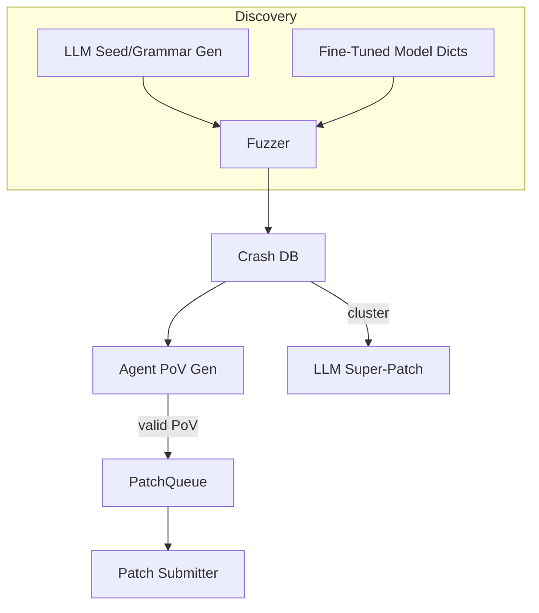

# AI 辅助模糊测试与自动化漏洞发现

{{#include ../banners/hacktricks-training.md}}

## 概述
大型语言模型（LLM）可以通过生成语义丰富的输入、演化语法、分析崩溃数据，甚至提出修复多个漏洞的补丁，大幅增强传统漏洞研究流程。本页汇集了 DARPA AI Cyber Challenge（AIxCC）决赛及其他公开研究中观察到的最有效模式。<sup>[[4]](#references)</sup><sup>[[5]](#references)</sup>

以下内容并非对某个特定竞赛系统的描述，而是对相关技术的抽象，方便你在自己的工作流中复现。

---

## 1. LLM 生成的种子输入

传统的覆盖率引导型 fuzzers（AFL++、libFuzzer、Honggfuzz……）从少量种子语料开始，并盲目地变异字节。当目标输入格式较为复杂（SQL、URL、自定义二进制协议）时，随机变异通常会在触及有趣的分支之前就破坏语法。

LLM 可以通过生成*种子生成器*来解决这个启动问题——也就是能够输出**语法正确且与安全相关的输入**的简短脚本。例如：

```prompt
SYSTEM: You are a helpful security engineer.
USER:
Write a Python3 program that prints 200 unique SQL injection strings targeting common anti-pattern mistakes (missing quotes, numeric context, stacked queries).  Ensure length ≤ 256 bytes / string so they survive common length limits.
```

```python
# gen_sqli_seeds.py (truncated)
PAYLOADS = [
    "1 OR 1=1 -- ",
    "' UNION SELECT NULL,NULL--",
    "0; DROP TABLE users;--",
    ...
]
for p in PAYLOADS:
    print(p)
```

运行一次，并将输出直接输入到 fuzzer 的初始语料库：

```bash
python3 gen_sqli_seeds.py > seeds.txt
afl-fuzz -i seeds.txt -o findings/ -- ./target @@
```

优势：
1. 语义有效性 → 更早获得更深的覆盖率。
2. 可重新生成：调整 prompt，即可聚焦于 XSS、path traversal、binary blobs 等。
3. 成本低（使用 GPT-3.5 不到 1 ¢）。

### 提示
* 指示模型让 payload 长度和编码（UTF-8、URL 编码、UTF-16-LE）*多样化*，以绕过表层过滤器。
* 要求生成*单个自包含脚本*，避免 JSON 格式问题。

---

## 2. 语法演化 Fuzzing

一种更强大的变体是让 LLM **演化语法**，而不是生成具体的种子。工作流程（“Grammar Guy”模式）如下：

1. 通过 prompt 生成初始的 ANTLR/Peach/LibFuzzer 语法。
2. Fuzz N 分钟，并收集覆盖率指标（命中的边 / 代码块）。
3. 总结未覆盖的程序区域，并将总结反馈给模型：
   ```prompt
   The previous grammar triggered 12 % of the program edges.  Functions not reached: parse_auth, handle_upload.  Add / modify rules to cover these.
   ```
4. 合并新规则，重新 fuzz，重复此过程。

伪代码框架：

```python
for epoch in range(MAX_EPOCHS):
    grammar = llm.refine(grammar, feedback=coverage_stats)
    save(grammar, f"grammar_{epoch}.txt")
    coverage_stats = run_fuzzer(grammar)
```

要点：
* 保持 *预算* ——每次改进都会消耗 tokens。
* 使用 `diff` + `patch` 指令，让模型编辑而不是重写。
* 当 Δcoverage < ε 时停止。

---

## 3. 本地 LLM libFuzzer Harness 工程

对于不能离开分析人员工作站的源代码，本地代码模型可以起草一个小型适配器，用于在 fuzzer 字节与 C/C++ API 之间转换。关键的安全边界应明确：**模型编写并修订测试基础设施；coverage-guided mutation 探索输入；sanitizer 报告无效操作；人工审查 harness 并对发现进行分类**。<sup>[[9]](#references)</sup>

关于不依赖 LLM 的引擎级语料库、反馈、快照和 stateful-fuzzing 技术，请参阅通用的 [Fuzzing Methodology](../generic-methodologies-and-resources/fuzzing.md)。

从目标头文件中复制确切的声明，并限制输出格式。范围明确的提示可以减少虚构的 API，并使结果易于审查：<sup>[[8]](#references)[[9]](#references)</sup>

```prompt
Write a libFuzzer target for this exact declaration:
int parse_records(const uint8_t *data, size_t size);

Output only C code. Implement LLVMFuzzerTestOneInput, include the
declaration, pass data and size unchanged, and do not use files,
network access, randomness, clocks, threads, or persistent state.
```

对于原始字节解析器，预期结果不应比以下内容更复杂：<sup>[[6]](#references)[[9]](#references)</sup>

```c
#include <stddef.h>
#include <stdint.h>

extern int parse_records(const uint8_t *, size_t);

int LLVMFuzzerTestOneInput(const uint8_t *data, size_t size) {
    (void)parse_records(data, size);
    return 0;
}
```

编译只是第一道验证关卡。在花费 CPU 时间之前，请根据以下不变量检查每个生成的目标：<sup>[[6]](#references)[[8]](#references)[[9]](#references)</sup>

- **准确的 API：** 对照真实头文件和现有调用方，检查类型、所有权规则、初始化、清理和调用约定。
- **Harness 安全性：** 对从 `data` 读取的每个位置进行保护；Sanitizer 发现的问题必须源自目标本身，而不是生成的胶水代码。
- **可重复性：** 确保结果仅由 `data` 和 `size` 决定；移除外部 I/O、时间、不可控的随机性、未等待的线程，以及调用之间仍然保留的状态。
- **吞吐量：** 仅在不会影响行为时，才初始化一次开销较大的不可变状态；限制输入大小、抑制日志，并释放每个输入对应的分配。
- **可达性：** 确认预期的函数和分支确实会执行。能够编译、却只触发拒绝路径的目标，就是一种无声的失败。

### 结构感知型目标：保留不变量，同时不掩盖漏洞

如果大多数原始输入都无法通过 magic、长度、版本或校验和检查门槛，就将 fuzz 字节用作**类型化字段素材**，并据此重建有效对象。固定格式常量，让语义字段和 payload 字节保持可变，并根据重建后的 payload 派生完整性元数据。`FuzzedDataProvider` 可用于读取有界的类型化值，而适配器仍需负责限制生成的分配和转换。<sup>[[9]](#references)</sup>

<details>
<summary>结构感知型 C++ 目标示例</summary>

```cpp
#include <fuzzer/FuzzedDataProvider.h>
#include <stddef.h>
#include <stdint.h>
#include <vector>

extern "C" int parse_message(const uint8_t *, size_t);

extern "C" int LLVMFuzzerTestOneInput(const uint8_t *data, size_t size) {
    FuzzedDataProvider fdp(data, size);
    uint8_t version = fdp.ConsumeIntegral<uint8_t>();
    auto body = fdp.ConsumeRemainingBytes<uint8_t>();
    if (body.size() > UINT16_MAX) body.resize(UINT16_MAX);
    uint16_t len = static_cast<uint16_t>(body.size());
    std::vector<uint8_t> msg = {0x8b, 'M', 'S', 'G', version,
                                static_cast<uint8_t>(len >> 8),
                                static_cast<uint8_t>(len)};
    msg.insert(msg.end(), body.begin(), body.end());
    (void)parse_message(msg.data(), msg.size());
    return 0;
}
```

</details>

不要针对每个问题都使用同一个结构修复 target。维护一个会推导长度/校验和以探索深层有效状态的 target，另一个则让 fuzzer 控制**声明的**元数据，同时仅限制 harness 自身的读取和分配。第二个 target 保留了自动修复会抹去的长度不匹配和完整性校验失败攻击面。<sup>[[9]](#references)</sup>

### Seeds、字典、sanitizer 和覆盖率反馈

让模型生成用于写入二进制 seeds 的脚本，而不是让它直接打印二进制内容。为对象准备空、最小、典型和边界有效的 seeds；然后将 magic 值、标签、枚举编码和 parser 关键字提取到经过审核的字典中。libFuzzer 可通过 `-dict=` 接受该字典，并将能带来新覆盖率的变异保留在 corpus 中。<sup>[[6]](#references)[[9]](#references)</sup>

```text
magic="\x8bMSG"
version_min="\x00"
version_max="\xff"
config_tag="CONFIG"
```

使用互补的插桩方式构建同一目标。ASan 和 UBSan 可以共用一个 fuzzing 二进制；MSan 则使用单独的构建，并对其依赖项进行插桩，以避免未插桩代码导致的报告。<sup>[[6]](#references)[[9]](#references)</sup>

```bash
clang++ -g -O1 -fsanitize=fuzzer,address,undefined \
  -fno-sanitize-recover=undefined target.cc harness.cc -o fuzz_target
./fuzz_target corpus -dict=msg.dict -max_len=65535

clang++ -g -O1 -fsanitize=fuzzer,memory \
  target.cc harness.cc -o fuzz_target_msan
```

将 coverage 作为评估每个模型修订版的指标。在 libFuzzer 输出中，`cov`/`ft` 早早趋于平稳且语料库静态不变，通常意味着 framing 不当、过早返回条件过于严格，或调用了错误的函数；`exec/s` 偏低则说明 setup、I/O、分配开销过大，或存在泄漏状态。`NEW` 只能证明某个 coverage 特征发生了变化，并不能证明已到达预期的 parser。<sup>[[6]](#references)[[9]](#references)</sup>

要获取源代码级反馈，先构建带 coverage 的版本，再进行 fuzzing，并只向模型提供未覆盖的函数及其保护条件。验证生成的 harness/seed/dictionary 差异，并再次测量：<sup>[[7]](#references)[[8]](#references)[[9]](#references)</sup>

```bash
clang++ -g -O1 -fsanitize=fuzzer \
  -fprofile-instr-generate -fcoverage-mapping target.cc harness.cc -o fuzz_cov
mkdir -p profiles
LLVM_PROFILE_FILE='profiles/%p.profraw' ./fuzz_cov -max_total_time=300 corpus
llvm-profdata merge -sparse profiles/*.profraw -o fuzz.profdata
llvm-cov report ./fuzz_cov -instr-profile=fuzz.profdata
llvm-cov show ./fuzz_cov -instr-profile=fuzz.profdata \
  --show-branches=count --region-coverage-lt=1 target.cc
```

因此，可扩展的循环是 **生成 → 编译/链接 → 在 sanitizers 下进行冒烟测试 → 衡量目标覆盖率 → 提供最精简且相关的覆盖率/源代码上下文 → 修改 → 重新衡量**。OSS-Fuzz-Gen 也采用同一原则：评估生成的目标是否可编译、是否出现运行时故障、覆盖率如何，以及覆盖率是否优于现有目标，而不是仅凭代码看起来合理就予以接受。<sup>[[7]](#references)[[8]](#references)</sup>

---

<a id="3-agent-based-pov-exploit-generation" hidden>3. 基于 Agent 的 PoV（Exploit）生成</a>

## 4. 基于 Agent 的 PoV（Exploit）生成

发现崩溃后，你仍需要一个能够确定性触发它的**漏洞证明（PoV）**。

一种可扩展的方法是启动大量轻量级 worker（进程、线程或容器），每个 worker 使用不同的模型或采样配置。AIxCC 决赛入围团队调查报告给出了具体规模示例：一支团队使用了**数千个并发 Agent**来优先采用 AI 生成 PoV，另一支团队则协调了 **300–500 个 fuzzing Agent**，并将 LLM 用于更高层次的语义推理。<sup>[[4]](#references)</sup>

流程：
1. 静态/动态分析生成*漏洞候选项*（包含崩溃 PC、输入片段、sanitizer 消息的结构体）。
2. Orchestrator 将候选项分发给 Agent。
3. Agent 的推理步骤：
   a. 使用 `gdb` 和输入在本地复现漏洞。
   b. 提出最小 exploit payload。
   c. 在 sandbox 中验证 exploit。若成功 → 提交。
4. 失败的尝试会**作为新种子重新排队**，用于 coverage fuzzing（反馈循环）。

优势：
* 并行化可弥补单个 Agent 的不可靠性。
* 根据观察到的成功率，自动调整温度/模型大小。

---

<a id="4-directed-fuzzing-with-fine-tuned-code-models" hidden>4. 使用微调代码模型进行定向 Fuzzing</a>

## 5. 使用微调代码模型进行定向 Fuzzing

在带有漏洞模式标签的 C/C++ 源代码（整数溢出、缓冲区复制、格式字符串）上微调开放权重模型（例如 Llama-7B）。然后：

1. 运行静态分析，获取函数列表和 AST。
2. 提示模型：*“给出可能破坏函数 X 内存安全性的 mutation 字典条目”*。
3. 将这些 token 插入自定义的 `AFL_CUSTOM_MUTATOR`。

`sprintf` wrapper 的输出示例：
```
{"pattern":"%99999999s"}
{"pattern":"AAAAAAAA....<1024>....%n"}
```

在真实目标上，经实测，这能将崩溃所需时间缩短 2 倍以上。

---

<a id="5-ai-guided-patching-strategies" hidden>5. AI 引导的补丁策略</a>

## 6. AI 引导的补丁策略

<a id="51-super-patches" hidden>5.1 超级补丁</a>

### 6.1 超级补丁
让模型对崩溃特征进行*聚类*，并提出一个能够消除共同根本原因的**单一补丁**。一次提交，修复多个漏洞 → 在每个错误补丁都会扣分的环境中，减少精度损失。

提示大纲：
```
Here are 10 stack traces + file snippets.  Identify the shared mistake and generate a unified diff fixing all occurrences.
```

{{#ref}}
../generic-methodologies-and-resources/fuzzing.md
{{#endref}}

<a id="52-speculative-patch-ratio" hidden>5.2 推测性补丁比例</a>

### 6.2 推测性补丁比例
建立一个队列，按与评分规则相匹配的 1:​N 比例交错排列经 PoV 验证的已确认补丁和*推测性*补丁（没有 PoV）（例如，2 个推测性补丁 : 1 个已确认补丁）。成本模型会监测惩罚与得分，并自动调整 N。

---

<a id="6-deterministic-file-by-file-ai-code-review" hidden>6. 逐文件确定性 AI 代码审查</a>

## 7. 逐文件确定性 AI 代码审查

AI 辅助审查中一种常见的失败模式是让一个 agent 检查整个代码仓库，然后寄希望于它能选对文件和 grep 关键词。更可靠的做法是**强制覆盖整个代码仓库**：<sup>[[1]](#references)</sup>

1. 列出所有源文件。
2. 每次发送**一个文件**以及最少的上下文（入口点、导入项、附近的路由/调用方）。
3. 要求每个文件都提供**结构化报告**：source、sink、缺失的验证、利用前提和置信度。<sup>[[3]](#references)</sup>
4. 按**source→sink 模式**对报告去重，并手动验证高风险项。

这种方法消耗 token 较多，也会产生噪声，但非常擅长发现宽泛的 agentic 审查经常漏掉的**简单且影响重大的 source/sink 漏洞**。

### 值得优先关注的分诊模式

- **动态 PHP include/dispatch**：攻击者可控的路由/控制器/模块名称流入 `require_once()`、`include()` 或 `include_once()`，但没有严格的 allowlist 和路径规范化。
- **管理/账户工作流中的 Shell 执行**：用户名、域名、FTP 账户或其他标识符流入 `exec()`、`system()`、`shell_exec()`、`passthru()`、`proc_open()` 或 `popen()`。
- **结构化输入汇聚**：同一参数从 `$_GET`、`$_POST`、JSON、XML 或框架 body parser 中接收，之后又被用于文件系统或 OS 命令 sink。

### 这种方法特别擅长发现的两类实用漏洞

- **PHP 控制器分派 LFI/RCE**：如果请求控制的控制器名称被拼接到 `require_once()` 中，且没有 allowlist/路径规范化，攻击者就能利用 `../` 等路径遍历序列，让 PHP 包含非预期的本地 `.php` 文件。如果攻击者能让 include 指向其植入的或其他有用的 PHP 文件，LFI 就会升级为代码执行。参见 [File Inclusion / Path Traversal](../pentesting-web/file-inclusion/README.md)。<sup>[[1]](#references)</sup>
- **Hosting/admin 面板中的已认证命令注入**：如果用户名等账户管理字段被嵌入 Shell 命令，低权限的已认证用户可能将普通的创建/删除操作转化为 RCE。如果面板以权限更高的服务账户执行该命令，影响会更大。参见 [Command Injection](../pentesting-web/command-injection.md)。<sup>[[1]](#references)</sup>

### 实用审查建议

- 首先将 LLM 用作 **source/sink 审查工具**，而不是利用代码生成器。
- 要求它明确列出**攻击者可控字段**、**规范化/验证缺失点**和**危险 sink**。
- 对大型代码仓库而言，确定性的逐文件审查通常比单次自主 agent 执行更可靠，即使后者使用了更强的模型也是如此。<sup>[[2]](#references)</sup>
- 对于**Broken Access Control** 和其他业务逻辑漏洞，若利用性取决于跨文件假设、角色语义或产品特定的威胁模型，预期审查效果会较弱。

---

## 移动端入口点 taskflow

单条覆盖整个代码仓库的提示通常会混淆威胁模型，难以追踪从外部可访问组件到敏感 sink 的路径。更好的工作流是将审计拆分为有状态的 taskflow：先对应用/组件分类，再盘点攻击者可控的入口点，为每个入口点补充可达性元数据，最后依据平台特定的漏洞类别逐一审查。GitHub Security Lab 的移动端 taskflow 为 Android、iOS 和跨平台代码仓库实现了这一模式。<sup>[[14]](#references)[[15]](#references)</sup>

对于 Android，至少应记录：<sup>[[14]](#references)[[15]](#references)</sup>

- 已导出的 Activities、Services、Receivers 和 Providers，包括权限；
- intent actions、deep-link schemes/hosts/paths、MIME filters 和 App Links；
- 攻击者可控的 actions、data URIs、`ClipData`、extras 和 URI-grant flags；
- WebView 导航输入和 `addJavascriptInterface` bridges；
- 下游特权操作、导入的资源和网络目标。

然后结合上下文对每个入口点进行分类。明确检查调用方授权/混淆代理行为、intent 重定向、广播伪造或信息泄露、不安全导入、WebView 脚本及 bridge 暴露，以及跨 origin 的凭证或 cookie 流转。执行一轮**严格清单检查**和一轮**更广泛的对抗性审查**。将发现关联到 [Intent Injection](../mobile-pentesting/android-app-pentesting/intent-injection.md) 和 [WebView Attacks](../mobile-pentesting/android-app-pentesting/webview-attacks.md)，而不要重复描述利用细节。<sup>[[15]](#references)</sup>

当前的开源 taskflow 可通过其 Codespace 使用以下命令启动：<sup>[[14]](#references)</sup>

```bash
./scripts/audit/run_audit.sh owner/repository
```

结果会写入 SQLite 的 `audit_result` 表。<sup>[[14]](#references)</sup> 将标记为 vulnerable 的行视为**线索**，而非已验证的发现。对于每条线索，要求模型说明攻击者可控的来源、敏感 sink、前置条件和预期影响，然后让它创建一个最小 PoC。使用调试器或 instrumentation 在原始构建上执行该 PoC。这样可以发现常见的静态分析错误，例如不可达分支、不现实的应用状态、外部存储数据的优先级低于私有数据，以及会实质降低严重性的缓解措施。<sup>[[15]](#references)</sup>

---

## 8. 使用 Instrumented Oracle 进行模式引导的内核审计

对于内核规模的目标，不要要求 agent 在整个代码树中任意寻找漏洞。更节省 token 的工作流是将历史漏洞知识转化为静态查询，根据暴露的攻击面为结果排序，并使用 instrumented 内核作为执行 oracle。<sup>[[11]](#references)</sup>

### 模式数据库 → CodeQL/Semgrep → 聚焦审查

构建一个小型知识库，包含危险 API、缺失验证模式、有风险的 source-to-sink 数据流，以及之前已修复的漏洞形态。要求模型每次将**一种模式**转换为审查启发式规则和 CodeQL/Semgrep 规则，然后使用这些确定性规则扫描整个代码树。在将代码交给模型之前，对匹配项进行分组和去重；原始扫描器输出可能包含数千条低价值候选结果。在符合条件的研究或开源目标之外使用此方法之前，请确认 CodeQL 当前的许可证。<sup>[[11]](#references)</sup>

根据**规则命中密度**和**攻击者可达性**确定子系统的优先级，而不是只看命中数量。非特权进程、沙箱、容器、jail 或 guest 环境可访问的内核接口，应比仅供内部使用的代码获得更高权重。审查单元应足够小，使 agent 能够掌握调用方、验证逻辑和生命周期规则；提示时应指定漏洞类别或控制流模式，而不是要求“寻找任意漏洞”。当较新的隔离边界使旧式特权接口对 namespaced 或 jail 中的 root 用户可达时，这些接口尤其值得关注。<sup>[[11]](#references)</sup>

对于每个候选项，在尝试利用之前，都要求提供明确的字段流记录。<sup>[[11]](#references)</sup>

```text
entrypoint -> privilege check -> parser -> validation/normalization
           -> later rewrite -> dangerous sink
attacker controls: <fields and lengths>
constraints:       <values rewritten, rejected, or preserved>
observable result: <sanitizer report, assertion, panic, or clean exit>
```

### 将 KASAN telemetry 用作假设判定器

在启用 KASAN 和有用诊断断言的临时 VM 中运行目标 kernel。Agent 应迭代执行 **源代码假设 → 最小 userland 触发器 → VM 执行 → KASAN/断言跟踪 → 修订假设**，直到复现或排除疑似损坏。每次迭代只返回相关的堆栈跟踪和附近的源代码；这样既能保留推理上下文，也能确保以运行时证据而非模型置信度作为验收标准。<sup>[[11]](#references)</sup>

插桩构建并非最终的可利用性测试环境。断言可能在造成损坏的操作执行前终止程序，而同一断言在生产 kernel 中可能已被编译移除。使用完全相同的触发器，在精确的生产配置下重新测试，记录 kernel 构建版本和配置，并将**可达性**、**内存损坏**、**可控原语**和**安全影响**作为不同的主张分别说明。<sup>[[11]](#references)[[12]](#references)</sup>

CVE-2026-3038 是一个有用的验证案例，而非 exploit 模板。一个未提权的 FreeBSD `RTM_GET` 请求可通过选择性验证和回复改写，让超大的 `RTAX_AUTHOR` sockaddr 得以保留，直到 `rtsock_msg_buffer()` 将用户控制的 `sa_len` 复制到 128 字节的栈上 `sockaddr_storage`。最大 255 字节的复制会造成 127 字节的覆写；在插桩构建中，诊断断言会捕获错误长度，而 GENERIC kernel 则会执行复制，随后在检查被破坏的 canary 时 panic。这证明了未提权的拒绝服务，但不能证明其本身可提权：要实现可靠控制，首先还需要另一个原语，例如 canary 泄露。有关相应的 binary-exploitation 边界，请参见 [Stack Canaries](../binary-exploitation/common-binary-protections-and-bypasses/stack-canaries/index.html)。<sup>[[11]](#references)[[12]](#references)[[13]](#references)</sup>

### 拒绝在 exploit 前提上弄虚作假

在接受 PoV 或 exploit 之前，让独立的审查者/agent 按固定标准尝试证伪。审查必须确认以下所有条件。<sup>[[11]](#references)</sup>

- 未修改目标源代码、kernel 或易受攻击的模块来使该路径可达。
- 未引入辅助模块、合成 gadget、已禁用的缓解措施、额外权限或不可用接口。
- 在干净快照中，触发器以所声称的调用者身份和隔离限制启动。
- 所声称的结果仍依赖该 bug：移除格式错误的字段或仅修补该 bug，都必须能中断利用链。
- 崩溃、越界读取或覆写只报告为相应原语；代码执行或提权则需要独立证据。

最后这项反事实检查可以发现循环论证式的演示：如果前提条件已经带来了所声称的影响（例如，从未以 `nosuid` 挂载的文件系统执行攻击者提供的 SUID 内容），那么内存安全 bug 并未造成该影响。<sup>[[11]](#references)</sup>

---

## 在陌生代码库上开展可审计的 Agent 辅助研究

[以图为先的 fuzz 目标工作流](../generic-methodologies-and-resources/fuzzing.md#graph-first-fuzz-target-selection-and-mutation-triage)已涵盖入口点可达性，而[agentic SAST pipelines](../network-services-pentesting/pentesting-web/code-review-tools.md#agentic-sast-pipelines)则涵盖分阶段审查和证据门槛。将这些确定性结果与模型的假设分开保存，确保每个晋级的线索都保留源代码位置、路径证据和动态测量结果。<sup>[[10]](#references)</sup>

### 关联对象生命周期证据，但不要臆造数据流

静态分析可能发现，某个函数将攻击者控制的长度存储起来，而同一对象字段在很久之后到达复制 sink，但无法证明它们之间跨越回调、重连或对象生命周期的关联。分别保留这两项发现，按对象/字段聚类，并将缺失的边明确列为分流审查问题。Agent 可以提出这种关联，但必须通过源代码审查或运行时插桩来证明。<sup>[[10]](#references)</sup>

对于每个候选项，记录：

- 具体入口点和攻击者控制的字节；
- 相关字段的每个生产者，包括针对各生产者的验证逻辑；
- sink、目标容量，以及到达该处所需的构建/运行时条件；
- 从暴露入口点出发的真实调用栈，而不只是直接调用 harness 的结果；
- 能确认或否定该假设的最小动态结果。

某条路径看起来安全，并不意味着该字段在所有路径上都安全。第二个生产者可能会设置同一字段，却没有第一条路径中的长度限制。应独立测试各条路径，并使用与部署环境等效的构建选项运行 harness，因为调试断言可能会将生产环境中的内存损坏变成仅在测试中提前中止。<sup>[[10]](#references)</sup>

### 信息泄露和利用的测量门槛

对于疑似未初始化内存泄露，使用可识别的字节填充新分配的内存，并验证准确的标记是否到达发出的数据包。对于利用，要求通过测量逐项确认门槛，例如**可控覆写 → 有用的受害对象 → 信息泄露 → 指针/基址恢复 → 控制流劫持 → 组合 payload**。只有当 harness 证明当前属性时，agent 才能推进；合理的叙述不算通过门槛。[FreeRDP 案例](../binary-exploitation/libc-heap/heap-overflow.md#cross-path-length-reuse-and-stale-output-disclosure)展示了验证期间必须保留的路径和构建约束。<sup>[[10]](#references)</sup>

---

有关将分阶段 L0–L4 验证应用于 LLM 辅助 exploit 开发的 kernel 案例研究，请参见：

{{#ref}}
../binary-exploitation/freebsd-kernel-exploitation-vnet-jail-escape.md
{{#endref}}

## 整合起来
端到端的 CRS（Cyber Reasoning System）可以按如下方式连接各个组件：



---

## References

- [1] [Project Black - 用于网络安全的本地 AI：发现 phpIPAM LFI 和 myVesta 已认证 RCE](https://projectblack.io/blog/local-ai-for-cyber-security)
- [2] [Strix](https://github.com/usestrix/strix)
- [3] [GitHub Copilot 社区 security-review 技能](https://github.com/github/awesome-copilot/blob/main/skills/security-review/SKILL.md)
- [4] [Trail of Bits – AIxCC 决赛：实战表现](https://blog.trailofbits.com/2025/08/07/aixcc-finals-tale-of-the-tape/)
- [5] [CTF Radiooo AIxCC 决赛入围者访谈](https://www.youtube.com/@ctfradiooo)
- [6] [LLVM — libFuzzer：用于覆盖率引导模糊测试的库](https://llvm.org/docs/LibFuzzer.html)
- [7] [Google — OSS-Fuzz-Gen](https://github.com/google/oss-fuzz-gen)
- [8] [Google Online Security Blog — 提升模糊测试水平：借助 AI 发现更多漏洞](https://security.googleblog.com/2024/11/leveling-up-fuzzing-finding-more.html)
- [9] [8kSec — 使用本地 LLM 辅助生成模糊测试 Harness](https://8ksec.io/ai-assisted-fuzzing-harness-local-llm)
- [10] [Quarkslab — 从 AI Agents 到 RCE：构建漏洞研究工作流](https://blog.quarkslab.com/from-ai-agents-to-rce-building-a-vulnerability-research-workflow.html)
- [11] [Praetorian — FreeBSoD：利用语言模型发现并利用内核漏洞（共 2 部分，第 1 部分）](https://praetorian.com/blog/ai-vulnerability-research-freebsd-kernel)
- [12] [FreeBSD-SA-26:05.route — 通过路由套接字导致本地 DoS 和可能的权限提升](https://www.freebsd.org/security/advisories/FreeBSD-SA-26:05.route.asc)
- [13] [FreeBSD-SA-26:05.route 源代码补丁](https://security.FreeBSD.org/patches/SA-26:05/route.patch)
- [14] [GitHub Security Lab - SecLab Taskflows](https://github.com/GitHubSecurityLab/seclab-taskflows)
- [15] [GitHub Security Lab - 我们如何使用开源 AI 安全 Agent 发现 24 个 Android 漏洞](https://github.blog/security/how-we-found-24-android-vulnerabilities-using-our-open-source-ai-security-agent)
{{#include ../banners/hacktricks-training.md}}
