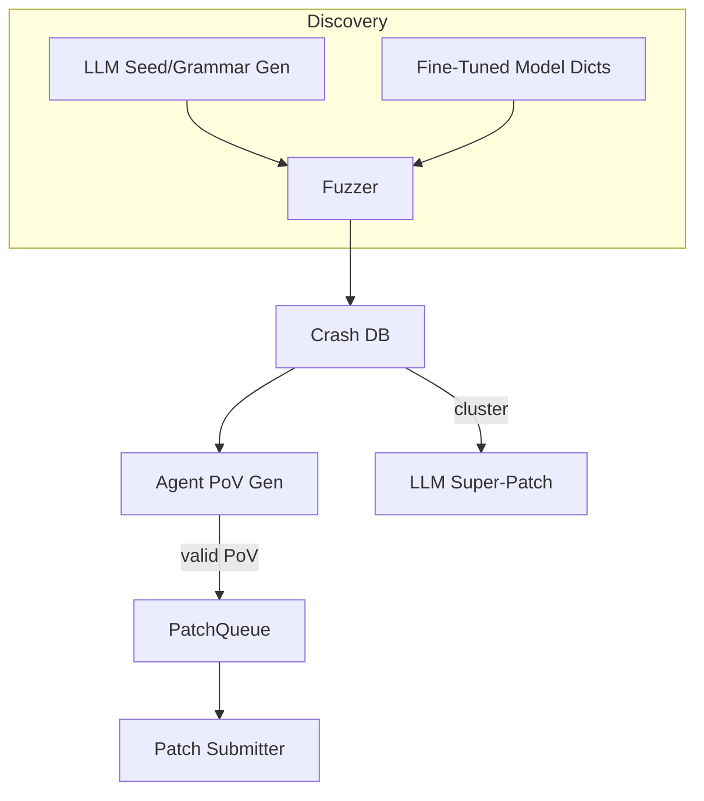

# Fuzzing assistito dall'IA e scoperta automatizzata delle vulnerabilità

{{#include ../banners/hacktricks-training.md}}

## Panoramica
I modelli linguistici di grandi dimensioni (LLM) possono potenziare notevolmente le pipeline tradizionali di ricerca delle vulnerabilità generando input semanticamente ricchi, facendo evolvere grammatiche, ragionando sui dati dei crash e persino proponendo patch per più bug. Questa pagina raccoglie gli approcci più efficaci osservati nelle finali della AI Cyber Challenge (AIxCC) della DARPA e in altre ricerche pubbliche.<sup>[[4]](#references)</sup><sup>[[5]](#references)</sup>

Quello che segue non è la descrizione di un sistema specifico usato in una competizione, ma un'astrazione delle tecniche, così da poterle riprodurre nei propri workflow.

---

## 1. Input seed generati da LLM

I fuzzer tradizionali guidati dalla coverage (AFL++, libFuzzer, Honggfuzz…) partono da un piccolo corpus di seed e mutano i byte alla cieca. Quando il formato di input di destinazione è complesso (SQL, URL, protocolli binari personalizzati), le mutazioni casuali di solito ne rompono la sintassi prima che vengano raggiunti branch interessanti.

Gli LLM possono risolvere questo problema iniziale generando *generatori di seed*: brevi script che producono **input sintatticamente corretti ma rilevanti per la sicurezza**. Per esempio:

```prompt
SYSTEM: You are a helpful security engineer.
USER:
Write a Python3 program that prints 200 unique SQL injection strings targeting common anti-pattern mistakes (missing quotes, numeric context, stacked queries).  Ensure length ≤ 256 bytes / string so they survive common length limits.
```

```python
# gen_sqli_seeds.py (truncated)
PAYLOADS = [
    "1 OR 1=1 -- ",
    "' UNION SELECT NULL,NULL--",
    "0; DROP TABLE users;--",
    ...
]
for p in PAYLOADS:
    print(p)
```

Esegui una volta e inserisci direttamente l'output nel corpus iniziale del fuzzer:

```bash
python3 gen_sqli_seeds.py > seeds.txt
afl-fuzz -i seeds.txt -o findings/ -- ./target @@
```

Benefits:
1. Validità semantica → copertura più approfondita fin da subito.
2. Rigenerabile: modifica il prompt per concentrarti su XSS, path traversal, binary blobs, ecc.
3. Economico (< 1 ¢ con GPT-3.5).

### Suggerimenti
* Istruisci il modello a *diversificare* la lunghezza e la codifica dei payload (UTF-8, URL-encoded, UTF-16-LE) per aggirare i filtri superficiali.
* Chiedi un *unico script autonomo* – evita problemi con la formattazione JSON.

---

## 2. Grammar-Evolution Fuzzing

Una variante più potente consiste nel lasciare che l’LLM **evolva una grammar** invece di seed concreti. Il workflow (pattern “Grammar Guy”) è:

1. Genera una grammar ANTLR/Peach/LibFuzzer iniziale tramite prompt.
2. Esegui il fuzzing per N minuti e raccogli le metriche di copertura (edge / block raggiunti).
3. Riassumi le aree del programma non coperte e reinserisci il riepilogo nel modello:
   ```prompt
   The previous grammar triggered 12 % of the program edges.  Functions not reached: parse_auth, handle_upload.  Add / modify rules to cover these.
   ```
4. Unisci le nuove regole, esegui nuovamente il fuzzing e ripeti.

Scheletro di pseudo-codice:

```python
for epoch in range(MAX_EPOCHS):
    grammar = llm.refine(grammar, feedback=coverage_stats)
    save(grammar, f"grammar_{epoch}.txt")
    coverage_stats = run_fuzzer(grammar)
```

Punti chiave:
* Tieni un *budget*: ogni revisione usa token.
* Usa istruzioni `diff` + `patch` per far modificare il modello invece di riscrivere.
* Fermati quando Δcoverage < ε.

---

## 3. Progettazione di harness libFuzzer con LLM locali

Per il codice che non può lasciare la workstation di un analista, un modello di codice locale può abbozzare il piccolo adapter tra i byte del fuzzer e un'API C/C++. Il confine di sicurezza utile è esplicito: **il modello scrive e revisiona l'infrastruttura di test; la mutazione guidata dalla coverage esplora gli input; i sanitizer segnalano le operazioni non valide; una persona revisiona l'harness e fa il triage dei risultati**.<sup>[[9]](#references)</sup>

Per le tecniche di corpus, feedback, snapshot e stateful fuzzing a livello di engine che non dipendono da un LLM, consulta la [metodologia di fuzzing](../generic-methodologies-and-resources/fuzzing.md).

Inizia dalla dichiarazione esatta copiata dall'header del target e vincola il formato dell'output. Un prompt circoscritto riduce le API inventate e rende il risultato facile da revisionare:<sup>[[8]](#references)[[9]](#references)</sup>

```prompt
Write a libFuzzer target for this exact declaration:
int parse_records(const uint8_t *data, size_t size);

Output only C code. Implement LLVMFuzzerTestOneInput, include the
declaration, pass data and size unchanged, and do not use files,
network access, randomness, clocks, threads, or persistent state.
```

Per un parser di byte grezzi, il risultato atteso non dovrebbe essere più complicato di:<sup>[[6]](#references)[[9]](#references)</sup>

```c
#include <stddef.h>
#include <stdint.h>

extern int parse_records(const uint8_t *, size_t);

int LLVMFuzzerTestOneInput(const uint8_t *data, size_t size) {
    (void)parse_records(data, size);
    return 0;
}
```

La compilazione è solo il primo passaggio di convalida. Prima di dedicarvi tempo di CPU, verificate ogni target generato rispetto a questi invarianti:<sup>[[6]](#references)[[8]](#references)[[9]](#references)</sup>

- **API esatta:** confrontate i tipi, le regole di ownership, l'inizializzazione, la teardown e la calling convention con l'header reale e i chiamanti esistenti.
- **Sicurezza dell'harness:** proteggete ogni lettura da `data`; i risultati del sanitizer devono avere origine nel target, non nel glue generato.
- **Ripetibilità:** fate in modo che il risultato dipenda da `data` e `size`; rimuovete I/O esterno, tempo, casualità non controllata, thread non attesi e stato che persiste tra le chiamate.
- **Throughput:** inizializzate una sola volta lo stato immutabile costoso, solo se ciò non può influire sul comportamento; limitate la dimensione degli input, sopprimete i log e liberate le allocazioni per ogni input.
- **Raggiungibilità:** verificate che vengano eseguite le funzioni e i branch previsti. Un target che compila ma esegue solo percorsi di rifiuto è un fallimento silenzioso.

### Target consapevoli della struttura: preservare gli invarianti senza nascondere i bug

Se la maggior parte degli input grezzi non supera un controllo di magic, lunghezza, versione o checksum, usate i byte di fuzz come materiale per campi tipizzati e ricostruite un oggetto valido. Fissate le costanti del formato, lasciate mutabili i campi semantici e i byte del payload e ricavate i metadati di integrità dal payload ricostruito. `FuzzedDataProvider` è utile per consumare valori tipizzati con limiti, mentre l'adapter rimane responsabile di limitare qualsiasi allocazione e conversione generate.<sup>[[9]](#references)</sup>

<details>
<summary>Esempio di target C++ consapevole della struttura</summary>

```cpp
#include <fuzzer/FuzzedDataProvider.h>
#include <stddef.h>
#include <stdint.h>
#include <vector>

extern "C" int parse_message(const uint8_t *, size_t);

extern "C" int LLVMFuzzerTestOneInput(const uint8_t *data, size_t size) {
    FuzzedDataProvider fdp(data, size);
    uint8_t version = fdp.ConsumeIntegral<uint8_t>();
    auto body = fdp.ConsumeRemainingBytes<uint8_t>();
    if (body.size() > UINT16_MAX) body.resize(UINT16_MAX);
    uint16_t len = static_cast<uint16_t>(body.size());
    std::vector<uint8_t> msg = {0x8b, 'M', 'S', 'G', version,
                                static_cast<uint8_t>(len >> 8),
                                static_cast<uint8_t>(len)};
    msg.insert(msg.end(), body.begin(), body.end());
    (void)parse_message(msg.data(), msg.size());
    return 0;
}
```

</details>

Non usare un unico target con riparazione della struttura per ogni domanda. Mantieni un target che calcoli lunghezze/checksum per esplorare stati validi profondi e un altro che lasci i metadati **dichiarati** sotto il controllo del fuzzer, limitando solo le letture e le allocazioni del harness. Il secondo target preserva le superfici di attacco con lunghezze non corrispondenti e integrità non valida, che la riparazione automatica altrimenti eliminerebbe.<sup>[[9]](#references)</sup>

### Seed, dizionari, sanitizer e feedback sulla coverage

Chiedi al modello di generare uno script che scriva seed binari, invece di chiedergli di stamparli direttamente. Crea seed con oggetti vuoti, minimi, tipici e validi al limite; poi estrai i valori magic, i tag, le codifiche degli enum e le parole chiave del parser in un dizionario revisionato. libFuzzer accetta quel dizionario con `-dict=` e mantiene nel corpus le mutazioni che rivelano nuova coverage.<sup>[[6]](#references)[[9]](#references)</sup>

```text
magic="\x8bMSG"
version_min="\x00"
version_max="\xff"
config_tag="CONFIG"
```

Compila lo stesso target con strumentazione complementare. ASan e UBSan possono condividere un binario di fuzzing; usa una build separata di MSan e strumenta le sue dipendenze per evitare segnalazioni causate da codice non strumentato.<sup>[[6]](#references)[[9]](#references)</sup>

```bash
clang++ -g -O1 -fsanitize=fuzzer,address,undefined \
  -fno-sanitize-recover=undefined target.cc harness.cc -o fuzz_target
./fuzz_target corpus -dict=msg.dict -max_len=65535

clang++ -g -O1 -fsanitize=fuzzer,memory \
  target.cc harness.cc -o fuzz_target_msan
```

Considera la copertura come criterio di valutazione per ogni revisione del modello. Nell’output di libFuzzer, valori `cov`/`ft` che si appiattiscono presto e un corpus statico di solito indicano framing errato, un early return troppo restrittivo o una chiamata errata; un valore basso di `exec/s` indica setup costoso, I/O, allocazioni o stato non ripulito. `NEW` dimostra solo che una feature di copertura è cambiata, non che sia stato raggiunto il parser previsto.<sup>[[6]](#references)[[9]](#references)</sup>

Per ottenere feedback a livello di sorgente, crea una build con coverage, esegui il fuzzing e fornisci al modello solo le funzioni non coperte e le relative condizioni di guardia. Verifica le modifiche a harness/seed/dictionary e misura di nuovo:<sup>[[7]](#references)[[8]](#references)[[9]](#references)</sup>

```bash
clang++ -g -O1 -fsanitize=fuzzer \
  -fprofile-instr-generate -fcoverage-mapping target.cc harness.cc -o fuzz_cov
mkdir -p profiles
LLVM_PROFILE_FILE='profiles/%p.profraw' ./fuzz_cov -max_total_time=300 corpus
llvm-profdata merge -sparse profiles/*.profraw -o fuzz.profdata
llvm-cov report ./fuzz_cov -instr-profile=fuzz.profdata
llvm-cov show ./fuzz_cov -instr-profile=fuzz.profdata \
  --show-branches=count --region-coverage-lt=1 target.cc
```

Il ciclo scalabile è quindi **generare → compilare/linkare → eseguire smoke test con i sanitizer → misurare la coverage del target → fornire il contesto minimo pertinente di coverage/codice sorgente → correggere → misurare di nuovo**. OSS-Fuzz-Gen applica lo stesso principio, valutando i target generati in base alla compilabilità, agli errori in fase di esecuzione, alla coverage e al miglioramento della coverage rispetto ai target esistenti, invece di accettare codice plausibile senza verificarlo.<sup>[[7]](#references)[[8]](#references)</sup>

---

<a id="3-agent-based-pov-exploit-generation" hidden>3. Generazione di PoV (exploit) basata su agenti</a>

## 4. Generazione di PoV (exploit) basata su agenti

Dopo aver trovato un crash, serve comunque una **proof-of-vulnerability (PoV)** che lo attivi in modo deterministico.

Un approccio scalabile consiste nell’avviare molti worker leggeri (processi, thread o container), ognuno dei quali usa un modello o una configurazione di campionamento diversi. La rassegna dei finalisti di AIxCC fornisce esempi concreti su questa scala: un team ha usato **migliaia di agenti concorrenti** per la generazione di PoV basata innanzitutto sull’AI, mentre un altro ha orchestrato **300–500 agenti di fuzzing** e ha riservato gli LLM al ragionamento semantico di livello superiore.<sup>[[4]](#references)</sup>

Pipeline:
1. L’analisi statica/dinamica produce *bug candidate* (struct con PC del crash, porzione dell’input e messaggio del sanitizer).
2. L’orchestratore distribuisce i candidate agli agenti.
3. Fasi di ragionamento dell’agente:
   a. Riprodurre localmente il bug con `gdb` e l’input.
   b. Proporre un payload exploit minimo.
   c. Convalidare l’exploit in una sandbox. Se ha successo → inviarlo.
4. I tentativi falliti vengono **rimessi in coda come nuovi seed** per il fuzzing della coverage (feedback loop).

Vantaggi:
* La parallelizzazione compensa l’inaffidabilità del singolo agente.
* Regolazione automatica della temperatura / dimensione del modello in base al tasso di successo osservato.

---

<a id="4-directed-fuzzing-with-fine-tuned-code-models" hidden>4. Fuzzing mirato con modelli di codice fine-tuned</a>

## 5. Fuzzing mirato con modelli di codice fine-tuned

Esegui il fine-tuning di un modello open-weight (ad es. Llama-7B) su codice sorgente C/C++ etichettato con pattern di vulnerabilità (integer overflow, buffer copy, format string). Quindi:

1. Esegui l’analisi statica per ottenere l’elenco delle funzioni e l’AST.
2. Chiedi al modello: *“Fornisci voci per un dizionario di mutazione che possano compromettere la memory safety nella funzione X”*.
3. Inserisci quei token in un `AFL_CUSTOM_MUTATOR` personalizzato.

Esempio di output per un wrapper di `sprintf`:
```
{"pattern":"%99999999s"}
{"pattern":"AAAAAAAA....<1024>....%n"}
```

Empiricamente questo riduce di oltre 2× il tempo necessario per causare un crash su target reali.

---

<a id="5-ai-guided-patching-strategies" hidden>5. Strategie di patching guidate dall'IA</a>

## 6. Strategie di patching guidate dall'IA

<a id="51-super-patches" hidden>5.1 Super patch</a>

### 6.1 Super patch
Chiedi al modello di *raggruppare* le firme dei crash e proporre una **singola patch** che elimini la causa radice comune.  Invia una sola patch e correggi diversi bug → meno penalità di accuratezza negli ambienti in cui ogni patch errata costa punti.

Schema del prompt:
```
Here are 10 stack traces + file snippets.  Identify the shared mistake and generate a unified diff fixing all occurrences.
```

{{#ref}}
../generic-methodologies-and-resources/fuzzing.md
{{#endref}}

<a id="52-speculative-patch-ratio" hidden>5.2 Speculative Patch Ratio</a>

### 6.2 Speculative Patch Ratio
Implementa una coda in cui patch confermate e convalidate tramite PoV e patch *speculative* (senza PoV) si alternano con un rapporto 1:N, calibrato sulle regole di punteggio (ad es. 2 speculative : 1 confermata). Un modello dei costi monitora penalità e punti e regola N automaticamente.

---

<a id="6-deterministic-file-by-file-ai-code-review" hidden>6. Deterministic File-by-File AI Code Review</a>

## 7. Revisione del codice con AI, deterministica e file per file

Un errore frequente nelle revisioni assistite dall'AI consiste nel chiedere a un singolo agente di esaminare un intero repository e sperare che scelga i file e i termini grep giusti. Un approccio più affidabile consiste nell'**imporre una copertura completa del repository**:<sup>[[1]](#references)</sup>

1. Elencare i file sorgente.
2. Inviare **un file alla volta** insieme al contesto minimo (entrypoint, import, route e chiamanti vicini).
3. Richiedere un **report strutturato** per ogni file: sorgenti, sink, validazione mancante, precondizioni di exploit e livello di confidenza.<sup>[[3]](#references)</sup>
4. Deduplicare i report in base allo **schema source→sink** e convalidare manualmente quelli ad alto rischio.

Questo approccio consuma molti token e produce rumore, ma è molto efficace nel far emergere **bug semplici e di grande impatto tra sorgenti e sink**, che spesso sfuggono alle revisioni agentiche ad ampio raggio.

### Pattern di triage da prioritizzare

- **Include/dispatch dinamici in PHP**: nomi di route/controller/moduli controllati dall'attaccante che arrivano a `require_once()`, `include()` o `include_once()` senza una allowlist rigorosa e la canonicalizzazione dei percorsi.
- **Esecuzione di shell nei flussi di lavoro di amministrazione/account**: nomi utente, domini, account FTP o altri identificatori che arrivano a `exec()`, `system()`, `shell_exec()`, `passthru()`, `proc_open()` o `popen()`.
- **Convergenza di input strutturati**: lo stesso parametro accettato da `$_GET`, `$_POST`, JSON, XML o parser del body del framework e poi riutilizzato in sink del filesystem o dei comandi del sistema operativo.

### Due classi di bug pratiche che questo metodo individua bene

- **LFI/RCE nel dispatch dei controller PHP**: se il nome del controller controllato dalla richiesta viene concatenato in `require_once()` senza allowlist o normalizzazione del percorso, sequenze di traversal come `../` possono far includere a PHP un file `.php` locale non previsto. Se l'attaccante può indirizzare l'include a un file PHP creato ad hoc o comunque utile, la LFI diventa esecuzione di codice. Vedi [File Inclusion / Path Traversal](../pentesting-web/file-inclusion/README.md).<sup>[[1]](#references)</sup>
- **Command injection autenticata nei pannelli di hosting/amministrazione**: se campi di gestione degli account, come i nomi utente, vengono inseriti in comandi shell, un utente autenticato con pochi privilegi può trasformare una normale operazione di creazione/eliminazione in RCE. L'impatto aumenta se il pannello esegue il comando come un account di servizio con privilegi maggiori. Vedi [Command Injection](../pentesting-web/command-injection.md).<sup>[[1]](#references)</sup>

### Note pratiche per la revisione

- Usa l'LLM prima di tutto come **revisore di source/sink**, non come generatore di exploit.
- Chiedigli di elencare esplicitamente il **campo controllato dall'attaccante**, la **lacuna di normalizzazione/validazione** e il **sink pericoloso**.
- Nei repository di grandi dimensioni, la revisione deterministica file per file è spesso più affidabile di una singola esecuzione di un agente autonomo, anche se quest'ultimo usa un modello più potente.<sup>[[2]](#references)</sup>
- Aspettati risultati più deboli sui bug di **Broken Access Control** e altri bug di business logic, la cui sfruttabilità dipende da assunzioni tra file, semantica dei ruoli o modelli di minaccia specifici del prodotto.

---

## 8. Audit del kernel guidato da pattern con un oracolo strumentato

Per un target delle dimensioni di un kernel, non chiedere a un agente di cercare bug arbitrari nell'intero albero. Un flusso di lavoro più efficiente in termini di token trasforma le conoscenze storiche sulle vulnerabilità in query statiche, ordina i risultati in base alla superficie di attacco esposta e usa un kernel strumentato come oracolo di esecuzione.<sup>[[11]](#references)</sup>

### Database di pattern → CodeQL/Semgrep → revisione mirata

Crea una piccola knowledge base con API pericolose, pattern di validazione mancante, flussi rischiosi da sorgente a sink e forme di bug già corrette. Chiedi al modello di tradurre **un pattern alla volta** in euristiche di revisione e regole CodeQL/Semgrep, quindi esegui queste regole deterministiche sull'intero albero. Raggruppa e deduplica le corrispondenze prima di restituire il codice al modello; l'output grezzo dello scanner può contenere migliaia di candidati di scarso valore. Prima di usare questo approccio al di fuori di target di ricerca idonei o open source, verifica la licenza attuale di CodeQL.<sup>[[11]](#references)</sup>

Assegna priorità ai sottosistemi usando sia la **densità di corrispondenze delle regole** sia la **raggiungibilità da parte dell'attaccante**, invece di considerare solo il numero di corrispondenze. Le interfacce del kernel raggiungibili da processi non privilegiati, sandbox, container, jail o contesti guest meritano più peso del codice accessibile solo internamente. Mantieni l'unità di revisione abbastanza piccola da consentire all'agente di tenere conto dei chiamanti, dei validatori e delle regole di gestione della durata; chiedi di esaminare una classe di vulnerabilità o un pattern di flusso di controllo specifico anziché «trovare qualsiasi vulnerabilità». Le interfacce legacy privilegiate sono particolarmente interessanti quando un nuovo confine di contenimento le rende raggiungibili da un utente root con namespace o in jail.<sup>[[11]](#references)</sup>

Per ogni candidato, richiedi un record esplicito del flusso dei campi prima di tentare lo sfruttamento.<sup>[[11]](#references)</sup>

```text
entrypoint -> privilege check -> parser -> validation/normalization
           -> later rewrite -> dangerous sink
attacker controls: <fields and lengths>
constraints:       <values rewritten, rejected, or preserved>
observable result: <sanitizer report, assertion, panic, or clean exit>
```

### Usa la telemetria KASAN come oracolo per le ipotesi

Esegui il kernel target in una VM usa e getta con KASAN e asserzioni diagnostiche utili abilitate. L’agente dovrebbe iterare seguendo il ciclo **ipotesi sul codice sorgente → trigger minimo in userland → esecuzione nella VM → trace KASAN/asserzione → ipotesi rivista**, finché la corruzione sospetta non viene riprodotta o esclusa. A ogni iterazione, restituisci solo lo stack trace pertinente e il codice sorgente circostante: così si preserva il contesto necessario al ragionamento e si fa sì che siano le prove raccolte durante l’esecuzione, non la sicurezza del modello, a determinare l’accettazione.<sup>[[11]](#references)</sup>

Una build strumentata non è l’ambiente definitivo per valutare la sfruttabilità. Le asserzioni possono interrompere l’esecuzione prima dell’operazione che causa la corruzione, mentre la stessa asserzione potrebbe essere esclusa dalla build del kernel di produzione. Verifica di nuovo il trigger invariato con la configurazione esatta di produzione, annota la build e la configurazione del kernel e distingui **raggiungibilità**, **corruzione della memoria**, **primitiva controllata** e **impatto sulla sicurezza** come affermazioni separate.<sup>[[11]](#references)[[12]](#references)</sup>

CVE-2026-3038 è un utile esempio di validazione, non un modello di exploit. Una richiesta `RTM_GET` non privilegiata di FreeBSD poteva mantenere un sockaddr `RTAX_AUTHOR` sovradimensionato attraverso la validazione selettiva e la riscrittura della risposta, fino a quando `rtsock_msg_buffer()` copiava il valore `sa_len`, controllato dall’utente, in uno `sockaddr_storage` da 128 byte allocato sullo stack. La copia massima di 255 byte causava un overflow di 127 byte; una asserzione diagnostica rilevava la lunghezza errata nella build strumentata, mentre un kernel GENERIC eseguiva la copia e poi andava in panic durante il controllo del canary corrotto. Questo dimostra una denial of service non privilegiata, non un’escalation di privilegi autonoma: per ottenere un controllo affidabile sarebbe prima necessaria un’altra primitiva, come la divulgazione del canary. Consulta [Stack Canaries](../binary-exploitation/common-binary-protections-and-bypasses/stack-canaries/index.html) per il corrispondente limite della binary exploitation.<sup>[[11]](#references)[[12]](#references)[[13]](#references)</sup>

### Rifiuta gli espedienti sui prerequisiti degli exploit

Prima di accettare un PoV o un exploit, chiedi a un revisore/agente indipendente di provare a confutarlo sulla base di criteri fissi. La revisione deve confermare tutte le condizioni seguenti.<sup>[[11]](#references)</sup>

- Il codice sorgente target, il kernel e il modulo vulnerabile non sono stati modificati per rendere raggiungibile il percorso.
- Non sono stati introdotti moduli ausiliari, gadget sintetici, mitigazioni disabilitate, privilegi aggiuntivi o interfacce non disponibili.
- Il trigger parte dall’identità del chiamante dichiarata e con le restrizioni di contenimento previste, usando uno snapshot pulito.
- Il risultato dichiarato dipende ancora dal bug: rimuovere il campo malformato o correggere solo il bug deve interrompere la catena.
- Un crash, un overread o un overwrite viene riportato solo come tale primitiva; l’esecuzione di codice o l’escalation di privilegi richiedono prove indipendenti.

Quest’ultimo controllo controfattuale individua le dimostrazioni circolari: se i prerequisiti garantiscono già l’impatto dichiarato (per esempio, eseguire contenuti SUID forniti dall’attaccante da un filesystem montato senza `nosuid`), il bug di memory safety non ha causato quell’impatto.<sup>[[11]](#references)</sup>

---

## Ricerca verificabile assistita da agenti su codebase sconosciute

Il [graph-first fuzz-target workflow](../generic-methodologies-and-resources/fuzzing.md#graph-first-fuzz-target-selection-and-mutation-triage) tratta già la raggiungibilità degli entrypoint, mentre le [agentic SAST pipelines](../network-services-pentesting/pentesting-web/code-review-tools.md#agentic-sast-pipelines) trattano la revisione per fasi e i criteri di verifica delle prove. Tieni separati quei risultati deterministici dalle ipotesi del modello, affinché ogni pista promossa conservi le posizioni nel codice sorgente, le prove del percorso e una misurazione dinamica.<sup>[[10]](#references)</sup>

### Correlare le prove sul ciclo di vita degli oggetti senza inventare flussi di dati

L’analisi statica può trovare una lunghezza controllata dall’attaccante memorizzata in una funzione e lo stesso campo di un oggetto che raggiunge molto più tardi un punto di copia, senza però riuscire a dimostrare il collegamento attraverso callback, riconnessioni o il ciclo di vita dell’oggetto. Conserva separatamente entrambi i risultati, raggruppali per oggetto/campo e indica esplicitamente il collegamento mancante come questione da risolvere durante il triage. L’agente può suggerire la relazione, ma la revisione del codice sorgente o la strumentazione a runtime deve dimostrarla.<sup>[[10]](#references)</sup>

Per ogni candidato, registra:

- l’entrypoint concreto e i byte controllati dall’attaccante;
- ogni produttore del campo in questione, comprese le validazioni specifiche di ciascun produttore;
- il sink, la capacità della destinazione e le condizioni di build/runtime necessarie per raggiungerlo;
- uno stack di chiamate reale dall’entrypoint esposto, non solo un’invocazione diretta dell’harness;
- il risultato dinamico minimo che conferma o respinge l’ipotesi.

Un percorso apparentemente sicuro non esclude globalmente un campo. Un secondo produttore potrebbe popolare lo stesso campo senza il limite applicato dal primo percorso. Verifica i percorsi separatamente ed esegui l’harness con opzioni di build equivalenti a quelle di deployment, perché le asserzioni di debug possono trasformare una corruzione della memoria in produzione in un’interruzione anticipata del test.<sup>[[10]](#references)</sup>

### Criteri di misurazione per la divulgazione e lo sfruttamento

Se sospetti una divulgazione di memoria non inizializzata, riempi le nuove allocazioni con un byte riconoscibile e verifica che il marker esatto raggiunga il pacchetto emesso. Per lo sfruttamento, richiedi criteri misurati come **overwrite controllato → oggetto vittima utile → divulgazione → recupero di puntatore/base → dirottamento del flusso di controllo → payload composto**. L’agente procede solo quando l’harness dimostra la proprietà corrente; una ricostruzione plausibile non equivale al superamento di un criterio. Il [FreeRDP case](../binary-exploitation/libc-heap/heap-overflow.md#cross-path-length-reuse-and-stale-output-disclosure) mostra il percorso e i vincoli di build da preservare durante la validazione.<sup>[[10]](#references)</sup>

---

Per un caso di studio sul kernel che applica la validazione per fasi L0–L4 allo sviluppo di exploit assistito da LLM, consulta:

{{#ref}}
../binary-exploitation/freebsd-kernel-exploitation-vnet-jail-escape.md
{{#endref}}

## Il quadro completo
Un CRS (Cyber Reasoning System) end-to-end può collegare i componenti in questo modo:



---

## References

- [1] [Project Black - AI locale per la cybersicurezza: individuazione di LFI in phpIPAM e RCE autenticata in myVesta](https://projectblack.io/blog/local-ai-for-cyber-security)
- [2] [Strix](https://github.com/usestrix/strix)
- [3] [Skill community security-review di GitHub Copilot](https://github.com/github/awesome-copilot/blob/main/skills/security-review/SKILL.md)
- [4] [Trail of Bits – Finali AIxCC: cronaca della competizione](https://blog.trailofbits.com/2025/08/07/aixcc-finals-tale-of-the-tape/)
- [5] [Interviste ai finalisti AIxCC di CTF Radiooo](https://www.youtube.com/@ctfradiooo)
- [6] [LLVM — libFuzzer: una libreria per il fuzz testing guidato dalla copertura](https://llvm.org/docs/LibFuzzer.html)
- [7] [Google — OSS-Fuzz-Gen](https://github.com/google/oss-fuzz-gen)
- [8] [Google Online Security Blog — Potenziare il fuzzing: trovare più vulnerabilità con l'AI](https://security.googleblog.com/2024/11/leveling-up-fuzzing-finding-more.html)
- [9] [8kSec — Generazione di harness di fuzzing assistita dall'AI con un LLM locale](https://8ksec.io/ai-assisted-fuzzing-harness-local-llm)
- [10] [Quarkslab — Dagli agenti AI alla RCE: creare un workflow di ricerca delle vulnerabilità](https://blog.quarkslab.com/from-ai-agents-to-rce-building-a-vulnerability-research-workflow.html)
- [11] [Praetorian — FreeBSoD: sfruttare i modelli linguistici per trovare e sfruttare bug del kernel (Parte 1 di 2)](https://praetorian.com/blog/ai-vulnerability-research-freebsd-kernel)
- [12] [FreeBSD-SA-26:05.route — DoS locale e possibile escalation dei privilegi tramite socket di routing](https://www.freebsd.org/security/advisories/FreeBSD-SA-26:05.route.asc)
- [13] [Patch sorgente di FreeBSD-SA-26:05.route](https://security.FreeBSD.org/patches/SA-26:05/route.patch)
{{#include ../banners/hacktricks-training.md}}
