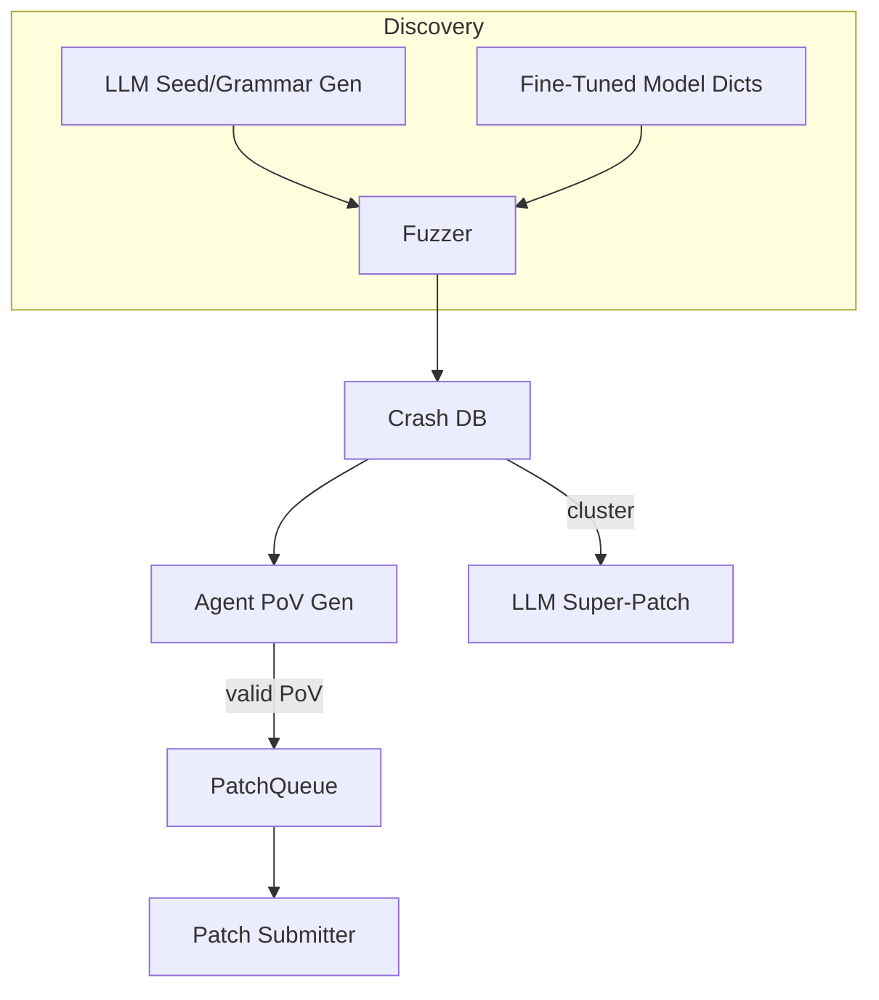

# Fuzzing wspomagany przez AI i automatyczne wykrywanie podatności

{{#include ../banners/hacktricks-training.md}}

## Przegląd
Duże modele językowe (LLM) mogą znacznie usprawnić tradycyjne procesy badania podatności, generując semantycznie bogate dane wejściowe, rozwijając gramatyki, analizując dane o awariach, a nawet proponując poprawki usuwające wiele błędów. Ta strona opisuje najskuteczniejsze wzorce zaobserwowane podczas finałów DARPA AI Cyber Challenge (AIxCC) oraz innych publicznych badań.<sup>[[4]](#references)</sup><sup>[[5]](#references)</sup>

Poniżej nie opisano konkretnego systemu używanego w jednym konkursie, lecz przedstawiono techniki w formie ogólnej, aby można je było odtworzyć we własnych procesach.

---

## 1. Dane wejściowe seedów generowane przez LLM

Tradycyjne fuzzery sterowane pokryciem kodu (AFL++, libFuzzer, Honggfuzz…) rozpoczynają pracę od niewielkiego zbioru seedów i ślepo mutują bajty. Gdy format danych wejściowych celu jest złożony (SQL, URL-e, niestandardowe protokoły binarne), losowe mutacje zwykle psują składnię, zanim program dotrze do interesujących gałęzi.

LLM mogą rozwiązać ten problem rozruchowy, generując *generatory seedów* — krótkie skrypty, które tworzą **poprawne składniowo, ale istotne z punktu widzenia bezpieczeństwa dane wejściowe**. Na przykład:

```prompt
SYSTEM: You are a helpful security engineer.
USER:
Write a Python3 program that prints 200 unique SQL injection strings targeting common anti-pattern mistakes (missing quotes, numeric context, stacked queries).  Ensure length ≤ 256 bytes / string so they survive common length limits.
```

```python
# gen_sqli_seeds.py (truncated)
PAYLOADS = [
    "1 OR 1=1 -- ",
    "' UNION SELECT NULL,NULL--",
    "0; DROP TABLE users;--",
    ...
]
for p in PAYLOADS:
    print(p)
```

Uruchom raz i przekaż wynik bezpośrednio do początkowego korpusu fuzzera:

```bash
python3 gen_sqli_seeds.py > seeds.txt
afl-fuzz -i seeds.txt -o findings/ -- ./target @@
```

Benefits:
1. Poprawność semantyczna → głębsze pokrycie na wczesnym etapie.
2. Możliwość ponownego generowania: zmień prompt, aby skupić się na XSS, path traversal, binary blobs itp.
3. Niski koszt (< 1 ¢ przy GPT-3.5).

### Tips
* Poproś model o *zróżnicowanie* długości i kodowania payloadów (UTF-8, URL-encoded, UTF-16-LE), aby ominąć powierzchowne filtry.
* Poproś o *pojedynczy, samodzielny skrypt* – pozwala uniknąć problemów z formatowaniem JSON.

---

## 2. Grammar-Evolution Fuzzing

Potężniejszy wariant polega na tym, aby LLM **ewoluował gramatykę** zamiast konkretnych seedów. Workflow (wzorzec „Grammar Guy”) wygląda następująco:

1. Wygeneruj początkową gramatykę ANTLR/Peach/LibFuzzer za pomocą promptu.
2. Fuzzuj przez N minut i zbierz metryki pokrycia (trafione krawędzie / bloki).
3. Podsumuj niepokryte obszary programu i przekaż podsumowanie z powrotem do modelu:
   ```prompt
   The previous grammar triggered 12 % of the program edges.  Functions not reached: parse_auth, handle_upload.  Add / modify rules to cover these.
   ```
4. Połącz nowe reguły, ponownie uruchom fuzzing i powtórz.

Szkielet pseudokodu:

```python
for epoch in range(MAX_EPOCHS):
    grammar = llm.refine(grammar, feedback=coverage_stats)
    save(grammar, f"grammar_{epoch}.txt")
    coverage_stats = run_fuzzer(grammar)
```

Kluczowe punkty:
* Trzymaj się *budżetu* – każde udoskonalenie zużywa tokeny.
* Używaj instrukcji `diff` + `patch`, aby model edytował kod zamiast przepisywać go od nowa.
* Zatrzymaj się, gdy Δcoverage < ε.

---

## 3. Inżynieria harnessu libFuzzer z lokalnym LLM

Jeśli kod nie może opuścić stacji roboczej analityka, lokalny model kodujący może przygotować niewielki adapter między bajtami fuzzera a API C/C++. Istotna jest tu wyraźna granica bezpieczeństwa: **model tworzy i poprawia infrastrukturę testową; mutacje sterowane pokryciem eksplorują dane wejściowe; sanitizery zgłaszają nieprawidłowe operacje; człowiek przegląda harness i analizuje wyniki**.<sup>[[9]](#references)</sup>

Informacje o technikach pracy z corpus, feedbackiem, snapshotami i fuzzingiem stanowym na poziomie silnika, które nie wymagają LLM, znajdziesz w ogólnej [Fuzzing Methodology](../generic-methodologies-and-resources/fuzzing.md).

Zacznij od dokładnej deklaracji skopiowanej z nagłówka celu i określ format wyjściowy. Wąski prompt ogranicza wymyślanie API i ułatwia weryfikację wyniku:<sup>[[8]](#references)[[9]](#references)</sup>

```prompt
Write a libFuzzer target for this exact declaration:
int parse_records(const uint8_t *data, size_t size);

Output only C code. Implement LLVMFuzzerTestOneInput, include the
declaration, pass data and size unchanged, and do not use files,
network access, randomness, clocks, threads, or persistent state.
```

W przypadku parsera surowych bajtów oczekiwany wynik nie powinien być bardziej skomplikowany niż:<sup>[[6]](#references)[[9]](#references)</sup>

```c
#include <stddef.h>
#include <stdint.h>

extern int parse_records(const uint8_t *, size_t);

int LLVMFuzzerTestOneInput(const uint8_t *data, size_t size) {
    (void)parse_records(data, size);
    return 0;
}
```

Kompilacja to dopiero pierwszy etap walidacji. Zanim poświęcisz na każdy wygenerowany cel czas procesora, sprawdź, czy spełnia wszystkie poniższe niezmienniki:<sup>[[6]](#references)[[8]](#references)[[9]](#references)</sup>

- **Zgodność z API:** porównaj typy, zasady zarządzania własnością, inicjalizację, zwalnianie zasobów i konwencję wywołań z rzeczywistym nagłówkiem oraz istniejącymi wywołaniami.
- **Bezpieczeństwo harnessu:** zabezpiecz każdy odczyt z `data`; błędy wykryte przez sanitizery muszą pochodzić z celu, a nie z wygenerowanego kodu pośredniczącego.
- **Powtarzalność:** wynik musi być funkcją `data` i `size`; usuń zewnętrzne operacje wejścia/wyjścia, zależność od czasu, niekontrolowaną losowość, niezakończone wątki i stan utrzymujący się między wywołaniami.
- **Przepustowość:** inicjalizuj kosztowny, niezmienny stan tylko raz, ale wyłącznie wtedy, gdy nie wpływa to na zachowanie; ogranicz rozmiar danych wejściowych, wyłącz logowanie i zwalniaj alokacje dla każdego wejścia.
- **Osiągalność:** sprawdź, czy wykonywane są zamierzone funkcje i gałęzie. Cel, który się kompiluje, ale sprawdza tylko ścieżki odrzucenia, to cicha porażka.

### Cele uwzględniające strukturę: zachowuj niezmienniki, nie ukrywając błędów

Jeśli większość surowych danych wejściowych nie przechodzi kontroli magicznej wartości, długości, wersji lub sumy kontrolnej, użyj bajtów fuzz jako **materiału na typowane pola** i zbuduj poprawny obiekt. Ustaw stałe formatu, pozostaw pola semantyczne i bajty payloadu zmienne, a metadane integralności wylicz na podstawie odtworzonego payloadu. `FuzzedDataProvider` przydaje się do pobierania ograniczonych wartości typowanych, a adapter nadal odpowiada za ograniczanie każdej wygenerowanej alokacji i konwersji.<sup>[[9]](#references)</sup>

<details>
<summary>Przykładowy cel C++ uwzględniający strukturę</summary>

```cpp
#include <fuzzer/FuzzedDataProvider.h>
#include <stddef.h>
#include <stdint.h>
#include <vector>

extern "C" int parse_message(const uint8_t *, size_t);

extern "C" int LLVMFuzzerTestOneInput(const uint8_t *data, size_t size) {
    FuzzedDataProvider fdp(data, size);
    uint8_t version = fdp.ConsumeIntegral<uint8_t>();
    auto body = fdp.ConsumeRemainingBytes<uint8_t>();
    if (body.size() > UINT16_MAX) body.resize(UINT16_MAX);
    uint16_t len = static_cast<uint16_t>(body.size());
    std::vector<uint8_t> msg = {0x8b, 'M', 'S', 'G', version,
                                static_cast<uint8_t>(len >> 8),
                                static_cast<uint8_t>(len)};
    msg.insert(msg.end(), body.begin(), body.end());
    (void)parse_message(msg.data(), msg.size());
    return 0;
}
```

</details>

Nie używaj jednego celu naprawiającego strukturę dla każdego pytania. Utrzymuj jeden cel, który wylicza długości/sumy kontrolne, aby eksplorować głębokie, poprawne stany, oraz drugi, w którym fuzzer kontroluje **deklarowane** metadane, a ograniczone są tylko odczyty i alokacje wykonywane przez sam harness. Drugi cel zachowuje powierzchnie ataku związane z niezgodnymi długościami i błędną integralnością, które automatyczna naprawa w przeciwnym razie by wyeliminowała.<sup>[[9]](#references)</sup>

### Ziarna, słowniki, sanitizery i sprzężenie zwrotne z pokrycia

Poproś model o wygenerowanie skryptu zapisującego ziarna binarne, zamiast prosić go o bezpośrednie wypisanie danych binarnych. Przygotuj ziarna dla pustych, minimalnych, typowych i poprawnych wartości brzegowych obiektów; następnie wyodrębnij wartości magiczne, tagi, kodowania enumów i słowa kluczowe parsera do sprawdzonego słownika. libFuzzer przyjmuje ten słownik za pomocą `-dict=` i zachowuje w korpusie mutacje, które ujawniają nowe pokrycie.<sup>[[6]](#references)[[9]](#references)</sup>

```text
magic="\x8bMSG"
version_min="\x00"
version_max="\xff"
config_tag="CONFIG"
```

Zbuduj ten sam cel z uzupełniającą instrumentacją. ASan i UBSan mogą współdzielić plik binarny do fuzzingu; użyj osobnej kompilacji z MSan i instrumentuj jej zależności, aby uniknąć raportów powodowanych przez nieinstrumentowany kod.<sup>[[6]](#references)[[9]](#references)</sup>

```bash
clang++ -g -O1 -fsanitize=fuzzer,address,undefined \
  -fno-sanitize-recover=undefined target.cc harness.cc -o fuzz_target
./fuzz_target corpus -dict=msg.dict -max_len=65535

clang++ -g -O1 -fsanitize=fuzzer,memory \
  target.cc harness.cc -o fuzz_target_msan
```

Traktuj pokrycie jako kryterium oceny każdej wersji modelu. W wynikach libFuzzer wczesne wypłaszczenie `cov`/`ft` i statyczny corpus zwykle wskazują na nieprawidłowe framing, zbyt restrykcyjny wczesny warunek zwrotu lub niewłaściwe wywołanie; niskie `exec/s` wskazuje na kosztowną konfigurację, operacje I/O, alokację lub wyciek stanu. `NEW` dowodzi jedynie, że zmieniła się cecha pokrycia, a nie że osiągnięto zamierzony parser.<sup>[[6]](#references)[[9]](#references)</sup>

Aby uzyskać informacje zwrotne na poziomie źródła, przygotuj build z pomiarem pokrycia, uruchom fuzzing i przekaż modelowi tylko niepokryte funkcje oraz warunki, które je chronią. Zweryfikuj zmiany w harness/seed/dictionary i ponownie wykonaj pomiar:<sup>[[7]](#references)[[8]](#references)[[9]](#references)</sup>

```bash
clang++ -g -O1 -fsanitize=fuzzer \
  -fprofile-instr-generate -fcoverage-mapping target.cc harness.cc -o fuzz_cov
mkdir -p profiles
LLVM_PROFILE_FILE='profiles/%p.profraw' ./fuzz_cov -max_total_time=300 corpus
llvm-profdata merge -sparse profiles/*.profraw -o fuzz.profdata
llvm-cov report ./fuzz_cov -instr-profile=fuzz.profdata
llvm-cov show ./fuzz_cov -instr-profile=fuzz.profdata \
  --show-branches=count --region-coverage-lt=1 target.cc
```

Skalowalna pętla wygląda więc tak: **generowanie → kompilacja/linkowanie → testy dymne z użyciem sanitizerów → pomiar pokrycia celu → przekazanie minimalnego, istotnego kontekstu dotyczącego pokrycia/kodu źródłowego → poprawki → ponowny pomiar**. OSS-Fuzz-Gen stosuje tę samą zasadę: ocenia wygenerowane cele pod kątem możliwości kompilacji, awarii w czasie działania, pokrycia oraz poprawy pokrycia względem istniejących celów, zamiast uznawać wiarygodnie wyglądający kod za poprawny bez weryfikacji.<sup>[[7]](#references)[[8]](#references)</sup>

---

<a id="3-agent-based-pov-exploit-generation" hidden>3. Agent-Based PoV (Exploit) Generation</a>

## 4. Generowanie PoV (Exploit) z użyciem agentów

Po znalezieniu awarii nadal potrzebujesz **proof-of-vulnerability (PoV)**, który deterministycznie ją wywoła.

Skalowalne podejście polega na uruchomieniu wielu lekkich workerów (procesów, wątków lub kontenerów), z których każdy korzysta z innego modelu lub konfiguracji próbkowania. Ankieta finalistów AIxCC podaje konkretne przykłady skali: jeden z zespołów używał **tysięcy współbieżnych agentów** do generowania PoV w podejściu AI-first, a inny koordynował pracę **300–500 agentów fuzzujących** i wykorzystywał LLM-y do bardziej zaawansowanego rozumowania semantycznego.<sup>[[4]](#references)</sup>

Potok:
1. Analiza statyczna/dynamiczna generuje *kandydatów na błędy* (struct z adresem crash PC, wycinkiem wejścia i komunikatem sanitizera).
2. Orkiestrator rozdziela kandydatów między agentów.
3. Kroki rozumowania agenta:
   a. Lokalnie odtwarza błąd za pomocą `gdb` i wejścia.
   b. Proponuje minimalny payload exploita.
   c. Weryfikuje exploit w sandboxie. Jeśli się powiedzie → zgłasza go.
4. Nieudane próby są **ponownie kolejkowane jako nowe seedy** do fuzzingu pokrycia (pętla sprzężenia zwrotnego).

Zalety:
* Równoległość ogranicza skutki zawodności pojedynczego agenta.
* Automatyczne dostrajanie temperatury / rozmiaru modelu na podstawie zaobserwowanego wskaźnika powodzenia.

---

<a id="4-directed-fuzzing-with-fine-tuned-code-models" hidden>4. Directed Fuzzing with Fine-Tuned Code Models</a>

## 5. Ukierunkowany fuzzing z dostrojonymi modelami kodu

Dostrój model open-weight (np. Llama-7B) na kodzie źródłowym C/C++ oznaczonym wzorcami podatności (przepełnienie liczby całkowitej, kopiowanie bufora, format string). Następnie:

1. Uruchom analizę statyczną, aby uzyskać listę funkcji i AST.
2. Podaj modelowi prompt: *„Podaj wpisy słownika mutacji, które prawdopodobnie naruszą bezpieczeństwo pamięci w funkcji X”*.
3. Wstaw te tokeny do niestandardowego `AFL_CUSTOM_MUTATOR`.

Przykładowy wynik dla wrappera `sprintf`:
```
{"pattern":"%99999999s"}
{"pattern":"AAAAAAAA....<1024>....%n"}
```

Empirycznie skraca to czas do awarii ponad dwukrotnie na rzeczywistych celach.

---

<a id="5-ai-guided-patching-strategies" hidden>5. Strategie łatania wspomagane przez AI</a>

## 6. Strategie łatania wspomagane przez AI

<a id="51-super-patches" hidden>5.1 Superłatki</a>

### 6.1 Superłatki
Poproś model o *pogrupowanie* sygnatur awarii i zaproponowanie **pojedynczej łatki**, która usuwa wspólną przyczynę źródłową. Jedno zgłoszenie, kilka naprawionych błędów → mniej kar za brak precyzji w środowiskach, w których każda błędna łatka kosztuje punkty.

Zarys promptu:
```
Here are 10 stack traces + file snippets.  Identify the shared mistake and generate a unified diff fixing all occurrences.
```

{{#ref}}
../generic-methodologies-and-resources/fuzzing.md
{{#endref}}

<a id="52-speculative-patch-ratio" hidden>5.2 Speculative Patch Ratio</a>

### 6.2 Współczynnik spekulatywnych poprawek
Zaimplementuj kolejkę, w której potwierdzone poprawki zweryfikowane za pomocą PoV są przeplatane *spekulatywnymi* poprawkami (bez PoV) w proporcji 1:​N dostosowanej do zasad punktacji (np. 2 spekulatywne : 1 potwierdzona). Model kosztów monitoruje kary i punkty, a następnie samodzielnie dostosowuje N.

---

Więcej informacji o deterministycznym przeglądzie kodu źródłowego plik po pliku, mobilnych przepływach zadań dla punktów wejścia, audytach wzorców w jądrze oraz walidacji podatności opartej na dowodach znajdziesz w [wspomaganym przez AI przeglądzie kodu źródłowego i walidacji podatności](AI-Assisted-Source-Review-and-Vulnerability-Validation.md).

---

## Triaging awarii z pomocą debuggera

Przepływy pracy Mona v3 dotyczące triage’u awarii, analizy funkcji i kontrolowanego uzyskiwania osiągalności chunków sterty opisano w [narzędziach do exploitacji](../binary-exploitation/basic-stack-binary-exploitation-methodology/tools/#mona-v3-debugger-context-requests-for-crash-triage).

---

## Całość w praktyce
Kompletny system CRS (Cyber Reasoning System) może łączyć komponenty w następujący sposób:



---

## References

- [4] [Trail of Bits – AIxCC: finałowa relacja z przebiegu wydarzeń](https://blog.trailofbits.com/2025/08/07/aixcc-finals-tale-of-the-tape/)
- [5] [Wywiady CTF Radiooo z finalistami AIxCC](https://www.youtube.com/@ctfradiooo)
- [6] [LLVM — libFuzzer: biblioteka do testowania fuzzingowego sterowanego pokryciem kodu](https://llvm.org/docs/LibFuzzer.html)
- [7] [Google — OSS-Fuzz-Gen](https://github.com/google/oss-fuzz-gen)
- [8] [Google Online Security Blog — Rozwijanie fuzzingu: wykrywanie większej liczby podatności dzięki AI](https://security.googleblog.com/2024/11/leveling-up-fuzzing-finding-more.html)
- [9] [8kSec — Generowanie harnessów fuzzingowych wspomagane przez AI z użyciem lokalnego LLM](https://8ksec.io/ai-assisted-fuzzing-harness-local-llm)
{{#include ../banners/hacktricks-training.md}}
