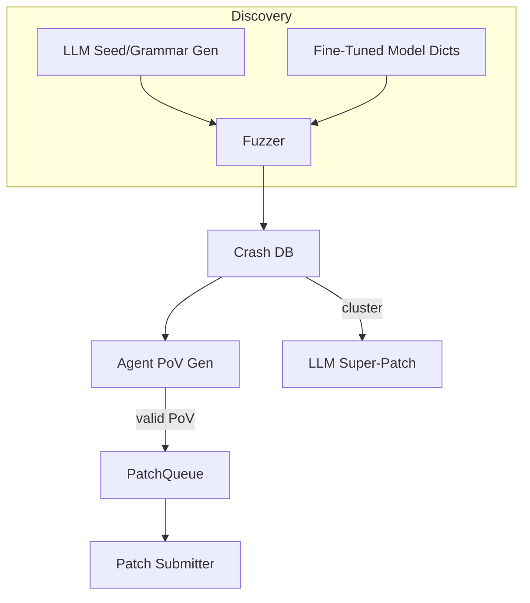

# AI-सहायता प्राप्त Fuzzing और Automated Vulnerability Discovery

{{#include ../banners/hacktricks-training.md}}

## अवलोकन
Large-language models (LLMs) semantically rich inputs जनरेट करके, grammars को विकसित करके, crash data पर reasoning करके और यहाँ तक कि multi-bug patches का सुझाव देकर traditional vulnerability-research pipelines को काफी बेहतर बना सकते हैं। यह पेज DARPA’s AI Cyber Challenge (AIxCC) finals और अन्य public research के दौरान देखे गए सबसे प्रभावी patterns को संकलित करता है।<sup>[[4]](#references)</sup><sup>[[5]](#references)</sup>

आगे किसी एक specific competition system का वर्णन नहीं है, बल्कि techniques का एक abstraction है, ताकि आप इन्हें अपने workflows में दोहरा सकें।

---

## 1. LLM-Generated Seed Inputs

Traditional coverage–guided fuzzers (AFL++, libFuzzer, Honggfuzz…) seeds के एक छोटे corpus से शुरू होते हैं और bytes को blind तरीके से mutate करते हैं। जब target input format जटिल होता है (SQL, URLs, custom binary protocols), तो random mutations आमतौर पर syntax को बिगाड़ देते हैं, इससे पहले कि interesting branches तक पहुँचा जा सके।

LLMs *seed generators* — ऐसे छोटे scripts जो **syntax-correct लेकिन security-relevant inputs** आउटपुट करते हैं — बनाकर इस bootstrap problem को हल कर सकते हैं। उदाहरण के लिए:

```prompt
SYSTEM: You are a helpful security engineer.
USER:
Write a Python3 program that prints 200 unique SQL injection strings targeting common anti-pattern mistakes (missing quotes, numeric context, stacked queries).  Ensure length ≤ 256 bytes / string so they survive common length limits.
```

```python
# gen_sqli_seeds.py (truncated)
PAYLOADS = [
    "1 OR 1=1 -- ",
    "' UNION SELECT NULL,NULL--",
    "0; DROP TABLE users;--",
    ...
]
for p in PAYLOADS:
    print(p)
```

एक बार चलाएँ और आउटपुट को सीधे fuzzer के initial corpus में डालें:

```bash
python3 gen_sqli_seeds.py > seeds.txt
afl-fuzz -i seeds.txt -o findings/ -- ./target @@
```

लाभ:
1. अर्थगत वैधता → शुरुआत में ही अधिक गहरा कवरेज।
2. दोबारा जनरेट किया जा सकता है: XSS, path traversal, binary blobs आदि पर ध्यान केंद्रित करने के लिए prompt में बदलाव करें।
3. सस्ता (< 1 ¢ GPT-3.5 के साथ)।

### सुझाव
* सतही फ़िल्टरों को बायपास करने के लिए मॉडल को payload की लंबाई और encoding (UTF-8, URL-encoded, UTF-16-LE) में *विविधता* लाने का निर्देश दें।
* एक *स्व-निहित script* माँगें — इससे JSON फ़ॉर्मैटिंग की गड़बड़ियों से बचा जा सकता है।

---

## 2. Grammar-Evolution Fuzzing

एक अधिक शक्तिशाली तरीका यह है कि LLM को ठोस seeds के बजाय **grammar विकसित** करने दें। इसका workflow (“Grammar Guy” pattern) है:

1. prompt के ज़रिए शुरुआती ANTLR/Peach/LibFuzzer grammar जनरेट करें।
2. N मिनट तक fuzzing करें और coverage metrics (hit हुए edges / blocks) इकट्ठा करें।
3. प्रोग्राम के उन हिस्सों का सारांश बनाएँ जिनका कवरेज नहीं हुआ है और वह सारांश मॉडल को वापस दें:
   ```prompt
   The previous grammar triggered 12 % of the program edges.  Functions not reached: parse_auth, handle_upload.  Add / modify rules to cover these.
   ```
4. नए rules merge करें, फिर से fuzz करें और दोहराएँ।

Pseudo-code skeleton:

```python
for epoch in range(MAX_EPOCHS):
    grammar = llm.refine(grammar, feedback=coverage_stats)
    save(grammar, f"grammar_{epoch}.txt")
    coverage_stats = run_fuzzer(grammar)
```

मुख्य बिंदु:
* एक *बजट* रखें – हर refinement में tokens लगते हैं।
* मॉडल से फिर से लिखवाने के बजाय संपादन करवाने के लिए `diff` + `patch` निर्देशों का उपयोग करें।
* Δcoverage < ε होने पर रुक जाएँ।

---

## 3. Local-LLM libFuzzer Harness इंजीनियरिंग

ऐसे source code के लिए जिसे analyst के workstation से बाहर नहीं भेजा जा सकता, कोई local code model fuzzer bytes और C/C++ API के बीच छोटा adapter तैयार कर सकता है। उपयोगी सुरक्षा सीमा स्पष्ट है: **मॉडल test infrastructure लिखता और संशोधित करता है; coverage-guided mutation inputs को explore करता है; sanitizers invalid operations की रिपोर्ट देते हैं; और एक मानव harness की समीक्षा करके findings की triage करता है**।<sup>[[9]](#references)</sup>

ऐसी engine-level corpus, feedback, snapshot और stateful-fuzzing तकनीकों के लिए जो LLM पर निर्भर नहीं करतीं, सामान्य [Fuzzing Methodology](../generic-methodologies-and-resources/fuzzing.md) देखें।

Target header से हूबहू declaration कॉपी करके शुरू करें और output format को सीमित रखें। एक संकीर्ण prompt मनगढ़ंत APIs को कम करता है और परिणाम की समीक्षा आसान बनाता है:<sup>[[8]](#references)[[9]](#references)</sup>

```prompt
Write a libFuzzer target for this exact declaration:
int parse_records(const uint8_t *data, size_t size);

Output only C code. Implement LLVMFuzzerTestOneInput, include the
declaration, pass data and size unchanged, and do not use files,
network access, randomness, clocks, threads, or persistent state.
```

कच्चे byte parser के लिए, अपेक्षित परिणाम इससे अधिक जटिल नहीं होना चाहिए:<sup>[[6]](#references)[[9]](#references)</sup>

```c
#include <stddef.h>
#include <stdint.h>

extern int parse_records(const uint8_t *, size_t);

int LLVMFuzzerTestOneInput(const uint8_t *data, size_t size) {
    (void)parse_records(data, size);
    return 0;
}
```

कंपाइलेशन validation का केवल पहला gate है। CPU समय खर्च करने से पहले, इन invariants के अनुसार हर generated target की समीक्षा करें:<sup>[[6]](#references)[[8]](#references)[[9]](#references)</sup>

- **Exact API:** types, ownership rules, initialization, teardown और calling convention की तुलना वास्तविक header और मौजूदा callers से करें।
- **Harness safety:** `data` से होने वाले हर read पर guard लगाएँ; sanitizer findings target में उत्पन्न होनी चाहिए, generated glue में नहीं।
- **Repeatability:** परिणाम को `data` और `size` का function बनाएँ; external I/O, time, uncontrolled randomness, unjoined threads और हर call के बीच बने रहने वाली state हटाएँ।
- **Throughput:** महँगी immutable state को केवल तभी एक बार initialize करें, जब इससे behavior प्रभावित न हो; input size सीमित रखें, logging बंद करें और हर input के लिए किए गए allocations free करें।
- **Reachability:** सत्यापित करें कि इच्छित functions और branches execute हों। ऐसा target जो compile हो जाए, लेकिन केवल rejection paths को exercise करे, एक ऐसी विफलता है जिस पर ध्यान नहीं जाता।

### Structure-aware targets: bugs को छिपाए बिना invariants बनाए रखें

अगर ज़्यादातर raw inputs किसी magic, length, version या checksum gate पर fail हो जाते हैं, तो fuzz bytes को **typed field material** की तरह इस्तेमाल करके valid object फिर से बनाएँ। Format constants को fix करें, semantic fields और payload bytes को mutable रहने दें, और reconstructed payload से integrity metadata निकालें। `FuzzedDataProvider` सीमित typed values consume करने में उपयोगी है, जबकि generated allocation और conversion को सीमित रखने की ज़िम्मेदारी adapter की रहती है।<sup>[[9]](#references)</sup>

<details>
<summary>Structure-aware C++ target का उदाहरण</summary>

```cpp
#include <fuzzer/FuzzedDataProvider.h>
#include <stddef.h>
#include <stdint.h>
#include <vector>

extern "C" int parse_message(const uint8_t *, size_t);

extern "C" int LLVMFuzzerTestOneInput(const uint8_t *data, size_t size) {
    FuzzedDataProvider fdp(data, size);
    uint8_t version = fdp.ConsumeIntegral<uint8_t>();
    auto body = fdp.ConsumeRemainingBytes<uint8_t>();
    if (body.size() > UINT16_MAX) body.resize(UINT16_MAX);
    uint16_t len = static_cast<uint16_t>(body.size());
    std::vector<uint8_t> msg = {0x8b, 'M', 'S', 'G', version,
                                static_cast<uint8_t>(len >> 8),
                                static_cast<uint8_t>(len)};
    msg.insert(msg.end(), body.begin(), body.end());
    (void)parse_message(msg.data(), msg.size());
    return 0;
}
```

</details>

हर प्रश्न के लिए एक ही structure-repairing target का उपयोग न करें। एक target ऐसा रखें जो गहरी valid states खोजने के लिए lengths/checksums निकालता हो, और दूसरा ऐसा जो **declared** metadata को fuzzer के नियंत्रण में रखे और केवल harness की अपनी reads और allocations को सीमित करे। दूसरा target mismatched-length और bad-integrity attack surfaces को बनाए रखता है, जिन्हें automatic repair अन्यथा मिटा देता।<sup>[[9]](#references)</sup>

### Seeds, dictionaries, sanitizers, और coverage feedback

मॉडल से binary सीधे प्रिंट करने के बजाय ऐसी script बनाने को कहें जो binary seeds लिखे। खाली, न्यूनतम, सामान्य और boundary-valid objects से seeds तैयार करें; फिर magic values, tags, enum encodings और parser keywords निकालकर उन्हें एक reviewed dictionary में रखें। libFuzzer उस dictionary को `-dict=` के साथ स्वीकार करता है और corpus में उन mutations को बनाए रखता है जो नया coverage उजागर करती हैं।<sup>[[6]](#references)[[9]](#references)</sup>

```text
magic="\x8bMSG"
version_min="\x00"
version_max="\xff"
config_tag="CONFIG"
```

उसी target को पूरक instrumentation के साथ build करें। ASan और UBSan एक fuzzing binary साझा कर सकते हैं; अलग MSan build का उपयोग करें और उसकी dependencies को instrument करें, ताकि uninstrumented code के कारण reports न आएँ।<sup>[[6]](#references)[[9]](#references)</sup>

```bash
clang++ -g -O1 -fsanitize=fuzzer,address,undefined \
  -fno-sanitize-recover=undefined target.cc harness.cc -o fuzz_target
./fuzz_target corpus -dict=msg.dict -max_len=65535

clang++ -g -O1 -fsanitize=fuzzer,memory \
  target.cc harness.cc -o fuzz_target_msan
```

हर model revision के लिए coverage को evaluator मानें। libFuzzer output में, शुरुआत में सपाट `cov`/`ft` और स्थिर corpus का आमतौर पर मतलब है गलत framing, बहुत ज़्यादा प्रतिबंधित early return, या गलत call; कम `exec/s` महंगे setup, I/O, allocation या लीक हुए state की ओर इशारा करता है। `NEW` केवल यह साबित करता है कि कोई coverage feature बदला है, यह नहीं कि इच्छित parser तक पहुँचा गया।<sup>[[6]](#references)[[9]](#references)</sup>

Source-level feedback के लिए, coverage build बनाएं, उसे fuzz करें, और model को केवल uncovered functions तथा उन्हें नियंत्रित करने वाली conditions दें। परिणामी harness/seed/dictionary diff की पुष्टि करें और दोबारा मापें:<sup>[[7]](#references)[[8]](#references)[[9]](#references)</sup>

```bash
clang++ -g -O1 -fsanitize=fuzzer \
  -fprofile-instr-generate -fcoverage-mapping target.cc harness.cc -o fuzz_cov
mkdir -p profiles
LLVM_PROFILE_FILE='profiles/%p.profraw' ./fuzz_cov -max_total_time=300 corpus
llvm-profdata merge -sparse profiles/*.profraw -o fuzz.profdata
llvm-cov report ./fuzz_cov -instr-profile=fuzz.profdata
llvm-cov show ./fuzz_cov -instr-profile=fuzz.profdata \
  --show-branches=count --region-coverage-lt=1 target.cc
```

इसलिए स्केलेबल लूप है **generate → compile/link → sanitizers के तहत smoke-test → target coverage मापें → सबसे छोटा प्रासंगिक coverage/source context दें → संशोधित करें → दोबारा मापें**। OSS-Fuzz-Gen इसी सिद्धांत को लागू करता है: यह generated targets को compilability, runtime failures, coverage और मौजूदा targets की तुलना में coverage improvement के आधार पर परखता है, न कि केवल संभावित रूप से सही दिखने वाले code को स्वीकार करता है।<sup>[[7]](#references)[[8]](#references)</sup>

---

## 4. Agent-Based PoV (Exploit) Generation

Crash मिलने के बाद भी आपको एक **proof-of-vulnerability (PoV)** चाहिए, जो निश्चित रूप से उसे trigger करे।

एक स्केलेबल तरीका है कई lightweight workers (processes, threads या containers) शुरू करना, जिनमें से हर worker अलग model या sampling configuration इस्तेमाल करे। AIxCC finalist survey में scale के ठोस उदाहरण दिए गए हैं: एक टीम ने AI-first PoV generation के लिए **हज़ारों concurrent agents** इस्तेमाल किए, जबकि दूसरी ने **300–500 fuzzing agents** का समन्वय किया और उच्च-स्तरीय semantic reasoning के लिए LLMs को अलग रखा।<sup>[[4]](#references)</sup>

Pipeline:
1. Static/dynamic analysis से *bug candidates* मिलते हैं (crash PC, input slice, sanitizer msg वाला struct)।
2. Orchestrator candidates को agents में वितरित करता है।
3. Agent की reasoning के चरण:
   a. `gdb` + input की मदद से bug को local स्तर पर reproduce करें।
   b. न्यूनतम exploit payload सुझाएँ।
   c. Sandbox में exploit को validate करें। सफल होने पर → submit करें।
4. असफल प्रयासों को coverage fuzzing के लिए **नए seeds के रूप में दोबारा queue किया जाता है** (feedback loop)।

फ़ायदे:
* Parallelisation से single-agent की अविश्वसनीयता का असर कम होता है।
* देखी गई success-rate के आधार पर temp/model size को auto-tune किया जा सकता है।

---

## 5. Fine-Tuned Code Models के साथ Directed Fuzzing

Vulnerability patterns (integer overflow, buffer copy, format string) के साथ label किए गए C/C++ source पर open-weight model (जैसे Llama-7B) को fine-tune करें। फिर:

1. Function list + AST पाने के लिए static analysis चलाएँ।
2. Model को prompt दें: *“Function X में memory safety तोड़ने की संभावना वाले mutation dictionary entries दें”*।
3. उन tokens को custom `AFL_CUSTOM_MUTATOR` में insert करें।

`sprintf` wrapper के लिए उदाहरण output:
```
{"pattern":"%99999999s"}
{"pattern":"AAAAAAAA....<1024>....%n"}
```

वास्तविक targets पर अनुभवजन्य रूप से, इससे crash होने में लगने वाला समय >2× कम हो जाता है।

---

## 6. AI-निर्देशित Patching रणनीतियाँ

### 6.1 Super Patches
मॉडल से crash signatures को *cluster* करने और ऐसा **एक patch** सुझाने के लिए कहें, जो सामान्य root cause को दूर करे।  एक बार submit करें, कई bugs ठीक करें → उन environments में accuracy penalties कम होंगी जहाँ हर गलत patch पर points कटते हैं।

Prompt की रूपरेखा:
```
Here are 10 stack traces + file snippets.  Identify the shared mistake and generate a unified diff fixing all occurrences.
```

### 6.2 Speculative Patch Ratio
एक queue लागू करें, जिसमें PoV-validated confirmed patches और *speculative* patches (बिना PoV) को scoring rules के अनुसार तय 1:N अनुपात में बारी-बारी से रखा जाए (जैसे, 2 speculative : 1 confirmed)। एक cost model penalties और points पर नज़र रखता है और N को अपने आप समायोजित करता है।

---

## 7. Deterministic फ़ाइल-दर-फ़ाइल AI Code Review

AI-सहायता वाले review में अक्सर यह विफलता होती है कि एक agent से पूरा repository जाँचने को कहा जाता है और उम्मीद की जाती है कि वह सही files और grep terms चुन लेगा। इससे अधिक भरोसेमंद तरीका है **repository coverage को अनिवार्य करना**:<sup>[[1]](#references)</sup>

1. Source files की सूची बनाएँ।
2. हर बार **एक file** के साथ थोड़ा-सा context भेजें (entrypoint, imports, आसपास के routes/callers)।
3. हर file के लिए एक **structured report** माँगें: sources, sink, missing validation, exploit preconditions और confidence।<sup>[[3]](#references)</sup>
4. **source→sink pattern** के आधार पर reports की duplicates हटाएँ और high-risk findings को हाथ से validate करें।

इसमें बहुत tokens लगते हैं और शोर भी होता है, लेकिन यह **सरल, high-impact source/sink bugs** खोजने में बहुत प्रभावी है, जिन्हें व्यापक agentic reviews अक्सर छोड़ देते हैं।

### Triage के वे patterns जिन्हें प्राथमिकता देना उपयोगी है

- **Dynamic PHP include/dispatch**: attacker-controlled route/controller/module names का सख्त allowlisting और path canonicalisation के बिना `require_once()`, `include()`, या `include_once()` तक पहुँचना।
- **Admin/account workflows में shell execution**: usernames, domains, FTP accounts या अन्य identifiers का `exec()`, `system()`, `shell_exec()`, `passthru()`, `proc_open()`, या `popen()` तक पहुँचना।
- **Structured input fan-in**: एक ही parameter का `$_GET`, `$_POST`, JSON, XML या framework body parsers से स्वीकार किया जाना और बाद में filesystem या OS-command sinks में दोबारा इस्तेमाल होना।

### दो व्यावहारिक bug classes जिन्हें यह तरीका अच्छी तरह खोजता है

- **PHP controller-dispatch LFI/RCE**: यदि request-controlled controller name को बिना allowlist/path normalisation के `require_once()` में जोड़ दिया जाए, तो `../` जैसे traversal sequences से PHP किसी अनचाही local `.php` file को include कर सकता है। यदि attacker include को किसी planted या अन्यथा उपयोगी PHP file की ओर इंगित कर सके, तो LFI code execution में बदल जाता है। देखें [File Inclusion / Path Traversal](../pentesting-web/file-inclusion/README.md)।<sup>[[1]](#references)</sup>
- **Hosting/admin panels में authenticated command injection**: यदि usernames जैसे account-management fields को shell commands में शामिल किया जाए, तो कम privileges वाला authenticated user सामान्य create/delete action को RCE में बदल सकता है। यदि panel command को अधिक privileges वाले service account के रूप में चलाता है, तो impact बढ़ जाता है। देखें [Command Injection](../pentesting-web/command-injection.md)।<sup>[[1]](#references)</sup>

### व्यावहारिक review notes

- LLM का इस्तेमाल पहले **source/sink reviewer** के रूप में करें, exploit generator के रूप में नहीं।
- उससे स्पष्ट रूप से **attacker-controlled field**, **normalization/validation gap**, और **खतरनाक sink** की सूची माँगें।
- बड़े repos के लिए, deterministic per-file review अक्सर एक single autonomous agent run से अधिक भरोसेमंद होता है, भले ही वह run किसी अधिक शक्तिशाली model का इस्तेमाल करे।<sup>[[2]](#references)</sup>
- **Broken Access Control** और अन्य business-logic bugs पर कमजोर नतीजों की अपेक्षा रखें, जहाँ exploitability cross-file assumptions, role semantics या product-specific threat models पर निर्भर करती है।

---

## अपरिचित Codebases पर Auditable Agent-Assisted Research

[graph-first fuzz-target workflow](../generic-methodologies-and-resources/fuzzing.md#graph-first-fuzz-target-selection-and-mutation-triage) में entrypoint reachability पहले से शामिल है, जबकि [agentic SAST pipelines](../network-services-pentesting/pentesting-web/code-review-tools.md#agentic-sast-pipelines) staged review और evidence gates को कवर करती हैं। इन deterministic नतीजों को model की hypotheses से अलग रखें, ताकि हर आगे बढ़ाए गए lead के साथ source locations, path evidence और एक dynamic measurement मौजूद रहे।<sup>[[10]](#references)</sup>

### Data flow गढ़े बिना object-lifetime evidence को जोड़ें

Static analysis को एक function में store की गई attacker-controlled length और उसी object field का बहुत बाद में किसी copy sink तक पहुँचना दिख सकता है, फिर भी callbacks, reconnects या object lifetime के पार इस संबंध को साबित करने में वह विफल हो सकता है। दोनों findings को अलग-अलग रखें, object/field के आधार पर cluster करें और छूटी हुई edge को एक स्पष्ट triage question बनाएँ। Agent इस संबंध का सुझाव दे सकता है, लेकिन इसे source review या runtime instrumentation से साबित करना ज़रूरी है।<sup>[[10]](#references)</sup>

हर candidate के लिए दर्ज करें:

- concrete entrypoint और attacker-controlled bytes;
- संबंधित field के हर producer सहित, हर producer के लिए विशिष्ट validation;
- sink, destination capacity और वहाँ तक पहुँचने के लिए ज़रूरी build/runtime conditions;
- exposed entrypoint से आया वास्तविक call stack, केवल direct harness invocation नहीं;
- सबसे छोटा dynamic result जो hypothesis की पुष्टि या खंडन करता हो।

कोई path सुरक्षित दिखने भर से field हर जगह सुरक्षित साबित नहीं होता। दूसरा producer उसी field को पहले path की bound के बिना भर सकता है। Paths को अलग-अलग test करें और harness को deployment-equivalent build options के साथ चलाएँ, क्योंकि debug assertions production memory corruption को जल्दी होने वाले test-only abort में बदल सकते हैं।<sup>[[10]](#references)</sup>

### Disclosure और exploitation के लिए measurement gates

Suspected uninitialized-memory disclosure के लिए, नई allocations को पहचानने योग्य byte से भरें और जाँचें कि वही marker emitted packet तक पहुँचता है। Exploitation के लिए मापे गए gates अनिवार्य करें, जैसे **controlled overwrite → उपयोगी victim object → disclosure → pointer/base recovery → control-flow hijack → composed payload**। Agent तभी आगे बढ़े जब harness मौजूदा property को साबित करे; विश्वसनीय लगने वाली कहानी किसी gate को पार करना नहीं है। [FreeRDP case](../binary-exploitation/libc-heap/heap-overflow.md#cross-path-length-reuse-and-stale-output-disclosure) में वे paths और build constraints दिखाए गए हैं जिन्हें validation के दौरान बनाए रखना ज़रूरी है।<sup>[[10]](#references)</sup>

---

## इसे एक साथ जोड़ना
End-to-end CRS (Cyber Reasoning System) components को इस तरह जोड़ सकता है:



---

## References

- [1] [Project Black - Cyber Security के लिए Local AI: phpIPAM LFI और myVesta Authenticated RCE की खोज](https://projectblack.io/blog/local-ai-for-cyber-security)
- [2] [Strix](https://github.com/usestrix/strix)
- [3] [GitHub Copilot community security-review skill](https://github.com/github/awesome-copilot/blob/main/skills/security-review/SKILL.md)
- [4] [Trail of Bits – AIxCC finals: मुकाबले का पूरा हाल](https://blog.trailofbits.com/2025/08/07/aixcc-finals-tale-of-the-tape/)
- [5] [CTF Radiooo AIxCC finalist interviews](https://www.youtube.com/@ctfradiooo)
- [6] [LLVM — libFuzzer: coverage-guided fuzz testing के लिए एक library](https://llvm.org/docs/LibFuzzer.html)
- [7] [Google — OSS-Fuzz-Gen](https://github.com/google/oss-fuzz-gen)
- [8] [Google Online Security Blog — Fuzzing को अगले स्तर पर ले जाना: AI से और अधिक vulnerabilities खोजना](https://security.googleblog.com/2024/11/leveling-up-fuzzing-finding-more.html)
- [9] [8kSec — Local LLM से AI-Assisted Fuzzing Harness बनाना](https://8ksec.io/ai-assisted-fuzzing-harness-local-llm)
- [10] [Quarkslab — AI Agents से RCE तक: Vulnerability Research Workflow बनाना](https://blog.quarkslab.com/from-ai-agents-to-rce-building-a-vulnerability-research-workflow.html)
{{#include ../banners/hacktricks-training.md}}
