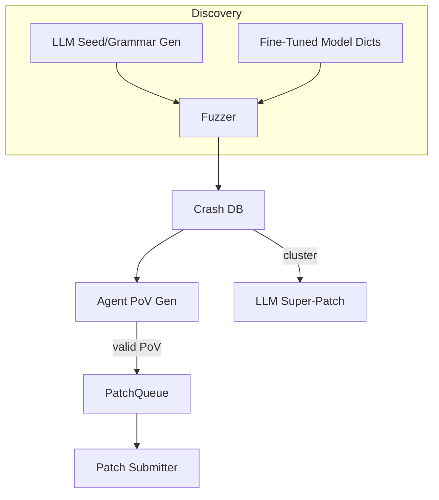

# AI Destekli Fuzzing ve Otomatik Güvenlik Açığı Keşfi

{{#include ../banners/hacktricks-training.md}}

## Genel Bakış
Büyük dil modelleri (LLM’ler), anlamsal açıdan zengin girdiler üreterek, gramerleri geliştirerek, crash verileri üzerinde akıl yürüterek ve hatta birden fazla hatayı gideren yamalar önererek geleneksel güvenlik açığı araştırma süreçlerini büyük ölçüde güçlendirebilir. Bu sayfada, DARPA’nın AI Cyber Challenge (AIxCC) finallerinde ve diğer kamuya açık araştırmalarda gözlemlenen en etkili kalıplar derlenmiştir.<sup>[[4]](#references)</sup><sup>[[5]](#references)</sup>

Aşağıda belirli bir yarışma sisteminin açıklaması değil, bu teknikleri kendi iş akışlarınızda yeniden uygulayabilmeniz için genel bir çerçeve sunulmaktadır.

---

## 1. LLM Tarafından Üretilen Seed Girdileri

Geleneksel coverage-guided fuzzer’lar (AFL++, libFuzzer, Honggfuzz…) küçük bir seed koleksiyonuyla başlar ve baytları gelişigüzel değiştirir. Hedef girdi biçimi karmaşık olduğunda (SQL, URL’ler, özel ikili protokoller), rastgele değişiklikler genellikle ilgi çekici dallara ulaşılmadan önce sözdizimini bozar.

LLM’ler, **sözdizimi doğru ancak güvenlik açısından anlamlı girdiler** üreten kısa betikler olan *seed üreticileri* oluşturarak bu başlangıç sorununu çözebilir. Örneğin:

```prompt
SYSTEM: You are a helpful security engineer.
USER:
Write a Python3 program that prints 200 unique SQL injection strings targeting common anti-pattern mistakes (missing quotes, numeric context, stacked queries).  Ensure length ≤ 256 bytes / string so they survive common length limits.
```

```python
# gen_sqli_seeds.py (truncated)
PAYLOADS = [
    "1 OR 1=1 -- ",
    "' UNION SELECT NULL,NULL--",
    "0; DROP TABLE users;--",
    ...
]
for p in PAYLOADS:
    print(p)
```

Bir kez çalıştırın ve çıktıyı doğrudan fuzzer'ın başlangıç corpus'una aktarın:

```bash
python3 gen_sqli_seeds.py > seeds.txt
afl-fuzz -i seeds.txt -o findings/ -- ./target @@
```

Benefits:
1. Anlamsal geçerlilik → erken aşamada daha derin coverage.
2. Yeniden üretilebilir: XSS, path traversal, binary blobs vb. konulara odaklanmak için prompt'u düzenleyin.
3. Ucuz (< GPT-3.5 ile 1 ¢).

### İpuçları
* Yüzeysel filtreleri aşmak için modelden payload uzunluğunu ve encoding'i (UTF-8, URL-encoded, UTF-16-LE) *çeşitlendirmesini* isteyin.
* JSON biçimlendirme sorunlarını önlemek için *tek bir bağımsız script* isteyin.

---

## 2. Grammar-Evolution Fuzzing

Daha güçlü bir varyant, LLM'in somut seed'ler yerine bir **grammar geliştirmesine** olanak tanır. İş akışı (“Grammar Guy” pattern'i) şöyledir:

1. Prompt aracılığıyla başlangıç niteliğinde bir ANTLR/Peach/LibFuzzer grammar'ı oluşturun.
2. N dakika boyunca fuzzing yapın ve coverage metriklerini (ulaşılan edge/block'lar) toplayın.
3. Kapsanmayan program alanlarını özetleyin ve özeti modele geri verin:
   ```prompt
   The previous grammar triggered 12 % of the program edges.  Functions not reached: parse_auth, handle_upload.  Add / modify rules to cover these.
   ```
4. Yeni kuralları birleştirin, yeniden fuzzing yapın ve tekrarlayın.

Pseudo-code iskeleti:

```python
for epoch in range(MAX_EPOCHS):
    grammar = llm.refine(grammar, feedback=coverage_stats)
    save(grammar, f"grammar_{epoch}.txt")
    coverage_stats = run_fuzzer(grammar)
```

Önemli noktalar:
* Bir *bütçe* belirleyin — her iyileştirme token kullanır.
* Modelin baştan yazmak yerine düzenleme yapması için `diff` + `patch` talimatlarını kullanın.
* Δcoverage < ε olduğunda durun.

---

## 3. Yerel LLM ile libFuzzer Harness Mühendisliği

Kaynak kodun analistin iş istasyonundan ayrılamadığı durumlarda, yerel bir kod modeli; fuzzer baytları ile bir C/C++ API’si arasında bağlantı kuran küçük adaptörü taslak olarak hazırlayabilir. Yararlı güvenlik sınırı açıktır: **model test altyapısını yazar ve gözden geçirir; coverage-guided mutation girdileri keşfeder; sanitizer’lar geçersiz işlemleri bildirir; bir insan harness’i inceler ve bulguları değerlendirir**.<sup>[[9]](#references)</sup>

LLM’ye bağlı olmayan engine düzeyindeki corpus, geri bildirim, snapshot ve stateful-fuzzing teknikleri için genel [Fuzzing Metodolojisi](../generic-methodologies-and-resources/fuzzing.md) sayfasına bakın.

Hedef başlık dosyasındaki tam tanımla başlayın ve çıktı biçimini kısıtlayın. Dar kapsamlı bir prompt, modelin var olmayan API’ler uydurma olasılığını azaltır ve sonucu incelemeyi kolaylaştırır:<sup>[[8]](#references)[[9]](#references)</sup>

```prompt
Write a libFuzzer target for this exact declaration:
int parse_records(const uint8_t *data, size_t size);

Output only C code. Implement LLVMFuzzerTestOneInput, include the
declaration, pass data and size unchanged, and do not use files,
network access, randomness, clocks, threads, or persistent state.
```

Ham bayt ayrıştırıcısı için beklenen sonuç bundan daha karmaşık olmamalıdır:<sup>[[6]](#references)[[9]](#references)</sup>

```c
#include <stddef.h>
#include <stdint.h>

extern int parse_records(const uint8_t *, size_t);

int LLVMFuzzerTestOneInput(const uint8_t *data, size_t size) {
    (void)parse_records(data, size);
    return 0;
}
```

Derleme, yalnızca ilk doğrulama aşamasıdır. CPU zamanını harcamadan önce, oluşturulan her target'ı şu değişmezlere göre gözden geçirin:<sup>[[6]](#references)[[8]](#references)[[9]](#references)</sup>

- **API'nin birebir uyumu:** Türleri, sahiplik kurallarını, başlatma ve sonlandırmayı, ayrıca çağrı kuralını gerçek header ve mevcut çağıran kodla karşılaştırın.
- **Harness güvenliği:** `data` üzerinden yapılan her okumayı korumaya alın; sanitizer bulguları oluşturulan glue kodundan değil, target'tan kaynaklanmalıdır.
- **Tekrarlanabilirlik:** Sonucu `data` ve `size` değerlerinin bir fonksiyonu hâline getirin; harici I/O'yu, zamanı, denetimsiz rastgeleliği, birleştirilmemiş thread'leri ve çağrılar arasında kalan durumu kaldırın.
- **İşleme hızı:** Davranışı etkilemeyeceğinden emin olduğunuzda pahalı, değişmez durumu yalnızca bir kez başlatın; girdi boyutunu sınırlandırın, loglamayı devre dışı bırakın ve girdi başına ayrılan belleği serbest bırakın.
- **Erişilebilirlik:** Amaçlanan fonksiyonların ve dalların çalıştığını doğrulayın. Derlenen ancak yalnızca reddetme yollarını çalıştıran bir target, sessiz bir başarısızlıktır.

### Yapı farkındalıklı target'lar: hataları gizlemeden değişmezleri koruyun

Ham girdilerin çoğu magic, uzunluk, sürüm veya checksum kontrolünden geçemiyorsa fuzz baytlarını **tipli alan verisi** olarak kullanın ve geçerli bir nesne oluşturun. Format sabitlerini belirleyin, anlamsal alanları ve payload baytlarını değiştirilebilir bırakın, integrity metadata'sını yeniden oluşturulan payload'dan türetin. `FuzzedDataProvider`, sınırlandırılmış tipli değerleri tüketmek için kullanışlıdır; oluşturulan bellek ayırmalarını ve dönüştürmeleri sınırlandırma sorumluluğu ise adapter'da kalır.<sup>[[9]](#references)</sup>

<details>
<summary>Yapı farkındalıklı C++ target örneği</summary>

```cpp
#include <fuzzer/FuzzedDataProvider.h>
#include <stddef.h>
#include <stdint.h>
#include <vector>

extern "C" int parse_message(const uint8_t *, size_t);

extern "C" int LLVMFuzzerTestOneInput(const uint8_t *data, size_t size) {
    FuzzedDataProvider fdp(data, size);
    uint8_t version = fdp.ConsumeIntegral<uint8_t>();
    auto body = fdp.ConsumeRemainingBytes<uint8_t>();
    if (body.size() > UINT16_MAX) body.resize(UINT16_MAX);
    uint16_t len = static_cast<uint16_t>(body.size());
    std::vector<uint8_t> msg = {0x8b, 'M', 'S', 'G', version,
                                static_cast<uint8_t>(len >> 8),
                                static_cast<uint8_t>(len)};
    msg.insert(msg.end(), body.begin(), body.end());
    (void)parse_message(msg.data(), msg.size());
    return 0;
}
```

</details>

Her soru için yapıyı onaran tek bir hedef kullanmayın. Derin ve geçerli durumları keşfetmek için uzunlukları/checksum'ları hesaplayan bir hedef, ayrıca yalnızca harness'in kendi okumalarını ve bellek ayırmalarını sınırlandırırken **bildirilen** metadata'yı fuzzer'ın kontrolünde tutan başka bir hedef kullanın. İkinci hedef, otomatik onarımın aksi hâlde ortadan kaldıracağı uzunluk uyuşmazlığı ve hatalı bütünlük saldırı yüzeylerini korur.<sup>[[9]](#references)</sup>

### Seed'ler, sözlükler, sanitizer'lar ve kapsam geri bildirimi

Modelden doğrudan binary yazdırmasını istemek yerine, binary seed'ler yazan bir betik üretmesini isteyin. Boş, minimal, tipik ve sınır değerlerinde geçerli nesnelerle seed oluşturun; ardından magic değerlerini, etiketleri, enum kodlamalarını ve parser anahtar sözcüklerini gözden geçirilmiş bir sözlüğe çıkarın. libFuzzer bu sözlüğü `-dict=` ile kabul eder ve corpus'ta yeni kapsam ortaya çıkaran mutasyonları tutar.<sup>[[6]](#references)[[9]](#references)</sup>

```text
magic="\x8bMSG"
version_min="\x00"
version_max="\xff"
config_tag="CONFIG"
```

Aynı hedefi tamamlayıcı enstrümantasyonla derleyin. ASan ve UBSan aynı fuzzing ikilisini paylaşabilir; enstrümante edilmemiş kodun neden olduğu raporları önlemek için ayrı bir MSan derlemesi yapın ve bağımlılıklarını da enstrümante edin.<sup>[[6]](#references)[[9]](#references)</sup>

```bash
clang++ -g -O1 -fsanitize=fuzzer,address,undefined \
  -fno-sanitize-recover=undefined target.cc harness.cc -o fuzz_target
./fuzz_target corpus -dict=msg.dict -max_len=65535

clang++ -g -O1 -fsanitize=fuzzer,memory \
  target.cc harness.cc -o fuzz_target_msan
```

Her model revizyonunu değerlendirirken coverage'ı ölçüt olarak kullanın. libFuzzer çıktısında `cov`/`ft` değerlerinin baştan sona düz seyretmesi ve corpus'un değişmemesi genellikle hatalı framing'e, aşırı kısıtlayıcı bir erken dönüşe veya yanlış çağrıya işaret eder; düşük `exec/s` ise maliyetli kurulum, I/O, bellek ayırma ya da sızan duruma işaret eder. `NEW`, yalnızca bir coverage özelliğinin değiştiğini kanıtlar; amaçlanan parser'a ulaşıldığını değil.<sup>[[6]](#references)[[9]](#references)</sup>

Kaynak düzeyinde geri bildirim için bir coverage build oluşturun, fuzzing yapın ve modele yalnızca kapsanmayan fonksiyonları ve bunları koruyan koşulları verin. Ortaya çıkan harness/seed/dictionary diff'ini doğrulayın ve yeniden ölçüm yapın:<sup>[[7]](#references)[[8]](#references)[[9]](#references)</sup>

```bash
clang++ -g -O1 -fsanitize=fuzzer \
  -fprofile-instr-generate -fcoverage-mapping target.cc harness.cc -o fuzz_cov
mkdir -p profiles
LLVM_PROFILE_FILE='profiles/%p.profraw' ./fuzz_cov -max_total_time=300 corpus
llvm-profdata merge -sparse profiles/*.profraw -o fuzz.profdata
llvm-cov report ./fuzz_cov -instr-profile=fuzz.profdata
llvm-cov show ./fuzz_cov -instr-profile=fuzz.profdata \
  --show-branches=count --region-coverage-lt=1 target.cc
```

Ölçeklenebilir döngü şu şekildedir: **üret → derle/bağla → sanitizer’lar altında smoke test yap → hedef kapsamasını ölç → ilgili en küçük kapsama/kaynak bağlamını sağla → gözden geçir → yeniden ölç**. OSS-Fuzz-Gen de makul görünen kodu olduğu gibi kabul etmek yerine, üretilen hedefleri derlenebilirlik, çalışma zamanı hataları, kapsama ve mevcut hedeflere kıyasla kapsama artışı açısından değerlendirerek aynı ilkeyi uygular.<sup>[[7]](#references)[[8]](#references)</sup>

---

<a id="3-agent-based-pov-exploit-generation" hidden>3. Agent Tabanlı PoV (Exploit) Üretimi</a>

## 4. Agent Tabanlı PoV (Exploit) Üretimi

Bir crash bulduktan sonra, bunu deterministik olarak tetikleyen bir **güvenlik açığı kanıtına (PoV)** da ihtiyacınız vardır.

Ölçeklenebilir bir yaklaşım, her biri farklı bir model veya örnekleme yapılandırması kullanan çok sayıda hafif worker (process, thread veya container) başlatmaktır. AIxCC finalistleri araştırması, ölçeğe ilişkin somut örnekler sunuyor: Bir ekip AI öncelikli PoV üretimi için **binlerce eşzamanlı agent** kullanırken, başka bir ekip **300–500 fuzzing agent** koordine etmiş ve LLM’leri üst düzey semantik akıl yürütme için ayırmıştır.<sup>[[4]](#references)</sup>

İş akışı:
1. Statik/dinamik analiz *bug adayları* üretir (crash PC’si, input dilimi ve sanitizer mesajı içeren struct).
2. Orchestrator adayları agent’lara dağıtır.
3. Agent’ların akıl yürütme adımları:
   a. Bug’ı `gdb` + input ile yerel olarak yeniden üret.
   b. Minimal exploit payload öner.
   c. Exploit’i sandbox’ta doğrula. Başarılıysa → gönder.
4. Başarısız denemeler, coverage fuzzing için **yeni seed’ler olarak yeniden kuyruğa alınır** (geri bildirim döngüsü).

Avantajlar:
* Paralellik, tek bir agent’ın güvenilmezliğini telafi eder.
* Gözlemlenen başarı oranına göre temp/model boyutunun otomatik ayarlanması.

---

<a id="4-directed-fuzzing-with-fine-tuned-code-models" hidden>4. İnce Ayar Yapılmış Code Model’lerle Yönlendirilmiş Fuzzing</a>

## 5. İnce Ayar Yapılmış Code Model’lerle Yönlendirilmiş Fuzzing

Açık ağırlıklı bir modeli (örn. Llama-7B), güvenlik açığı örüntüleriyle etiketlenmiş C/C++ kaynak kodu üzerinde (integer overflow, buffer copy, format string) ince ayarlayın. Ardından:

1. Fonksiyon listesi + AST elde etmek için statik analiz çalıştırın.
2. Modele şu prompt’u verin: *“X fonksiyonunda bellek güvenliğini bozma olasılığı yüksek mutation dictionary girdileri ver”*.
3. Bu token’ları özel bir `AFL_CUSTOM_MUTATOR` içine ekleyin.

Bir `sprintf` wrapper için örnek çıktı:
```
{"pattern":"%99999999s"}
{"pattern":"AAAAAAAA....<1024>....%n"}
```

Ampirik olarak bu, gerçek hedeflerde crash'e kadar geçen süreyi >2× azaltır.

---

<a id="5-ai-guided-patching-strategies" hidden>5. AI Destekli Patch Stratejileri</a>

## 6. AI Destekli Patch Stratejileri

<a id="51-super-patches" hidden>5.1 Super Patch'ler</a>

### 6.1 Super Patch'ler
Modelden crash imzalarını *kümelemesini* ve ortak kök nedeni ortadan kaldıran **tek bir patch** önermesini isteyin. Bir kez gönderin, birkaç hatayı düzeltin → hatalı her patch'in puan kaybettirdiği ortamlarda daha az doğruluk cezası alınır.

İstem taslağı:
```
Here are 10 stack traces + file snippets.  Identify the shared mistake and generate a unified diff fixing all occurrences.
```

{{#ref}}
../generic-methodologies-and-resources/fuzzing.md
{{#endref}}

<a id="52-speculative-patch-ratio" hidden>5.2 Spekülatif Yama Oranı</a>

### 6.2 Spekülatif Yama Oranı
Doğrulanmış, PoV ile valide edilmiş yamalar ile *spekülatif* yamaların (PoV yok) puanlama kurallarına göre ayarlanan 1:​N oranında sırayla işlendiği bir kuyruk oluşturun (ör. 2 spekülatif : 1 doğrulanmış). Bir maliyet modeli, cezaları puanlara kıyasla izler ve N değerini otomatik olarak ayarlar.

---

Deterministik, dosya dosya kaynak kodu incelemesi, mobil giriş noktası taskflow'ları, kernel pattern denetimleri ve kanıt koşullu güvenlik açığı doğrulaması için bkz. [AI destekli kaynak kodu incelemesi ve güvenlik açığı doğrulaması](AI-Assisted-Source-Review-and-Vulnerability-Validation.md).

---

## Debugger destekli crash triage

Crash triage, fonksiyon analizi ve kontrollü heap-chunk erişilebilirliği için Mona v3 iş akışları [Exploiting Tools](../binary-exploitation/basic-stack-binary-exploitation-methodology/tools/#mona-v3-debugger-context-requests-for-crash-triage) bölümünde yer alır.

---

## Hepsini Bir Araya Getirmek
Uçtan uca bir CRS (Cyber Reasoning System), bileşenleri şu şekilde bağlayabilir:



---

## References

- [4] [Trail of Bits – AIxCC finalleri: kayıtların öyküsü](https://blog.trailofbits.com/2025/08/07/aixcc-finals-tale-of-the-tape/)
- [5] [CTF Radiooo AIxCC finalistleriyle röportajlar](https://www.youtube.com/@ctfradiooo)
- [6] [LLVM — libFuzzer: coverage-guided fuzz testing için bir kütüphane](https://llvm.org/docs/LibFuzzer.html)
- [7] [Google — OSS-Fuzz-Gen](https://github.com/google/oss-fuzz-gen)
- [8] [Google Online Security Blog — Fuzzing'i geliştirmek: AI ile daha fazla güvenlik açığı bulma](https://security.googleblog.com/2024/11/leveling-up-fuzzing-finding-more.html)
- [9] [8kSec — Yerel bir LLM ile AI destekli fuzzing harness oluşturma](https://8ksec.io/ai-assisted-fuzzing-harness-local-llm)
{{#include ../banners/hacktricks-training.md}}
