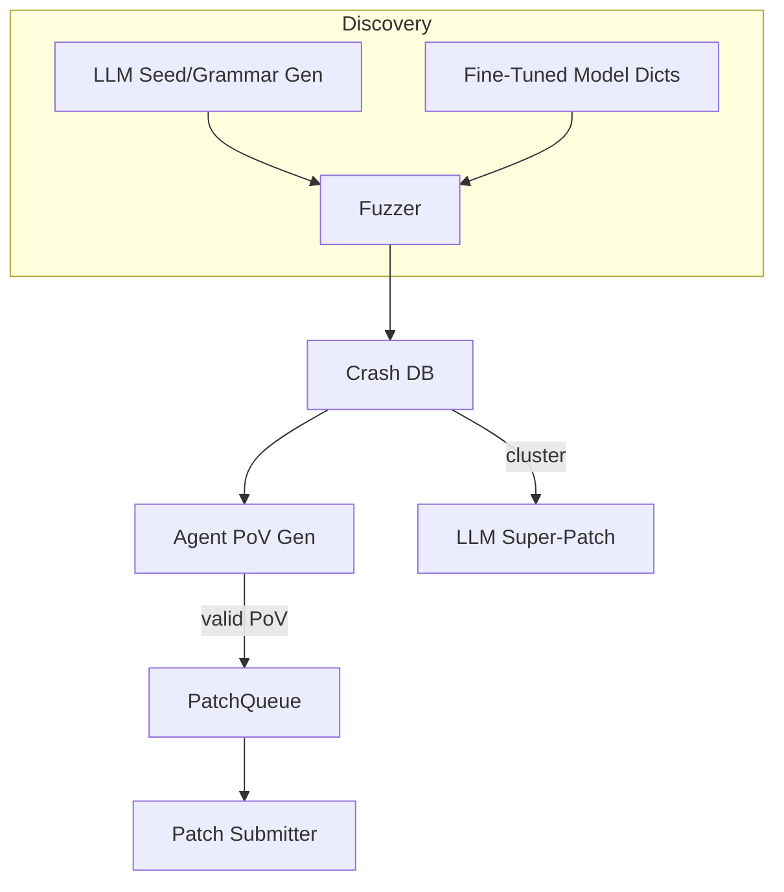

# Fuzzing με υποβοήθηση AI και αυτοματοποιημένη ανακάλυψη ευπαθειών

{{#include ../banners/hacktricks-training.md}}

## Επισκόπηση
Τα large language models (LLM) μπορούν να ενισχύσουν σημαντικά τις παραδοσιακές διαδικασίες έρευνας ευπαθειών, δημιουργώντας σημασιολογικά πλούσια inputs, εξελίσσοντας γραμματικές, αναλύοντας δεδομένα από crashes και προτείνοντας ακόμη και patches για πολλαπλά bugs. Αυτή η σελίδα συγκεντρώνει τα πιο αποτελεσματικά μοτίβα που παρατηρήθηκαν στους τελικούς του DARPA AI Cyber Challenge (AIxCC) και σε άλλες δημόσιες έρευνες.<sup>[[4]](#references)</sup><sup>[[5]](#references)</sup>

Αυτό που ακολουθεί δεν περιγράφει ένα συγκεκριμένο σύστημα διαγωνισμού, αλλά αφαιρεί τις τεχνικές ώστε να μπορείτε να τις αναπαράγετε στις δικές σας ροές εργασίας.

---

## 1. Inputs εκκίνησης που δημιουργούνται από LLM

Οι παραδοσιακοί fuzzers που καθοδηγούνται από coverage (AFL++, libFuzzer, Honggfuzz…) ξεκινούν με ένα μικρό corpus από seeds και μεταλλάσσουν bytes στα τυφλά. Όταν η μορφή εισόδου του στόχου είναι σύνθετη (SQL, URLs, προσαρμοσμένα δυαδικά πρωτόκολλα), οι τυχαίες μεταλλάξεις συνήθως καταστρέφουν τη σύνταξη προτού φτάσουμε σε ενδιαφέροντα branches.

Τα LLM μπορούν να λύσουν αυτό το πρόβλημα εκκίνησης δημιουργώντας *seed generators* – μικρά scripts που παράγουν **inputs με σωστή σύνταξη αλλά σχετικά με την ασφάλεια**. Για παράδειγμα:

```prompt
SYSTEM: You are a helpful security engineer.
USER:
Write a Python3 program that prints 200 unique SQL injection strings targeting common anti-pattern mistakes (missing quotes, numeric context, stacked queries).  Ensure length ≤ 256 bytes / string so they survive common length limits.
```

```python
# gen_sqli_seeds.py (truncated)
PAYLOADS = [
    "1 OR 1=1 -- ",
    "' UNION SELECT NULL,NULL--",
    "0; DROP TABLE users;--",
    ...
]
for p in PAYLOADS:
    print(p)
```

Εκτελέστε μία φορά και τροφοδοτήστε την έξοδο απευθείας στο αρχικό corpus του fuzzer:

```bash
python3 gen_sqli_seeds.py > seeds.txt
afl-fuzz -i seeds.txt -o findings/ -- ./target @@
```

Benefits:
1. Σημασιολογική εγκυρότητα → βαθύτερη κάλυψη από νωρίς.
2. Μπορεί να δημιουργηθεί ξανά: τροποποιήστε το prompt για να εστιάσει σε XSS, path traversal, binary blobs κ.λπ.
3. Χαμηλό κόστος (< 1 ¢ με GPT-3.5).

### Tips
* Ζητήστε από το μοντέλο να *διαφοροποιήσει* το μήκος και την κωδικοποίηση των payload (UTF-8, URL-encoded, UTF-16-LE), ώστε να παρακάμψετε επιφανειακά φίλτρα.
* Ζητήστε ένα *αυτοτελές script* – αποφεύγονται προβλήματα με τη μορφοποίηση JSON.

---

## 2. Grammar-Evolution Fuzzing

Μια πιο ισχυρή παραλλαγή είναι να αφήσετε το LLM να **εξελίξει μια γραμματική** αντί για συγκεκριμένα seeds. Η ροή εργασίας (μοτίβο «Grammar Guy») είναι η εξής:

1. Δημιουργήστε μια αρχική γραμματική ANTLR/Peach/LibFuzzer μέσω prompt.
2. Κάντε fuzzing για N λεπτά και συλλέξτε μετρικές κάλυψης (ακμές / blocks που ενεργοποιήθηκαν).
3. Συνοψίστε τις περιοχές του προγράμματος που δεν καλύφθηκαν και δώστε τη σύνοψη πίσω στο μοντέλο:
   ```prompt
   The previous grammar triggered 12 % of the program edges.  Functions not reached: parse_auth, handle_upload.  Add / modify rules to cover these.
   ```
4. Συγχώνευσε τους νέους κανόνες, εκτέλεσε ξανά fuzzing και επανάλαβε.

Σκελετός ψευδοκώδικα:

```python
for epoch in range(MAX_EPOCHS):
    grammar = llm.refine(grammar, feedback=coverage_stats)
    save(grammar, f"grammar_{epoch}.txt")
    coverage_stats = run_fuzzer(grammar)
```

Βασικά σημεία:
* Διατήρησε έναν *προϋπολογισμό* — κάθε βελτίωση χρησιμοποιεί tokens.
* Χρησιμοποίησε οδηγίες `diff` + `patch`, ώστε το μοντέλο να κάνει επεξεργασίες αντί να ξαναγράφει.
* Σταμάτησε όταν Δcoverage < ε.

---

## 3. Μηχανική σχεδίασης Harness για Local-LLM libFuzzer

Για πηγαίο κώδικα που δεν μπορεί να φύγει από τον σταθμό εργασίας ενός αναλυτή, ένα τοπικό μοντέλο κώδικα μπορεί να συντάξει τον μικρό adapter ανάμεσα στα bytes του fuzzer και ένα API C/C++. Το χρήσιμο όριο ασφαλείας είναι σαφές: **το μοντέλο γράφει και αναθεωρεί την υποδομή δοκιμών· η μετάλλαξη καθοδηγούμενη από κάλυψη εξερευνά εισόδους· οι sanitizers αναφέρουν μη έγκυρες λειτουργίες· ένας άνθρωπος εξετάζει το harness και διαλογίζει τα ευρήματα**.<sup>[[9]](#references)</sup>

Για τεχνικές σε επίπεδο engine σχετικά με corpus, feedback, snapshot και stateful fuzzing, οι οποίες δεν εξαρτώνται από LLM, δες τη γενική [Μεθοδολογία Fuzzing](../generic-methodologies-and-resources/fuzzing.md).

Ξεκίνα με την ακριβή δήλωση που έχει αντιγραφεί από το header του στόχου και περιόρισε τη μορφή εξόδου. Ένα στενά ορισμένο prompt μειώνει τις επινοημένες APIs και κάνει το αποτέλεσμα εύκολο στην εξέταση:<sup>[[8]](#references)[[9]](#references)</sup>

```prompt
Write a libFuzzer target for this exact declaration:
int parse_records(const uint8_t *data, size_t size);

Output only C code. Implement LLVMFuzzerTestOneInput, include the
declaration, pass data and size unchanged, and do not use files,
network access, randomness, clocks, threads, or persistent state.
```

Για έναν parser ακατέργαστων bytes, το αναμενόμενο αποτέλεσμα δεν θα πρέπει να είναι πιο περίπλοκο από:<sup>[[6]](#references)[[9]](#references)</sup>

```c
#include <stddef.h>
#include <stdint.h>

extern int parse_records(const uint8_t *, size_t);

int LLVMFuzzerTestOneInput(const uint8_t *data, size_t size) {
    (void)parse_records(data, size);
    return 0;
}
```

Η μεταγλώττιση είναι μόνο το πρώτο στάδιο επικύρωσης. Ελέγξτε κάθε παραγόμενο στόχο ως προς τα παρακάτω αμετάβλητα πριν αφιερώσετε σε αυτόν χρόνο CPU:<sup>[[6]](#references)[[8]](#references)[[9]](#references)</sup>

- **Ακριβές API:** συγκρίνετε τους τύπους, τους κανόνες ιδιοκτησίας, την αρχικοποίηση, τον τερματισμό λειτουργίας και τη σύμβαση κλήσης με την πραγματική κεφαλίδα και τους υπάρχοντες callers.
- **Ασφάλεια harness:** προστατεύστε κάθε ανάγνωση από το `data`· τα ευρήματα του sanitizer πρέπει να προέρχονται από τον στόχο και όχι από τον κώδικα-συγκόλληση που δημιουργήθηκε.
- **Επαναληψιμότητα:** το αποτέλεσμα πρέπει να είναι συνάρτηση των `data` και `size`· αφαιρέστε την εξωτερική είσοδο/έξοδο, τον χρόνο, την ανεξέλεγκτη τυχαιότητα, τα μη ενωμένα threads και την κατάσταση που διατηρείται μεταξύ κλήσεων.
- **Ρυθμός επεξεργασίας:** αρχικοποιήστε την αμετάβλητη κατάσταση υψηλού κόστους μόνο μία φορά, εφόσον αυτό δεν μπορεί να επηρεάσει τη συμπεριφορά, περιορίστε το μέγεθος της εισόδου, απενεργοποιήστε την καταγραφή και αποδεσμεύστε τις εκχωρήσεις μνήμης ανά είσοδο.
- **Προσπελασιμότητα:** επαληθεύστε ότι εκτελούνται οι επιθυμητές συναρτήσεις και διακλαδώσεις. Ένας στόχος που μεταγλωττίζεται αλλά ασκεί μόνο διαδρομές απόρριψης αποτελεί σιωπηρή αποτυχία.

### Στόχοι με επίγνωση της δομής: διατηρήστε τα αμετάβλητα χωρίς να κρύβετε σφάλματα

Αν οι περισσότερες ακατέργαστες είσοδοι απορρίπτονται λόγω ελέγχου magic, μήκους, έκδοσης ή checksum, χρησιμοποιήστε τα bytes του fuzzing ως **υλικό για τυποποιημένα πεδία** και ανακατασκευάστε ένα έγκυρο αντικείμενο. Ορίστε σταθερές μορφοποίησης, αφήστε τα σημασιολογικά πεδία και τα bytes του payload μεταβλητά και υπολογίστε τα μεταδεδομένα ακεραιότητας από το ανακατασκευασμένο payload. Το `FuzzedDataProvider` είναι χρήσιμο για την κατανάλωση οριοθετημένων τυποποιημένων τιμών, ενώ ο adapter παραμένει υπεύθυνος για τον περιορισμό κάθε παραγόμενης εκχώρησης μνήμης και μετατροπής.<sup>[[9]](#references)</sup>

<details>
<summary>Παράδειγμα στόχου C++ με επίγνωση της δομής</summary>

```cpp
#include <fuzzer/FuzzedDataProvider.h>
#include <stddef.h>
#include <stdint.h>
#include <vector>

extern "C" int parse_message(const uint8_t *, size_t);

extern "C" int LLVMFuzzerTestOneInput(const uint8_t *data, size_t size) {
    FuzzedDataProvider fdp(data, size);
    uint8_t version = fdp.ConsumeIntegral<uint8_t>();
    auto body = fdp.ConsumeRemainingBytes<uint8_t>();
    if (body.size() > UINT16_MAX) body.resize(UINT16_MAX);
    uint16_t len = static_cast<uint16_t>(body.size());
    std::vector<uint8_t> msg = {0x8b, 'M', 'S', 'G', version,
                                static_cast<uint8_t>(len >> 8),
                                static_cast<uint8_t>(len)};
    msg.insert(msg.end(), body.begin(), body.end());
    (void)parse_message(msg.data(), msg.size());
    return 0;
}
```

</details>

Μη χρησιμοποιείτε ένα target που επιδιορθώνει τη δομή για κάθε ερώτημα. Διατηρήστε ένα target που υπολογίζει μήκη/αθροίσματα ελέγχου, ώστε να εξερευνά έγκυρες βαθύτερες καταστάσεις, και ένα άλλο που αφήνει τα **δηλωμένα** μεταδεδομένα υπό τον έλεγχο του fuzzer, περιορίζοντας μόνο τις αναγνώσεις και τις δεσμεύσεις μνήμης του ίδιου του harness. Το δεύτερο target διατηρεί επιφάνειες επίθεσης με ασυμφωνίες μήκους και προβλήματα ακεραιότητας, τα οποία διαφορετικά θα εξαφάνιζε η αυτόματη επιδιόρθωση.<sup>[[9]](#references)</sup>

### Αρχικά δείγματα, λεξικά, sanitizers και feedback κάλυψης

Ζητήστε από το μοντέλο να δημιουργήσει ένα script που γράφει binary seeds, αντί να του ζητήσετε να εκτυπώσει απευθείας binary δεδομένα. Δημιουργήστε seeds για κενά, ελάχιστα, τυπικά και έγκυρα οριακά αντικείμενα. Στη συνέχεια, εξαγάγετε magic values, tags, κωδικοποιήσεις enum και λέξεις-κλειδιά του parser σε ένα λεξικό που έχει ελεγχθεί. Το libFuzzer δέχεται αυτό το λεξικό με την επιλογή `-dict=` και διατηρεί στο corpus τις μεταλλάξεις που αποκαλύπτουν νέα κάλυψη.<sup>[[6]](#references)[[9]](#references)</sup>

```text
magic="\x8bMSG"
version_min="\x00"
version_max="\xff"
config_tag="CONFIG"
```

Κατασκευάστε τον ίδιο στόχο με συμπληρωματική instrumentation. Τα ASan και UBSan μπορούν να χρησιμοποιούν το ίδιο fuzzing binary· χρησιμοποιήστε ξεχωριστό build για το MSan και κάντε instrumentation στις εξαρτήσεις του, ώστε να αποφύγετε αναφορές που προκαλούνται από μη instrumented κώδικα.<sup>[[6]](#references)[[9]](#references)</sup>

```bash
clang++ -g -O1 -fsanitize=fuzzer,address,undefined \
  -fno-sanitize-recover=undefined target.cc harness.cc -o fuzz_target
./fuzz_target corpus -dict=msg.dict -max_len=65535

clang++ -g -O1 -fsanitize=fuzzer,memory \
  target.cc harness.cc -o fuzz_target_msan
```

Αντιμετωπίστε το coverage ως αξιολογητή για κάθε αναθεώρηση του μοντέλου. Στην έξοδο του libFuzzer, τα πρώιμα επίπεδα `cov`/`ft` και ένα στατικό corpus συνήθως υποδεικνύουν κακή πλαισίωση, υπερβολικά περιοριστικό early return ή λάθος κλήση· χαμηλό `exec/s` υποδεικνύει δαπανηρή αρχικοποίηση, I/O, εκχωρήσεις μνήμης ή διαρροή κατάστασης. Το `NEW` αποδεικνύει μόνο ότι άλλαξε ένα χαρακτηριστικό coverage, όχι ότι προσεγγίστηκε ο επιδιωκόμενος parser.<sup>[[6]](#references)[[9]](#references)</sup>

Για feedback σε επίπεδο πηγαίου κώδικα, δημιουργήστε ένα coverage build, εκτελέστε fuzzing και δώστε στο μοντέλο μόνο τις συναρτήσεις που δεν έχουν καλυφθεί μαζί με τις συνθήκες που τις προστατεύουν. Επαληθεύστε τις αλλαγές στο harness/seed/dictionary και μετρήστε ξανά:<sup>[[7]](#references)[[8]](#references)[[9]](#references)</sup>

```bash
clang++ -g -O1 -fsanitize=fuzzer \
  -fprofile-instr-generate -fcoverage-mapping target.cc harness.cc -o fuzz_cov
mkdir -p profiles
LLVM_PROFILE_FILE='profiles/%p.profraw' ./fuzz_cov -max_total_time=300 corpus
llvm-profdata merge -sparse profiles/*.profraw -o fuzz.profdata
llvm-cov report ./fuzz_cov -instr-profile=fuzz.profdata
llvm-cov show ./fuzz_cov -instr-profile=fuzz.profdata \
  --show-branches=count --region-coverage-lt=1 target.cc
```

Ο κλιμακώσιμος βρόχος είναι, επομένως, **δημιουργία → compile/link → smoke-test με sanitizers → μέτρηση του target coverage → παροχή του μικρότερου σχετικού coverage/source context → αναθεώρηση → νέα μέτρηση**. Το OSS-Fuzz-Gen εφαρμόζει την ίδια αρχή, αξιολογώντας τα generated targets ως προς τη δυνατότητα μεταγλώττισης, τα runtime failures, το coverage και τη βελτίωση του coverage σε σχέση με τα υπάρχοντα targets, αντί να αποδέχεται εύλογο κώδικα χωρίς έλεγχο.<sup>[[7]](#references)[[8]](#references)</sup>

---

<a id="3-agent-based-pov-exploit-generation" hidden>3. Δημιουργία PoV (Exploit) με βάση agents</a>

## 4. Δημιουργία PoV (Exploit) με βάση agents

Αφού εντοπιστεί ένα crash, χρειάζεστε ακόμη ένα **proof-of-vulnerability (PoV)** που να το ενεργοποιεί με ντετερμινιστικό τρόπο.

Μια κλιμακώσιμη προσέγγιση είναι η εκκίνηση πολλών ελαφριών workers (processes, threads ή containers), καθένας με διαφορετικό model ή sampling configuration. Η επισκόπηση των φιναλίστ του AIxCC δίνει συγκεκριμένα παραδείγματα κλίμακας: μία ομάδα χρησιμοποίησε **χιλιάδες ταυτόχρονους agents** για AI-first δημιουργία PoV, ενώ μια άλλη συντόνισε **300–500 fuzzing agents** και χρησιμοποίησε LLMs για συλλογισμό υψηλότερου επιπέδου σχετικά με τη σημασιολογία.<sup>[[4]](#references)</sup>

Pipeline:
1. Η στατική/δυναμική ανάλυση παράγει *bug candidates* (struct με crash PC, input slice, μήνυμα sanitizer).
2. Ο orchestrator διανέμει τα candidates στους agents.
3. Βήματα συλλογισμού του agent:
   a. Αναπαραγωγή του bug τοπικά με `gdb` και input.
   b. Πρόταση ελάχιστου exploit payload.
   c. Επικύρωση του exploit σε sandbox. Αν πετύχει → υποβολή.
4. Οι αποτυχημένες προσπάθειες **μπαίνουν ξανά στην ουρά ως νέα seeds** για fuzzing κάλυψης (feedback loop).

Πλεονεκτήματα:
* Η παραλληλοποίηση αντισταθμίζει την αναξιοπιστία ενός μεμονωμένου agent.
* Αυτόματη προσαρμογή των temp / μεγέθους model με βάση το παρατηρούμενο success rate.

---

<a id="4-directed-fuzzing-with-fine-tuned-code-models" hidden>4. Κατευθυνόμενο fuzzing με fine-tuned code models</a>

## 5. Κατευθυνόμενο fuzzing με fine-tuned code models

Κάντε fine-tune ένα model ανοιχτών βαρών (π.χ. Llama-7B) με πηγαίο κώδικα C/C++ που έχει επισημανθεί με μοτίβα ευπαθειών (integer overflow, αντιγραφή buffer, format string). Έπειτα:

1. Εκτελέστε στατική ανάλυση για να λάβετε λίστα συναρτήσεων και AST.
2. Δώστε στο model το prompt: *«Δώσε εγγραφές λεξικού μεταλλάξεων που είναι πιθανό να παραβιάσουν την ασφάλεια μνήμης στη συνάρτηση X»*.
3. Εισαγάγετε αυτά τα tokens σε ένα προσαρμοσμένο `AFL_CUSTOM_MUTATOR`.

Παράδειγμα εξόδου για ένα wrapper της `sprintf`:
```
{"pattern":"%99999999s"}
{"pattern":"AAAAAAAA....<1024>....%n"}
```

Εμπειρικά, αυτό μειώνει τον χρόνο έως το crash κατά >2× σε πραγματικούς στόχους.

---

<a id="5-ai-guided-patching-strategies" hidden>5. Στρατηγικές patching καθοδηγούμενες από AI</a>

## 6. Στρατηγικές patching καθοδηγούμενες από AI

<a id="51-super-patches" hidden>5.1 Super Patches</a>

### 6.1 Super Patches
Ζητήστε από το μοντέλο να *ομαδοποιήσει* τις υπογραφές των crash και να προτείνει ένα **ενιαίο patch** που εξαλείφει τη συνήθη βασική αιτία.  Υποβάλετε μία φορά, διορθώστε αρκετά bugs → λιγότερες ποινές ακρίβειας σε περιβάλλοντα όπου κάθε λανθασμένο patch κοστίζει πόντους.

Περίγραμμα prompt:
```
Here are 10 stack traces + file snippets.  Identify the shared mistake and generate a unified diff fixing all occurrences.
```

{{#ref}}
../generic-methodologies-and-resources/fuzzing.md
{{#endref}}

<a id="52-speculative-patch-ratio" hidden>5.2 Αναλογία Υποθετικών Patches</a>

### 6.2 Αναλογία Υποθετικών Patches
Υλοποιήστε μια ουρά όπου εναλλάσσονται patches που έχουν επιβεβαιωθεί με PoV και *υποθετικά* patches (χωρίς PoV), σε αναλογία 1:N προσαρμοσμένη στους κανόνες βαθμολόγησης (π.χ. 2 υποθετικά : 1 επιβεβαιωμένο). Ένα μοντέλο κόστους παρακολουθεί τις ποινές σε σχέση με τους βαθμούς και προσαρμόζει αυτόματα το N.

---

Για ντετερμινιστικό έλεγχο πηγαίου κώδικα ανά αρχείο, taskflows για mobile entry points, ελέγχους μοτίβων kernel και επικύρωση ευπαθειών με τεκμηριωμένα στοιχεία, δείτε [Έλεγχος πηγαίου κώδικα με υποβοήθηση AI και επικύρωση ευπαθειών](AI-Assisted-Source-Review-and-Vulnerability-Validation.md).

---

## Διαλογή σφαλμάτων με υποβοήθηση debugger

Οι ροές εργασίας Mona v3 για διαλογή σφαλμάτων, ανάλυση συναρτήσεων και ελεγχόμενη προσβασιμότητα heap chunks περιγράφονται στα [Εργαλεία Exploiting](../binary-exploitation/basic-stack-binary-exploitation-methodology/tools/#mona-v3-debugger-context-requests-for-crash-triage).

---

## Συνδυάζοντας τα πάντα
Ένα CRS (Cyber Reasoning System) από άκρο σε άκρο μπορεί να συνδέει τα στοιχεία ως εξής:



---

## References

- [4] [Trail of Bits – Τελικοί AIxCC: Η αναμέτρηση](https://blog.trailofbits.com/2025/08/07/aixcc-finals-tale-of-the-tape/)
- [5] [Συνεντεύξεις φιναλίστ του AIxCC από το CTF Radiooo](https://www.youtube.com/@ctfradiooo)
- [6] [LLVM — libFuzzer: μια βιβλιοθήκη για fuzz testing καθοδηγούμενο από κάλυψη κώδικα](https://llvm.org/docs/LibFuzzer.html)
- [7] [Google — OSS-Fuzz-Gen](https://github.com/google/oss-fuzz-gen)
- [8] [Ιστολόγιο ασφάλειας της Google — Αναβαθμίζοντας το fuzzing: Εύρεση περισσότερων ευπαθειών με AI](https://security.googleblog.com/2024/11/leveling-up-fuzzing-finding-more.html)
- [9] [8kSec — Υποβοηθούμενη από AI δημιουργία harness για fuzzing με τοπικό LLM](https://8ksec.io/ai-assisted-fuzzing-harness-local-llm)
{{#include ../banners/hacktricks-training.md}}
