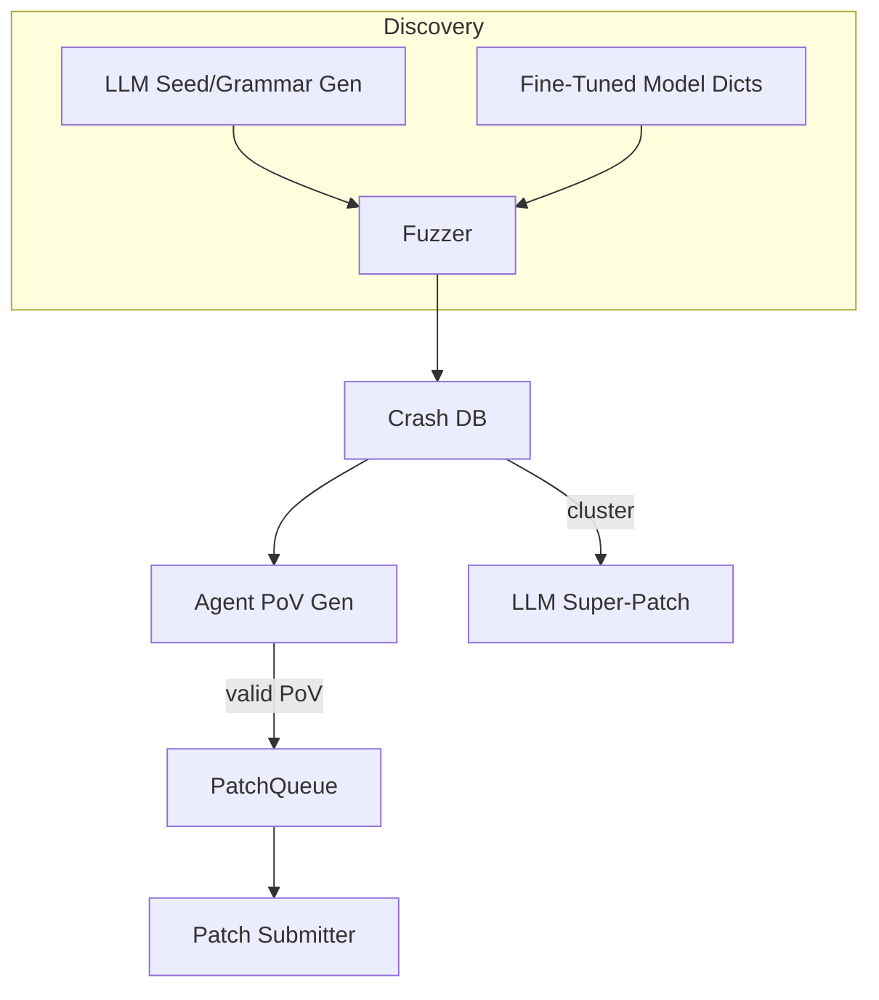

# Fuzzing wspomagany przez AI i automatyczne wykrywanie podatności

{{#include ../banners/hacktricks-training.md}}

## Przegląd
Modele językowe dużej skali (LLM) mogą znacznie usprawnić tradycyjne procesy badania podatności, generując semantycznie bogate dane wejściowe, rozwijając gramatyki, analizując dane o awariach, a nawet proponując poprawki usuwające wiele błędów. Ta strona przedstawia najskuteczniejsze wzorce zaobserwowane podczas finałów DARPA AI Cyber Challenge (AIxCC) oraz innych publicznych badań.<sup>[[4]](#references)</sup><sup>[[5]](#references)</sup>

Poniżej nie opisano konkretnego systemu konkursowego, lecz przedstawiono techniki w sposób ogólny, aby można je było odtworzyć we własnych procesach.

---

## 1. Dane wejściowe seed generowane przez LLM

Tradycyjne fuzzery sterowane pokryciem (AFL++, libFuzzer, Honggfuzz…) rozpoczynają działanie od niewielkiego korpusu seedów i ślepo mutują bajty. Gdy format danych wejściowych celu jest złożony (SQL, URL-e, niestandardowe protokoły binarne), losowe mutacje zwykle psują składnię, zanim zostaną osiągnięte interesujące gałęzie.

LLM-y mogą rozwiązać ten problem inicjalizacji, generując *generatory seedów* – krótkie skrypty, które zwracają **poprawne składniowo dane wejściowe istotne z punktu widzenia bezpieczeństwa**. Na przykład:

```prompt
SYSTEM: You are a helpful security engineer.
USER:
Write a Python3 program that prints 200 unique SQL injection strings targeting common anti-pattern mistakes (missing quotes, numeric context, stacked queries).  Ensure length ≤ 256 bytes / string so they survive common length limits.
```

```python
# gen_sqli_seeds.py (truncated)
PAYLOADS = [
    "1 OR 1=1 -- ",
    "' UNION SELECT NULL,NULL--",
    "0; DROP TABLE users;--",
    ...
]
for p in PAYLOADS:
    print(p)
```

Uruchom raz i bezpośrednio dodaj wynik do początkowego korpusu fuzzera:

```bash
python3 gen_sqli_seeds.py > seeds.txt
afl-fuzz -i seeds.txt -o findings/ -- ./target @@
```

Korzyści:
1. Poprawność semantyczna → większe pokrycie już na wczesnym etapie.
2. Możliwość ponownego generowania: zmień prompt, aby skupić się na XSS, path traversal, binary blobs itp.
3. Niski koszt (< 1 ¢ przy GPT-3.5).

### Wskazówki
* Poinstruuj model, aby *różnicował* długość i kodowanie payloadów (UTF-8, URL-encoded, UTF-16-LE), by omijać powierzchowne filtry.
* Poproś o *pojedynczy, samowystarczalny skrypt* — unikniesz problemów z formatowaniem JSON.

---

## 2. Fuzzing z ewolucją gramatyki

Bardziej zaawansowany wariant polega na tym, by pozwolić LLM **rozwijać gramatykę** zamiast konkretnych seeds. Przepływ pracy (wzorzec „Grammar Guy”) wygląda następująco:

1. Wygeneruj początkową gramatykę ANTLR/Peach/LibFuzzer za pomocą promptu.
2. Uruchom fuzzing przez N minut i zbierz metryki pokrycia (trafione krawędzie / bloki).
3. Podsumuj niepokryte obszary programu i przekaż podsumowanie z powrotem modelowi:
   ```prompt
   The previous grammar triggered 12 % of the program edges.  Functions not reached: parse_auth, handle_upload.  Add / modify rules to cover these.
   ```
4. Scal nowe reguły, ponownie przeprowadź fuzzing i powtórz.

Szkielet pseudokodu:

```python
for epoch in range(MAX_EPOCHS):
    grammar = llm.refine(grammar, feedback=coverage_stats)
    save(grammar, f"grammar_{epoch}.txt")
    coverage_stats = run_fuzzer(grammar)
```

Kluczowe punkty:
* Zachowaj *budżet* — każde udoskonalenie zużywa tokeny.
* Używaj instrukcji `diff` + `patch`, aby model wprowadzał zmiany zamiast przepisywać całość.
* Zatrzymaj się, gdy Δcoverage < ε.

---

## 3. Inżynieria harnessa libFuzzer dla lokalnych LLM

Gdy kod źródłowy nie może opuścić stacji roboczej analityka, lokalny model kodujący może przygotować niewielki adapter między bajtami fuzzera a API C/C++. Granica bezpieczeństwa jest jasno określona: **model tworzy i poprawia infrastrukturę testową; mutacje sterowane pokryciem eksplorują dane wejściowe; sanitizers zgłaszają nieprawidłowe operacje; człowiek sprawdza harness i analizuje wyniki**.<sup>[[9]](#references)</sup>

Informacje o technikach dotyczących corpus, informacji zwrotnej, snapshotów i fuzzingu stanowego na poziomie silnika, które nie zależą od LLM, znajdziesz w ogólnej [metodyce fuzzingu](../generic-methodologies-and-resources/fuzzing.md).

Zacznij od dokładnej deklaracji skopiowanej z nagłówka celu i określ format wyjściowy. Wąski prompt ogranicza wymyślanie API i ułatwia weryfikację wyniku:<sup>[[8]](#references)[[9]](#references)</sup>

```prompt
Write a libFuzzer target for this exact declaration:
int parse_records(const uint8_t *data, size_t size);

Output only C code. Implement LLVMFuzzerTestOneInput, include the
declaration, pass data and size unchanged, and do not use files,
network access, randomness, clocks, threads, or persistent state.
```

W przypadku parsera surowych bajtów oczekiwany wynik nie powinien być bardziej skomplikowany niż:<sup>[[6]](#references)[[9]](#references)</sup>

```c
#include <stddef.h>
#include <stdint.h>

extern int parse_records(const uint8_t *, size_t);

int LLVMFuzzerTestOneInput(const uint8_t *data, size_t size) {
    (void)parse_records(data, size);
    return 0;
}
```

Kompilacja to dopiero pierwsza bramka walidacji. Zanim poświęcisz na to czas procesora, sprawdź każdy wygenerowany cel pod kątem poniższych niezmienników:<sup>[[6]](#references)[[8]](#references)[[9]](#references)</sup>

- **Dokładne API:** porównaj typy, zasady zarządzania własnością, inicjalizację, zwalnianie zasobów i konwencję wywołań z rzeczywistym nagłówkiem i istniejącymi wywołaniami.
- **Bezpieczeństwo harnessa:** zabezpiecz każdy odczyt z `data`; problemy wykryte przez sanitizer muszą pochodzić z celu, a nie z wygenerowanego kodu pośredniczącego.
- **Powtarzalność:** spraw, by wynik zależał od `data` i `size`; usuń zewnętrzne operacje wejścia/wyjścia, zależność od czasu, niekontrolowaną losowość, nieoczekujące na zakończenie wątki i stan zachowywany między wywołaniami.
- **Przepustowość:** inicjalizuj kosztowny, niezmienny stan tylko raz i tylko wtedy, gdy nie wpływa to na działanie; ogranicz rozmiar wejścia, wyłącz logowanie i zwalniaj alokacje dla każdego wejścia.
- **Osiągalność:** sprawdź, czy wykonywane są zamierzone funkcje i gałęzie. Cel, który się kompiluje, ale wykonuje tylko ścieżki odrzucenia, oznacza cichą porażkę.

### Cele uwzględniające strukturę: zachowaj niezmienniki, nie ukrywając błędów

Jeśli większość surowych danych wejściowych nie przechodzi kontroli wartości magicznej, długości, wersji lub sumy kontrolnej, użyj bajtów fuzzingu jako materiału do pól typowanych i odtwórz prawidłowy obiekt. Ustal stałe formatu, pozostaw pola semantyczne i bajty danych użytkownika zmienne, a metadane integralności wylicz na podstawie odtworzonych danych użytkownika. `FuzzedDataProvider` przydaje się do pobierania ograniczonych wartości typowanych, natomiast adapter odpowiada za ograniczanie każdej generowanej alokacji i konwersji.<sup>[[9]](#references)</sup>

<details>
<summary>Przykładowy cel C++ uwzględniający strukturę</summary>

```cpp
#include <fuzzer/FuzzedDataProvider.h>
#include <stddef.h>
#include <stdint.h>
#include <vector>

extern "C" int parse_message(const uint8_t *, size_t);

extern "C" int LLVMFuzzerTestOneInput(const uint8_t *data, size_t size) {
    FuzzedDataProvider fdp(data, size);
    uint8_t version = fdp.ConsumeIntegral<uint8_t>();
    auto body = fdp.ConsumeRemainingBytes<uint8_t>();
    if (body.size() > UINT16_MAX) body.resize(UINT16_MAX);
    uint16_t len = static_cast<uint16_t>(body.size());
    std::vector<uint8_t> msg = {0x8b, 'M', 'S', 'G', version,
                                static_cast<uint8_t>(len >> 8),
                                static_cast<uint8_t>(len)};
    msg.insert(msg.end(), body.begin(), body.end());
    (void)parse_message(msg.data(), msg.size());
    return 0;
}
```

</details>

Nie używaj jednego celu naprawiającego strukturę do wszystkich pytań. Utrzymuj jeden cel, który wylicza długości/sumy kontrolne, aby eksplorować głębokie, poprawne stany, oraz drugi, który pozostawia **deklarowane** metadane pod kontrolą fuzzera, ograniczając jedynie odczyty i alokacje wykonywane przez harness. Drugi cel zachowuje powierzchnie ataku związane z niezgodnymi długościami i nieprawidłową integralnością, które automatyczna naprawa w przeciwnym razie by wyeliminowała.<sup>[[9]](#references)</sup>

### Ziarna, słowniki, sanitizery i informacja zwrotna o pokryciu

Poproś model o wygenerowanie skryptu zapisującego binarne ziarna zamiast proszenia go o bezpośrednie wypisanie danych binarnych. Przygotuj puste, minimalne, typowe i poprawne graniczne obiekty; następnie wyodrębnij wartości magiczne, tagi, kodowania enumów i słowa kluczowe parsera do sprawdzonego słownika. libFuzzer przyjmuje ten słownik za pomocą `-dict=` i zachowuje w korpusie mutacje, które ujawniają nowe pokrycie.<sup>[[6]](#references)[[9]](#references)</sup>

```text
magic="\x8bMSG"
version_min="\x00"
version_max="\xff"
config_tag="CONFIG"
```

Zbuduj ten sam program docelowy z uzupełniającą instrumentacją. ASan i UBSan mogą współdzielić plik binarny do fuzzingu; użyj osobnej kompilacji MSan i zinstrumentuj jego zależności, aby uniknąć zgłoszeń spowodowanych przez niezinstrumentowany kod.<sup>[[6]](#references)[[9]](#references)</sup>

```bash
clang++ -g -O1 -fsanitize=fuzzer,address,undefined \
  -fno-sanitize-recover=undefined target.cc harness.cc -o fuzz_target
./fuzz_target corpus -dict=msg.dict -max_len=65535

clang++ -g -O1 -fsanitize=fuzzer,memory \
  target.cc harness.cc -o fuzz_target_msan
```

Traktuj pokrycie jako kryterium oceny każdej rewizji modelu. W wynikach libFuzzer wczesne wypłaszczenie `cov`/`ft` i statyczny corpus zwykle oznaczają nieprawidłowe ramkowanie, zbyt restrykcyjny wczesny zwrot albo niewłaściwe wywołanie; niska wartość `exec/s` wskazuje na kosztowną konfigurację, operacje I/O, alokację lub wyciekający stan. `NEW` dowodzi jedynie, że zmieniła się pewna cecha pokrycia, a nie że osiągnięto zamierzony parser.<sup>[[6]](#references)[[9]](#references)</sup>

Aby uzyskać informacje zwrotne na poziomie kodu źródłowego, przygotuj kompilację z coverage, uruchom fuzzing i przekaż modelowi tylko niepokryte funkcje wraz z warunkami, które je chronią. Zweryfikuj wynikający z tego diff harness/seed/dictionary i ponownie wykonaj pomiary:<sup>[[7]](#references)[[8]](#references)[[9]](#references)</sup>

```bash
clang++ -g -O1 -fsanitize=fuzzer \
  -fprofile-instr-generate -fcoverage-mapping target.cc harness.cc -o fuzz_cov
mkdir -p profiles
LLVM_PROFILE_FILE='profiles/%p.profraw' ./fuzz_cov -max_total_time=300 corpus
llvm-profdata merge -sparse profiles/*.profraw -o fuzz.profdata
llvm-cov report ./fuzz_cov -instr-profile=fuzz.profdata
llvm-cov show ./fuzz_cov -instr-profile=fuzz.profdata \
  --show-branches=count --region-coverage-lt=1 target.cc
```

Skalowalna pętla wygląda więc tak: **generowanie → kompilacja/linkowanie → testy pobieżne z użyciem sanitizerów → pomiar pokrycia targetu → dostarczenie najmniejszego istotnego kontekstu pokrycia/źródła → poprawki → ponowny pomiar**. OSS-Fuzz-Gen stosuje tę samą zasadę, oceniając wygenerowane targety pod kątem możliwości kompilacji, błędów czasu wykonania, pokrycia i poprawy pokrycia względem istniejących targetów, zamiast bezkrytycznie akceptować kod, który jedynie wygląda wiarygodnie.<sup>[[7]](#references)[[8]](#references)</sup>

---

## 4. Generowanie PoV (exploitów) oparte na agentach

Po znalezieniu crasha nadal potrzebujesz **proof-of-vulnerability (PoV)**, który deterministycznie go wywołuje.

Skalowalne podejście polega na uruchomieniu wielu lekkich workerów (procesów, wątków lub kontenerów), z których każdy korzysta z innego modelu lub konfiguracji próbkowania. W przeglądzie finalistów AIxCC podano konkretne przykłady takiej skali: jeden zespół użył **tysięcy równoczesnych agentów** do generowania PoV z wykorzystaniem AI jako głównego narzędzia, a inny koordynował pracę **300–500 agentów fuzzujących** i wykorzystywał LLM-y do wyższego poziomu rozumowania semantycznego.<sup>[[4]](#references)</sup>

Potok:
1. Analiza statyczna/dynamiczna generuje *kandydatów na błędy* (strukturę zawierającą crash PC, fragment wejścia i komunikat sanitizera).
2. Orkiestrator rozdziela kandydatów między agentów.
3. Etapy rozumowania agenta:
   a. Odtwórz błąd lokalnie za pomocą `gdb` i wejścia.
   b. Zaproponuj minimalny payload exploita.
   c. Zweryfikuj exploit w sandboxie. Jeśli się powiedzie → zgłoś.
4. Nieudane próby są **ponownie dodawane do kolejki jako nowe seedy** do fuzzingu pokrycia (pętla sprzężenia zwrotnego).

Zalety:
* Równoległość maskuje zawodność pojedynczego agenta.
* Automatyczne dostrajanie temp / rozmiaru modelu na podstawie obserwowanego wskaźnika powodzenia.

---

## 5. Fuzzing ukierunkowany z dostrojonymi modelami kodu

Dostrój model z otwartymi wagami (np. Llama-7B) na kodzie źródłowym C/C++ oznaczonym wzorcami podatności (przepełnienie liczby całkowitej, kopiowanie bufora, format string). Następnie:

1. Uruchom analizę statyczną, aby uzyskać listę funkcji i AST.
2. Podaj modelowi prompt: *„Podaj wpisy słownika mutacji, które prawdopodobnie naruszą bezpieczeństwo pamięci w funkcji X”*.
3. Wstaw te tokeny do niestandardowego `AFL_CUSTOM_MUTATOR`.

Przykładowy wynik dla wrappera `sprintf`:
```
{"pattern":"%99999999s"}
{"pattern":"AAAAAAAA....<1024>....%n"}
```

Empirycznie skraca to czas do awarii ponad 2-krotnie na rzeczywistych celach.

---

## 6. Strategie łatania wspomagane przez AI

### 6.1 Super Patches
Poproś model o *pogrupowanie* sygnatur awarii i zaproponowanie **pojedynczego patcha**, który usuwa wspólną przyczynę źródłową. Zgłoś go raz, napraw kilka błędów → mniej kar za dokładność w środowiskach, w których każdy błędny patch kosztuje punkty.

Zarys promptu:
```
Here are 10 stack traces + file snippets.  Identify the shared mistake and generate a unified diff fixing all occurrences.
```

{{#ref}}
../generic-methodologies-and-resources/fuzzing.md
{{#endref}}

### 6.2 Współczynnik spekulatywnych patchy
Zaimplementuj kolejkę, w której potwierdzone patche zweryfikowane przez PoV i *spekulatywne* patche (bez PoV) są przeplatane w proporcji 1:​N dostosowanej do zasad punktacji (np. 2 spekulatywne : 1 potwierdzony). Model kosztów monitoruje kary i punkty, a następnie samodzielnie dostosowuje N.

---

## 7. Deterministyczny przegląd kodu AI plik po pliku

Częstym trybem porażki podczas przeglądu wspomaganego przez AI jest proszenie jednego agenta o sprawdzenie całego repozytorium i liczenie na to, że wybierze właściwe pliki oraz frazy do grep. Bardziej niezawodnym wzorcem jest **wymuszenie pokrycia repozytorium**:<sup>[[1]](#references)</sup>

1. Wylistuj pliki źródłowe.
2. Przekazuj **jeden plik naraz** wraz z minimalnym kontekstem (punkt wejścia, importy, pobliskie routes/callers).
3. Wymagaj **ustrukturyzowanego raportu** dla każdego pliku: źródła, sink, brakująca walidacja, warunki wstępne exploita i poziom pewności.<sup>[[3]](#references)</sup>
4. Usuń duplikaty raportów według **wzorca source→sink** i ręcznie zweryfikuj te o wysokim ryzyku.

To podejście zużywa dużo tokenów i generuje szum, ale jest bardzo skuteczne w wykrywaniu **prostych błędów source/sink o dużym wpływie**, które często umykają podczas szerokich przeglądów agentowych.

### Wzorce do priorytetowego triage

- **Dynamiczne dołączanie/dispatch w PHP**: kontrolowane przez atakującego nazwy route/controller/module trafiają do `require_once()`, `include()` lub `include_once()` bez ścisłej allowlisty i kanonikalizacji ścieżek.
- **Wykonywanie poleceń powłoki w przepływach administracyjnych/kontowych**: nazwy użytkowników, domeny, konta FTP lub inne identyfikatory trafiają do `exec()`, `system()`, `shell_exec()`, `passthru()`, `proc_open()` lub `popen()`.
- **Łączenie danych ze strukturyzowanych wejść**: ten sam parametr jest przyjmowany z `$_GET`, `$_POST`, JSON, XML lub parserów body frameworka, a następnie wykorzystywany w sinkach systemu plików lub poleceń systemu operacyjnego.

### Dwie praktyczne klasy błędów, które ta metoda dobrze wykrywa

- **LFI/RCE w PHP przez dispatch kontrolera**: jeśli nazwa kontrolera pochodzi z requestu i jest łączona z `require_once()` bez allowlisty/normalizacji ścieżki, sekwencje traversal, takie jak `../`, mogą spowodować, że PHP dołączy niezamierzony lokalny plik `.php`. Jeśli atakujący może wskazać spreparowany lub w inny sposób użyteczny plik PHP, LFI prowadzi do wykonania kodu. Zobacz [File Inclusion / Path Traversal](../pentesting-web/file-inclusion/README.md).<sup>[[1]](#references)</sup>
- **Uwierzytelnione command injection w panelach hostingowych/administracyjnych**: jeśli pola zarządzania kontami, takie jak nazwy użytkowników, są osadzane w poleceniach powłoki, uwierzytelniony użytkownik o niskich uprawnieniach może zmienić zwykłą operację tworzenia/usuwania w RCE. Skutki są poważniejsze, gdy panel wykonuje polecenie jako konto usługi o wyższych uprawnieniach. Zobacz [Command Injection](../pentesting-web/command-injection.md).<sup>[[1]](#references)</sup>

### Praktyczne uwagi dotyczące przeglądu

- Wykorzystuj LLM najpierw jako narzędzie do przeglądu **source/sink**, a nie jako generator exploitów.
- Poproś go o jawne wskazanie **pola kontrolowanego przez atakującego**, **luki w normalizacji/walidacji** oraz **niebezpiecznego sinka**.
- W dużych repozytoriach deterministyczny przegląd plik po pliku jest często bardziej niezawodny niż pojedyncze uruchomienie autonomicznego agenta, nawet jeśli korzysta on z mocniejszego modelu.<sup>[[2]](#references)</sup>
- Oczekuj słabszych wyników w przypadku **Broken Access Control** i innych błędów logiki biznesowej, których exploitatability zależy od założeń obejmujących wiele plików, semantyki ról lub modeli zagrożeń specyficznych dla produktu.

---

## 8. Audyt jądra ukierunkowany wzorcami z instrumentowanym oracle

W przypadku celu wielkości jądra nie proś agenta o wyszukiwanie dowolnych błędów w całym drzewie. Bardziej oszczędny pod względem tokenów przepływ pracy przekształca wiedzę o historycznych podatnościach w statyczne zapytania, szereguje wyniki według eksponowanej powierzchni ataku i wykorzystuje instrumentowane jądro jako oracle wykonania.<sup>[[11]](#references)</sup>

### Baza wzorców → CodeQL/Semgrep → ukierunkowany przegląd

Zbuduj niewielką bazę wiedzy zawierającą niebezpieczne API, wzorce brakującej walidacji, ryzykowne przepływy source-to-sink i kształty wcześniej naprawionych błędów. Poproś model, aby tłumaczył **po jednym wzorcu naraz** na heurystyki przeglądu i reguły CodeQL/Semgrep, a następnie uruchom te deterministyczne reguły na całym drzewie. Zgrupuj i usuń duplikaty wyników, zanim przekażesz kod modelowi; surowe wyniki skanera mogą zawierać tysiące kandydatów o niewielkiej wartości. Przed zastosowaniem tego podejścia poza kwalifikującymi się celami badawczymi lub open source sprawdź aktualną licencję CodeQL.<sup>[[11]](#references)</sup>

Ustal priorytet podsystemów na podstawie zarówno **gęstości trafień reguł**, jak i **dostępności dla atakującego**, a nie samej liczby trafień. Interfejsy jądra dostępne dla nieuprzywilejowanych procesów, sandboxów, kontenerów, jaili lub kontekstów gościa zasługują na wyższy priorytet niż kod dostępny wyłącznie wewnętrznie. Zachowaj na tyle mały zakres przeglądu, by agent mógł uwzględnić callers, walidatory i reguły czasu życia; zamiast prośby „znajdź dowolną podatność” wskaż konkretną klasę podatności lub wzorzec przepływu sterowania. Szczególnie interesujące są starsze uprzywilejowane interfejsy, gdy nowsza granica izolacji sprawia, że stają się dostępne dla użytkownika root w przestrzeni nazw lub jailu.<sup>[[11]](#references)</sup>

Dla każdego kandydata wymagaj jawnego zapisu przepływu pól przed podjęciem próby exploita.<sup>[[11]](#references)</sup>

```text
entrypoint -> privilege check -> parser -> validation/normalization
           -> later rewrite -> dangerous sink
attacker controls: <fields and lengths>
constraints:       <values rewritten, rejected, or preserved>
observable result: <sanitizer report, assertion, panic, or clean exit>
```

### Używaj telemetrii KASAN jako wyroczni weryfikującej hipotezy

Uruchom docelowe jądro w jednorazowej maszynie wirtualnej z włączonym KASAN i użytecznymi asercjami diagnostycznymi. Agent powinien iterować według schematu **hipoteza dotycząca kodu źródłowego → minimalny wyzwalacz w przestrzeni użytkownika → wykonanie w maszynie wirtualnej → ślad KASAN/asercji → zaktualizowana hipoteza**, aż do odtworzenia lub odrzucenia podejrzewanej korupcji. Przy każdej iteracji zwracaj wyłącznie istotny ślad stosu i fragment kodu źródłowego w pobliżu, aby zachować kontekst potrzebny do rozumowania i uczynić dowody z wykonania — a nie pewność modelu — kryterium akceptacji.<sup>[[11]](#references)</sup>

Kompilacja z instrumentacją nie jest docelowym środowiskiem do oceny możliwości wykorzystania błędu. Asercje mogą zatrzymać wykonanie przed operacją powodującą korupcję, a ta sama asercja może być wyłączona w produkcyjnym jądrze. Ponownie przetestuj niezmieniony wyzwalacz z dokładną konfiguracją produkcyjną, zapisz kompilację i konfigurację jądra oraz rozróżniaj **osiągalność**, **korupcję pamięci**, **kontrolowany prymityw** i **wpływ na bezpieczeństwo** jako odrębne twierdzenia.<sup>[[11]](#references)[[12]](#references)</sup>

CVE-2026-3038 to przydatny przykład walidacyjny, a nie szablon exploita. Nieuprzywilejowane żądanie FreeBSD `RTM_GET` mogło zachować zbyt duży sockaddr `RTAX_AUTHOR` mimo selektywnej walidacji i przepisywania odpowiedzi, aż `rtsock_msg_buffer()` skopiowało kontrolowane przez użytkownika `sa_len` do 128-bajtowego stosowego `sockaddr_storage`. Maksymalna kopia 255 bajtów powodowała nadpisanie 127 bajtów; asercja diagnostyczna wykrywała nieprawidłową długość w kompilacji z instrumentacją, natomiast jądro GENERIC dochodziło do kopiowania, po czym wywoływało panic podczas sprawdzania uszkodzonego canary. Dowodzi to nieuprzywilejowanej odmowy usługi, a nie samodzielnego podniesienia uprawnień: niezawodne sterowanie wymagałoby najpierw innego prymitywu, takiego jak ujawnienie wartości canary. Zobacz [Stack Canaries](../binary-exploitation/common-binary-protections-and-bypasses/stack-canaries/index.html), aby poznać odpowiadającą temu granicę w binary exploitation.<sup>[[11]](#references)[[12]](#references)[[13]](#references)</sup>

### Odrzucaj obchodzenie warunków wstępnych exploita

Zanim zaakceptujesz PoV lub exploit, poproś niezależnego recenzenta/agenta o próbę jego obalenia na podstawie ustalonych kryteriów. Recenzja musi potwierdzić wszystkie poniższe warunki.<sup>[[11]](#references)</sup>

- Kod źródłowy celu, jądro i podatny moduł nie zostały zmodyfikowane w celu udostępnienia tej ścieżki.
- Nie dodano modułu pomocniczego, sztucznego gadżetu, wyłączonego zabezpieczenia, dodatkowych uprawnień ani niedostępnego interfejsu.
- Wyzwalacz rozpoczyna działanie z deklarowaną tożsamością wywołującego i ograniczeniami izolacji na czystej migawce.
- Deklarowany rezultat nadal zależy od błędu: usunięcie nieprawidłowego pola lub załatanie wyłącznie tego błędu musi przerwać łańcuch.
- Awaria, odczyt poza zakresem lub nadpisanie są zgłaszane wyłącznie jako dany prymityw; wykonanie kodu lub podniesienie uprawnień wymaga niezależnych dowodów.

Ta ostatnia weryfikacja kontrfaktyczna wykrywa demonstracje oparte na błędnym kole: jeśli warunki wstępne już zapewniają deklarowany wpływ (na przykład wykonanie dostarczonej przez atakującego zawartości SUID z systemu plików zamontowanego bez `nosuid`), błąd bezpieczeństwa pamięci nie spowodował tego wpływu.<sup>[[11]](#references)</sup>

---

## Audytowalne badania nieznanych baz kodu wspomagane przez agentów

[graph-first fuzz-target workflow](../generic-methodologies-and-resources/fuzzing.md#graph-first-fuzz-target-selection-and-mutation-triage) obejmuje już osiągalność punktów wejścia, a [agentic SAST pipelines](../network-services-pentesting/pentesting-web/code-review-tools.md#agentic-sast-pipelines) obejmuje etapową weryfikację i bramki dowodowe. Oddziel te deterministyczne wyniki od hipotez modelu, tak aby każdy awansowany trop zachował lokalizacje w kodzie źródłowym, dowody dotyczące ścieżki i pomiar dynamiczny.<sup>[[10]](#references)</sup>

### Koreluj dowody dotyczące cyklu życia obiektów, nie wymyślając przepływu danych

Analiza statyczna może wykryć, że kontrolowana przez atakującego długość jest zapisywana w jednej funkcji, a to samo pole obiektu trafia znacznie później do miejsca kopiowania, ale nie zdołać udowodnić związku między nimi przez callbacki, ponowne połączenia lub cykl życia obiektu. Zachowaj oba ustalenia oddzielnie, grupuj je według obiektu/pola i wyraźnie oznacz brakujące powiązanie jako pytanie do weryfikacji. Agent może zasugerować zależność, ale musi ją potwierdzić analiza kodu źródłowego lub instrumentacja środowiska uruchomieniowego.<sup>[[10]](#references)</sup>

Dla każdego kandydata zapisz:

- konkretny punkt wejścia i bajty kontrolowane przez atakującego;
- każdego producenta odpowiedniego pola, wraz z walidacją specyficzną dla danego producenta;
- miejsce docelowe, pojemność bufora docelowego oraz warunki kompilacji/środowiska uruchomieniowego wymagane do osiągnięcia tego miejsca;
- rzeczywisty stos wywołań od ujawnionego punktu wejścia, a nie tylko bezpośrednie wywołanie z harnessu;
- najmniejszy wynik dynamiczny, który potwierdza lub odrzuca hipotezę.

Pozornie bezpieczna ścieżka nie oznacza, że pole jest bezpieczne globalnie. Inny producent może wypełnić to samo pole bez ograniczenia stosowanego w pierwszej ścieżce. Testuj ścieżki niezależnie i uruchamiaj harness z opcjami kompilacji odpowiadającymi wdrożeniu, ponieważ asercje debugowania mogą zmienić produkcyjną korupcję pamięci w przedwczesne przerwanie występujące wyłącznie podczas testów.<sup>[[10]](#references)</sup>

### Bramki pomiarowe dla ujawniania danych i eksploatacji

W przypadku podejrzenia ujawnienia niezainicjalizowanej pamięci wypełnij świeżo zaalokowane obszary rozpoznawalnym bajtem i sprawdź, czy dokładnie ten znacznik trafia do wysyłanego pakietu. W przypadku eksploatacji wymagaj zmierzonych etapów, takich jak **kontrolowane nadpisanie → użyteczny obiekt docelowy → ujawnienie danych → odzyskanie wskaźnika/bazy → przejęcie przepływu sterowania → złożony ładunek**. Agent przechodzi dalej tylko wtedy, gdy harness potwierdzi bieżącą właściwość; wiarygodna narracja nie oznacza zaliczenia etapu. [FreeRDP case](../binary-exploitation/libc-heap/heap-overflow.md#cross-path-length-reuse-and-stale-output-disclosure) pokazuje ścieżkę i ograniczenia kompilacji, które należy zachować podczas weryfikacji.<sup>[[10]](#references)</sup>

---

## Połączenie wszystkich elementów
Kompletny system CRS (Cyber Reasoning System) może połączyć te komponenty w następujący sposób:



---

## References

- [1] [Project Black - Lokalne AI dla cyberbezpieczeństwa: wykrywanie LFI w phpIPAM i uwierzytelnionego RCE w myVesta](https://projectblack.io/blog/local-ai-for-cyber-security)
- [2] [Strix](https://github.com/usestrix/strix)
- [3] [Umiejętność security-review społeczności GitHub Copilot](https://github.com/github/awesome-copilot/blob/main/skills/security-review/SKILL.md)
- [4] [Trail of Bits – finały AIxCC: przebieg rywalizacji](https://blog.trailofbits.com/2025/08/07/aixcc-finals-tale-of-the-tape/)
- [5] [Wywiady CTF Radiooo z finalistami AIxCC](https://www.youtube.com/@ctfradiooo)
- [6] [LLVM — libFuzzer: biblioteka do testowania fuzzingowego z analizą pokrycia](https://llvm.org/docs/LibFuzzer.html)
- [7] [Google — OSS-Fuzz-Gen](https://github.com/google/oss-fuzz-gen)
- [8] [Google Online Security Blog — Rozwój fuzzingu: wykrywanie większej liczby podatności dzięki AI](https://security.googleblog.com/2024/11/leveling-up-fuzzing-finding-more.html)
- [9] [8kSec — Generowanie harnessów do fuzzingu wspomagane przez AI z użyciem lokalnego LLM](https://8ksec.io/ai-assisted-fuzzing-harness-local-llm)
- [10] [Quarkslab — Od agentów AI do RCE: tworzenie przepływu pracy do badania podatności](https://blog.quarkslab.com/from-ai-agents-to-rce-building-a-vulnerability-research-workflow.html)
- [11] [Praetorian — FreeBSoD: wykorzystanie modeli językowych do wykrywania i wykorzystywania błędów jądra (część 1 z 2)](https://praetorian.com/blog/ai-vulnerability-research-freebsd-kernel)
- [12] [FreeBSD-SA-26:05.route — lokalny DoS i możliwe podniesienie uprawnień za pośrednictwem gniazd routingu](https://www.freebsd.org/security/advisories/FreeBSD-SA-26:05.route.asc)
- [13] [FreeBSD-SA-26:05.route — poprawka w kodzie źródłowym](https://security.FreeBSD.org/patches/SA-26:05/route.patch)
{{#include ../banners/hacktricks-training.md}}
