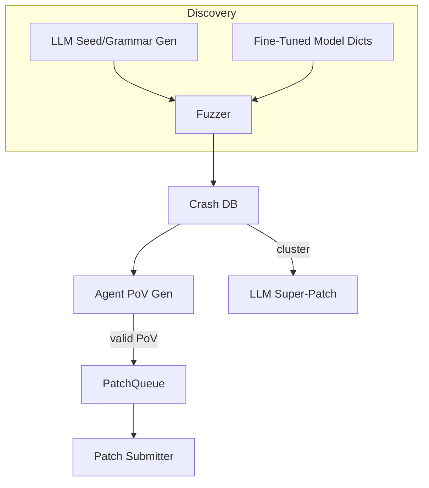

# Фаззинг за допомогою AI та автоматизоване виявлення вразливостей

{{#include ../banners/hacktricks-training.md}}

## Огляд
Великі мовні моделі (LLM) можуть значно посилити традиційні процеси дослідження вразливостей: генерувати семантично насичені вхідні дані, розвивати граматики, аналізувати дані про збої та навіть пропонувати виправлення, що усувають кілька помилок. На цій сторінці зібрано найефективніші підходи, помічені під час фіналу AI Cyber Challenge (AIxCC) від DARPA та в інших публічних дослідженнях.<sup>[[4]](#references)</sup><sup>[[5]](#references)</sup>

Далі описано не конкретну систему для певного змагання, а узагальнення методів, які можна відтворити у власних робочих процесах.

---

## 1. Генерація початкових вхідних даних за допомогою LLM

Традиційні fuzzers із керуванням за покриттям (AFL++, libFuzzer, Honggfuzz…) починають із невеликого corpus початкових даних і навмання мутують байти. Якщо формат вхідних даних цілі складний (SQL, URL-адреси, власні бінарні протоколи), випадкові мутації зазвичай порушують синтаксис ще до досягнення цікавих гілок виконання.

LLM можуть розв’язати цю проблему початкового запуску, створюючи *генератори seed-ів* — короткі скрипти, що формують **синтаксично коректні, але важливі з погляду безпеки вхідні дані**. Наприклад:

```prompt
SYSTEM: You are a helpful security engineer.
USER:
Write a Python3 program that prints 200 unique SQL injection strings targeting common anti-pattern mistakes (missing quotes, numeric context, stacked queries).  Ensure length ≤ 256 bytes / string so they survive common length limits.
```

```python
# gen_sqli_seeds.py (truncated)
PAYLOADS = [
    "1 OR 1=1 -- ",
    "' UNION SELECT NULL,NULL--",
    "0; DROP TABLE users;--",
    ...
]
for p in PAYLOADS:
    print(p)
```

Запустіть один раз і передайте вивід безпосередньо до початкового корпусу fuzzer:

```bash
python3 gen_sqli_seeds.py > seeds.txt
afl-fuzz -i seeds.txt -o findings/ -- ./target @@
```

Переваги:
1. Семантична коректність → глибше покриття на ранньому етапі.
2. Можна генерувати повторно: змініть prompt, щоб зосередитися на XSS, path traversal, binary blobs тощо.
3. Дешево (< 1 ¢ з GPT-3.5).

### Поради
* Попросіть модель *урізноманітнити* довжину й кодування payload (UTF-8, URL-encoded, UTF-16-LE), щоб обходити поверхневі фільтри.
* Попросіть *один самодостатній скрипт* — це допоможе уникнути проблем із форматуванням JSON.

---

## 2. Фаззинг з еволюцією граматики

Потужніший варіант — дозволити LLM **розвивати граматику**, а не конкретні seeds. Робочий процес (патерн “Grammar Guy”):

1. Згенеруйте початкову граматику ANTLR/Peach/LibFuzzer за допомогою prompt.
2. Виконуйте fuzzing протягом N хвилин і збирайте метрики покриття (досягнуті ребра / блоки).
3. Підсумуйте непокриті ділянки програми й передайте підсумок назад моделі:
   ```prompt
   The previous grammar triggered 12 % of the program edges.  Functions not reached: parse_auth, handle_upload.  Add / modify rules to cover these.
   ```
4. Об’єднайте нові правила, повторно запустіть fuzzing і повторюйте.

Каркас псевдокоду:

```python
for epoch in range(MAX_EPOCHS):
    grammar = llm.refine(grammar, feedback=coverage_stats)
    save(grammar, f"grammar_{epoch}.txt")
    coverage_stats = run_fuzzer(grammar)
```

Key points:
* Дотримуйтеся *бюджету* — кожне уточнення використовує токени.
* Використовуйте інструкції `diff` + `patch`, щоб модель редагувала, а не переписувала.
* Зупиніться, коли Δcoverage < ε.

---

## 3. Розробка harness для Local-LLM libFuzzer

Якщо вихідний код не може залишати робочу станцію аналітика, локальна модель коду може створити невеликий адаптер між байтами fuzzer і API на C/C++. Межа безпеки тут чітка: **модель пише й доопрацьовує тестову інфраструктуру; мутація під керуванням coverage досліджує вхідні дані; санітайзери виявляють некоректні операції; людина перевіряє harness і тріажить знахідки**.<sup>[[9]](#references)</sup>

Про engine-level методи роботи з corpus, feedback і snapshot, а також stateful-fuzzing, які не залежать від LLM, див. загальну [методологію fuzzing](../generic-methodologies-and-resources/fuzzing.md).

Почніть із точного оголошення, скопійованого із заголовка цільового коду, і обмежте формат виводу. Вузький промпт зменшує ймовірність вигаданих API та спрощує перевірку результату:<sup>[[8]](#references)[[9]](#references)</sup>

```prompt
Write a libFuzzer target for this exact declaration:
int parse_records(const uint8_t *data, size_t size);

Output only C code. Implement LLVMFuzzerTestOneInput, include the
declaration, pass data and size unchanged, and do not use files,
network access, randomness, clocks, threads, or persistent state.
```

Для парсера необроблених байтів очікуваний результат має бути не складнішим за:<sup>[[6]](#references)[[9]](#references)</sup>

```c
#include <stddef.h>
#include <stdint.h>

extern int parse_records(const uint8_t *, size_t);

int LLVMFuzzerTestOneInput(const uint8_t *data, size_t size) {
    (void)parse_records(data, size);
    return 0;
}
```

Компіляція — лише перший етап перевірки. Перш ніж витрачати на ціль процесорний час, перевірте кожну згенеровану ціль за такими інваріантами:<sup>[[6]](#references)[[8]](#references)[[9]](#references)</sup>

- **Точний API:** звірте типи, правила володіння, ініціалізацію, завершення роботи та угоду про виклик із реальним заголовним файлом і наявними викликами.
- **Безпека harness:** захистіть кожне читання з `data`; виявлені sanitizer помилки мають походити з цілі, а не зі згенерованої обв'язки.
- **Повторюваність:** результат має залежати лише від `data` і `size`; усуньте зовнішній ввід-вивід, час, неконтрольовану випадковість, нез'єднані потоки та стан, що зберігається між викликами.
- **Продуктивність:** ініціалізуйте дорогий незмінний стан лише один раз і тільки якщо це не впливає на поведінку, обмежуйте розмір вводу, вимкніть журналювання та звільняйте виділену для кожного вводу пам'ять.
- **Досяжність:** перевірте, що виконуються потрібні функції та гілки. Ціль, яка компілюється, але проходить лише шляхами відхилення, — це непомітна помилка.

### Цілі з урахуванням структури: зберігайте інваріанти, не приховуючи помилок

Якщо більшість необроблених входів не проходить перевірку сигнатури, довжини, версії чи контрольної суми, використовуйте байти fuzz як матеріал для типізованих полів і відновлюйте коректний об'єкт. Зафіксуйте константи формату, залиште семантичні поля та байти корисного навантаження змінними й обчислюйте метадані цілісності на основі відновленого корисного навантаження. `FuzzedDataProvider` зручний для отримання типізованих значень з обмеженнями, тоді як адаптер має обмежувати будь-яке виділення пам'яті та перетворення.<sup>[[9]](#references)</sup>

<details>
<summary>Приклад C++-цілі з урахуванням структури</summary>

```cpp
#include <fuzzer/FuzzedDataProvider.h>
#include <stddef.h>
#include <stdint.h>
#include <vector>

extern "C" int parse_message(const uint8_t *, size_t);

extern "C" int LLVMFuzzerTestOneInput(const uint8_t *data, size_t size) {
    FuzzedDataProvider fdp(data, size);
    uint8_t version = fdp.ConsumeIntegral<uint8_t>();
    auto body = fdp.ConsumeRemainingBytes<uint8_t>();
    if (body.size() > UINT16_MAX) body.resize(UINT16_MAX);
    uint16_t len = static_cast<uint16_t>(body.size());
    std::vector<uint8_t> msg = {0x8b, 'M', 'S', 'G', version,
                                static_cast<uint8_t>(len >> 8),
                                static_cast<uint8_t>(len)};
    msg.insert(msg.end(), body.begin(), body.end());
    (void)parse_message(msg.data(), msg.size());
    return 0;
}
```

</details>

Не використовуйте одну ціль із відновленням структури для кожного запитання. Підтримуйте одну ціль, яка обчислює довжини/контрольні суми, щоб досліджувати глибокі коректні стани, і ще одну, у якій fuzzer керує **заявленими** метаданими, а обмежуються лише власні читання й виділення пам’яті harness. Друга ціль зберігає поверхні атак із невідповідністю довжин і некоректною цілісністю даних, які автоматичне виправлення інакше усунуло б.<sup>[[9]](#references)</sup>

### Початкові зразки, словники, санітайзери та зворотний зв’язок за покриттям

Попросіть модель створити скрипт, який записуватиме бінарні початкові зразки, а не виводитиме їх безпосередньо. Створіть порожні, мінімальні, типові та гранично коректні об’єкти, а потім витягніть магічні значення, теги, кодування enum і ключові слова парсера до перевіреного словника. libFuzzer приймає цей словник через `-dict=`, а в корпусі зберігає мутації, що відкривають нове покриття.<sup>[[6]](#references)[[9]](#references)</sup>

```text
magic="\x8bMSG"
version_min="\x00"
version_max="\xff"
config_tag="CONFIG"
```

Зберіть ту саму ціль із додатковим інструментуванням. ASan і UBSan можуть використовувати один бінарний файл для fuzzing; для MSan створіть окрему збірку та інструментуйте її залежності, щоб уникнути звітів, спричинених неінструментованим кодом.<sup>[[6]](#references)[[9]](#references)</sup>

```bash
clang++ -g -O1 -fsanitize=fuzzer,address,undefined \
  -fno-sanitize-recover=undefined target.cc harness.cc -o fuzz_target
./fuzz_target corpus -dict=msg.dict -max_len=65535

clang++ -g -O1 -fsanitize=fuzzer,memory \
  target.cc harness.cc -o fuzz_target_msan
```

Розглядайте coverage як критерій оцінювання кожної версії моделі. У виводі libFuzzer раннє плато `cov`/`ft` і незмінний corpus зазвичай вказують на неправильне framing, надто обмежувальний ранній return або неправильний виклик; низький `exec/s` свідчить про дорогий setup, I/O, allocation або витік стану. `NEW` лише доводить, що змінилася coverage feature, а не те, що було досягнуто потрібного parser.<sup>[[6]](#references)[[9]](#references)</sup>

Для зворотного зв’язку на рівні вихідного коду створіть coverage build, запустіть fuzzing і надайте моделі лише непокриті функції та умови, що їх обмежують. Перевірте отриманий diff harness/seed/dictionary і повторно виміряйте результат:<sup>[[7]](#references)[[8]](#references)[[9]](#references)</sup>

```bash
clang++ -g -O1 -fsanitize=fuzzer \
  -fprofile-instr-generate -fcoverage-mapping target.cc harness.cc -o fuzz_cov
mkdir -p profiles
LLVM_PROFILE_FILE='profiles/%p.profraw' ./fuzz_cov -max_total_time=300 corpus
llvm-profdata merge -sparse profiles/*.profraw -o fuzz.profdata
llvm-cov report ./fuzz_cov -instr-profile=fuzz.profdata
llvm-cov show ./fuzz_cov -instr-profile=fuzz.profdata \
  --show-branches=count --region-coverage-lt=1 target.cc
```

Масштабований цикл — це **генерувати → компілювати/компонувати → виконувати smoke-тест під санітайзерами → вимірювати покриття цільового коду → надавати найменший релевантний контекст покриття/вихідного коду → переглядати → повторно вимірювати**. OSS-Fuzz-Gen застосовує той самий принцип: оцінює згенеровані цілі за можливістю компіляції, помилками під час виконання, покриттям і покращенням покриття порівняно з наявними цілями, а не приймає правдоподібний код за чисту монету.<sup>[[7]](#references)[[8]](#references)</sup>

---

<a id="3-agent-based-pov-exploit-generation" hidden>3. Генерація PoV (експлойту) на основі агентів</a>

## 4. Генерація PoV (експлойту) на основі агентів

Після виявлення крашу вам усе ще потрібен **proof-of-vulnerability (PoV)**, який детерміновано його відтворює.

Масштабований підхід — запустити багато легковагових воркерів (процесів, потоків або контейнерів), кожен із яких використовує окрему модель або конфігурацію семплювання. В огляді фіналістів AIxCC наведено конкретні приклади масштабів: одна команда використовувала **тисячі паралельних агентів** для генерації PoV, орієнтованої насамперед на AI, тоді як інша координувала роботу **300–500 fuzzing-агентів**, залишаючи LLM для семантичного аналізу вищого рівня.<sup>[[4]](#references)</sup>

Конвеєр:
1. Статичний/динамічний аналіз формує *кандидатів на баги* (структура з адресою інструкції крашу, фрагментом вхідних даних, повідомленням санітайзера).
2. Оркестратор розподіляє кандидатів між агентами.
3. Кроки міркування агента:
   a. Відтворити баг локально за допомогою `gdb` і вхідних даних.
   b. Запропонувати мінімальне навантаження експлойту.
   c. Перевірити експлойт у sandbox. Якщо успішно → надіслати.
4. Невдалі спроби **повторно ставляться в чергу як нові seeds** для coverage fuzzing (цикл зворотного зв’язку).

Переваги:
* Паралелізація компенсує ненадійність окремого агента.
* Автоматичне налаштування temp / розміру моделі залежно від спостережуваного рівня успіху.

---

<a id="4-directed-fuzzing-with-fine-tuned-code-models" hidden>4. Спрямований fuzzing із донавченими code-моделями</a>

## 5. Спрямований fuzzing із донавченими code-моделями

Донавчіть модель із відкритими вагами (наприклад, Llama-7B) на вихідному коді C/C++, позначеному шаблонами вразливостей (цілочисельне переповнення, копіювання буфера, форматний рядок). Потім:

1. Виконайте статичний аналіз, щоб отримати список функцій і AST.
2. Запропонуйте моделі: *«Надай записи словника мутацій, які можуть порушити безпеку пам’яті у функції X»*.
3. Вставте ці токени в користувацький `AFL_CUSTOM_MUTATOR`.

Приклад виводу для обгортки `sprintf`:
```
{"pattern":"%99999999s"}
{"pattern":"AAAAAAAA....<1024>....%n"}
```

Емпірично це скорочує час до збою більш ніж у 2 рази на реальних цілях.

---

<a id="5-ai-guided-patching-strategies" hidden>5. Стратегії виправлення під керуванням ШІ</a>

## 6. Стратегії виправлення під керуванням ШІ

<a id="51-super-patches" hidden>5.1 Суперпачі</a>

### 6.1 Суперпачі
Попросіть модель *кластеризувати* сигнатури збоїв і запропонувати **єдиний патч**, який усуває спільну першопричину. Надішліть його один раз — виправте кілька помилок → менше штрафів за точність у середовищах, де кожен неправильний патч коштує балів.

Орієнтовний план промпту:
```
Here are 10 stack traces + file snippets.  Identify the shared mistake and generate a unified diff fixing all occurrences.
```

{{#ref}}
../generic-methodologies-and-resources/fuzzing.md
{{#endref}}

<a id="52-speculative-patch-ratio" hidden>5.2 Speculative Patch Ratio</a>

### 6.2 Співвідношення спекулятивних патчів
Реалізуйте чергу, у якій чергуються підтверджені патчі, перевірені PoV, і *спекулятивні* патчі (без PoV) у співвідношенні 1:​N, налаштованому відповідно до правил нарахування балів (наприклад, 2 спекулятивні : 1 підтверджений). Модель витрат відстежує штрафи й бали та самостійно коригує N.

---

<a id="6-deterministic-file-by-file-ai-code-review" hidden>6. Deterministic File-by-File AI Code Review</a>

## 7. Детермінований AI-код-рев’ю файлу за файлом

Поширений режим збою під час AI-асистованого рев’ю — попросити одного агента перевірити весь репозиторій і сподіватися, що він вибере правильні файли та пошукові терміни. Надійніший підхід — **примусово охопити весь репозиторій**:<sup>[[1]](#references)</sup>

1. Перелічіть файли з вихідним кодом.
2. Надсилайте **по одному файлу за раз** із мінімальним контекстом (точка входу, імпорти, пов’язані маршрути/виклики).
3. Вимагайте **структурований звіт** для кожного файлу: джерела, sink, відсутня валідація, передумови експлуатації та рівень упевненості.<sup>[[3]](#references)</sup>
4. Усуньте дублікати звітів за **шаблоном source→sink** і вручну перевірте звіти з високим ризиком.

Цей підхід потребує багато токенів і створює шум, але він дуже ефективно виявляє **прості баги з високим впливом на рівні source/sink**, які часто пропускають широкі агентні рев’ю.

### Шаблони для пріоритетного сортування

- **Динамічне підключення/диспетчеризація в PHP**: контрольовані зловмисником назви маршрутів/контролерів/модулів передаються до `require_once()`, `include()` або `include_once()` без суворого списку дозволених значень і канонізації шляхів.
- **Виконання команд оболонки в робочих процесах адміністратора/облікового запису**: імена користувачів, домени, FTP-облікові записи чи інші ідентифікатори потрапляють до `exec()`, `system()`, `shell_exec()`, `passthru()`, `proc_open()` або `popen()`.
- **Об’єднання структурованих вхідних даних**: той самий параметр приймається з `$_GET`, `$_POST`, JSON, XML або парсерів тіла запиту фреймворку, а згодом використовується в sink файлової системи чи команд ОС.

### Два практичні класи багів, які цей метод добре знаходить

- **LFI/RCE через диспетчеризацію PHP-контролерів**: якщо ім’я контролера, задане в запиті, конкатенується з `require_once()` без списку дозволених значень або нормалізації шляху, послідовності обходу каталогів на кшталт `../` можуть змусити PHP підключити небажаний локальний файл `.php`. Якщо зловмисник може спрямувати підключення на підготовлений або іншим чином корисний PHP-файл, LFI перетворюється на виконання коду. Див. [File Inclusion / Path Traversal](../pentesting-web/file-inclusion/README.md).<sup>[[1]](#references)</sup>
- **Ін’єкція команд в автентифікованих панелях хостингу/адміністрування**: якщо поля керування обліковими записами, наприклад імена користувачів, вбудовуються в команди оболонки, автентифікований користувач із низькими привілеями може перетворити звичайну дію створення/видалення на RCE. Вплив посилюється, коли панель виконує команду від імені облікового запису служби з вищими привілеями. Див. [Command Injection](../pentesting-web/command-injection.md).<sup>[[1]](#references)</sup>

### Практичні примітки щодо рев’ю

- Спершу використовуйте LLM як **рев’юера source/sink**, а не як генератор експлойтів.
- Попросіть її чітко вказати **поле, контрольоване зловмисником**, **прогалину в нормалізації/валідації** та **небезпечний sink**.
- У великих репозиторіях детерміноване рев’ю кожного файлу окремо часто надійніше за один запуск автономного агента, навіть якщо в останньому використовується потужніша модель.<sup>[[2]](#references)</sup>
- Очікуйте слабших результатів щодо **Broken Access Control** та інших багів бізнес-логіки, де експлуатованість залежить від припущень між файлами, семантики ролей або специфічних для продукту моделей загроз.

---

## Мобільні taskflow точок входу

Один запит для всього репозиторію часто змішує моделі загроз і втрачає шлях від зовнішньо доступного компонента до чутливого sink. Кращий підхід розбиває аудит на taskflow зі збереженням стану: спочатку класифікувати застосунки/компоненти, потім інвентаризувати контрольовані зловмисником точки входу, доповнити кожну точку входу метаданими про досяжність і насамкінець перевірити кожну з них на класи вразливостей, специфічні для платформи. Мобільні taskflow GitHub Security Lab реалізують цей підхід для репозиторіїв Android, iOS і кросплатформних застосунків.<sup>[[14]](#references)[[15]](#references)</sup>

Для Android зафіксуйте щонайменше:<sup>[[14]](#references)[[15]](#references)</sup>

- експортовані Activities, Services, Receivers і Providers, включно з дозволами;
- дії intent, схеми/хости/шляхи deep link, MIME-фільтри та App Links;
- дії, URI даних, `ClipData`, extras і прапорці надання URI-доступу, контрольовані зловмисником;
- вхідні дані навігації WebView і мости `addJavascriptInterface`;
- подальші привілейовані операції, імпортовані ресурси та мережеві адресати.

Потім класифікуйте кожну точку входу з урахуванням контексту. Окремо перевірте авторизацію викликувача/поведінку confused deputy, перенаправлення intent, підміну або розголошення broadcast-повідомлень, небезпечний імпорт, виконання скриптів у WebView і доступність мостів, а також передавання облікових даних або cookie між origin. Виконайте і **сувору перевірку за контрольним списком**, і **ширшу змагальну перевірку**. Пов’язуйте знахідки з [Intent Injection](../mobile-pentesting/android-app-pentesting/intent-injection.md) і [WebView Attacks](../mobile-pentesting/android-app-pentesting/webview-attacks.md), замість того щоб дублювати подробиці експлуатації.<sup>[[15]](#references)</sup>

Поточні taskflow з відкритим вихідним кодом можна запустити у відповідному Codespace за допомогою:<sup>[[14]](#references)</sup>

```bash
./scripts/audit/run_audit.sh owner/repository
```

Результати записуються в SQLite у таблицю `audit_result`.<sup>[[14]](#references)</sup> Вважайте рядки, позначені як вразливі, **зачіпками**, а не підтвердженими знахідками. Для кожної зачіпки вимагайте від моделі вказати контрольоване зловмисником джерело, чутливий приймач, передумови та очікуваний вплив, а потім попросіть створити мінімальний PoC. Виконайте цей PoC на оригінальній збірці під налагоджувачем або з інструментуванням. Це дає змогу виявляти поширені помилки статичного аналізу, як-от недосяжні гілки, нереалістичний стан програми, втрату пріоритету даних із зовнішнього сховища над приватними даними та пом’якшувальні заходи, що суттєво знижують серйозність проблеми.<sup>[[15]](#references)</sup>

---

## 8. Аудит ядра за шаблонами з інструментованим оракулом

Для цілі розміру ядра не просіть агента шукати довільні помилки по всьому дереву коду. Ефективніший за використанням токенів процес перетворює знання про історичні вразливості на статичні запити, ранжує результати за доступністю поверхні атаки та використовує інструментоване ядро як оракул виконання.<sup>[[11]](#references)</sup>

### База шаблонів → CodeQL/Semgrep → цілеспрямований аналіз

Створіть невелику базу знань, що містить небезпечні API, шаблони відсутньої валідації, ризиковані потоки від джерела до приймача та форми помилок, які вже виправляли. Просіть модель перетворювати **по одному шаблону за раз** на евристики аналізу та правила CodeQL/Semgrep, а потім запускайте ці детерміновані правила на всьому дереві коду. Згрупуйте та усуньте дублікати збігів, перш ніж передавати код моделі: необроблені результати сканера можуть містити тисячі малокорисних кандидатів. Перед використанням цього підходу за межами відповідних досліджень або проєктів із відкритим кодом перевірте актуальні умови ліцензування CodeQL.<sup>[[11]](#references)</sup>

Визначайте пріоритетність підсистем за **щільністю збігів із правилами** та **досяжністю з боку зловмисника**, а не лише за кількістю збігів. Інтерфейсам ядра, доступним із непривілейованих процесів, пісочниць, контейнерів, jail-середовищ або гостьових контекстів, слід надавати більшу вагу, ніж коду, доступному лише внутрішньо. Робіть одиницю аналізу достатньо малою, щоб агент міг врахувати виклики, валідатори та правила життєвого циклу, і формулюйте запит щодо конкретного класу вразливості або шаблону керування потоком, а не «знайди будь-яку вразливість». Особливо цікаві застарілі привілейовані інтерфейси, якщо новіша межа ізоляції робить їх доступними для користувача root у просторі імен або jail-середовищі.<sup>[[11]](#references)</sup>

Для кожного кандидата вимагайте чітко задокументувати потік даних між полями, перш ніж переходити до спроби експлуатації.<sup>[[11]](#references)</sup>

```text
entrypoint -> privilege check -> parser -> validation/normalization
           -> later rewrite -> dangerous sink
attacker controls: <fields and lengths>
constraints:       <values rewritten, rejected, or preserved>
observable result: <sanitizer report, assertion, panic, or clean exit>
```

### Використовуйте телеметрію KASAN як оракул для перевірки гіпотез

Запустіть цільове ядро у тимчасовій VM з увімкненими KASAN і корисними діагностичними перевірками. Агент має ітерувати цикл **гіпотеза щодо коду → мінімальний тригер у userland → виконання у VM → трасування KASAN/перевірки → уточнена гіпотеза**, доки підозрюване пошкодження не буде відтворене або спростоване. На кожній ітерації повертайте лише релевантний стек викликів і фрагмент коду поруч із ним. Це зберігає контекст для аналізу, а також робить критерієм прийняття результатів дані виконання, а не впевненість моделі.<sup>[[11]](#references)</sup>

Інструментована збірка — не остаточне середовище для оцінки можливості експлуатації. Перевірки можуть зупинити виконання до операції, що спричиняє пошкодження, тоді як у production-ядрі ту саму перевірку можуть прибрати під час компіляції. Повторно перевірте незмінений тригер з точною конфігурацією production, зафіксуйте збірку ядра та конфігурацію й розглядайте **досяжність**, **пошкодження пам’яті**, **контрольований примітив** і **вплив на безпеку** як окремі твердження.<sup>[[11]](#references)[[12]](#references)</sup>

CVE-2026-3038 — це корисний приклад для перевірки, а не шаблон експлойту. Неавтентифікований запит FreeBSD `RTM_GET` міг зберегти sockaddr `RTAX_AUTHOR` завеликого розміру після вибіркової перевірки та переписування відповіді, доки `rtsock_msg_buffer()` не скопіювала контрольоване користувачем значення `sa_len` у 128-байтовий стековий `sockaddr_storage`. Максимальне копіювання 255 байтів спричиняло перезапис 127 байтів; діагностична перевірка виявляла некоректну довжину в інструментованій збірці, тоді як ядро GENERIC доходило до копіювання, а потім панікувало під час перевірки пошкодженого canary. Це доводить можливість відмови в обслуговуванні без привілеїв, але не саме по собі підвищення привілеїв: для надійного контролю спершу знадобився б інший примітив, наприклад розкриття canary. Відповідну межу бінарної експлуатації описано в [Stack Canaries](../binary-exploitation/common-binary-protections-and-bypasses/stack-canaries/index.html).<sup>[[11]](#references)[[12]](#references)[[13]](#references)</sup>

### Відхиляйте підміну передумов експлуатації

Перш ніж прийняти PoV або експлойт, доручіть окремому рецензенту/агенту спробувати його спростувати за фіксованими критеріями. Перевірка має підтвердити всі наведені нижче умови.<sup>[[11]](#references)</sup>

- Вихідний код цілі, ядро та вразливий модуль не змінювали, щоб зробити шлях досяжним.
- Не додавали допоміжний модуль, синтетичний gadget, вимкнений механізм захисту, додаткові привілеї чи недоступний інтерфейс.
- Тригер запускається з заявленою ідентичністю користувача та обмеженнями ізоляції, на чистому знімку системи.
- Заявлений результат і далі залежить від помилки: видалення некоректного поля або виправлення лише цієї помилки має розірвати ланцюжок.
- Збій, читання за межами буфера чи перезапис слід описувати лише як відповідний примітив; для виконання коду або підвищення привілеїв потрібні незалежні докази.

Ця остання контрфактична перевірка виявляє циклічні демонстрації: якщо передумови вже забезпечують заявлений вплив (наприклад, виконання наданого зловмисником SUID-вмісту з файлової системи, змонтованої без `nosuid`), то помилка безпеки пам’яті не спричинила цей вплив.<sup>[[11]](#references)</sup>

---

## Аудитовне дослідження незнайомих кодових баз за допомогою агентів

У [graph-first fuzz-target workflow](../generic-methodologies-and-resources/fuzzing.md#graph-first-fuzz-target-selection-and-mutation-triage) вже розглянуто досяжність точок входу, тоді як [agentic SAST pipelines](../network-services-pentesting/pentesting-web/code-review-tools.md#agentic-sast-pipelines) охоплюють поетапну перевірку та контрольні етапи доказів. Зберігайте ці детерміновані результати окремо від гіпотез моделі, щоб кожна відібрана зачіпка містила розташування в коді, докази проходження шляху та динамічний вимір.<sup>[[10]](#references)</sup>

### Зіставляйте докази життєвого циклу об’єктів, не вигадуючи потік даних

Статичний аналіз може виявити, що контрольована зловмисником довжина зберігається в одній функції, а те саме поле об’єкта значно пізніше передається до точки копіювання, але не довести зв’язок через callback-функції, повторні підключення чи життєвий цикл об’єкта. Зберігайте обидва результати окремо, групуйте їх за об’єктом/полем і сформулюйте відсутню ланку як чітке питання для тріажу. Агент може запропонувати зв’язок, але його мають підтвердити аналіз коду або інструментування під час виконання.<sup>[[10]](#references)</sup>

Для кожного кандидата зафіксуйте:

- конкретну точку входу та байти, контрольовані зловмисником;
- усіх виробників відповідного поля, зокрема перевірки, специфічні для кожного виробника;
- точку використання, місткість призначення та умови збірки/виконання, необхідні для її досягнення;
- реальний стек викликів від доступної точки входу, а не лише прямий виклик тестового стенда;
- найменший динамічний результат, який підтверджує або спростовує гіпотезу.

Шлях, який здається безпечним, не означає, що поле безпечне загалом. Інший виробник може заповнити те саме поле без обмеження, яке діяло на першому шляху. Перевіряйте шляхи незалежно та запускайте тестовий стенд із параметрами збірки, еквівалентними production, оскільки діагностичні перевірки можуть перетворити пошкодження пам’яті в production на раннє переривання, властиве лише тестуванню.<sup>[[10]](#references)</sup>

### Контрольні етапи для розкриття даних і експлуатації

Якщо підозрюється розкриття неініціалізованої пам’яті, заповніть щойно виділені ділянки пам’яті впізнаваним байтом і перевірте, чи саме цей маркер потрапляє до сформованого пакета. Для експлуатації вимагайте виміряних контрольних етапів, як-от **контрольований перезапис → корисний об’єкт-жертва → розкриття даних → відновлення вказівника/базової адреси → перехоплення потоку керування → складене корисне навантаження**. Агент переходить далі лише після того, як тестовий стенд доведе поточну властивість; правдоподібний опис не означає проходження контрольного етапу. У [FreeRDP case](../binary-exploitation/libc-heap/heap-overflow.md#cross-path-length-reuse-and-stale-output-disclosure) показано шлях і обмеження збірки, які потрібно зберегти під час перевірки.<sup>[[10]](#references)</sup>

---

Приклад застосування поетапної перевірки L0–L4 до розробки експлойтів за допомогою LLM у контексті ядра наведено тут:

{{#ref}}
../binary-exploitation/freebsd-kernel-exploitation-vnet-jail-escape.md
{{#endref}}

## Тріаж збоїв за допомогою відладчика

Робочі процеси Mona v3 для тріажу збоїв, аналізу функцій і контрольованої досяжності heap-чанків описано в [Exploiting Tools](../binary-exploitation/basic-stack-binary-exploitation-methodology/tools/#mona-v3-debugger-context-requests-for-crash-triage).

---

## Збираємо все докупи
Система CRS (Cyber Reasoning System) від початку до кінця може поєднувати компоненти так:



---

## References

- [1] [Project Black — Локальний AI для кібербезпеки: пошук LFI у phpIPAM та автентифікованого RCE у myVesta](https://projectblack.io/blog/local-ai-for-cyber-security)
- [2] [Strix](https://github.com/usestrix/strix)
- [3] [GitHub Copilot: спільнотний skill security-review](https://github.com/github/awesome-copilot/blob/main/skills/security-review/SKILL.md)
- [4] [Trail of Bits — Фінал AIxCC: підсумки змагання](https://blog.trailofbits.com/2025/08/07/aixcc-finals-tale-of-the-tape/)
- [5] [Інтерв’ю з фіналістами AIxCC від CTF Radiooo](https://www.youtube.com/@ctfradiooo)
- [6] [LLVM — libFuzzer: бібліотека для fuzz-тестування з керуванням покриттям](https://llvm.org/docs/LibFuzzer.html)
- [7] [Google — OSS-Fuzz-Gen](https://github.com/google/oss-fuzz-gen)
- [8] [Блог Google Online Security — Новий рівень fuzzing: пошук більшої кількості вразливостей за допомогою AI](https://security.googleblog.com/2024/11/leveling-up-fuzzing-finding-more.html)
- [9] [8kSec — Створення fuzzing harness за допомогою AI та локальної LLM](https://8ksec.io/ai-assisted-fuzzing-harness-local-llm)
- [10] [Quarkslab — Від AI-агентів до RCE: створення робочого процесу дослідження вразливостей](https://blog.quarkslab.com/from-ai-agents-to-rce-building-a-vulnerability-research-workflow.html)
- [11] [Praetorian — FreeBSoD: використання мовних моделей для пошуку й експлуатації помилок ядра (частина 1 із 2)](https://praetorian.com/blog/ai-vulnerability-research-freebsd-kernel)
- [12] [FreeBSD-SA-26:05.route — Локальний DoS і можливе підвищення привілеїв через маршрутизаційні сокети](https://www.freebsd.org/security/advisories/FreeBSD-SA-26:05.route.asc)
- [13] [Вихідний патч FreeBSD-SA-26:05.route](https://security.FreeBSD.org/patches/SA-26:05/route.patch)
- [14] [GitHub Security Lab — робочі процеси SecLab](https://github.com/GitHubSecurityLab/seclab-taskflows)
- [15] [GitHub Security Lab — Як ми знайшли 24 вразливості Android за допомогою агента безпеки AI з відкритим кодом](https://github.blog/security/how-we-found-24-android-vulnerabilities-using-our-open-source-ai-security-agent)
{{#include ../banners/hacktricks-training.md}}
