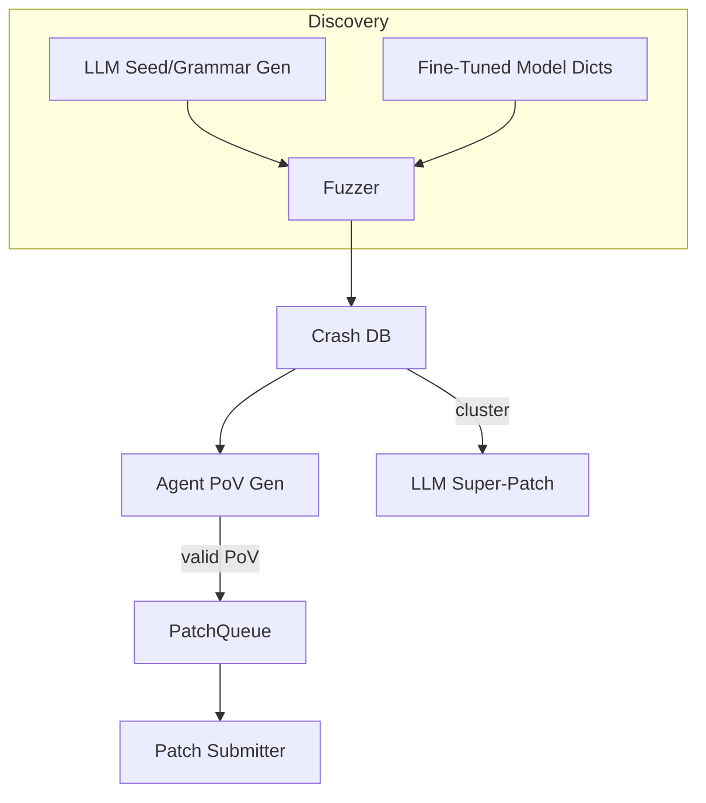

# AI 지원 Fuzzing 및 자동화된 취약점 발견

{{#include ../banners/hacktricks-training.md}}

## 개요
대규모 언어 모델(LLM)은 의미가 풍부한 입력을 생성하고, 문법을 발전시키며, crash 데이터를 추론하고, 여러 버그를 한 번에 수정하는 패치까지 제안해 기존 취약점 연구 파이프라인의 성능을 크게 높일 수 있습니다. 이 페이지에서는 DARPA의 AI Cyber Challenge(AIxCC) 결선과 기타 공개 연구에서 관찰된 가장 효과적인 패턴을 정리합니다.<sup>[[4]](#references)</sup><sup>[[5]](#references)</sup>

아래 내용은 특정 대회 시스템을 설명하는 것이 아니라, 자체 워크플로에서 재현할 수 있도록 기법을 추상화한 것입니다.

---

## 1. LLM이 생성하는 Seed 입력

기존의 coverage-guided fuzzer(AFL++, libFuzzer, Honggfuzz 등)는 작은 seed corpus로 시작해 바이트를 무작위로 변형합니다. 대상 입력 형식이 복잡한 경우(SQL, URL, 사용자 지정 바이너리 프로토콜 등), 무작위 변형은 대개 흥미로운 분기에 도달하기 전에 구문을 깨뜨립니다.

LLM은 *seed generator*를 출력해 이 초기 설정 문제를 해결할 수 있습니다. seed generator는 **구문은 올바르면서 보안상 의미 있는 입력**을 출력하는 짧은 스크립트입니다. 예를 들면:

```prompt
SYSTEM: You are a helpful security engineer.
USER:
Write a Python3 program that prints 200 unique SQL injection strings targeting common anti-pattern mistakes (missing quotes, numeric context, stacked queries).  Ensure length ≤ 256 bytes / string so they survive common length limits.
```

```python
# gen_sqli_seeds.py (truncated)
PAYLOADS = [
    "1 OR 1=1 -- ",
    "' UNION SELECT NULL,NULL--",
    "0; DROP TABLE users;--",
    ...
]
for p in PAYLOADS:
    print(p)
```

한 번 실행한 뒤 출력을 퍼저의 초기 코퍼스에 직접 입력합니다:

```bash
python3 gen_sqli_seeds.py > seeds.txt
afl-fuzz -i seeds.txt -o findings/ -- ./target @@
```

Benefits:
1. 의미적 유효성 → 초기에 더 깊은 커버리지 확보.
2. 재생성 가능: prompt를 조정해 XSS, path traversal, binary blobs 등에 초점을 맞출 수 있음.
3. 저렴함(GPT-3.5 기준 1 ¢ 미만).

### Tips
* 피상적인 필터를 우회할 수 있도록 payload 길이와 인코딩(UTF-8, URL-encoded, UTF-16-LE)을 *다양하게* 하라고 모델에 지시합니다.
* *단일 독립 실행형 script*를 요청하면 JSON 형식 지정 문제를 피할 수 있습니다.

---

## 2. Grammar-Evolution Fuzzing

더 강력한 변형 방식은 구체적인 seed 대신 LLM이 **grammar를 진화**시키도록 하는 것입니다. 워크플로(“Grammar Guy” 패턴)는 다음과 같습니다.

1. prompt를 통해 초기 ANTLR/Peach/LibFuzzer grammar를 생성합니다.
2. N분 동안 fuzzing하고 커버리지 지표(hit한 edges / blocks)를 수집합니다.
3. 커버되지 않은 프로그램 영역을 요약하고 그 요약을 모델에 다시 입력합니다:
   ```prompt
   The previous grammar triggered 12 % of the program edges.  Functions not reached: parse_auth, handle_upload.  Add / modify rules to cover these.
   ```
4. 새 규칙을 병합하고, 다시 fuzzing한 뒤 반복합니다.

의사 코드 골격:

```python
for epoch in range(MAX_EPOCHS):
    grammar = llm.refine(grammar, feedback=coverage_stats)
    save(grammar, f"grammar_{epoch}.txt")
    coverage_stats = run_fuzzer(grammar)
```

주요 사항:
* *예산*을 유지하세요. 각 개선 작업에는 토큰이 사용됩니다.
* 모델이 다시 작성하는 대신 편집하도록 `diff` + `patch` 지침을 사용하세요.
* Δcoverage < ε일 때 중단하세요.

---

## 3. Local-LLM libFuzzer 하네스 엔지니어링

분석가의 워크스테이션 밖으로 반출할 수 없는 소스의 경우, 로컬 코드 모델을 사용해 fuzzer 바이트와 C/C++ API 사이의 작은 어댑터 초안을 작성할 수 있습니다. 보안 경계는 명확합니다. **모델은 테스트 인프라를 작성하고 수정하며, coverage-guided mutation은 입력을 탐색하고, sanitizer는 잘못된 연산을 보고하며, 사람은 하네스를 검토하고 발견 사항을 분류합니다**.<sup>[[9]](#references)</sup>

LLM에 의존하지 않는 엔진 수준의 corpus, 피드백, snapshot 및 stateful-fuzzing 기법은 일반 [Fuzzing Methodology](../generic-methodologies-and-resources/fuzzing.md)를 참조하세요.

대상 헤더에서 정확한 선언을 복사하고 출력 형식을 제한하는 것부터 시작하세요. 프롬프트의 범위를 좁히면 API를 지어낼 가능성이 줄고 결과를 검토하기도 쉬워집니다.<sup>[[8]](#references)[[9]](#references)</sup>

```prompt
Write a libFuzzer target for this exact declaration:
int parse_records(const uint8_t *data, size_t size);

Output only C code. Implement LLVMFuzzerTestOneInput, include the
declaration, pass data and size unchanged, and do not use files,
network access, randomness, clocks, threads, or persistent state.
```

raw byte parser의 예상 결과는 다음보다 복잡하지 않아야 합니다:<sup>[[6]](#references)[[9]](#references)</sup>

```c
#include <stddef.h>
#include <stdint.h>

extern int parse_records(const uint8_t *, size_t);

int LLVMFuzzerTestOneInput(const uint8_t *data, size_t size) {
    (void)parse_records(data, size);
    return 0;
}
```

Compilation은 첫 번째 검증 단계일 뿐입니다. CPU 시간을 들이기 전에 생성된 각 target이 다음 불변 조건을 충족하는지 검토하세요:<sup>[[6]](#references)[[8]](#references)[[9]](#references)</sup>

- **정확한 API:** 실제 헤더 및 기존 호출부와 타입, 소유권 규칙, 초기화, 정리, 호출 규약을 비교합니다.
- **Harness 안전성:** `data`에서 읽는 모든 부분을 보호합니다. sanitizer 결과는 생성된 glue가 아니라 target에서 발생해야 합니다.
- **반복 가능성:** 결과가 `data`와 `size`의 함수가 되도록 합니다. 외부 I/O, 시간, 제어되지 않는 난수, join되지 않은 스레드, 호출 사이에 유지되는 상태를 제거합니다.
- **처리량:** 동작에 영향을 주지 않는 경우에만 비용이 큰 불변 상태를 한 번 초기화하고, 입력 크기를 제한하고, 로깅을 억제하고, 입력별 할당을 해제합니다.
- **실행 경로 도달성:** 의도한 함수와 분기가 실행되는지 확인합니다. 컴파일은 되지만 거부 경로만 실행하는 target은 조용한 실패입니다.

### 구조 인식 target: 버그를 숨기지 않고 불변 조건 유지하기

대부분의 raw 입력이 magic, 길이, 버전 또는 checksum 검사에서 거부된다면, fuzz 바이트를 **타입이 지정된 필드 데이터**로 사용해 유효한 객체를 다시 구성합니다. 포맷 상수는 고정하고, 의미 필드와 payload 바이트는 변경 가능하게 두며, 재구성한 payload에서 무결성 메타데이터를 파생합니다. `FuzzedDataProvider`는 범위가 제한된 타입 값을 소비하는 데 유용하며, 생성되는 모든 할당과 변환을 제한하는 책임은 adapter에 있습니다.<sup>[[9]](#references)</sup>

<details>
<summary>구조 인식 C++ target 예시</summary>

```cpp
#include <fuzzer/FuzzedDataProvider.h>
#include <stddef.h>
#include <stdint.h>
#include <vector>

extern "C" int parse_message(const uint8_t *, size_t);

extern "C" int LLVMFuzzerTestOneInput(const uint8_t *data, size_t size) {
    FuzzedDataProvider fdp(data, size);
    uint8_t version = fdp.ConsumeIntegral<uint8_t>();
    auto body = fdp.ConsumeRemainingBytes<uint8_t>();
    if (body.size() > UINT16_MAX) body.resize(UINT16_MAX);
    uint16_t len = static_cast<uint16_t>(body.size());
    std::vector<uint8_t> msg = {0x8b, 'M', 'S', 'G', version,
                                static_cast<uint8_t>(len >> 8),
                                static_cast<uint8_t>(len)};
    msg.insert(msg.end(), body.begin(), body.end());
    (void)parse_message(msg.data(), msg.size());
    return 0;
}
```

</details>

모든 경우에 하나의 구조 복구형 타깃만 사용하지 마세요. 길이와 체크섬을 계산해 깊은 유효 상태를 탐색하는 타깃 하나와, **선언된** 메타데이터는 퍼저가 제어하도록 두고 하네스 자체의 읽기와 할당만 제한하는 타깃을 별도로 유지하세요. 두 번째 타깃은 자동 복구로 사라질 수 있는 길이 불일치 및 무결성 오류 공격 표면을 보존합니다.<sup>[[9]](#references)</sup>

### 시드, 딕셔너리, sanitizer, coverage 피드백

모델에 바이너리를 직접 출력하도록 요청하는 대신, 바이너리 시드를 기록하는 스크립트를 생성하도록 요청하세요. 비어 있는 객체, 최소 객체, 일반적인 객체, 경계값에 해당하는 유효 객체를 시드로 사용한 다음, 매직 값, 태그, enum 인코딩, 파서 키워드를 추출해 검토된 딕셔너리에 넣으세요. libFuzzer는 `-dict=` 옵션으로 해당 딕셔너리를 받아들이며, 새로운 coverage를 드러내는 변이를 코퍼스에 유지합니다.<sup>[[6]](#references)[[9]](#references)</sup>

```text
magic="\x8bMSG"
version_min="\x00"
version_max="\xff"
config_tag="CONFIG"
```

상호 보완적인 계측을 적용해 동일한 타깃을 빌드합니다. ASan과 UBSan은 하나의 fuzzing 바이너리를 함께 사용할 수 있습니다. MSan은 별도로 빌드하고, 계측되지 않은 코드로 인한 보고를 방지하려면 의존성도 계측해야 합니다.<sup>[[6]](#references)[[9]](#references)</sup>

```bash
clang++ -g -O1 -fsanitize=fuzzer,address,undefined \
  -fno-sanitize-recover=undefined target.cc harness.cc -o fuzz_target
./fuzz_target corpus -dict=msg.dict -max_len=65535

clang++ -g -O1 -fsanitize=fuzzer,memory \
  target.cc harness.cc -o fuzz_target_msan
```

각 model revision의 evaluator로 coverage를 사용하세요. libFuzzer 출력에서 `cov`/`ft`가 초기에 정체되고 corpus가 대개 그대로라면 framing이 잘못됐거나, 너무 일찍 실행되는 restrictive return이 있거나, 잘못된 함수를 호출했을 가능성이 큽니다. `exec/s`가 낮다면 setup, I/O, allocation 비용이 크거나 state가 누수되고 있음을 나타냅니다. `NEW`는 coverage feature가 바뀌었다는 것만 보여줄 뿐, 의도한 parser에 도달했다는 뜻은 아닙니다.<sup>[[6]](#references)[[9]](#references)</sup>

source-level feedback을 얻으려면 coverage build를 만들고 fuzz한 뒤, uncovered functions와 해당 함수의 실행을 제어하는 조건만 model에 제공하세요. 결과 harness/seed/dictionary diff를 확인하고 다시 측정하세요:<sup>[[7]](#references)[[8]](#references)[[9]](#references)</sup>

```bash
clang++ -g -O1 -fsanitize=fuzzer \
  -fprofile-instr-generate -fcoverage-mapping target.cc harness.cc -o fuzz_cov
mkdir -p profiles
LLVM_PROFILE_FILE='profiles/%p.profraw' ./fuzz_cov -max_total_time=300 corpus
llvm-profdata merge -sparse profiles/*.profraw -o fuzz.profdata
llvm-cov report ./fuzz_cov -instr-profile=fuzz.profdata
llvm-cov show ./fuzz_cov -instr-profile=fuzz.profdata \
  --show-branches=count --region-coverage-lt=1 target.cc
```

따라서 확장 가능한 루프는 **생성 → 컴파일/링크 → sanitizer를 사용해 smoke-test → target coverage 측정 → 가장 관련성 높은 최소한의 coverage/source 컨텍스트 제공 → 수정 → 재측정**입니다. OSS-Fuzz-Gen도 그럴듯해 보이는 코드를 액면 그대로 받아들이는 대신, 생성된 target의 컴파일 가능성, runtime failure, coverage, 기존 target 대비 coverage 개선 여부를 평가하는 같은 원칙을 적용합니다.<sup>[[7]](#references)[[8]](#references)</sup>

---

## 4. Agent-Based PoV (Exploit) Generation

crash를 찾은 뒤에도 이를 결정적으로 트리거하는 **proof-of-vulnerability (PoV)**가 필요합니다.

확장 가능한 접근 방식은 여러 개의 경량 worker(프로세스, 스레드 또는 컨테이너)를 실행하고, 각 worker가 서로 다른 모델이나 sampling 설정을 사용하도록 하는 것입니다. AIxCC finalist survey에는 구체적인 규모의 사례가 나와 있습니다. 한 팀은 AI 우선 PoV 생성을 위해 **수천 개의 동시 agent**를 사용했고, 다른 팀은 **300–500개의 fuzzing agent**를 오케스트레이션하고 더 높은 수준의 semantic reasoning에 LLM을 활용했습니다.<sup>[[4]](#references)</sup>

파이프라인:
1. Static/dynamic analysis에서 *bug 후보*를 생성합니다(crash PC, 입력 slice, sanitizer 메시지가 담긴 struct).
2. Orchestrator가 후보를 agent에 분배합니다.
3. Agent의 reasoning 단계:
   a. `gdb`와 입력을 사용해 로컬에서 bug를 재현합니다.
   b. 최소한의 exploit payload를 제안합니다.
   c. sandbox에서 exploit을 검증합니다. 성공하면 제출합니다.
4. 실패한 시도는 coverage fuzzing을 위한 **새 seed로 다시 큐에 추가**합니다(feedback loop).

장점:
* 병렬화하면 단일 agent의 불안정성을 보완할 수 있습니다.
* 관찰된 성공률을 기반으로 temp/model size를 자동 조정할 수 있습니다.

---

## 5. Fine-Tuned Code Models를 활용한 Directed Fuzzing

취약점 패턴(integer overflow, buffer copy, format string)이 표시된 C/C++ 소스 코드로 open-weight 모델(예: Llama-7B)을 fine-tune합니다. 그런 다음:

1. Static analysis를 실행해 함수 목록과 AST를 가져옵니다.
2. 모델에 다음과 같이 요청합니다. *“함수 X에서 memory safety를 깨뜨릴 가능성이 높은 mutation dictionary 항목을 제안해 줘”*
3. 해당 토큰을 사용자 지정 `AFL_CUSTOM_MUTATOR`에 삽입합니다.

`sprintf` wrapper에서 생성되는 예시 출력:
```
{"pattern":"%99999999s"}
{"pattern":"AAAAAAAA....<1024>....%n"}
```

실제 대상에서 경험적으로 time-to-crash를 2배 이상 단축합니다.

---

## 6. AI 기반 패치 전략

### 6.1 슈퍼 패치
모델에 crash signature를 *클러스터링*하고 공통 근본 원인을 제거하는 **단일 패치**를 제안하도록 요청합니다. 한 번 제출해 여러 버그를 수정하면, 잘못된 패치 하나당 점수가 깎이는 환경에서 정확도 페널티를 줄일 수 있습니다.

프롬프트 개요:
```
Here are 10 stack traces + file snippets.  Identify the shared mistake and generate a unified diff fixing all occurrences.
```

### 6.2 Speculative Patch 비율
PoV 검증을 통과한 패치와 PoV가 없는 *speculative* 패치를 점수 규칙에 맞춰 조정한 1:​N 비율(예: speculative 2개 : confirmed 1개)로 섞는 큐를 구현합니다. 비용 모델은 페널티와 점수를 모니터링하고 N을 자동 조정합니다.

---

## 7. 파일별 결정론적 AI 코드 리뷰

AI 지원 리뷰에서 흔히 발생하는 실패 방식은 에이전트 하나에 저장소 전체를 검사하도록 요청한 뒤, 올바른 파일과 grep 검색어를 선택하기를 기대하는 것입니다. 더 신뢰할 수 있는 방식은 **저장소 전체를 빠짐없이 검사하도록 강제하는 것**입니다:<sup>[[1]](#references)</sup>

1. 소스 파일을 나열합니다.
2. 최소한의 컨텍스트(진입점, imports, 인접한 라우트/호출자)와 함께 **파일 하나씩** 전달합니다.
3. 각 파일에 대해 출처, sink, 누락된 검증, exploit 전제 조건, 신뢰도를 담은 **구조화된 보고서**를 요구합니다.<sup>[[3]](#references)</sup>
4. **source→sink 패턴**을 기준으로 보고서를 중복 제거하고, 위험도가 높은 항목을 직접 검증합니다.

토큰을 많이 사용하고 노이즈도 있지만, 광범위한 agentic 리뷰에서 종종 놓치는 **간단하면서 영향이 큰 source/sink 버그**를 찾는 데 매우 효과적입니다.

### 우선순위를 둘 만한 트리아지 패턴

- **동적 PHP include/dispatch**: 공격자가 제어하는 라우트/컨트롤러/모듈 이름이 엄격한 allowlist 및 경로 정규화 없이 `require_once()`, `include()`, `include_once()`로 전달되는 경우.
- **관리자/계정 워크플로의 셸 실행**: 사용자 이름, 도메인, FTP 계정 또는 다른 식별자가 `exec()`, `system()`, `shell_exec()`, `passthru()`, `proc_open()`, `popen()`에 전달되는 경우.
- **구조화된 입력의 다중 유입**: 동일한 파라미터가 `$_GET`, `$_POST`, JSON, XML 또는 프레임워크 body parser에서 받아들여진 뒤 파일 시스템 또는 OS 명령 sink에서 재사용되는 경우.

### 이 방식으로 잘 찾을 수 있는 실용적인 버그 유형 두 가지

- **PHP 컨트롤러 디스패치 LFI/RCE**: 요청으로 제어되는 컨트롤러 이름이 allowlist/path 정규화 없이 `require_once()`에 연결되면, `../` 같은 traversal 시퀀스로 PHP가 의도하지 않은 로컬 `.php` 파일을 include하게 만들 수 있습니다. 공격자가 심어 둔 PHP 파일이나 다른 방식으로 유용한 PHP 파일을 include하도록 할 수 있다면, LFI는 코드 실행으로 이어집니다. [File Inclusion / Path Traversal](../pentesting-web/file-inclusion/README.md)를 참고하세요.<sup>[[1]](#references)</sup>
- **호스팅/관리자 패널의 인증된 command injection**: 사용자 이름 같은 계정 관리 필드가 셸 명령에 삽입되면, 낮은 권한의 인증 사용자가 일반적인 생성/삭제 작업을 RCE로 바꿀 수 있습니다. 패널이 더 높은 권한의 서비스 계정으로 명령을 실행할 경우 영향이 커집니다. [Command Injection](../pentesting-web/command-injection.md)를 참고하세요.<sup>[[1]](#references)</sup>

### 실용적인 리뷰 참고 사항

- LLM을 exploit 생성기가 아니라 **우선 source/sink 검토자**로 활용합니다.
- **공격자가 제어하는 필드**, **정규화/검증의 허점**, **위험한 sink**를 명시적으로 나열하도록 요청합니다.
- 대규모 저장소에서는 더 강력한 모델을 사용하는 경우에도, 단일 자율 에이전트 실행보다 결정론적인 파일별 리뷰가 더 신뢰할 수 있는 경우가 많습니다.<sup>[[2]](#references)</sup>
- exploit 가능성이 여러 파일에 걸친 가정, 역할 의미 또는 제품별 위협 모델에 달려 있는 **Broken Access Control** 및 기타 비즈니스 로직 버그에서는 결과가 약할 수 있습니다.

---

## 익숙하지 않은 코드베이스에서 감사 가능한 에이전트 지원 조사

[graph-first fuzz-target workflow](../generic-methodologies-and-resources/fuzzing.md#graph-first-fuzz-target-selection-and-mutation-triage)는 진입점의 도달 가능성을 다루고, [agentic SAST pipelines](../network-services-pentesting/pentesting-web/code-review-tools.md#agentic-sast-pipelines)는 단계별 리뷰와 증거 게이트를 다룹니다. 승격된 모든 단서에 소스 위치, 경로 증거, 동적 측정값이 남도록 이러한 결정론적 결과를 모델의 가설과 분리해 두세요.<sup>[[10]](#references)</sup>

### 데이터 흐름을 지어내지 않고 객체 수명 증거 연관 짓기

정적 분석은 한 함수에서 공격자가 제어하는 길이가 저장되고, 훨씬 나중에 같은 객체 필드가 copy sink에 도달하는 것을 찾을 수 있지만, callback, 재연결 또는 객체 수명에 걸친 연결을 입증하지 못할 수 있습니다. 두 발견 사항을 각각 보존하고, 객체/필드별로 묶은 뒤, 누락된 연결을 명시적인 트리아지 질문으로 남기세요. 에이전트가 관계를 제안할 수는 있지만, 소스 검토나 런타임 계측으로 이를 입증해야 합니다.<sup>[[10]](#references)</sup>

각 후보에 대해 다음을 기록합니다.

- 구체적인 진입점과 공격자가 제어하는 바이트;
- 각 producer에 적용되는 검증을 포함해 관련 필드의 모든 producer;
- sink, 대상 버퍼 용량, 그리고 도달에 필요한 빌드/런타임 조건;
- 직접적인 harness 호출만이 아니라 노출된 진입점에서 시작하는 실제 call stack;
- 가설을 확인하거나 반박하는 최소한의 동적 결과.

겉보기에 안전한 경로가 있다고 해서 해당 필드 전체가 안전한 것은 아닙니다. 두 번째 producer가 첫 번째 경로의 제한 없이 같은 필드를 채울 수 있습니다. 각 경로를 독립적으로 테스트하고, 배포 환경과 동등한 빌드 옵션으로 harness를 실행하세요. debug assertion이 프로덕션의 메모리 손상을 테스트에서만 조기에 중단되는 문제로 바꿀 수 있기 때문입니다.<sup>[[10]](#references)</sup>

### 공개 및 exploit을 위한 측정 게이트

초기화되지 않은 메모리 공개가 의심되면 새로 할당된 메모리를 알아볼 수 있는 바이트로 채우고, 정확히 그 마커가 전송되는 패킷에 도달하는지 확인합니다. exploit의 경우 **controlled overwrite → 유용한 victim object → disclosure → 포인터/base 복구 → control-flow hijack → 조합된 payload**와 같은 측정 게이트를 요구합니다. harness가 현재 속성을 입증한 경우에만 에이전트를 다음 단계로 진행합니다. 그럴듯한 설명만으로는 게이트를 통과한 것이 아닙니다. [FreeRDP 사례](../binary-exploitation/libc-heap/heap-overflow.md#cross-path-length-reuse-and-stale-output-disclosure)는 검증 중 보존해야 할 경로와 빌드 제약을 보여 줍니다.<sup>[[10]](#references)</sup>

---

## 모든 것을 종합하기
엔드투엔드 CRS(Cyber Reasoning System)는 다음과 같이 구성 요소를 연결할 수 있습니다:



---

## References

- [1] [Project Black - 사이버 보안을 위한 로컬 AI: phpIPAM LFI 및 myVesta 인증된 RCE 발견](https://projectblack.io/blog/local-ai-for-cyber-security)
- [2] [Strix](https://github.com/usestrix/strix)
- [3] [GitHub Copilot 커뮤니티 security-review 스킬](https://github.com/github/awesome-copilot/blob/main/skills/security-review/SKILL.md)
- [4] [Trail of Bits – AIxCC 결승전: 경기 기록](https://blog.trailofbits.com/2025/08/07/aixcc-finals-tale-of-the-tape/)
- [5] [CTF Radiooo AIxCC 결승 진출팀 인터뷰](https://www.youtube.com/@ctfradiooo)
- [6] [LLVM — libFuzzer: 커버리지 기반 퍼즈 테스트 라이브러리](https://llvm.org/docs/LibFuzzer.html)
- [7] [Google — OSS-Fuzz-Gen](https://github.com/google/oss-fuzz-gen)
- [8] [Google 온라인 보안 블로그 — 퍼징 강화: AI로 더 많은 취약점 찾기](https://security.googleblog.com/2024/11/leveling-up-fuzzing-finding-more.html)
- [9] [8kSec — 로컬 LLM을 활용한 AI 지원 퍼징 하네스 생성](https://8ksec.io/ai-assisted-fuzzing-harness-local-llm)
- [10] [Quarkslab — AI 에이전트에서 RCE까지: 취약점 연구 워크플로 구축](https://blog.quarkslab.com/from-ai-agents-to-rce-building-a-vulnerability-research-workflow.html)
{{#include ../banners/hacktricks-training.md}}
