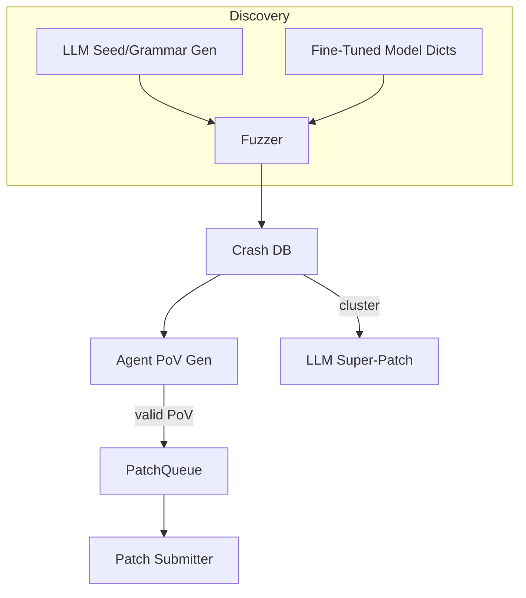

# Fuzzing asistido por IA y descubrimiento automatizado de vulnerabilidades

{{#include ../banners/hacktricks-training.md}}

## Descripción general
Los modelos de lenguaje grandes (LLM) pueden potenciar enormemente los flujos de trabajo tradicionales de investigación de vulnerabilidades al generar entradas semánticamente ricas, desarrollar gramáticas, razonar sobre datos de fallos e incluso proponer parches para varios bugs. Esta página recopila los patrones más eficaces observados durante la final de AI Cyber Challenge (AIxCC) de DARPA y otras investigaciones públicas.<sup>[[4]](#references)</sup><sup>[[5]](#references)</sup>

Lo que sigue no es una descripción de un sistema de competición específico, sino una abstracción de las técnicas para que puedas reproducirlas en tus propios flujos de trabajo.

---

## 1. Entradas semilla generadas por LLM

Los fuzzers tradicionales guiados por cobertura (AFL++, libFuzzer, Honggfuzz…) comienzan con un pequeño corpus de semillas y mutan bytes a ciegas. Cuando el formato de entrada objetivo es complejo (SQL, URL, protocolos binarios personalizados), las mutaciones aleatorias suelen romper la sintaxis antes de alcanzar ramas interesantes.

Los LLM pueden resolver este problema inicial generando *generadores de semillas*: scripts cortos que producen **entradas sintácticamente correctas pero relevantes para la seguridad**. Por ejemplo:

```prompt
SYSTEM: You are a helpful security engineer.
USER:
Write a Python3 program that prints 200 unique SQL injection strings targeting common anti-pattern mistakes (missing quotes, numeric context, stacked queries).  Ensure length ≤ 256 bytes / string so they survive common length limits.
```

```python
# gen_sqli_seeds.py (truncated)
PAYLOADS = [
    "1 OR 1=1 -- ",
    "' UNION SELECT NULL,NULL--",
    "0; DROP TABLE users;--",
    ...
]
for p in PAYLOADS:
    print(p)
```

Ejecútalo una vez y alimenta directamente la salida al corpus inicial del fuzzer:

```bash
python3 gen_sqli_seeds.py > seeds.txt
afl-fuzz -i seeds.txt -o findings/ -- ./target @@
```

Benefits:
1. Validez semántica → cobertura más profunda desde el principio.
2. Regenerable: ajusta el prompt para centrarse en XSS, path traversal, blobs binarios, etc.
3. Barato (< 1 ¢ con GPT-3.5).

### Tips
* Indica al modelo que *diversifique* la longitud y la codificación de los payloads (UTF-8, URL-encoded, UTF-16-LE) para eludir filtros superficiales.
* Pide un *único script autónomo*: evita problemas de formato JSON.

---

## 2. Grammar-Evolution Fuzzing

Una variante más potente consiste en permitir que el LLM **evolucione una gramática** en lugar de semillas concretas. El flujo de trabajo (patrón «Grammar Guy») es:

1. Generar una gramática inicial de ANTLR/Peach/LibFuzzer mediante un prompt.
2. Ejecutar fuzzing durante N minutos y recopilar métricas de cobertura (edges / bloques alcanzados).
3. Resumir las áreas del programa no cubiertas y enviar el resumen al modelo:
   ```prompt
   The previous grammar triggered 12 % of the program edges.  Functions not reached: parse_auth, handle_upload.  Add / modify rules to cover these.
   ```
4. Combina las nuevas reglas, vuelve a fuzzear y repite.

Esqueleto de pseudocódigo:

```python
for epoch in range(MAX_EPOCHS):
    grammar = llm.refine(grammar, feedback=coverage_stats)
    save(grammar, f"grammar_{epoch}.txt")
    coverage_stats = run_fuzzer(grammar)
```

Puntos clave:
* Mantén un *presupuesto*: cada refinamiento consume tokens.
* Usa instrucciones `diff` + `patch` para que el modelo edite en lugar de reescribir.
* Detente cuando Δcoverage < ε.

---

## 3. Ingeniería de harness para libFuzzer con LLM local

Cuando el código fuente no puede salir de la estación de trabajo del analista, un modelo de código local puede redactar el pequeño adaptador entre los bytes del fuzzer y una API de C/C++. El límite de seguridad útil es explícito: **el modelo escribe y revisa la infraestructura de pruebas; la mutación guiada por cobertura explora las entradas; los sanitizers informan sobre operaciones no válidas; una persona revisa el harness y clasifica los hallazgos**.<sup>[[9]](#references)</sup>

Para consultar técnicas de corpus, feedback, snapshots y fuzzing con estado a nivel del motor que no dependen de un LLM, consulta la [Metodología de fuzzing](../generic-methodologies-and-resources/fuzzing.md).

Empieza con la declaración exacta copiada del encabezado del objetivo y restringe el formato de salida. Un prompt acotado reduce la invención de APIs y facilita la revisión del resultado:<sup>[[8]](#references)[[9]](#references)</sup>

```prompt
Write a libFuzzer target for this exact declaration:
int parse_records(const uint8_t *data, size_t size);

Output only C code. Implement LLVMFuzzerTestOneInput, include the
declaration, pass data and size unchanged, and do not use files,
network access, randomness, clocks, threads, or persistent state.
```

Para un parser de bytes en bruto, el resultado esperado no debería ser más complicado que:<sup>[[6]](#references)[[9]](#references)</sup>

```c
#include <stddef.h>
#include <stdint.h>

extern int parse_records(const uint8_t *, size_t);

int LLVMFuzzerTestOneInput(const uint8_t *data, size_t size) {
    (void)parse_records(data, size);
    return 0;
}
```

La compilación es solo la primera etapa de validación. Revisa cada target generado según estas invariantes antes de dedicarle tiempo de CPU:<sup>[[6]](#references)[[8]](#references)[[9]](#references)</sup>

- **API exacta:** compara los tipos, las reglas de propiedad, la inicialización, la limpieza y la convención de llamada con el header real y los callers existentes.
- **Seguridad del harness:** protege cada lectura de `data`; los hallazgos del sanitizer deben originarse en el target, no en el código glue generado.
- **Repetibilidad:** haz que el resultado dependa de `data` y `size`; elimina la E/S externa, el tiempo, la aleatoriedad no controlada, los threads sin unir y el estado que persiste entre llamadas.
- **Rendimiento:** inicializa el estado inmutable costoso una sola vez únicamente si esto no puede afectar al comportamiento, limita el tamaño de entrada, suprime el logging y libera las asignaciones por entrada.
- **Alcanzabilidad:** verifica que se ejecuten las funciones y ramas previstas. Un target que compila pero solo recorre rutas de rechazo es un fallo silencioso.

### Targets con conocimiento de la estructura: conserva las invariantes sin ocultar bugs

Si la mayoría de las entradas sin procesar fallan una comprobación de magic, longitud, versión o checksum, usa los bytes del fuzzer como material para campos tipados y reconstruye un objeto válido. Fija las constantes del formato, deja mutables los campos semánticos y los bytes del payload, y deriva los metadatos de integridad del payload reconstruido. `FuzzedDataProvider` resulta útil para consumir valores tipados con límites, mientras que el adapter sigue siendo responsable de limitar cualquier asignación y conversión generadas.<sup>[[9]](#references)</sup>

<details>
<summary>Ejemplo de target C++ con conocimiento de la estructura</summary>

```cpp
#include <fuzzer/FuzzedDataProvider.h>
#include <stddef.h>
#include <stdint.h>
#include <vector>

extern "C" int parse_message(const uint8_t *, size_t);

extern "C" int LLVMFuzzerTestOneInput(const uint8_t *data, size_t size) {
    FuzzedDataProvider fdp(data, size);
    uint8_t version = fdp.ConsumeIntegral<uint8_t>();
    auto body = fdp.ConsumeRemainingBytes<uint8_t>();
    if (body.size() > UINT16_MAX) body.resize(UINT16_MAX);
    uint16_t len = static_cast<uint16_t>(body.size());
    std::vector<uint8_t> msg = {0x8b, 'M', 'S', 'G', version,
                                static_cast<uint8_t>(len >> 8),
                                static_cast<uint8_t>(len)};
    msg.insert(msg.end(), body.begin(), body.end());
    (void)parse_message(msg.data(), msg.size());
    return 0;
}
```

</details>

No uses un único target que repare estructuras para todas las preguntas. Mantén un target que derive longitudes/sumas de comprobación para explorar estados válidos profundos, y otro que deje los metadatos **declarados** bajo el control del fuzzer y limite únicamente las lecturas y asignaciones de memoria propias del harness. El segundo target conserva las superficies de ataque de longitudes no coincidentes y de integridad incorrecta que la reparación automática eliminaría de otro modo.<sup>[[9]](#references)</sup>

### Seeds, diccionarios, sanitizers y feedback de cobertura

Pide al modelo que genere un script que escriba seeds binarios, en lugar de pedirle que imprima directamente datos binarios. Usa objetos vacíos, mínimos, típicos y válidos en los límites como seeds; después extrae los valores mágicos, las etiquetas, las codificaciones de enumeraciones y las palabras clave del parser para crear un diccionario revisado. libFuzzer acepta ese diccionario con `-dict=`, y mantiene en el corpus las mutaciones que revelan nueva cobertura.<sup>[[6]](#references)[[9]](#references)</sup>

```text
magic="\x8bMSG"
version_min="\x00"
version_max="\xff"
config_tag="CONFIG"
```

Construye el mismo objetivo con instrumentación complementaria. ASan y UBSan pueden compartir un binario de fuzzing; usa una compilación independiente con MSan e instrumenta sus dependencias para evitar informes causados por código sin instrumentar.<sup>[[6]](#references)[[9]](#references)</sup>

```bash
clang++ -g -O1 -fsanitize=fuzzer,address,undefined \
  -fno-sanitize-recover=undefined target.cc harness.cc -o fuzz_target
./fuzz_target corpus -dict=msg.dict -max_len=65535

clang++ -g -O1 -fsanitize=fuzzer,memory \
  target.cc harness.cc -o fuzz_target_msan
```

Trata la cobertura como el evaluador de cada revisión del modelo. En la salida de libFuzzer, `cov`/`ft` planos desde el inicio y un corpus estático suelen indicar un framing incorrecto, un early return demasiado restrictivo o una llamada equivocada; un `exec/s` bajo apunta a una configuración costosa, E/S, asignaciones o estado filtrado. `NEW` solo demuestra que cambió una característica de cobertura, no que se haya alcanzado el parser previsto.<sup>[[6]](#references)[[9]](#references)</sup>

Para obtener feedback a nivel de código fuente, crea una build con cobertura, haz fuzzing y proporciona al modelo solo las funciones no cubiertas, junto con sus condiciones de protección. Verifica las diferencias en el harness/seed/dictionary y vuelve a medir:<sup>[[7]](#references)[[8]](#references)[[9]](#references)</sup>

```bash
clang++ -g -O1 -fsanitize=fuzzer \
  -fprofile-instr-generate -fcoverage-mapping target.cc harness.cc -o fuzz_cov
mkdir -p profiles
LLVM_PROFILE_FILE='profiles/%p.profraw' ./fuzz_cov -max_total_time=300 corpus
llvm-profdata merge -sparse profiles/*.profraw -o fuzz.profdata
llvm-cov report ./fuzz_cov -instr-profile=fuzz.profdata
llvm-cov show ./fuzz_cov -instr-profile=fuzz.profdata \
  --show-branches=count --region-coverage-lt=1 target.cc
```

El ciclo escalable es, por tanto: **generar → compilar/enlazar → hacer una prueba rápida con sanitizers → medir la cobertura del objetivo → proporcionar el contexto mínimo relevante de cobertura/código fuente → revisar → volver a medir**. OSS-Fuzz-Gen aplica el mismo principio: evalúa los objetivos generados según si se pueden compilar, si fallan en tiempo de ejecución, su cobertura y la mejora de cobertura frente a los objetivos existentes, en lugar de aceptar código plausible sin más.<sup>[[7]](#references)[[8]](#references)</sup>

---

<a id="3-agent-based-pov-exploit-generation" hidden>3. Generación de PoV (Exploit) basada en agentes</a>

## 4. Generación de PoV (Exploit) basada en agentes

Después de encontrar un crash, aún necesitas una **prueba de vulnerabilidad (PoV)** que lo desencadene de forma determinista.

Un enfoque escalable consiste en iniciar muchos workers ligeros (procesos, hilos o contenedores), cada uno con un modelo o una configuración de muestreo diferentes. El informe de finalistas de AIxCC ofrece ejemplos concretos de escala: un equipo utilizó **miles de agentes concurrentes** para generar PoV con AI como prioridad, mientras que otro coordinó **300–500 agentes de fuzzing** y reservó los LLM para el razonamiento semántico de alto nivel.<sup>[[4]](#references)</sup>

Pipeline:
1. El análisis estático/dinámico genera *candidatos a bug* (struct con el PC del crash, el fragmento de entrada y el mensaje del sanitizer).
2. El orquestador distribuye los candidatos entre los agentes.
3. Pasos de razonamiento del agente:
   a. Reproducir el bug localmente con `gdb` + la entrada.
   b. Proponer un payload de exploit mínimo.
   c. Validar el exploit en un sandbox. Si tiene éxito → enviar.
4. Los intentos fallidos se **vuelven a poner en cola como nuevos seeds** para el fuzzing de cobertura (bucle de retroalimentación).

Ventajas:
* La paralelización oculta la falta de fiabilidad de un solo agente.
* Ajuste automático de la temperatura / el tamaño del modelo según la tasa de éxito observada.

---

<a id="4-directed-fuzzing-with-fine-tuned-code-models" hidden>4. Fuzzing dirigido con modelos de código ajustados</a>

## 5. Fuzzing dirigido con modelos de código ajustados

Ajusta un modelo de pesos abiertos (p. ej., Llama-7B) con código fuente C/C++ etiquetado con patrones de vulnerabilidad (desbordamiento de enteros, copia de búfer, format string). Luego:

1. Ejecuta un análisis estático para obtener la lista de funciones + AST.
2. Pide al modelo: *“Dame entradas para el diccionario de mutación que probablemente rompan la seguridad de memoria en la función X”*.
3. Inserta esos tokens en un `AFL_CUSTOM_MUTATOR` personalizado.

Ejemplo de salida para un wrapper de `sprintf`:
```
{"pattern":"%99999999s"}
{"pattern":"AAAAAAAA....<1024>....%n"}
```

Empíricamente, esto reduce el tiempo hasta el crash en más de 2× en objetivos reales.

---

<a id="5-ai-guided-patching-strategies" hidden>Estrategias de parcheo guiadas por IA</a>

## 6. Estrategias de parcheo guiadas por IA

<a id="51-super-patches" hidden>5.1 Superparches</a>

### 6.1 Superparches
Pídele al modelo que *agrupe* las firmas de crash y proponga un **único parche** que elimine la causa raíz común.  Envíalo una sola vez y corrige varios bugs → menos penalizaciones por precisión en entornos donde cada parche incorrecto cuesta puntos.

Esquema del prompt:
```
Here are 10 stack traces + file snippets.  Identify the shared mistake and generate a unified diff fixing all occurrences.
```

{{#ref}}
../generic-methodologies-and-resources/fuzzing.md
{{#endref}}

<a id="52-speculative-patch-ratio" hidden>5.2 Ratio de parches especulativos</a>

### 6.2 Ratio de parches especulativos
Implementa una cola donde se intercalen parches confirmados y validados con PoV y parches *especulativos* (sin PoV) en una proporción de 1:N, ajustada a las reglas de puntuación (p. ej., 2 especulativos : 1 confirmado). Un modelo de costos supervisa las penalizaciones frente a los puntos y ajusta N automáticamente.

---

<a id="6-deterministic-file-by-file-ai-code-review" hidden>6. Revisión de código con IA determinista, archivo por archivo</a>

## 7. Revisión de código con IA determinista, archivo por archivo

Un modo de fallo frecuente en la revisión asistida por IA es pedirle a un agente que inspeccione todo un repositorio y esperar que elija los archivos y términos de grep correctos. Un patrón más fiable es **forzar la cobertura del repositorio**:<sup>[[1]](#references)</sup>

1. Enumera los archivos de código fuente.
2. Envía **un archivo a la vez** junto con el contexto mínimo (punto de entrada, imports, rutas y funciones cercanas).
3. Exige un **informe estructurado** para cada archivo: sources, sink, validación ausente, precondiciones de explotación y nivel de confianza.<sup>[[3]](#references)</sup>
4. Deduplica los informes por **patrón source→sink** y valida manualmente los de mayor riesgo.

Consume muchos tokens y genera ruido, pero resulta muy eficaz para detectar **bugs sencillos de alto impacto en sources/sinks** que a menudo pasan inadvertidos en revisiones amplias con agentes.

### Patrones de triaje que conviene priorizar

- **Inclusión/dispatch dinámico en PHP**: nombres de rutas/controladores/módulos controlados por un atacante que llegan a `require_once()`, `include()` o `include_once()` sin una lista de permitidos estricta ni canonicalización de rutas.
- **Ejecución de comandos de shell en flujos de trabajo de administración/cuentas**: nombres de usuario, dominios, cuentas FTP u otros identificadores que llegan a `exec()`, `system()`, `shell_exec()`, `passthru()`, `proc_open()` o `popen()`.
- **Convergencia de entradas estructuradas**: el mismo parámetro se acepta desde `$_GET`, `$_POST`, JSON, XML o parsers del cuerpo de solicitudes del framework y luego se reutiliza en sinks del sistema de archivos o de comandos del SO.

### Dos clases de bugs prácticas que este método detecta bien

- **LFI/RCE por dispatch de controladores PHP**: si un nombre de controlador controlado por una solicitud se concatena en `require_once()` sin una lista de permitidos ni normalización de rutas, secuencias de traversal como `../` pueden hacer que PHP incluya un archivo local `.php` no previsto. Si el atacante puede dirigir la inclusión a un archivo PHP colocado previamente o útil por otros motivos, la LFI se convierte en ejecución de código. Consulta [File Inclusion / Path Traversal](../pentesting-web/file-inclusion/README.md).<sup>[[1]](#references)</sup>
- **Inyección de comandos autenticada en paneles de hosting/administración**: si campos de gestión de cuentas, como los nombres de usuario, se incrustan en comandos de shell, un usuario autenticado con pocos privilegios puede convertir una acción normal de creación/eliminación en RCE. El impacto aumenta cuando el panel ejecuta el comando como una cuenta de servicio con más privilegios. Consulta [Command Injection](../pentesting-web/command-injection.md).<sup>[[1]](#references)</sup>

### Notas prácticas para la revisión

- Usa el LLM primero como **revisor de source/sink**, no como generador de exploits.
- Pídele que enumere explícitamente el **campo controlado por el atacante**, la **falla de normalización/validación** y el **sink peligroso**.
- En repositorios grandes, la revisión determinista archivo por archivo suele ser más fiable que una única ejecución de un agente autónomo, incluso si este usa un modelo más potente.<sup>[[2]](#references)</sup>
- Espera resultados más débiles en **Broken Access Control** y otros bugs de lógica de negocio, donde la explotabilidad depende de supuestos entre archivos, la semántica de los roles o modelos de amenazas específicos del producto.

---

## 8. Auditoría del kernel guiada por patrones con un oráculo instrumentado

Para un objetivo del tamaño de un kernel, no le pidas a un agente que busque bugs arbitrarios por todo el árbol. Un flujo de trabajo más eficiente en tokens convierte el conocimiento histórico de vulnerabilidades en consultas estáticas, clasifica los resultados según la superficie de ataque expuesta y usa un kernel instrumentado como oráculo de ejecución.<sup>[[11]](#references)</sup>

### Base de datos de patrones → CodeQL/Semgrep → revisión enfocada

Crea una pequeña base de conocimiento con APIs peligrosas, patrones de validación ausente, flujos source-to-sink de riesgo y formas de bugs corregidos anteriormente. Pídele al modelo que convierta **un patrón a la vez** en heurísticas de revisión y reglas de CodeQL/Semgrep; luego, ejecuta esas reglas deterministas en todo el árbol. Agrupa y deduplica las coincidencias antes de devolver el código al modelo; la salida sin procesar del escáner puede contener miles de candidatos de poco valor. Comprueba la licencia vigente de CodeQL antes de usar este enfoque fuera de objetivos aptos para investigación o de código abierto.<sup>[[11]](#references)</sup>

Prioriza los subsistemas usando tanto la **densidad de coincidencias con las reglas** como la **posibilidad de acceso por parte de un atacante**, en lugar de basarte únicamente en la cantidad de coincidencias. Las interfaces del kernel accesibles desde procesos sin privilegios, sandboxes, contenedores, jails o contextos de máquinas invitadas merecen más peso que el código de uso exclusivamente interno. Mantén la unidad de revisión lo suficientemente pequeña para que el agente pueda tener presentes los callers, los validadores y las reglas de ciclo de vida, y solicita una clase de vulnerabilidad o un patrón de flujo de control concreto en vez de pedirle que “encuentre cualquier vulnerabilidad”. Las interfaces privilegiadas heredadas son especialmente interesantes cuando un límite de contención más reciente las hace accesibles a un usuario root dentro de un namespace o jail.<sup>[[11]](#references)</sup>

Para cada candidato, exige un registro explícito del flujo de datos entre campos antes de intentar explotarlo.<sup>[[11]](#references)</sup>

```text
entrypoint -> privilege check -> parser -> validation/normalization
           -> later rewrite -> dangerous sink
attacker controls: <fields and lengths>
constraints:       <values rewritten, rejected, or preserved>
observable result: <sanitizer report, assertion, panic, or clean exit>
```

### Usar la telemetría de KASAN como oráculo de hipótesis

Ejecuta el kernel objetivo en una VM desechable con KASAN y aserciones de diagnóstico útiles habilitadas. El agente debe iterar por **hipótesis sobre el código fuente → trigger mínimo desde userland → ejecución en VM → traza de KASAN/aserción → hipótesis revisada** hasta reproducir o descartar la corrupción sospechada. Devuelve solo la traza de pila pertinente y el código fuente cercano en cada iteración; así se conserva el contexto para razonar y se establece la evidencia de ejecución, no la confianza del modelo, como criterio de aceptación.<sup>[[11]](#references)</sup>

Una compilación instrumentada no es el entorno final para evaluar la explotabilidad. Las aserciones pueden detener la ejecución antes de la operación que corrompe la memoria, mientras que esa misma aserción puede estar desactivada en un kernel de producción. Vuelve a probar el trigger sin modificarlo con la configuración exacta de producción, registra la compilación y la configuración del kernel, y distingue **alcanzabilidad**, **corrupción de memoria**, **primitiva controlada** e **impacto en la seguridad** como afirmaciones separadas.<sup>[[11]](#references)[[12]](#references)</sup>

CVE-2026-3038 es un ejemplo útil para validar, no una plantilla de exploit. Una solicitud `RTM_GET` de FreeBSD sin privilegios podía conservar un `sockaddr` `RTAX_AUTHOR` de tamaño excesivo mediante validación selectiva y reescritura de la respuesta, hasta que `rtsock_msg_buffer()` copiaba su `sa_len`, controlado por el usuario, en un `sockaddr_storage` de 128 bytes en la pila. La copia máxima de 255 bytes producía una sobrescritura de 127 bytes; una aserción de diagnóstico detectaba la longitud incorrecta en la compilación instrumentada, mientras que un kernel GENERIC llegaba a la copia y luego entraba en pánico al comprobar el canario corrupto. Esto demuestra una denegación de servicio sin privilegios, no una escalada de privilegios por sí sola: para lograr un control fiable primero se necesitaría otra primitiva, como la divulgación de un canario. Consulta [Stack Canaries](../binary-exploitation/common-binary-protections-and-bypasses/stack-canaries/index.html) para conocer el límite correspondiente en binary exploitation.<sup>[[11]](#references)[[12]](#references)[[13]](#references)</sup>

### Rechazar el engaño con las precondiciones del exploit

Antes de aceptar un PoV o un exploit, pide a un revisor/agente independiente que intente refutarlo con criterios fijos. La revisión debe confirmar todas las condiciones siguientes.<sup>[[11]](#references)</sup>

- No se modificaron el código fuente del objetivo, el kernel ni el módulo vulnerable para hacer alcanzable la ruta.
- No se introdujeron módulos auxiliares, gadgets sintéticos, mitigaciones desactivadas, privilegios adicionales ni interfaces no disponibles.
- El trigger parte de la identidad de usuario y las restricciones de aislamiento declaradas, en una instantánea limpia.
- El resultado declarado sigue dependiendo del bug: eliminar el campo malformado o corregir solo el bug debe romper la cadena.
- Un crash, una lectura fuera de límites o una sobrescritura se reportan únicamente como esa primitiva; la ejecución de código o la escalada de privilegios requieren evidencia independiente.

Esta última comprobación contrafactual detecta demostraciones circulares: si los prerrequisitos ya otorgan el impacto declarado (por ejemplo, ejecutar contenido SUID proporcionado por el atacante desde un sistema de archivos montado sin `nosuid`), el bug de seguridad de memoria no produjo ese impacto.<sup>[[11]](#references)</sup>

---

## Investigación auditable asistida por agentes en bases de código desconocidas

El [flujo de trabajo de selección de fuzz targets centrado en el grafo](../generic-methodologies-and-resources/fuzzing.md#graph-first-fuzz-target-selection-and-mutation-triage) ya cubre la alcanzabilidad de los puntos de entrada, mientras que los [pipelines de SAST agéntico](../network-services-pentesting/pentesting-web/code-review-tools.md#agentic-sast-pipelines) cubren las revisiones por etapas y los criterios de evidencia. Mantén esos resultados deterministas separados de las hipótesis del modelo para que cada indicio promovido conserve ubicaciones en el código fuente, evidencia de la ruta y una medición dinámica.<sup>[[10]](#references)</sup>

### Correlacionar evidencia sobre el ciclo de vida de los objetos sin inventar flujos de datos

El análisis estático puede encontrar una longitud controlada por el atacante que se almacena en una función y el mismo campo del objeto que llega a un punto de copia mucho más tarde, pero no lograr demostrar la conexión a través de callbacks, reconexiones o el ciclo de vida del objeto. Conserva ambos hallazgos por separado, agrúpalos por objeto/campo y convierte la conexión faltante en una pregunta explícita de triage. El agente puede sugerir la relación, pero la revisión del código fuente o la instrumentación en tiempo de ejecución deben demostrarla.<sup>[[10]](#references)</sup>

Para cada candidato, registra:

- el punto de entrada concreto y los bytes controlados por el atacante;
- cada productor del campo pertinente, incluida la validación específica de cada productor;
- el punto de consumo, la capacidad del destino y las condiciones de compilación/ejecución necesarias para alcanzarlo;
- una pila de llamadas real desde el punto de entrada expuesto, no solo una invocación directa del harness;
- el resultado dinámico mínimo que confirma o descarta la hipótesis.

Una ruta aparentemente segura no garantiza que un campo sea seguro en todos los casos. Un segundo productor podría llenar el mismo campo sin el límite aplicado por la primera ruta. Prueba las rutas por separado y ejecuta el harness con opciones de compilación equivalentes a las del despliegue, porque las aserciones de depuración pueden convertir una corrupción de memoria en producción en una interrupción temprana que solo ocurre en las pruebas.<sup>[[10]](#references)</sup>

### Criterios de medición para la divulgación y la explotación

Para una sospecha de divulgación de memoria no inicializada, llena las asignaciones nuevas con un byte reconocible y verifica que el marcador exacto llegue al paquete emitido. Para la explotación, exige criterios medidos como **sobrescritura controlada → objeto víctima útil → divulgación → recuperación de puntero/base → secuestro del flujo de control → payload compuesto**. Un agente solo avanza cuando el harness demuestra la propiedad actual; una narrativa plausible no satisface el criterio. El [caso de FreeRDP](../binary-exploitation/libc-heap/heap-overflow.md#cross-path-length-reuse-and-stale-output-disclosure) muestra la ruta y las restricciones de compilación que deben conservarse durante la validación.<sup>[[10]](#references)</sup>

---

Para un caso práctico de kernel que aplica la validación escalonada L0–L4 al desarrollo de exploits asistido por LLM, consulta:

{{#ref}}
../binary-exploitation/freebsd-kernel-exploitation-vnet-jail-escape.md
{{#endref}}

## Putting It All Together
Un CRS (Cyber Reasoning System) integral podría conectar los componentes así:



---

## References

- [1] [Project Black - IA local para ciberseguridad: Cómo encontrar LFI en phpIPAM y RCE autenticado en myVesta](https://projectblack.io/blog/local-ai-for-cyber-security)
- [2] [Strix](https://github.com/usestrix/strix)
- [3] [Skill de revisión de seguridad de la comunidad de GitHub Copilot](https://github.com/github/awesome-copilot/blob/main/skills/security-review/SKILL.md)
- [4] [Trail of Bits – Finales de AIxCC: balance de la contienda](https://blog.trailofbits.com/2025/08/07/aixcc-finals-tale-of-the-tape/)
- [5] [Entrevistas de CTF Radiooo a los finalistas de AIxCC](https://www.youtube.com/@ctfradiooo)
- [6] [LLVM — libFuzzer: una biblioteca para pruebas fuzz guiadas por cobertura](https://llvm.org/docs/LibFuzzer.html)
- [7] [Google — OSS-Fuzz-Gen](https://github.com/google/oss-fuzz-gen)
- [8] [Blog de seguridad en línea de Google — Mejorar el fuzzing: encontrar más vulnerabilidades con IA](https://security.googleblog.com/2024/11/leveling-up-fuzzing-finding-more.html)
- [9] [8kSec — Generación asistida por IA de harnesses de fuzzing con un LLM local](https://8ksec.io/ai-assisted-fuzzing-harness-local-llm)
- [10] [Quarkslab — De agentes de IA a RCE: creación de un flujo de trabajo de investigación de vulnerabilidades](https://blog.quarkslab.com/from-ai-agents-to-rce-building-a-vulnerability-research-workflow.html)
- [11] [Praetorian — FreeBSoD: uso de modelos de lenguaje para encontrar y explotar errores del kernel (Parte 1 de 2)](https://praetorian.com/blog/ai-vulnerability-research-freebsd-kernel)
- [12] [FreeBSD-SA-26:05.route — DoS local y posible escalada de privilegios mediante sockets de enrutamiento](https://www.freebsd.org/security/advisories/FreeBSD-SA-26:05.route.asc)
- [13] [Parche del código fuente de FreeBSD-SA-26:05.route](https://security.FreeBSD.org/patches/SA-26:05/route.patch)
{{#include ../banners/hacktricks-training.md}}
