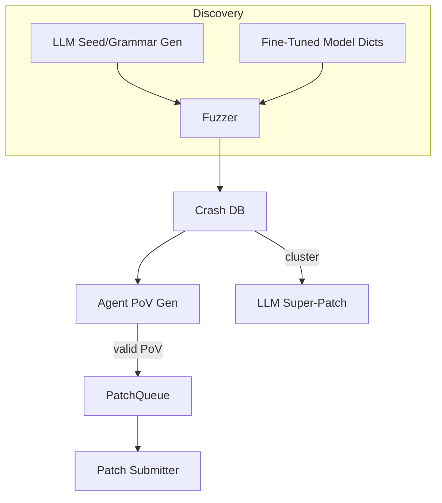

# Fuzzing Assistido por IA e Descoberta Automatizada de Vulnerabilidades

{{#include ../banners/hacktricks-training.md}}

## Visão geral
Os modelos de linguagem grandes (LLMs) podem turbinar os pipelines tradicionais de pesquisa de vulnerabilidades, gerando entradas semanticamente ricas, evoluindo gramáticas, raciocinando sobre dados de crash e até propondo patches que corrigem múltiplos bugs. Esta página reúne os padrões mais eficazes observados na final do AI Cyber Challenge (AIxCC) da DARPA e em outras pesquisas públicas.<sup>[[4]](#references)</sup><sup>[[5]](#references)</sup>

O que segue não é uma descrição de um sistema específico de competição, mas uma abstração das técnicas para que você possa reproduzi-las nos seus próprios workflows.

---

## 1. Entradas seed geradas por LLMs

Fuzzers tradicionais guiados por cobertura (AFL++, libFuzzer, Honggfuzz…) começam com um pequeno corpus de seeds e mutam bytes às cegas. Quando o formato de entrada do alvo é complexo (SQL, URLs, protocolos binários personalizados), mutações aleatórias geralmente quebram a sintaxe antes que os caminhos de execução interessantes sejam alcançados.

LLMs podem resolver esse problema inicial gerando *seed generators* — scripts curtos que produzem **entradas sintaticamente corretas, mas relevantes para a segurança**. Por exemplo:

```prompt
SYSTEM: You are a helpful security engineer.
USER:
Write a Python3 program that prints 200 unique SQL injection strings targeting common anti-pattern mistakes (missing quotes, numeric context, stacked queries).  Ensure length ≤ 256 bytes / string so they survive common length limits.
```

```python
# gen_sqli_seeds.py (truncated)
PAYLOADS = [
    "1 OR 1=1 -- ",
    "' UNION SELECT NULL,NULL--",
    "0; DROP TABLE users;--",
    ...
]
for p in PAYLOADS:
    print(p)
```

Execute uma vez e forneça a saída diretamente ao corpus inicial do fuzzer:

```bash
python3 gen_sqli_seeds.py > seeds.txt
afl-fuzz -i seeds.txt -o findings/ -- ./target @@
```

Benefícios:
1. Validade semântica → cobertura mais profunda desde o início.
2. Regenerável: ajuste o prompt para focar em XSS, path traversal, blobs binários etc.
3. Barato (< 1 ¢ com GPT-3.5).

### Dicas
* Instrua o modelo a *diversificar* o comprimento e a codificação dos payloads (UTF-8, URL-encoded, UTF-16-LE) para contornar filtros superficiais.
* Peça um *único script autocontido* – isso evita problemas de formatação JSON.

---

## 2. Grammar-Evolution Fuzzing

Uma variante mais poderosa é deixar o LLM **evoluir uma gramática** em vez de seeds concretos. O fluxo de trabalho (padrão “Grammar Guy”) é:

1. Gere uma gramática inicial de ANTLR/Peach/LibFuzzer por meio de um prompt.
2. Faça fuzzing por N minutos e colete métricas de cobertura (arestas / blocos atingidos).
3. Resuma as áreas do programa não cobertas e envie o resumo de volta ao modelo:
   ```prompt
   The previous grammar triggered 12 % of the program edges.  Functions not reached: parse_auth, handle_upload.  Add / modify rules to cover these.
   ```
4. Faça o merge das novas regras, rode o fuzzing novamente e repita.

Esqueleto de pseudocódigo:

```python
for epoch in range(MAX_EPOCHS):
    grammar = llm.refine(grammar, feedback=coverage_stats)
    save(grammar, f"grammar_{epoch}.txt")
    coverage_stats = run_fuzzer(grammar)
```

Pontos-chave:
* Mantenha um *budget* – cada refinamento usa tokens.
* Use instruções `diff` + `patch` para que o modelo edite em vez de reescrever.
* Pare quando Δcoverage < ε.

---

## 3. Engenharia de Harness do libFuzzer Local-LLM

Para código-fonte que não pode sair da estação de trabalho do analista, um modelo de código local pode elaborar o pequeno adapter entre os bytes do fuzzer e uma API C/C++. O limite de segurança útil é explícito: **o modelo escreve e revisa a infraestrutura de testes; a mutação guiada por coverage explora entradas; os sanitizers relatam operações inválidas; uma pessoa revisa o harness e faz a triagem das descobertas**.<sup>[[9]](#references)</sup>

Para técnicas de corpus, feedback, snapshot e fuzzing com estado no nível do engine que não dependem de um LLM, consulte a [Metodologia de Fuzzing](../generic-methodologies-and-resources/fuzzing.md).

Comece com a declaração exata copiada do header do alvo e restrinja o formato de saída. Um prompt específico reduz APIs inventadas e facilita a revisão do resultado:<sup>[[8]](#references)[[9]](#references)</sup>

```prompt
Write a libFuzzer target for this exact declaration:
int parse_records(const uint8_t *data, size_t size);

Output only C code. Implement LLVMFuzzerTestOneInput, include the
declaration, pass data and size unchanged, and do not use files,
network access, randomness, clocks, threads, or persistent state.
```

Para um parser de bytes brutos, o resultado esperado não deveria ser mais complicado do que:<sup>[[6]](#references)[[9]](#references)</sup>

```c
#include <stddef.h>
#include <stdint.h>

extern int parse_records(const uint8_t *, size_t);

int LLVMFuzzerTestOneInput(const uint8_t *data, size_t size) {
    (void)parse_records(data, size);
    return 0;
}
```

A compilação é apenas a primeira etapa de validação. Revise cada target gerado com base nestes invariantes antes de gastar tempo de CPU com ele:<sup>[[6]](#references)[[8]](#references)[[9]](#references)</sup>

- **API exata:** compare os tipos, as regras de ownership, a inicialização, a finalização e a convenção de chamada com o header real e os callers existentes.
- **Segurança do harness:** proteja cada leitura de `data`; os achados do sanitizer devem ter origem no target, não no glue gerado.
- **Reprodutibilidade:** faça o resultado depender de `data` e `size`; remova I/O externo, dependências de tempo, aleatoriedade não controlada, threads sem join e estado que persista entre chamadas.
- **Vazão:** inicialize o estado imutável caro apenas uma vez e somente quando isso não puder afetar o comportamento, limite o tamanho da entrada, suprima logs e libere as alocações por entrada.
- **Alcançabilidade:** verifique se as funções e branches pretendidos são executados. Um target que compila, mas só exercita caminhos de rejeição, é uma falha silenciosa.

### Alvos cientes da estrutura: preserve invariantes sem ocultar bugs

Se a maioria das entradas brutas falhar em uma verificação de magic, comprimento, versão ou checksum, use os bytes do fuzz como material para campos tipados e reconstrua um objeto válido. Fixe as constantes do formato, mantenha os campos semânticos e os bytes do payload mutáveis e derive os metadados de integridade do payload reconstruído. `FuzzedDataProvider` é útil para consumir valores tipados limitados, enquanto o adapter continua responsável por limitar qualquer alocação e conversão geradas.<sup>[[9]](#references)</sup>

<details>
<summary>Exemplo de target C++ ciente da estrutura</summary>

```cpp
#include <fuzzer/FuzzedDataProvider.h>
#include <stddef.h>
#include <stdint.h>
#include <vector>

extern "C" int parse_message(const uint8_t *, size_t);

extern "C" int LLVMFuzzerTestOneInput(const uint8_t *data, size_t size) {
    FuzzedDataProvider fdp(data, size);
    uint8_t version = fdp.ConsumeIntegral<uint8_t>();
    auto body = fdp.ConsumeRemainingBytes<uint8_t>();
    if (body.size() > UINT16_MAX) body.resize(UINT16_MAX);
    uint16_t len = static_cast<uint16_t>(body.size());
    std::vector<uint8_t> msg = {0x8b, 'M', 'S', 'G', version,
                                static_cast<uint8_t>(len >> 8),
                                static_cast<uint8_t>(len)};
    msg.insert(msg.end(), body.begin(), body.end());
    (void)parse_message(msg.data(), msg.size());
    return 0;
}
```

</details>

Não use um único alvo que corrige estruturas para todas as perguntas. Mantenha um alvo que derive comprimentos/checksums para explorar estados válidos profundos e outro que mantenha os metadados **declarados** sob controle do fuzzer, limitando apenas as leituras e alocações do próprio harness. O segundo alvo preserva superfícies de ataque com comprimentos incompatíveis e integridade inválida, que seriam eliminadas pela correção automática.<sup>[[9]](#references)</sup>

### Seeds, dicionários, sanitizers e feedback de cobertura

Peça ao modelo para gerar um script que grave seeds binários, em vez de pedir que imprima dados binários diretamente. Crie seeds de objetos vazios, mínimos, típicos e válidos nos limites; em seguida, extraia valores mágicos, tags, codificações de enum e palavras-chave do parser para um dicionário revisado. O libFuzzer aceita esse dicionário com `-dict=` e mantém no corpus as mutações que revelam novas coberturas.<sup>[[6]](#references)[[9]](#references)</sup>

```text
magic="\x8bMSG"
version_min="\x00"
version_max="\xff"
config_tag="CONFIG"
```

Compile o mesmo alvo com instrumentação complementar. ASan e UBSan podem compartilhar um binário de fuzzing; use uma compilação separada com MSan e instrumente suas dependências para evitar alertas causados por código não instrumentado.<sup>[[6]](#references)[[9]](#references)</sup>

```bash
clang++ -g -O1 -fsanitize=fuzzer,address,undefined \
  -fno-sanitize-recover=undefined target.cc harness.cc -o fuzz_target
./fuzz_target corpus -dict=msg.dict -max_len=65535

clang++ -g -O1 -fsanitize=fuzzer,memory \
  target.cc harness.cc -o fuzz_target_msan
```

Trate a cobertura como o critério de avaliação de cada revisão do modelo. Na saída do libFuzzer, `cov`/`ft` que ficam estáveis logo no início e um corpus estático geralmente indicam framing incorreto, um early return restritivo demais ou a chamada errada; `exec/s` baixo aponta para configuração custosa, I/O, alocação ou estado vazado. `NEW` apenas comprova que um recurso de cobertura mudou, não que o parser pretendido foi alcançado.<sup>[[6]](#references)[[9]](#references)</sup>

Para obter feedback no nível do código-fonte, faça um build com cobertura, execute o fuzzer e forneça ao modelo apenas as funções não cobertas e as condições que as protegem. Verifique as alterações no harness/seed/dictionary e meça novamente:<sup>[[7]](#references)[[8]](#references)[[9]](#references)</sup>

```bash
clang++ -g -O1 -fsanitize=fuzzer \
  -fprofile-instr-generate -fcoverage-mapping target.cc harness.cc -o fuzz_cov
mkdir -p profiles
LLVM_PROFILE_FILE='profiles/%p.profraw' ./fuzz_cov -max_total_time=300 corpus
llvm-profdata merge -sparse profiles/*.profraw -o fuzz.profdata
llvm-cov report ./fuzz_cov -instr-profile=fuzz.profdata
llvm-cov show ./fuzz_cov -instr-profile=fuzz.profdata \
  --show-branches=count --region-coverage-lt=1 target.cc
```

O loop escalável é, portanto, **gerar → compilar/vincular → fazer smoke test com sanitizers → medir a cobertura do alvo → fornecer o contexto mínimo relevante de cobertura/código-fonte → revisar → medir novamente**. O OSS-Fuzz-Gen aplica o mesmo princípio, avaliando os alvos gerados quanto à compilabilidade, falhas em tempo de execução, cobertura e melhoria da cobertura em relação aos alvos existentes, em vez de aceitar código plausível sem validação.<sup>[[7]](#references)[[8]](#references)</sup>

---

<a id="3-agent-based-pov-exploit-generation" hidden>3. Geração de PoV (exploit) baseada em agentes</a>

## 4. Geração de PoV (exploit) baseada em agentes

Após encontrar um crash, você ainda precisa de uma **prova de vulnerabilidade (PoV)** que o acione de forma determinística.

Uma abordagem escalável é iniciar muitos workers leves (processos, threads ou contêineres), cada um usando um modelo ou uma configuração de amostragem diferente. A pesquisa dos finalistas da AIxCC apresenta exemplos concretos de escala: uma equipe usou **milhares de agentes simultâneos** para gerar PoVs com IA como abordagem principal, enquanto outra orquestrou **300–500 agentes de fuzzing** e reservou os LLMs para raciocínio semântico de alto nível.<sup>[[4]](#references)</sup>

Pipeline:
1. A análise estática/dinâmica produz *candidatos a bugs* (struct com PC do crash, trecho da entrada e mensagem do sanitizer).
2. O orquestrador distribui os candidatos aos agentes.
3. Etapas de raciocínio do agente:
   a. Reproduzir o bug localmente com `gdb` + entrada.
   b. Sugerir um payload de exploit mínimo.
   c. Validar o exploit em um sandbox. Se funcionar → enviar.
4. As tentativas malsucedidas são **enfileiradas novamente como novas seeds** para o fuzzing de cobertura (loop de feedback).

Vantagens:
* A paralelização reduz o impacto da falta de confiabilidade de um único agente.
* Ajuste automático da temperatura / do tamanho do modelo com base na taxa de sucesso observada.

---

<a id="4-directed-fuzzing-with-fine-tuned-code-models" hidden>4. Fuzzing direcionado com modelos de código fine-tuned</a>

## 5. Fuzzing direcionado com modelos de código fine-tuned

Faça fine-tuning de um modelo de pesos abertos (por exemplo, Llama-7B) com código-fonte C/C++ rotulado com padrões de vulnerabilidade (integer overflow, cópia de buffer, format string). Em seguida:

1. Execute uma análise estática para obter a lista de funções + AST.
2. Solicite ao modelo: *“Forneça entradas para um dicionário de mutações com probabilidade de comprometer a segurança da memória na função X”*.
3. Insira esses tokens em um `AFL_CUSTOM_MUTATOR` personalizado.

Exemplo de saída para um wrapper de `sprintf`:
```
{"pattern":"%99999999s"}
{"pattern":"AAAAAAAA....<1024>....%n"}
```

Empiricamente, isso reduz o tempo até o crash em mais de 2× em alvos reais.

---

<a id="5-ai-guided-patching-strategies" hidden>5. Estratégias de patching guiadas por IA</a>

## 6. Estratégias de patching guiadas por IA

<a id="51-super-patches" hidden>5.1 Super Patches</a>

### 6.1 Super Patches
Peça ao modelo para *agrupar* assinaturas de crash e propor um **único patch** que elimine a causa raiz comum. Envie uma vez, corrija vários bugs → menos penalidades de precisão em ambientes onde cada patch incorreto custa pontos.

Esboço do prompt:
```
Here are 10 stack traces + file snippets.  Identify the shared mistake and generate a unified diff fixing all occurrences.
```

{{#ref}}
../generic-methodologies-and-resources/fuzzing.md
{{#endref}}

<a id="52-speculative-patch-ratio" hidden>5.2 Speculative Patch Ratio</a>

### 6.2 Speculative Patch Ratio
Implemente uma fila em que patches confirmados e validados por PoV e patches *especulativos* (sem PoV) sejam intercalados numa proporção de 1:N, ajustada às regras de pontuação (por exemplo, 2 especulativos : 1 confirmado). Um modelo de custos monitora as penalidades em relação aos pontos e ajusta N automaticamente.

---

<a id="6-deterministic-file-by-file-ai-code-review" hidden>6. Deterministic File-by-File AI Code Review</a>

## 7. Revisão de código determinística com IA, arquivo por arquivo

Um modo frequente de falha na revisão assistida por IA é pedir a um agente que inspecione um repositório inteiro e esperar que ele escolha os arquivos e os termos de grep certos. Um padrão mais confiável é **forçar a cobertura do repositório**:<sup>[[1]](#references)</sup>

1. Enumerar os arquivos de código-fonte.
2. Enviar **um arquivo por vez** junto com o contexto mínimo (ponto de entrada, imports, rotas/chamadores próximos).
3. Exigir um **relatório estruturado** para cada arquivo: fontes, sink, validação ausente, pré-condições de exploração e nível de confiança.<sup>[[3]](#references)</sup>
4. Eliminar duplicatas dos relatórios pelo **padrão source→sink** e validar manualmente os casos de alto risco.

Isso consome muitos tokens e gera ruído, mas é muito eficaz para revelar **bugs simples de alto impacto em source/sink** que revisões agentic abrangentes muitas vezes não detectam.

### Padrões de triagem que vale a pena priorizar

- **Inclusão/dispatch dinâmico em PHP**: nomes de rotas/controladores/módulos controlados pelo atacante que chegam a `require_once()`, `include()` ou `include_once()` sem allowlist rigorosa e canonicalização de caminhos.
- **Execução de shell em fluxos de trabalho administrativos/de contas**: nomes de usuário, domínios, contas FTP ou outros identificadores que chegam a `exec()`, `system()`, `shell_exec()`, `passthru()`, `proc_open()` ou `popen()`.
- **Convergência de entradas estruturadas**: o mesmo parâmetro aceito via `$_GET`, `$_POST`, JSON, XML ou parsers de corpo do framework e posteriormente reutilizado em sinks de sistema de arquivos ou comandos do SO.

### Duas classes práticas de bugs que este método encontra bem

- **LFI/RCE por dispatch de controlador em PHP**: se o nome do controlador, controlado pela requisição, for concatenado em `require_once()` sem allowlist/normalização de caminho, sequências de traversal como `../` podem fazer o PHP incluir um arquivo `.php` local não pretendido. Se o atacante puder apontar a inclusão para um arquivo PHP plantado ou de outra forma útil, a LFI se torna execução de código. Consulte [File Inclusion / Path Traversal](../pentesting-web/file-inclusion/README.md).<sup>[[1]](#references)</sup>
- **Command injection autenticada em painéis de hospedagem/administração**: se campos de gerenciamento de contas, como nomes de usuário, forem inseridos em comandos de shell, um usuário autenticado com poucos privilégios poderá transformar uma ação normal de criação/exclusão em RCE. O impacto aumenta quando o painel executa o comando como uma conta de serviço mais privilegiada. Consulte [Command Injection](../pentesting-web/command-injection.md).<sup>[[1]](#references)</sup>

### Observações práticas para a revisão

- Use o LLM primeiro como **revisor de source/sink**, não como gerador de exploits.
- Peça que ele liste explicitamente o **campo controlado pelo atacante**, a **lacuna de normalização/validação** e o **sink perigoso**.
- Em repositórios grandes, a revisão determinística arquivo por arquivo costuma ser mais confiável do que uma única execução de agente autônomo, mesmo quando esta usa um modelo mais poderoso.<sup>[[2]](#references)</sup>
- Espere resultados mais fracos em **Broken Access Control** e outros bugs de lógica de negócio cuja explorabilidade depende de suposições entre arquivos, semântica de funções ou modelos de ameaças específicos do produto.

---

## Fluxos de tarefas para pontos de entrada móveis

Um único prompt para todo o repositório costuma misturar modelos de ameaça e perder o caminho entre um componente acessível externamente e um sink sensível. Um fluxo de trabalho mais robusto divide a auditoria em fluxos de tarefas com estado: primeiro classifica aplicativos/componentes, depois inventaria os pontos de entrada controlados pelo atacante, enriquece cada ponto de entrada com metadados de acessibilidade e, por fim, revisa cada um em relação a classes de vulnerabilidade específicas da plataforma. Os fluxos de tarefas móveis do GitHub Security Lab implementam esse padrão para repositórios Android, iOS e multiplataforma.<sup>[[14]](#references)[[15]](#references)</sup>

Para Android, registre pelo menos:<sup>[[14]](#references)[[15]](#references)</sup>

- Activities, Services, Receivers e Providers exportados, incluindo permissões;
- ações de intent, esquemas/hosts/caminhos de deep links, filtros MIME e App Links;
- ações, URIs de dados, `ClipData`, extras e flags de concessão de URI controlados pelo atacante;
- entradas de navegação do WebView e bridges `addJavascriptInterface`;
- operações privilegiadas subsequentes, recursos importados e destinos de rede.

Em seguida, classifique cada ponto de entrada em contexto. Pergunte explicitamente sobre autorização do chamador/comportamento de confused deputy, redirecionamento de intent, spoofing ou divulgação por broadcast, imports inseguros, scripting e exposição de bridges do WebView, além de transferência de credenciais ou cookies entre origens. Execute tanto uma **etapa rigorosa de checklist** quanto uma **etapa adversarial mais ampla**. Vincule os achados a [Intent Injection](../mobile-pentesting/android-app-pentesting/intent-injection.md) e [WebView Attacks](../mobile-pentesting/android-app-pentesting/webview-attacks.md), em vez de duplicar os detalhes de exploração.<sup>[[15]](#references)</sup>

Os fluxos de tarefas open source atuais podem ser iniciados no Codespace correspondente com:<sup>[[14]](#references)</sup>

```bash
./scripts/audit/run_audit.sh owner/repository
```

Os resultados são gravados no SQLite, na tabela `audit_result`.<sup>[[14]](#references)</sup> Trate as linhas marcadas como vulneráveis como **indícios**, não como descobertas verificadas. Para cada indício, exija que o modelo indique a origem controlada pelo atacante, o destino sensível, as precondições e o impacto esperado; em seguida, peça que crie uma PoC mínima. Execute essa PoC na build original, usando um debugger ou instrumentação. Isso detecta erros comuns de análise estática, como ramificações inalcançáveis, estado irrealista da aplicação, dados do armazenamento externo perderem prioridade para dados privados e mitigações que reduzem significativamente a gravidade.<sup>[[15]](#references)</sup>

---

## 8. Auditoria de kernel guiada por padrões com um oráculo instrumentado

Para um alvo do tamanho de um kernel, não peça a um agente que encontre bugs arbitrários em toda a árvore. Um fluxo de trabalho mais eficiente em tokens transforma o conhecimento sobre vulnerabilidades históricas em consultas estáticas, classifica os resultados pela superfície de ataque exposta e usa um kernel instrumentado como oráculo de execução.<sup>[[11]](#references)</sup>

### Banco de padrões → CodeQL/Semgrep → análise direcionada

Crie uma pequena base de conhecimento contendo APIs perigosas, padrões de validação ausente, fluxos arriscados de origem a destino e formatos de bugs corrigidos anteriormente. Peça ao modelo que traduza **um padrão por vez** em heurísticas de análise e regras de CodeQL/Semgrep; em seguida, execute essas regras determinísticas em toda a árvore. Agrupe e deduplique as correspondências antes de enviar o código ao modelo; a saída bruta do scanner pode conter milhares de candidatos de pouco valor. Verifique a licença atual do CodeQL antes de usar essa abordagem fora de alvos elegíveis de pesquisa ou de código aberto.<sup>[[11]](#references)</sup>

Priorize subsistemas considerando tanto a **densidade de ocorrências das regras** quanto a **possibilidade de acesso pelo atacante**, em vez de apenas a contagem de ocorrências. Interfaces do kernel acessíveis a processos sem privilégios, sandboxes, containers, jails ou contextos de convidados devem receber mais peso do que código acessível apenas internamente. Mantenha a unidade de análise pequena o suficiente para que o agente retenha os chamadores, validadores e regras de ciclo de vida; peça a análise de uma classe de vulnerabilidade ou padrão de fluxo de controle específico, em vez de “encontre qualquer vulnerabilidade”. Interfaces privilegiadas legadas são especialmente interessantes quando um limite de contenção mais recente as torna acessíveis a um usuário root em um namespace ou jail.<sup>[[11]](#references)</sup>

Para cada candidato, exija um registro explícito do fluxo dos dados antes de tentar explorá-lo.<sup>[[11]](#references)</sup>

```text
entrypoint -> privilege check -> parser -> validation/normalization
           -> later rewrite -> dangerous sink
attacker controls: <fields and lengths>
constraints:       <values rewritten, rejected, or preserved>
observable result: <sanitizer report, assertion, panic, or clean exit>
```

### Use a telemetria do KASAN como oráculo de hipóteses

Execute o kernel-alvo em uma VM descartável com KASAN e asserções de diagnóstico úteis habilitadas. O agente deve iterar por **hipótese sobre o código-fonte → trigger mínimo em userland → execução na VM → rastreamento do KASAN/da asserção → hipótese revisada** até que a corrupção suspeita seja reproduzida ou descartada. Retorne apenas o rastreamento de pilha relevante e o trecho de código-fonte próximo em cada iteração; isso preserva o contexto para o raciocínio e faz da evidência de execução, não da confiança do modelo, o critério de aceitação.<sup>[[11]](#references)</sup>

Uma compilação instrumentada não é o ambiente final para avaliar a possibilidade de exploração. Asserções podem interromper a execução antes da operação que causa a corrupção, enquanto a mesma asserção pode ser removida de um kernel de produção. Teste novamente o trigger inalterado com a configuração exata de produção, registre a compilação e a configuração do kernel e trate **alcançabilidade**, **corrupção de memória**, **primitiva controlada** e **impacto de segurança** como alegações distintas.<sup>[[11]](#references)[[12]](#references)</sup>

CVE-2026-3038 é um exemplo útil de validação, não um modelo de exploit. Uma solicitação `RTM_GET` não privilegiada do FreeBSD podia preservar um sockaddr `RTAX_AUTHOR` grande demais, passando por validação seletiva e reescrita da resposta, até que `rtsock_msg_buffer()` copiasse seu `sa_len`, controlado pelo usuário, para um `sockaddr_storage` de 128 bytes na pilha. A cópia máxima de 255 bytes causava uma sobrescrita de 127 bytes; uma asserção de diagnóstico detectava o tamanho inválido na compilação instrumentada, enquanto um kernel GENERIC chegava à cópia e, em seguida, entrava em panic quando o canário corrompido era verificado. Isso comprova uma negação de serviço não privilegiada, não uma elevação de privilégio independente: o controle confiável exigiria primeiro outra primitiva, como o vazamento do canário. Consulte [Stack Canaries](../binary-exploitation/common-binary-protections-and-bypasses/stack-canaries/index.html) para ver o limite correspondente da exploração de binários.<sup>[[11]](#references)[[12]](#references)[[13]](#references)</sup>

### Rejeite a falsificação de pré-condições de exploit

Antes de aceitar um PoV ou exploit, peça a um revisor/agente independente que tente refutá-lo com base em critérios fixos. A revisão deve confirmar todas as condições a seguir.<sup>[[11]](#references)</sup>

- O código-fonte do alvo, o kernel e o módulo vulnerável não foram modificados para tornar o caminho alcançável.
- Nenhum módulo auxiliar, gadget sintético, mitigação desabilitada, privilégio extra ou interface indisponível foi introduzido.
- O trigger começa com a identidade de usuário e as restrições de isolamento alegadas, em um snapshot limpo.
- O resultado alegado ainda depende do bug: remover o campo malformado ou aplicar um patch apenas ao bug deve interromper a cadeia.
- Um crash, uma leitura além dos limites ou uma sobrescrita deve ser relatado apenas como essa primitiva; execução de código ou elevação de privilégio exige evidências independentes.

Essa última verificação contrafactual detecta demonstrações circulares: se os pré-requisitos já concedem o impacto alegado (por exemplo, executar conteúdo SUID fornecido pelo atacante em um sistema de arquivos montado sem `nosuid`), o bug de segurança de memória não causou esse impacto.<sup>[[11]](#references)</sup>

---

## Pesquisa auditável assistida por agentes em bases de código desconhecidas

O [graph-first fuzz-target workflow](../generic-methodologies-and-resources/fuzzing.md#graph-first-fuzz-target-selection-and-mutation-triage) já cobre a alcançabilidade dos pontos de entrada, enquanto [agentic SAST pipelines](../network-services-pentesting/pentesting-web/code-review-tools.md#agentic-sast-pipelines) cobrem revisão em etapas e critérios de evidência. Mantenha esses resultados determinísticos separados das hipóteses do modelo, para que cada possível problema promovido preserve os locais no código-fonte, as evidências do caminho e uma medição dinâmica.<sup>[[10]](#references)</sup>

### Correlacione evidências do ciclo de vida de objetos sem inventar fluxo de dados

A análise estática pode encontrar um comprimento controlado pelo atacante armazenado em uma função e o mesmo campo do objeto chegando a um ponto de cópia muito depois, mas talvez não consiga provar a conexão entre callbacks, reconexões ou o ciclo de vida do objeto. Preserve os dois achados separadamente, agrupe-os por objeto/campo e transforme a aresta ausente em uma pergunta explícita de triagem. O agente pode sugerir a relação, mas a revisão do código-fonte ou a instrumentação em tempo de execução precisa comprová-la.<sup>[[10]](#references)</sup>

Para cada candidato, registre:

- o ponto de entrada concreto e os bytes controlados pelo atacante;
- cada produtor do campo relevante, incluindo a validação específica de cada produtor;
- o destino, a capacidade do destino e as condições de compilação/execução necessárias para alcançá-lo;
- uma pilha de chamadas real a partir do ponto de entrada exposto, não apenas uma invocação direta do harness;
- o menor resultado dinâmico que confirme ou rejeite a hipótese.

Um caminho aparentemente seguro não valida globalmente um campo. Um segundo produtor pode preencher o mesmo campo sem o limite aplicado no primeiro caminho. Teste os caminhos de forma independente e execute o harness com opções de compilação equivalentes às da implantação, pois asserções de depuração podem transformar uma corrupção de memória em produção em uma interrupção antecipada que ocorre apenas no teste.<sup>[[10]](#references)</sup>

### Critérios de medição para divulgação e exploração

Para suspeitas de divulgação de memória não inicializada, preencha novas alocações com um byte reconhecível e verifique se o marcador exato chega ao pacote emitido. Para exploração, exija critérios medidos, como **sobrescrita controlada → objeto vítima útil → divulgação → recuperação de ponteiro/base → desvio do fluxo de controle → payload composto**. O agente só avança quando o harness comprova a propriedade atual; uma narrativa plausível não satisfaz um critério. O [FreeRDP case](../binary-exploitation/libc-heap/heap-overflow.md#cross-path-length-reuse-and-stale-output-disclosure) demonstra o caminho e as restrições de compilação que devem ser preservados durante a validação.<sup>[[10]](#references)</sup>

---

Para um estudo de caso de kernel que aplica validação em etapas L0–L4 ao desenvolvimento de exploits assistido por LLM, consulte:

{{#ref}}
../binary-exploitation/freebsd-kernel-exploitation-vnet-jail-escape.md
{{#endref}}

## Juntando tudo
Um CRS (Cyber Reasoning System) de ponta a ponta pode conectar os componentes da seguinte forma:



---

## References

- [1] [Project Black - IA local para cibersegurança: encontrando LFI no phpIPAM e RCE autenticado no myVesta](https://projectblack.io/blog/local-ai-for-cyber-security)
- [2] [Strix](https://github.com/usestrix/strix)
- [3] [Skill de revisão de segurança da comunidade GitHub Copilot](https://github.com/github/awesome-copilot/blob/main/skills/security-review/SKILL.md)
- [4] [Trail of Bits – Finais do AIxCC: análise dos resultados](https://blog.trailofbits.com/2025/08/07/aixcc-finals-tale-of-the-tape/)
- [5] [Entrevistas com finalistas do AIxCC pela CTF Radiooo](https://www.youtube.com/@ctfradiooo)
- [6] [LLVM — libFuzzer: uma biblioteca para fuzz testing guiado por cobertura](https://llvm.org/docs/LibFuzzer.html)
- [7] [Google — OSS-Fuzz-Gen](https://github.com/google/oss-fuzz-gen)
- [8] [Google Online Security Blog — Elevando o nível do fuzzing: encontrando mais vulnerabilidades com IA](https://security.googleblog.com/2024/11/leveling-up-fuzzing-finding-more.html)
- [9] [8kSec — Geração de harnesses de fuzzing assistida por IA com um LLM local](https://8ksec.io/ai-assisted-fuzzing-harness-local-llm)
- [10] [Quarkslab — De agentes de IA a RCE: criando um fluxo de trabalho de pesquisa de vulnerabilidades](https://blog.quarkslab.com/from-ai-agents-to-rce-building-a-vulnerability-research-workflow.html)
- [11] [Praetorian — FreeBSoD: usando modelos de linguagem para encontrar e explorar bugs no kernel (Parte 1 de 2)](https://praetorian.com/blog/ai-vulnerability-research-freebsd-kernel)
- [12] [FreeBSD-SA-26:05.route — DoS local e possível escalada de privilégios por meio de sockets de roteamento](https://www.freebsd.org/security/advisories/FreeBSD-SA-26:05.route.asc)
- [13] [Patch de origem do FreeBSD-SA-26:05.route](https://security.FreeBSD.org/patches/SA-26:05/route.patch)
- [14] [GitHub Security Lab - Fluxos de tarefas do SecLab](https://github.com/GitHubSecurityLab/seclab-taskflows)
- [15] [GitHub Security Lab - Como encontramos 24 vulnerabilidades no Android usando um agente de segurança de IA de código aberto](https://github.blog/security/how-we-found-24-android-vulnerabilities-using-our-open-source-ai-security-agent)
{{#include ../banners/hacktricks-training.md}}
