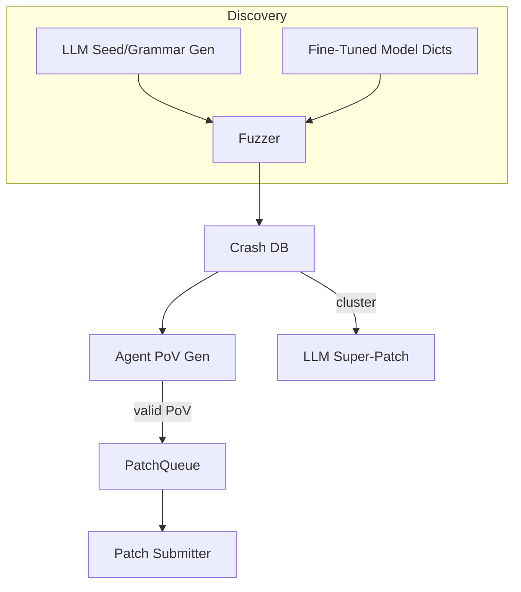

# AI 지원 Fuzzing 및 자동화된 취약점 발견

{{#include ../banners/hacktricks-training.md}}

## 개요
대규모 언어 모델(LLM)은 의미가 풍부한 입력을 생성하고, grammar를 발전시키고, crash 데이터를 추론하고, 여러 버그를 한꺼번에 수정하는 패치까지 제안함으로써 기존 취약점 연구 파이프라인의 성능을 크게 높일 수 있습니다. 이 페이지에서는 DARPA AI Cyber Challenge(AIxCC) 결선과 그 밖의 공개 연구에서 확인된 가장 효과적인 패턴을 정리합니다.<sup>[[4]](#references)</sup><sup>[[5]](#references)</sup>

다음은 특정 대회 시스템 하나를 설명하는 것이 아니라, 여러분이 자신의 워크플로에서 재현할 수 있도록 기법을 추상화한 것입니다.

---

## 1. LLM이 생성한 Seed 입력

기존 coverage-guided fuzzer(AFL++, libFuzzer, Honggfuzz…)는 소규모 seed corpus로 시작해 바이트를 무작위로 변형합니다. 대상 입력 형식이 복잡하면(SQL, URL, 맞춤형 바이너리 프로토콜 등) 무작위 변형으로 문법이 깨져 흥미로운 분기에 도달하기 어려운 경우가 많습니다.

LLM은 *seed generator*를 출력해 이 초기화 문제를 해결할 수 있습니다. 이는 **문법은 올바르면서도 보안과 관련된 입력을** 출력하는 짧은 스크립트입니다. 예를 들면 다음과 같습니다.

```prompt
SYSTEM: You are a helpful security engineer.
USER:
Write a Python3 program that prints 200 unique SQL injection strings targeting common anti-pattern mistakes (missing quotes, numeric context, stacked queries).  Ensure length ≤ 256 bytes / string so they survive common length limits.
```

```python
# gen_sqli_seeds.py (truncated)
PAYLOADS = [
    "1 OR 1=1 -- ",
    "' UNION SELECT NULL,NULL--",
    "0; DROP TABLE users;--",
    ...
]
for p in PAYLOADS:
    print(p)
```

한 번 실행한 뒤 출력을 퍼저의 초기 코퍼스에 바로 입력합니다:

```bash
python3 gen_sqli_seeds.py > seeds.txt
afl-fuzz -i seeds.txt -o findings/ -- ./target @@
```

Benefits:
1. 의미적 유효성 → 초기에 더 깊은 커버리지를 달성합니다.
2. 재생성 가능: 프롬프트를 조정해 XSS, path traversal, binary blobs 등에 집중하도록 할 수 있습니다.
3. 저렴합니다(GPT-3.5 사용 시 1¢ 미만).

### Tips
* 피상적인 필터를 우회할 수 있도록 payload 길이와 인코딩(UTF-8, URL-encoded, UTF-16-LE)을 *다양화*하라고 모델에 지시합니다.
* *자체적으로 완결된 단일 스크립트*를 요청하면 JSON 형식 오류를 피할 수 있습니다.

---

## 2. Grammar-Evolution Fuzzing

더 강력한 변형으로, 구체적인 seed 대신 LLM이 **grammar를 진화**시키도록 할 수 있습니다. 워크플로(“Grammar Guy” 패턴)는 다음과 같습니다.

1. 프롬프트를 통해 초기 ANTLR/Peach/LibFuzzer grammar를 생성합니다.
2. N분 동안 fuzzing을 수행하고 커버리지 지표(적중한 edge / block)를 수집합니다.
3. 커버되지 않은 프로그램 영역을 요약하고 그 요약을 모델에 다시 입력합니다:
   ```prompt
   The previous grammar triggered 12 % of the program edges.  Functions not reached: parse_auth, handle_upload.  Add / modify rules to cover these.
   ```
4. 새 규칙을 병합하고, 다시 fuzzing한 뒤 반복합니다.

의사 코드 골격:

```python
for epoch in range(MAX_EPOCHS):
    grammar = llm.refine(grammar, feedback=coverage_stats)
    save(grammar, f"grammar_{epoch}.txt")
    coverage_stats = run_fuzzer(grammar)
```

핵심 사항:
* *budget*을 유지하세요. 각 refinement에는 tokens가 사용됩니다.
* 모델이 전체를 다시 작성하는 대신 편집하도록 `diff` + `patch` 지시를 사용하세요.
* Δcoverage < ε이면 중단하세요.

---

## 3. Local-LLM libFuzzer Harness Engineering

분석가의 workstation 밖으로 내보낼 수 없는 소스의 경우, local code model을 사용해 fuzzer bytes와 C/C++ API 사이의 작은 adapter를 작성할 수 있습니다. 중요한 security boundary는 명확합니다. **모델은 test infrastructure를 작성하고 수정하며, coverage-guided mutation은 입력을 탐색하고, sanitizer는 잘못된 동작을 보고하며, 사람은 harness를 검토하고 발견 사항을 분류합니다**.<sup>[[9]](#references)</sup>

LLM에 의존하지 않는 engine 수준의 corpus, feedback, snapshot, stateful-fuzzing 기법은 일반 [Fuzzing Methodology](../generic-methodologies-and-resources/fuzzing.md)를 참조하세요.

대상 header에서 정확한 선언을 복사하고 출력 형식을 제한하는 것부터 시작하세요. 범위를 좁힌 prompt는 지어낸 API를 줄이고 결과를 쉽게 검토할 수 있게 합니다:<sup>[[8]](#references)[[9]](#references)</sup>

```prompt
Write a libFuzzer target for this exact declaration:
int parse_records(const uint8_t *data, size_t size);

Output only C code. Implement LLVMFuzzerTestOneInput, include the
declaration, pass data and size unchanged, and do not use files,
network access, randomness, clocks, threads, or persistent state.
```

raw byte parser의 예상 결과는 다음보다 더 복잡하지 않아야 합니다:<sup>[[6]](#references)[[9]](#references)</sup>

```c
#include <stddef.h>
#include <stdint.h>

extern int parse_records(const uint8_t *, size_t);

int LLVMFuzzerTestOneInput(const uint8_t *data, size_t size) {
    (void)parse_records(data, size);
    return 0;
}
```

Compilation은 첫 번째 검증 단계일 뿐입니다. CPU 시간을 들이기 전에 생성된 모든 target을 다음 불변 조건에 따라 검토하세요:<sup>[[6]](#references)[[8]](#references)[[9]](#references)</sup>

- **정확한 API:** 실제 헤더 및 기존 호출 코드와 타입, 소유권 규칙, 초기화, 해제, 호출 규약을 비교합니다.
- **Harness 안전성:** `data`에서 읽는 모든 작업을 보호하고, sanitizer 탐지 결과는 생성된 glue가 아니라 target에서 비롯되어야 합니다.
- **반복 가능성:** 결과가 `data`와 `size`의 함수가 되도록 합니다. 외부 I/O, 시간, 제어되지 않는 난수, join되지 않은 스레드, 호출 간 유지되는 상태를 제거합니다.
- **처리량:** 동작에 영향을 주지 않는 경우에만 비용이 큰 불변 상태를 한 번 초기화하고, 입력 크기를 제한하고, 로깅을 억제하며, 입력별 할당을 해제합니다.
- **실행 경로 도달성:** 의도한 함수와 분기가 실행되는지 확인합니다. 컴파일은 되지만 거부 경로만 실행하는 target은 조용한 실패입니다.

### 구조 인식 target: 버그를 숨기지 않으면서 불변 조건 유지하기

대부분의 raw 입력이 magic, 길이, 버전 또는 체크섬 검사에서 실패한다면, fuzz 바이트를 **타입이 지정된 필드 데이터**로 사용해 유효한 객체를 재구성합니다. 형식 상수는 고정하고, 의미 필드와 payload 바이트는 변경 가능하게 두며, 재구성한 payload에서 무결성 메타데이터를 계산합니다. `FuzzedDataProvider`는 범위가 제한된 타입 값을 가져오는 데 유용하지만, 생성되는 모든 할당과 변환을 제한하는 책임은 adapter에 있습니다.<sup>[[9]](#references)</sup>

<details>
<summary>구조 인식 C++ target 예제</summary>

```cpp
#include <fuzzer/FuzzedDataProvider.h>
#include <stddef.h>
#include <stdint.h>
#include <vector>

extern "C" int parse_message(const uint8_t *, size_t);

extern "C" int LLVMFuzzerTestOneInput(const uint8_t *data, size_t size) {
    FuzzedDataProvider fdp(data, size);
    uint8_t version = fdp.ConsumeIntegral<uint8_t>();
    auto body = fdp.ConsumeRemainingBytes<uint8_t>();
    if (body.size() > UINT16_MAX) body.resize(UINT16_MAX);
    uint16_t len = static_cast<uint16_t>(body.size());
    std::vector<uint8_t> msg = {0x8b, 'M', 'S', 'G', version,
                                static_cast<uint8_t>(len >> 8),
                                static_cast<uint8_t>(len)};
    msg.insert(msg.end(), body.begin(), body.end());
    (void)parse_message(msg.data(), msg.size());
    return 0;
}
```

</details>

모든 질문에 하나의 구조 복구 타깃만 사용하지 마세요. 길이와 체크섬을 계산해 유효한 내부 상태를 깊이 탐색하는 타깃 하나와, 하네스 자체의 읽기 및 할당만 제한하면서 **선언된** 메타데이터는 fuzzer가 제어하도록 유지하는 타깃을 별도로 두세요. 두 번째 타깃은 자동 복구로 사라질 수 있는 길이 불일치 및 무결성 오류 공격 표면을 보존합니다.<sup>[[9]](#references)</sup>

### 시드, 사전, sanitizer, 커버리지 피드백

모델에 바이너리를 직접 출력하도록 요청하는 대신, 바이너리 시드를 기록하는 스크립트를 생성하도록 요청하세요. 비어 있는 객체, 최소 객체, 일반적인 객체, 경계값에 해당하는 유효한 객체를 시드로 사용한 다음, 매직 값, 태그, enum 인코딩, 파서 키워드를 추출해 검토된 사전에 넣으세요. libFuzzer는 `-dict=` 옵션으로 해당 사전을 받아들이며, 새로운 커버리지를 드러내는 변이를 코퍼스에 유지합니다.<sup>[[6]](#references)[[9]](#references)</sup>

```text
magic="\x8bMSG"
version_min="\x00"
version_max="\xff"
config_tag="CONFIG"
```

상호 보완적인 instrumentation을 적용해 동일한 대상을 빌드하세요. ASan과 UBSan은 하나의 fuzzing 바이너리를 공유할 수 있지만, 비계측 코드로 인한 보고를 방지하려면 별도의 MSan 빌드를 사용하고 종속 항목에도 instrumentation을 적용하세요.<sup>[[6]](#references)[[9]](#references)</sup>

```bash
clang++ -g -O1 -fsanitize=fuzzer,address,undefined \
  -fno-sanitize-recover=undefined target.cc harness.cc -o fuzz_target
./fuzz_target corpus -dict=msg.dict -max_len=65535

clang++ -g -O1 -fsanitize=fuzzer,memory \
  target.cc harness.cc -o fuzz_target_msan
```

각 모델 revision의 평가 기준으로 coverage를 사용하세요. libFuzzer 출력에서 초반부터 평탄한 `cov`/`ft`와 정적인 corpus는 대개 잘못된 framing, 지나치게 제한적인 early return 또는 잘못된 호출을 의미합니다. 낮은 `exec/s`는 비용이 많이 드는 setup, I/O, allocation 또는 누수된 state를 나타냅니다. `NEW`는 coverage feature가 변경되었다는 사실만 증명할 뿐, 의도한 parser에 도달했다는 뜻은 아닙니다.<sup>[[6]](#references)[[9]](#references)</sup>

소스 수준의 피드백을 얻으려면 coverage 빌드를 만들고 fuzzing한 뒤, 미커버 함수와 해당 함수의 실행을 제어하는 조건만 모델에 제공하세요. 결과로 나온 harness/seed/dictionary diff를 확인하고 다시 측정하세요:<sup>[[7]](#references)[[8]](#references)[[9]](#references)</sup>

```bash
clang++ -g -O1 -fsanitize=fuzzer \
  -fprofile-instr-generate -fcoverage-mapping target.cc harness.cc -o fuzz_cov
mkdir -p profiles
LLVM_PROFILE_FILE='profiles/%p.profraw' ./fuzz_cov -max_total_time=300 corpus
llvm-profdata merge -sparse profiles/*.profraw -o fuzz.profdata
llvm-cov report ./fuzz_cov -instr-profile=fuzz.profdata
llvm-cov show ./fuzz_cov -instr-profile=fuzz.profdata \
  --show-branches=count --region-coverage-lt=1 target.cc
```

따라서 확장 가능한 반복 과정은 **생성 → 컴파일/링크 → sanitizer를 적용한 스모크 테스트 → 대상 커버리지 측정 → 관련성이 가장 높은 최소한의 커버리지/소스 컨텍스트 제공 → 수정 → 재측정**입니다. OSS-Fuzz-Gen은 그럴듯한 코드를 그대로 받아들이는 대신, 생성된 타깃의 컴파일 가능성, 런타임 오류, 커버리지, 기존 타깃 대비 커버리지 개선 여부를 평가하여 같은 원칙을 적용합니다.<sup>[[7]](#references)[[8]](#references)</sup>

---

## 4. 에이전트 기반 PoV(Exploit) 생성

crash를 찾은 뒤에는 이를 결정론적으로 재현하는 **취약점 증명(proof-of-vulnerability, PoV)**이 여전히 필요합니다.

확장 가능한 접근 방식은 경량 worker(프로세스, 스레드 또는 컨테이너)를 다수 실행하고, 각 worker가 서로 다른 모델이나 샘플링 설정을 사용하도록 하는 것입니다. AIxCC finalist 설문에는 구체적인 규모의 사례가 소개되어 있습니다. 한 팀은 AI 우선 PoV 생성을 위해 **수천 개의 동시 에이전트**를 사용했고, 다른 팀은 **300–500개의 fuzzing 에이전트**를 조율하면서 상위 수준의 의미 추론에 LLM을 활용했습니다.<sup>[[4]](#references)</sup>

파이프라인:
1. 정적/동적 분석으로 *버그 후보*를 생성합니다(crash PC, 입력 슬라이스, sanitizer 메시지가 포함된 struct).
2. 오케스트레이터가 후보를 에이전트에 분배합니다.
3. 에이전트의 추론 단계:
   a. `gdb`와 입력을 사용해 로컬에서 버그를 재현합니다.
   b. 최소 exploit payload를 제안합니다.
   c. sandbox에서 exploit을 검증합니다. 성공하면 제출합니다.
4. 실패한 시도는 커버리지 fuzzing을 위한 새 seed로 **다시 대기열에 추가**됩니다(피드백 루프).

장점:
* 병렬화를 통해 단일 에이전트의 신뢰성 문제를 보완합니다.
* 관측된 성공률에 따라 temp/model 크기를 자동 조정합니다.

---

## 5. Fine-Tuned Code Model을 사용한 Directed Fuzzing

취약점 패턴(integer overflow, buffer copy, format string)이 라벨링된 C/C++ 소스로 open-weight 모델(예: Llama-7B)을 fine-tune합니다. 그런 다음:

1. 정적 분석을 실행해 함수 목록과 AST를 가져옵니다.
2. 모델에 다음과 같이 프롬프트를 입력합니다. *“함수 X의 메모리 안전성을 깨뜨릴 가능성이 높은 mutation dictionary 항목을 제시해 주세요.”*
3. 해당 토큰을 커스텀 `AFL_CUSTOM_MUTATOR`에 삽입합니다.

`sprintf` 래퍼에서 출력되는 예시:
```
{"pattern":"%99999999s"}
{"pattern":"AAAAAAAA....<1024>....%n"}
```

실제 대상에서 경험적으로 이는 time-to-crash를 2배 이상 단축합니다.

---

## 6. AI 기반 패치 전략

### 6.1 Super Patches
모델에 crash signature를 *클러스터링*하고 공통 근본 원인을 제거하는 **단일 패치**를 제안하도록 요청합니다. 한 번 제출해 여러 버그를 수정하면, 잘못된 패치 하나마다 점수가 깎이는 환경에서 정확도 페널티를 줄일 수 있습니다.

프롬프트 개요:
```
Here are 10 stack traces + file snippets.  Identify the shared mistake and generate a unified diff fixing all occurrences.
```

{{#ref}}
../generic-methodologies-and-resources/fuzzing.md
{{#endref}}

### 6.2 Speculative Patch 비율
PoV로 검증된 확정 패치와 PoV가 없는 *speculative* 패치를 1:​N 비율로 번갈아 처리하는 큐를 구현합니다. 이 비율은 점수 규칙에 맞춰 조정합니다(예: speculative 패치 2개 : 확정 패치 1개). 비용 모델은 페널티와 점수를 모니터링하고 N을 자동 조정합니다.

---

## 7. 결정론적 파일별 AI 코드 리뷰

AI 지원 리뷰에서 자주 나타나는 실패 유형은 에이전트 하나에 전체 저장소를 검사하게 하고, 적절한 파일과 grep 검색어를 선택하기를 기대하는 것입니다. 더 신뢰할 수 있는 방식은 **저장소 전체를 빠짐없이 검사하도록 강제하는 것**입니다:<sup>[[1]](#references)</sup>

1. 소스 파일을 열거합니다.
2. 최소한의 컨텍스트(진입점, imports, 인접한 routes/callers)와 함께 **한 번에 파일 하나씩** 전달합니다.
3. 각 파일에 대해 sources, sink, 누락된 검증, exploit 전제 조건, 신뢰도를 포함한 **구조화된 보고서**를 요구합니다.<sup>[[3]](#references)</sup>
4. **source→sink 패턴**을 기준으로 보고서를 중복 제거한 뒤, 위험도가 높은 항목을 직접 검증합니다.

토큰 소모가 많고 잡음도 있지만, 광범위한 agentic 리뷰에서 자주 놓치는 **단순하면서 영향력이 큰 source/sink 버그**를 찾아내는 데 매우 효과적입니다.

### 우선순위를 둘 만한 분류 패턴

- **동적 PHP include/dispatch**: 공격자가 제어하는 route/controller/module 이름이 엄격한 allowlist와 경로 정규화 없이 `require_once()`, `include()`, `include_once()`로 전달되는 경우.
- **admin/account 워크플로에서의 셸 실행**: usernames, domains, FTP 계정 또는 기타 식별자가 `exec()`, `system()`, `shell_exec()`, `passthru()`, `proc_open()`, `popen()`에 전달되는 경우.
- **구조화된 입력의 fan-in**: 동일한 매개변수를 `$_GET`, `$_POST`, JSON, XML 또는 프레임워크 body parser에서 받고, 이후 파일시스템 또는 OS 명령 sink에서 재사용하는 경우.

### 이 방법으로 잘 찾을 수 있는 실용적인 버그 유형 두 가지

- **PHP controller-dispatch LFI/RCE**: 요청으로 제어되는 controller 이름을 allowlist/path 정규화 없이 `require_once()`에 연결하면 `../` 같은 traversal sequence로 의도하지 않은 로컬 `.php` 파일을 PHP가 포함하게 만들 수 있습니다. 공격자가 심어 둔, 또는 다른 방식으로 유용한 PHP 파일을 include 대상으로 지정할 수 있다면 LFI는 코드 실행으로 이어집니다. [File Inclusion / Path Traversal](../pentesting-web/file-inclusion/README.md)을 참조하세요.<sup>[[1]](#references)</sup>
- **hosting/admin panel의 인증된 command injection**: usernames 같은 계정 관리 필드가 셸 명령에 포함되면, 권한이 낮은 인증 사용자가 일반적인 생성/삭제 작업을 RCE로 바꿀 수 있습니다. 패널이 더 높은 권한의 서비스 계정으로 명령을 실행하면 영향이 커집니다. [Command Injection](../pentesting-web/command-injection.md)을 참조하세요.<sup>[[1]](#references)</sup>

### 실용적인 리뷰 참고 사항

- LLM을 exploit generator가 아니라 우선 **source/sink 리뷰어**로 사용합니다.
- **공격자가 제어하는 필드**, **정규화/검증의 누락 지점**, **위험한 sink**를 명시적으로 나열하도록 요청합니다.
- 대규모 저장소에서는 더 강력한 모델을 사용하는 경우에도, 자율 에이전트를 한 번 실행하는 것보다 결정론적 파일별 리뷰가 더 신뢰할 수 있는 경우가 많습니다.<sup>[[2]](#references)</sup>
- exploit 가능성이 여러 파일에 걸친 가정, 역할 의미 또는 제품별 위협 모델에 좌우되는 **Broken Access Control** 및 기타 비즈니스 로직 버그에서는 결과가 좋지 않을 수 있습니다.

---

## 8. 계측된 오라클을 이용한 패턴 기반 커널 감사

커널 규모의 대상을 다룰 때 에이전트에게 전체 트리에서 임의의 버그를 찾도록 요청하지 마세요. 토큰 효율이 더 높은 워크플로에서는 과거의 취약점 정보를 정적 쿼리로 변환하고, 노출된 공격 표면을 기준으로 결과의 우선순위를 정한 뒤, 계측된 커널을 실행 오라클로 사용합니다.<sup>[[11]](#references)</sup>

### 패턴 데이터베이스 → CodeQL/Semgrep → 집중 리뷰

위험한 API, 누락된 검증 패턴, 위험한 source-to-sink 흐름, 이전에 수정된 버그 형태를 포함하는 소규모 지식 기반을 구축합니다. 모델에 **한 번에 패턴 하나씩** 리뷰 휴리스틱과 CodeQL/Semgrep 규칙으로 변환하게 한 다음, 결정론적 규칙을 전체 트리에서 실행합니다. 결과를 모델에 돌려주기 전에 일치 항목을 그룹화하고 중복을 제거합니다. 원시 스캐너 출력에는 가치가 낮은 후보가 수천 개 포함될 수 있습니다. 적격한 연구 대상이나 오픈소스 대상 외부에서 이 접근법을 사용하기 전에 CodeQL의 현재 라이선스를 확인하세요.<sup>[[11]](#references)</sup>

적중 수만 보지 말고 **규칙 적중 밀도**와 **공격자 도달 가능성**을 함께 고려해 하위 시스템의 우선순위를 정합니다. 권한이 없는 프로세스, sandbox, container, jail 또는 guest 컨텍스트에서 접근 가능한 커널 인터페이스는 내부에서만 사용되는 코드보다 더 높은 비중을 둬야 합니다. 에이전트가 callers, validators, lifetime 규칙을 파악할 수 있도록 리뷰 단위를 충분히 작게 유지하고, “취약점을 아무거나 찾아라” 대신 특정 취약점 분류나 control-flow 패턴을 지정해 요청합니다. 새로운 containment boundary로 인해 namespaced 또는 jailed root 사용자가 접근할 수 있게 된 기존의 privileged 인터페이스는 특히 살펴볼 가치가 있습니다.<sup>[[11]](#references)</sup>

모든 후보에 대해 exploit을 시도하기 전에 명시적인 field-flow 기록을 요구합니다.<sup>[[11]](#references)</sup>

```text
entrypoint -> privilege check -> parser -> validation/normalization
           -> later rewrite -> dangerous sink
attacker controls: <fields and lengths>
constraints:       <values rewritten, rejected, or preserved>
observable result: <sanitizer report, assertion, panic, or clean exit>
```

### 가설 오라클로 KASAN 텔레메트리 사용

KASAN과 유용한 진단 assertion을 활성화한 일회용 VM에서 대상 커널을 실행합니다. 에이전트는 의심되는 손상이 재현되거나 기각될 때까지 **소스 가설 → 최소한의 userland 트리거 → VM 실행 → KASAN/assertion 추적 → 수정된 가설**을 반복해야 합니다. 각 반복에서는 관련 스택 추적과 주변 소스 코드만 반환하세요. 이렇게 하면 추론에 필요한 맥락은 유지하면서, 모델의 확신이 아니라 런타임 증거를 수용 기준으로 삼을 수 있습니다.<sup>[[11]](#references)</sup>

계측 빌드는 최종 exploitability 환경이 아닙니다. assertion이 손상을 일으키는 연산 전에 실행을 중단할 수 있지만, 같은 assertion이 production 커널에서는 컴파일 시 제외될 수 있습니다. 변경하지 않은 동일 트리거를 정확한 production 구성에서도 다시 테스트하고, 커널 빌드 및 구성을 기록하며, **도달 가능성**, **메모리 손상**, **제어 가능한 primitive**, **보안 영향**을 별개의 주장으로 구분하세요.<sup>[[11]](#references)[[12]](#references)</sup>

CVE-2026-3038은 exploit 템플릿이 아니라 유용한 검증 사례입니다. 권한이 없는 FreeBSD `RTM_GET` 요청은 선택적 검증과 응답 재작성 과정을 거치면서 크기가 초과된 `RTAX_AUTHOR` sockaddr을 보존했고, 결국 `rtsock_msg_buffer()`가 사용자 제어 `sa_len`을 128바이트 스택 `sockaddr_storage`에 복사했습니다. 최대 255바이트 복사로 127바이트 덮어쓰기가 발생했습니다. 계측 빌드에서는 진단 assertion이 잘못된 길이를 감지했지만, GENERIC 커널은 복사에 도달한 후 손상된 canary 검사 시 panic이 발생했습니다. 이는 권한 없는 서비스 거부를 입증할 뿐, 독립적인 권한 상승을 입증하지는 않습니다. 안정적인 제어를 위해서는 먼저 canary disclosure와 같은 또 다른 primitive가 필요합니다. 해당 binary-exploitation 경계는 [Stack Canaries](../binary-exploitation/common-binary-protections-and-bypasses/stack-canaries/index.html)를 참조하세요.<sup>[[11]](#references)[[12]](#references)[[13]](#references)</sup>

### exploit 사전 조건을 속이는 행위 배제

PoV 또는 exploit을 승인하기 전에 별도의 검토자/에이전트에게 고정된 기준에 따라 이를 반증해 보도록 하세요. 검토자는 다음 조건을 모두 확인해야 합니다.<sup>[[11]](#references)</sup>

- 경로를 도달 가능하게 만들기 위해 대상 소스, 커널, 취약한 모듈을 수정하지 않았습니다.
- helper 모듈, synthetic gadget, 비활성화된 완화책, 추가 권한 또는 사용할 수 없는 인터페이스를 도입하지 않았습니다.
- 깨끗한 스냅샷에서 주장된 호출자 ID와 격리 제한으로 트리거를 시작합니다.
- 버그에 따라 결과가 달라집니다. 즉, 잘못된 필드를 제거하거나 버그만 패치하면 체인이 중단됩니다.
- crash, overread 또는 overwrite는 해당 primitive로만 보고합니다. code execution 또는 권한 상승에는 독립적인 증거가 필요합니다.

이 마지막 반사실 검사는 순환적인 입증을 찾아냅니다. 예를 들어, 이미 공격자가 제공한 SUID 콘텐츠를 실행할 수 있는 조건(가령 `nosuid` 없이 마운트된 파일시스템)이 마련되어 있다면, 메모리 안전성 버그가 그 영향을 만들어낸 것은 아닙니다.<sup>[[11]](#references)</sup>

---

## 익숙하지 않은 코드베이스에서 감사 가능한 에이전트 지원 연구

[graph-first fuzz-target workflow](../generic-methodologies-and-resources/fuzzing.md#graph-first-fuzz-target-selection-and-mutation-triage)는 이미 진입점 도달 가능성을 다루며, [agentic SAST pipelines](../network-services-pentesting/pentesting-web/code-review-tools.md#agentic-sast-pipelines)는 단계별 검토와 증거 기준을 다룹니다. 이러한 결정론적 결과를 모델의 가설과 분리하여, 승격된 모든 단서에 소스 위치, 경로 증거, 동적 측정값이 남도록 하세요.<sup>[[10]](#references)</sup>

### 데이터 흐름을 지어내지 않고 객체 수명 증거 연관 짓기

정적 분석은 공격자가 제어하는 길이가 한 함수에서 저장되고, 동일한 객체 필드가 훨씬 나중에 복사 sink에 도달한다는 점을 찾을 수 있지만, callback, reconnect 또는 객체 수명을 가로지르는 연결을 입증하지 못할 수 있습니다. 두 결과를 별도로 보존하고, 객체/필드 기준으로 묶은 뒤 누락된 연결을 명시적인 분류 질문으로 남기세요. 에이전트가 관계를 제안할 수는 있지만, 소스 검토나 런타임 계측으로 이를 입증해야 합니다.<sup>[[10]](#references)</sup>

각 후보에 대해 다음을 기록하세요.

- 구체적인 진입점과 공격자가 제어하는 바이트
- 관련 필드를 생성하는 모든 코드 경로와 각 경로에 특화된 검증
- sink, 대상 버퍼 용량, 도달에 필요한 빌드/런타임 조건
- 직접 harness 호출만이 아니라 노출된 진입점에서 시작하는 실제 호출 스택
- 가설을 확인하거나 기각하는 최소한의 동적 결과

겉보기에 안전한 경로가 있다고 해서 필드가 전역적으로 안전한 것은 아닙니다. 두 번째 생성 경로에서는 첫 번째 경로의 길이 제한 없이 같은 필드를 채울 수 있습니다. 각 경로를 독립적으로 테스트하고, 배포 환경과 동등한 빌드 옵션으로 harness를 실행하세요. debug assertion이 production 메모리 손상을 테스트 전용의 조기 중단으로 바꿀 수 있기 때문입니다.<sup>[[10]](#references)</sup>

### disclosure 및 exploitation을 위한 측정 기준

초기화되지 않은 메모리 disclosure가 의심되면, 새 할당 영역을 식별 가능한 바이트로 채우고 정확한 marker가 출력 패킷에 도달하는지 확인하세요. exploitation의 경우 **제어 가능한 overwrite → 유용한 victim object → disclosure → pointer/base 복구 → control-flow hijack → payload 조합**과 같은 측정 기준을 요구하세요. 에이전트는 harness가 현재 속성을 입증할 때만 다음 단계로 넘어갑니다. 그럴듯한 설명은 기준 통과가 아닙니다. 검증 중 보존해야 하는 경로와 빌드 제약은 [FreeRDP case](../binary-exploitation/libc-heap/heap-overflow.md#cross-path-length-reuse-and-stale-output-disclosure)를 참조하세요.<sup>[[10]](#references)</sup>

---

## 모든 내용 종합하기
종단 간 CRS (Cyber Reasoning System)는 다음과 같이 구성 요소를 연결할 수 있습니다.



---

## References

- [1] [Project Black - Cybersecurity용 로컬 AI: phpIPAM LFI 및 myVesta 인증된 RCE 찾기](https://projectblack.io/blog/local-ai-for-cyber-security)
- [2] [Strix](https://github.com/usestrix/strix)
- [3] [GitHub Copilot 커뮤니티 security-review 스킬](https://github.com/github/awesome-copilot/blob/main/skills/security-review/SKILL.md)
- [4] [Trail of Bits – AIxCC 결승전: 경기 기록](https://blog.trailofbits.com/2025/08/07/aixcc-finals-tale-of-the-tape/)
- [5] [CTF Radiooo AIxCC 결승 진출팀 인터뷰](https://www.youtube.com/@ctfradiooo)
- [6] [LLVM — libFuzzer: 커버리지 기반 fuzz testing 라이브러리](https://llvm.org/docs/LibFuzzer.html)
- [7] [Google — OSS-Fuzz-Gen](https://github.com/google/oss-fuzz-gen)
- [8] [Google Online Security Blog — Fuzzing 강화: AI로 더 많은 취약점 찾기](https://security.googleblog.com/2024/11/leveling-up-fuzzing-finding-more.html)
- [9] [8kSec — 로컬 LLM을 활용한 AI 지원 fuzzing harness 생성](https://8ksec.io/ai-assisted-fuzzing-harness-local-llm)
- [10] [Quarkslab — AI Agents에서 RCE까지: 취약점 연구 워크플로 구축](https://blog.quarkslab.com/from-ai-agents-to-rce-building-a-vulnerability-research-workflow.html)
- [11] [Praetorian — FreeBSoD: 언어 모델을 활용한 커널 버그 탐색 및 악용 (2부 중 1부)](https://praetorian.com/blog/ai-vulnerability-research-freebsd-kernel)
- [12] [FreeBSD-SA-26:05.route — 라우팅 소켓을 통한 로컬 DoS 및 잠재적 권한 상승](https://www.freebsd.org/security/advisories/FreeBSD-SA-26:05.route.asc)
- [13] [FreeBSD-SA-26:05.route 소스 패치](https://security.FreeBSD.org/patches/SA-26:05/route.patch)
{{#include ../banners/hacktricks-training.md}}
