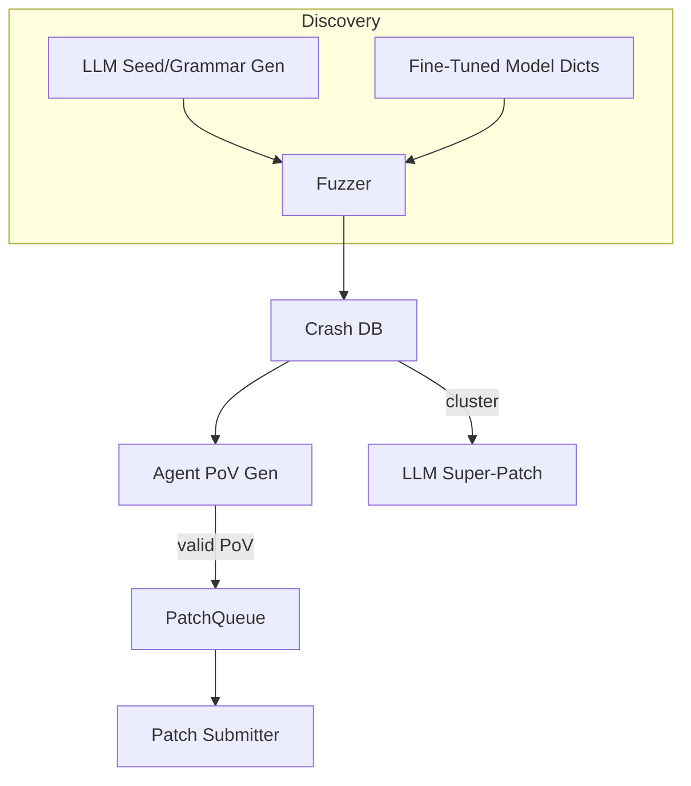

# KI-gestütztes Fuzzing & automatisierte Schwachstellenentdeckung

{{#include ../banners/hacktricks-training.md}}

## Überblick
Large Language Models (LLMs) können traditionelle Vulnerability-Research-Pipelines erheblich verstärken, indem sie semantisch reichhaltige Eingaben generieren, Grammatiken weiterentwickeln, Crash-Daten analysieren und sogar Patches für mehrere Bugs vorschlagen. Diese Seite fasst die effektivsten Muster zusammen, die während des Finales der DARPA AI Cyber Challenge (AIxCC) und in anderer öffentlicher Forschung beobachtet wurden.<sup>[[4]](#references)</sup><sup>[[5]](#references)</sup>

Was folgt, ist keine Beschreibung eines bestimmten Wettbewerbssystems, sondern eine Abstraktion der Techniken, damit du sie in deinen eigenen Workflows reproduzieren kannst.

---

## 1. Von LLMs generierte Seed-Eingaben

Traditionelle Coverage-guided-Fuzzer (AFL++, libFuzzer, Honggfuzz …) starten mit einem kleinen Seed-Corpus und mutieren Bytes blind. Wenn das Eingabeformat des Ziels komplex ist (SQL, URLs, benutzerdefinierte Binärprotokolle), zerstören zufällige Mutationen meist die Syntax, bevor interessante Branches erreicht werden.

LLMs können dieses Bootstrap-Problem lösen, indem sie *Seed-Generatoren* erzeugen – kurze Skripte, die **syntaktisch korrekte, aber sicherheitsrelevante Eingaben** ausgeben. Zum Beispiel:

```prompt
SYSTEM: You are a helpful security engineer.
USER:
Write a Python3 program that prints 200 unique SQL injection strings targeting common anti-pattern mistakes (missing quotes, numeric context, stacked queries).  Ensure length ≤ 256 bytes / string so they survive common length limits.
```

```python
# gen_sqli_seeds.py (truncated)
PAYLOADS = [
    "1 OR 1=1 -- ",
    "' UNION SELECT NULL,NULL--",
    "0; DROP TABLE users;--",
    ...
]
for p in PAYLOADS:
    print(p)
```

Einmal ausführen und die Ausgabe direkt in den initialen Corpus des Fuzzers einspeisen:

```bash
python3 gen_sqli_seeds.py > seeds.txt
afl-fuzz -i seeds.txt -o findings/ -- ./target @@
```

Benefits:
1. Semantische Gültigkeit → frühzeitig tiefere Abdeckung.
2. Erneut generierbar: Passe den Prompt an, um den Fokus auf XSS, path traversal, binary blobs usw. zu legen.
3. Günstig (< 1 ¢ mit GPT-3.5).

### Tipps
* Weise das Modell an, die Länge und Kodierung der Payloads zu *variieren* (UTF-8, URL-encoded, UTF-16-LE), um oberflächliche Filter zu umgehen.
* Bitte um ein *einzelnes eigenständiges Skript* – so vermeidest du Probleme mit dem JSON-Format.

---

## 2. Grammar-Evolution Fuzzing

Eine leistungsfähigere Variante besteht darin, das LLM eine Grammatik **entwickeln** zu lassen, statt konkrete Seeds zu verwenden. Der Workflow (Muster „Grammar Guy“) sieht so aus:

1. Generiere per Prompt eine anfängliche ANTLR/Peach/LibFuzzer-Grammatik.
2. Führe N Minuten lang Fuzzing aus und sammle Coverage-Metriken (getroffene Edges/Blocks).
3. Fasse die nicht abgedeckten Programmbereiche zusammen und gib die Zusammenfassung an das Modell zurück:
   ```prompt
   The previous grammar triggered 12 % of the program edges.  Functions not reached: parse_auth, handle_upload.  Add / modify rules to cover these.
   ```
4. Führe die neuen Regeln zusammen, führe das Fuzzing erneut aus und wiederhole den Vorgang.

Pseudocode-Skelett:

```python
for epoch in range(MAX_EPOCHS):
    grammar = llm.refine(grammar, feedback=coverage_stats)
    save(grammar, f"grammar_{epoch}.txt")
    coverage_stats = run_fuzzer(grammar)
```

Kernpunkte:
* Ein *Budget* einhalten – jede Verfeinerung verbraucht Tokens.
* `diff`- und `patch`-Anweisungen verwenden, damit das Modell Änderungen vornimmt, statt alles neu zu schreiben.
* Beenden, wenn Δcoverage < ε.

---

## 3. Entwicklung von Local-LLM-libFuzzer-Harnesses

Wenn Quellcode den Arbeitsplatz eines Analysts nicht verlassen darf, kann ein lokales Code-Modell den kleinen Adapter zwischen Fuzzer-Bytes und einer C/C++-API erstellen. Die Sicherheitsgrenze ist klar definiert: **Das Modell schreibt und überarbeitet die Testinfrastruktur; coverage-guided mutation untersucht Eingaben; Sanitizer melden ungültige Operationen; ein Mensch prüft den Harness und triagiert die Funde**.<sup>[[9]](#references)</sup>

Informationen zu engine-level Techniken für Corpus, Feedback, Snapshots und stateful fuzzing, die nicht von einem LLM abhängen, findest du in der allgemeinen [Fuzzing Methodology](../generic-methodologies-and-resources/fuzzing.md).

Beginne mit der exakten Deklaration aus dem Ziel-Header und schränke das Ausgabeformat ein. Ein eng gefasster Prompt reduziert erfundene APIs und erleichtert die Prüfung des Ergebnisses:<sup>[[8]](#references)[[9]](#references)</sup>

```prompt
Write a libFuzzer target for this exact declaration:
int parse_records(const uint8_t *data, size_t size);

Output only C code. Implement LLVMFuzzerTestOneInput, include the
declaration, pass data and size unchanged, and do not use files,
network access, randomness, clocks, threads, or persistent state.
```

Für einen Raw-Byte-Parser sollte das erwartete Ergebnis nicht komplizierter sein als:<sup>[[6]](#references)[[9]](#references)</sup>

```c
#include <stddef.h>
#include <stdint.h>

extern int parse_records(const uint8_t *, size_t);

int LLVMFuzzerTestOneInput(const uint8_t *data, size_t size) {
    (void)parse_records(data, size);
    return 0;
}
```

Die Kompilierung ist nur die erste Validierungsstufe. Prüfe jedes generierte Target anhand dieser Invarianten, bevor du CPU-Zeit dafür aufwendest:<sup>[[6]](#references)[[8]](#references)[[9]](#references)</sup>

- **Exakte API:** Vergleiche Typen, Ownership-Regeln, Initialisierung, Teardown und Calling Convention mit dem tatsächlichen Header und den vorhandenen Aufrufern.
- **Sicherheit des Harness:** Sichere jeden Lesezugriff auf `data` ab; Sanitizer-Befunde müssen im Target entstehen, nicht im generierten Glue-Code.
- **Reproduzierbarkeit:** Das Ergebnis muss eine Funktion von `data` und `size` sein. Entferne externe I/O, Zeit, unkontrollierte Zufallswerte, nicht beendete Threads und Zustände, die Aufrufe überdauern.
- **Durchsatz:** Initialisiere aufwendige unveränderliche Zustände nur einmal, wenn sich dadurch das Verhalten nicht ändern kann, begrenze die Eingabegröße, unterdrücke Logging und gib pro Eingabe allokierten Speicher frei.
- **Erreichbarkeit:** Prüfe, ob die vorgesehenen Funktionen und Branches ausgeführt werden. Ein Target, das kompiliert, aber nur Ablehnungspfade ausführt, ist ein stiller Fehlschlag.

### Struktur-aware Targets: Invarianten bewahren, ohne Bugs zu verbergen

Wenn die meisten Rohdaten an einer Magic-, Längen-, Versions- oder Prüfsummenprüfung scheitern, verwende die Fuzz-Bytes als **Material für typisierte Felder** und setze ein gültiges Objekt neu zusammen. Setze Formatkonstanten fest, lasse semantische Felder und Payload-Bytes veränderlich und leite Integritätsmetadaten aus der rekonstruierten Payload ab. `FuzzedDataProvider` eignet sich zum Konsumieren begrenzter typisierter Werte; der Adapter bleibt dafür verantwortlich, jede generierte Allokation und Konvertierung zu begrenzen.<sup>[[9]](#references)</sup>

<details>
<summary>Beispiel für ein struktur-aware C++-Target</summary>

```cpp
#include <fuzzer/FuzzedDataProvider.h>
#include <stddef.h>
#include <stdint.h>
#include <vector>

extern "C" int parse_message(const uint8_t *, size_t);

extern "C" int LLVMFuzzerTestOneInput(const uint8_t *data, size_t size) {
    FuzzedDataProvider fdp(data, size);
    uint8_t version = fdp.ConsumeIntegral<uint8_t>();
    auto body = fdp.ConsumeRemainingBytes<uint8_t>();
    if (body.size() > UINT16_MAX) body.resize(UINT16_MAX);
    uint16_t len = static_cast<uint16_t>(body.size());
    std::vector<uint8_t> msg = {0x8b, 'M', 'S', 'G', version,
                                static_cast<uint8_t>(len >> 8),
                                static_cast<uint8_t>(len)};
    msg.insert(msg.end(), body.begin(), body.end());
    (void)parse_message(msg.data(), msg.size());
    return 0;
}
```

</details>

Verwende nicht für jede Frage dasselbe strukturreparierende Target. Pflege ein Target, das Längen und Prüfsummen ableitet, um tiefe gültige Zustände zu erkunden, und ein weiteres, bei dem der Fuzzer die **deklarierten** Metadaten kontrolliert und nur die eigenen Lesezugriffe und Speicherzuweisungen des Harness begrenzt. Das zweite Target bewahrt Angriffsflächen mit nicht übereinstimmenden Längen und fehlerhafter Integrität, die durch automatische Reparatur andernfalls beseitigt würden.<sup>[[9]](#references)</sup>

### Seeds, Wörterbücher, Sanitizer und Coverage-Feedback

Bitte das Modell, ein Skript zu erstellen, das binäre Seeds schreibt, statt es aufzufordern, Binärdaten direkt auszugeben. Verwende leere, minimale, typische und gültige Grenzfallobjekte als Seeds; extrahiere dann Magic Values, Tags, Enum-Kodierungen und Parser-Schlüsselwörter in ein geprüftes Wörterbuch. libFuzzer akzeptiert dieses Wörterbuch mit `-dict=`, und behält Mutationen, die neue Coverage im Corpus aufdecken.<sup>[[6]](#references)[[9]](#references)</sup>

```text
magic="\x8bMSG"
version_min="\x00"
version_max="\xff"
config_tag="CONFIG"
```

Bauen Sie dasselbe Ziel mit ergänzender Instrumentierung. ASan und UBSan können sich ein Fuzzing-Binary teilen. Verwenden Sie einen separaten MSan-Build und instrumentieren Sie dessen Abhängigkeiten, um Meldungen durch nicht instrumentierten Code zu vermeiden.<sup>[[6]](#references)[[9]](#references)</sup>

```bash
clang++ -g -O1 -fsanitize=fuzzer,address,undefined \
  -fno-sanitize-recover=undefined target.cc harness.cc -o fuzz_target
./fuzz_target corpus -dict=msg.dict -max_len=65535

clang++ -g -O1 -fsanitize=fuzzer,memory \
  target.cc harness.cc -o fuzz_target_msan
```

Behandle Coverage als Bewertungsmaßstab für jede Modellrevision. Bei libFuzzer weisen ein frühzeitig stagnierendes `cov`/`ft` und ein statischer Corpus meist auf ein fehlerhaftes Framing, eine zu restriktive frühe Rückgabe oder den falschen Aufruf hin; eine niedrige `exec/s` deutet auf aufwendiges Setup, I/O, Allokation oder leaked state hin. `NEW` belegt nur, dass sich ein Coverage-Feature geändert hat, nicht, dass der vorgesehene Parser erreicht wurde.<sup>[[6]](#references)[[9]](#references)</sup>

Für Feedback auf Source-Ebene erstelle einen Coverage-Build, fuzze damit und gib dem Modell nur die nicht abgedeckten Funktionen samt ihrer Schutzbedingungen. Überprüfe den resultierenden Harness-/Seed-/Dictionary-Diff und miss erneut:<sup>[[7]](#references)[[8]](#references)[[9]](#references)</sup>

```bash
clang++ -g -O1 -fsanitize=fuzzer \
  -fprofile-instr-generate -fcoverage-mapping target.cc harness.cc -o fuzz_cov
mkdir -p profiles
LLVM_PROFILE_FILE='profiles/%p.profraw' ./fuzz_cov -max_total_time=300 corpus
llvm-profdata merge -sparse profiles/*.profraw -o fuzz.profdata
llvm-cov report ./fuzz_cov -instr-profile=fuzz.profdata
llvm-cov show ./fuzz_cov -instr-profile=fuzz.profdata \
  --show-branches=count --region-coverage-lt=1 target.cc
```

Die skalierbare Schleife lautet daher **generieren → kompilieren/verknüpfen → Smoke-Test unter Sanitizern → Zielabdeckung messen → den kleinsten relevanten Abdeckungs-/Quellcodekontext bereitstellen → überarbeiten → erneut messen**. OSS-Fuzz-Gen wendet dasselbe Prinzip an, indem es generierte Targets auf Kompilierbarkeit, Laufzeitfehler, Abdeckung und eine Verbesserung der Abdeckung gegenüber vorhandenen Targets prüft, statt plausibel wirkenden Code einfach für bare Münze zu nehmen.<sup>[[7]](#references)[[8]](#references)</sup>

---

## 4. Agentenbasierte PoV-Generierung (Exploit)

Nachdem ein Crash gefunden wurde, braucht man noch einen **Proof-of-Vulnerability (PoV)**, der ihn deterministisch auslöst.

Ein skalierbarer Ansatz besteht darin, viele leichtgewichtige Worker (Prozesse, Threads oder Container) zu starten, die jeweils ein anderes Modell oder eine andere Sampling-Konfiguration verwenden. Die Umfrage unter den AIxCC-Finalisten nennt konkrete Beispiele für diese Größenordnung: Ein Team setzte **Tausende parallele Agenten** für die AI-first-PoV-Generierung ein, während ein anderes **300–500 Fuzzing-Agenten** koordinierte und LLMs für übergeordnetes semantisches Schlussfolgern reservierte.<sup>[[4]](#references)</sup>

Pipeline:
1. Statische/dynamische Analyse erzeugt *Bug-Kandidaten* (Struct mit Crash-PC, Input-Slice und Sanitizer-Meldung).
2. Der Orchestrator verteilt die Kandidaten an Agenten.
3. Schlussfolgerungsschritte des Agenten:
   a. Bug lokal mit `gdb` und dem Input reproduzieren.
   b. Ein minimales Exploit-Payload vorschlagen.
   c. Exploit in einer Sandbox validieren. Bei Erfolg → einreichen.
4. Fehlgeschlagene Versuche werden als neue Seeds für Coverage-Fuzzing **erneut in die Warteschlange gestellt** (Feedback-Schleife).

Vorteile:
* Parallelisierung gleicht die Unzuverlässigkeit einzelner Agenten aus.
* Automatische Anpassung von temp / Modellgröße anhand der beobachteten Erfolgsrate.

---

## 5. Directed Fuzzing mit feinabgestimmten Code-Modellen

Ein Open-Weight-Modell (z. B. Llama-7B) anhand von C/C++-Quellcode mit markierten Schwachstellenmustern (Integer Overflow, Buffer Copy, Format String) feinabstimmen. Dann:

1. Statische Analyse ausführen, um die Funktionsliste und den AST zu erhalten.
2. Das Modell auffordern: *„Gib Mutation-Dictionary-Einträge an, die wahrscheinlich die Memory Safety in Funktion X verletzen“*.
3. Diese Tokens in einen benutzerdefinierten `AFL_CUSTOM_MUTATOR` einfügen.

Beispielausgabe für einen `sprintf`-Wrapper:
```
{"pattern":"%99999999s"}
{"pattern":"AAAAAAAA....<1024>....%n"}
```

Empirisch verkürzt dies die Zeit bis zum Crash bei realen Zielen um mehr als das Zweifache.

---

## 6. KI-gestützte Patch-Strategien

### 6.1 Super Patches
Bitte das Modell, Crash-Signaturen zu *clustern* und einen **einzelnen Patch** vorzuschlagen, der die gemeinsame Grundursache beseitigt. Einmal einreichen, mehrere Bugs beheben → weniger Genauigkeitsabzüge in Umgebungen, in denen jeder falsche Patch Punkte kostet.

Prompt-Übersicht:
```
Here are 10 stack traces + file snippets.  Identify the shared mistake and generate a unified diff fixing all occurrences.
```

{{#ref}}
../generic-methodologies-and-resources/fuzzing.md
{{#endref}}

### 6.2 Verhältnis spekulativer Patches
Implementiere eine Warteschlange, in der durch PoV validierte bestätigte Patches und *spekulative* Patches (ohne PoV) in einem an die Bewertungsregeln angepassten Verhältnis von 1:​N abwechseln (z. B. 2 spekulative : 1 bestätigter Patch). Ein Kostenmodell überwacht Strafen im Verhältnis zu Punkten und passt N automatisch an.

---

## 7. Deterministisches KI-Code-Review Datei für Datei

Ein häufiges Fehlermuster bei KI-gestützten Reviews ist, einen Agenten aufzufordern, ein ganzes Repository zu untersuchen und darauf zu hoffen, dass er die richtigen Dateien und grep-Begriffe auswählt. Ein zuverlässigeres Muster besteht darin, eine **vollständige Repository-Abdeckung zu erzwingen**:<sup>[[1]](#references)</sup>

1. Quelldateien auflisten.
2. **Jeweils eine Datei** zusammen mit minimalem Kontext übermitteln (Einstiegspunkt, Imports, benachbarte Routen/Aufrufer).
3. Für jede Datei einen **strukturierten Bericht** verlangen: Quellen, Sink, fehlende Validierung, Exploit-Voraussetzungen und Konfidenz.<sup>[[3]](#references)</sup>
4. Berichte nach **Source→Sink-Muster** deduplizieren und die risikoreichsten manuell validieren.

Das ist tokenintensiv und erzeugt viele irrelevante Ergebnisse, aber es ist sehr effektiv darin, **einfache Source/Sink-Bugs mit hoher Auswirkung** aufzudecken, die bei umfassenden agentischen Reviews oft übersehen werden.

### Triage-Muster, die Priorität verdienen

- **Dynamischer PHP-Include/Dispatch**: Vom Angreifer kontrollierte Routen-/Controller-/Modulnamen fließen ohne strikte Allowlist und Pfadkanonisierung in `require_once()`, `include()` oder `include_once()`.
- **Shell-Ausführung in Admin-/Account-Workflows**: Benutzernamen, Domains, FTP-Accounts oder andere Kennungen gelangen in `exec()`, `system()`, `shell_exec()`, `passthru()`, `proc_open()` oder `popen()`.
- **Zusammenführung strukturierter Eingaben**: Derselbe Parameter wird über `$_GET`, `$_POST`, JSON, XML oder Framework-Body-Parser angenommen und später in Datei- oder Betriebssystem-Command-Sinks wiederverwendet.

### Zwei praktische Bug-Klassen, die diese Methode gut findet

- **PHP-Controller-Dispatch-LFI/RCE**: Wird ein request-gesteuerter Controllername ohne Allowlist oder Pfadnormalisierung an `require_once()` angehängt, können Traversal-Sequenzen wie `../` dazu führen, dass PHP eine unbeabsichtigte lokale `.php`-Datei einbindet. Kann der Angreifer das Include auf eine eingeschleuste oder anderweitig nützliche PHP-Datei lenken, wird aus der LFI Codeausführung. Siehe [File Inclusion / Path Traversal](../pentesting-web/file-inclusion/README.md).<sup>[[1]](#references)</sup>
- **Authentifizierte Command Injection in Hosting-/Admin-Panels**: Werden Account-Verwaltungsfelder wie Benutzernamen in Shell-Commands eingebettet, kann ein authentifizierter Benutzer mit geringen Rechten eine normale Erstellungs-/Löschaktion in RCE verwandeln. Die Auswirkungen sind größer, wenn das Panel den Command als privilegierteres Servicekonto ausführt. Siehe [Command Injection](../pentesting-web/command-injection.md).<sup>[[1]](#references)</sup>

### Praktische Review-Hinweise

- Verwende das LLM zunächst als **Source/Sink-Reviewer**, nicht als Exploit-Generator.
- Fordere es auf, ausdrücklich das **vom Angreifer kontrollierte Feld**, die **Lücke bei Normalisierung/Validierung** und den **gefährlichen Sink** aufzulisten.
- Bei großen Repositories ist ein deterministisches Review Datei für Datei oft zuverlässiger als ein einzelner autonomer Agentenlauf, selbst wenn dieser ein stärkeres Modell verwendet.<sup>[[2]](#references)</sup>
- Erwarte schwächere Ergebnisse bei **Broken Access Control** und anderen Business-Logic-Bugs, bei denen die Ausnutzbarkeit von dateiübergreifenden Annahmen, Rollenbedeutungen oder produktspezifischen Threat Models abhängt.

---

## 8. Mustergeleitetes Kernel-Auditing mit einem instrumentierten Oracle

Bei einem Kernel-großen Ziel solltest du einen Agenten nicht bitten, beliebige Bugs im gesamten Quellbaum zu finden. Ein tokeneffizienterer Workflow wandelt Wissen über historische Schwachstellen in statische Abfragen um, priorisiert die Ergebnisse anhand der exponierten Angriffsfläche und verwendet einen instrumentierten Kernel als Ausführungs-Oracle.<sup>[[11]](#references)</sup>

### Musterdatenbank → CodeQL/Semgrep → gezieltes Review

Erstelle eine kleine Wissensbasis mit gefährlichen APIs, Mustern fehlender Validierung, riskanten Source-to-Sink-Flows und Formen bereits behobener Bugs. Bitte das Modell, jeweils **ein Muster** in Review-Heuristiken und CodeQL-/Semgrep-Regeln zu übersetzen, und führe diese deterministischen Regeln anschließend über den gesamten Quellbaum aus. Gruppiere und dedupliziere die Treffer, bevor du dem Modell Code übergibst; die rohe Scanner-Ausgabe kann Tausende Kandidaten mit geringem Wert enthalten. Prüfe die aktuelle Lizenz von CodeQL, bevor du diesen Ansatz außerhalb geeigneter Forschungs- oder Open-Source-Ziele verwendest.<sup>[[11]](#references)</sup>

Priorisiere Subsysteme anhand sowohl der **Trefferdichte der Regeln** als auch der **Erreichbarkeit durch Angreifer**, nicht allein anhand der Trefferzahl. Kernel-Schnittstellen, die für unprivilegierte Prozesse, Sandboxes, Container, Jails oder Gastkontexte erreichbar sind, sollten stärker gewichtet werden als ausschließlich intern verwendeter Code. Halte die Review-Einheit klein genug, damit der Agent Aufrufer, Validatoren und Lifetime-Regeln berücksichtigen kann, und gib als Prompt eine benannte Schwachstellenklasse oder ein Kontrollflussmuster vor, statt „finde beliebige Schwachstellen“. Alte privilegierte Schnittstellen sind besonders interessant, wenn eine neuere Containment-Grenze sie für einen Namespaced- oder Jail-Root-Benutzer erreichbar macht.<sup>[[11]](#references)</sup>

Verlange für jeden Kandidaten eine explizite Aufzeichnung des Feldflusses, bevor du einen Exploit-Versuch unternimmst.<sup>[[11]](#references)</sup>

```text
entrypoint -> privilege check -> parser -> validation/normalization
           -> later rewrite -> dangerous sink
attacker controls: <fields and lengths>
constraints:       <values rewritten, rejected, or preserved>
observable result: <sanitizer report, assertion, panic, or clean exit>
```

### KASAN-Telemetrie als Hypothesenorakel verwenden

Führe den Zielkernel in einer Wegwerf-VM mit aktiviertem KASAN und nützlichen Diagnose-Assertions aus. Der Agent sollte so lange die Folge **Quellenhypothese → minimaler Userland-Trigger → VM-Ausführung → KASAN-/Assertion-Trace → überarbeitete Hypothese** durchlaufen, bis die vermutete Beschädigung reproduziert oder verworfen wurde. Gib bei jeder Iteration nur den relevanten Stack-Trace und den angrenzenden Quellcode zurück. So bleibt der Kontext für die Analyse erhalten, während Laufzeitbelege – und nicht das Vertrauen in das Modell – als Akzeptanzkriterium dienen.<sup>[[11]](#references)</sup>

Ein instrumentierter Build ist nicht die endgültige Umgebung zur Beurteilung der Ausnutzbarkeit. Assertions können die Ausführung vor der Operation stoppen, die die Beschädigung verursacht, während dieselbe Assertion in einem Produktionskernel möglicherweise deaktiviert ist. Teste denselben Trigger erneut mit der exakten Produktionskonfiguration, dokumentiere Kernel-Build und Konfiguration und behandle **Erreichbarkeit**, **Speicherbeschädigung**, **kontrolliertes Primitiv** und **Sicherheitsauswirkung** als separate Behauptungen.<sup>[[11]](#references)[[12]](#references)</sup>

CVE-2026-3038 ist ein nützliches Validierungsbeispiel, aber keine Exploit-Vorlage. Eine nicht privilegierte FreeBSD-`RTM_GET`-Anfrage konnte eine übergroße `RTAX_AUTHOR`-Sockaddr durch selektive Validierung und das Umschreiben der Antwort hindurch bewahren, bis `rtsock_msg_buffer()` ihr benutzergesteuertes `sa_len` in eine 128 Byte große `sockaddr_storage` auf dem Stack kopierte. Die maximale Kopie von 255 Byte führte zu einem 127-Byte-Overwrite. Im instrumentierten Build erkannte eine Diagnose-Assertion die fehlerhafte Länge; ein GENERIC-Kernel erreichte dagegen die Kopie und geriet anschließend beim Prüfen des beschädigten Canarys in eine Panic. Dies belegt einen nicht privilegierten Denial of Service, keine eigenständige Privilegienausweitung: Für zuverlässige Kontrolle wäre zunächst ein weiteres Primitiv erforderlich, etwa ein Canary-Leak. Unter [Stack Canaries](../binary-exploitation/common-binary-protections-and-bypasses/stack-canaries/index.html) findest du die entsprechende Grenze bei der Binary Exploitation.<sup>[[11]](#references)[[12]](#references)[[13]](#references)</sup>

### Exploit-Voraussetzungen nicht durch Tricks umgehen

Lass vor der Akzeptanz eines PoV oder Exploits einen separaten Reviewer/Agent anhand fester Kriterien versuchen, ihn zu widerlegen. Die Prüfung muss alle folgenden Bedingungen bestätigen.<sup>[[11]](#references)</sup>

- Der Zielquellcode, der Kernel und das verwundbare Modul wurden nicht geändert, um den Pfad erreichbar zu machen.
- Es wurden weder ein Hilfsmodul, ein synthetisches Gadget, eine deaktivierte Mitigation, zusätzliche Privilegien noch eine nicht verfügbare Schnittstelle eingeführt.
- Der Trigger startet mit der angegebenen Identität des Aufrufers und den geltenden Einschränkungen der Isolation auf einem sauberen Snapshot.
- Das behauptete Ergebnis hängt weiterhin vom Bug ab: Wird das fehlerhafte Feld entfernt oder ausschließlich der Bug gepatcht, muss die Kette fehlschlagen.
- Ein Crash, Overread oder Overwrite wird nur als das jeweilige Primitiv gemeldet; Codeausführung oder Privilegienausweitung erfordern unabhängige Belege.

Diese letzte kontrafaktische Prüfung deckt zirkuläre Demonstrationen auf: Wenn die Voraussetzungen die behauptete Auswirkung bereits ermöglichen (zum Beispiel die Ausführung von angreiferkontrolliertem SUID-Inhalt von einem Dateisystem, das ohne `nosuid` eingehängt ist), hat der Memory-Safety-Bug diese Auswirkung nicht verursacht.<sup>[[11]](#references)</sup>

---

## Auditierbare agentengestützte Forschung an unbekannten Codebasen

Der [graph-first Fuzz-Target-Workflow](../generic-methodologies-and-resources/fuzzing.md#graph-first-fuzz-target-selection-and-mutation-triage) behandelt bereits die Erreichbarkeit von Einstiegspunkten, während [agentische SAST-Pipelines](../network-services-pentesting/pentesting-web/code-review-tools.md#agentic-sast-pipelines) gestufte Prüfungen und Evidenz-Gates abdecken. Halte diese deterministischen Ergebnisse von den Hypothesen des Modells getrennt, damit jede weiterverfolgte Spur Quellcodepositionen, Pfadbelege und eine dynamische Messung enthält.<sup>[[10]](#references)</sup>

### Belege zur Objektlebensdauer abgleichen, ohne Datenflüsse zu erfinden

Eine statische Analyse kann feststellen, dass eine angreiferkontrollierte Länge in einer Funktion gespeichert wird und dass dasselbe Objektfeld viel später einen Copy-Sink erreicht, aber möglicherweise die Verbindung über Callbacks, Reconnects oder die Objektlebensdauer hinweg nicht nachweisen. Halte beide Befunde separat fest, gruppiere sie nach Objekt/Feld und formuliere die fehlende Verbindung ausdrücklich als Triage-Frage. Der Agent darf den Zusammenhang vorschlagen; nachweisen müssen ihn jedoch eine Quellcodeprüfung oder Laufzeitinstrumentierung.<sup>[[10]](#references)</sup>

Erfasse für jeden Kandidaten:

- den konkreten Einstiegspunkt und die angreiferkontrollierten Bytes;
- jeden Erzeuger des betreffenden Felds, einschließlich der für jeden Erzeuger spezifischen Validierung;
- den Sink, die Zielkapazität und die Build-/Laufzeitbedingungen, die für den Pfad erforderlich sind;
- einen echten Call-Stack vom exponierten Einstiegspunkt, nicht nur einen direkten Aufruf des Harness;
- das kleinste dynamische Ergebnis, das die Hypothese bestätigt oder verwirft.

Ein scheinbar sicherer Pfad macht ein Feld nicht grundsätzlich unbedenklich. Ein zweiter Erzeuger kann dasselbe Feld ohne die Begrenzung des ersten Pfads befüllen. Teste die Pfade unabhängig voneinander und führe den Harness mit Build-Optionen aus, die der Bereitstellung entsprechen, denn Debug-Assertions können eine Speicherbeschädigung in der Produktion in einen vorzeitigen, nur im Test auftretenden Abbruch verwandeln.<sup>[[10]](#references)</sup>

### Mess-Gates für Disclosure und Exploitation

Fülle bei Verdacht auf die Offenlegung nicht initialisierten Speichers frische Allokationen mit einem erkennbaren Byte und prüfe, ob genau dieser Marker im ausgegebenen Paket ankommt. Verlange für Exploitation gemessene Gates wie **kontrollierter Overwrite → nützliches Victim-Objekt → Disclosure → Wiederherstellung von Pointer/Basisadresse → Control-Flow-Hijack → zusammengesetzte Payload**. Ein Agent geht nur dann weiter, wenn der Harness die aktuelle Eigenschaft nachweist; eine plausible Darstellung gilt nicht als bestandenes Gate. Der [FreeRDP-Fall](../binary-exploitation/libc-heap/heap-overflow.md#cross-path-length-reuse-and-stale-output-disclosure) zeigt den Pfad und die Build-Bedingungen, die bei der Validierung erhalten bleiben müssen.<sup>[[10]](#references)</sup>

---

## Alles zusammenführen
Ein End-to-End-CRS (Cyber Reasoning System) kann die Komponenten etwa folgendermaßen verbinden:



---

## References

- [1] [Project Black – Lokale KI für Cybersicherheit: phpIPAM-LFI und myVesta-authentifiziertes RCE finden](https://projectblack.io/blog/local-ai-for-cyber-security)
- [2] [Strix](https://github.com/usestrix/strix)
- [3] [GitHub Copilot Community-Skill für Security-Reviews](https://github.com/github/awesome-copilot/blob/main/skills/security-review/SKILL.md)
- [4] [Trail of Bits – AIxCC-Finale: Ein Vergleich](https://blog.trailofbits.com/2025/08/07/aixcc-finals-tale-of-the-tape/)
- [5] [CTF Radiooo: Interviews mit AIxCC-Finalisten](https://www.youtube.com/@ctfradiooo)
- [6] [LLVM – libFuzzer: eine Bibliothek für coverage-guided Fuzz-Tests](https://llvm.org/docs/LibFuzzer.html)
- [7] [Google – OSS-Fuzz-Gen](https://github.com/google/oss-fuzz-gen)
- [8] [Google Online Security Blog – Fuzzing verbessern: Mit KI mehr Schwachstellen finden](https://security.googleblog.com/2024/11/leveling-up-fuzzing-finding-more.html)
- [9] [8kSec – KI-gestützte Generierung von Fuzzing-Harnesses mit einem lokalen LLM](https://8ksec.io/ai-assisted-fuzzing-harness-local-llm)
- [10] [Quarkslab – Von KI-Agenten zu RCE: Aufbau eines Workflows zur Schwachstellenforschung](https://blog.quarkslab.com/from-ai-agents-to-rce-building-a-vulnerability-research-workflow.html)
- [11] [Praetorian – FreeBSoD: Sprachmodelle nutzen, um Kernel-Bugs zu finden und auszunutzen (Teil 1 von 2)](https://praetorian.com/blog/ai-vulnerability-research-freebsd-kernel)
- [12] [FreeBSD-SA-26:05.route – Lokaler DoS und mögliche Privilegieneskalation über Routing-Sockets](https://www.freebsd.org/security/advisories/FreeBSD-SA-26:05.route.asc)
- [13] [FreeBSD-SA-26:05.route-Quellcode-Patch](https://security.FreeBSD.org/patches/SA-26:05/route.patch)
{{#include ../banners/hacktricks-training.md}}
