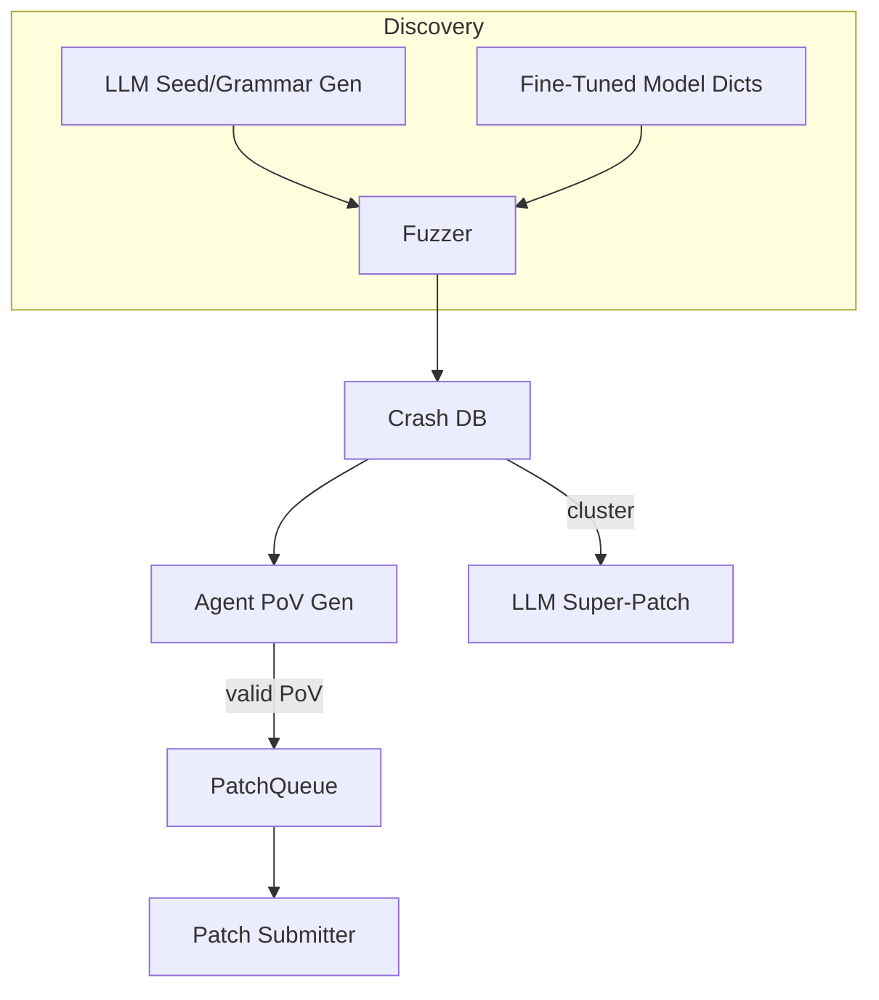

# Fuzzing uz pomoć AI-ja i automatizovano otkrivanje ranjivosti

{{#include ../banners/hacktricks-training.md}}

## Pregled
Veliki jezički modeli (LLM-ovi) mogu znatno da unaprede tradicionalne procese istraživanja ranjivosti tako što generišu semantički bogate ulaze, razvijaju gramatike, analiziraju podatke o padovima, pa čak i predlažu zakrpe za više grešaka. Ova stranica objedinjuje najefikasnije obrasce uočene tokom finala DARPA-inog AI Cyber Challenge-a (AIxCC) i drugih javnih istraživanja.<sup>[[4]](#references)</sup><sup>[[5]](#references)</sup>

Ovo nije opis konkretnog takmičarskog sistema, već pregled tehnika koje možete primeniti u sopstvenim radnim procesima.

---

## 1. Ulazni seedovi koje generiše LLM

Tradicionalni fuzzers vođeni pokrivenošću (AFL++, libFuzzer, Honggfuzz…) počinju s malim korpusom seedova i nasumično menjaju bajtove. Kada je format ulaza ciljnog programa složen (SQL, URL-ovi, prilagođeni binarni protokoli), nasumične izmene obično naruše sintaksu pre nego što se dođe do zanimljivih grana.

LLM-ovi mogu da reše ovaj početni problem tako što generišu *generatore seedova* – kratke skripte koje ispisuju **ulaze sa ispravnom sintaksom, ali relevantne za bezbednost**. Na primer:

```prompt
SYSTEM: You are a helpful security engineer.
USER:
Write a Python3 program that prints 200 unique SQL injection strings targeting common anti-pattern mistakes (missing quotes, numeric context, stacked queries).  Ensure length ≤ 256 bytes / string so they survive common length limits.
```

```python
# gen_sqli_seeds.py (truncated)
PAYLOADS = [
    "1 OR 1=1 -- ",
    "' UNION SELECT NULL,NULL--",
    "0; DROP TABLE users;--",
    ...
]
for p in PAYLOADS:
    print(p)
```

Pokrenite jednom i direktno prosledite izlaz u početni korpus fuzzer-a:

```bash
python3 gen_sqli_seeds.py > seeds.txt
afl-fuzz -i seeds.txt -o findings/ -- ./target @@
```

Benefits:
1. Semantička validnost → dublja pokrivenost od samog početka.
2. Može ponovo da se generiše: prilagodite prompt da se fokusira na XSS, path traversal, binary blobs itd.
3. Jeftino (< 1 ¢ uz GPT-3.5).

### Saveti
* Uputite model da *diversifikuje* dužinu i kodiranje payload-a (UTF-8, URL-encoded, UTF-16-LE) kako bi zaobišao površne filtere.
* Zatražite *jednu samostalnu skriptu* – tako izbegavate probleme s formatiranjem JSON-a.

---

## 2. Grammar-Evolution Fuzzing

Moćnija varijanta je da LLM-u prepustite da **evoluira gramatiku**, umesto da koristi konkretne seed-ove. Tok rada (obrazac „Grammar Guy“) je:

1. Generišite početnu ANTLR/Peach/LibFuzzer gramatiku pomoću prompta.
2. Pokrenite fuzzing N minuta i prikupite metrike pokrivenosti (pogodjene ivice / blokovi).
3. Sažmite nepokrivene delove programa i prosledite sažetak nazad modelu:
   ```prompt
   The previous grammar triggered 12 % of the program edges.  Functions not reached: parse_auth, handle_upload.  Add / modify rules to cover these.
   ```
4. Spojite nova pravila, ponovo pokrenite fuzzing i ponavljajte.

Kostur pseudokoda:

```python
for epoch in range(MAX_EPOCHS):
    grammar = llm.refine(grammar, feedback=coverage_stats)
    save(grammar, f"grammar_{epoch}.txt")
    coverage_stats = run_fuzzer(grammar)
```

Ključne tačke:
* Držite se *budžeta* – svako doterivanje troši tokene.
* Koristite uputstva `diff` + `patch` da bi model menjao postojeći tekst umesto da ga ponovo ispisuje.
* Zaustavite se kada je Δcoverage < ε.

---

## 3. Inženjering libFuzzer harness-a uz lokalni LLM

Kada izvorni kod ne sme da napusti analitičarevu radnu stanicu, lokalni model koda može da sastavi mali adapter između bajtova fuzzera i C/C++ API-ja. Bezbednosna granica je jasna: **model piše i doteruje testnu infrastrukturu; mutacije vođene pokrivenošću istražuju ulaze; sanitajzeri prijavljuju nevažeće operacije; čovek pregleda harness i trijažira nalaze**.<sup>[[9]](#references)</sup>

Za tehnike na nivou engine-a za korpus, povratne informacije, snapshot i stateful fuzzing koje ne zavise od LLM-a, pogledajte opštu [metodologiju fuzzing-a](../generic-methodologies-and-resources/fuzzing.md).

Počnite od tačne deklaracije prepisane iz ciljnog header-a i ograničite format izlaza. Uzak prompt smanjuje broj izmišljenih API-ja i olakšava pregled rezultata:<sup>[[8]](#references)[[9]](#references)</sup>

```prompt
Write a libFuzzer target for this exact declaration:
int parse_records(const uint8_t *data, size_t size);

Output only C code. Implement LLVMFuzzerTestOneInput, include the
declaration, pass data and size unchanged, and do not use files,
network access, randomness, clocks, threads, or persistent state.
```

Za parser sirovih bajtova, očekivani rezultat ne bi trebalo da bude ništa složenije od:<sup>[[6]](#references)[[9]](#references)</sup>

```c
#include <stddef.h>
#include <stdint.h>

extern int parse_records(const uint8_t *, size_t);

int LLVMFuzzerTestOneInput(const uint8_t *data, size_t size) {
    (void)parse_records(data, size);
    return 0;
}
```

Kompilacija je samo prva kontrolna tačka validacije. Pre nego što potrošite vreme procesora, proverite svaki generisani target u odnosu na sledeće invarijante:<sup>[[6]](#references)[[8]](#references)[[9]](#references)</sup>

- **Tačan API:** uporedite tipove, pravila vlasništva, inicijalizaciju, razgradnju i konvenciju pozivanja sa stvarnim zaglavljem i postojećim pozivaocima.
- **Bezbednost harness-a:** zaštitite svako čitanje iz `data`; nalazi sanitizer-a moraju poticati iz targeta, a ne iz generisanog glue koda.
- **Ponovljivost:** neka rezultat zavisi samo od `data` i `size`; uklonite spoljašnji I/O, vreme, nekontrolisanu slučajnost, nepovezane niti i stanje koje opstaje između poziva.
- **Propusnost:** skupo nepromenljivo stanje inicijalizujte samo jednom, ali samo ako to ne može da utiče na ponašanje; ograničite veličinu ulaza, utišajte logovanje i oslobodite alokacije za svaki ulaz.
- **Dostižnost:** proverite da li se izvršavaju predviđene funkcije i grane. Target koji se kompajlira, ali prolazi samo kroz putanje odbacivanja, predstavlja neprimetan neuspeh.

### Targeti koji uzimaju u obzir strukturu: očuvajte invarijante bez prikrivanja grešaka

Ako većina sirovih ulaza ne prođe proveru magic vrednosti, dužine, verzije ili kontrolne sume, upotrebite bajtove fuzz ulaza kao **materijal za tipizirana polja** i ponovo sastavite validan objekat. Fiksirajte konstante formata, ostavite semantička polja i bajtove sadržaja promenljivim i izračunajte metapodatke integriteta na osnovu ponovo sastavljenog sadržaja. `FuzzedDataProvider` je koristan za preuzimanje ograničenih tipiziranih vrednosti, dok je adapter i dalje odgovoran za ograničavanje svake generisane alokacije i konverzije.<sup>[[9]](#references)</sup>

<details>
<summary>Primer C++ targeta koji uzima u obzir strukturu</summary>

```cpp
#include <fuzzer/FuzzedDataProvider.h>
#include <stddef.h>
#include <stdint.h>
#include <vector>

extern "C" int parse_message(const uint8_t *, size_t);

extern "C" int LLVMFuzzerTestOneInput(const uint8_t *data, size_t size) {
    FuzzedDataProvider fdp(data, size);
    uint8_t version = fdp.ConsumeIntegral<uint8_t>();
    auto body = fdp.ConsumeRemainingBytes<uint8_t>();
    if (body.size() > UINT16_MAX) body.resize(UINT16_MAX);
    uint16_t len = static_cast<uint16_t>(body.size());
    std::vector<uint8_t> msg = {0x8b, 'M', 'S', 'G', version,
                                static_cast<uint8_t>(len >> 8),
                                static_cast<uint8_t>(len)};
    msg.insert(msg.end(), body.begin(), body.end());
    (void)parse_message(msg.data(), msg.size());
    return 0;
}
```

</details>

Nemojte koristiti jedan cilj koji popravlja strukturu za svako pitanje. Održavajte jedan cilj koji izvodi dužine/kontrolne sume kako bi istraživao duboka, validna stanja, i drugi koji ostavlja da fuzzer kontroliše **deklarisane** metapodatke, a ograničava samo čitanja i alokacije samog harness-a. Drugi cilj čuva površine za napade sa nepodudarnim dužinama i neispravnim integritetom koje bi automatska popravka inače uklonila.<sup>[[9]](#references)</sup>

### Početni primeri, rečnici, sanitizatori i povratne informacije o pokrivenosti

Zatražite od modela da generiše skriptu koja upisuje binarne početne primere, umesto da tražite da direktno ispiše binarne podatke. Koristite prazne, minimalne, uobičajene i granično validne objekte kao početne primere; zatim izdvojite magične vrednosti, oznake, kodiranja enumeracija i ključne reči parsera u provereni rečnik. libFuzzer prihvata taj rečnik pomoću opcije `-dict=`, a u korpusu zadržava mutacije koje otkrivaju novu pokrivenost.<sup>[[6]](#references)[[9]](#references)</sup>

```text
magic="\x8bMSG"
version_min="\x00"
version_max="\xff"
config_tag="CONFIG"
```

Izgradite isti cilj uz komplementarno instrumentisanje. ASan i UBSan mogu da dele isti fuzzing binarni fajl; koristite zasebnu MSan izgradnju i instrumentišite njene zavisnosti da biste izbegli prijave uzrokovane neinstrumentisanim kodom.<sup>[[6]](#references)[[9]](#references)</sup>

```bash
clang++ -g -O1 -fsanitize=fuzzer,address,undefined \
  -fno-sanitize-recover=undefined target.cc harness.cc -o fuzz_target
./fuzz_target corpus -dict=msg.dict -max_len=65535

clang++ -g -O1 -fsanitize=fuzzer,memory \
  target.cc harness.cc -o fuzz_target_msan
```

Coverage tretirajte kao merilo za svaku reviziju modela. U libFuzzer izlazu, rano zaravnjeni cov/ft i statičan korpus obično ukazuju na loše uokviravanje, prerano ograničavajući povratak ili pogrešan poziv; nizak exec/s ukazuje na skupo podešavanje, I/O, alokaciju ili stanje koje se prenosi između iteracija. NEW samo dokazuje da se promenila neka coverage karakteristika, a ne da je dostignut predviđeni parser.<sup>[[6]](#references)[[9]](#references)</sup>

Da biste dobili povratne informacije na nivou izvornog koda, napravite coverage build, pokrenite fuzzing i modelu dajte samo nepokrivene funkcije zajedno sa uslovima koji ih štite. Proverite diff za harness/seed/dictionary i ponovo izmerite:<sup>[[7]](#references)[[8]](#references)[[9]](#references)</sup>

```bash
clang++ -g -O1 -fsanitize=fuzzer \
  -fprofile-instr-generate -fcoverage-mapping target.cc harness.cc -o fuzz_cov
mkdir -p profiles
LLVM_PROFILE_FILE='profiles/%p.profraw' ./fuzz_cov -max_total_time=300 corpus
llvm-profdata merge -sparse profiles/*.profraw -o fuzz.profdata
llvm-cov report ./fuzz_cov -instr-profile=fuzz.profdata
llvm-cov show ./fuzz_cov -instr-profile=fuzz.profdata \
  --show-branches=count --region-coverage-lt=1 target.cc
```

Skalabilna petlja je zato **generiši → kompajliraj/poveži → izvrši smoke-test pod sanitizerima → izmeri pokrivenost cilja → obezbedi najmanji relevantan kontekst pokrivenosti/izvornog koda → izmeni → ponovo izmeri**. OSS-Fuzz-Gen primenjuje isti princip tako što procenjuje generisane ciljeve prema mogućnosti kompajliranja, greškama tokom izvršavanja, pokrivenosti i poboljšanju pokrivenosti u odnosu na postojeće ciljeve, umesto da prihvata uverljiv kod zdravo za gotovo.<sup>[[7]](#references)[[8]](#references)</sup>

---

## 4. Generisanje PoV (Exploit) zasnovano na agentima

Kada se pronađe crash, i dalje vam je potreban **proof-of-vulnerability (PoV)** koji ga deterministički izaziva.

Skalabilan pristup je pokretanje velikog broja lakih radnika (procesa, niti ili kontejnera), od kojih svaki koristi drugačiji model ili konfiguraciju uzorkovanja. Pregled AIxCC finalista navodi konkretne primere ovakvog obima: jedan tim je koristio **hiljade istovremeno aktivnih agenata** za AI-first generisanje PoV-a, dok je drugi koordinisao **300–500 fuzzing agenata**, a LLM-ove koristio za semantičko zaključivanje na višem nivou.<sup>[[4]](#references)</sup>

Pipeline:
1. Statička/dinamička analiza daje *kandidate za grešku* (struct sa crash PC-jem, segmentom ulaza i porukom sanitizera).
2. Orkestrator prosleđuje kandidate agentima.
3. Koraci zaključivanja agenta:
   a. Lokalno reprodukuje grešku pomoću `gdb` + ulaza.
   b. Predlaže minimalni exploit payload.
   c. Proverava exploit u sandbox-u. Ako uspe → šalje ga.
4. Neuspešni pokušaji se **ponovo stavljaju u red kao novi seed-ovi** za coverage fuzzing (povratna sprega).

Prednosti:
* Paralelizacija ublažava nepouzdanost pojedinačnog agenta.
* Automatsko podešavanje temperature / veličine modela na osnovu uočene stope uspešnosti.

---

## 5. Usmereni fuzzing pomoću fino podešenih modela koda

Fino podesite model otvorenih težina (npr. Llama-7B) na C/C++ izvornom kodu označenom obrascima ranjivosti (prekoračenje celobrojne vrednosti, kopiranje bafera, format string). Zatim:

1. Pokrenite statičku analizu da biste dobili listu funkcija + AST.
2. Zadajte modelu prompt: *“Daj stavke mutation dictionary-ja koje će verovatno narušiti bezbednost memorije u funkciji X”*.
3. Ubacite te tokene u prilagođeni `AFL_CUSTOM_MUTATOR`.

Primer izlaza za `sprintf` omotač:
```
{"pattern":"%99999999s"}
{"pattern":"AAAAAAAA....<1024>....%n"}
```

Empirijski, ovo skraćuje vreme do crash-a za više od 2× na stvarnim metama.

---

## 6. Strategije patchovanja vođene AI-jem

### 6.1 Super Patches
Zatražite od modela da *grupiše* potpise crash-eva i predloži **jedan patch** koji uklanja zajednički osnovni uzrok.  Pošaljite ga jednom i rešite nekoliko bagova → manje kazni za netačnost u okruženjima u kojima se za svaki pogrešan patch gube poeni.

Okvir prompta:
```
Here are 10 stack traces + file snippets.  Identify the shared mistake and generate a unified diff fixing all occurrences.
```

### 6.2 Odnos spekulativnih zakrpa
Implementirajte red u kom se zakrpe potvrđene pomoću PoV-a i *spekulativne* zakrpe (bez PoV-a) smenjuju u odnosu 1:N, podešenom prema pravilima bodovanja (npr. 2 spekulativne : 1 potvrđena). Model troškova prati kazne u odnosu na poene i samostalno prilagođava N.

---

## 7. Deterministički AI pregled koda, fajl po fajl

Čest način na koji AI-potpomognuti pregled ne uspeva jeste da se od jednog agenta zatraži da pregleda celo skladište i da se očekuje da izabere prave fajlove i grep termine. Pouzdaniji obrazac je da se **obuhvati celo skladište**:<sup>[[1]](#references)</sup>

1. Izlistajte izvorne fajlove.
2. Šaljite **po jedan fajl** zajedno s minimalnim kontekstom (entrypoint, imports, obližnje rute/pozivaoci).
3. Zahtevajte **strukturisan izveštaj** za svaki fajl: izvori, sink, nedostajuća validacija, preduslovi za iskorišćavanje i nivo pouzdanosti.<sup>[[3]](#references)</sup>
4. Uklonite duplikate izveštaja prema **obrascu source→sink** i ručno proverite one s visokim rizikom.

Ovaj postupak troši mnogo tokena i stvara šum, ali je veoma efikasan u otkrivanju **jednostavnih source/sink propusta s velikim uticajem** koje široki agentic pregledi često propuštaju.

### Obrasci za trijažu kojima vredi dati prednost

- **Dinamički PHP include/dispatch**: nazivi ruta/kontrolera/modula pod kontrolom napadača dospevaju do `require_once()`, `include()` ili `include_once()` bez stroge liste dozvoljenih vrednosti i kanonikalizacije putanje.
- **Izvršavanje shell komandi u administratorskim/nalogovnim radnim tokovima**: korisnička imena, domeni, FTP nalozi ili drugi identifikatori dospevaju do `exec()`, `system()`, `shell_exec()`, `passthru()`, `proc_open()` ili `popen()`.
- **Spajanje strukturisanih ulaza**: isti parametar se prihvata iz `$_GET`, `$_POST`, JSON-a, XML-a ili parsera tela zahteva u okviru, a kasnije se ponovo koristi u sinkovima za fajl sistem ili OS komande.

### Dve praktične klase bagova koje ova metoda dobro pronalazi

- **LFI/RCE usled PHP controller-dispatch-a**: ako se naziv kontrolera iz zahteva konkatenira u `require_once()` bez liste dozvoljenih vrednosti/normalizacije putanje, sekvence za traversal kao što je `../` mogu navesti PHP da uključi neželjeni lokalni `.php` fajl. Ako napadač može da usmeri include na podmetnuti ili na drugi način koristan PHP fajl, LFI prelazi u izvršavanje koda. Pogledajte [File Inclusion / Path Traversal](../pentesting-web/file-inclusion/README.md).<sup>[[1]](#references)</sup>
- **Command injection u hosting/admin panelima za autentifikovane korisnike**: ako se polja za upravljanje nalozima, kao što su korisnička imena, umeću u shell komande, autentifikovani korisnik s niskim privilegijama može da pretvori uobičajenu akciju kreiranja/brisanja u RCE. Uticaj je veći kada panel izvršava komandu kao servisni nalog s višim privilegijama. Pogledajte [Command Injection](../pentesting-web/command-injection.md).<sup>[[1]](#references)</sup>

### Praktične napomene za pregled

- Najpre koristite LLM kao **source/sink recenzenta**, a ne kao generator exploit-a.
- Tražite od njega da izričito navede **polje pod kontrolom napadača**, **propust u normalizaciji/validaciji** i **opasan sink**.
- Za velika skladišta, deterministički pregled fajl po fajl često je pouzdaniji od jednog autonomnog pokretanja agenta, čak i kada se koristi snažniji model.<sup>[[2]](#references)</sup>
- Očekujte slabije rezultate za **Broken Access Control** i druge bagove poslovne logike, gde mogućnost iskorišćavanja zavisi od pretpostavki kroz više fajlova, semantike uloga ili modela pretnji specifičnih za proizvod.

---

## Revizibilno istraživanje uz pomoć agenata na nepoznatim bazama koda

[Radni tok za izbor fuzz-target-a, zasnovan na grafu](../generic-methodologies-and-resources/fuzzing.md#graph-first-fuzz-target-selection-and-mutation-triage) već pokriva dostupnost entrypoint-a, dok [agentic SAST pipelines](../network-services-pentesting/pentesting-web/code-review-tools.md#agentic-sast-pipelines) obuhvataju fazni pregled i kontrolne tačke za dokaze. Te determinističke rezultate držite odvojeno od hipoteza modela kako bi svaki unapređeni trag zadržao lokacije u izvoru, dokaze o putanji i dinamičko merenje.<sup>[[10]](#references)</sup>

### Povežite dokaze o životnom veku objekta bez izmišljanja toka podataka

Statička analiza može da pronađe dužinu pod kontrolom napadača koja se čuva u jednoj funkciji i isto polje objekta koje mnogo kasnije dospeva do sinka za kopiranje, a da pritom ne uspe da dokaže vezu preko callback-ova, ponovnih povezivanja ili životnog veka objekta. Sačuvajte oba nalaza odvojeno, grupišite ih prema objektu/polju i eksplicitno navedite nedostajuću vezu kao pitanje za trijažu. Agent može da predloži vezu, ali pregled izvornog koda ili instrumentacija tokom izvršavanja moraju da je dokažu.<sup>[[10]](#references)</sup>

Za svakog kandidata zabeležite:

- konkretan entrypoint i bajtove pod kontrolom napadača;
- svakog proizvođača relevantnog polja, uključujući validaciju specifičnu za svakog proizvođača;
- sink, kapacitet odredišta i uslove izgradnje/izvršavanja potrebne da bi se do njega stiglo;
- stvarni stek poziva od izloženog entrypoint-a, a ne samo direktno pokretanje harness-a;
- najmanji dinamički rezultat koji potvrđuje ili odbacuje hipotezu.

Prividno bezbedna putanja ne čini polje bezbednim u celini. Drugi proizvođač može da popuni isto polje bez ograničenja koje je postojalo na prvoj putanji. Testirajte putanje nezavisno i pokrenite harness sa opcijama izgradnje ekvivalentnim onima u deployment-u, jer debug assertions mogu da pretvore korupciju memorije u produkciji u rani prekid koji se javlja samo tokom testiranja.<sup>[[10]](#references)</sup>

### Kontrolne tačke za merenje pri objavljivanju i iskorišćavanju

Kod sumnje na otkrivanje neinicijalizovane memorije, popunite sveže alokacije prepoznatljivim bajtom i proverite da li tačan marker dospeva do poslatog paketa. Za iskorišćavanje zahtevajte izmerene kontrolne tačke, kao što su **kontrolisani overwrite → koristan victim object → otkrivanje podataka → oporavak pokazivača/osnove → preuzimanje kontrole toka izvršavanja → sastavljeni payload**. Agent napreduje samo kada harness dokaže trenutno svojstvo; uverljiva priča ne znači da je kontrolna tačka prošla. [Slučaj FreeRDP](../binary-exploitation/libc-heap/heap-overflow.md#cross-path-length-reuse-and-stale-output-disclosure) pokazuje putanju i ograničenja izgradnje koja se moraju sačuvati tokom validacije.<sup>[[10]](#references)</sup>

---

## Sve zajedno
End-to-end CRS (Cyber Reasoning System) može da poveže komponente ovako:



---

## References

- [1] [Project Black - Lokalna AI za sajber bezbednost: Pronalaženje phpIPAM LFI-ja i autentifikovanog myVesta RCE-a](https://projectblack.io/blog/local-ai-for-cyber-security)
- [2] [Strix](https://github.com/usestrix/strix)
- [3] [GitHub Copilot community veština za bezbednosnu proveru](https://github.com/github/awesome-copilot/blob/main/skills/security-review/SKILL.md)
- [4] [Trail of Bits – Završnica AIxCC-a: poređenje učesnika](https://blog.trailofbits.com/2025/08/07/aixcc-finals-tale-of-the-tape/)
- [5] [Intervjui sa finalistima AIxCC-a na CTF Radiooo](https://www.youtube.com/@ctfradiooo)
- [6] [LLVM — libFuzzer: biblioteka za fuzz testiranje vođeno pokrivenošću](https://llvm.org/docs/LibFuzzer.html)
- [7] [Google — OSS-Fuzz-Gen](https://github.com/google/oss-fuzz-gen)
- [8] [Google Online Security Blog — Unapređenje fuzzing-a: pronalaženje više ranjivosti pomoću AI-ja](https://security.googleblog.com/2024/11/leveling-up-fuzzing-finding-more.html)
- [9] [8kSec — Generisanje fuzzing harness-a uz pomoć lokalnog LLM-a](https://8ksec.io/ai-assisted-fuzzing-harness-local-llm)
- [10] [Quarkslab — Od AI agenata do RCE-a: izrada radnog procesa za istraživanje ranjivosti](https://blog.quarkslab.com/from-ai-agents-to-rce-building-a-vulnerability-research-workflow.html)
{{#include ../banners/hacktricks-training.md}}
