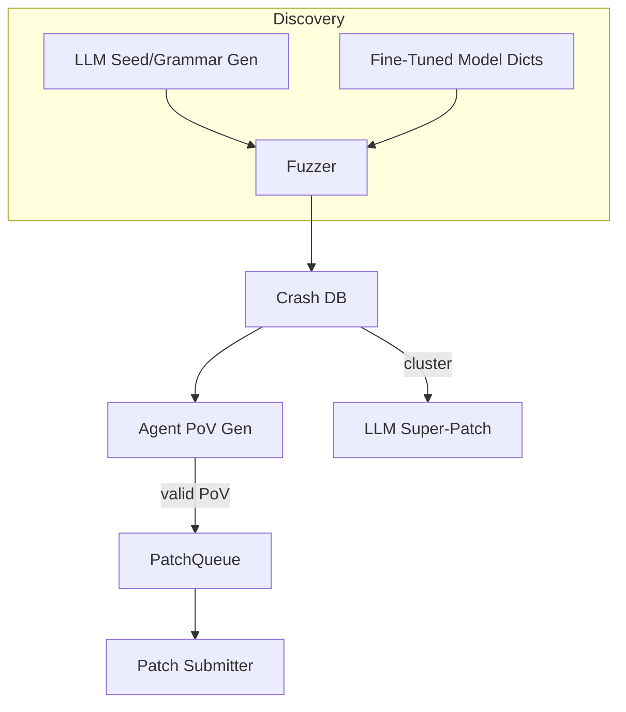

# Fuzzing Inayosaidiwa na AI na Ugunduzi wa Kiotomatiki wa Athari za Usalama

{{#include ../banners/hacktricks-training.md}}

## Muhtasari
Large-language models (LLMs) zinaweza kuongeza kwa kiasi kikubwa uwezo wa mifumo ya jadi ya utafiti wa athari za usalama kwa kuzalisha ingizo zenye maana ya kisemantiki, kuboresha grammars, kuchanganua data za crash, na hata kupendekeza patches zinazorekebisha hitilafu nyingi. Ukurasa huu unakusanya mbinu zenye ufanisi zaidi zilizobainika katika fainali za DARPA’s AI Cyber Challenge (AIxCC) na tafiti nyingine za umma.<sup>[[4]](#references)</sup><sup>[[5]](#references)</sup>

Yafuatayo si maelezo ya mfumo mmoja mahususi wa mashindano, bali ni muhtasari wa mbinu ili uweze kuzitumia tena katika workflows zako.

---

## 1. Ingizo za Seed Zinazozalishwa na LLM

Fuzzers za jadi zinazoongozwa na coverage (AFL++, libFuzzer, Honggfuzz…) huanza na corpus ndogo ya seeds na kubadilisha bytes bila mpangilio. Umbizo la ingizo la lengo linapokuwa changamano (SQL, URLs, protocols maalum za binary), mabadiliko ya nasibu kwa kawaida huvunja syntax kabla ya kufikiwa kwa branches zinazovutia.

LLMs zinaweza kutatua tatizo hili la kuanzisha kwa kutoa *seed generators* – scripts fupi zinazotoa **ingizo sahihi kisintaksia lakini muhimu kwa usalama**. Kwa mfano:

```prompt
SYSTEM: You are a helpful security engineer.
USER:
Write a Python3 program that prints 200 unique SQL injection strings targeting common anti-pattern mistakes (missing quotes, numeric context, stacked queries).  Ensure length ≤ 256 bytes / string so they survive common length limits.
```

```python
# gen_sqli_seeds.py (truncated)
PAYLOADS = [
    "1 OR 1=1 -- ",
    "' UNION SELECT NULL,NULL--",
    "0; DROP TABLE users;--",
    ...
]
for p in PAYLOADS:
    print(p)
```

Endesha mara moja na uweke matokeo moja kwa moja kwenye corpus ya mwanzo ya fuzzer:

```bash
python3 gen_sqli_seeds.py > seeds.txt
afl-fuzz -i seeds.txt -o findings/ -- ./target @@
```

Benefits:
1. Uhalali wa kisemantiki → coverage ya kina zaidi mapema.
2. Inaweza kuzalishwa upya: rekebisha prompt ili kulenga XSS, path traversal, binary blobs, n.k.
3. Gharama nafuu (< 1 ¢ ukitumia GPT-3.5).

### Tips
* Agiza modeli ibadilishe urefu na encoding ya payload (UTF-8, URL-encoded, UTF-16-LE) ili kukwepa filters za juu juu.
* Omba *script moja inayojitegemea* – huepusha matatizo ya uumbizaji wa JSON.

---

## 2. Grammar-Evolution Fuzzing

Toleo lenye nguvu zaidi ni kuruhusu LLM **kuendeleza grammar** badala ya seeds halisi. Mtiririko wa kazi (muundo wa “Grammar Guy”) ni:

1. Tengeneza grammar ya awali ya ANTLR/Peach/LibFuzzer kupitia prompt.
2. Fanya fuzzing kwa dakika N na ukusanye vipimo vya coverage (edges / blocks zilizofikiwa).
3. Fupisha maeneo ya programu ambayo hayajafunikwa na urudishe muhtasari huo kwenye modeli:
   ```prompt
   The previous grammar triggered 12 % of the program edges.  Functions not reached: parse_auth, handle_upload.  Add / modify rules to cover these.
   ```
4. Unganisha sheria mpya, fanya fuzzing tena, rudia.

Muundo wa pseudocode:

```python
for epoch in range(MAX_EPOCHS):
    grammar = llm.refine(grammar, feedback=coverage_stats)
    save(grammar, f"grammar_{epoch}.txt")
    coverage_stats = run_fuzzer(grammar)
```

Mambo muhimu:
* Dumisha *budget* – kila uboreshaji hutumia tokens.
* Tumia maagizo ya `diff` + `patch` ili modeli ihariri badala ya kuandika upya.
* Simama wakati Δcoverage < ε.

---

## 3. Uhandisi wa Harness ya Local-LLM libFuzzer

Kwa msimbo ambao hauwezi kutoka kwenye workstation ya mchambuzi, code model ya ndani inaweza kuandaa adapter ndogo kati ya bytes za fuzzer na API ya C/C++. Mpaka wa usalama unaofaa uko wazi: **modeli huandika na kurekebisha miundombinu ya majaribio; mutation inayoongozwa na coverage huchunguza inputs; sanitizers huripoti shughuli batili; binadamu hukagua harness na kuchambua matokeo**.<sup>[[9]](#references)</sup>

Kwa mbinu za corpus, feedback, snapshot na stateful-fuzzing katika kiwango cha engine ambazo hazitegemei LLM, angalia [Fuzzing Methodology](../generic-methodologies-and-resources/fuzzing.md) ya jumla.

Anza na declaration kamili iliyonakiliwa kutoka kwenye header lengwa, kisha weka masharti ya muundo wa matokeo. Prompt finyu hupunguza API zilizobuniwa na kurahisisha ukaguzi wa matokeo:<sup>[[8]](#references)[[9]](#references)</sup>

```prompt
Write a libFuzzer target for this exact declaration:
int parse_records(const uint8_t *data, size_t size);

Output only C code. Implement LLVMFuzzerTestOneInput, include the
declaration, pass data and size unchanged, and do not use files,
network access, randomness, clocks, threads, or persistent state.
```

Kwa parser ya byte ghafi, matokeo yanayotarajiwa hayapaswi kuwa magumu zaidi ya:<sup>[[6]](#references)[[9]](#references)</sup>

```c
#include <stddef.h>
#include <stdint.h>

extern int parse_records(const uint8_t *, size_t);

int LLVMFuzzerTestOneInput(const uint8_t *data, size_t size) {
    (void)parse_records(data, size);
    return 0;
}
```

Ukusanywa ni hatua ya kwanza tu ya uthibitishaji. Kagua kila target iliyozalishwa kulingana na masharti haya kabla ya kuitumia CPU:<sup>[[6]](#references)[[8]](#references)[[9]](#references)</sup>

- **API halisi:** linganisha aina, kanuni za umiliki, uanzishaji, usafishaji na calling convention na header halisi pamoja na watumiaji waliopo.
- **Usalama wa harness:** linda kila usomaji kutoka `data`; matokeo ya sanitizer lazima yatokane na target, si glue iliyozalishwa.
- **Uwezo wa kurudia:** fanya matokeo yawe kazi ya `data` na `size`; ondoa I/O ya nje, muda, randomness isiyodhibitiwa, threads ambazo hazijaunganishwa, na hali inayobaki kati ya miito.
- **Ufanisi wa uchakataji:** anzisha hali ghali isiyobadilika mara moja tu ikiwa hilo haliwezi kuathiri tabia, weka kikomo cha ukubwa wa ingizo, zima logging na uachilie allocations za kila ingizo.
- **Ufikikaji:** hakikisha kwamba functions na branches zilizokusudiwa zinatekelezwa. Target inayokusanywa lakini inayojaribu tu njia za kukataa ni kushindwa kusikoonekana.

### Targets zinazozingatia muundo: hifadhi masharti bila kuficha bugs

Ikiwa ingizo ghafi nyingi hukataliwa kwenye kizuizi cha magic, urefu, version au checksum, tumia bytes za fuzz kama nyenzo za fields zenye aina maalum na ujenge upya object halali. Weka constants za format zisizobadilika, acha fields za maana na payload bytes zibadilike, kisha tengeneza metadata ya integrity kutokana na payload iliyojengwa upya. `FuzzedDataProvider` ni muhimu kwa kutumia thamani zenye aina maalum zilizo na mipaka, huku adapter ikiwa na jukumu la kuweka kikomo kwa allocations na conversions zozote zinazozalishwa.<sup>[[9]](#references)</sup>

<details>
<summary>Mfano wa target ya C++ inayozingatia muundo</summary>

```cpp
#include <fuzzer/FuzzedDataProvider.h>
#include <stddef.h>
#include <stdint.h>
#include <vector>

extern "C" int parse_message(const uint8_t *, size_t);

extern "C" int LLVMFuzzerTestOneInput(const uint8_t *data, size_t size) {
    FuzzedDataProvider fdp(data, size);
    uint8_t version = fdp.ConsumeIntegral<uint8_t>();
    auto body = fdp.ConsumeRemainingBytes<uint8_t>();
    if (body.size() > UINT16_MAX) body.resize(UINT16_MAX);
    uint16_t len = static_cast<uint16_t>(body.size());
    std::vector<uint8_t> msg = {0x8b, 'M', 'S', 'G', version,
                                static_cast<uint8_t>(len >> 8),
                                static_cast<uint8_t>(len)};
    msg.insert(msg.end(), body.begin(), body.end());
    (void)parse_message(msg.data(), msg.size());
    return 0;
}
```

</details>

Usitumie target moja inayorekebisha muundo kwa kila swali. Dumisha target moja inayokokotoa lengths/checksums ili kuchunguza states halali za ndani zaidi, na nyingine inayofanya metadata **iliyotangazwa** idhibitiwe na fuzzer huku ikiweka mipaka tu kwa reads na allocations za harness yenyewe. Target ya pili huhifadhi attack surfaces za mismatched-length na bad-integrity ambazo automatic repair ingeondoa vinginevyo.<sup>[[9]](#references)</sup>

### Seeds, dictionaries, sanitizers, na feedback ya coverage

Iombe model itengeneze script inayoandika binary seeds badala ya kuiomba ichapishe binary moja kwa moja. Tengeneza seeds za objects tupu, ndogo zaidi, za kawaida, na halali kwenye mipaka; kisha toa magic values, tags, enum encodings, na parser keywords na kuziweka kwenye dictionary iliyopitiwa. libFuzzer hupokea dictionary hiyo kwa `-dict=`, na huhifadhi kwenye corpus mutations zinazofichua coverage mpya.<sup>[[6]](#references)[[9]](#references)</sup>

```text
magic="\x8bMSG"
version_min="\x00"
version_max="\xff"
config_tag="CONFIG"
```

Jenga target ileile kwa kutumia instrumentation inayokamilishana. ASan na UBSan zinaweza kushiriki binary ya fuzzing; tumia build tofauti ya MSan na ufanye instrumentation ya dependencies zake ili kuepuka ripoti zinazosababishwa na code isiyo na instrumentation.<sup>[[6]](#references)[[9]](#references)</sup>

```bash
clang++ -g -O1 -fsanitize=fuzzer,address,undefined \
  -fno-sanitize-recover=undefined target.cc harness.cc -o fuzz_target
./fuzz_target corpus -dict=msg.dict -max_len=65535

clang++ -g -O1 -fsanitize=fuzzer,memory \
  target.cc harness.cc -o fuzz_target_msan
```

Chukulia coverage kuwa kipimo cha kila marekebisho ya modeli. Katika matokeo ya libFuzzer, `cov`/`ft` zinazobaki tambarare mapema na corpus isiyobadilika kwa kawaida huashiria framing isiyofaa, early return yenye vizuizi vingi, au call isiyo sahihi; `exec/s` ya chini huashiria setup, I/O, allocation yenye gharama kubwa, au state inayovuja. `NEW` huthibitisha tu kuwa kipengele cha coverage kimebadilika, si kwamba parser iliyokusudiwa imefikiwa.<sup>[[6]](#references)[[9]](#references)</sup>

Ili kupata maoni kutoka kwenye kiwango cha source, tengeneza build ya coverage, ifuzz, kisha ipe modeli functions ambazo hazijafunikwa pamoja na masharti yanayozilinda pekee. Hakiki tofauti za harness/seed/dictionary zinazotokana na hilo na upime tena:<sup>[[7]](#references)[[8]](#references)[[9]](#references)</sup>

```bash
clang++ -g -O1 -fsanitize=fuzzer \
  -fprofile-instr-generate -fcoverage-mapping target.cc harness.cc -o fuzz_cov
mkdir -p profiles
LLVM_PROFILE_FILE='profiles/%p.profraw' ./fuzz_cov -max_total_time=300 corpus
llvm-profdata merge -sparse profiles/*.profraw -o fuzz.profdata
llvm-cov report ./fuzz_cov -instr-profile=fuzz.profdata
llvm-cov show ./fuzz_cov -instr-profile=fuzz.profdata \
  --show-branches=count --region-coverage-lt=1 target.cc
```

Mzunguko unaoweza kupanuliwa ni **zalisha → compile/link → fanya smoke-test chini ya sanitizers → pima target coverage → toa muktadha mdogo zaidi unaohusika wa coverage/source → rekebisha → pima tena**. OSS-Fuzz-Gen hutumia kanuni hiyo hiyo kwa kutathmini targets zilizozalishwa kulingana na uwezo wa ku-compile, hitilafu za runtime, coverage na uboreshaji wa coverage ikilinganishwa na targets zilizopo, badala ya kukubali msimbo unaoonekana kuwa sahihi bila kuuthibitisha.<sup>[[7]](#references)[[8]](#references)</sup>

---

<a id="3-agent-based-pov-exploit-generation" hidden>3. Uzalishaji wa PoV (Exploit) Unaotegemea Agents</a>

## 4. Uzalishaji wa PoV (Exploit) Unaotegemea Agents

Baada ya kupata crash, bado unahitaji **proof-of-vulnerability (PoV)** inayosababisha crash hiyo kwa uhakika kila mara.

Mbinu inayoweza kupanuliwa ni kuanzisha workers wengi wepesi (processes, threads au containers), kila mmoja akitumia model au usanidi tofauti wa sampling. Utafiti wa waliofika fainali za AIxCC unatoa mifano halisi ya kiwango: timu moja ilitumia **maelfu ya agents wanaofanya kazi kwa wakati mmoja** kuzalisha PoV kwa kutumia AI kwanza, huku nyingine ikiendesha **agents 300–500 za fuzzing** na kutumia LLMs kwa reasoning ya kisemantiki ya kiwango cha juu.<sup>[[4]](#references)</sup>

Mtiririko wa kazi:
1. Static/dynamic analysis hutambua *wagombea wa hitilafu* (struct yenye crash PC, input slice, ujumbe wa sanitizer).
2. Orchestrator husambaza wagombea kwa agents.
3. Hatua za reasoning za agent:
   a. Zalisha tena hitilafu ndani ya mfumo kwa kutumia `gdb` + input.
   b. Pendekeza exploit payload ndogo kabisa.
   c. Thibitisha exploit kwenye sandbox. Ikiwa imefanikiwa → wasilisha.
4. Majaribio yaliyoshindwa **huongezwa tena kwenye foleni kama seeds mpya** za coverage fuzzing (feedback loop).

Faida:
* Uendeshaji sambamba huficha kutotegemeka kwa agent mmoja.
* Urekebishaji otomatiki wa temp / ukubwa wa model kulingana na kiwango cha mafanikio kilichozingatiwa.

---

<a id="4-directed-fuzzing-with-fine-tuned-code-models" hidden>4. Fuzzing Inayoelekezwa kwa Kutumia Code Models Zilizofanyiwa Fine-Tuning</a>

## 5. Fuzzing Inayoelekezwa kwa Kutumia Code Models Zilizofanyiwa Fine-Tuning

Fanya fine-tuning ya model ya open-weight (kwa mfano Llama-7B) kwa kutumia source ya C/C++ iliyowekewa lebo za mifumo ya vulnerability (integer overflow, buffer copy, format string). Kisha:

1. Tumia static analysis kupata orodha ya functions + AST.
2. Ipe model prompt: *“Toa entries za mutation dictionary zinazoweza kuvunja memory safety katika function X”*.
3. Ingiza tokens hizo kwenye `AFL_CUSTOM_MUTATOR` maalum.

Mfano wa matokeo kwa wrapper ya `sprintf`:
```
{"pattern":"%99999999s"}
{"pattern":"AAAAAAAA....<1024>....%n"}
```

Kwa majaribio, hii hupunguza muda hadi crash kwa zaidi ya mara 2 kwenye targets halisi.

---

<a id="5-ai-guided-patching-strategies" hidden>5. Mikakati ya Patching Inayoongozwa na AI</a>

## 6. Mikakati ya Patching Inayoongozwa na AI

<a id="51-super-patches" hidden>5.1 Super Patches</a>

### 6.1 Super Patches
Iombe model *iweke crash signatures katika makundi* na ipendekeze **patch moja** itakayoondoa chanzo kikuu cha tatizo kinachofanana. Wasilisha mara moja, rekebisha bugs kadhaa → adhabu chache za usahihi katika mazingira ambako kila patch isiyo sahihi hugharimu pointi.

Muhtasari wa prompt:
```
Here are 10 stack traces + file snippets.  Identify the shared mistake and generate a unified diff fixing all occurrences.
```

{{#ref}}
../generic-methodologies-and-resources/fuzzing.md
{{#endref}}

<a id="52-speculative-patch-ratio" hidden>5.2 Speculative Patch Ratio</a>

### 6.2 Uwiano wa Patch za Kubashiri
Tekeleza foleni ambamo patch zilizothibitishwa kwa PoV na patch za *kubashiri* (bila PoV) hupishana kwa uwiano wa 1:​N uliowekwa kulingana na kanuni za alama (kwa mfano, 2 za kubashiri : 1 iliyothibitishwa). Mfumo wa gharama hufuatilia adhabu dhidi ya pointi na kurekebisha N kiotomatiki.

---

Kwa ukaguzi wa source wa faili moja baada ya nyingine unaoweza kurudiwa kwa matokeo yale yale, taskflow za mobile entry-point, ukaguzi wa mifumo ya kernel, na uthibitishaji wa vulnerability unaohitaji ushahidi, angalia [Ukaguzi wa source unaosaidiwa na AI na uthibitishaji wa vulnerability](AI-Assisted-Source-Review-and-Vulnerability-Validation.md).

---

## Uchambuzi wa awali wa crash kwa usaidizi wa debugger

Mtiririko wa kazi wa Mona v3 wa uchambuzi wa awali wa crash, uchanganuzi wa function, na kufikia heap-chunk kwa udhibiti umeelezwa katika [Exploiting Tools](../binary-exploitation/basic-stack-binary-exploitation-methodology/tools/#mona-v3-debugger-context-requests-for-crash-triage).

---

## Kuunganisha Yote
CRS (Cyber Reasoning System) ya mwanzo hadi mwisho inaweza kuunganisha vipengele kama hivi:



---

## References

- [4] [Trail of Bits – Fainali za AIxCC: Hadithi ya kanda](https://blog.trailofbits.com/2025/08/07/aixcc-finals-tale-of-the-tape/)
- [5] [Mahojiano ya CTF Radiooo na waliofuzu fainali za AIxCC](https://www.youtube.com/@ctfradiooo)
- [6] [LLVM — libFuzzer: maktaba ya fuzz testing inayoongozwa na coverage](https://llvm.org/docs/LibFuzzer.html)
- [7] [Google — OSS-Fuzz-Gen](https://github.com/google/oss-fuzz-gen)
- [8] [Blogu ya Usalama ya Google — Kuboresha Fuzzing: Kupata Vulnerabilities Zaidi kwa AI](https://security.googleblog.com/2024/11/leveling-up-fuzzing-finding-more.html)
- [9] [8kSec — Uzalishaji wa Fuzzing Harness kwa Usaidizi wa AI kwa Kutumia LLM ya Ndani](https://8ksec.io/ai-assisted-fuzzing-harness-local-llm)
{{#include ../banners/hacktricks-training.md}}
