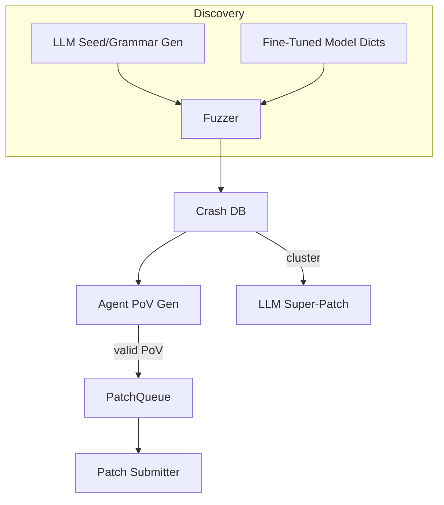

# AI-Assisted Fuzzing і автоматизоване виявлення вразливостей

{{#include ../banners/hacktricks-training.md}}

## Огляд
Великі мовні моделі (LLM) можуть значно посилити традиційні процеси дослідження вразливостей: генерувати семантично насичені вхідні дані, розвивати граматики, аналізувати дані про збої й навіть пропонувати виправлення кількох помилок. На цій сторінці зібрано найефективніші методи, помічені під час фіналу AI Cyber Challenge (AIxCC) від DARPA та в інших публічних дослідженнях.<sup>[[4]](#references)</sup><sup>[[5]](#references)</sup>

Далі описано не конкретну систему змагань, а узагальнені методи, які можна відтворити у власних робочих процесах.

---

## 1. Вхідні дані для seed, згенеровані LLM

Традиційні coverage-guided фаззери (AFL++, libFuzzer, Honggfuzz…) починають із невеликого corpus seed-файлів і наосліп мутують байти. Коли формат вхідних даних складний (SQL, URL-адреси, власні бінарні протоколи), випадкові мутації зазвичай порушують синтаксис ще до того, як буде досягнуто цікавих гілок виконання.

LLM можуть вирішити цю проблему початкового запуску, генеруючи *генератори seed* — короткі скрипти, які створюють **синтаксично коректні, але релевантні для безпеки вхідні дані**. Наприклад:

```prompt
SYSTEM: You are a helpful security engineer.
USER:
Write a Python3 program that prints 200 unique SQL injection strings targeting common anti-pattern mistakes (missing quotes, numeric context, stacked queries).  Ensure length ≤ 256 bytes / string so they survive common length limits.
```

```python
# gen_sqli_seeds.py (truncated)
PAYLOADS = [
    "1 OR 1=1 -- ",
    "' UNION SELECT NULL,NULL--",
    "0; DROP TABLE users;--",
    ...
]
for p in PAYLOADS:
    print(p)
```

Запустіть один раз і передайте вивід безпосередньо до початкового корпусу фаззера:

```bash
python3 gen_sqli_seeds.py > seeds.txt
afl-fuzz -i seeds.txt -o findings/ -- ./target @@
```

Переваги:
1. Семантична коректність → глибше покриття на ранніх етапах.
2. Можна генерувати повторно: змініть prompt, щоб зосередитися на XSS, обході шляхів, бінарних даних тощо.
3. Дешево (< 1 ¢ з GPT-3.5).

### Поради
* Попросіть модель *урізноманітнити* довжину payload і кодування (UTF-8, URL-кодування, UTF-16-LE), щоб обходити поверхневі фільтри.
* Попросіть створити *один самодостатній скрипт* — це допоможе уникнути проблем із форматуванням JSON.

---

## 2. Фаззинг з еволюцією граматики

Потужніший варіант — запропонувати LLM **еволюціонувати граматику**, а не конкретні початкові дані. Робочий процес (патерн «Grammar Guy»):

1. Згенерувати початкову граматику ANTLR/Peach/LibFuzzer за допомогою prompt.
2. Запускати фаззинг протягом N хвилин і збирати метрики покриття (перевірені ребра / блоки).
3. Підсумувати непокриті ділянки програми й передати підсумок моделі знову:
   ```prompt
   The previous grammar triggered 12 % of the program edges.  Functions not reached: parse_auth, handle_upload.  Add / modify rules to cover these.
   ```
4. Об’єднайте нові правила, повторно запустіть fuzzing і повторіть.

Псевдокод: skeleton

```python
for epoch in range(MAX_EPOCHS):
    grammar = llm.refine(grammar, feedback=coverage_stats)
    save(grammar, f"grammar_{epoch}.txt")
    coverage_stats = run_fuzzer(grammar)
```

Ключові моменти:
* Дотримуйтеся *бюджету* — кожне уточнення витрачає токени.
* Використовуйте інструкції `diff` + `patch`, щоб модель редагувала, а не переписувала.
* Зупиніться, коли Δcoverage < ε.

---

## 3. Розробка harness для libFuzzer із локальною LLM

Якщо вихідний код не може залишати робочу станцію аналітика, локальна модель коду може створити невеликий адаптер між байтами fuzz-тестера та API на C/C++. Межі безпеки мають бути чітко визначені: **модель пише й доопрацьовує тестову інфраструктуру; мутація, керована покриттям, досліджує вхідні дані; санітайзери виявляють некоректні операції; людина перевіряє harness і сортує результати**.<sup>[[9]](#references)</sup>

Опис технік для корпусу, зворотного зв’язку, знімків стану та stateful fuzzing на рівні рушія, які не залежать від LLM, див. у загальній [методології fuzzing](../generic-methodologies-and-resources/fuzzing.md).

Почніть із точного оголошення, скопійованого із заголовка цільового проєкту, і задайте обмеження для формату виводу. Вузький промпт зменшує ймовірність вигаданих API та полегшує перевірку результату:<sup>[[8]](#references)[[9]](#references)</sup>

```prompt
Write a libFuzzer target for this exact declaration:
int parse_records(const uint8_t *data, size_t size);

Output only C code. Implement LLVMFuzzerTestOneInput, include the
declaration, pass data and size unchanged, and do not use files,
network access, randomness, clocks, threads, or persistent state.
```

Для парсера сирих байтів очікуваний результат не має бути складнішим за:<sup>[[6]](#references)[[9]](#references)</sup>

```c
#include <stddef.h>
#include <stdint.h>

extern int parse_records(const uint8_t *, size_t);

int LLVMFuzzerTestOneInput(const uint8_t *data, size_t size) {
    (void)parse_records(data, size);
    return 0;
}
```

Компіляція — лише перший етап перевірки. Перш ніж витрачати на ціль процесорний час, перевірте кожну згенеровану ціль на відповідність таким інваріантам:<sup>[[6]](#references)[[8]](#references)[[9]](#references)</sup>

- **Точний API:** звірте типи, правила володіння, ініціалізацію, завершення роботи та угоду про виклик зі справжнім заголовком і наявними викликачами.
- **Безпека harness:** захистіть кожне читання з `data`; виявлені санітайзерами проблеми мають виникати в цілі, а не в згенерованому клеї.
- **Повторюваність:** результат має бути функцією від `data` і `size`; приберіть зовнішній ввід-вивід, час, неконтрольовану випадковість, нез’єднані потоки та стан, що зберігається між викликами.
- **Пропускна здатність:** ініціалізуйте дорогий незмінний стан один раз лише тоді, коли це не може вплинути на поведінку; обмежте розмір вводу, вимкніть журналювання та звільняйте виділену для кожного вводу пам’ять.
- **Досяжність:** перевірте, що виконуються призначені функції та гілки. Ціль, яка компілюється, але перевіряє лише шляхи відхилення, — це непомітна помилка.

### Цілі зі структурним урахуванням: зберігайте інваріанти, не приховуючи помилок

Якщо більшість необроблених вводів відхиляється через перевірку magic-значення, довжини, версії або контрольної суми, використовуйте байти fuzz як матеріал для **типізованих полів** і створюйте коректний об’єкт заново. Зафіксуйте константи формату, залиште семантичні поля та байти корисного навантаження змінними й обчислюйте метадані цілісності на основі відновленого корисного навантаження. `FuzzedDataProvider` зручно використовувати для отримання обмежених типізованих значень, а адаптер відповідає за обмеження будь-якого виділення пам’яті та перетворення.<sup>[[9]](#references)</sup>

<details>
<summary>Приклад C++-цілі зі структурним урахуванням</summary>

```cpp
#include <fuzzer/FuzzedDataProvider.h>
#include <stddef.h>
#include <stdint.h>
#include <vector>

extern "C" int parse_message(const uint8_t *, size_t);

extern "C" int LLVMFuzzerTestOneInput(const uint8_t *data, size_t size) {
    FuzzedDataProvider fdp(data, size);
    uint8_t version = fdp.ConsumeIntegral<uint8_t>();
    auto body = fdp.ConsumeRemainingBytes<uint8_t>();
    if (body.size() > UINT16_MAX) body.resize(UINT16_MAX);
    uint16_t len = static_cast<uint16_t>(body.size());
    std::vector<uint8_t> msg = {0x8b, 'M', 'S', 'G', version,
                                static_cast<uint8_t>(len >> 8),
                                static_cast<uint8_t>(len)};
    msg.insert(msg.end(), body.begin(), body.end());
    (void)parse_message(msg.data(), msg.size());
    return 0;
}
```

</details>

Не використовуйте одну ціль із відновленням структури для всіх запитів. Підтримуйте одну ціль, яка обчислює довжини/контрольні суми, щоб досліджувати глибокі коректні стани, і ще одну, де fuzzer керує **заявленими** метаданими, а обмежуються лише власні операції читання й виділення пам’яті harness. Друга ціль зберігає поверхні атак із невідповідними довжинами й некоректною цілісністю, які автоматичне виправлення інакше усунуло б.<sup>[[9]](#references)</sup>

### Початкові зразки, словники, санітайзери та зворотний зв’язок за покриттям

Попросіть модель згенерувати скрипт, який записує двійкові початкові зразки, а не виводить двійкові дані безпосередньо. Створіть порожні, мінімальні, типові та граничні коректні об’єкти; потім витягніть магічні значення, теги, кодування enum і ключові слова парсера до перевіреного словника. libFuzzer приймає цей словник через `-dict=`, а до корпусу додає мутації, що відкривають нове покриття.<sup>[[6]](#references)[[9]](#references)</sup>

```text
magic="\x8bMSG"
version_min="\x00"
version_max="\xff"
config_tag="CONFIG"
```

Зберіть ту саму ціль із додатковою інструментацією. ASan і UBSan можуть використовувати спільний бінарний файл для fuzzing; створіть окрему збірку з MSan і інструментуйте її залежності, щоб уникнути звітів, спричинених неінструментованим кодом.<sup>[[6]](#references)[[9]](#references)</sup>

```bash
clang++ -g -O1 -fsanitize=fuzzer,address,undefined \
  -fno-sanitize-recover=undefined target.cc harness.cc -o fuzz_target
./fuzz_target corpus -dict=msg.dict -max_len=65535

clang++ -g -O1 -fsanitize=fuzzer,memory \
  target.cc harness.cc -o fuzz_target_msan
```

Розглядайте coverage як критерій оцінювання кожної ревізії моделі. У виводі libFuzzer ранні пласкі показники `cov`/`ft` і незмінний корпус зазвичай свідчать про неправильне фреймування, надто обмежувальний ранній вихід або неправильний виклик; низький `exec/s` вказує на витратне налаштування, введення-виведення, виділення пам’яті або витік стану. `NEW` лише доводить, що змінилася ознака покриття, а не те, що було досягнуто потрібного парсера.<sup>[[6]](#references)[[9]](#references)</sup>

Щоб отримати зворотний зв’язок на рівні вихідного коду, створіть збірку з coverage, запустіть fuzzing і надайте моделі лише функції, які не були охоплені, разом з умовами їх захисту. Перевірте зміни в harness/seed/dictionary і знову виконайте вимірювання:<sup>[[7]](#references)[[8]](#references)[[9]](#references)</sup>

```bash
clang++ -g -O1 -fsanitize=fuzzer \
  -fprofile-instr-generate -fcoverage-mapping target.cc harness.cc -o fuzz_cov
mkdir -p profiles
LLVM_PROFILE_FILE='profiles/%p.profraw' ./fuzz_cov -max_total_time=300 corpus
llvm-profdata merge -sparse profiles/*.profraw -o fuzz.profdata
llvm-cov report ./fuzz_cov -instr-profile=fuzz.profdata
llvm-cov show ./fuzz_cov -instr-profile=fuzz.profdata \
  --show-branches=count --region-coverage-lt=1 target.cc
```

Масштабований цикл такий: **генерація → компіляція/зв’язування → smoke-тестування із санітайзерами → вимірювання покриття цілі → надання найменшого релевантного контексту покриття/коду → доопрацювання → повторне вимірювання**. OSS-Fuzz-Gen застосовує той самий принцип: оцінює згенеровані цілі за можливістю компіляції, помилками під час виконання, покриттям і покращенням покриття порівняно з наявними цілями, а не приймає правдоподібний код за чисту монету.<sup>[[7]](#references)[[8]](#references)</sup>

---

## 4. Генерація PoV (експлойту) на основі агентів

Після виявлення збою вам усе ще потрібен **proof-of-vulnerability (PoV)**, який детерміновано його спричиняє.

Масштабований підхід — запускати багато легковагих воркерів (процесів, потоків або контейнерів), кожен з іншою моделлю або конфігурацією семплювання. В огляді фіналістів AIxCC наведено конкретні приклади масштабування: одна команда використовувала **тисячі паралельних агентів** для генерації PoV із пріоритетом AI, а інша оркеструвала **300–500 fuzzing-агентів** і залучала LLM для семантичних міркувань вищого рівня.<sup>[[4]](#references)</sup>

Конвеєр:
1. Статичний/динамічний аналіз формує *кандидатів на помилки* (struct із crash PC, зрізом вхідних даних, повідомленням санітайзера).
2. Оркестратор розподіляє кандидатів між агентами.
3. Етапи міркування агента:
   a. Відтворити помилку локально за допомогою `gdb` і вхідних даних.
   b. Запропонувати мінімальний експлойт-пейлоад.
   c. Перевірити експлойт у sandbox. Якщо успішно → надіслати.
4. Невдалі спроби **повторно додаються до черги як нові seed-и** для coverage fuzzing (цикл зворотного зв’язку).

Переваги:
* Паралелізація компенсує ненадійність окремого агента.
* Автоматичне налаштування temp / розміру моделі на основі спостережуваного відсотка успіху.

---

## 5. Directed Fuzzing за допомогою донавчених моделей коду

Донавчіть модель із відкритими вагами (наприклад, Llama-7B) на вихідному коді C/C++, розміченому шаблонами вразливостей (цілочисельне переповнення, копіювання буфера, format string). Потім:

1. Запустіть статичний аналіз, щоб отримати список функцій і AST.
2. Запитайте модель: *«Запропонуй елементи словника мутацій, які можуть порушити безпеку пам’яті у функції X»*.
3. Вставте ці токени у власний `AFL_CUSTOM_MUTATOR`.

Приклад виводу для обгортки `sprintf`:
```
{"pattern":"%99999999s"}
{"pattern":"AAAAAAAA....<1024>....%n"}
```

Емпірично це скорочує час до збою більш ніж удвічі на реальних цілях.

---

## 6. Стратегії виправлення за допомогою AI

### 6.1 Super Patches
Попросіть модель *кластеризувати* сигнатури збоїв і запропонувати **єдиний патч**, який усуває спільну першопричину. Надішліть його один раз і виправте кілька багів → менше штрафів за точність у середовищах, де кожен неправильний патч коштує балів.

Структура промпту:
```
Here are 10 stack traces + file snippets.  Identify the shared mistake and generate a unified diff fixing all occurrences.
```

{{#ref}}
../generic-methodologies-and-resources/fuzzing.md
{{#endref}}

### 6.2 Співвідношення спекулятивних патчів
Реалізуйте чергу, у якій підтверджені патчі, валідовані PoV, чергуються зі *спекулятивними* патчами (без PoV) у співвідношенні 1:​N, налаштованому відповідно до правил оцінювання (наприклад, 2 спекулятивні : 1 підтверджений). Модель витрат відстежує штрафи й бали та самостійно коригує N.

---

## 7. Детермінований AI-кодрев’ю файл за файлом

Поширена причина невдачі під час AI-assisted review — попросити одного агента перевірити весь репозиторій і сподіватися, що він вибере потрібні файли та grep-терміни. Надійніший підхід — **примусово охопити репозиторій**:<sup>[[1]](#references)</sup>

1. Перелічити файли з вихідним кодом.
2. Надсилати **по одному файлу за раз** із мінімальним контекстом (entrypoint, імпорти, суміжні маршрути/виклики).
3. Вимагати для кожного файлу **структурований звіт**: джерела, sink, відсутня валідація, передумови експлуатації та впевненість у висновках.<sup>[[3]](#references)</sup>
4. Видалити дублікати звітів за **шаблоном source→sink** і вручну перевірити знахідки з високим ризиком.

Цей підхід потребує багато токенів і створює шум, але дуже ефективно виявляє **прості вразливості source/sink із серйозними наслідками**, які часто пропускають широкі агентні перевірки.

### Шаблони для пріоритетного тріажу

- **Динамічний PHP include/dispatch**: контрольовані атакувальником назви маршрутів/контролерів/модулів передаються в `require_once()`, `include()` або `include_once()` без суворого allowlisting і канонізації шляхів.
- **Виконання команд оболонки в робочих процесах адміністратора/облікового запису**: імена користувачів, домени, FTP-облікові записи чи інші ідентифікатори потрапляють у `exec()`, `system()`, `shell_exec()`, `passthru()`, `proc_open()` або `popen()`.
- **Об’єднання структурованих вхідних даних**: той самий параметр приймається з `$_GET`, `$_POST`, JSON, XML або парсерів тіла запиту фреймворку, а згодом використовується в sink файлової системи або команд ОС.

### Два практичні класи вразливостей, які цей метод добре виявляє

- **LFI/RCE через диспетчеризацію PHP-контролера**: якщо контрольована запитом назва контролера конкатенується з `require_once()` без allowlist/нормалізації шляху, послідовності обходу каталогів на кшталт `../` можуть змусити PHP підключити ненавмисний локальний файл `.php`. Якщо атакувальник може вказати на підготовлений або інший корисний PHP-файл, LFI перетворюється на виконання коду. Див. [File Inclusion / Path Traversal](../pentesting-web/file-inclusion/README.md).<sup>[[1]](#references)</sup>
- **Ін’єкція команд із автентифікацією в панелях хостингу/адміністрування**: якщо поля керування обліковими записами, як-от імена користувачів, вбудовуються в команди оболонки, користувач із низькими привілеями, який пройшов автентифікацію, може перетворити звичайну дію створення/видалення на RCE. Наслідки серйозніші, якщо панель виконує команду від імені службового облікового запису з вищими привілеями. Див. [Command Injection](../pentesting-web/command-injection.md).<sup>[[1]](#references)</sup>

### Практичні нотатки з перевірки коду

- Спочатку використовуйте LLM як **засіб перевірки source/sink**, а не як генератор експлойтів.
- Попросіть його чітко вказати **контрольоване атакувальником поле**, **прогалину в нормалізації/валідації** та **небезпечний sink**.
- У великих репозиторіях детермінована перевірка файл за файлом часто надійніша за один автономний запуск агента, навіть якщо в останньому використовується потужніша модель.<sup>[[2]](#references)</sup>
- Очікуйте слабших результатів щодо **Broken Access Control** та інших вразливостей бізнес-логіки, де можливість експлуатації залежить від припущень щодо кількох файлів, семантики ролей або моделей загроз конкретного продукту.

---

## 8. Аудит ядра за шаблонами з інструментованим оракулом

Для цілі розміру ядра не просіть агента шукати довільні вразливості по всьому дереву коду. Ефективніший з погляду токенів процес перетворює знання про історичні вразливості на статичні запити, ранжує результати за доступною поверхнею атаки та використовує інструментоване ядро як оракул виконання.<sup>[[11]](#references)</sup>

### База шаблонів → CodeQL/Semgrep → цільова перевірка

Створіть невелику базу знань із небезпечними API, шаблонами відсутньої валідації, ризикованими потоками source-to-sink і формами раніше виправлених вразливостей. Попросіть модель перетворювати **по одному шаблону за раз** на евристики перевірки та правила CodeQL/Semgrep, а потім запустіть ці детерміновані правила на всьому дереві коду. Згрупуйте збіги й видаліть дублікати, перш ніж передавати код моделі: сирий вивід сканера може містити тисячі малоцінних кандидатів. Перш ніж використовувати цей підхід поза відповідними дослідницькими проєктами або цілями з відкритим кодом, перевірте чинну ліцензію CodeQL.<sup>[[11]](#references)</sup>

Визначайте пріоритетність підсистем за **щільністю збігів із правилами** та **досяжністю для атакувальника**, а не лише за кількістю збігів. Інтерфейси ядра, доступні непривілейованим процесам, sandbox, контейнерам, jail або гостьовим середовищам, мають отримувати вищий пріоритет, ніж код, доступний лише внутрішньо. Обсяг перевірки має бути достатньо малим, щоб агент міг врахувати викликачів, валідатори та правила керування життєвим циклом; формулюйте запит про конкретний клас вразливості або шаблон потоку керування, а не «знайди будь-яку вразливість». Особливо цікаві застарілі привілейовані інтерфейси, коли новіша межа ізоляції робить їх доступними користувачу root у namespace або jail.<sup>[[11]](#references)</sup>

Для кожного кандидата вимагайте явний запис потоку даних полів, перш ніж переходити до спроби експлуатації.<sup>[[11]](#references)</sup>

```text
entrypoint -> privilege check -> parser -> validation/normalization
           -> later rewrite -> dangerous sink
attacker controls: <fields and lengths>
constraints:       <values rewritten, rejected, or preserved>
observable result: <sanitizer report, assertion, panic, or clean exit>
```

### Використовуйте телеметрію KASAN як оракул для перевірки гіпотез

Запустіть цільове ядро у тимчасовій VM із увімкненими KASAN та корисними діагностичними assertions. Агент має повторювати цикл **гіпотеза щодо коду → мінімальний тригер із userland → виконання у VM → трасування KASAN/assertion → уточнена гіпотеза**, доки підозрюване пошкодження не буде відтворено або спростовано. На кожній ітерації повертайте лише відповідний stack trace і фрагмент коду поруч із ним: так зберігається контекст для міркувань, а критерієм прийняття стають результати виконання, а не впевненість моделі.<sup>[[11]](#references)</sup>

Інструментована збірка — це не середовище для остаточної оцінки можливості експлуатації. Assertions можуть зупинити виконання до операції, що спричиняє пошкодження, тоді як те саме assertion може бути вимкнене під час компіляції production-ядра. Повторно перевірте незмінений тригер на точній production-конфігурації, зафіксуйте збірку й конфігурацію ядра та розглядайте **досяжність**, **пошкодження пам’яті**, **керований примітив** і **вплив на безпеку** як окремі твердження.<sup>[[11]](#references)[[12]](#references)</sup>

CVE-2026-3038 — корисний приклад для перевірки, а не шаблон експлойту. Неавторизований користувач FreeBSD міг надіслати запит `RTM_GET`, який зберігав завеликий sockaddr `RTAX_AUTHOR` попри вибіркову перевірку й переписування відповіді, доки `rtsock_msg_buffer()` не копіювала керований користувачем `sa_len` у 128-байтовий stack `sockaddr_storage`. Максимальне копіювання 255 байтів спричиняло перезапис на 127 байтів; у інструментованій збірці діагностичне assertion виявляло неправильну довжину, тоді як ядро GENERIC доходило до копіювання, а потім панікувало під час перевірки пошкодженого canary. Це доводить можливість відмови в обслуговуванні без привілеїв, але не самостійну ескалацію привілеїв: для надійного контролю спершу знадобився б інший примітив, наприклад розкриття canary. Межі відповідної бінарної експлуатації описано в [Stack Canaries](../binary-exploitation/common-binary-protections-and-bypasses/stack-canaries/index.html).<sup>[[11]](#references)[[12]](#references)[[13]](#references)</sup>

### Відхиляйте маніпуляції з передумовами експлуатації

Перш ніж приймати PoV або експлойт, попросіть окремого рецензента/агента спробувати спростувати його за заздалегідь визначеними критеріями. Під час перевірки необхідно підтвердити всі наведені нижче умови.<sup>[[11]](#references)</sup>

- Цільовий код, ядро й уразливий модуль не змінювали, щоб зробити цей шлях досяжним.
- Не додавали допоміжний модуль, синтетичний gadget, вимкнений захист, додаткові привілеї чи недоступний інтерфейс.
- Тригер запускається з указаною ідентичністю користувача та обмеженнями ізоляції у чистому знімку системи.
- Заявлений результат усе ще залежить від помилки: вилучення некоректного поля або виправлення лише цієї помилки має розірвати ланцюжок.
- Збій, читання за межами буфера чи перезапис описують лише як відповідний примітив; для виконання коду чи ескалації привілеїв потрібні незалежні докази.

Ця остання контрфактична перевірка виявляє циклічні демонстрації: якщо передумови вже забезпечують заявлений вплив (наприклад, виконання наданого зловмисником вмісту SUID із файлової системи, змонтованої без `nosuid`), то помилка безпеки пам’яті не спричинила цей вплив.<sup>[[11]](#references)</sup>

---

## Дослідження незнайомих кодових баз за допомогою агентів із можливістю аудиту

[graph-first fuzz-target workflow](../generic-methodologies-and-resources/fuzzing.md#graph-first-fuzz-target-selection-and-mutation-triage) уже охоплює досяжність entrypoint, а [agentic SAST pipelines](../network-services-pentesting/pentesting-web/code-review-tools.md#agentic-sast-pipelines) — поетапну перевірку й контрольні етапи доказування. Зберігайте ці детерміновані результати окремо від гіпотез моделі, щоб для кожної відібраної знахідки залишалися посилання на код, докази проходження шляху та динамічний вимір.<sup>[[10]](#references)</sup>

### Зіставляйте докази життєвого циклу об’єктів, не вигадуючи потік даних

Статичний аналіз може виявити, що керована зловмисником довжина зберігається в одній функції, а те саме поле об’єкта значно пізніше доходить до точки копіювання, але не зуміти довести зв’язок між ними через callback-функції, повторні підключення чи життєвий цикл об’єкта. Зберігайте обидві знахідки окремо, групуйте їх за об’єктом/полем і явно сформулюйте відсутній зв’язок як запитання для тріажу. Агент може припустити цей зв’язок, але його треба довести перевіркою коду або інструментуванням під час виконання.<sup>[[10]](#references)</sup>

Для кожного кандидата зафіксуйте:

- конкретний entrypoint і байти, контрольовані зловмисником;
- усі джерела відповідного поля, включно з перевірками, специфічними для кожного джерела;
- точку призначення, місткість буфера призначення та умови збірки/виконання, потрібні для досягнення цієї точки;
- реальний call stack від відкритого entrypoint, а не лише прямий виклик harness;
- найменший динамічний результат, який підтверджує або спростовує гіпотезу.

Наявність безпечного шляху не означає, що поле безпечне в усіх випадках. Друге джерело може заповнити те саме поле, не застосовуючи обмеження першого шляху. Перевіряйте шляхи незалежно та запускайте harness із параметрами збірки, еквівалентними production-середовищу, оскільки debug assertions можуть перетворити пошкодження пам’яті у production на раннє переривання лише під час тестування.<sup>[[10]](#references)</sup>

### Контрольні етапи вимірювання для розкриття даних і експлуатації

Якщо підозрюєте розкриття неініціалізованої пам’яті, заповніть свіжі виділені ділянки впізнаваним байтом і перевірте, чи саме цей маркер потрапляє до надісланого пакета. Для експлуатації вимагайте виміряних контрольних етапів, наприклад **керований перезапис → корисний об’єкт-ціль → розкриття даних → відновлення вказівника/базової адреси → перехоплення потоку керування → складений payload**. Агент переходить далі лише тоді, коли harness підтверджує поточну властивість; правдоподібний опис не означає, що контрольний етап пройдено. У [FreeRDP case](../binary-exploitation/libc-heap/heap-overflow.md#cross-path-length-reuse-and-stale-output-disclosure) показано шлях і обмеження збірки, які необхідно зберегти під час перевірки.<sup>[[10]](#references)</sup>

---

## Об’єднання всіх компонентів
Наскрізна CRS (Cyber Reasoning System) може поєднувати компоненти так:



---

## References

- [1] [Project Black — Локальний AI для кібербезпеки: виявлення LFI у phpIPAM і автентифікованого RCE у myVesta](https://projectblack.io/blog/local-ai-for-cyber-security)
- [2] [Strix](https://github.com/usestrix/strix)
- [3] [Навичка security-review спільноти GitHub Copilot](https://github.com/github/awesome-copilot/blob/main/skills/security-review/SKILL.md)
- [4] [Trail of Bits — фінал AIxCC: історія змагання](https://blog.trailofbits.com/2025/08/07/aixcc-finals-tale-of-the-tape/)
- [5] [Інтерв’ю з фіналістами AIxCC від CTF Radiooo](https://www.youtube.com/@ctfradiooo)
- [6] [LLVM — libFuzzer: бібліотека для fuzz-тестування з керуванням за покриттям](https://llvm.org/docs/LibFuzzer.html)
- [7] [Google — OSS-Fuzz-Gen](https://github.com/google/oss-fuzz-gen)
- [8] [Блог Google Online Security — удосконалення fuzzing: виявлення більшої кількості вразливостей за допомогою AI](https://security.googleblog.com/2024/11/leveling-up-fuzzing-finding-more.html)
- [9] [8kSec — генерація harness для fuzzing за допомогою AI з локальною LLM](https://8ksec.io/ai-assisted-fuzzing-harness-local-llm)
- [10] [Quarkslab — від AI-агентів до RCE: створення робочого процесу дослідження вразливостей](https://blog.quarkslab.com/from-ai-agents-to-rce-building-a-vulnerability-research-workflow.html)
- [11] [Praetorian — FreeBSoD: використання мовних моделей для виявлення та експлуатації помилок ядра (частина 1 із 2)](https://praetorian.com/blog/ai-vulnerability-research-freebsd-kernel)
- [12] [FreeBSD-SA-26:05.route — локальна DoS-атака та можливе підвищення привілеїв через маршрутизаційні сокети](https://www.freebsd.org/security/advisories/FreeBSD-SA-26:05.route.asc)
- [13] [Початковий патч FreeBSD-SA-26:05.route](https://security.FreeBSD.org/patches/SA-26:05/route.patch)
{{#include ../banners/hacktricks-training.md}}
