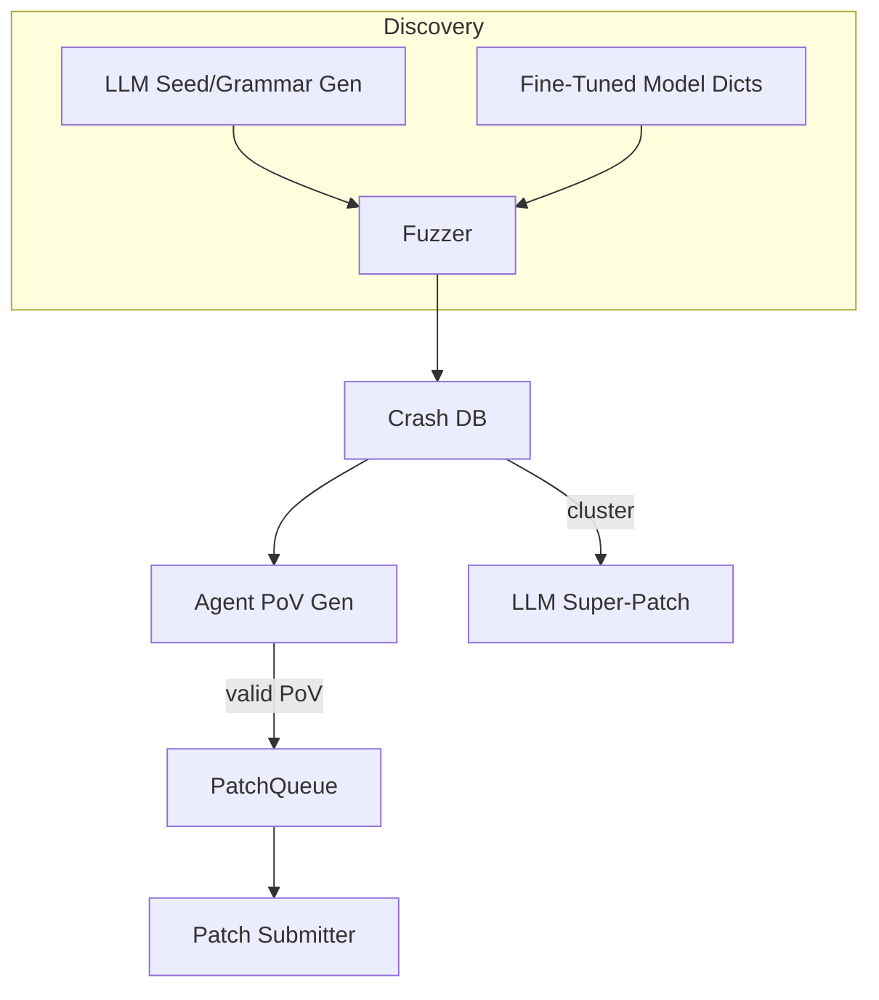

# Fuzzing potpomognut AI-jem i automatizovano otkrivanje ranjivosti

{{#include ../banners/hacktricks-training.md}}

## Pregled
Veliki jezički modeli (LLM-ovi) mogu značajno da unaprede tradicionalne procese istraživanja ranjivosti tako što generišu semantički bogate ulaze, razvijaju gramatike, analiziraju podatke o padovima i čak predlažu zakrpe za više grešaka. Ova stranica objedinjuje najefikasnije obrasce uočene tokom finala DARPA-inog AI Cyber Challenge-a (AIxCC) i drugih javno dostupnih istraživanja.<sup>[[4]](#references)</sup><sup>[[5]](#references)</sup>

Ovo nije opis jednog konkretnog takmičarskog sistema, već prikaz tehnika koje možete ponovo primeniti u sopstvenim tokovima rada.

---

## 1. Ulazni seed-ovi koje generiše LLM

Tradicionalni fuzzers vođeni pokrivenošću (AFL++, libFuzzer, Honggfuzz…) počinju s malim korpusom seed-ova i nasumično menjaju bajtove. Kada je format ulaza ciljnog programa složen (SQL, URL-ovi, prilagođeni binarni protokoli), nasumične izmene obično naruše sintaksu pre nego što se dođe do zanimljivih grana.

LLM-ovi mogu da reše ovaj početni problem generisanjem *generatora seed-ova* – kratkih skripti koje ispisuju **sintaksno ispravne ulaze relevantne za bezbednost**. Na primer:

```prompt
SYSTEM: You are a helpful security engineer.
USER:
Write a Python3 program that prints 200 unique SQL injection strings targeting common anti-pattern mistakes (missing quotes, numeric context, stacked queries).  Ensure length ≤ 256 bytes / string so they survive common length limits.
```

```python
# gen_sqli_seeds.py (truncated)
PAYLOADS = [
    "1 OR 1=1 -- ",
    "' UNION SELECT NULL,NULL--",
    "0; DROP TABLE users;--",
    ...
]
for p in PAYLOADS:
    print(p)
```

Pokrenite jednom i prosledite izlaz direktno u početni korpus fuzzera:

```bash
python3 gen_sqli_seeds.py > seeds.txt
afl-fuzz -i seeds.txt -o findings/ -- ./target @@
```

Benefits:
1. Semantička validnost → dublja pokrivenost u ranoj fazi.
2. Može ponovo da se generiše: prilagodite prompt tako da se fokusira na XSS, path traversal, binary blobs itd.
3. Jeftino (< 1 ¢ uz GPT-3.5).

### Saveti
* Zadajte modelu da *diversifikuje* dužinu i kodiranje payload-a (UTF-8, URL-encoded, UTF-16-LE) kako bi zaobišao površinske filtere.
* Zatražite *jednu samostalnu skriptu* – tako se izbegavaju problemi s formatiranjem JSON-a.

---

## 2. Grammar-Evolution Fuzzing

Moćnija varijanta je da se LLM-u prepusti **evolucija gramatike**, umesto konkretnih seed-ova. Tok rada (obrazac „Grammar Guy“) je sledeći:

1. Generišite početnu ANTLR/Peach/LibFuzzer gramatiku pomoću prompt-a.
2. Pokrenite fuzzing N minuta i prikupite metrike pokrivenosti (pogodjene edges / blocks).
3. Sažmite nepokrivene delove programa i prosledite sažetak modelu:
   ```prompt
   The previous grammar triggered 12 % of the program edges.  Functions not reached: parse_auth, handle_upload.  Add / modify rules to cover these.
   ```
4. Objedinite nova pravila, ponovo pokrenite fuzzing i ponovite postupak.

Skelet pseudo-koda:

```python
for epoch in range(MAX_EPOCHS):
    grammar = llm.refine(grammar, feedback=coverage_stats)
    save(grammar, f"grammar_{epoch}.txt")
    coverage_stats = run_fuzzer(grammar)
```

Ključne tačke:
* Zadržite *budget* – svako usavršavanje troši tokene.
* Koristite instrukcije `diff` + `patch` kako bi model uređivao umesto da ponovo piše.
* Zaustavite se kada je Δcoverage < ε.

---

## 3. Inženjering libFuzzer harness-a za lokalni LLM

Za izvorni kod koji ne može da napusti radnu stanicu analitičara, lokalni model koda može da izradi mali adapter između bajtova fuzzera i C/C++ API-ja. Bezbednosna granica je jasna: **model piše i revidira testnu infrastrukturu; mutacija vođena pokrivenošću istražuje ulaze; sanitizatori prijavljuju neispravne operacije; čovek pregleda harness i trijažira nalaze**.<sup>[[9]](#references)</sup>

Za tehnike rada sa corpus-om, povratnim informacijama, snimcima stanja i stateful fuzzing-om na nivou engine-a, koje ne zavise od LLM-a, pogledajte opštu [Fuzzing Methodology](../generic-methodologies-and-resources/fuzzing.md).

Počnite od tačne deklaracije preuzete iz zaglavlja cilja i ograničite format izlaza. Usko formulisan prompt smanjuje broj izmišljenih API-ja i olakšava pregled rezultata:<sup>[[8]](#references)[[9]](#references)</sup>

```prompt
Write a libFuzzer target for this exact declaration:
int parse_records(const uint8_t *data, size_t size);

Output only C code. Implement LLVMFuzzerTestOneInput, include the
declaration, pass data and size unchanged, and do not use files,
network access, randomness, clocks, threads, or persistent state.
```

Za parser sirovih bajtova, očekivani rezultat ne bi trebalo da bude složeniji od:<sup>[[6]](#references)[[9]](#references)</sup>

```c
#include <stddef.h>
#include <stdint.h>

extern int parse_records(const uint8_t *, size_t);

int LLVMFuzzerTestOneInput(const uint8_t *data, size_t size) {
    (void)parse_records(data, size);
    return 0;
}
```

Kompilacija je samo prva kontrolna tačka validacije. Proverite svaki generisani target u odnosu na ove invarijante pre nego što potrošite CPU vreme na njega:<sup>[[6]](#references)[[8]](#references)[[9]](#references)</sup>

- **Tačan API:** uporedite tipove, pravila vlasništva, inicijalizaciju, čišćenje i calling convention sa stvarnim header-om i postojećim pozivaocima.
- **Bezbednost harness-a:** zaštitite svako čitanje iz `data`; nalazi sanitizer-a moraju poticati iz target-a, a ne iz generisanog glue koda.
- **Ponovljivost:** obezbedite da rezultat bude funkcija od `data` i `size`; uklonite eksterni I/O, vreme, nekontrolisanu slučajnost, thread-ove koji nisu join-ovani i state koji opstaje između poziva.
- **Propusnost:** inicijalizujte skupo nepromenljivo stanje jednom, ali samo ako to ne može da utiče na ponašanje; ograničite veličinu ulaza, isključite logovanje i oslobodite alokacije za svaki ulaz.
- **Dostižnost:** proverite da li se izvršavaju predviđene funkcije i grane. Target koji se kompajlira, ali izvršava samo putanje odbacivanja, predstavlja tihi neuspeh.

### Strukturno svesni target-i: očuvajte invarijante bez prikrivanja bagova

Ako većina sirovih ulaza ne prođe proveru magic vrednosti, dužine, verzije ili checksum-a, iskoristite fuzz bajtove kao materijal za tipizirana polja i ponovo izgradite validan objekat. Fiksirajte konstante formata, ostavite semantička polja i payload bajtove promenljivim i izvedite metapodatke integriteta iz rekonstruisanog payload-a. `FuzzedDataProvider` je koristan za preuzimanje ograničenih tipiziranih vrednosti, dok je adapter i dalje odgovoran za ograničavanje svake generisane alokacije i konverzije.<sup>[[9]](#references)</sup>

<details>
<summary>Primer strukturno svesnog C++ target-a</summary>

```cpp
#include <fuzzer/FuzzedDataProvider.h>
#include <stddef.h>
#include <stdint.h>
#include <vector>

extern "C" int parse_message(const uint8_t *, size_t);

extern "C" int LLVMFuzzerTestOneInput(const uint8_t *data, size_t size) {
    FuzzedDataProvider fdp(data, size);
    uint8_t version = fdp.ConsumeIntegral<uint8_t>();
    auto body = fdp.ConsumeRemainingBytes<uint8_t>();
    if (body.size() > UINT16_MAX) body.resize(UINT16_MAX);
    uint16_t len = static_cast<uint16_t>(body.size());
    std::vector<uint8_t> msg = {0x8b, 'M', 'S', 'G', version,
                                static_cast<uint8_t>(len >> 8),
                                static_cast<uint8_t>(len)};
    msg.insert(msg.end(), body.begin(), body.end());
    (void)parse_message(msg.data(), msg.size());
    return 0;
}
```

</details>

Nemojte koristiti jedan target koji popravlja strukturu za svako pitanje. Održavajte jedan target koji izvodi dužine/kontrolne sume kako bi istraživao duboka, validna stanja, i drugi koji ostavlja da fuzzer kontroliše **deklarisane** metapodatke, a ograničava samo čitanja i alokacije koje obavlja sam harness. Drugi target čuva attack surface koji obuhvata neusklađene dužine i neispravne provere integriteta, a koje bi automatska popravka inače uklonila.<sup>[[9]](#references)</sup>

### Seedovi, rečnici, sanitizatori i povratne informacije o pokrivenosti

Zatražite od modela da generiše skriptu koja upisuje binarne seedove, umesto da tražite da ih direktno ispiše. Napravite seedove od praznih, minimalnih, tipičnih i validnih graničnih objekata; zatim izdvojite magične vrednosti, tagove, kodiranja enuma i ključne reči parsera u rečnik koji je prošao pregled. libFuzzer prihvata taj rečnik pomoću opcije `-dict=`, i zadržava u korpusu mutacije koje otkrivaju novu pokrivenost.<sup>[[6]](#references)[[9]](#references)</sup>

```text
magic="\x8bMSG"
version_min="\x00"
version_max="\xff"
config_tag="CONFIG"
```

Izgradite isti cilj uz komplementarnu instrumentaciju. ASan i UBSan mogu da dele isti fuzzing binary; koristite zasebnu MSan verziju i instrumentirajte njene zavisnosti da biste izbegli izveštaje izazvane neinstrumentiranim kodom.<sup>[[6]](#references)[[9]](#references)</sup>

```bash
clang++ -g -O1 -fsanitize=fuzzer,address,undefined \
  -fno-sanitize-recover=undefined target.cc harness.cc -o fuzz_target
./fuzz_target corpus -dict=msg.dict -max_len=65535

clang++ -g -O1 -fsanitize=fuzzer,memory \
  target.cc harness.cc -o fuzz_target_msan
```

Tretirajte pokrivenost kao merilo za svaku reviziju modela. U izlazu libFuzzer-a, rano ravni `cov`/`ft` i statičan korpus obično ukazuju na loše uokviravanje, previše restriktivan rani povratak ili pogrešan poziv; nizak `exec/s` ukazuje na skupu pripremu, I/O, alokaciju ili procurelo stanje. `NEW` samo dokazuje da se funkcija pokrivenosti promenila, a ne i da je dostignut željeni parser.<sup>[[6]](#references)[[9]](#references)</sup>

Za povratne informacije na nivou izvornog koda, napravite build sa pokrivenošću, fuzz-ujte ga i dajte modelu samo nepokrivene funkcije zajedno sa uslovima koji ih štite. Proverite nastale izmene harness-a/seed-a/dictionary-ja i ponovo izmerite:<sup>[[7]](#references)[[8]](#references)[[9]](#references)</sup>

```bash
clang++ -g -O1 -fsanitize=fuzzer \
  -fprofile-instr-generate -fcoverage-mapping target.cc harness.cc -o fuzz_cov
mkdir -p profiles
LLVM_PROFILE_FILE='profiles/%p.profraw' ./fuzz_cov -max_total_time=300 corpus
llvm-profdata merge -sparse profiles/*.profraw -o fuzz.profdata
llvm-cov report ./fuzz_cov -instr-profile=fuzz.profdata
llvm-cov show ./fuzz_cov -instr-profile=fuzz.profdata \
  --show-branches=count --region-coverage-lt=1 target.cc
```

Skalabilni ciklus je zato **generiši → kompajliraj/poveži → smoke-testiraj uz sanitizere → izmeri pokrivenost cilja → obezbedi najmanji relevantni kontekst pokrivenosti/izvornog koda → revidiraj → ponovo izmeri**. OSS-Fuzz-Gen primenjuje isti princip tako što procenjuje generisane ciljeve na osnovu mogućnosti kompajliranja, grešaka tokom izvršavanja, pokrivenosti i poboljšanja pokrivenosti u odnosu na postojeće ciljeve, umesto da prihvata uverljiv kod zdravo za gotovo.<sup>[[7]](#references)[[8]](#references)</sup>

---

## 4. Generisanje PoV-a (Exploit) pomoću agenata

Nakon što se pronađe crash, i dalje vam je potreban **proof-of-vulnerability (PoV)** koji ga deterministički izaziva.

Skalabilan pristup je pokretanje velikog broja laganih radnika (procesa, niti ili kontejnera), od kojih svaki koristi drugi model ili konfiguraciju uzorkovanja. Pregled finalista takmičenja AIxCC navodi konkretne primere obima: jedan tim je koristio **hiljade istovremenih agenata** za generisanje PoV-a uz AI kao primarni pristup, dok je drugi orkestrirao **300–500 fuzzing agenata** i koristio LLM-ove za semantičko rezonovanje višeg nivoa.<sup>[[4]](#references)</sup>

Tok rada:
1. Statička/dinamička analiza generiše *kandidate za grešku* (struct sa crash PC-jem, isečkom ulaza i sanitizer porukom).
2. Orkestrator prosleđuje kandidate agentima.
3. Koraci rezonovanja agenta:
   a. Lokalno reprodukovanje greške pomoću `gdb`-a i ulaza.
   b. Predlaganje minimalnog exploit payload-a.
   c. Validacija exploita u sandbox-u. Ako uspe → podnošenje.
4. Neuspešni pokušaji se **ponovo stavljaju u red kao novi seeds** za fuzzing pokrivenosti (povratna sprega).

Prednosti:
* Paralelizacija ublažava nepouzdanost pojedinačnog agenta.
* Automatsko podešavanje temperature / veličine modela na osnovu uočene stope uspeha.

---

## 5. Usmereni Fuzzing pomoću fino podešenih modela koda

Fino podesite model otvorenih težina (npr. Llama-7B) na C/C++ izvornom kodu označenom obrascima ranjivosti (integer overflow, kopiranje bafera, format string). Zatim:

1. Pokrenite statičku analizu da biste dobili listu funkcija i AST.
2. Zadajte modelu prompt: *„Daj unose za mutation dictionary za koje je verovatno da će narušiti bezbednost memorije u funkciji X“*.
3. Ubacite te tokene u prilagođeni `AFL_CUSTOM_MUTATOR`.

Primer izlaza za `sprintf` omotač:
```
{"pattern":"%99999999s"}
{"pattern":"AAAAAAAA....<1024>....%n"}
```

Empirijski, ovo smanjuje time-to-crash za više od 2× na stvarnim metama.

---

## 6. Strategije AI-vođenog patchovanja

### 6.1 Super Patches
Zatražite od modela da *grupiše* potpise crash-eva i predloži **jedan patch** koji uklanja zajednički osnovni uzrok.  Podnesite ga jednom i ispravite nekoliko bagova → manje kazni za tačnost u okruženjima u kojima se za svaki pogrešan patch gube poeni.

Okvir prompta:
```
Here are 10 stack traces + file snippets.  Identify the shared mistake and generate a unified diff fixing all occurrences.
```

{{#ref}}
../generic-methodologies-and-resources/fuzzing.md
{{#endref}}

### 6.2 Odnos spekulativnih zakrpa
Implementirajte red u kojem se potvrđene zakrpe validirane pomoću PoV-a i *spekulativne* zakrpe (bez PoV-a) smenjuju u odnosu 1:​N, prilagođenom pravilima bodovanja (npr. 2 spekulativne : 1 potvrđena). Model troškova prati kaznene poene u odnosu na osvojene poene i samostalno prilagođava N.

---

## 7. Deterministički AI pregled koda, datoteku po datoteku

Čest način na koji AI-potpomognuti pregled ne uspeva jeste da se od jednog agenta zatraži da pregleda čitavo spremište, uz nadu da će odabrati odgovarajuće datoteke i grep termine. Pouzdaniji obrazac je da se **obuhvati celo spremište**:<sup>[[1]](#references)</sup>

1. Izlistajte izvorne datoteke.
2. Šaljite **jednu datoteku odjednom** uz minimalni kontekst (ulaznu tačku, imports, obližnje rute/pozivaoce).
3. Za svaku datoteku zahtevajte **strukturisani izveštaj**: sources, sink, nedostajuću validaciju, preduslove za iskorišćavanje i pouzdanost.<sup>[[3]](#references)</sup>
4. Uklonite duplikate izveštaja prema **obrascu source→sink** i ručno proverite one sa visokim rizikom.

Ovaj pristup troši mnogo tokena i daje dosta šuma, ali je veoma efikasan u otkrivanju **jednostavnih grešaka source/sink sa velikim uticajem** koje širi agentni pregledi često propuštaju.

### Obrasci za trijažu kojima vredi dati prioritet

- **Dinamički PHP include/dispatch**: imena ruta/kontrolera/modula pod kontrolom napadača prosleđuju se funkcijama `require_once()`, `include()` ili `include_once()` bez stroge liste dozvoljenih vrednosti i kanonikalizacije putanje.
- **Izvršavanje shell komandi u administratorskim/nalogom povezanim procesima**: korisnička imena, domeni, FTP nalozi ili drugi identifikatori dospevaju do `exec()`, `system()`, `shell_exec()`, `passthru()`, `proc_open()` ili `popen()`.
- **Ulazni podaci iz više strukturisanih izvora**: isti parametar prihvata se iz `$_GET`, `$_POST`, JSON-a, XML-a ili framework body parsera, a zatim se ponovo koristi u datotečnim ili OS-command sinkovima.

### Dve praktične klase grešaka koje ova metoda dobro pronalazi

- **PHP controller-dispatch LFI/RCE**: ako se ime kontrolera pod kontrolom zahteva konkatenira u `require_once()` bez liste dozvoljenih vrednosti/normalizacije putanje, sekvence za traversal kao što je `../` mogu naterati PHP da uključi neželjenu lokalnu `.php` datoteku. Ako napadač može da usmeri include na podmetnutu ili na drugi način korisnu PHP datoteku, LFI prelazi u izvršavanje koda. Pogledajte [File Inclusion / Path Traversal](../pentesting-web/file-inclusion/README.md).<sup>[[1]](#references)</sup>
- **Command injection u hosting/administratorskim panelima sa autentifikacijom**: ako se polja za upravljanje nalozima, kao što su korisnička imena, ugrađuju u shell komande, autentifikovani korisnik sa niskim privilegijama može uobičajenu akciju kreiranja/brisanja da pretvori u RCE. Uticaj je veći kada panel izvršava komandu kao servisni nalog sa većim privilegijama. Pogledajte [Command Injection](../pentesting-web/command-injection.md).<sup>[[1]](#references)</sup>

### Praktične napomene za pregled

- Prvo koristite LLM kao **pregledač source/sink tokova**, a ne kao generator exploit-a.
- Tražite od njega da izričito navede **polje pod kontrolom napadača**, **nedostatak normalizacije/validacije** i **opasan sink**.
- Kod velikih spremišta, deterministički pregled datoteka jednu po jednu često je pouzdaniji od jednog pokretanja autonomnog agenta, čak i kada se koristi jači model.<sup>[[2]](#references)</sup>
- Očekujte slabije rezultate kod **Broken Access Control** i drugih grešaka poslovne logike, gde mogućnost iskorišćavanja zavisi od pretpostavki koje obuhvataju više datoteka, semantike uloga ili modela pretnji specifičnih za proizvod.

---

## 8. Revizija kernela vođena obrascima pomoću instrumentisanog orakla

Kod cilja veličine kernela, nemojte tražiti od agenta da pronađe proizvoljne greške u celom stablu. Efikasniji pristup u pogledu potrošnje tokena pretvara znanje o ranijim ranjivostima u statičke upite, rangira rezultate prema izloženoj površini napada i koristi instrumentisani kernel kao orakl za izvršavanje.<sup>[[11]](#references)</sup>

### Baza obrazaca → CodeQL/Semgrep → fokusirani pregled

Napravite malu bazu znanja koja sadrži opasne API-je, obrasce nedostajuće validacije, rizične tokove source-to-sink i oblike ranije ispravljenih grešaka. Zatražite od modela da prevede **jedan obrazac odjednom** u heuristike za pregled i CodeQL/Semgrep pravila, a zatim pokrenite ta deterministička pravila nad celim stablom. Grupisano uklonite duplikate iz podudaranja pre nego što modelu prosledite kod; sirovi izlaz skenera može da sadrži hiljade kandidata male vrednosti. Pre korišćenja ovog pristupa izvan istraživanja ili ciljeva otvorenog koda proverite aktuelnu licencu za CodeQL.<sup>[[11]](#references)</sup>

Dajte prioritet podsistemima uzimajući u obzir i **gustinu pogodaka pravila** i **dostupnost napadaču**, umesto da se oslanjate samo na broj pogodaka. Interfejsi kernela dostupni neprivilegovanim procesima, sandbox okruženjima, kontejnerima, jail-ovima ili gostujućim kontekstima zaslužuju veću težinu od koda dostupnog samo interno. Neka jedinica pregleda bude dovoljno mala da agent može da zadrži kontekst pozivalaca, validatora i pravila životnog ciklusa, a u upitu navedite konkretnu klasu ranjivosti ili obrazac toka kontrole umesto „pronađi bilo koju ranjivost“. Nasleđeni privilegovani interfejsi naročito su zanimljivi kada ih novija granica izolacije učini dostupnim root korisniku u imenskom prostoru ili jail-u.<sup>[[11]](#references)</sup>

Za svakog kandidata zahtevajte eksplicitan zapis toka podataka pre pokušaja iskorišćavanja.<sup>[[11]](#references)</sup>

```text
entrypoint -> privilege check -> parser -> validation/normalization
           -> later rewrite -> dangerous sink
attacker controls: <fields and lengths>
constraints:       <values rewritten, rejected, or preserved>
observable result: <sanitizer report, assertion, panic, or clean exit>
```

### Koristite KASAN telemetriju kao oracle za hipoteze

Pokrenite ciljni kernel u privremenoj VM mašini sa uključenim KASAN-om i korisnim dijagnostičkim tvrdnjama. Agent treba da ponavlja ciklus **hipoteza o izvornom kodu → minimalni okidač iz korisničkog prostora → izvršavanje u VM-u → KASAN/traga tvrdnje → revidirana hipoteza** dok se sumnjivo oštećenje ne reprodukuje ili odbaci. Pri svakom ciklusu vratite samo relevantan trag steka i okolni izvorni kod; tako se čuva kontekst za zaključivanje, a kriterijum prihvatanja postaju dokazi iz izvršavanja, a ne pouzdanost modela.<sup>[[11]](#references)</sup>

Instrumentirana izrada nije konačno okruženje za procenu mogućnosti eksploatacije. Tvrdnje mogu zaustaviti izvršavanje pre operacije koja izaziva oštećenje, dok ista tvrdnja može biti isključena iz produkcionog kernela. Ponovo testirajte neizmenjeni okidač sa tačnom produkcionom konfiguracijom, zabeležite verziju i konfiguraciju izrade kernela i razdvojite **dostupnost putanje**, **oštećenje memorije**, **kontrolisani primitiv** i **bezbednosni uticaj** kao zasebne tvrdnje.<sup>[[11]](#references)[[12]](#references)</sup>

CVE-2026-3038 je koristan primer za validaciju, a ne predložak za exploit. Zahtev `RTM_GET` za FreeBSD, koji je mogao da pošalje neprivilegovani korisnik, mogao je da sačuva prevelik `RTAX_AUTHOR` sockaddr kroz selektivnu validaciju i prepisivanje odgovora, sve dok `rtsock_msg_buffer()` nije kopirao korisnički kontrolisani `sa_len` u `sockaddr_storage` od 128 bajtova na steku. Kopiranje maksimalnih 255 bajtova izazvalo je prepisivanje od 127 bajtova; dijagnostička tvrdnja je otkrila neispravnu dužinu u instrumentiranoj izradi, dok je GENERIC kernel stigao do kopiranja, a zatim se srušio pri proveri oštećenog canary-ja. Ovo dokazuje uskraćivanje usluge koje može izazvati neprivilegovani korisnik, a ne samostalno podizanje privilegija: za pouzdanu kontrolu najpre bi bio potreban drugi primitiv, kao što je otkrivanje canary-ja. Pogledajte [Stack Canaries](../binary-exploitation/common-binary-protections-and-bypasses/stack-canaries/index.html) za odgovarajuću granicu binary exploitation-a.<sup>[[11]](#references)[[12]](#references)[[13]](#references)</sup>

### Odbacite varanje u pogledu preduslova za exploit

Pre prihvatanja PoV-a ili exploita, zatražite od nezavisnog recenzenta/agenta da pokuša da ga opovrgne prema unapred utvrđenim kriterijumima. Recenzija mora da potvrdi sve sledeće uslove.<sup>[[11]](#references)</sup>

- Izvorni kod cilja, kernel i ranjivi modul nisu izmenjeni da bi putanja postala dostupna.
- Nisu uvedeni pomoćni modul, sintetički gadget, isključena mera zaštite, dodatna privilegija ili nedostupan interfejs.
- Okidač se pokreće sa navedenim identitetom pozivaoca i ograničenjima izolacije, na čistom snimku sistema.
- Navedeni rezultat i dalje zavisi od greške: uklanjanje neispravnog polja ili ispravljanje samo greške mora da prekine lanac.
- Pad, čitanje van granica ili prepisivanje prijavljuju se samo kao takav primitiv; za izvršavanje koda ili podizanje privilegija potrebni su nezavisni dokazi.

Ova poslednja kontrafaktualna provera otkriva kružne demonstracije: ako preduslovi već omogućavaju navodni uticaj (na primer, izvršavanje sadržaja SUID koji je dostavio napadač sa sistema datoteka montiranog bez `nosuid`), greška bezbednosti memorije nije izazvala taj uticaj.<sup>[[11]](#references)</sup>

---

## Istraživanje nepoznatih baza koda uz pomoć agenata koje je moguće proveriti

[graph-first fuzz-target workflow](../generic-methodologies-and-resources/fuzzing.md#graph-first-fuzz-target-selection-and-mutation-triage) već obrađuje dostupnost ulaznih tačaka, dok [agentic SAST pipelines](../network-services-pentesting/pentesting-web/code-review-tools.md#agentic-sast-pipelines) obrađuju višefaznu reviziju i kontrolne tačke za dokaze. Te determinističke rezultate držite odvojeno od hipoteza modela, kako bi svaka unapređena naznaka zadržala lokacije u izvornom kodu, dokaze o putanji i dinamičko merenje.<sup>[[10]](#references)</sup>

### Povežite dokaze o životnom veku objekta bez izmišljanja toka podataka

Statička analiza može da pronađe da se dužina pod kontrolom napadača upisuje u jednoj funkciji, a da isto polje objekta mnogo kasnije stiže do odredišta za kopiranje, ali da ne uspe da dokaže vezu kroz callback-ove, ponovno povezivanje ili životni vek objekta. Sačuvajte oba nalaza odvojeno, grupišite ih prema objektu/polju i eksplicitno navedite nedostajuću vezu kao pitanje za trijažu. Agent može da predloži vezu, ali je mora potvrditi pregled izvornog koda ili instrumentacija tokom izvršavanja.<sup>[[10]](#references)</sup>

Za svakog kandidata zabeležite:

- konkretnu ulaznu tačku i bajtove koje kontroliše napadač;
- sve proizvođače relevantnog polja, uključujući validaciju specifičnu za svakog proizvođača;
- odredište, kapacitet ciljnog bafera i uslove izrade/izvršavanja potrebne da bi se do njega stiglo;
- stvarni stek poziva od izložene ulazne tačke, a ne samo direktno pozivanje harness-a;
- najmanji dinamički rezultat koji potvrđuje ili odbacuje hipotezu.

Prividno bezbedna putanja ne znači da je polje bezbedno u svim slučajevima. Drugi proizvođač može da popuni isto polje bez ograničenja prve putanje. Testirajte putanje nezavisno i pokrenite harness sa opcijama izrade ekvivalentnim produkcionom okruženju, jer dijagnostičke tvrdnje mogu da pretvore oštećenje memorije u produkciji u prevremeni prekid koji se javlja samo tokom testiranja.<sup>[[10]](#references)</sup>

### Kontrolne tačke za merenje pri otkrivanju podataka i eksploataciji

Kada sumnjate na otkrivanje neinicijalizovane memorije, popunite sveže alokacije prepoznatljivim bajtom i proverite da li tačno taj marker stiže do emitovanog paketa. Za eksploataciju zahtevajte izmerene kontrolne tačke, kao što su **kontrolisano prepisivanje → koristan objekat žrtve → otkrivanje podataka → oporavak pokazivača/osnove → otmica toka kontrole → sastavljen payload**. Agent prelazi na sledeću fazu tek kada harness dokaže trenutno svojstvo; uverljiva priča ne znači da je kontrolna tačka prošla. Slučaj [FreeRDP](../binary-exploitation/libc-heap/heap-overflow.md#cross-path-length-reuse-and-stale-output-disclosure) pokazuje putanju i ograničenja izrade koja se moraju sačuvati tokom validacije.<sup>[[10]](#references)</sup>

---

## Sastavljanje svega u celinu
CRS (Cyber Reasoning System) koji obuhvata ceo postupak može da poveže komponente ovako:



---

## References

- [1] [Project Black - Lokalna AI za sajber-bezbednost: Pronalaženje phpIPAM LFI i autentifikovanog RCE-a](https://projectblack.io/blog/local-ai-for-cyber-security)
- [2] [Strix](https://github.com/usestrix/strix)
- [3] [GitHub Copilot zajednički skill za bezbednosni pregled](https://github.com/github/awesome-copilot/blob/main/skills/security-review/SKILL.md)
- [4] [Trail of Bits – AIxCC finale: Priča o nadmetanju](https://blog.trailofbits.com/2025/08/07/aixcc-finals-tale-of-the-tape/)
- [5] [Intervjui sa finalistima AIxCC-a na CTF Radiooo](https://www.youtube.com/@ctfradiooo)
- [6] [LLVM — libFuzzer: biblioteka za fuzz testiranje vođeno pokrivenošću](https://llvm.org/docs/LibFuzzer.html)
- [7] [Google — OSS-Fuzz-Gen](https://github.com/google/oss-fuzz-gen)
- [8] [Google Online Security Blog — Unapređenje fuzzinga: pronalaženje više ranjivosti pomoću AI-ja](https://security.googleblog.com/2024/11/leveling-up-fuzzing-finding-more.html)
- [9] [8kSec — Generisanje fuzzing harness-a uz pomoć AI-ja i lokalnog LLM-a](https://8ksec.io/ai-assisted-fuzzing-harness-local-llm)
- [10] [Quarkslab — Od AI agenata do RCE-a: izgradnja radnog toka za istraživanje ranjivosti](https://blog.quarkslab.com/from-ai-agents-to-rce-building-a-vulnerability-research-workflow.html)
- [11] [Praetorian — FreeBSoD: Korišćenje jezičkih modela za pronalaženje i iskorišćavanje grešaka u kernelu (1. deo od 2)](https://praetorian.com/blog/ai-vulnerability-research-freebsd-kernel)
- [12] [FreeBSD-SA-26:05.route — Lokalni DoS i moguća eskalacija privilegija preko routing socket-a](https://www.freebsd.org/security/advisories/FreeBSD-SA-26:05.route.asc)
- [13] [Izvorna zakrpa za FreeBSD-SA-26:05.route](https://security.FreeBSD.org/patches/SA-26:05/route.patch)
{{#include ../banners/hacktricks-training.md}}
