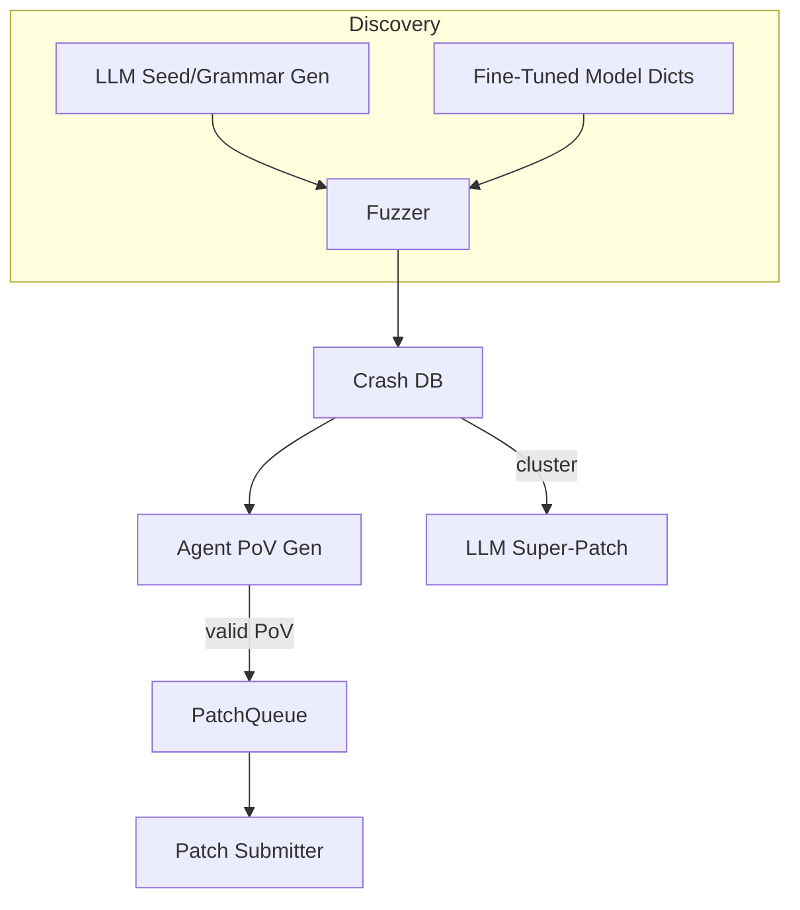

# Fuzzing assisté par l’IA et découverte automatisée de vulnérabilités

{{#include ../banners/hacktricks-training.md}}

## Vue d’ensemble
Les modèles de langage de grande taille (LLM) peuvent considérablement renforcer les pipelines traditionnels de recherche de vulnérabilités en générant des entrées sémantiquement riches, en faisant évoluer des grammaires, en raisonnant sur les données de crash et même en proposant des correctifs couvrant plusieurs bugs. Cette page rassemble les approches les plus efficaces observées lors de la finale du DARPA AI Cyber Challenge (AIxCC) et d’autres travaux de recherche publics.<sup>[[4]](#references)</sup><sup>[[5]](#references)</sup>

Ce qui suit ne décrit pas un système spécifique utilisé lors d’une compétition, mais présente une abstraction des techniques afin que vous puissiez les reproduire dans vos propres workflows.

---

## 1. Entrées de départ générées par des LLM

Les fuzzers traditionnels guidés par la couverture (AFL++, libFuzzer, Honggfuzz…) démarrent avec un petit corpus d’entrées de départ et mutent les octets à l’aveugle. Lorsque le format d’entrée de la cible est complexe (SQL, URL, protocoles binaires personnalisés), les mutations aléatoires cassent généralement la syntaxe avant que des branches intéressantes ne soient atteintes.

Les LLM peuvent résoudre ce problème d’amorçage en générant des *générateurs d’entrées de départ* — de courts scripts qui produisent des **entrées syntaxiquement correctes, mais pertinentes pour la sécurité**. Par exemple :

```prompt
SYSTEM: You are a helpful security engineer.
USER:
Write a Python3 program that prints 200 unique SQL injection strings targeting common anti-pattern mistakes (missing quotes, numeric context, stacked queries).  Ensure length ≤ 256 bytes / string so they survive common length limits.
```

```python
# gen_sqli_seeds.py (truncated)
PAYLOADS = [
    "1 OR 1=1 -- ",
    "' UNION SELECT NULL,NULL--",
    "0; DROP TABLE users;--",
    ...
]
for p in PAYLOADS:
    print(p)
```

Exécutez-le une fois, puis transmettez directement la sortie au corpus initial du fuzzer :

```bash
python3 gen_sqli_seeds.py > seeds.txt
afl-fuzz -i seeds.txt -o findings/ -- ./target @@
```

Benefits:
1. Validité sémantique → couverture plus approfondie dès le début.
2. Régénérable : ajustez le prompt pour cibler XSS, path traversal, binary blobs, etc.
3. Peu coûteux (< 1 ¢ avec GPT-3.5).

### Conseils
* Demandez au modèle de *diversifier* la longueur et l’encodage des payloads (UTF-8, URL-encoded, UTF-16-LE) afin de contourner les filtres superficiels.
* Demandez un *script autonome unique* — cela évite les problèmes de formatage JSON.

---

## 2. Grammar-Evolution Fuzzing

Une variante plus puissante consiste à laisser le LLM **faire évoluer une grammaire** plutôt que des seeds concrets. Le workflow (modèle « Grammar Guy ») est le suivant :

1. Générer une grammaire initiale ANTLR/Peach/LibFuzzer à l’aide d’un prompt.
2. Lancer le fuzzing pendant N minutes et collecter les métriques de couverture (arêtes / blocs atteints).
3. Résumer les zones du programme non couvertes et transmettre ce résumé au modèle :
   ```prompt
   The previous grammar triggered 12 % of the program edges.  Functions not reached: parse_auth, handle_upload.  Add / modify rules to cover these.
   ```
4. Fusionnez les nouvelles règles, relancez le fuzzing, répétez.

Squelette de pseudo-code :

```python
for epoch in range(MAX_EPOCHS):
    grammar = llm.refine(grammar, feedback=coverage_stats)
    save(grammar, f"grammar_{epoch}.txt")
    coverage_stats = run_fuzzer(grammar)
```

Points clés :
* Gardez un *budget* : chaque amélioration consomme des tokens.
* Utilisez des instructions `diff` + `patch` pour que le modèle modifie le code plutôt que de le réécrire.
* Arrêtez-vous lorsque Δcoverage < ε.

---

## 3. Ingénierie de harness libFuzzer avec LLM local

Pour du code qui ne peut pas quitter le poste de travail d’un analyste, un modèle de code local peut rédiger le petit adaptateur entre les octets du fuzzer et une API C/C++. La limite de sécurité est explicite : **le modèle écrit et révise l’infrastructure de test ; la mutation guidée par la couverture explore les entrées ; les sanitizers signalent les opérations invalides ; un humain examine le harness et trie les résultats**.<sup>[[9]](#references)</sup>

Pour les techniques de corpus, de feedback, de snapshot et de fuzzing avec état au niveau du moteur qui ne dépendent pas d’un LLM, consultez la [méthodologie de fuzzing](../generic-methodologies-and-resources/fuzzing.md).

Commencez par copier la déclaration exacte de l’en-tête cible et imposez le format de sortie. Un prompt ciblé limite l’invention d’API et facilite l’examen du résultat :<sup>[[8]](#references)[[9]](#references)</sup>

```prompt
Write a libFuzzer target for this exact declaration:
int parse_records(const uint8_t *data, size_t size);

Output only C code. Implement LLVMFuzzerTestOneInput, include the
declaration, pass data and size unchanged, and do not use files,
network access, randomness, clocks, threads, or persistent state.
```

Pour un analyseur d’octets bruts, le résultat attendu ne devrait pas être plus compliqué que :<sup>[[6]](#references)[[9]](#references)</sup>

```c
#include <stddef.h>
#include <stdint.h>

extern int parse_records(const uint8_t *, size_t);

int LLVMFuzzerTestOneInput(const uint8_t *data, size_t size) {
    (void)parse_records(data, size);
    return 0;
}
```

La compilation n’est que la première étape de validation. Vérifiez chaque cible générée par rapport à ces invariants avant d’y consacrer du temps CPU :<sup>[[6]](#references)[[8]](#references)[[9]](#references)</sup>

- **API exacte :** comparez les types, les règles de propriété, l’initialisation, le nettoyage et la convention d’appel avec le véritable en-tête et les appelants existants.
- **Sécurité du harness :** protégez chaque lecture de `data` ; les constats des sanitizers doivent provenir de la cible, et non du code glue généré.
- **Répétabilité :** faites dépendre le résultat de `data` et de `size` ; supprimez les E/S externes, le temps, l’aléatoire non maîtrisé, les threads non joints et tout état persistant entre les appels.
- **Débit :** n’initialisez l’état immuable coûteux qu’une seule fois, uniquement si cela ne peut pas affecter le comportement ; limitez la taille des entrées, désactivez les logs et libérez les allocations propres à chaque entrée.
- **Atteignabilité :** vérifiez que les fonctions et branches visées sont exécutées. Une cible qui compile, mais n’exerce que des chemins de rejet, échoue silencieusement.

### Cibles structure-aware : préserver les invariants sans masquer les bugs

Si la plupart des entrées brutes échouent à un contrôle de magic, de longueur, de version ou de checksum, utilisez les octets de fuzz comme matériau pour des champs typés et reconstruisez un objet valide. Fixez les constantes de format, laissez les champs sémantiques et les octets du payload modifiables, et calculez les métadonnées d’intégrité à partir du payload reconstruit. `FuzzedDataProvider` permet de consommer des valeurs typées bornées, tandis que l’adaptateur reste chargé de limiter toute allocation et conversion générées.<sup>[[9]](#references)</sup>

<details>
<summary>Exemple de cible C++ structure-aware</summary>

```cpp
#include <fuzzer/FuzzedDataProvider.h>
#include <stddef.h>
#include <stdint.h>
#include <vector>

extern "C" int parse_message(const uint8_t *, size_t);

extern "C" int LLVMFuzzerTestOneInput(const uint8_t *data, size_t size) {
    FuzzedDataProvider fdp(data, size);
    uint8_t version = fdp.ConsumeIntegral<uint8_t>();
    auto body = fdp.ConsumeRemainingBytes<uint8_t>();
    if (body.size() > UINT16_MAX) body.resize(UINT16_MAX);
    uint16_t len = static_cast<uint16_t>(body.size());
    std::vector<uint8_t> msg = {0x8b, 'M', 'S', 'G', version,
                                static_cast<uint8_t>(len >> 8),
                                static_cast<uint8_t>(len)};
    msg.insert(msg.end(), body.begin(), body.end());
    (void)parse_message(msg.data(), msg.size());
    return 0;
}
```

</details>

N’utilisez pas une seule cible qui répare la structure pour toutes les questions. Maintenez une cible qui calcule les longueurs et les sommes de contrôle afin d’explorer des états valides profonds, et une autre qui laisse les métadonnées **déclarées** contrôlées par le fuzzer, tout en limitant uniquement les lectures et les allocations propres au harness. La deuxième cible préserve les surfaces d’attaque liées aux longueurs incohérentes et aux erreurs d’intégrité, que la réparation automatique effacerait autrement.<sup>[[9]](#references)</sup>

### Seeds, dictionnaires, sanitizers et retour de couverture

Demandez au modèle de générer un script qui écrit des seeds binaires plutôt que de lui demander d’afficher directement des données binaires. Créez des seeds à partir d’objets vides, minimaux, typiques et valides aux limites, puis extrayez les valeurs magiques, les tags, les encodages d’enum et les mots-clés du parser dans un dictionnaire révisé. libFuzzer accepte ce dictionnaire avec `-dict=`, et conserve dans le corpus les mutations qui révèlent une nouvelle couverture.<sup>[[6]](#references)[[9]](#references)</sup>

```text
magic="\x8bMSG"
version_min="\x00"
version_max="\xff"
config_tag="CONFIG"
```

Construisez la même cible avec une instrumentation complémentaire. ASan et UBSan peuvent partager un binaire de fuzzing ; utilisez une compilation MSan distincte et instrumentez ses dépendances afin d’éviter les rapports causés par du code non instrumenté.<sup>[[6]](#references)[[9]](#references)</sup>

```bash
clang++ -g -O1 -fsanitize=fuzzer,address,undefined \
  -fno-sanitize-recover=undefined target.cc harness.cc -o fuzz_target
./fuzz_target corpus -dict=msg.dict -max_len=65535

clang++ -g -O1 -fsanitize=fuzzer,memory \
  target.cc harness.cc -o fuzz_target_msan
```

Traitez la couverture comme le critère d’évaluation de chaque révision du modèle. Dans la sortie de libFuzzer, des valeurs `cov`/`ft` qui stagnent dès le début et un corpus statique indiquent généralement un mauvais cadrage, un retour anticipé trop restrictif ou un mauvais appel ; un faible `exec/s` signale une configuration coûteuse, des E/S, des allocations ou un état qui fuit. `NEW` prouve uniquement qu’une fonctionnalité de couverture a changé, pas que le parseur visé a été atteint.<sup>[[6]](#references)[[9]](#references)</sup>

Pour obtenir du feedback au niveau du code source, créez une version avec instrumentation de couverture, lancez le fuzzing et ne fournissez au modèle que les fonctions non couvertes et leurs conditions de garde. Vérifiez les différences du harness/seed/dictionary et mesurez à nouveau :<sup>[[7]](#references)[[8]](#references)[[9]](#references)</sup>

```bash
clang++ -g -O1 -fsanitize=fuzzer \
  -fprofile-instr-generate -fcoverage-mapping target.cc harness.cc -o fuzz_cov
mkdir -p profiles
LLVM_PROFILE_FILE='profiles/%p.profraw' ./fuzz_cov -max_total_time=300 corpus
llvm-profdata merge -sparse profiles/*.profraw -o fuzz.profdata
llvm-cov report ./fuzz_cov -instr-profile=fuzz.profdata
llvm-cov show ./fuzz_cov -instr-profile=fuzz.profdata \
  --show-branches=count --region-coverage-lt=1 target.cc
```

La boucle évolutive est donc **générer → compiler/éditer les liens → effectuer un test de fumée avec les sanitizers → mesurer la couverture de la cible → fournir le contexte minimal pertinent de couverture et de code source → réviser → mesurer à nouveau**. OSS-Fuzz-Gen applique le même principe en évaluant les cibles générées selon leur compilabilité, les erreurs à l’exécution, la couverture et l’amélioration de la couverture par rapport aux cibles existantes, plutôt que d’accepter du code plausible sans vérification.<sup>[[7]](#references)[[8]](#references)</sup>

---

<a id="3-agent-based-pov-exploit-generation" hidden>3. Génération de PoV (Exploit) basée sur des agents</a>

## 4. Génération de PoV (Exploit) basée sur des agents

Après avoir trouvé un crash, il vous faut encore une **preuve de vulnérabilité (PoV)** qui le déclenche de manière déterministe.

Une approche évolutive consiste à lancer de nombreux workers légers (processus, threads ou conteneurs), chacun utilisant un modèle ou une configuration d’échantillonnage différente. L’enquête auprès des finalistes d’AIxCC donne des exemples concrets de cette échelle : une équipe a utilisé **des milliers d’agents simultanés** pour générer des PoV en priorité avec l’IA, tandis qu’une autre a orchestré **300–500 agents de fuzzing** et réservé les LLM au raisonnement sémantique de haut niveau.<sup>[[4]](#references)</sup>

Pipeline :
1. L’analyse statique/dynamique produit des *candidats de bugs* (structure contenant le PC du crash, un segment de l’entrée et le message du sanitizer).
2. L’orchestrateur distribue les candidats aux agents.
3. Étapes de raisonnement de l’agent :
   a. Reproduire le bug localement avec `gdb` et l’entrée.
   b. Proposer un payload d’exploit minimal.
   c. Valider l’exploit dans un sandbox. En cas de succès → soumettre.
4. Les tentatives échouées sont **remises en file d’attente comme nouvelles seeds** pour le fuzzing de couverture (boucle de rétroaction).

Avantages :
* La parallélisation masque le manque de fiabilité d’un agent unique.
* Ajustement automatique de la température et de la taille du modèle en fonction du taux de réussite observé.

---

<a id="4-directed-fuzzing-with-fine-tuned-code-models" hidden>4. Fuzzing dirigé avec des modèles de code fine-tunés</a>

## 5. Fuzzing dirigé avec des modèles de code fine-tunés

Fine-tunez un modèle à poids ouverts (par exemple, Llama-7B) sur du code source C/C++ annoté avec des motifs de vulnérabilité (débordement d’entier, copie de buffer, format string). Ensuite :

1. Exécutez une analyse statique pour obtenir la liste des fonctions et l’AST.
2. Donnez au modèle l’instruction suivante : *« Fournis des entrées de dictionnaire de mutation susceptibles de compromettre la sécurité mémoire dans la fonction X »*.
3. Insérez ces tokens dans un `AFL_CUSTOM_MUTATOR` personnalisé.

Exemple de sortie pour un wrapper `sprintf` :
```
{"pattern":"%99999999s"}
{"pattern":"AAAAAAAA....<1024>....%n"}
```

Empiriquement, cela réduit de plus de 2× le temps avant un crash sur des cibles réelles.

---

<a id="5-ai-guided-patching-strategies" hidden>5. Stratégies de patching guidées par l’IA</a>

## 6. Stratégies de patching guidées par l’IA

<a id="51-super-patches" hidden>5.1 Super-correctifs</a>

### 6.1 Super-correctifs
Demandez au modèle de *regrouper* les signatures de crash et de proposer un **correctif unique** qui élimine la cause racine commune.  Soumettez-le une seule fois pour corriger plusieurs bugs → moins de pénalités de précision dans les environnements où chaque correctif erroné coûte des points.

Structure de la requête :
```
Here are 10 stack traces + file snippets.  Identify the shared mistake and generate a unified diff fixing all occurrences.
```

{{#ref}}
../generic-methodologies-and-resources/fuzzing.md
{{#endref}}

<a id="52-speculative-patch-ratio" hidden>5.2 Speculative Patch Ratio</a>

### 6.2 Speculative Patch Ratio
Mettez en place une file où les patches confirmés et validés par PoV et les patches *spéculatifs* (sans PoV) sont alternés selon un ratio de 1:​N ajusté aux règles de score (p. ex. 2 spéculatifs : 1 confirmé). Un modèle de coût surveille les pénalités par rapport aux points et ajuste N automatiquement.

---

<a id="6-deterministic-file-by-file-ai-code-review" hidden>6. Revue de code IA déterministe fichier par fichier</a>

## 7. Revue de code IA déterministe fichier par fichier

Un mode d’échec fréquent des revues assistées par IA consiste à demander à un agent d’inspecter tout un dépôt et à espérer qu’il choisisse les bons fichiers et termes de recherche. Une méthode plus fiable consiste à **imposer une couverture du dépôt** :<sup>[[1]](#references)</sup>

1. Énumérer les fichiers source.
2. Envoyer **un fichier à la fois**, avec un contexte minimal (point d’entrée, imports, routes/appelants proches).
3. Exiger un **rapport structuré** pour chaque fichier : sources, sink, validations manquantes, préconditions d’exploitation et niveau de confiance.<sup>[[3]](#references)</sup>
4. Dédupliquer les rapports selon le **schéma source→sink** et valider manuellement les cas à haut risque.

Cette méthode consomme beaucoup de tokens et génère du bruit, mais elle est très efficace pour détecter des **bugs simples à fort impact liés aux sources et sinks**, souvent manqués par les revues agentiques à grande échelle.

### Schémas de triage à prioriser

- **Inclusion/déclenchement dynamique de PHP** : des noms de routes, contrôleurs ou modules contrôlés par l’attaquant sont transmis à `require_once()`, `include()` ou `include_once()` sans liste d’autorisation stricte ni canonisation du chemin.
- **Exécution de commandes shell dans les workflows d’administration/de compte** : des noms d’utilisateur, domaines, comptes FTP ou autres identifiants atteignent `exec()`, `system()`, `shell_exec()`, `passthru()`, `proc_open()` ou `popen()`.
- **Convergence d’entrées structurées** : le même paramètre est accepté depuis `$_GET`, `$_POST`, JSON, XML ou les analyseurs de corps du framework, puis réutilisé dans des sinks liés au système de fichiers ou aux commandes du système d’exploitation.

### Deux classes de bugs que cette méthode détecte bien en pratique

- **LFI/RCE via le dispatch de contrôleurs PHP** : si un nom de contrôleur fourni par la requête est concaténé dans `require_once()` sans liste d’autorisation ni normalisation du chemin, des séquences de traversée comme `../` peuvent amener PHP à inclure un fichier `.php` local non prévu. Si l’attaquant peut faire pointer l’inclusion vers un fichier PHP qu’il a placé ou qui lui est utile, la LFI devient une exécution de code. Voir [File Inclusion / Path Traversal](../pentesting-web/file-inclusion/README.md).<sup>[[1]](#references)</sup>
- **Injection de commandes authentifiée dans les panneaux d’hébergement/d’administration** : si des champs de gestion de compte tels que les noms d’utilisateur sont intégrés à des commandes shell, un utilisateur authentifié disposant de faibles privilèges peut transformer une action normale de création/suppression en RCE. L’impact augmente lorsque le panneau exécute la commande en tant que compte de service plus privilégié. Voir [Command Injection](../pentesting-web/command-injection.md).<sup>[[1]](#references)</sup>

### Notes pratiques pour la revue

- Utilisez le LLM d’abord comme **outil de revue des sources et des sinks**, et non comme générateur d’exploits.
- Demandez-lui de préciser explicitement le **champ contrôlé par l’attaquant**, la **lacune de normalisation/validation** et le **sink dangereux**.
- Pour les grands dépôts, une revue déterministe fichier par fichier est souvent plus fiable qu’une seule exécution d’agent autonome, même si celle-ci utilise un modèle plus puissant.<sup>[[2]](#references)</sup>
- Attendez-vous à des résultats moins bons concernant **Broken Access Control** et d’autres bugs de logique métier, dont l’exploitabilité dépend d’hypothèses entre fichiers, de la sémantique des rôles ou de modèles de menace propres au produit.

---

## 8. Audit du kernel guidé par des schémas avec un oracle instrumenté

Pour une cible de la taille d’un kernel, ne demandez pas à un agent de chercher des bugs arbitraires dans l’ensemble du code. Un workflow plus économe en tokens transforme les connaissances sur les vulnérabilités historiques en requêtes statiques, classe les résultats selon la surface d’attaque exposée et utilise un kernel instrumenté comme oracle d’exécution.<sup>[[11]](#references)</sup>

### Base de schémas → CodeQL/Semgrep → revue ciblée

Constituez une petite base de connaissances contenant les API dangereuses, les schémas de validation manquante, les flux risqués de source à sink et les formes de bugs déjà corrigées. Demandez au modèle de traduire **un schéma à la fois** en heuristiques de revue et en règles CodeQL/Semgrep, puis exécutez ces règles déterministes sur l’ensemble du code. Regroupez et dédupliquez les correspondances avant de soumettre le code au modèle ; les résultats bruts des scanners peuvent contenir des milliers de candidats de faible valeur. Vérifiez la licence actuelle de CodeQL avant d’utiliser cette méthode en dehors des cibles de recherche admissibles ou open source.<sup>[[11]](#references)</sup>

Priorisez les sous-systèmes en fonction à la fois de la **densité de correspondances aux règles** et de l’**accessibilité par un attaquant**, plutôt que du seul nombre de correspondances. Les interfaces du kernel accessibles depuis des processus sans privilèges, des sandboxes, des conteneurs, des jails ou des contextes invités méritent davantage de poids que le code réservé à un usage interne. Gardez l’unité de revue assez petite pour que l’agent puisse prendre en compte les appelants, les validateurs et les règles de durée de vie, et demandez-lui d’examiner une classe de vulnérabilité ou un schéma de flux de contrôle précis plutôt que de « trouver n’importe quelle vulnérabilité ». Les anciennes interfaces privilégiées sont particulièrement intéressantes lorsqu’une frontière de confinement plus récente les rend accessibles à un utilisateur root avec espace de noms ou placé dans une jail.<sup>[[11]](#references)</sup>

Pour chaque candidat, exigez un relevé explicite des flux de données avant toute tentative d’exploitation.<sup>[[11]](#references)</sup>

```text
entrypoint -> privilege check -> parser -> validation/normalization
           -> later rewrite -> dangerous sink
attacker controls: <fields and lengths>
constraints:       <values rewritten, rejected, or preserved>
observable result: <sanitizer report, assertion, panic, or clean exit>
```

### Utiliser la télémétrie KASAN comme oracle d’hypothèse

Exécutez le kernel cible dans une VM jetable avec KASAN et des assertions de diagnostic utiles activés. L’agent doit itérer selon le cycle **hypothèse sur le code source → déclencheur minimal en userland → exécution dans la VM → trace KASAN/assertion → hypothèse révisée**, jusqu’à ce que la corruption suspectée soit reproduite ou écartée. À chaque itération, ne renvoyez que la stack trace pertinente et le code source à proximité ; cela préserve le contexte de raisonnement tout en faisant des éléments observés à l’exécution — et non de la confiance du modèle — le critère d’acceptation.<sup>[[11]](#references)</sup>

Un build instrumenté ne représente pas l’environnement final d’exploitabilité. Les assertions peuvent interrompre l’exécution avant l’opération corruptrice, alors que la même assertion peut être désactivée dans un kernel de production. Retestez le déclencheur inchangé avec la configuration exacte de production, consignez le build et la configuration du kernel, et distinguez **l’atteignabilité**, **la corruption mémoire**, **la primitive contrôlée** et **l’impact sur la sécurité** comme des affirmations distinctes.<sup>[[11]](#references)[[12]](#references)</sup>

CVE-2026-3038 est un exemple utile pour la validation, pas un modèle d’exploit. Une requête FreeBSD `RTM_GET` non privilégiée pouvait préserver un sockaddr `RTAX_AUTHOR` surdimensionné malgré une validation sélective et une réécriture de la réponse, jusqu’à ce que `rtsock_msg_buffer()` copie son `sa_len` contrôlé par l’utilisateur dans un `sockaddr_storage` de 128 octets sur la pile. La copie maximale de 255 octets produisait un dépassement de 127 octets ; une assertion de diagnostic détectait la longueur incorrecte dans le build instrumenté, tandis qu’un kernel GENERIC atteignait la copie, puis paniquait lors de la vérification du canary corrompu. Cela prouve un déni de service non privilégié, pas une élévation de privilèges à lui seul : un contrôle fiable nécessiterait d’abord une autre primitive, comme la divulgation d’un canary. Voir [Stack Canaries](../binary-exploitation/common-binary-protections-and-bypasses/stack-canaries/index.html) pour la limite correspondante en binary exploitation.<sup>[[11]](#references)[[12]](#references)[[13]](#references)</sup>

### Rejeter la triche sur les préconditions d’exploit

Avant d’accepter un PoV ou un exploit, demandez à un reviewer/agent distinct de tenter de le réfuter selon des critères fixes. L’examen doit confirmer toutes les conditions suivantes.<sup>[[11]](#references)</sup>

- Le code source cible, le kernel et le module vulnérable n’ont pas été modifiés pour rendre le chemin atteignable.
- Aucun module auxiliaire, gadget synthétique, mécanisme d’atténuation désactivé, privilège supplémentaire ou interface indisponible n’a été introduit.
- Le déclencheur démarre avec l’identité de l’appelant revendiquée et les restrictions de confinement, sur un snapshot propre.
- Le résultat revendiqué dépend toujours du bug : retirer le champ malformé ou corriger uniquement le bug doit rompre la chaîne.
- Un crash, une lecture excessive ou une écriture excessive n’est rapporté que comme cette primitive ; l’exécution de code ou l’élévation de privilèges nécessite des preuves indépendantes.

Cette dernière vérification contrefactuelle permet de repérer les démonstrations circulaires : si les prérequis accordent déjà l’impact revendiqué (par exemple, l’exécution d’un contenu SUID fourni par l’attaquant depuis un système de fichiers monté sans `nosuid`), le bug de sécurité mémoire n’a pas créé cet impact.<sup>[[11]](#references)</sup>

---

## Recherche auditable assistée par agent sur des bases de code inconnues

Le [workflow de sélection des cibles de fuzzing fondé sur le graphe](../generic-methodologies-and-resources/fuzzing.md#graph-first-fuzz-target-selection-and-mutation-triage) couvre déjà l’atteignabilité des points d’entrée, tandis que les [pipelines SAST agentiques](../network-services-pentesting/pentesting-web/code-review-tools.md#agentic-sast-pipelines) couvrent l’examen par étapes et les critères de validation des preuves. Gardez ces résultats déterministes distincts des hypothèses du modèle afin que chaque piste retenue conserve les emplacements dans le code source, les preuves concernant le chemin et une mesure dynamique.<sup>[[10]](#references)</sup>

### Corréler les preuves sur la durée de vie des objets sans inventer de flux de données

L’analyse statique peut détecter qu’une longueur contrôlée par un attaquant est stockée dans une fonction, puis que le même champ d’objet atteint un point de copie beaucoup plus tard, sans toutefois prouver le lien à travers les callbacks, les reconnexions ou la durée de vie de l’objet. Conservez les deux résultats séparément, regroupez-les par objet/champ et formulez explicitement le lien manquant comme une question de triage. L’agent peut suggérer la relation, mais l’examen du code source ou l’instrumentation à l’exécution doit la prouver.<sup>[[10]](#references)</sup>

Pour chaque candidat, consignez :

- le point d’entrée concret et les octets contrôlés par l’attaquant ;
- chaque producteur du champ concerné, y compris la validation propre à chaque producteur ;
- le point d’écriture, la capacité de destination et les conditions de build/d’exécution nécessaires pour l’atteindre ;
- une vraie pile d’appels depuis le point d’entrée exposé, et pas seulement un appel direct au harness ;
- le plus petit résultat dynamique permettant de confirmer ou d’écarter l’hypothèse.

Un chemin apparemment sûr ne valide pas un champ de manière globale. Un second producteur peut renseigner le même champ sans respecter la limite du premier chemin. Testez les chemins indépendamment et exécutez le harness avec des options de build équivalentes à celles du déploiement, car les assertions de débogage peuvent transformer une corruption mémoire en production en arrêt prématuré réservé aux tests.<sup>[[10]](#references)</sup>

### Critères de mesure pour la divulgation et l’exploitation

Pour une suspicion de divulgation de mémoire non initialisée, remplissez les allocations fraîches avec un octet reconnaissable et vérifiez que le marqueur exact apparaît dans le paquet émis. Pour l’exploitation, exigez des critères mesurés tels que **écriture contrôlée → objet victime utile → divulgation → récupération du pointeur/de la base → détournement du flux de contrôle → payload composé**. Un agent ne passe à l’étape suivante que lorsque le harness prouve la propriété actuelle ; un scénario plausible ne suffit pas à valider un critère. Le [cas FreeRDP](../binary-exploitation/libc-heap/heap-overflow.md#cross-path-length-reuse-and-stale-output-disclosure) montre le chemin et les contraintes de build à préserver pendant la validation.<sup>[[10]](#references)</sup>

---

Pour une étude de cas kernel appliquant une validation progressive L0–L4 au développement d’exploits assisté par LLM, voir :

{{#ref}}
../binary-exploitation/freebsd-kernel-exploitation-vnet-jail-escape.md
{{#endref}}

## Assembler le tout
Un CRS (Cyber Reasoning System) de bout en bout peut relier les composants ainsi :



---

## References

- [1] [Project Black - IA locale pour la cybersécurité : découverte d’une LFI dans phpIPAM et d’une RCE authentifiée dans myVesta](https://projectblack.io/blog/local-ai-for-cyber-security)
- [2] [Strix](https://github.com/usestrix/strix)
- [3] [Compétence security-review de la communauté GitHub Copilot](https://github.com/github/awesome-copilot/blob/main/skills/security-review/SKILL.md)
- [4] [Trail of Bits – Finales AIxCC : le bilan](https://blog.trailofbits.com/2025/08/07/aixcc-finals-tale-of-the-tape/)
- [5] [CTF Radiooo — Interviews des finalistes AIxCC](https://www.youtube.com/@ctfradiooo)
- [6] [LLVM — libFuzzer : une bibliothèque pour le fuzz testing guidé par la couverture](https://llvm.org/docs/LibFuzzer.html)
- [7] [Google — OSS-Fuzz-Gen](https://github.com/google/oss-fuzz-gen)
- [8] [Google Online Security Blog — Améliorer le fuzzing : découvrir davantage de vulnérabilités grâce à l’IA](https://security.googleblog.com/2024/11/leveling-up-fuzzing-finding-more.html)
- [9] [8kSec — Génération assistée par IA d’un harness de fuzzing avec un LLM local](https://8ksec.io/ai-assisted-fuzzing-harness-local-llm)
- [10] [Quarkslab — Des agents IA à la RCE : créer un workflow de recherche de vulnérabilités](https://blog.quarkslab.com/from-ai-agents-to-rce-building-a-vulnerability-research-workflow.html)
- [11] [Praetorian — FreeBSoD : utiliser des modèles de langage pour trouver et exploiter des bugs du kernel (partie 1 sur 2)](https://praetorian.com/blog/ai-vulnerability-research-freebsd-kernel)
- [12] [FreeBSD-SA-26:05.route — DoS local et éventuelle élévation de privilèges via les sockets de routage](https://www.freebsd.org/security/advisories/FreeBSD-SA-26:05.route.asc)
- [13] [FreeBSD-SA-26:05.route — patch source](https://security.FreeBSD.org/patches/SA-26:05/route.patch)
{{#include ../banners/hacktricks-training.md}}
