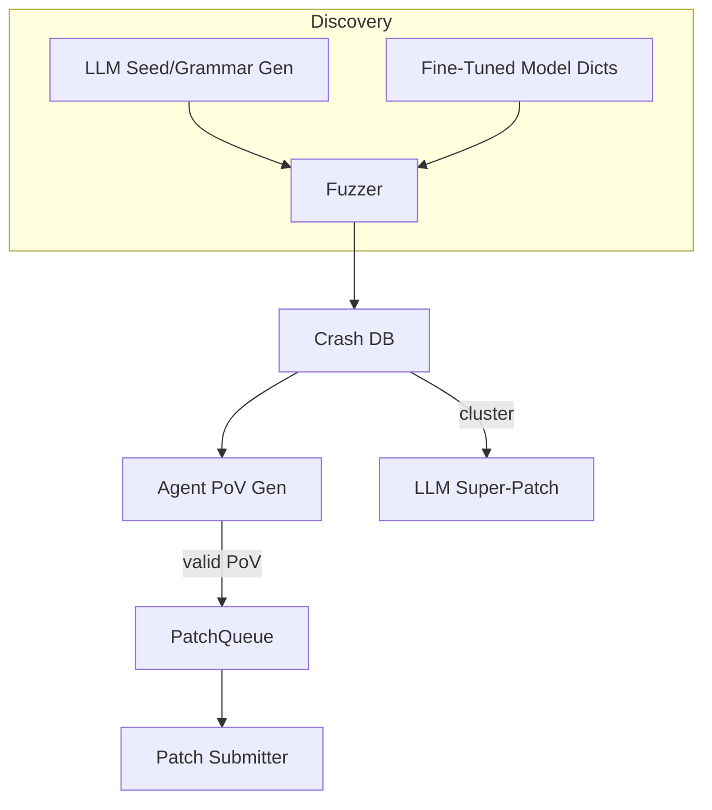

# Fuzzing за допомогою AI та автоматизоване виявлення вразливостей

{{#include ../banners/hacktricks-training.md}}

## Огляд
Великі мовні моделі (LLM) можуть значно посилити традиційні процеси дослідження вразливостей: генерувати семантично насичені inputs, розвивати граматики, аналізувати дані про збої та навіть пропонувати патчі для кількох багів. На цій сторінці зібрано найефективніші підходи, виявлені під час фіналу DARPA AI Cyber Challenge (AIxCC) та інших відкритих досліджень.<sup>[[4]](#references)</sup><sup>[[5]](#references)</sup>

Далі описано не одну конкретну систему для змагань, а узагальнені методи, які допоможуть відтворити їх у власних робочих процесах.

---

## 1. Seed inputs, згенеровані LLM

Традиційні coverage-guided fuzzers (AFL++, libFuzzer, Honggfuzz…) починають із невеликого корпусу seed inputs і наосліп мутують байти. Коли цільовий формат input складний (SQL, URL-адреси, спеціальні бінарні протоколи), випадкові мутації зазвичай порушують синтаксис, перш ніж буде досягнуто цікавих гілок виконання.

LLM можуть вирішити цю початкову проблему, створюючи *генератори seed inputs* — короткі скрипти, які виводять **синтаксично коректні, але важливі для безпеки inputs**. Наприклад:

```prompt
SYSTEM: You are a helpful security engineer.
USER:
Write a Python3 program that prints 200 unique SQL injection strings targeting common anti-pattern mistakes (missing quotes, numeric context, stacked queries).  Ensure length ≤ 256 bytes / string so they survive common length limits.
```

```python
# gen_sqli_seeds.py (truncated)
PAYLOADS = [
    "1 OR 1=1 -- ",
    "' UNION SELECT NULL,NULL--",
    "0; DROP TABLE users;--",
    ...
]
for p in PAYLOADS:
    print(p)
```

Запустіть один раз і передайте вивід безпосередньо до початкового корпусу фаззера:

```bash
python3 gen_sqli_seeds.py > seeds.txt
afl-fuzz -i seeds.txt -o findings/ -- ./target @@
```

Benefits:
1. Семантична валідність → глибше покриття на ранніх етапах.
2. Можна генерувати повторно: змініть prompt, щоб зосередитися на XSS, path traversal, двійкових blobs тощо.
3. Дешево (< 1 ¢ з GPT-3.5).

### Поради
* Попросіть модель урізноманітнити довжину payload і кодування (UTF-8, URL-encoded, UTF-16-LE), щоб обходити поверхневі фільтри.
* Попросіть *один автономний скрипт* — так можна уникнути проблем із форматуванням JSON.

---

## 2. Grammar-Evolution Fuzzing

Потужніший варіант — дозволити LLM **еволюціонувати граматику** замість конкретних seeds. Робочий процес (патерн “Grammar Guy”):

1. Згенеруйте початкову граматику ANTLR/Peach/LibFuzzer за допомогою prompt.
2. Виконуйте fuzzing протягом N хвилин і збирайте метрики покриття (відвідані edges / blocks).
3. Підсумуйте непокриті ділянки програми й передайте цей підсумок назад моделі:
   ```prompt
   The previous grammar triggered 12 % of the program edges.  Functions not reached: parse_auth, handle_upload.  Add / modify rules to cover these.
   ```
4. Об’єднайте нові правила, повторно запустіть fuzzing і повторіть.

Каркас псевдокоду:

```python
for epoch in range(MAX_EPOCHS):
    grammar = llm.refine(grammar, feedback=coverage_stats)
    save(grammar, f"grammar_{epoch}.txt")
    coverage_stats = run_fuzzer(grammar)
```

Key points:
* Дотримуйтеся *бюджету* — кожне уточнення витрачає токени.
* Використовуйте інструкції `diff` + `patch`, щоб модель редагувала, а не переписувала.
* Зупиніться, коли Δcoverage < ε.

---

## 3. Розробка harness для libFuzzer на локальній LLM

Якщо вихідний код не може залишати робочу станцію аналітика, локальна code model може створити невеликий адаптер між байтами fuzzer і API на C/C++. Межі безпеки мають бути чіткими: **модель пише й доопрацьовує тестову інфраструктуру; мутації з керуванням за покриттям досліджують вхідні дані; санітайзери повідомляють про некоректні операції; людина перевіряє harness і сортує результати**.<sup>[[9]](#references)</sup>

Методи роботи з корпусом, зворотним зв’язком, знімками стану та stateful fuzzing на рівні рушія, які не залежать від LLM, див. у загальній [методології fuzzing](../generic-methodologies-and-resources/fuzzing.md).

Почніть із точного оголошення, скопійованого із заголовкового файлу цільового проєкту, і задайте обмеження для формату виводу. Вузький промпт зменшує ймовірність вигаданих API та полегшує перевірку результату:<sup>[[8]](#references)[[9]](#references)</sup>

```prompt
Write a libFuzzer target for this exact declaration:
int parse_records(const uint8_t *data, size_t size);

Output only C code. Implement LLVMFuzzerTestOneInput, include the
declaration, pass data and size unchanged, and do not use files,
network access, randomness, clocks, threads, or persistent state.
```

Для парсера необроблених байтів очікуваний результат не має бути складнішим за:<sup>[[6]](#references)[[9]](#references)</sup>

```c
#include <stddef.h>
#include <stdint.h>

extern int parse_records(const uint8_t *, size_t);

int LLVMFuzzerTestOneInput(const uint8_t *data, size_t size) {
    (void)parse_records(data, size);
    return 0;
}
```

Компіляція — лише перший етап перевірки. Перш ніж витрачати на це процесорний час, перевірте кожну згенеровану ціль на відповідність таким інваріантам:<sup>[[6]](#references)[[8]](#references)[[9]](#references)</sup>

- **Точний API:** порівняйте типи, правила володіння, ініціалізацію, завершення роботи та угоду про виклик із реальним заголовком і наявними викликами.
- **Безпека harness:** захистіть кожне читання з `data`; результати санітайзера мають походити з цілі, а не зі згенерованого glue-коду.
- **Повторюваність:** зробіть результат функцією `data` і `size`; усуньте зовнішнє введення-виведення, час, неконтрольовану випадковість, неприєднані потоки та стан, що зберігається між викликами.
- **Пропускна здатність:** ініціалізуйте дорогу незмінну структуру лише один раз і лише якщо це не може вплинути на поведінку, обмежте розмір входу, вимкніть логування та звільняйте виділену для кожного входу пам’ять.
- **Досяжність:** перевірте, що виконуються потрібні функції та гілки. Ціль, яка компілюється, але перевіряє лише шляхи відхилення, — це непомітний збій.

### Цілі з урахуванням структури: зберігайте інваріанти, не приховуючи помилок

Якщо більшість необроблених входів не проходять перевірку магічного значення, довжини, версії чи контрольної суми, використовуйте байти fuzzing як **матеріал для типізованих полів** і відновлюйте коректний об’єкт. Задайте сталі значення формату, залиште семантичні поля та байти корисного навантаження змінними й обчислюйте метадані цілісності на основі відновленого корисного навантаження. `FuzzedDataProvider` зручно використовувати для отримання обмежених типізованих значень, а адаптер відповідає за обмеження будь-якого згенерованого виділення пам’яті та перетворення.<sup>[[9]](#references)</sup>

<details>
<summary>Приклад C++-цілі з урахуванням структури</summary>

```cpp
#include <fuzzer/FuzzedDataProvider.h>
#include <stddef.h>
#include <stdint.h>
#include <vector>

extern "C" int parse_message(const uint8_t *, size_t);

extern "C" int LLVMFuzzerTestOneInput(const uint8_t *data, size_t size) {
    FuzzedDataProvider fdp(data, size);
    uint8_t version = fdp.ConsumeIntegral<uint8_t>();
    auto body = fdp.ConsumeRemainingBytes<uint8_t>();
    if (body.size() > UINT16_MAX) body.resize(UINT16_MAX);
    uint16_t len = static_cast<uint16_t>(body.size());
    std::vector<uint8_t> msg = {0x8b, 'M', 'S', 'G', version,
                                static_cast<uint8_t>(len >> 8),
                                static_cast<uint8_t>(len)};
    msg.insert(msg.end(), body.begin(), body.end());
    (void)parse_message(msg.data(), msg.size());
    return 0;
}
```

</details>

Не використовуйте для кожного запитання одну й ту саму ціль, що виправляє структуру. Підтримуйте одну ціль, яка обчислює довжини й контрольні суми, щоб досліджувати глибокі коректні стани, і ще одну, де fuzzer контролює **заявлені** метадані, а обмежуються лише читання й виділення пам’яті самим harness. Друга ціль зберігає поверхні атак із невідповідною довжиною та некоректною цілісністю даних, які автоматичне виправлення інакше усунуло б.<sup>[[9]](#references)</sup>

### Seeds, словники, санітайзери та зворотний зв’язок від покриття

Попросіть модель згенерувати скрипт, який записує бінарні seeds, а не друкує бінарні дані безпосередньо. Створіть seeds для порожніх, мінімальних, типових і гранично коректних об’єктів; потім виділіть магічні значення, теги, кодування enum і ключові слова парсера в перевірений словник. libFuzzer приймає цей словник через `-dict=` і зберігає в corpus мутації, що відкривають нове покриття.<sup>[[6]](#references)[[9]](#references)</sup>

```text
magic="\x8bMSG"
version_min="\x00"
version_max="\xff"
config_tag="CONFIG"
```

Зберіть ту саму ціль із взаємодоповнювальною інструментацією. ASan і UBSan можуть використовувати спільний бінарний файл для fuzzing; використовуйте окрему збірку MSan та інструментуйте її залежності, щоб уникнути звітів, спричинених неінструментованим кодом.<sup>[[6]](#references)[[9]](#references)</sup>

```bash
clang++ -g -O1 -fsanitize=fuzzer,address,undefined \
  -fno-sanitize-recover=undefined target.cc harness.cc -o fuzz_target
./fuzz_target corpus -dict=msg.dict -max_len=65535

clang++ -g -O1 -fsanitize=fuzzer,memory \
  target.cc harness.cc -o fuzz_target_msan
```

Розглядайте покриття як критерій оцінювання кожної версії моделі. У виводі libFuzzer раннє плато `cov`/`ft` і статичний corpus зазвичай свідчать про неправильне framing, надто обмежувальний ранній вихід або неправильний виклик; низьке значення `exec/s` вказує на витратне налаштування, I/O, виділення пам’яті або витік стану. `NEW` лише доводить, що змінилася функція покриття, а не те, що було досягнуто потрібного parser.<sup>[[6]](#references)[[9]](#references)</sup>

Щоб отримати зворотний зв’язок на рівні вихідного коду, створіть збірку з coverage, запустіть fuzzing і передайте моделі лише непокриті функції разом з умовами їх виклику. Перевірте отримані зміни в harness/seed/dictionary і виміряйте ще раз:<sup>[[7]](#references)[[8]](#references)[[9]](#references)</sup>

```bash
clang++ -g -O1 -fsanitize=fuzzer \
  -fprofile-instr-generate -fcoverage-mapping target.cc harness.cc -o fuzz_cov
mkdir -p profiles
LLVM_PROFILE_FILE='profiles/%p.profraw' ./fuzz_cov -max_total_time=300 corpus
llvm-profdata merge -sparse profiles/*.profraw -o fuzz.profdata
llvm-cov report ./fuzz_cov -instr-profile=fuzz.profdata
llvm-cov show ./fuzz_cov -instr-profile=fuzz.profdata \
  --show-branches=count --region-coverage-lt=1 target.cc
```

Масштабований цикл, таким чином: **генерувати → компілювати/компонувати → виконувати smoke-тести із санітайзерами → вимірювати покриття цілі → надавати мінімальний релевантний контекст покриття/вихідного коду → доопрацьовувати → повторно вимірювати**. OSS-Fuzz-Gen застосовує той самий принцип: оцінює згенеровані цілі за можливістю компіляції, помилками під час виконання, покриттям і поліпшенням покриття порівняно з наявними цілями, замість того щоб приймати правдоподібний код за чисту монету.<sup>[[7]](#references)[[8]](#references)</sup>

---

<a id="3-agent-based-pov-exploit-generation" hidden>3. Agent-Based PoV (Exploit) Generation</a>

## 4. Генерація PoV (експлойтів) агентами

Після виявлення збою вам усе ще потрібен **proof-of-vulnerability (PoV)**, який детерміновано його спричиняє.

Масштабований підхід — запускати багато легковагових робочих процесів (процесів, потоків або контейнерів), кожен із яких використовує іншу модель або конфігурацію семплювання. Огляд фіналістів AIxCC містить конкретні приклади масштабування: одна команда використовувала **тисячі паралельних агентів** для генерації PoV із пріоритетом AI, а інша координувала **300–500 fuzzing-агентів**, залишаючи LLM для семантичного аналізу вищого рівня.<sup>[[4]](#references)</sup>

Конвеєр:
1. Статичний/динамічний аналіз генерує *кандидатів на помилки* (структура з crash PC, фрагментом вхідних даних, повідомленням санітайзера).
2. Оркестратор розподіляє кандидатів між агентами.
3. Етапи аналізу агента:
   a. Локально відтворити помилку за допомогою `gdb` і вхідних даних.
   b. Запропонувати мінімальний експлойт-пейлоад.
   c. Перевірити експлойт у пісочниці. Якщо успішно → надіслати.
4. Невдалі спроби **повторно ставляться в чергу як нові сіди** для fuzzing покриття (цикл зворотного зв’язку).

Переваги:
* Паралелізація нівелює ненадійність окремого агента.
* Автоматичне налаштування тимчасової затримки / розміру моделі на основі спостережуваного відсотка успіху.

---

<a id="4-directed-fuzzing-with-fine-tuned-code-models" hidden>4. Directed Fuzzing with Fine-Tuned Code Models</a>

## 5. Спрямований fuzzing із тонко налаштованими моделями коду

Виконайте тонке налаштування моделі з відкритими вагами (наприклад, Llama-7B) на вихідному коді C/C++, позначеному шаблонами вразливостей (цілочисельне переповнення, копіювання буфера, форматний рядок). Потім:

1. Виконайте статичний аналіз, щоб отримати список функцій і AST.
2. Запропонуйте моделі запит: *«Надай записи словника мутацій, які можуть порушити безпеку пам’яті у функції X»*.
3. Вставте ці токени у власний `AFL_CUSTOM_MUTATOR`.

Приклад виводу для обгортки `sprintf`:
```
{"pattern":"%99999999s"}
{"pattern":"AAAAAAAA....<1024>....%n"}
```

Емпірично це скорочує час до збою більш ніж удвічі на реальних цілях.

---

<a id="5-ai-guided-patching-strategies" hidden>5. Стратегії виправлення під керуванням ШІ</a>

## 6. Стратегії виправлення під керуванням ШІ

<a id="51-super-patches" hidden>5.1 Суперпатчі</a>

### 6.1 Суперпатчі
Попросіть модель *кластеризувати* сигнатури збоїв і запропонувати **один патч**, який усуває спільну першопричину. Надішліть його один раз, виправте кілька багів → менше штрафів за точність у середовищах, де кожен неправильний патч коштує балів.

Структура промпту:
```
Here are 10 stack traces + file snippets.  Identify the shared mistake and generate a unified diff fixing all occurrences.
```

{{#ref}}
../generic-methodologies-and-resources/fuzzing.md
{{#endref}}

<a id="52-speculative-patch-ratio" hidden>5.2 Співвідношення спекулятивних виправлень</a>

### 6.2 Співвідношення спекулятивних виправлень
Реалізуйте чергу, у якій підтверджені виправлення, перевірені за допомогою PoV, чергуються зі *спекулятивними* виправленнями (без PoV) у співвідношенні 1:​N, налаштованому відповідно до правил оцінювання (наприклад, 2 спекулятивні : 1 підтверджене). Модель витрат відстежує штрафи та бали й автоматично коригує N.

---

<a id="6-deterministic-file-by-file-ai-code-review" hidden>6. Детермінований AI-аудит коду файл за файлом</a>

## 7. Детермінований AI-аудит коду файл за файлом

Поширений сценарій невдачі під час AI-аудиту — попросити одного агента перевірити весь репозиторій і сподіватися, що він правильно вибере файли та пошукові терміни. Надійніший підхід — **примусово охопити весь репозиторій**:<sup>[[1]](#references)</sup>

1. Перелічіть файли з вихідним кодом.
2. Надсилайте **по одному файлу за раз** разом із мінімальним контекстом (точка входу, імпорти, пов’язані маршрути/викликачі).
3. Вимагайте **структурований звіт** для кожного файла: джерела, приймач, відсутня валідація, передумови експлуатації та рівень упевненості.<sup>[[3]](#references)</sup>
4. Усуньте дублікати звітів за **шаблоном джерело→приймач** і вручну перевірте знахідки з високим ризиком.

Цей підхід потребує багато токенів і створює шум, але дуже ефективно виявляє **прості баги з високим впливом у зв’язці джерело/приймач**, які широкі агентні перевірки часто пропускають.

### Шаблони для тріажу, які варто пріоритезувати

- **Динамічні PHP include/dispatch**: контрольовані зловмисником назви маршрутів/контролерів/модулів потрапляють до `require_once()`, `include()` або `include_once()` без суворого списку дозволених значень і канонізації шляхів.
- **Виконання shell-команд в адміністративних сценаріях і сценаріях роботи з обліковими записами**: імена користувачів, домени, FTP-облікові записи чи інші ідентифікатори потрапляють до `exec()`, `system()`, `shell_exec()`, `passthru()`, `proc_open()` або `popen()`.
- **Об’єднання структурованих вхідних даних**: той самий параметр приймається з `$_GET`, `$_POST`, JSON, XML або парсерів тіла запиту фреймворку, а згодом використовується в приймачах, пов’язаних із файловою системою чи командами ОС.

### Два практичні класи багів, які цей метод добре виявляє

- **LFI/RCE через диспетчеризацію PHP-контролерів**: якщо назву контролера з керованого запиту конкатенують у `require_once()` без списку дозволених значень або нормалізації шляху, послідовності обходу на кшталт `../` можуть змусити PHP включити не той локальний файл `.php`. Якщо зловмисник може спрямувати include на підготовлений або іншим чином корисний PHP-файл, LFI перетворюється на виконання коду. Див. [File Inclusion / Path Traversal](../pentesting-web/file-inclusion/README.md).<sup>[[1]](#references)</sup>
- **Автентифікована ін’єкція команд у панелях хостингу/адміністрування**: якщо поля керування обліковими записами, наприклад імена користувачів, вставляються в shell-команди, автентифікований користувач із низькими привілеями може перетворити звичайну дію створення/видалення на RCE. Вплив зростає, якщо панель виконує команду від імені службового облікового запису з вищими привілеями. Див. [Command Injection](../pentesting-web/command-injection.md).<sup>[[1]](#references)</sup>

### Практичні примітки щодо аудиту

- Спершу використовуйте LLM як **аналізатор джерел/приймачів**, а не як генератор експлойтів.
- Попросіть її чітко вказати **поле, контрольоване зловмисником**, **прогалину в нормалізації/валідації** та **небезпечний приймач**.
- У великих репозиторіях детермінований аудит окремих файлів часто надійніший за один запуск автономного агента, навіть якщо останній використовує потужнішу модель.<sup>[[2]](#references)</sup>
- Очікуйте слабших результатів щодо **Broken Access Control** та інших багів бізнес-логіки, де можливість експлуатації залежить від припущень між файлами, семантики ролей або специфічних для продукту моделей загроз.

---

## Taskflow-и для мобільних точок входу

Один запит для всього репозиторію часто змішує моделі загроз і втрачає шлях від доступного ззовні компонента до чутливого приймача. Надійніший робочий процес розбиває аудит на контекстні taskflow-и: спочатку класифікує застосунки/компоненти, потім інвентаризує точки входу, контрольовані зловмисником, доповнює кожну точку входу метаданими про доступність, а насамкінець перевіряє кожну з них на специфічні для платформи класи вразливостей. Мобільні taskflow-и GitHub Security Lab реалізують цей підхід для репозиторіїв Android, iOS і кросплатформних застосунків.<sup>[[14]](#references)[[15]](#references)</sup>

Для Android зафіксуйте щонайменше:<sup>[[14]](#references)[[15]](#references)</sup>

- експортовані Activities, Services, Receivers і Providers, зокрема дозволи;
- дії intent, схеми/хости/шляхи deep-link, MIME-фільтри та App Links;
- дії, URI даних, `ClipData`, додаткові дані й прапорці надання URI, контрольовані зловмисником;
- вхідні дані навігації WebView і мости `addJavascriptInterface`;
- подальші привілейовані операції, імпортовані ресурси та мережеві адресати.

Потім класифікуйте кожну точку входу з урахуванням контексту. Окремо перевірте авторизацію викликувача/поведінку confused deputy, перенаправлення intent, підміну або розкриття broadcast, небезпечний імпорт, виконання скриптів у WebView і доступність мостів, а також передавання облікових даних чи cookie між origin. Виконайте і **перевірку за суворим контрольним списком**, і **ширшу змагальну перевірку**. Пов’язуйте знахідки з [Intent Injection](../mobile-pentesting/android-app-pentesting/intent-injection.md) і [WebView Attacks](../mobile-pentesting/android-app-pentesting/webview-attacks.md), а не дублюйте подробиці експлуатації.<sup>[[15]](#references)</sup>

Поточні taskflow-и з відкритим кодом можна запустити зі свого Codespace за допомогою:<sup>[[14]](#references)</sup>

```bash
./scripts/audit/run_audit.sh owner/repository
```

Результати записуються в SQLite у таблицю `audit_result`.<sup>[[14]](#references)</sup> Сприймайте рядки, позначені як вразливі, як **зачіпки**, а не підтверджені знахідки. Для кожної зачіпки вимагайте від моделі вказати контрольоване зловмисником джерело, чутливий sink, передумови й очікуваний вплив, а потім попросіть створити мінімальний PoC. Запустіть цей PoC на оригінальній збірці під налагоджувачем або з інструментуванням. Так можна виявити поширені помилки статичного аналізу, як-от недосяжні гілки, нереалістичний стан застосунку, втрату пріоритету даними із зовнішнього сховища перед приватними даними та пом’якшення, які суттєво знижують серйозність.<sup>[[15]](#references)</sup>

---

## 8. Аудит ядра за шаблонами за допомогою інструментованого оракула

Для цілі розміром із ядро не просіть агента шукати довільні баги в усьому дереві коду. Ефективніший з погляду використання токенів робочий процес перетворює знання про історичні вразливості на статичні запити, ранжує результати за відкритістю поверхні атаки та використовує інструментоване ядро як оракул виконання.<sup>[[11]](#references)</sup>

### База шаблонів → CodeQL/Semgrep → цілеспрямований аналіз

Створіть невелику базу знань із небезпечних API, шаблонів відсутності валідації, ризикованих потоків від джерела до sink і форм раніше виправлених багів. Попросіть модель перетворити **по одному шаблону за раз** на евристики для аналізу й правила CodeQL/Semgrep, а потім запустіть ці детерміновані правила для всього дерева коду. Згрупуйте й дедуплікуйте збіги, перш ніж передавати код моделі; необроблений вивід сканера може містити тисячі малокорисних кандидатів. Перш ніж застосовувати цей підхід поза межами досліджень або цілей із відкритим кодом, перевірте чинну ліцензію CodeQL.<sup>[[11]](#references)</sup>

Визначайте пріоритет підсистем за **щільністю збігів із правилами** та **досяжністю для зловмисника**, а не лише за кількістю збігів. Інтерфейси ядра, доступні непривілейованим процесам, пісочницям, контейнерам, jail-середовищам або гостьовим контекстам, мають отримувати вищий пріоритет, ніж код, доступний лише зсередини. Обмежуйте обсяг аналізованого коду так, щоб агент міг утримувати в контексті викликачів, валідатори та правила керування часом життя, і просіть шукати названий клас вразливостей або шаблон потоку керування, а не «знайти будь-яку вразливість». Особливо цікаві застарілі привілейовані інтерфейси, якщо новіша межа ізоляції робить їх доступними користувачу root у просторі імен або jail-середовищі.<sup>[[11]](#references)</sup>

Для кожного кандидата вимагайте чіткого опису потоку даних у полях, перш ніж переходити до спроби експлуатації.<sup>[[11]](#references)</sup>

```text
entrypoint -> privilege check -> parser -> validation/normalization
           -> later rewrite -> dangerous sink
attacker controls: <fields and lengths>
constraints:       <values rewritten, rejected, or preserved>
observable result: <sanitizer report, assertion, panic, or clean exit>
```

### Використовуйте телеметрію KASAN як оракул гіпотез

Запустіть цільове ядро у тимчасовій VM з увімкненими KASAN і корисними діагностичними assertions. Агент має повторювати цикл **гіпотеза щодо коду → мінімальний тригер у userland → виконання у VM → трасування KASAN/assertion → уточнена гіпотеза**, доки підозрюване пошкодження не буде відтворене або спростоване. На кожній ітерації повертайте лише відповідне трасування стека та фрагмент коду поруч із ним. Це зберігає контекст для аналізу, а критерієм прийняття слугують дані виконання, а не впевненість моделі.<sup>[[11]](#references)</sup>

Інструментована збірка — це не середовище для остаточної оцінки експлуатованості. Assertions можуть зупинити виконання до операції, що спричиняє пошкодження, тоді як у production-ядрі той самий assertion може бути вимкнений під час компіляції. Повторно перевірте незмінений тригер з точною production-конфігурацією, зафіксуйте збірку та конфігурацію ядра й розглядайте **досяжність**, **пошкодження пам’яті**, **керований примітив** і **вплив на безпеку** як окремі твердження.<sup>[[11]](#references)[[12]](#references)</sup>

CVE-2026-3038 — корисний приклад для перевірки, а не шаблон експлойта. Неавторизований запит FreeBSD `RTM_GET` міг зберегти надмірно великий sockaddr `RTAX_AUTHOR` під час вибіркової валідації та перезапису відповіді, аж поки `rtsock_msg_buffer()` не скопіювала керований користувачем `sa_len` у 128-байтовий `sockaddr_storage` у стеку. Максимальне копіювання 255 байтів спричиняло перезапис 127 байтів; діагностичний assertion виявляв неправильну довжину в інструментованій збірці, тоді як ядро GENERIC доходило до копіювання, а потім панікувало під час перевірки пошкодженого canary. Це доводить можливість відмови в обслуговуванні з боку неавторизованого користувача, але не ескалацію привілеїв саму по собі: для надійного контролю спершу потрібен інший примітив, наприклад розкриття canary. Відповідну межу бінарної експлуатації див. у [Stack Canaries](../binary-exploitation/common-binary-protections-and-bypasses/stack-canaries/index.html).<sup>[[11]](#references)[[12]](#references)[[13]](#references)</sup>

### Відхиляйте підтасовування передумов експлойта

Перш ніж прийняти PoV або експлойт, попросіть окремого рецензента/агента спробувати спростувати його за фіксованими критеріями. Рецензент має підтвердити всі наведені нижче умови.<sup>[[11]](#references)</sup>

- Цільовий код, ядро та вразливий модуль не змінювали, щоб зробити шлях досяжним.
- Не додавали допоміжний модуль, синтетичний гаджет, вимкнені засоби захисту, додаткові привілеї чи недоступний інтерфейс.
- Тригер запускається з заявленими обліковими даними виклику та обмеженнями ізоляції на чистому знімку.
- Заявлений результат і далі залежить від помилки: видалення некоректного поля або виправлення лише цієї помилки має розірвати ланцюжок.
- Збій, читання за межами буфера чи перезапис повідомляються лише як відповідний примітив; для виконання коду або ескалації привілеїв потрібні незалежні докази.

Ця остання контрфактична перевірка виявляє циклічні демонстрації: якщо передумови вже забезпечують заявлений вплив (наприклад, виконання наданого зловмисником SUID-вмісту з файлової системи, змонтованої без `nosuid`), то помилка безпеки пам’яті не спричинила цей вплив.<sup>[[11]](#references)</sup>

---

## Дослідження незнайомих кодових баз за допомогою агентів із можливістю аудиту

[graph-first fuzz-target workflow](../generic-methodologies-and-resources/fuzzing.md#graph-first-fuzz-target-selection-and-mutation-triage) уже охоплює досяжність точок входу, а [agentic SAST pipelines](../network-services-pentesting/pentesting-web/code-review-tools.md#agentic-sast-pipelines) — поетапний аналіз і критерії прийняття доказів. Зберігайте ці детерміновані результати окремо від гіпотез моделі, щоб кожна відібрана зачіпка містила розташування в коді, докази шляху та динамічне вимірювання.<sup>[[10]](#references)</sup>

### Зіставляйте докази життєвого циклу об’єкта, не вигадуючи потік даних

Статичний аналіз може виявити, що керована атакувальником довжина записується в одній функції, а те саме поле об’єкта набагато пізніше доходить до точки копіювання, але не довести зв’язок між ними через callback-и, повторні з’єднання або життєвий цикл об’єкта. Зберігайте ці знахідки окремо, групуйте їх за об’єктом/полем і чітко формулюйте відсутній зв’язок як питання для тріажу. Агент може запропонувати цей зв’язок, але його має підтвердити аналіз коду або інструментування під час виконання.<sup>[[10]](#references)</sup>

Для кожного кандидата зафіксуйте:

- конкретну точку входу та байти, контрольовані атакувальником;
- кожне місце, де формується відповідне поле, включно з валідацією, специфічною для кожного такого місця;
- точку призначення, місткість буфера та умови збірки/виконання, необхідні для досягнення цього місця;
- реальний стек викликів від відкритої точки входу, а не лише прямий виклик harness;
- найменший динамічний результат, який підтверджує або спростовує гіпотезу.

Наявність безпечного шляху не означає, що поле безпечне всюди. Друге місце формування може заповнити те саме поле без обмеження з першого шляху. Перевіряйте шляхи окремо та запускайте harness із параметрами збірки, еквівалентними розгортанню, оскільки debug assertions можуть перетворити пошкодження пам’яті у production на раннє переривання тесту.<sup>[[10]](#references)</sup>

### Критерії вимірювання для розкриття даних та експлуатації

Якщо підозрюється розкриття неініціалізованої пам’яті, заповніть свіжі виділення пам’яті впізнаваним байтом і перевірте, чи точний маркер потрапляє до сформованого пакета. Для експлуатації вимагайте виміряних етапів, як-от **керований перезапис → корисний об’єкт-жертва → розкриття даних → відновлення вказівника/базової адреси → перехоплення потоку керування → складений payload**. Агент переходить далі, лише коли harness доводить поточну властивість; правдоподібний опис не означає проходження етапу. У [FreeRDP case](../binary-exploitation/libc-heap/heap-overflow.md#cross-path-length-reuse-and-stale-output-disclosure) показано шлях і обмеження збірки, які потрібно зберегти під час перевірки.<sup>[[10]](#references)</sup>

---

Приклад застосування поетапної перевірки L0–L4 до розробки експлойтів за допомогою LLM див. у:

{{#ref}}
../binary-exploitation/freebsd-kernel-exploitation-vnet-jail-escape.md
{{#endref}}

## Збираємо все докупи
Наскрізна CRS (Cyber Reasoning System) може поєднувати компоненти так:



---

## References

- [1] [Project Black — Локальний AI для кібербезпеки: пошук LFI у phpIPAM і автентифікованого RCE у myVesta](https://projectblack.io/blog/local-ai-for-cyber-security)
- [2] [Strix](https://github.com/usestrix/strix)
- [3] [Навичка перевірки безпеки спільноти GitHub Copilot](https://github.com/github/awesome-copilot/blob/main/skills/security-review/SKILL.md)
- [4] [Trail of Bits — Фінал AIxCC: підсумки змагання](https://blog.trailofbits.com/2025/08/07/aixcc-finals-tale-of-the-tape/)
- [5] [Інтерв’ю CTF Radiooo з фіналістами AIxCC](https://www.youtube.com/@ctfradiooo)
- [6] [LLVM — libFuzzer: бібліотека для fuzz-тестування з керуванням за покриттям](https://llvm.org/docs/LibFuzzer.html)
- [7] [Google — OSS-Fuzz-Gen](https://github.com/google/oss-fuzz-gen)
- [8] [Блог Google про онлайн-безпеку — Новий рівень fuzzing: пошук більшої кількості вразливостей за допомогою AI](https://security.googleblog.com/2024/11/leveling-up-fuzzing-finding-more.html)
- [9] [8kSec — Створення harness для fuzzing за допомогою AI та локальної LLM](https://8ksec.io/ai-assisted-fuzzing-harness-local-llm)
- [10] [Quarkslab — Від AI-агентів до RCE: створення робочого процесу дослідження вразливостей](https://blog.quarkslab.com/from-ai-agents-to-rce-building-a-vulnerability-research-workflow.html)
- [11] [Praetorian — FreeBSoD: використання мовних моделей для пошуку й експлуатації помилок ядра (частина 1 з 2)](https://praetorian.com/blog/ai-vulnerability-research-freebsd-kernel)
- [12] [FreeBSD-SA-26:05.route — Локальний DoS і можливе підвищення привілеїв через сокети маршрутизації](https://www.freebsd.org/security/advisories/FreeBSD-SA-26:05.route.asc)
- [13] [Патч вихідного коду FreeBSD-SA-26:05.route](https://security.FreeBSD.org/patches/SA-26:05/route.patch)
- [14] [GitHub Security Lab — Робочі процеси завдань SecLab](https://github.com/GitHubSecurityLab/seclab-taskflows)
- [15] [GitHub Security Lab — Як ми знайшли 24 вразливості Android за допомогою AI-агента безпеки з відкритим кодом](https://github.blog/security/how-we-found-24-android-vulnerabilities-using-our-open-source-ai-security-agent)
{{#include ../banners/hacktricks-training.md}}
