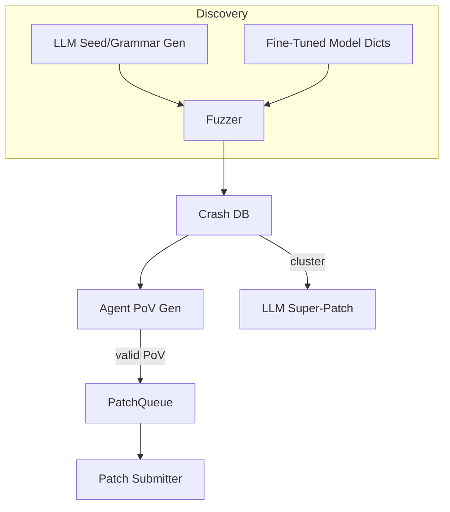

# Fuzzing Assistido por IA e Descoberta Automatizada de Vulnerabilidades

{{#include ../banners/hacktricks-training.md}}

## Visão geral
Os modelos de linguagem de grande escala (LLMs) podem turbinar os pipelines tradicionais de pesquisa de vulnerabilidades, gerando inputs semanticamente ricos, evoluindo gramáticas, analisando dados de crash e até propondo patches para múltiplos bugs. Esta página reúne os padrões mais eficazes observados nas finais do AI Cyber Challenge (AIxCC) da DARPA e em outras pesquisas públicas.<sup>[[4]](#references)</sup><sup>[[5]](#references)</sup>

O que segue não é uma descrição de um sistema específico de competição, mas uma abstração das técnicas, para que você possa reproduzi-las nos seus próprios fluxos de trabalho.

---

## 1. Inputs de seed gerados por LLMs

Fuzzers tradicionais guiados por cobertura (AFL++, libFuzzer, Honggfuzz…) começam com um pequeno corpus de seeds e fazem mutações cegas nos bytes. Quando o formato de input do alvo é complexo (SQL, URLs, protocolos binários personalizados), mutações aleatórias geralmente quebram a sintaxe antes que branches interessantes sejam alcançados.

LLMs podem resolver esse problema inicial gerando *geradores de seeds* — scripts curtos que produzem **inputs sintaticamente corretos, mas relevantes para a segurança**. Por exemplo:

```prompt
SYSTEM: You are a helpful security engineer.
USER:
Write a Python3 program that prints 200 unique SQL injection strings targeting common anti-pattern mistakes (missing quotes, numeric context, stacked queries).  Ensure length ≤ 256 bytes / string so they survive common length limits.
```

```python
# gen_sqli_seeds.py (truncated)
PAYLOADS = [
    "1 OR 1=1 -- ",
    "' UNION SELECT NULL,NULL--",
    "0; DROP TABLE users;--",
    ...
]
for p in PAYLOADS:
    print(p)
```

Execute uma vez e alimente a saída diretamente no corpus inicial do fuzzer:

```bash
python3 gen_sqli_seeds.py > seeds.txt
afl-fuzz -i seeds.txt -o findings/ -- ./target @@
```

Benefícios:
1. Validade semântica → cobertura mais profunda desde o início.
2. Pode ser gerado novamente: ajuste o prompt para se concentrar em XSS, path traversal, blobs binários etc.
3. Barato (< 1 ¢ com GPT-3.5).

### Dicas
* Instrua o modelo a *diversificar* o tamanho e a codificação dos payloads (UTF-8, URL-encoded, UTF-16-LE) para contornar filtros superficiais.
* Peça um *único script autocontido* – evita problemas de formatação JSON.

---

## 2. Grammar-Evolution Fuzzing

Uma variante mais poderosa consiste em deixar o LLM **evoluir uma gramática** em vez de seeds concretas. O fluxo de trabalho (padrão “Grammar Guy”) é:

1. Gere uma gramática inicial ANTLR/Peach/LibFuzzer usando um prompt.
2. Faça fuzzing por N minutos e colete métricas de cobertura (arestas / blocos atingidos).
3. Resuma as áreas do programa ainda não cobertas e envie o resumo de volta ao modelo:
   ```prompt
   The previous grammar triggered 12 % of the program edges.  Functions not reached: parse_auth, handle_upload.  Add / modify rules to cover these.
   ```
4. Mescle as novas regras, refaça o fuzzing e repita.

Esqueleto de pseudocódigo:

```python
for epoch in range(MAX_EPOCHS):
    grammar = llm.refine(grammar, feedback=coverage_stats)
    save(grammar, f"grammar_{epoch}.txt")
    coverage_stats = run_fuzzer(grammar)
```

Pontos-chave:
* Mantenha um *orçamento* — cada refinamento usa tokens.
* Use instruções de `diff` + `patch` para que o modelo edite em vez de reescrever.
* Pare quando Δcoverage < ε.

---

## 3. Engenharia de harness do libFuzzer com LLM local

Para código-fonte que não pode sair da estação de trabalho do analista, um modelo de código local pode criar o pequeno adaptador entre os bytes do fuzzer e uma API C/C++. O limite de segurança útil é explícito: **o modelo escreve e revisa a infraestrutura de testes; a mutação guiada por cobertura explora entradas; os sanitizers relatam operações inválidas; uma pessoa revisa o harness e faz a triagem das descobertas**.<sup>[[9]](#references)</sup>

Para técnicas de corpus, feedback, snapshot e stateful-fuzzing no nível do engine que não dependem de um LLM, consulte a [Fuzzing Methodology](../generic-methodologies-and-resources/fuzzing.md) geral.

Comece com a declaração exata, copiada do cabeçalho do alvo, e restrinja o formato da saída. Um prompt específico reduz APIs inventadas e facilita a revisão do resultado:<sup>[[8]](#references)[[9]](#references)</sup>

```prompt
Write a libFuzzer target for this exact declaration:
int parse_records(const uint8_t *data, size_t size);

Output only C code. Implement LLVMFuzzerTestOneInput, include the
declaration, pass data and size unchanged, and do not use files,
network access, randomness, clocks, threads, or persistent state.
```

Para um parser de bytes brutos, o resultado esperado não deve ser mais complicado do que:<sup>[[6]](#references)[[9]](#references)</sup>

```c
#include <stddef.h>
#include <stdint.h>

extern int parse_records(const uint8_t *, size_t);

int LLVMFuzzerTestOneInput(const uint8_t *data, size_t size) {
    (void)parse_records(data, size);
    return 0;
}
```

A compilação é apenas a primeira etapa de validação. Revise cada target gerado com base nestes invariantes antes de gastar tempo de CPU nele:<sup>[[6]](#references)[[8]](#references)[[9]](#references)</sup>

- **API exata:** compare os tipos, as regras de ownership, a inicialização, o teardown e a convenção de chamada com o header real e os chamadores existentes.
- **Segurança do harness:** proteja toda leitura de `data`; os problemas detectados pelo sanitizer devem ter origem no target, não no código de integração gerado.
- **Repetibilidade:** faça do resultado uma função de `data` e `size`; remova I/O externo, uso de tempo, aleatoriedade não controlada, threads não sincronizadas e estado que persista entre chamadas.
- **Throughput:** inicialize estados imutáveis caros apenas uma vez e somente quando isso não puder afetar o comportamento; limite o tamanho da entrada, suprima logs e libere as alocações por entrada.
- **Alcançabilidade:** verifique se as funções e ramificações pretendidas são executadas. Um target que compila, mas só percorre caminhos de rejeição, é uma falha silenciosa.

### Targets com estrutura: preserve invariantes sem ocultar bugs

Se a maioria das entradas brutas falhar em uma verificação de magic, comprimento, versão ou checksum, use os bytes de fuzz como material para campos tipados e reconstrua um objeto válido. Fixe as constantes de formato, deixe os campos semânticos e os bytes do payload mutáveis e derive os metadados de integridade a partir do payload reconstruído. `FuzzedDataProvider` é útil para consumir valores tipados com limites, enquanto o adapter continua responsável por limitar qualquer alocação e conversão geradas.<sup>[[9]](#references)</sup>

<details>
<summary>Exemplo de target C++ com reconhecimento de estrutura</summary>

```cpp
#include <fuzzer/FuzzedDataProvider.h>
#include <stddef.h>
#include <stdint.h>
#include <vector>

extern "C" int parse_message(const uint8_t *, size_t);

extern "C" int LLVMFuzzerTestOneInput(const uint8_t *data, size_t size) {
    FuzzedDataProvider fdp(data, size);
    uint8_t version = fdp.ConsumeIntegral<uint8_t>();
    auto body = fdp.ConsumeRemainingBytes<uint8_t>();
    if (body.size() > UINT16_MAX) body.resize(UINT16_MAX);
    uint16_t len = static_cast<uint16_t>(body.size());
    std::vector<uint8_t> msg = {0x8b, 'M', 'S', 'G', version,
                                static_cast<uint8_t>(len >> 8),
                                static_cast<uint8_t>(len)};
    msg.insert(msg.end(), body.begin(), body.end());
    (void)parse_message(msg.data(), msg.size());
    return 0;
}
```

</details>

Não use um único alvo que repare estruturas para todas as perguntas. Mantenha um alvo que derive comprimentos/checksums para explorar estados válidos profundos e outro que mantenha os metadados **declarados** sob controle do fuzzer, limitando apenas as leituras e alocações do próprio harness. O segundo alvo preserva superfícies de ataque com comprimentos incompatíveis e integridade inválida que o reparo automático eliminaria.<sup>[[9]](#references)</sup>

### Seeds, dicionários, sanitizers e feedback de cobertura

Peça ao modelo para gerar um script que grave seeds binários, em vez de pedir que ele imprima dados binários diretamente. Crie seeds de objetos vazios, mínimos, típicos e válidos nos limites; em seguida, extraia valores mágicos, tags, codificações de enum e palavras-chave do parser para um dicionário revisado. O libFuzzer aceita esse dicionário com `-dict=` e mantém no corpus as mutações que revelam nova cobertura.<sup>[[6]](#references)[[9]](#references)</sup>

```text
magic="\x8bMSG"
version_min="\x00"
version_max="\xff"
config_tag="CONFIG"
```

Compile o mesmo alvo com instrumentação complementar. ASan e UBSan podem compartilhar um binário de fuzzing; use um build separado com MSan e instrumente suas dependências para evitar relatórios causados por código não instrumentado.<sup>[[6]](#references)[[9]](#references)</sup>

```bash
clang++ -g -O1 -fsanitize=fuzzer,address,undefined \
  -fno-sanitize-recover=undefined target.cc harness.cc -o fuzz_target
./fuzz_target corpus -dict=msg.dict -max_len=65535

clang++ -g -O1 -fsanitize=fuzzer,memory \
  target.cc harness.cc -o fuzz_target_msan
```

Trate a cobertura como avaliadora de cada revisão do modelo. Na saída do libFuzzer, `cov`/`ft` iniciais estagnados e um corpus estático geralmente indicam framing incorreto, um retorno antecipado excessivamente restritivo ou a chamada errada; `exec/s` baixo aponta para configuração dispendiosa, I/O, alocação ou estado com leak. `NEW` só comprova que um recurso de cobertura mudou, não que o parser pretendido foi alcançado.<sup>[[6]](#references)[[9]](#references)</sup>

Para obter feedback no nível do código-fonte, faça um build com cobertura, execute o fuzzing e forneça ao modelo apenas as funções não cobertas e suas condições de proteção. Verifique o diff do harness/seed/dictionary e meça novamente:<sup>[[7]](#references)[[8]](#references)[[9]](#references)</sup>

```bash
clang++ -g -O1 -fsanitize=fuzzer \
  -fprofile-instr-generate -fcoverage-mapping target.cc harness.cc -o fuzz_cov
mkdir -p profiles
LLVM_PROFILE_FILE='profiles/%p.profraw' ./fuzz_cov -max_total_time=300 corpus
llvm-profdata merge -sparse profiles/*.profraw -o fuzz.profdata
llvm-cov report ./fuzz_cov -instr-profile=fuzz.profdata
llvm-cov show ./fuzz_cov -instr-profile=fuzz.profdata \
  --show-branches=count --region-coverage-lt=1 target.cc
```

O loop escalável é, portanto, **gerar → compilar/vincular → executar teste rápido sob sanitizers → medir a cobertura do alvo → fornecer o menor contexto relevante de cobertura/código-fonte → revisar → medir novamente**. O OSS-Fuzz-Gen aplica o mesmo princípio ao avaliar os alvos gerados quanto à compilabilidade, falhas em tempo de execução, cobertura e melhoria de cobertura em relação aos alvos existentes, em vez de aceitar código plausível sem validação.<sup>[[7]](#references)[[8]](#references)</sup>

---

## 4. Geração de PoV (Exploit) baseada em agentes

Depois de encontrar um crash, você ainda precisa de um **proof-of-vulnerability (PoV)** que o acione de forma determinística.

Uma abordagem escalável é iniciar muitos workers leves (processos, threads ou containers), cada um usando um modelo ou uma configuração de amostragem diferente. A pesquisa dos finalistas do AIxCC apresenta exemplos concretos de escala: uma equipe usou **milhares de agentes concorrentes** para a geração de PoV com IA em primeiro lugar, enquanto outra orquestrou **300–500 agentes de fuzzing** e reservou os LLMs para raciocínio semântico de nível mais alto.<sup>[[4]](#references)</sup>

Pipeline:
1. A análise estática/dinâmica produz *candidatos a bugs* (estrutura com PC do crash, trecho da entrada, mensagem do sanitizer).
2. O orquestrador distribui os candidatos aos agentes.
3. Etapas de raciocínio do agente:
   a. Reproduzir o bug localmente com `gdb` + entrada.
   b. Sugerir um payload de exploit mínimo.
   c. Validar o exploit em sandbox. Se for bem-sucedido → enviar.
4. As tentativas malsucedidas são **recolocadas na fila como novas seeds** para o coverage fuzzing (loop de feedback).

Vantagens:
* A paralelização oculta a falta de confiabilidade de um único agente.
* Ajuste automático da temperatura / do tamanho do modelo com base na taxa de sucesso observada.

---

## 5. Fuzzing direcionado com modelos de código ajustados

Ajuste um modelo de pesos abertos (por exemplo, Llama-7B) com código-fonte C/C++ rotulado com padrões de vulnerabilidade (integer overflow, cópia de buffer, format string). Em seguida:

1. Execute a análise estática para obter a lista de funções + AST.
2. Envie ao modelo o prompt: *“Forneça entradas para o dicionário de mutações que provavelmente comprometerão a segurança de memória na função X”*.
3. Insira esses tokens em um `AFL_CUSTOM_MUTATOR` personalizado.

Exemplo de saída para um wrapper de `sprintf`:
```
{"pattern":"%99999999s"}
{"pattern":"AAAAAAAA....<1024>....%n"}
```

Empiricamente, isso reduz o time-to-crash em mais de 2× em alvos reais.

---

## 6. Estratégias de Patching Guiadas por IA

### 6.1 Super Patches
Peça ao modelo para *agrupar* assinaturas de crash e propor um **único patch** que elimine a causa raiz comum.  Envie uma vez, corrija vários bugs → menos penalidades de precisão em ambientes nos quais cada patch incorreto custa pontos.

Esboço do prompt:
```
Here are 10 stack traces + file snippets.  Identify the shared mistake and generate a unified diff fixing all occurrences.
```

### 6.2 Proporção de Patches Especulativos
Implemente uma fila na qual patches confirmados e validados por PoV e patches *especulativos* (sem PoV) sejam intercalados em uma proporção de 1:N ajustada às regras de pontuação (por exemplo, 2 especulativos : 1 confirmado). Um modelo de custo monitora as penalidades em relação aos pontos e ajusta N automaticamente.

---

## 7. Revisão de Código com IA Determinística, Arquivo por Arquivo

Uma falha frequente em revisões assistidas por IA é pedir a um agente que inspecione um repositório inteiro e torcer para que ele escolha os arquivos e termos de busca corretos. Um padrão mais confiável é **forçar a cobertura do repositório**:<sup>[[1]](#references)</sup>

1. Enumerar os arquivos-fonte.
2. Enviar **um arquivo por vez** junto com o contexto mínimo (entrypoint, imports, rotas/chamadores próximos).
3. Exigir um **relatório estruturado** para cada arquivo: sources, sink, validação ausente, precondições de exploit e nível de confiança.<sup>[[3]](#references)</sup>
4. Eliminar relatórios duplicados por **padrão source→sink** e validar manualmente os casos de alto risco.

Isso consome muitos tokens e gera ruído, mas é muito eficaz para encontrar **bugs simples de alto impacto em source/sink** que revisões agentic abrangentes muitas vezes não detectam.

### Padrões de triagem que vale a pena priorizar

- **Include/dispatch dinâmico em PHP**: nomes de rota/controlador/módulo controlados pelo atacante chegam a `require_once()`, `include()` ou `include_once()` sem uma allowlist restrita e canonicalização de caminho.
- **Execução de shell em fluxos de administração/conta**: nomes de usuário, domínios, contas FTP ou outros identificadores chegam a `exec()`, `system()`, `shell_exec()`, `passthru()`, `proc_open()` ou `popen()`.
- **Convergência de entradas estruturadas**: o mesmo parâmetro é aceito de `$_GET`, `$_POST`, JSON, XML ou parsers de corpo do framework e depois reutilizado em sinks do sistema de arquivos ou de comandos do sistema operacional.

### Duas classes práticas de bugs que esse método encontra bem

- **LFI/RCE por despacho de controlador PHP**: se um nome de controlador controlado pela requisição é concatenado a `require_once()` sem allowlist/normalização de caminho, sequências de traversal como `../` podem fazer o PHP incluir um arquivo `.php` local não pretendido. Se o atacante puder apontar o include para um arquivo PHP inserido ou útil de outra forma, a LFI se torna execução de código. Consulte [File Inclusion / Path Traversal](../pentesting-web/file-inclusion/README.md).<sup>[[1]](#references)</sup>
- **Command injection autenticada em painéis de hospedagem/administração**: se campos de gerenciamento de contas, como nomes de usuário, forem inseridos em comandos de shell, um usuário autenticado com poucos privilégios pode transformar uma ação normal de criação/exclusão em RCE. O impacto aumenta quando o painel executa o comando como uma conta de serviço com mais privilégios. Consulte [Command Injection](../pentesting-web/command-injection.md).<sup>[[1]](#references)</sup>

### Observações práticas sobre a revisão

- Use o LLM primeiro como **revisor de source/sink**, não como gerador de exploits.
- Peça que ele liste explicitamente o **campo controlado pelo atacante**, a **lacuna de normalização/validação** e o **sink perigoso**.
- Em repositórios grandes, a revisão determinística arquivo por arquivo costuma ser mais confiável do que uma única execução de agente autônomo, mesmo quando esta usa um modelo mais poderoso.<sup>[[2]](#references)</sup>
- Espere resultados mais fracos em **Broken Access Control** e outros bugs de lógica de negócios cuja explorabilidade depende de suposições entre arquivos, semântica de funções ou modelos de ameaças específicos do produto.

---

## Pesquisa Auditável Assistida por Agentes em Codebases Desconhecidas

O [fluxo de trabalho de seleção de fuzz targets graph-first](../generic-methodologies-and-resources/fuzzing.md#graph-first-fuzz-target-selection-and-mutation-triage) já cobre a alcançabilidade de entrypoints, enquanto os [pipelines agentic SAST](../network-services-pentesting/pentesting-web/code-review-tools.md#agentic-sast-pipelines) cobrem a revisão em etapas e os pontos de verificação de evidências. Mantenha esses resultados determinísticos separados das hipóteses do modelo para que cada pista promovida preserve locais no código-fonte, evidências do caminho e uma medição dinâmica.<sup>[[10]](#references)</sup>

### Correlacionar evidências do ciclo de vida de objetos sem inventar fluxo de dados

A análise estática pode encontrar um tamanho controlado pelo atacante sendo armazenado em uma função e o mesmo campo de objeto chegando a um sink de cópia muito depois, mas não conseguir provar a conexão entre callbacks, reconexões ou o ciclo de vida do objeto. Preserve as duas descobertas separadamente, agrupe-as por objeto/campo e transforme a aresta ausente em uma pergunta explícita de triagem. O agente pode sugerir a relação, mas a revisão do código-fonte ou a instrumentação em tempo de execução precisa comprová-la.<sup>[[10]](#references)</sup>

Para cada candidato, registre:

- o entrypoint concreto e os bytes controlados pelo atacante;
- cada produtor do campo relevante, incluindo a validação específica de cada produtor;
- o sink, a capacidade do destino e as condições de build/execução necessárias para alcançá-lo;
- uma pilha de chamadas real desde o entrypoint exposto, não apenas uma invocação direta do harness;
- o menor resultado dinâmico que confirme ou rejeite a hipótese.

Um caminho aparentemente seguro não torna um campo seguro em todos os casos. Um segundo produtor pode preencher o mesmo campo sem o limite aplicado no primeiro caminho. Teste os caminhos de forma independente e execute o harness com opções de build equivalentes às de implantação, pois asserções de debug podem transformar uma corrupção de memória em produção em uma interrupção antecipada que só ocorre nos testes.<sup>[[10]](#references)</sup>

### Pontos de verificação de medição para divulgação e exploração

Para suspeitas de divulgação de memória não inicializada, preencha novas alocações com um byte reconhecível e verifique se o marcador exato chega ao pacote emitido. Para exploração, exija pontos de verificação medidos, como **sobrescrita controlada → objeto vítima útil → divulgação → recuperação de ponteiro/base → sequestro do fluxo de controle → payload composto**. Um agente só avança quando o harness comprova a propriedade atual; uma narrativa plausível não significa que o ponto de verificação foi aprovado. O [caso FreeRDP](../binary-exploitation/libc-heap/heap-overflow.md#cross-path-length-reuse-and-stale-output-disclosure) mostra o caminho e as restrições de build que devem ser preservados durante a validação.<sup>[[10]](#references)</sup>

---

## Juntando Tudo
Um CRS (Sistema de Raciocínio Cibernético) de ponta a ponta pode conectar os componentes da seguinte maneira:



---

## References

- [1] [Project Black - IA local para cibersegurança: Encontrando LFI no phpIPAM e RCE autenticado no myVesta](https://projectblack.io/blog/local-ai-for-cyber-security)
- [2] [Strix](https://github.com/usestrix/strix)
- [3] [Skill de revisão de segurança da comunidade GitHub Copilot](https://github.com/github/awesome-copilot/blob/main/skills/security-review/SKILL.md)
- [4] [Trail of Bits – Finais do AIxCC: a história por trás dos números](https://blog.trailofbits.com/2025/08/07/aixcc-finals-tale-of-the-tape/)
- [5] [Entrevistas com finalistas do AIxCC no CTF Radiooo](https://www.youtube.com/@ctfradiooo)
- [6] [LLVM — libFuzzer: uma biblioteca para testes fuzz guiados por cobertura](https://llvm.org/docs/LibFuzzer.html)
- [7] [Google — OSS-Fuzz-Gen](https://github.com/google/oss-fuzz-gen)
- [8] [Blog de segurança online do Google — Elevando o nível do fuzzing: encontrando mais vulnerabilidades com IA](https://security.googleblog.com/2024/11/leveling-up-fuzzing-finding-more.html)
- [9] [8kSec — Geração de harness de fuzzing assistida por IA com um LLM local](https://8ksec.io/ai-assisted-fuzzing-harness-local-llm)
- [10] [Quarkslab — De agentes de IA a RCE: criando um fluxo de trabalho de pesquisa de vulnerabilidades](https://blog.quarkslab.com/from-ai-agents-to-rce-building-a-vulnerability-research-workflow.html)
{{#include ../banners/hacktricks-training.md}}
