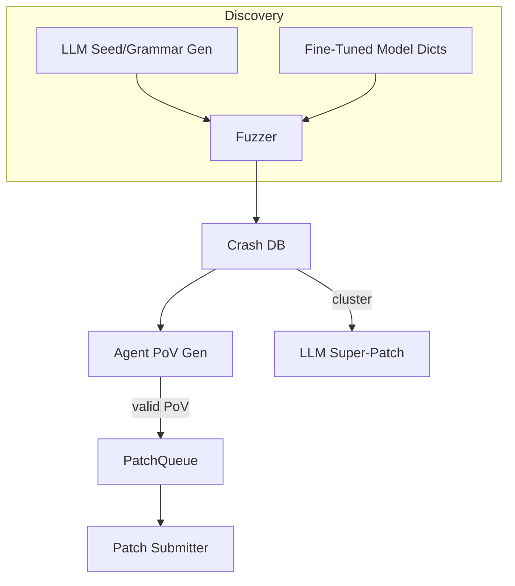

# Fuzzing uz pomoć AI-ja i automatizovano otkrivanje ranjivosti

{{#include ../banners/hacktricks-training.md}}

## Pregled
Veliki jezički modeli (LLM) mogu značajno da unaprede tradicionalne procese istraživanja ranjivosti tako što generišu semantički bogate ulaze, razvijaju gramatike, analiziraju podatke o padovima i čak predlažu zakrpe za više bagova. Ova stranica prikuplja najefikasnije obrasce uočene tokom finala DARPA-inog AI Cyber Challenge-a (AIxCC) i drugih javnih istraživanja.<sup>[[4]](#references)</sup><sup>[[5]](#references)</sup>

Ono što sledi nije opis jednog konkretnog takmičarskog sistema, već skup tehnika koje možete ponoviti u sopstvenim radnim procesima.

---

## 1. Ulazi za seed koje generiše LLM

Tradicionalni fuzzers-i vođeni pokrivenošću (AFL++, libFuzzer, Honggfuzz…) počinju sa malim korpusom seed-ova i nasumično menjaju bajtove. Kada je format ulaza ciljnog programa složen (SQL, URL-ovi, prilagođeni binarni protokoli), nasumične izmene obično naruše sintaksu pre nego što se dođe do zanimljivih grana koda.

LLM-ovi mogu da reše ovaj početni problem tako što generišu *generatore seed-ova* – kratke skripte koje ispisuju **ulaze sa ispravnom sintaksom, ali relevantne za bezbednost**. Na primer:

```prompt
SYSTEM: You are a helpful security engineer.
USER:
Write a Python3 program that prints 200 unique SQL injection strings targeting common anti-pattern mistakes (missing quotes, numeric context, stacked queries).  Ensure length ≤ 256 bytes / string so they survive common length limits.
```

```python
# gen_sqli_seeds.py (truncated)
PAYLOADS = [
    "1 OR 1=1 -- ",
    "' UNION SELECT NULL,NULL--",
    "0; DROP TABLE users;--",
    ...
]
for p in PAYLOADS:
    print(p)
```

Pokreni jednom i prosledi izlaz direktno u početni korpus fuzzera:

```bash
python3 gen_sqli_seeds.py > seeds.txt
afl-fuzz -i seeds.txt -o findings/ -- ./target @@
```

Benefits:
1. Semantička validnost → dublja pokrivenost od početka.
2. Može ponovo da se generiše: prilagodite prompt tako da se fokusira na XSS, path traversal, binary blobs itd.
3. Jeftino (< 1 ¢ uz GPT-3.5).

### Saveti
* Naložite modelu da *diversify* dužinu i kodiranje payload-a (UTF-8, URL-encoded, UTF-16-LE) kako bi zaobišao površne filtere.
* Zatražite *jednu samostalnu skriptu* – time se izbegavaju problemi sa formatiranjem JSON-a.

---

## 2. Grammar-Evolution Fuzzing

Moćnija varijanta je da LLM-u prepustite da **evolve a grammar** umesto konkretnih seeds. Tok rada (obrazac „Grammar Guy“) je:

1. Generišite početnu ANTLR/Peach/LibFuzzer gramatiku pomoću prompt-a.
2. Pokrenite fuzzing N minuta i prikupite metrike pokrivenosti (pogodjene ivice / blokovi).
3. Sažmite nepokrivene delove programa i prosledite sažetak modelu:
   ```prompt
   The previous grammar triggered 12 % of the program edges.  Functions not reached: parse_auth, handle_upload.  Add / modify rules to cover these.
   ```
4. Spojite nova pravila, ponovo pokrenite fuzzing i ponavljajte.

Kostur pseudokoda:

```python
for epoch in range(MAX_EPOCHS):
    grammar = llm.refine(grammar, feedback=coverage_stats)
    save(grammar, f"grammar_{epoch}.txt")
    coverage_stats = run_fuzzer(grammar)
```

Ključne tačke:
* Držite se *budžeta* – svako doterivanje troši tokene.
* Koristite instrukcije `diff` + `patch` kako bi model uređivao, umesto da sve ponovo napiše.
* Zaustavite se kada je Δcoverage < ε.

---

## 3. Inženjering libFuzzer harness-a za lokalni LLM

Kada izvorni kod ne može da napusti radnu stanicu analitičara, lokalni model koda može da napravi mali adapter između bajtova fuzzera i C/C++ API-ja. Korisna bezbednosna granica je jasna: **model piše i dorađuje testnu infrastrukturu; mutacija vođena coverage-om istražuje ulaze; sanitajzeri prijavljuju neispravne operacije; čovek pregleda harness i trijažira nalaze**.<sup>[[9]](#references)</sup>

Za tehnike na nivou engine-a za korpuse, povratne informacije, snapshot-e i stateful fuzzing koje ne zavise od LLM-a, pogledajte opštu [Metodologiju fuzzing-a](../generic-methodologies-and-resources/fuzzing.md).

Počnite od tačne deklaracije kopirane iz zaglavlja ciljnog programa i ograničite format izlaza. Usko definisan prompt smanjuje broj izmišljenih API-ja i olakšava pregled rezultata:<sup>[[8]](#references)[[9]](#references)</sup>

```prompt
Write a libFuzzer target for this exact declaration:
int parse_records(const uint8_t *data, size_t size);

Output only C code. Implement LLVMFuzzerTestOneInput, include the
declaration, pass data and size unchanged, and do not use files,
network access, randomness, clocks, threads, or persistent state.
```

Za parser sirovih bajtova, očekivani rezultat ne bi trebalo da bude ništa složeniji od:<sup>[[6]](#references)[[9]](#references)</sup>

```c
#include <stddef.h>
#include <stdint.h>

extern int parse_records(const uint8_t *, size_t);

int LLVMFuzzerTestOneInput(const uint8_t *data, size_t size) {
    (void)parse_records(data, size);
    return 0;
}
```

Kompilacija je samo prva kontrolna tačka validacije. Pre nego što potrošite CPU vreme, proverite svaki generisani target prema sledećim invarijantama:<sup>[[6]](#references)[[8]](#references)[[9]](#references)</sup>

- **Tačan API:** uporedite tipove, pravila vlasništva, inicijalizaciju, čišćenje i konvenciju pozivanja sa stvarnim zaglavljem i postojećim pozivaocima.
- **Bezbednost harness-a:** zaštitite svako čitanje iz `data`; nalazi sanitizer-a moraju poticati iz targeta, a ne iz generisanog glue koda.
- **Ponovljivost:** rezultat mora biti funkcija vrednosti `data` i `size`; uklonite spoljašnji I/O, vreme, nekontrolisanu slučajnost, nepovezane niti i stanje koje se zadržava između poziva.
- **Propusnost:** inicijalizujte skupo nepromenljivo stanje jednom, ali samo ako to ne može da utiče na ponašanje; ograničite veličinu ulaza, potisnite logovanje i oslobodite alokacije za svaki ulaz.
- **Dostižnost:** proverite da li se izvršavaju predviđene funkcije i grane. Target koji se kompajlira, ali izvršava samo putanje odbijanja, predstavlja neprimetan neuspeh.

### Strukturno svesni targeti: očuvajte invarijante bez prikrivanja bagova

Ako većina sirovih ulaza ne prođe proveru magic vrednosti, dužine, verzije ili kontrolne sume, koristite fuzz bajtove kao materijal za tipizirana polja i ponovo izgradite validan objekat. Zadajte fiksne konstante formata, ostavite semantička polja i bajtove sadržaja promenljivim i izvedite metapodatke za proveru integriteta iz rekonstruisanog sadržaja. `FuzzedDataProvider` je koristan za preuzimanje ograničenih tipiziranih vrednosti, dok je adapter i dalje odgovoran za ograničavanje svih generisanih alokacija i konverzija.<sup>[[9]](#references)</sup>

<details>
<summary>Primer strukturno svesnog C++ targeta</summary>

```cpp
#include <fuzzer/FuzzedDataProvider.h>
#include <stddef.h>
#include <stdint.h>
#include <vector>

extern "C" int parse_message(const uint8_t *, size_t);

extern "C" int LLVMFuzzerTestOneInput(const uint8_t *data, size_t size) {
    FuzzedDataProvider fdp(data, size);
    uint8_t version = fdp.ConsumeIntegral<uint8_t>();
    auto body = fdp.ConsumeRemainingBytes<uint8_t>();
    if (body.size() > UINT16_MAX) body.resize(UINT16_MAX);
    uint16_t len = static_cast<uint16_t>(body.size());
    std::vector<uint8_t> msg = {0x8b, 'M', 'S', 'G', version,
                                static_cast<uint8_t>(len >> 8),
                                static_cast<uint8_t>(len)};
    msg.insert(msg.end(), body.begin(), body.end());
    (void)parse_message(msg.data(), msg.size());
    return 0;
}
```

</details>

Nemojte koristiti jedan cilj koji popravlja strukturu za svako pitanje. Održavajte jedan cilj koji izračunava dužine/kontrolne sume radi istraživanja dubokih validnih stanja, a drugi koji ostavlja **deklarisane** metapodatke pod kontrolom fuzzera, ograničavajući samo čitanja i alokacije samog harness-a. Drugi cilj čuva napadne površine sa neusklađenim dužinama i neispravnim integritetom, koje bi automatska popravka inače uklonila.<sup>[[9]](#references)</sup>

### Početni ulazi, rečnici, sanitizatori i povratne informacije o pokrivenosti

Zatražite od modela da generiše skriptu koja upisuje binarne početne ulaze, umesto da tražite da ih direktno ispisuje. Koristite prazne, minimalne, tipične i granično validne objekte kao početne ulaze; zatim izdvojite magične vrednosti, oznake, kodiranja enum vrednosti i ključne reči parsera u pregledani rečnik. libFuzzer prihvata taj rečnik pomoću `-dict=`, a u korpusu zadržava mutacije koje otkrivaju novu pokrivenost.<sup>[[6]](#references)[[9]](#references)</sup>

```text
magic="\x8bMSG"
version_min="\x00"
version_max="\xff"
config_tag="CONFIG"
```

Izgradite isti cilj uz komplementarnu instrumentaciju. ASan i UBSan mogu da dele isti fuzzing binarni fajl; koristite zasebnu MSan verziju i instrumentišite njene zavisnosti da biste izbegli prijave uzrokovane neinstruiranim kodom.<sup>[[6]](#references)[[9]](#references)</sup>

```bash
clang++ -g -O1 -fsanitize=fuzzer,address,undefined \
  -fno-sanitize-recover=undefined target.cc harness.cc -o fuzz_target
./fuzz_target corpus -dict=msg.dict -max_len=65535

clang++ -g -O1 -fsanitize=fuzzer,memory \
  target.cc harness.cc -o fuzz_target_msan
```

Tretirajte coverage kao evaluatora za svaku reviziju modela. U libFuzzer izlazu, rano ravne vrednosti `cov`/`ft` i statičan corpus obično ukazuju na loš framing, previše restriktivan rani povratak ili pogrešan poziv; nizak `exec/s` ukazuje na skupu pripremu, I/O, alokaciju ili procurelo stanje. `NEW` samo dokazuje da se promenila neka coverage funkcija, a ne da je dostignut željeni parser.<sup>[[6]](#references)[[9]](#references)</sup>

Za povratne informacije na nivou izvornog koda napravite coverage build, pokrenite fuzzing i modelu dajte samo nepokrivene funkcije i uslove koji ih ograničavaju. Proverite nastale razlike u harnessu/seedu/dictionaryju i ponovo izmerite:<sup>[[7]](#references)[[8]](#references)[[9]](#references)</sup>

```bash
clang++ -g -O1 -fsanitize=fuzzer \
  -fprofile-instr-generate -fcoverage-mapping target.cc harness.cc -o fuzz_cov
mkdir -p profiles
LLVM_PROFILE_FILE='profiles/%p.profraw' ./fuzz_cov -max_total_time=300 corpus
llvm-profdata merge -sparse profiles/*.profraw -o fuzz.profdata
llvm-cov report ./fuzz_cov -instr-profile=fuzz.profdata
llvm-cov show ./fuzz_cov -instr-profile=fuzz.profdata \
  --show-branches=count --region-coverage-lt=1 target.cc
```

Skalabilna petlja je zato **generiši → kompajliraj/poveži → izvrši smoke test pod sanitajzerima → izmeri pokrivenost cilja → obezbedi najmanji relevantni kontekst pokrivenosti/izvornog koda → revidiraj → izmeri ponovo**. OSS-Fuzz-Gen primenjuje isti princip tako što procenjuje generisane ciljeve prema tome mogu li se kompajlirati, da li dolazi do grešaka tokom izvršavanja, kolika je pokrivenost i da li je pokrivenost veća nego kod postojećih ciljeva, umesto da prihvata uverljiv kod zdravo za gotovo.<sup>[[7]](#references)[[8]](#references)</sup>

---

<a id="3-agent-based-pov-exploit-generation" hidden>3. Agent-Based generisanje PoV-a (eksploita)</a>

## 4. Agent-Based generisanje PoV-a (eksploita)

Nakon što pronađete crash, i dalje vam je potreban **proof-of-vulnerability (PoV)** koji ga pouzdano izaziva.

Skalabilan pristup je pokretanje mnogo jednostavnih radnika (procesa, niti ili kontejnera), od kojih svaki koristi drugi model ili konfiguraciju uzorkovanja. Anketa finalista AIxCC-a navodi konkretne primere takvog obima: jedan tim koristio je **hiljade istovremenih agenata** za PoV generisanje prvenstveno pomoću AI-ja, dok je drugi orkestrirao **300–500 fuzzing agenata** i koristio LLM-ove za složenije semantičko zaključivanje.<sup>[[4]](#references)</sup>

Pipeline:
1. Statička/dinamička analiza daje *kandidate za greške* (struct sa crash PC-jem, segmentom ulaza i porukom sanitajzera).
2. Orkestrator raspodeljuje kandidate agentima.
3. Koraci rezonovanja agenta:
   a. Lokalno reprodukuje grešku pomoću `gdb` + ulaza.
   b. Predlaže minimalni exploit payload.
   c. Proverava exploit u sandboxu. Ako uspe → šalje ga.
4. Neuspešni pokušaji se **ponovo stavljaju u red kao novi seeds** za coverage fuzzing (povratna sprega).

Prednosti:
* Paralelizacija prikriva nepouzdanost pojedinačnog agenta.
* Automatsko podešavanje temperature / veličine modela na osnovu uočene stope uspeha.

---

<a id="4-directed-fuzzing-with-fine-tuned-code-models" hidden>4. Usmereni fuzzing sa dodatno obučenim modelima koda</a>

## 5. Usmereni fuzzing sa dodatno obučenim modelima koda

Dodatno obučite model otvorenih težina (npr. Llama-7B) na C/C++ izvornom kodu označenom obrascima ranjivosti (prekoračenje celog broja, kopiranje bafera, formatni string). Zatim:

1. Pokrenite statičku analizu da biste dobili listu funkcija + AST.
2. Zadajte modelu: *„Navedite stavke rečnika mutacija koje bi verovatno narušile bezbednost memorije u funkciji X“*.
3. Umetnite te tokene u prilagođeni `AFL_CUSTOM_MUTATOR`.

Primer izlaza za omotač funkcije `sprintf`:
```
{"pattern":"%99999999s"}
{"pattern":"AAAAAAAA....<1024>....%n"}
```

Empirijski, ovo smanjuje vreme do pada za više od 2× na stvarnim metama.

---

<a id="5-ai-guided-patching-strategies" hidden>5. Strategije zakrpavanja uz pomoć AI-ja</a>

## 6. Strategije zakrpavanja uz pomoć AI-ja

<a id="51-super-patches" hidden>5.1 Superzakrpe</a>

### 6.1 Superzakrpe
Zatražite od modela da *grupiše* potpise padova i predloži **jednu zakrpu** koja otklanja zajednički osnovni uzrok.  Pošaljite je jednom, otklonite nekoliko grešaka → manje kazni za netačnost u okruženjima u kojima se za svaku pogrešnu zakrpu gube poeni.

Okvir prompta:
```
Here are 10 stack traces + file snippets.  Identify the shared mistake and generate a unified diff fixing all occurrences.
```

{{#ref}}
../generic-methodologies-and-resources/fuzzing.md
{{#endref}}

<a id="52-speculative-patch-ratio" hidden>5.2 Odnos spekulativnih zakrpa</a>

### 6.2 Odnos spekulativnih zakrpa
Implementirajte red u kojem se zakrpe potvrđene pomoću PoV-a i *spekulativne* zakrpe (bez PoV-a) smenjuju u odnosu 1:​N, podešenom prema pravilima bodovanja (npr. 2 spekulativne : 1 potvrđena). Model troškova prati kazne u odnosu na poene i sam prilagođava N.

---

<a id="6-deterministic-file-by-file-ai-code-review" hidden>6. Deterministički AI pregled koda datoteku po datoteku</a>

## 7. Deterministički AI pregled koda datoteku po datoteku

Čest način na koji AI-potpomognuti pregledi ne uspevaju jeste da se od jednog agenta traži da pregleda čitav repozitorijum, uz očekivanje da će izabrati prave datoteke i grep pojmove. Pouzdaniji pristup je da se **obuhvati čitav repozitorijum**:<sup>[[1]](#references)</sup>

1. Izlistajte izvorne datoteke.
2. Šaljite **po jednu datoteku** uz minimalni kontekst (ulazna tačka, imports, obližnje rute/pozivaoci).
3. Za svaku datoteku zahtevajte **strukturisan izveštaj**: izvore, sink, nedostajuću validaciju, preduslove za eksploataciju i nivo pouzdanosti.<sup>[[3]](#references)</sup>
4. Deduplikujte izveštaje prema **source→sink obrascu** i ručno proverite one visokog rizika.

Ovaj pristup troši mnogo tokena i stvara šum, ali veoma dobro otkriva **jednostavne source/sink greške velikog uticaja** koje široki agentni pregledi često previde.

### Obrasci za trijažu kojima vredi dati prednost

- **Dinamički PHP include/dispatch**: nazivi ruta/kontrolera/modula pod kontrolom napadača prosleđuju se u `require_once()`, `include()` ili `include_once()` bez stroge allowliste i kanonikalizacije putanje.
- **Izvršavanje shell komandi u administratorskim/nalogovnim tokovima**: korisnička imena, domeni, FTP nalozi ili drugi identifikatori dospevaju do `exec()`, `system()`, `shell_exec()`, `passthru()`, `proc_open()` ili `popen()`.
- **Spajanje strukturisanih ulaza**: isti parametar prihvata se iz `$_GET`, `$_POST`, JSON-a, XML-a ili parsera tela zahteva frameworka, pa se kasnije ponovo koristi u sink-ovima za datotečni sistem ili OS komande.

### Dve praktične klase grešaka koje ova metoda dobro otkriva

- **PHP controller-dispatch LFI/RCE**: ako se naziv kontrolera iz zahteva konkatenira u `require_once()` bez allowliste/normalizacije putanje, sekvence za traversal kao što je `../` mogu navesti PHP da uključi neželjenu lokalnu `.php` datoteku. Ako napadač može da usmeri include na podmetnutu ili na drugi način korisnu PHP datoteku, LFI prelazi u izvršavanje koda. Pogledajte [File Inclusion / Path Traversal](../pentesting-web/file-inclusion/README.md).<sup>[[1]](#references)</sup>
- **Autentifikovana command injection ranjivost u hosting/administratorskim panelima**: ako se polja za upravljanje nalozima, kao što su korisnička imena, ugrađuju u shell komande, autentifikovani korisnik sa niskim privilegijama može uobičajenu radnju kreiranja/brisanja da pretvori u RCE. Uticaj je veći kada panel izvršava komandu kao servisni nalog sa višim privilegijama. Pogledajte [Command Injection](../pentesting-web/command-injection.md).<sup>[[1]](#references)</sup>

### Praktične napomene za pregled

- Prvo koristite LLM kao **pregledač source/sink tokova**, a ne kao generator eksploita.
- Tražite da eksplicitno navede **polje pod kontrolom napadača**, **nedostatak normalizacije/validacije** i **opasni sink**.
- U velikim repozitorijumima deterministički pregled datoteku po datoteku često je pouzdaniji od jednog autonomnog pokretanja agenta, čak i kada koristi jači model.<sup>[[2]](#references)</sup>
- Očekujte slabije rezultate pri otkrivanju **Broken Access Control** i drugih grešaka poslovne logike, gde mogućnost eksploatacije zavisi od pretpostavki kroz više datoteka, semantike uloga ili modela pretnji specifičnog za proizvod.

---

## 8. Revizija kernela vođena obrascima uz instrumentisani oracle

Kada je cilj kernel, nemojte tražiti od agenta da pronađe proizvoljne greške u celom stablu koda. Efikasniji tok rada u pogledu tokena pretvara znanje o ranijim ranjivostima u statičke upite, rangira rezultate prema izloženoj napadnoj površini i koristi instrumentisani kernel kao oracle za izvršavanje.<sup>[[11]](#references)</sup>

### Baza obrazaca → CodeQL/Semgrep → fokusirani pregled

Napravite malu bazu znanja koja sadrži opasne API-je, obrasce nedostajuće validacije, rizične source-to-sink tokove i oblike ranije ispravljenih grešaka. Tražite od modela da prevede **jedan obrazac odjednom** u heuristike za pregled i CodeQL/Semgrep pravila, a zatim pokrenite ta deterministička pravila nad celim stablom koda. Grupisanje i deduplikaciju pogodaka obavite pre nego što kod prosledite modelu; sirovi izlaz skenera može sadržati hiljade kandidata male vrednosti. Pre korišćenja ovog pristupa izvan istraživačkih ili open-source ciljeva proverite važeću licencu za CodeQL.<sup>[[11]](#references)</sup>

Dajte prioritet podsistemima na osnovu **gustine pogodaka pravila** i **dostupnosti napadaču**, a ne samo broja pogodaka. Interfejsi kernela dostupni neprivilegovanim procesima, sandboxovima, kontejnerima, jail-ovima ili gostujućim okruženjima zaslužuju veću težinu od koda dostupnog samo interno. Jedinica pregleda treba da bude dovoljno mala da agent može da zadrži kontekst pozivalaca, validatora i pravila životnog ciklusa; tražite konkretnu klasu ranjivosti ili obrazac kontrolnog toka, umesto „pronađi bilo koju ranjivost“. Nasleđeni privilegovani interfejsi posebno su zanimljivi kada ih nova granica izolacije čini dostupnim root korisniku u namespace-u ili jail-u.<sup>[[11]](#references)</sup>

Za svakog kandidata zahtevajte eksplicitan zapis toka polja pre pokušaja eksploatacije.<sup>[[11]](#references)</sup>

```text
entrypoint -> privilege check -> parser -> validation/normalization
           -> later rewrite -> dangerous sink
attacker controls: <fields and lengths>
constraints:       <values rewritten, rejected, or preserved>
observable result: <sanitizer report, assertion, panic, or clean exit>
```

### Koristite KASAN telemetriju kao oracle za hipoteze

Pokrenite ciljni kernel u jednokratnoj VM mašini sa uključenim KASAN-om i korisnim dijagnostičkim proverama. Agent treba da ponavlja ciklus **hipoteza o izvoru → minimalni okidač iz userland-a → izvršavanje u VM-u → KASAN/trasa provere → revidirana hipoteza** dok se sumnjivo oštećenje ne reprodukuje ili odbaci. Pri svakoj iteraciji vratite samo relevantan stack trace i okolni izvorni kod; tako se čuva kontekst za zaključivanje, a dokaz iz izvršavanja — ne pouzdanost modela — postaje kriterijum prihvatanja.<sup>[[11]](#references)</sup>

Instrumentisana izgradnja nije konačno okruženje za procenu mogućnosti eksploatacije. Provere mogu zaustaviti izvršavanje pre operacije koja izaziva oštećenje, dok ista provera može biti izostavljena iz production kernela. Ponovo testirajte neizmenjeni okidač sa tačnom production konfiguracijom, zabeležite izgradnju i konfiguraciju kernela i razdvojte **dostupnost putanje**, **oštećenje memorije**, **primitiv pod kontrolom napadača** i **bezbednosni uticaj** kao zasebne tvrdnje.<sup>[[11]](#references)[[12]](#references)</sup>

CVE-2026-3038 je koristan primer validacije, a ne šablon za eksploataciju. Neprivilegovani FreeBSD `RTM_GET` zahtev mogao je da sačuva preveliki `RTAX_AUTHOR` sockaddr kroz selektivnu validaciju i prepravljanje odgovora, sve dok `rtsock_msg_buffer()` nije kopirao korisnički kontrolisani `sa_len` u `sockaddr_storage` veličine 128 bajtova na steku. Maksimalna kopija od 255 bajtova izazvala je prepisivanje od 127 bajtova; dijagnostička provera je uhvatila neispravnu dužinu u instrumentisanoj izgradnji, dok je GENERIC kernel stigao do kopiranja, a zatim pao kada je proverena oštećena canary vrednost. Ovo dokazuje neprivilegovano uskraćivanje usluge, a ne samostalnu eskalaciju privilegija: pouzdana kontrola bi prvo zahtevala drugi primitiv, poput otkrivanja canary vrednosti. Pogledajte [Stack Canaries](../binary-exploitation/common-binary-protections-and-bypasses/stack-canaries/index.html) za odgovarajuću granicu binary exploitation-a.<sup>[[11]](#references)[[12]](#references)[[13]](#references)</sup>

### Odbacite varanje u vezi sa preduslovima za eksploataciju

Pre prihvatanja PoV-a ili eksploita, zamolite zasebnog recenzenta/agenta da pokuša da ga opovrgne prema unapred utvrđenim kriterijumima. Recenzija mora da potvrdi sve sledeće uslove.<sup>[[11]](#references)</sup>

- Izvorni kod cilja, kernel i ranjivi modul nisu menjani da bi putanja postala dostupna.
- Nisu uvedeni pomoćni modul, sintetički gadget, onemogućena zaštita, dodatne privilegije ili nedostupan interfejs.
- Okidač počinje sa navedenim identitetom pozivaoca i ograničenjima izolacije, u čistom snimku sistema.
- Navedeni ishod i dalje zavisi od greške: uklanjanje neispravnog polja ili ispravljanje samo te greške mora da prekine lanac.
- Pad, čitanje izvan granica или преписивање пријављује се само као тај примитив; за извршавање кода или ескалацију привилегија потребни су независни докази.

Ова последња контрафактуална провера открива кружне демонстрације: ако предуслови већ омогућавају наводни утицај (на пример, извршавање садржаја SUID који је доставио нападач са система датотека монтираног без `nosuid`), грешка безбедности меморије није изазвала тај утицај.<sup>[[11]](#references)</sup>

---

## Проверљиво истраживање непознатих база кода уз помоћ агената

[graph-first fuzz-target workflow](../generic-methodologies-and-resources/fuzzing.md#graph-first-fuzz-target-selection-and-mutation-triage) већ обрађује доступност улазних тачака, док [agentic SAST pipelines](../network-services-pentesting/pentesting-web/code-review-tools.md#agentic-sast-pipelines) обрађују фазну рецензију и критеријуме за доказе. Те детерминистичке резултате држите одвојено од хипотеза модела, како би свака унапређена сумња и даље имала локације у изворном коду, доказе о путањи и динамичко мерење.<sup>[[10]](#references)</sup>

### Повежите доказе о животном веку објекта без измишљања тока података

Статичка анализа може да пронађе дужину под контролом нападача која се уписује у једној функцији и исто поље објекта које много касније стиже до одредишта копирања, а да не успе да докаже везу између њих кроз повратне позиве, поновна повезивања или животни век објекта. Сачувајте оба налаза одвојено, групишите их према објекту/пољу и експлицитно забележите недостајућу везу као питање за тријажу. Агент може да предложи однос, али преглед изворног кода или инструментовање током извршавања морају да га докажу.<sup>[[10]](#references)</sup>

За сваког кандидата забележите:

- конкретну улазну тачку и бајтове под контролом нападача;
- сваког произвођача релевантног поља, укључујући валидацију специфичну за сваког произвођача;
- одредиште, капацитет одредишта и услове изградње/извршавања потребне да би се до њега стигло;
- стварни позивни стек од изложене улазне тачке, а не само директно позивање harness-а;
- најмањи динамички резултат који потврђује или одбацује хипотезу.

То што једна путања изгледа безбедно не значи да је поље безбедно у свим случајевима. Други произвођач може да попуни исто поље без ограничења које примењује прва путања. Тестирајте путање независно и покрените harness са опцијама изградње еквивалентним онима у окружењу за примену, јер дијагностичке провере могу да претворе оштећење меморије у production окружењу у рани прекид који се јавља само током тестирања.<sup>[[10]](#references)</sup>

### Критеријуми мерења за откривање података и експлоатацију

Када се сумња на откривање неиницијализоване меморије, попуните свеже алокације препознатљивим бајтом и проверите да ли тачно та ознака стиже до послатог пакета. За експлоатацију захтевајте измерене критеријуме као што су **контролисано преписивање → користан објекат жртве → откривање података → опоравак показивача/основне адресе → отмица контролног тока → састављени payload**. Агент напредује само када harness докаже текуће својство; уверљива прича није испуњен критеријум. [FreeRDP case](../binary-exploitation/libc-heap/heap-overflow.md#cross-path-length-reuse-and-stale-output-disclosure) показује путању и ограничења изградње која се морају очувати током валидације.<sup>[[10]](#references)</sup>

---

За студију случаја о kernel-у која примењује фазну L0–L4 валидацију на развој експлоита уз помоћ LLM-а, погледајте:

{{#ref}}
../binary-exploitation/freebsd-kernel-exploitation-vnet-jail-escape.md
{{#endref}}

## Све заједно
Систем за расуђивање о коду (CRS, Cyber Reasoning System) од краја до краја може да повеже компоненте на следећи начин:



---

## References

- [1] [Project Black - Lokalni AI za sajber bezbednost: pronalaženje phpIPAM LFI i autentifikovanog RCE-a](https://projectblack.io/blog/local-ai-for-cyber-security)
- [2] [Strix](https://github.com/usestrix/strix)
- [3] [GitHub Copilot community security-review skill](https://github.com/github/awesome-copilot/blob/main/skills/security-review/SKILL.md)
- [4] [Trail of Bits – AIxCC finale: pregled rezultata](https://blog.trailofbits.com/2025/08/07/aixcc-finals-tale-of-the-tape/)
- [5] [Intervjui sa finalistima AIxCC-a na CTF Radiooo](https://www.youtube.com/@ctfradiooo)
- [6] [LLVM — libFuzzer: biblioteka za fuzz testiranje vođeno pokrivenošću](https://llvm.org/docs/LibFuzzer.html)
- [7] [Google — OSS-Fuzz-Gen](https://github.com/google/oss-fuzz-gen)
- [8] [Google Online Security Blog — Unapređivanje fuzzinga: pronalaženje više ranjivosti pomoću AI-ja](https://security.googleblog.com/2024/11/leveling-up-fuzzing-finding-more.html)
- [9] [8kSec — Generisanje fuzzing harness-a uz pomoć AI-ja i lokalnog LLM-a](https://8ksec.io/ai-assisted-fuzzing-harness-local-llm)
- [10] [Quarkslab — Od AI agenata do RCE-a: izgradnja radnog procesa za istraživanje ranjivosti](https://blog.quarkslab.com/from-ai-agents-to-rce-building-a-vulnerability-research-workflow.html)
- [11] [Praetorian — FreeBSoD: korišćenje jezičkih modela za pronalaženje i iskorišćavanje kernel grešaka (1. deo od 2)](https://praetorian.com/blog/ai-vulnerability-research-freebsd-kernel)
- [12] [FreeBSD-SA-26:05.route — Lokalni DoS i moguće podizanje privilegija putem routing socket-a](https://www.freebsd.org/security/advisories/FreeBSD-SA-26:05.route.asc)
- [13] [Izvorna zakrpa za FreeBSD-SA-26:05.route](https://security.FreeBSD.org/patches/SA-26:05/route.patch)
{{#include ../banners/hacktricks-training.md}}
