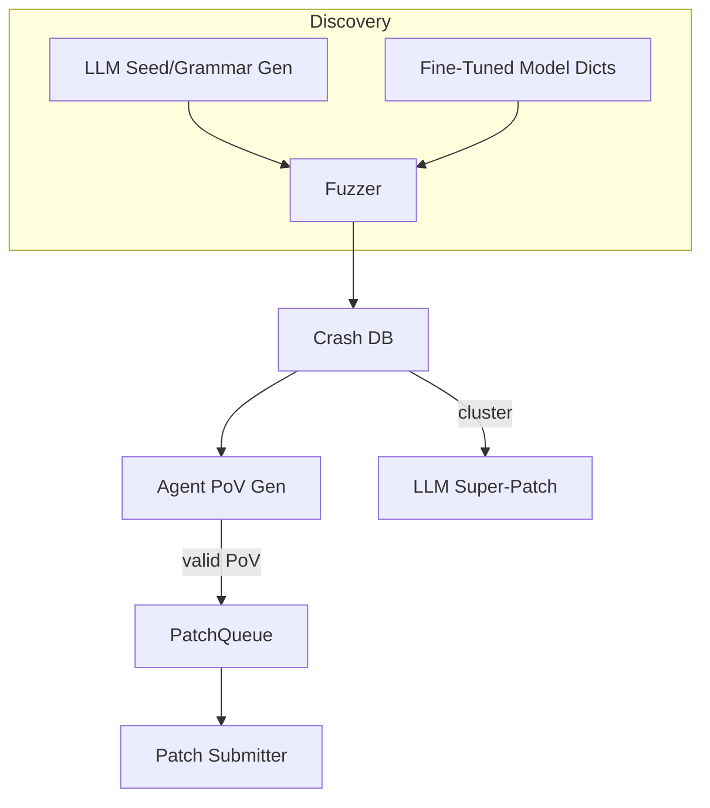

# KI-gestütztes Fuzzing & automatisierte Schwachstellenerkennung

{{#include ../banners/hacktricks-training.md}}

## Überblick
Large Language Models (LLMs) können herkömmliche Schwachstellenforschungs-Pipelines erheblich verbessern, indem sie semantisch aussagekräftige Eingaben generieren, Grammatiken weiterentwickeln, Crash-Daten analysieren und sogar Patches für mehrere Bugs vorschlagen.<sup>[[4]](#references)</sup><sup>[[5]](#references)</sup>

Diese Seite beschreibt kein bestimmtes Wettbewerbssystem, sondern fasst die effektivsten Muster zusammen, die im Finale der DARPA AI Cyber Challenge (AIxCC) und bei anderen öffentlichen Forschungsarbeiten beobachtet wurden.

Im Folgenden werden die Techniken abstrahiert beschrieben, damit du sie in deinen eigenen Workflows reproduzieren kannst.

---

## 1. Von LLMs generierte Seed-Eingaben

Herkömmliche coverage-guided Fuzzer (AFL++, libFuzzer, Honggfuzz …) starten mit einem kleinen Seed-Korpus und mutieren Bytes blind. Wenn das Eingabeformat des Ziels komplex ist (SQL, URLs, benutzerdefinierte Binärprotokolle), zerstören zufällige Mutationen meist die Syntax, bevor interessante Branches erreicht werden.

LLMs können dieses Bootstrap-Problem lösen, indem sie *Seed-Generatoren* ausgeben – kurze Skripte, die **syntaktisch korrekte, aber sicherheitsrelevante Eingaben** erzeugen. Zum Beispiel:

```prompt
SYSTEM: You are a helpful security engineer.
USER:
Write a Python3 program that prints 200 unique SQL injection strings targeting common anti-pattern mistakes (missing quotes, numeric context, stacked queries).  Ensure length ≤ 256 bytes / string so they survive common length limits.
```

```python
# gen_sqli_seeds.py (truncated)
PAYLOADS = [
    "1 OR 1=1 -- ",
    "' UNION SELECT NULL,NULL--",
    "0; DROP TABLE users;--",
    ...
]
for p in PAYLOADS:
    print(p)
```

Einmal ausführen und die Ausgabe direkt in den Initial-Corpus des Fuzzers einspeisen:

```bash
python3 gen_sqli_seeds.py > seeds.txt
afl-fuzz -i seeds.txt -o findings/ -- ./target @@
```

Benefits:
1. Semantische Gültigkeit → frühzeitig tiefere Abdeckung.
2. Erneut generierbar: Passe den prompt an, um den Fokus auf XSS, path traversal, binary blobs usw. zu legen.
3. Günstig (< 1 ¢ mit GPT-3.5).

### Tipps
* Weise das Modell an, die Payload-Länge und Kodierung (UTF-8, URL-encoded, UTF-16-LE) zu *variieren*, um oberflächliche Filter zu umgehen.
* Bitte um ein *einzelnes eigenständiges script* – so vermeidest du Probleme mit der JSON-Formatierung.

---

## 2. Grammar-Evolution Fuzzing

Eine leistungsfähigere Variante besteht darin, das LLM eine **Grammatik weiterentwickeln** zu lassen, anstatt konkrete Seeds zu verwenden. Der Workflow („Grammar Guy“-Muster) sieht so aus:

1. Generiere per Prompt eine anfängliche ANTLR-/Peach-/LibFuzzer-Grammatik.
2. Führe N Minuten lang Fuzzing durch und sammle Coverage-Metriken (getroffene Edges / Blocks).
3. Fasse nicht abgedeckte Programmbereiche zusammen und gib die Zusammenfassung an das Modell zurück:
   ```prompt
   The previous grammar triggered 12 % of the program edges.  Functions not reached: parse_auth, handle_upload.  Add / modify rules to cover these.
   ```
4. Führe die neuen Regeln zusammen, fuzz erneut und wiederhole den Vorgang.

Pseudo-Code-Skelett:

```python
for epoch in range(MAX_EPOCHS):
    grammar = llm.refine(grammar, feedback=coverage_stats)
    save(grammar, f"grammar_{epoch}.txt")
    coverage_stats = run_fuzzer(grammar)
```

Wichtige Punkte:
* Ein *Budget* einhalten – jede Verfeinerung verbraucht Tokens.
* `diff`- und `patch`-Anweisungen verwenden, damit das Modell Änderungen vornimmt, statt alles neu zu schreiben.
* Beenden, wenn Δcoverage < ε.

---

## 3. Entwicklung eines lokalen libFuzzer-Harness

Wenn Quellcode die Workstation eines Analysten nicht verlassen darf, kann ein lokales Code-Modell den kleinen Adapter zwischen Fuzzer-Bytes und einer C/C++-API erstellen. Die Sicherheitsgrenze ist klar definiert: **Das Modell schreibt und überarbeitet die Testinfrastruktur; Coverage-guided Mutation untersucht Eingaben; Sanitizer melden ungültige Operationen; ein Mensch prüft das Harness und bewertet die Funde**.<sup>[[9]](#references)</sup>

Informationen zu Engine-seitigen Techniken für Corpus, Feedback, Snapshots und Stateful Fuzzing, die nicht von einem LLM abhängen, finden Sie in der allgemeinen [Fuzzing-Methodik](../generic-methodologies-and-resources/fuzzing.md).

Beginnen Sie mit der exakten Deklaration aus dem Header der Zielanwendung und schränken Sie das Ausgabeformat ein. Ein eng gefasster Prompt verringert das Risiko erfundener APIs und erleichtert die Überprüfung des Ergebnisses:<sup>[[8]](#references)[[9]](#references)</sup>

```prompt
Write a libFuzzer target for this exact declaration:
int parse_records(const uint8_t *data, size_t size);

Output only C code. Implement LLVMFuzzerTestOneInput, include the
declaration, pass data and size unchanged, and do not use files,
network access, randomness, clocks, threads, or persistent state.
```

Bei einem Parser für Rohbytes sollte das erwartete Ergebnis nicht komplizierter sein als:<sup>[[6]](#references)[[9]](#references)</sup>

```c
#include <stddef.h>
#include <stdint.h>

extern int parse_records(const uint8_t *, size_t);

int LLVMFuzzerTestOneInput(const uint8_t *data, size_t size) {
    (void)parse_records(data, size);
    return 0;
}
```

Die Kompilierung ist nur die erste Validierungsstufe. Prüfe jedes generierte Target anhand dieser Invarianten, bevor du CPU-Zeit dafür aufwendest:<sup>[[6]](#references)[[8]](#references)[[9]](#references)</sup>

- **Exakte API:** Vergleiche Typen, Ownership-Regeln, Initialisierung, Teardown und Calling Convention mit dem tatsächlichen Header und den vorhandenen Aufrufstellen.
- **Harness-Sicherheit:** Sichere jeden Lesezugriff auf `data` ab; Sanitizer-Befunde müssen ihren Ursprung im Target haben, nicht im generierten Glue-Code.
- **Wiederholbarkeit:** Das Ergebnis muss eine Funktion von `data` und `size` sein; entferne externe I/O, Zeit, unkontrollierte Zufallswerte, nicht gejointe Threads und Zustände, die zwischen Aufrufen bestehen bleiben.
- **Durchsatz:** Initialisiere teuren unveränderlichen Zustand nur einmal, sofern dies das Verhalten nicht beeinflussen kann, begrenze die Eingabegröße, unterdrücke Logging und gib pro Eingabe belegten Speicher frei.
- **Erreichbarkeit:** Prüfe, ob die vorgesehenen Funktionen und Branches ausgeführt werden. Ein Target, das kompiliert, aber nur Ablehnungspfade ausführt, ist ein stiller Fehlschlag.

### Struktur-aware Targets: Invarianten bewahren, ohne Bugs zu verbergen

Wenn die meisten Rohdaten an einer Magic-, Längen-, Versions- oder Prüfsummenprüfung scheitern, verwende die Fuzz-Bytes als **typisiertes Feldmaterial** und erstelle ein gültiges Objekt neu. Setze Formatkonstanten fest, lass semantische Felder und Payload-Bytes veränderlich und leite Integritätsmetadaten aus der rekonstruierten Payload ab. `FuzzedDataProvider` ist nützlich, um begrenzte typisierte Werte zu entnehmen; der Adapter bleibt jedoch dafür verantwortlich, jede generierte Allokation und Konvertierung zu begrenzen.<sup>[[9]](#references)</sup>

<details>
<summary>Beispiel für ein struktur-aware C++-Target</summary>

```cpp
#include <fuzzer/FuzzedDataProvider.h>
#include <stddef.h>
#include <stdint.h>
#include <vector>

extern "C" int parse_message(const uint8_t *, size_t);

extern "C" int LLVMFuzzerTestOneInput(const uint8_t *data, size_t size) {
    FuzzedDataProvider fdp(data, size);
    uint8_t version = fdp.ConsumeIntegral<uint8_t>();
    auto body = fdp.ConsumeRemainingBytes<uint8_t>();
    if (body.size() > UINT16_MAX) body.resize(UINT16_MAX);
    uint16_t len = static_cast<uint16_t>(body.size());
    std::vector<uint8_t> msg = {0x8b, 'M', 'S', 'G', version,
                                static_cast<uint8_t>(len >> 8),
                                static_cast<uint8_t>(len)};
    msg.insert(msg.end(), body.begin(), body.end());
    (void)parse_message(msg.data(), msg.size());
    return 0;
}
```

</details>

Verwende nicht für jede Frage dasselbe strukturreparierende Target. Verwende ein Target, das Längen und Prüfsummen ableitet, um tiefe gültige Zustände zu erkunden, und ein weiteres, bei dem der Fuzzer die **deklarierten** Metadaten kontrolliert, während nur die eigenen Lese- und Speicherzuweisungen des Harness begrenzt werden. Das zweite Target bewahrt Angriffsflächen mit nicht übereinstimmenden Längen und fehlerhafter Integrität, die durch automatische Reparatur sonst verschwinden würden.<sup>[[9]](#references)</sup>

### Seeds, Dictionaries, Sanitizer und Coverage-Feedback

Bitte das Modell, ein Skript zu generieren, das binäre Seeds schreibt, statt es direkt Binärdaten ausgeben zu lassen. Erstelle Seeds für leere, minimale, typische und gültige Grenzfallobjekte; extrahiere dann Magic Values, Tags, Enum-Kodierungen und Parser-Schlüsselwörter in ein geprüftes Dictionary. libFuzzer akzeptiert dieses Dictionary mit `-dict=` und behält Mutationen, die im Corpus neue Coverage aufdecken.<sup>[[6]](#references)[[9]](#references)</sup>

```text
magic="\x8bMSG"
version_min="\x00"
version_max="\xff"
config_tag="CONFIG"
```

Erstelle dasselbe Ziel mit ergänzender Instrumentierung. ASan und UBSan können sich ein Fuzzing-Binary teilen; verwende einen separaten MSan-Build und instrumentiere dessen Abhängigkeiten, um Meldungen zu vermeiden, die durch nicht instrumentierten Code verursacht werden.<sup>[[6]](#references)[[9]](#references)</sup>

```bash
clang++ -g -O1 -fsanitize=fuzzer,address,undefined \
  -fno-sanitize-recover=undefined target.cc harness.cc -o fuzz_target
./fuzz_target corpus -dict=msg.dict -max_len=65535

clang++ -g -O1 -fsanitize=fuzzer,memory \
  target.cc harness.cc -o fuzz_target_msan
```

Behandle die Coverage als Bewertungsmaßstab für jede Modellrevision. Bei libFuzzer-Ausgaben deuten früh stagnierende `cov`/`ft` und ein statischer Corpus normalerweise auf fehlerhaftes Framing, einen zu restriktiven early return oder den falschen Aufruf hin; eine niedrige `exec/s`-Rate weist auf aufwendiges Setup, I/O, Allokation oder geleakten Zustand hin. `NEW` beweist nur, dass sich ein Coverage-Merkmal geändert hat, nicht, dass der beabsichtigte Parser erreicht wurde.<sup>[[6]](#references)[[9]](#references)</sup>

Für Feedback auf Quellcodeebene erstellst du einen Coverage-Build, fuzzst ihn und gibst dem Modell nur die nicht abgedeckten Funktionen samt den Bedingungen, die ihren Aufruf steuern. Überprüfe die resultierenden Änderungen an Harness, Seed und Dictionary und miss erneut:<sup>[[7]](#references)[[8]](#references)[[9]](#references)</sup>

```bash
clang++ -g -O1 -fsanitize=fuzzer \
  -fprofile-instr-generate -fcoverage-mapping target.cc harness.cc -o fuzz_cov
mkdir -p profiles
LLVM_PROFILE_FILE='profiles/%p.profraw' ./fuzz_cov -max_total_time=300 corpus
llvm-profdata merge -sparse profiles/*.profraw -o fuzz.profdata
llvm-cov report ./fuzz_cov -instr-profile=fuzz.profdata
llvm-cov show ./fuzz_cov -instr-profile=fuzz.profdata \
  --show-branches=count --region-coverage-lt=1 target.cc
```

Die skalierbare Schleife lautet daher **generieren → kompilieren/linken → Smoke-Test unter Sanitizern → Target-Coverage messen → den kleinsten relevanten Coverage-/Quellcodekontext bereitstellen → überarbeiten → erneut messen**. OSS-Fuzz-Gen wendet dasselbe Prinzip an, indem es generierte Targets auf Kompilierbarkeit, Laufzeitfehler, Coverage und eine Verbesserung der Coverage gegenüber bestehenden Targets prüft, statt plausibel wirkenden Code einfach für bare Münze zu nehmen.<sup>[[7]](#references)[[8]](#references)</sup>

---

<a id="3-agent-based-pov-exploit-generation" hidden>3. Agentenbasierte PoV- (Exploit-)Generierung</a>

## 4. Agentenbasierte PoV- (Exploit-)Generierung

Nachdem ein Crash gefunden wurde, benötigen Sie weiterhin einen **Proof of Vulnerability (PoV)**, der ihn zuverlässig auslöst.

Ein skalierbarer Ansatz besteht darin, viele leichtgewichtige Worker (Prozesse, Threads oder Container) zu starten, die jeweils ein anderes Modell oder eine andere Sampling-Konfiguration verwenden. Die AIxCC-Finalistenumfrage liefert konkrete Beispiele für diesen Umfang: Ein Team verwendete **Tausende gleichzeitig laufende Agenten** zur AI-first-PoV-Generierung, während ein anderes **300–500 Fuzzing-Agenten** koordinierte und LLMs für höherstufige semantische Schlussfolgerungen reservierte.<sup>[[4]](#references)</sup>

Pipeline:
1. Statische/dynamische Analyse erzeugt *Bug-Kandidaten* (Struct mit Crash-PC, Input-Slice und Sanitizer-Meldung).
2. Der Orchestrator verteilt die Kandidaten an Agenten.
3. Schritte der Agenten:
   a. Bug lokal mit `gdb` und dem Input reproduzieren.
   b. Ein minimales Exploit-Payload vorschlagen.
   c. Exploit in einer Sandbox validieren. Bei Erfolg → einreichen.
4. Fehlgeschlagene Versuche werden als neue Seeds für Coverage-Fuzzing **erneut in die Warteschlange gestellt** (Feedback-Schleife).

Vorteile:
* Parallelisierung gleicht die Unzuverlässigkeit einzelner Agenten aus.
* Automatische Anpassung von temp / Modellgröße anhand der beobachteten Erfolgsrate.

---

<a id="4-directed-fuzzing-with-fine-tuned-code-models" hidden>4. Gerichtetes Fuzzing mit fein abgestimmten Code-Modellen</a>

## 5. Gerichtetes Fuzzing mit fein abgestimmten Code-Modellen

Ein Open-Weight-Modell (z. B. Llama-7B) mit C/C++-Quellcode feinabstimmen, der mit Schwachstellenmustern (Integer Overflow, Buffer Copy, Format String) gekennzeichnet ist. Dann:

1. Statische Analyse ausführen, um eine Funktionsliste und einen AST zu erhalten.
2. Das Modell prompten: *„Liefere Einträge für ein Mutationswörterbuch, die wahrscheinlich die Speichersicherheit in Funktion X beeinträchtigen.“*
3. Diese Tokens in einen benutzerdefinierten `AFL_CUSTOM_MUTATOR` einfügen.

Beispielausgabe für einen `sprintf`-Wrapper:
```
{"pattern":"%99999999s"}
{"pattern":"AAAAAAAA....<1024>....%n"}
```

Empirisch verkürzt dies die Zeit bis zum Absturz bei realen Zielen um mehr als das Zweifache.

---

<a id="5-ai-guided-patching-strategies" hidden>5. KI-gestützte Patch-Strategien</a>

## 6. KI-gestützte Patch-Strategien

<a id="51-super-patches" hidden>5.1 Super-Patches</a>

### 6.1 Super-Patches
Bitte das Modell, Absturzsignaturen zu *gruppieren* und einen **einzigen Patch** vorzuschlagen, der die gemeinsame Ursache beseitigt. Einmal einreichen, mehrere Bugs beheben → weniger Genauigkeitsabzüge in Umgebungen, in denen jeder falsche Patch Punkte kostet.

Prompt-Skizze:
```
Here are 10 stack traces + file snippets.  Identify the shared mistake and generate a unified diff fixing all occurrences.
```

{{#ref}}
../generic-methodologies-and-resources/fuzzing.md
{{#endref}}

<a id="52-speculative-patch-ratio" hidden>5.2 Verhältnis spekulativer Patches</a>

### 6.2 Verhältnis spekulativer Patches
Implementiere eine Warteschlange, in der bestätigte, durch PoV validierte Patches und *spekulative* Patches (ohne PoV) in einem an die Bewertungsregeln angepassten Verhältnis von 1:​N abwechseln (z. B. 2 spekulative : 1 bestätigter Patch). Ein Kostenmodell überwacht Abzüge im Verhältnis zu Punkten und passt N automatisch an.

---

<a id="6-deterministic-file-by-file-ai-code-review" hidden>6. Deterministische dateiweise KI-Codeprüfung</a>

## 7. Deterministische dateiweise KI-Codeprüfung

Ein häufiger Fehler bei KI-gestützten Prüfungen besteht darin, einen Agenten mit der Untersuchung eines ganzen Repositories zu beauftragen und darauf zu hoffen, dass er die richtigen Dateien und grep-Begriffe auswählt. Ein zuverlässigeres Muster ist es, eine **vollständige Repository-Abdeckung zu erzwingen**:<sup>[[1]](#references)</sup>

1. Quelldateien auflisten.
2. **Jeweils eine Datei** zusammen mit minimalem Kontext senden (Einstiegspunkt, Imports, benachbarte Routen/Aufrufer).
3. Für jede Datei einen **strukturierten Bericht** verlangen: Quellen, Senke, fehlende Validierung, Exploit-Voraussetzungen und Konfidenz.<sup>[[3]](#references)</sup>
4. Berichte nach **Source→Sink-Muster** deduplizieren und die risikoreichsten manuell validieren.

Dieser Ansatz ist tokenintensiv und erzeugt viel Rauschen, aber er deckt sehr effektiv **einfache, folgenreiche Source-/Sink-Bugs** auf, die bei breit angelegten agentischen Prüfungen oft übersehen werden.

### Triage-Muster, die Vorrang verdienen

- **Dynamischer PHP-Include/Dispatch**: Vom Angreifer kontrollierte Routen-/Controller-/Modulnamen fließen in `require_once()`, `include()` oder `include_once()` ein, ohne strikte Allowlist und Pfadkanonisierung.
- **Shell-Ausführung in Admin-/Account-Workflows**: Benutzernamen, Domains, FTP-Accounts oder andere Bezeichner gelangen in `exec()`, `system()`, `shell_exec()`, `passthru()`, `proc_open()` oder `popen()`.
- **Zusammenführung strukturierter Eingaben**: Derselbe Parameter wird aus `$_GET`, `$_POST`, JSON, XML oder Framework-Body-Parsern akzeptiert und später in Dateisystem- oder OS-Befehlssenken wiederverwendet.

### Zwei praktische Bug-Klassen, die sich mit dieser Methode gut finden lassen

- **LFI/RCE durch PHP-Controller-Dispatch**: Wenn ein request-kontrollierter Controllername ohne Allowlist/Pfadnormalisierung an `require_once()` angehängt wird, können Traversal-Sequenzen wie `../` dazu führen, dass PHP eine unbeabsichtigte lokale `.php`-Datei einbindet. Kann der Angreifer das Include auf eine platzierte oder anderweitig nützliche PHP-Datei lenken, wird aus der LFI Codeausführung. Siehe [File Inclusion / Path Traversal](../pentesting-web/file-inclusion/README.md).<sup>[[1]](#references)</sup>
- **Authentifizierte Command Injection in Hosting-/Admin-Panels**: Werden Felder zur Account-Verwaltung wie Benutzernamen in Shell-Befehle eingebettet, kann ein authentifizierter Benutzer mit geringen Rechten eine normale Erstellungs-/Löschaktion in RCE umwandeln. Die Auswirkungen nehmen zu, wenn das Panel den Befehl als privilegierteres Servicekonto ausführt. Siehe [Command Injection](../pentesting-web/command-injection.md).<sup>[[1]](#references)</sup>

### Praktische Hinweise zur Prüfung

- Nutze das LLM zunächst als **Source-/Sink-Prüfer**, nicht als Exploit-Generator.
- Fordere es auf, ausdrücklich das **vom Angreifer kontrollierte Feld**, die **Lücke bei Normalisierung/Validierung** und die **gefährliche Senke** aufzulisten.
- Bei großen Repositories ist eine deterministische dateiweise Prüfung oft zuverlässiger als ein einzelner autonomer Agentenlauf, selbst wenn letzterer ein stärkeres Modell verwendet.<sup>[[2]](#references)</sup>
- Bei **Broken Access Control** und anderen Business-Logic-Bugs sind schwächere Ergebnisse zu erwarten, wenn die Ausnutzbarkeit von dateiübergreifenden Annahmen, Rollenbedeutungen oder produktspezifischen Bedrohungsmodellen abhängt.

---

## Mobile Einstiegspunkt-Taskflows

Ein einzelner Prompt für ein ganzes Repository vermischt oft Bedrohungsmodelle und verliert den Pfad von einer extern erreichbaren Komponente zu einer sensiblen Senke. Ein besserer Workflow unterteilt die Prüfung in zustandsbehaftete Taskflows: Zuerst werden Anwendungen/Komponenten klassifiziert, dann vom Angreifer kontrollierte Einstiegspunkte erfasst, anschließend wird jeder Einstiegspunkt um Metadaten zur Erreichbarkeit ergänzt und schließlich anhand plattformspezifischer Schwachstellenklassen geprüft. Die Mobile-Taskflows von GitHub Security Lab setzen dieses Muster für Android-, iOS- und plattformübergreifende Repositories um.<sup>[[14]](#references)[[15]](#references)</sup>

Für Android mindestens Folgendes erfassen:<sup>[[14]](#references)[[15]](#references)</sup>

- exportierte Activities, Services, Receivers und Providers einschließlich Berechtigungen;
- Intent-Actions, Deep-Link-Schemas/Hosts/Pfade, MIME-Filter und App Links;
- vom Angreifer kontrollierte Actions, Data URIs, `ClipData`, Extras und URI-Grant-Flags;
- WebView-Navigationseingaben und `addJavascriptInterface`-Bridges;
- nachgelagerte privilegierte Vorgänge, importierte Ressourcen und Netzwerkziele.

Anschließend jeden Einstiegspunkt im Kontext klassifizieren. Gezielt nach Autorisierung des Aufrufers/Confused-Deputy-Verhalten, Intent-Redirection, Broadcast-Spoofing oder -Offenlegung, unsicheren Imports, WebView-Scripting und Bridge-Angriffsflächen sowie dem Verschieben von Zugangsdaten oder Cookies zwischen Origins fragen. Sowohl eine **strenge Checklistenprüfung** als auch eine **breitere adversariale Prüfung** durchführen. Befunde mit [Intent Injection](../mobile-pentesting/android-app-pentesting/intent-injection.md) und [WebView Attacks](../mobile-pentesting/android-app-pentesting/webview-attacks.md) verknüpfen, statt die Exploit-Details zu duplizieren.<sup>[[15]](#references)</sup>

Die aktuellen Open-Source-Taskflows lassen sich über ihren Codespace starten mit:<sup>[[14]](#references)</sup>

```bash
./scripts/audit/run_audit.sh owner/repository
```

Die Ergebnisse werden in SQLite in der Tabelle `audit_result` gespeichert.<sup>[[14]](#references)</sup> Behandle als anfällig markierte Zeilen als **Hinweise**, nicht als bestätigte Befunde. Verlange für jeden Hinweis, dass das Modell die vom Angreifer kontrollierte Quelle, den sensiblen Sink, die Voraussetzungen und die erwarteten Auswirkungen angibt. Bitte es anschließend, einen minimalen PoC zu erstellen. Führe diesen PoC mit dem ursprünglichen Build unter einem Debugger oder mit Instrumentierung aus. So lassen sich häufige Fehler statischer Analysen erkennen, etwa unerreichbare Verzweigungen, unrealistische Anwendungszustände, der Vorrang privater Daten vor Daten aus externem Speicher sowie Mitigations, die den Schweregrad wesentlich reduzieren.<sup>[[15]](#references)</sup>

---

## 8. Mustergestützte Kernel-Prüfung mit einem instrumentierten Oracle

Frage bei einem Kernel als Ziel nicht einen Agenten, beliebige Fehler im gesamten Quellbaum zu finden. Ein token-effizienterer Workflow wandelt Wissen über historische Schwachstellen in statische Abfragen um, bewertet die Ergebnisse nach der exponierten Angriffsfläche und nutzt einen instrumentierten Kernel als Ausführungs-Oracle.<sup>[[11]](#references)</sup>

### Musterdatenbank → CodeQL/Semgrep → gezielte Prüfung

Erstelle eine kleine Wissensdatenbank mit gefährlichen APIs, Mustern fehlender Validierung, riskanten Datenflüssen von Quelle zu Sink und Formen bereits behobener Fehler. Bitte das Modell, **jeweils ein Muster** in Prüfheuristiken und CodeQL/Semgrep-Regeln umzusetzen, und führe diese deterministischen Regeln anschließend im gesamten Quellbaum aus. Gruppiere und dedupliziere die Treffer, bevor du dem Modell Code übergibst; die rohe Ausgabe des Scanners kann Tausende Kandidaten mit geringem Wert enthalten. Prüfe die aktuelle Lizenz von CodeQL, bevor du diesen Ansatz außerhalb geeigneter Forschungs- oder Open-Source-Ziele verwendest.<sup>[[11]](#references)</sup>

Priorisiere Subsysteme anhand der **Trefferdichte der Regeln** und der **Erreichbarkeit durch Angreifer**, nicht nur anhand der Trefferzahl. Kernel-Schnittstellen, die von nicht privilegierten Prozessen, Sandboxes, Containern, Jails oder Gastkontexten aus erreichbar sind, verdienen mehr Gewicht als ausschließlich intern verwendeter Code. Halte die Prüfeinheit klein genug, damit der Agent Aufrufer, Validatoren und Lebensdauerregeln berücksichtigen kann. Bitte ihn um eine bestimmte Schwachstellenklasse oder ein Kontrollflussmuster, statt allgemein nach „irgendeiner Schwachstelle“ zu suchen. Ältere privilegierte Schnittstellen sind besonders interessant, wenn eine neuere Isolationsgrenze sie für einen Root-Benutzer in einem Namespace oder Jail erreichbar macht.<sup>[[11]](#references)</sup>

Verlange für jeden Kandidaten eine explizite Aufzeichnung des Datenflusses, bevor du versuchst, ihn auszunutzen.<sup>[[11]](#references)</sup>

```text
entrypoint -> privilege check -> parser -> validation/normalization
           -> later rewrite -> dangerous sink
attacker controls: <fields and lengths>
constraints:       <values rewritten, rejected, or preserved>
observable result: <sanitizer report, assertion, panic, or clean exit>
```

### KASAN-Telemetrie als Hypothesenorakel verwenden

Führe den Zielkernel in einer Wegwerf-VM mit aktiviertem KASAN und nützlichen Diagnose-Assertions aus. Der Agent sollte iterieren, bis die vermutete Beschädigung reproduziert oder widerlegt wurde: **Quellcodehypothese → minimaler Userland-Trigger → VM-Ausführung → KASAN-/Assertion-Trace → überarbeitete Hypothese**. Gib bei jeder Iteration nur den relevanten Stacktrace und den umgebenden Quellcode zurück. So bleibt der Kontext für die Schlussfolgerungen erhalten, während Laufzeitnachweise – nicht das Vertrauen in das Modell – als Akzeptanzkriterium dienen.<sup>[[11]](#references)</sup>

Ein instrumentierter Build ist nicht die endgültige Umgebung zur Bewertung der Ausnutzbarkeit. Assertions können die Ausführung vor der beschädigenden Operation abbrechen, während dieselbe Assertion in einem Produktionskernel möglicherweise nicht einkompiliert wird. Teste den unveränderten Trigger erneut mit der exakten Produktionskonfiguration, protokolliere Kernel-Build und Konfiguration und behandle **Erreichbarkeit**, **Speicherbeschädigung**, **kontrolliertes Primitiv** und **Sicherheitsauswirkung** als separate Aussagen.<sup>[[11]](#references)[[12]](#references)</sup>

CVE-2026-3038 ist ein nützliches Validierungsbeispiel, aber keine Exploit-Vorlage. Eine nicht privilegierte FreeBSD-`RTM_GET`-Anfrage konnte über selektive Validierung und das Umschreiben der Antwort eine übergroße `RTAX_AUTHOR`-Sockaddr erhalten, bis `rtsock_msg_buffer()` deren benutzerkontrolliertes `sa_len` in eine 128 Byte große Stack-`sockaddr_storage` kopierte. Die maximale Kopie von 255 Byte verursachte ein Überschreiben um 127 Byte. Im instrumentierten Build erkannte eine Diagnose-Assertion die ungültige Länge, während ein GENERIC-Kernel die Kopie ausführte und anschließend beim Prüfen des beschädigten Canarys in einen Panic lief. Das belegt eine nicht privilegierte Dienstverweigerung, keine eigenständige Rechteausweitung: Für zuverlässige Kontrolle wäre zunächst ein weiteres Primitiv nötig, etwa das Offenlegen eines Canarys. Informationen zur entsprechenden Grenze bei der Binary-Exploitation findest du unter [Stack Canaries](../binary-exploitation/common-binary-protections-and-bypasses/stack-canaries/index.html).<sup>[[11]](#references)[[12]](#references)[[13]](#references)</sup>

### Exploit-Voraussetzungen nicht umgehen

Bevor ein PoV oder Exploit akzeptiert wird, sollte ein unabhängiger Reviewer/Agent versuchen, ihn anhand festgelegter Kriterien zu widerlegen. Die Prüfung muss alle folgenden Bedingungen bestätigen.<sup>[[11]](#references)</sup>

- Quellcode, Kernel und verwundbares Modul des Ziels wurden nicht verändert, um den Pfad erreichbar zu machen.
- Es wurde kein Hilfsmodul, synthetisches Gadget, deaktivierter Mitigation-Mechanismus, zusätzlicher Berechtigungsumfang oder nicht verfügbares Interface eingeführt.
- Der Trigger beginnt mit der behaupteten Identität des Aufrufers und den geltenden Einschränkungen der Isolation auf einem sauberen Snapshot.
- Das behauptete Ergebnis hängt weiterhin vom Bug ab: Wird das fehlerhafte Feld entfernt oder ausschließlich der Bug gepatcht, muss die Kette fehlschlagen.
- Ein Crash, ein Overread oder ein Overwrite wird nur als dieses Primitiv gemeldet; Codeausführung oder Rechteausweitung erfordern unabhängige Belege.

Diese letzte kontrafaktische Prüfung deckt zirkuläre Demonstrationen auf: Wenn die Voraussetzungen die behauptete Auswirkung bereits ermöglichen (etwa das Ausführen von angreiferkontrollierten SUID-Inhalten von einem Dateisystem, das ohne `nosuid` eingehängt ist), hat der Memory-Safety-Bug diese Auswirkung nicht verursacht.<sup>[[11]](#references)</sup>

---

## Überprüfbare agentengestützte Forschung an unbekannten Codebasen

Der [graph-first-Workflow zur Auswahl von Fuzz-Zielen](../generic-methodologies-and-resources/fuzzing.md#graph-first-fuzz-target-selection-and-mutation-triage) behandelt bereits die Erreichbarkeit von Einstiegspunkten, während [agentische SAST-Pipelines](../network-services-pentesting/pentesting-web/code-review-tools.md#agentic-sast-pipelines) gestufte Prüfungen und Evidenz-Gates abdecken. Halte diese deterministischen Ergebnisse getrennt von den Hypothesen des Modells, damit jede weiterverfolgte Spur Quellcodepositionen, Pfadnachweise und eine dynamische Messung enthält.<sup>[[10]](#references)</sup>

### Belege zur Objektlebensdauer abgleichen, ohne Datenflüsse zu erfinden

Statische Analyse kann feststellen, dass eine angreiferkontrollierte Länge in einer Funktion gespeichert wird und dass dasselbe Objektfeld viel später einen Copy-Sink erreicht, ohne jedoch die Verbindung über Callbacks, Reconnects oder die Objektlebensdauer nachweisen zu können. Halte beide Befunde getrennt fest, gruppiere sie nach Objekt/Feld und formuliere die fehlende Verbindung ausdrücklich als Triage-Frage. Der Agent darf den Zusammenhang vorschlagen, doch eine Quellcodeprüfung oder Laufzeitinstrumentierung muss ihn belegen.<sup>[[10]](#references)</sup>

Dokumentiere für jeden Kandidaten:

- den konkreten Einstiegspunkt und die angreiferkontrollierten Bytes;
- alle Produzenten des relevanten Felds, einschließlich der für jeden Produzenten spezifischen Validierung;
- den Sink, die Zielkapazität und die Build-/Laufzeitbedingungen, die für dessen Erreichbarkeit nötig sind;
- einen echten Call-Stack vom exponierten Einstiegspunkt, nicht nur einen direkten Harness-Aufruf;
- das kleinste dynamische Ergebnis, das die Hypothese bestätigt oder widerlegt.

Ein scheinbar sicherer Pfad macht ein Feld nicht grundsätzlich unbedenklich. Ein zweiter Produzent kann dasselbe Feld ohne die Längenbegrenzung des ersten Pfads befüllen. Teste Pfade unabhängig voneinander und führe den Harness mit Build-Optionen aus, die dem Deployment entsprechen, da Debug-Assertions eine Speicherbeschädigung in der Produktion in einen frühen, nur im Test auftretenden Abbruch verwandeln können.<sup>[[10]](#references)</sup>

### Mess-Gates für Offenlegung und Ausnutzung

Bei Verdacht auf Offenlegung nicht initialisierten Speichers fülle frische Allokationen mit einem erkennbaren Byte und prüfe, ob genau dieser Marker das ausgegebene Paket erreicht. Für die Ausnutzung sind messbare Gates erforderlich, etwa **kontrolliertes Überschreiben → nützliches Opferobjekt → Offenlegung → Wiederherstellung von Zeiger/Basisadresse → Kontrollflussübernahme → zusammengesetzte Payload**. Der Agent darf nur dann zum nächsten Schritt übergehen, wenn der Harness die aktuelle Eigenschaft nachweist; eine plausible Darstellung erfüllt kein Gate. Der [FreeRDP-Fall](../binary-exploitation/libc-heap/heap-overflow.md#cross-path-length-reuse-and-stale-output-disclosure) zeigt die Pfad- und Build-Bedingungen, die bei der Validierung erhalten bleiben müssen.<sup>[[10]](#references)</sup>

---

Ein Kernel-Fallbeispiel, das die gestufte L0–L4-Validierung bei der LLM-unterstützten Exploit-Entwicklung anwendet, findest du hier:

{{#ref}}
../binary-exploitation/freebsd-kernel-exploitation-vnet-jail-escape.md
{{#endref}}

## Alles zusammenführen
Ein durchgängiges CRS (Cyber Reasoning System) könnte die Komponenten folgendermaßen verbinden:



---

## References

- [1] [Project Black – Lokale AI für Cybersicherheit: phpIPAM-LFI und authentifizierte myVesta-RCE finden](https://projectblack.io/blog/local-ai-for-cyber-security)
- [2] [Strix](https://github.com/usestrix/strix)
- [3] [GitHub Copilot Community-Skill für security-review](https://github.com/github/awesome-copilot/blob/main/skills/security-review/SKILL.md)
- [4] [Trail of Bits – AIxCC-Finale: Eine Bestandsaufnahme](https://blog.trailofbits.com/2025/08/07/aixcc-finals-tale-of-the-tape/)
- [5] [Interviews mit AIxCC-Finalisten bei CTF Radiooo](https://www.youtube.com/@ctfradiooo)
- [6] [LLVM – libFuzzer: Eine Bibliothek für coverage-guided Fuzz-Tests](https://llvm.org/docs/LibFuzzer.html)
- [7] [Google – OSS-Fuzz-Gen](https://github.com/google/oss-fuzz-gen)
- [8] [Google Online Security Blog – Fuzzing auf ein neues Niveau heben: Mit AI mehr Schwachstellen finden](https://security.googleblog.com/2024/11/leveling-up-fuzzing-finding-more.html)
- [9] [8kSec – KI-gestützte Fuzzing-Harness-Generierung mit einem lokalen LLM](https://8ksec.io/ai-assisted-fuzzing-harness-local-llm)
- [10] [Quarkslab – Von AI Agents zu RCE: Einen Workflow für die Schwachstellenforschung entwickeln](https://blog.quarkslab.com/from-ai-agents-to-rce-building-a-vulnerability-research-workflow.html)
- [11] [Praetorian – FreeBSoD: Sprachmodelle nutzen, um Kernel-Bugs zu finden und auszunutzen (Teil 1 von 2)](https://praetorian.com/blog/ai-vulnerability-research-freebsd-kernel)
- [12] [FreeBSD-SA-26:05.route – Lokaler DoS und mögliche Rechteausweitung über Routing-Sockets](https://www.freebsd.org/security/advisories/FreeBSD-SA-26:05.route.asc)
- [13] [Quellcode-Patch für FreeBSD-SA-26:05.route](https://security.FreeBSD.org/patches/SA-26:05/route.patch)
- [14] [GitHub Security Lab – SecLab Taskflows](https://github.com/GitHubSecurityLab/seclab-taskflows)
- [15] [GitHub Security Lab – Wie wir mithilfe eines Open-Source-KI-Sicherheitsagenten 24 Android-Schwachstellen gefunden haben](https://github.blog/security/how-we-found-24-android-vulnerabilities-using-our-open-source-ai-security-agent)
{{#include ../banners/hacktricks-training.md}}
