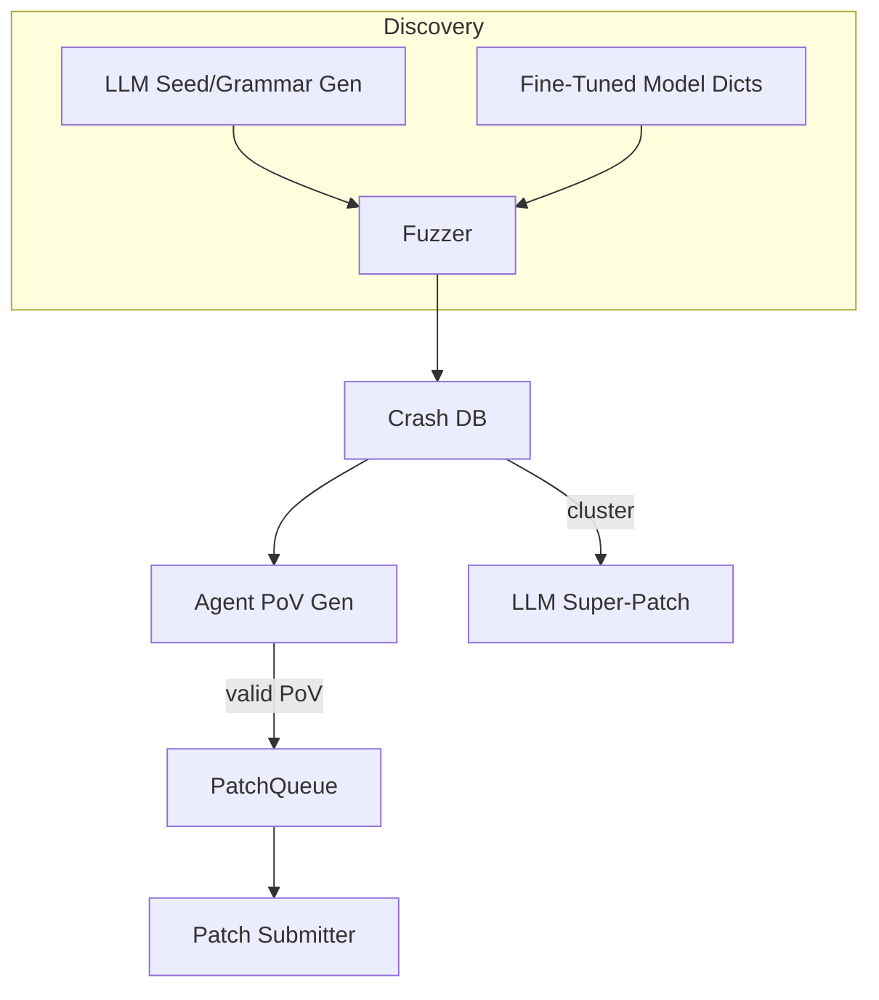

# Fuzzing assisté par l’IA et découverte automatisée de vulnérabilités

{{#include ../banners/hacktricks-training.md}}

## Vue d’ensemble
Les grands modèles de langage (LLM) peuvent considérablement améliorer les pipelines traditionnels de recherche de vulnérabilités en générant des entrées sémantiquement riches, en faisant évoluer des grammaires, en raisonnant sur les données de crash et même en proposant des correctifs pour plusieurs bugs. Cette page rassemble les approches les plus efficaces observées lors de la finale du DARPA AI Cyber Challenge (AIxCC) et d’autres travaux de recherche publics.<sup>[[4]](#references)</sup><sup>[[5]](#references)</sup>

Ce qui suit n’est pas la description d’un système utilisé lors d’une compétition particulière, mais une synthèse des techniques afin que vous puissiez les reproduire dans vos propres workflows.

---

## 1. Entrées seed générées par des LLM

Les fuzzers traditionnels guidés par la couverture (AFL++, libFuzzer, Honggfuzz…) démarrent avec un petit corpus de seeds et mutent les octets à l’aveugle. Lorsque le format d’entrée ciblé est complexe (SQL, URL, protocoles binaires personnalisés), les mutations aléatoires cassent généralement la syntaxe avant que des branches intéressantes ne soient atteintes.

Les LLM peuvent résoudre ce problème de démarrage en produisant des *générateurs de seeds* : de courts scripts qui génèrent des **entrées syntaxiquement correctes, mais pertinentes du point de vue de la sécurité**. Par exemple :

```prompt
SYSTEM: You are a helpful security engineer.
USER:
Write a Python3 program that prints 200 unique SQL injection strings targeting common anti-pattern mistakes (missing quotes, numeric context, stacked queries).  Ensure length ≤ 256 bytes / string so they survive common length limits.
```

```python
# gen_sqli_seeds.py (truncated)
PAYLOADS = [
    "1 OR 1=1 -- ",
    "' UNION SELECT NULL,NULL--",
    "0; DROP TABLE users;--",
    ...
]
for p in PAYLOADS:
    print(p)
```

Exécutez une fois et injectez directement la sortie dans le corpus initial du fuzzer :

```bash
python3 gen_sqli_seeds.py > seeds.txt
afl-fuzz -i seeds.txt -o findings/ -- ./target @@
```

Benefits:
1. Validité sémantique → couverture plus approfondie dès le début.
2. Régénérable : ajustez le prompt pour cibler le XSS, le path traversal, les blobs binaires, etc.
3. Peu coûteux (< 1 ¢ avec GPT-3.5).

### Conseils
* Demandez au modèle de *diversifier* la longueur et l’encodage des payloads (UTF-8, URL-encoded, UTF-16-LE) pour contourner les filtres superficiels.
* Demandez un *script autonome unique* : cela évite les problèmes de formatage JSON.

---

## 2. Grammar-Evolution Fuzzing

Une variante plus puissante consiste à laisser le LLM **faire évoluer une grammaire** plutôt que des seeds concrets. Le workflow (pattern « Grammar Guy ») est le suivant :

1. Générer une grammaire initiale ANTLR/Peach/LibFuzzer à l’aide d’un prompt.
2. Lancer le fuzzing pendant N minutes et recueillir les métriques de couverture (arêtes / blocs atteints).
3. Résumer les zones du programme non couvertes et transmettre le résumé au modèle :
   ```prompt
   The previous grammar triggered 12 % of the program edges.  Functions not reached: parse_auth, handle_upload.  Add / modify rules to cover these.
   ```
4. Fusionnez les nouvelles règles, relancez le fuzzing, répétez.

Squelette de pseudo-code :

```python
for epoch in range(MAX_EPOCHS):
    grammar = llm.refine(grammar, feedback=coverage_stats)
    save(grammar, f"grammar_{epoch}.txt")
    coverage_stats = run_fuzzer(grammar)
```

Points clés :
* Gardez un *budget* : chaque raffinement consomme des tokens.
* Utilisez des instructions `diff` + `patch` pour que le modèle modifie le code plutôt que de le réécrire.
* Arrêtez-vous lorsque Δcoverage < ε.

---

## 3. Ingénierie de harness libFuzzer avec un LLM local

Lorsque le code ne peut pas quitter le poste de travail d’un analyste, un modèle de code local peut rédiger le petit adaptateur entre les octets du fuzzer et une API C/C++. La limite de sécurité est claire : **le modèle écrit et révise l’infrastructure de test ; la mutation guidée par la couverture explore les entrées ; les sanitizers signalent les opérations invalides ; un humain examine le harness et analyse les résultats**.<sup>[[9]](#references)</sup>

Pour les techniques de corpus, de feedback, de snapshot et de fuzzing avec état au niveau du moteur qui ne dépendent pas d’un LLM, consultez la [méthodologie de fuzzing](../generic-methodologies-and-resources/fuzzing.md).

Commencez par copier la déclaration exacte depuis l’en-tête cible et imposez un format de sortie. Un prompt ciblé réduit les API inventées et facilite l’examen du résultat :<sup>[[8]](#references)[[9]](#references)</sup>

```prompt
Write a libFuzzer target for this exact declaration:
int parse_records(const uint8_t *data, size_t size);

Output only C code. Implement LLVMFuzzerTestOneInput, include the
declaration, pass data and size unchanged, and do not use files,
network access, randomness, clocks, threads, or persistent state.
```

Pour un parseur d’octets bruts, le résultat attendu ne devrait pas être plus compliqué que :<sup>[[6]](#references)[[9]](#references)</sup>

```c
#include <stddef.h>
#include <stdint.h>

extern int parse_records(const uint8_t *, size_t);

int LLVMFuzzerTestOneInput(const uint8_t *data, size_t size) {
    (void)parse_records(data, size);
    return 0;
}
```

La compilation n’est que le premier filtre de validation. Vérifiez chaque cible générée par rapport à ces invariants avant d’y consacrer du temps CPU :<sup>[[6]](#references)[[8]](#references)[[9]](#references)</sup>

- **API exacte :** comparez les types, les règles de propriété, l’initialisation, le teardown et la convention d’appel avec le véritable en-tête et les appelants existants.
- **Sécurité du harness :** protégez chaque lecture depuis `data` ; les résultats des sanitizers doivent provenir de la cible, pas du code glue généré.
- **Répétabilité :** faites en sorte que le résultat dépende de `data` et de `size` ; supprimez les entrées/sorties externes, le temps, l’aléatoire non contrôlé, les threads non joints et tout état persistant entre les appels.
- **Débit :** initialisez l’état immuable coûteux une seule fois, uniquement si cela ne peut pas affecter le comportement, limitez la taille des entrées, désactivez la journalisation et libérez les allocations propres à chaque entrée.
- **Atteignabilité :** vérifiez que les fonctions et branches visées s’exécutent. Une cible qui compile, mais n’exerce que les chemins de rejet, constitue un échec silencieux.

### Cibles sensibles à la structure : préserver les invariants sans masquer les bugs

Si la plupart des entrées brutes échouent à un contrôle de magic, de longueur, de version ou de checksum, utilisez les octets du fuzzing comme **matériau pour des champs typés** et reconstruisez un objet valide. Fixez les constantes du format, laissez les champs sémantiques et les octets du payload modifiables, et dérivez les métadonnées d’intégrité à partir du payload reconstruit. `FuzzedDataProvider` est utile pour consommer des valeurs typées bornées, tandis que l’adaptateur reste responsable de limiter toute allocation et conversion générées.<sup>[[9]](#references)</sup>

<details>
<summary>Exemple de cible C++ sensible à la structure</summary>

```cpp
#include <fuzzer/FuzzedDataProvider.h>
#include <stddef.h>
#include <stdint.h>
#include <vector>

extern "C" int parse_message(const uint8_t *, size_t);

extern "C" int LLVMFuzzerTestOneInput(const uint8_t *data, size_t size) {
    FuzzedDataProvider fdp(data, size);
    uint8_t version = fdp.ConsumeIntegral<uint8_t>();
    auto body = fdp.ConsumeRemainingBytes<uint8_t>();
    if (body.size() > UINT16_MAX) body.resize(UINT16_MAX);
    uint16_t len = static_cast<uint16_t>(body.size());
    std::vector<uint8_t> msg = {0x8b, 'M', 'S', 'G', version,
                                static_cast<uint8_t>(len >> 8),
                                static_cast<uint8_t>(len)};
    msg.insert(msg.end(), body.begin(), body.end());
    (void)parse_message(msg.data(), msg.size());
    return 0;
}
```

</details>

N’utilisez pas une seule cible qui répare les structures pour toutes les questions. Maintenez une cible qui calcule les longueurs et les checksums afin d’explorer des états valides profonds, et une autre qui laisse les métadonnées **déclarées** sous le contrôle du fuzzer, tout en limitant uniquement les lectures et les allocations propres au harness. La seconde cible préserve les surfaces d’attaque liées aux longueurs incohérentes et aux problèmes d’intégrité, que la réparation automatique effacerait autrement.<sup>[[9]](#references)</sup>

### Seeds, dictionnaires, sanitizers et retour de couverture

Demandez au modèle de générer un script qui écrit des seeds binaires plutôt que de lui demander d’imprimer directement des données binaires. Utilisez comme seeds des objets vides, minimaux, typiques et valides aux limites ; extrayez ensuite les valeurs magiques, les tags, les encodages d’enum et les mots-clés du parser dans un dictionnaire vérifié. libFuzzer accepte ce dictionnaire avec `-dict=`, et conserve dans le corpus les mutations qui révèlent de nouvelles couvertures.<sup>[[6]](#references)[[9]](#references)</sup>

```text
magic="\x8bMSG"
version_min="\x00"
version_max="\xff"
config_tag="CONFIG"
```

Construisez la même cible avec une instrumentation complémentaire. ASan et UBSan peuvent partager un binaire de fuzzing ; utilisez un build MSan distinct et instrumentez ses dépendances pour éviter les signalements causés par du code non instrumenté.<sup>[[6]](#references)[[9]](#references)</sup>

```bash
clang++ -g -O1 -fsanitize=fuzzer,address,undefined \
  -fno-sanitize-recover=undefined target.cc harness.cc -o fuzz_target
./fuzz_target corpus -dict=msg.dict -max_len=65535

clang++ -g -O1 -fsanitize=fuzzer,memory \
  target.cc harness.cc -o fuzz_target_msan
```

Traitez la couverture comme le critère d’évaluation de chaque révision du modèle. Dans la sortie de libFuzzer, des valeurs `cov`/`ft` qui stagnent tôt et un corpus statique indiquent généralement un mauvais framing, un retour anticipé trop restrictif ou un mauvais appel ; un faible `exec/s` indique une initialisation coûteuse, des E/S, des allocations ou un état qui fuit. `NEW` prouve uniquement qu’une caractéristique de couverture a changé, pas que le parser visé a été atteint.<sup>[[6]](#references)[[9]](#references)</sup>

Pour obtenir des retours au niveau du code source, créez une build avec couverture, lancez le fuzzing et ne fournissez au modèle que les fonctions non couvertes ainsi que leurs conditions de garde. Vérifiez les différences du harness, du seed et du dictionary, puis mesurez à nouveau :<sup>[[7]](#references)[[8]](#references)[[9]](#references)</sup>

```bash
clang++ -g -O1 -fsanitize=fuzzer \
  -fprofile-instr-generate -fcoverage-mapping target.cc harness.cc -o fuzz_cov
mkdir -p profiles
LLVM_PROFILE_FILE='profiles/%p.profraw' ./fuzz_cov -max_total_time=300 corpus
llvm-profdata merge -sparse profiles/*.profraw -o fuzz.profdata
llvm-cov report ./fuzz_cov -instr-profile=fuzz.profdata
llvm-cov show ./fuzz_cov -instr-profile=fuzz.profdata \
  --show-branches=count --region-coverage-lt=1 target.cc
```

La boucle évolutive est donc **générer → compiler/éditer les liens → effectuer un test rapide sous sanitizers → mesurer la couverture de la cible → fournir le contexte pertinent minimal sur la couverture/le code source → réviser → mesurer à nouveau**. OSS-Fuzz-Gen applique le même principe en évaluant la compilabilité des cibles générées, les défaillances à l’exécution, la couverture et l’amélioration de la couverture par rapport aux cibles existantes, plutôt qu’en acceptant du code plausible sans vérification.<sup>[[7]](#references)[[8]](#references)</sup>

---

## 4. Génération de PoV (Exploit) par agents

Après avoir trouvé un crash, il vous faut encore un **proof-of-vulnerability (PoV)** qui le déclenche de manière déterministe.

Une approche évolutive consiste à lancer de nombreux workers légers (processus, threads ou conteneurs), chacun utilisant un modèle ou une configuration d’échantillonnage différente. L’étude des finalistes de l’AIxCC donne des exemples concrets à grande échelle : une équipe a utilisé **des milliers d’agents concurrents** pour générer des PoV en privilégiant l’IA, tandis qu’une autre a orchestré **300 à 500 agents de fuzzing** et réservé les LLM au raisonnement sémantique de plus haut niveau.<sup>[[4]](#references)</sup>

Pipeline :
1. L’analyse statique/dynamique produit des *candidats de bugs* (structure avec l’adresse du crash, l’extrait d’entrée et le message du sanitizer).
2. L’orchestrateur distribue les candidats aux agents.
3. Étapes de raisonnement de l’agent :
   a. Reproduire le bug localement avec `gdb` et l’entrée.
   b. Proposer un payload d’exploit minimal.
   c. Valider l’exploit dans un sandbox. En cas de réussite → soumettre.
4. Les tentatives échouées sont **réintégrées dans la file comme nouvelles seeds** pour le fuzzing de couverture (boucle de rétroaction).

Avantages :
* La parallélisation compense le manque de fiabilité d’un agent unique.
* Ajustement automatique de la température / de la taille du modèle selon le taux de réussite observé.

---

## 5. Fuzzing dirigé avec des modèles de code fine-tunés

Fine-tuner un modèle à poids ouverts (par exemple Llama-7B) sur du code source C/C++ annoté avec des schémas de vulnérabilités (débordement d’entier, copie de tampon, format string). Puis :

1. Effectuer une analyse statique pour obtenir la liste des fonctions et l’AST.
2. Demander au modèle : *« Donnez des entrées de dictionnaire de mutation susceptibles de compromettre la sécurité mémoire dans la fonction X »*.
3. Insérer ces tokens dans un `AFL_CUSTOM_MUTATOR` personnalisé.

Exemple de sortie pour un wrapper `sprintf` :
```
{"pattern":"%99999999s"}
{"pattern":"AAAAAAAA....<1024>....%n"}
```

Empiriquement, cela réduit de plus de 2× le délai avant crash sur des cibles réelles.

---

## 6. Stratégies de correction guidées par l’IA

### 6.1 Super Patches
Demandez au modèle de *regrouper* les signatures de crash et de proposer un **patch unique** qui élimine la cause fondamentale commune. Soumettez-le une seule fois et corrigez plusieurs bugs → moins de pénalités de précision dans les environnements où chaque patch erroné coûte des points.

Structure du prompt :
```
Here are 10 stack traces + file snippets.  Identify the shared mistake and generate a unified diff fixing all occurrences.
```

### 6.2 Ratio de patches spéculatifs
Mettez en place une file où les patches confirmés et validés par PoV sont entrelacés avec des patches *spéculatifs* (sans PoV) selon un ratio 1:​N ajusté aux règles de score (par exemple, 2 spéculatifs : 1 confirmé). Un modèle de coûts surveille les pénalités par rapport aux points et ajuste N automatiquement.

---

## 7. Revue de code IA déterministe, fichier par fichier

Un échec fréquent des revues assistées par IA consiste à demander à un agent d’inspecter tout un dépôt en espérant qu’il choisisse les bons fichiers et les bons termes de recherche grep. Une approche plus fiable consiste à **imposer une couverture du dépôt** :<sup>[[1]](#references)</sup>

1. Énumérez les fichiers source.
2. Transmettez **un fichier à la fois**, avec un contexte minimal (point d’entrée, imports, routes/appelants proches).
3. Exigez un **rapport structuré** pour chaque fichier : sources, sink, validation manquante, préconditions d’exploitation et niveau de confiance.<sup>[[3]](#references)</sup>
4. Dédupliquez les rapports selon le **schéma source→sink** et validez manuellement les cas à haut risque.

Cette méthode consomme beaucoup de tokens et génère du bruit, mais elle est très efficace pour détecter les **bugs simples à fort impact de type source/sink**, souvent manqués par les revues agentiques générales.

### Schémas de triage à prioriser

- **Inclusion/dispatch dynamique en PHP** : noms de routes/contrôleurs/modules contrôlés par l’attaquant et transmis à `require_once()`, `include()` ou `include_once()` sans liste d’autorisation stricte ni canonicalisation des chemins.
- **Exécution de shell dans les workflows d’administration/de compte** : noms d’utilisateur, domaines, comptes FTP ou autres identifiants transmis à `exec()`, `system()`, `shell_exec()`, `passthru()`, `proc_open()` ou `popen()`.
- **Convergence de données d’entrée structurées** : même paramètre accepté depuis `$_GET`, `$_POST`, JSON, XML ou les analyseurs de corps de requête du framework, puis réutilisé dans des sinks de système de fichiers ou de commandes OS.

### Deux classes de bugs pratiques que cette méthode détecte bien

- **LFI/RCE via le dispatch de contrôleurs PHP** : si un nom de contrôleur contrôlé par la requête est concaténé dans `require_once()` sans liste d’autorisation ni normalisation de chemin, des séquences de traversal telles que `../` peuvent amener PHP à inclure un fichier `.php` local non prévu. Si l’attaquant peut faire pointer l’inclusion vers un fichier PHP qu’il a placé ou qui lui est utile, la LFI devient une exécution de code. Voir [File Inclusion / Path Traversal](../pentesting-web/file-inclusion/README.md).<sup>[[1]](#references)</sup>
- **Injection de commandes authentifiée dans les panneaux d’hébergement/d’administration** : si des champs de gestion de compte comme les noms d’utilisateur sont insérés dans des commandes shell, un utilisateur authentifié disposant de faibles privilèges peut transformer une opération normale de création/suppression en RCE. L’impact augmente si le panneau exécute la commande avec un compte de service plus privilégié. Voir [Command Injection](../pentesting-web/command-injection.md).<sup>[[1]](#references)</sup>

### Conseils pratiques pour la revue

- Utilisez d’abord le LLM comme **outil d’examen des sources/sinks**, pas comme générateur d’exploits.
- Demandez-lui d’indiquer explicitement le **champ contrôlé par l’attaquant**, la **lacune de normalisation/validation** et le **sink dangereux**.
- Pour les grands dépôts, une revue déterministe fichier par fichier est souvent plus fiable qu’une seule exécution d’agent autonome, même si celle-ci utilise un modèle plus puissant.<sup>[[2]](#references)</sup>
- Attendez-vous à des résultats moins bons sur le **Broken Access Control** et les autres bugs de logique métier dont l’exploitabilité dépend d’hypothèses entre fichiers, de la sémantique des rôles ou de modèles de menace propres au produit.

---

## Recherche auditable assistée par agent dans des bases de code inconnues

Le [workflow de fuzz-target graph-first](../generic-methodologies-and-resources/fuzzing.md#graph-first-fuzz-target-selection-and-mutation-triage) couvre déjà l’accessibilité des points d’entrée, tandis que les [pipelines SAST agentiques](../network-services-pentesting/pentesting-web/code-review-tools.md#agentic-sast-pipelines) couvrent la revue par étapes et les contrôles des preuves. Séparez ces résultats déterministes des hypothèses du modèle afin que chaque piste retenue conserve les emplacements source, les preuves de chemin et une mesure dynamique.<sup>[[10]](#references)</sup>

### Corréler les preuves de durée de vie des objets sans inventer de flux de données

L’analyse statique peut détecter qu’une longueur contrôlée par l’attaquant est stockée dans une fonction et que le même champ d’objet atteint un sink de copie bien plus tard, sans toutefois parvenir à prouver le lien entre callbacks, reconnexions ou durée de vie de l’objet. Conservez séparément les deux résultats, regroupez-les par objet/champ et formulez explicitement le lien manquant comme une question de triage. L’agent peut suggérer la relation, mais l’examen du code source ou l’instrumentation à l’exécution doit la prouver.<sup>[[10]](#references)</sup>

Pour chaque candidat, consignez :

- le point d’entrée concret et les octets contrôlés par l’attaquant ;
- chaque producteur du champ concerné, y compris les validations propres à chaque producteur ;
- le sink, la capacité de destination et les conditions de compilation/d’exécution nécessaires pour l’atteindre ;
- une véritable pile d’appels depuis le point d’entrée exposé, et pas uniquement une invocation directe du harness ;
- le résultat dynamique minimal permettant de confirmer ou de rejeter l’hypothèse.

Un chemin apparemment sûr ne garantit pas la sécurité globale d’un champ. Un second producteur peut alimenter le même champ sans appliquer la limite utilisée par le premier chemin. Testez les chemins séparément et exécutez le harness avec des options de compilation équivalentes à celles du déploiement, car les assertions de débogage peuvent transformer une corruption mémoire en production en un arrêt précoce réservé aux tests.<sup>[[10]](#references)</sup>

### Seuils de mesure pour la divulgation et l’exploitation

Pour une suspicion de divulgation de mémoire non initialisée, remplissez les allocations fraîches avec un octet reconnaissable et vérifiez que le marqueur exact se retrouve dans le paquet émis. Pour l’exploitation, exigez des seuils mesurés tels que **écriture contrôlée → objet victime utile → divulgation → récupération du pointeur/de la base → détournement du flux de contrôle → payload composé**. L’agent ne passe à l’étape suivante que lorsque le harness prouve la propriété actuelle ; un récit plausible ne valide pas le seuil. Le [cas FreeRDP](../binary-exploitation/libc-heap/heap-overflow.md#cross-path-length-reuse-and-stale-output-disclosure) montre le chemin et les contraintes de compilation à préserver pendant la validation.<sup>[[10]](#references)</sup>

---

## Assemblage de tous les éléments
Un CRS (Cyber Reasoning System) de bout en bout peut relier les composants ainsi :



---

## References

- [1] [Project Black - IA locale pour la cybersécurité : découverte d’une LFI dans phpIPAM et d’une RCE authentifiée dans myVesta](https://projectblack.io/blog/local-ai-for-cyber-security)
- [2] [Strix](https://github.com/usestrix/strix)
- [3] [Compétence security-review de la communauté GitHub Copilot](https://github.com/github/awesome-copilot/blob/main/skills/security-review/SKILL.md)
- [4] [Trail of Bits – Finales AIxCC : le bilan](https://blog.trailofbits.com/2025/08/07/aixcc-finals-tale-of-the-tape/)
- [5] [Interviews des finalistes AIxCC par CTF Radiooo](https://www.youtube.com/@ctfradiooo)
- [6] [LLVM — libFuzzer : une bibliothèque de fuzz testing guidé par la couverture](https://llvm.org/docs/LibFuzzer.html)
- [7] [Google — OSS-Fuzz-Gen](https://github.com/google/oss-fuzz-gen)
- [8] [Blog Google Online Security — Améliorer le fuzzing : découvrir davantage de vulnérabilités grâce à l’IA](https://security.googleblog.com/2024/11/leveling-up-fuzzing-finding-more.html)
- [9] [8kSec — Génération de harness de fuzzing assistée par IA avec un LLM local](https://8ksec.io/ai-assisted-fuzzing-harness-local-llm)
- [10] [Quarkslab — Des agents IA à la RCE : création d’un workflow de recherche de vulnérabilités](https://blog.quarkslab.com/from-ai-agents-to-rce-building-a-vulnerability-research-workflow.html)
{{#include ../banners/hacktricks-training.md}}
