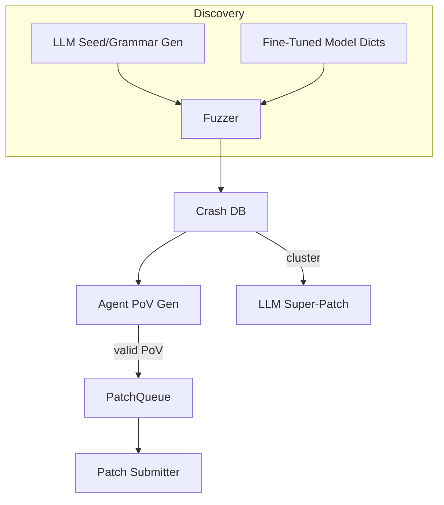

# AI Destekli Fuzzing ve Otomatik Zafiyet Keşfi

{{#include ../banners/hacktricks-training.md}}

## Genel Bakış
Büyük dil modelleri (LLM’ler), anlamsal açıdan zengin girdiler üreterek, gramerleri geliştirerek, crash verilerini analiz ederek ve hatta birden fazla hatayı ele alan yamalar önererek geleneksel zafiyet araştırma süreçlerini önemli ölçüde güçlendirebilir. Bu sayfada, DARPA’nın AI Cyber Challenge (AIxCC) finallerinde ve diğer kamuya açık araştırmalarda gözlemlenen en etkili yöntemler derlenmiştir.<sup>[[4]](#references)</sup><sup>[[5]](#references)</sup>

Aşağıda belirli bir yarışma sisteminin açıklaması değil, bu yöntemleri kendi iş akışlarınızda uygulayabilmeniz için bir teknikler özeti sunulmaktadır.

---

## 1. LLM Tarafından Üretilen Seed Girdileri

Geleneksel coverage-guided fuzzer’lar (AFL++, libFuzzer, Honggfuzz…) küçük bir seed corpus’u ile başlar ve baytları rastgele mutasyona uğratır. Hedef girdi biçimi karmaşık olduğunda (SQL, URL’ler, özel ikili protokoller), rastgele mutasyonlar genellikle ilgi çekici dallara ulaşılmadan önce sözdizimini bozar.

LLM’ler, *seed üreticileri* — **sözdizimi doğru ancak güvenlikle ilgili girdiler** üreten kısa betikler — oluşturarak bu başlangıç sorununu çözebilir. Örneğin:

```prompt
SYSTEM: You are a helpful security engineer.
USER:
Write a Python3 program that prints 200 unique SQL injection strings targeting common anti-pattern mistakes (missing quotes, numeric context, stacked queries).  Ensure length ≤ 256 bytes / string so they survive common length limits.
```

```python
# gen_sqli_seeds.py (truncated)
PAYLOADS = [
    "1 OR 1=1 -- ",
    "' UNION SELECT NULL,NULL--",
    "0; DROP TABLE users;--",
    ...
]
for p in PAYLOADS:
    print(p)
```

Bir kez çalıştırın ve çıktıyı doğrudan fuzzer’ın başlangıç corpus’una aktarın:

```bash
python3 gen_sqli_seeds.py > seeds.txt
afl-fuzz -i seeds.txt -o findings/ -- ./target @@
```

Benefits:
1. Semantik geçerlilik → erken aşamada daha derin kapsam.
2. Yeniden üretilebilir: XSS, path traversal, binary blobs vb. konulara odaklanmak için prompt’u değiştirin.
3. Ucuz (< 1 ¢ with GPT-3.5).

### İpuçları
* Yüzeysel filtreleri aşmak için modelden payload uzunluğunu ve encoding türünü (UTF-8, URL-encoded, UTF-16-LE) *çeşitlendirmesini* isteyin.
* JSON biçimlendirme sorunlarını önlemek için *tek ve kendi içinde çalışır bir script* isteyin.

---

## 2. Grammar-Evolution Fuzzing

Daha güçlü bir varyantta, LLM’nin somut seed’ler yerine bir grammar’ı **geliştirmesine** izin verilir. İş akışı (“Grammar Guy” pattern’i) şöyledir:

1. Prompt aracılığıyla başlangıç niteliğinde bir ANTLR/Peach/LibFuzzer grammar’ı oluşturun.
2. N dakika boyunca fuzzing yapın ve kapsam metriklerini (hit edilen edge’ler / block’lar) toplayın.
3. Programın kapsanmamış alanlarını özetleyin ve bu özeti modele geri verin:
   ```prompt
   The previous grammar triggered 12 % of the program edges.  Functions not reached: parse_auth, handle_upload.  Add / modify rules to cover these.
   ```
4. Yeni kuralları birleştir, yeniden fuzzing yap ve tekrarla.

Sözde kod iskeleti:

```python
for epoch in range(MAX_EPOCHS):
    grammar = llm.refine(grammar, feedback=coverage_stats)
    save(grammar, f"grammar_{epoch}.txt")
    coverage_stats = run_fuzzer(grammar)
```

Önemli noktalar:
* Bir *bütçe* belirleyin – her iyileştirme token kullanır.
* Modelin yeniden yazmak yerine düzenleme yapması için `diff` + `patch` talimatları kullanın.
* Δcoverage < ε olduğunda durun.

---

## 3. Local-LLM libFuzzer Harness Mühendisliği

Analistin iş istasyonundan dışarı çıkarılamayan kaynak kodlar için yerel bir code model, fuzzer baytları ile bir C/C++ API'si arasındaki küçük adaptörü taslak olarak hazırlayabilir. Yararlı güvenlik sınırı açıktır: **model test altyapısını yazar ve gözden geçirir; coverage-guided mutation girdileri keşfeder; sanitizer'lar geçersiz işlemleri bildirir; bir insan harness'i inceler ve bulguları sınıflandırır**.<sup>[[9]](#references)</sup>

LLM'e bağlı olmayan engine düzeyindeki corpus, feedback, snapshot ve stateful-fuzzing teknikleri için genel [Fuzzing Methodology](../generic-methodologies-and-resources/fuzzing.md) sayfasına bakın.

Hedef başlıktan alınan tam bildirimle başlayın ve çıktı biçimini kısıtlayın. Dar kapsamlı bir prompt, uydurma API'leri azaltır ve sonucu incelemeyi kolaylaştırır:<sup>[[8]](#references)[[9]](#references)</sup>

```prompt
Write a libFuzzer target for this exact declaration:
int parse_records(const uint8_t *data, size_t size);

Output only C code. Implement LLVMFuzzerTestOneInput, include the
declaration, pass data and size unchanged, and do not use files,
network access, randomness, clocks, threads, or persistent state.
```

Ham bayt ayrıştırıcısı için beklenen sonuç bundan daha karmaşık olmamalıdır:<sup>[[6]](#references)[[9]](#references)</sup>

```c
#include <stddef.h>
#include <stdint.h>

extern int parse_records(const uint8_t *, size_t);

int LLVMFuzzerTestOneInput(const uint8_t *data, size_t size) {
    (void)parse_records(data, size);
    return 0;
}
```

Derleme yalnızca ilk doğrulama aşamasıdır. CPU zamanı harcamadan önce oluşturulan her hedefi şu değişmezlere göre gözden geçirin:<sup>[[6]](#references)[[8]](#references)[[9]](#references)</sup>

- **API'yi tam eşleştirin:** Türleri, sahiplik kurallarını, başlatmayı, kapatmayı ve çağrı kuralını gerçek header ve mevcut çağıran kodlarla karşılaştırın.
- **Harness güvenliği:** `data` üzerinden yapılan her okumayı korumaya alın; sanitizer bulguları, oluşturulan glue kodundan değil hedeften kaynaklanmalıdır.
- **Tekrarlanabilirlik:** Sonucu `data` ve `size` değerlerinin bir fonksiyonu hâline getirin; harici G/Ç'yi, zamanı, kontrolsüz rastgeleliği, birleştirilmemiş thread'leri ve çağrılar arasında kalan durumu kaldırın.
- **Verim:** Davranışı etkilemeyeceği kesin olduğunda pahalı, değişmez durumu yalnızca bir kez başlatın; girdi boyutunu sınırlandırın, loglamayı devre dışı bırakın ve girdi başına yapılan bellek ayırmalarını serbest bırakın.
- **Erişilebilirlik:** Amaçlanan işlevlerin ve dalların çalıştığını doğrulayın. Derlenen ancak yalnızca reddetme yollarını çalıştıran bir hedef, sessiz bir başarısızlıktır.

### Yapı farkındalıklı hedefler: hataları gizlemeden değişmezleri koruyun

Ham girdilerin çoğu magic, uzunluk, sürüm veya checksum denetimlerinde başarısız oluyorsa fuzz byte'larını **türlü alan verisi** olarak kullanın ve geçerli bir nesneyi yeniden oluşturun. Biçim sabitlerini sabitleyin, anlamsal alanları ve payload byte'larını değiştirilebilir bırakın, bütünlük metadatasını yeniden oluşturulan payload'dan türetin. `FuzzedDataProvider`, sınırlandırılmış tür değerlerini tüketmek için kullanışlıdır; oluşturulan bellek ayırmalarını ve dönüşümleri sınırlandırmak ise adapter'ın sorumluluğundadır.<sup>[[9]](#references)</sup>

<details>
<summary>Yapı farkındalıklı C++ hedefi örneği</summary>

```cpp
#include <fuzzer/FuzzedDataProvider.h>
#include <stddef.h>
#include <stdint.h>
#include <vector>

extern "C" int parse_message(const uint8_t *, size_t);

extern "C" int LLVMFuzzerTestOneInput(const uint8_t *data, size_t size) {
    FuzzedDataProvider fdp(data, size);
    uint8_t version = fdp.ConsumeIntegral<uint8_t>();
    auto body = fdp.ConsumeRemainingBytes<uint8_t>();
    if (body.size() > UINT16_MAX) body.resize(UINT16_MAX);
    uint16_t len = static_cast<uint16_t>(body.size());
    std::vector<uint8_t> msg = {0x8b, 'M', 'S', 'G', version,
                                static_cast<uint8_t>(len >> 8),
                                static_cast<uint8_t>(len)};
    msg.insert(msg.end(), body.begin(), body.end());
    (void)parse_message(msg.data(), msg.size());
    return 0;
}
```

</details>

Her soru için yapıyı onaran tek bir target kullanmayın. Derin ve geçerli durumları keşfetmek için uzunlukları/checksum’ları türeten bir target; fuzzer’ın kontrolündeki **beyan edilen** metadata’yı korurken yalnızca harness’in kendi okuma ve bellek ayırma işlemlerini sınırlandıran başka bir target bulundurun. İkinci target, otomatik onarımın aksi hâlde ortadan kaldıracağı uzunluk uyuşmazlıklarını ve hatalı integrity değerlerinin oluşturduğu saldırı yüzeylerini korur.<sup>[[9]](#references)</sup>

### Seed’ler, sözlükler, sanitizer’lar ve coverage geri bildirimi

Modelden binary veriyi doğrudan yazdırmasını istemek yerine binary seed’ler yazan bir script üretmesini isteyin. Boş, minimal, tipik ve sınırda geçerli nesnelerle seed oluşturun; ardından magic değerlerini, tag’leri, enum kodlamalarını ve parser anahtar sözcüklerini gözden geçirilmiş bir sözlüğe çıkarın. libFuzzer bu sözlüğü `-dict=` ile kabul eder ve corpus’ta yeni coverage sağlayan mutasyonları tutar.<sup>[[6]](#references)[[9]](#references)</sup>

```text
magic="\x8bMSG"
version_min="\x00"
version_max="\xff"
config_tag="CONFIG"
```

Aynı hedefi tamamlayıcı enstrümantasyonla derleyin. ASan ve UBSan aynı fuzzing binary'yi paylaşabilir; enstrümante edilmemiş kodun neden olduğu raporları önlemek için ayrı bir MSan derlemesi kullanın ve bağımlılıklarını enstrümante edin.<sup>[[6]](#references)[[9]](#references)</sup>

```bash
clang++ -g -O1 -fsanitize=fuzzer,address,undefined \
  -fno-sanitize-recover=undefined target.cc harness.cc -o fuzz_target
./fuzz_target corpus -dict=msg.dict -max_len=65535

clang++ -g -O1 -fsanitize=fuzzer,memory \
  target.cc harness.cc -o fuzz_target_msan
```

Her model revizyonu için coverage’ı değerlendirici olarak kullanın. libFuzzer çıktısında `cov`/`ft` değerlerinin erkenden sabitlenmesi ve corpus’un değişmemesi genellikle framing’in hatalı, erken dönüş koşulunun aşırı kısıtlayıcı ya da çağrının yanlış olduğu anlamına gelir; düşük `exec/s` ise pahalı kurulum, I/O, bellek ayırma veya sızan state’e işaret eder. `NEW`, yalnızca bir coverage özelliğinin değiştiğini kanıtlar; amaçlanan parser’a ulaşıldığını değil.<sup>[[6]](#references)[[9]](#references)</sup>

Kaynak düzeyinde geri bildirim için coverage build’i oluşturup fuzzing yapın ve modele yalnızca coverage’a ulaşılmamış fonksiyonları ve bunları koruyan koşulları verin. Ortaya çıkan harness/seed/dictionary diff’ini doğrulayın ve yeniden ölçüm yapın:<sup>[[7]](#references)[[8]](#references)[[9]](#references)</sup>

```bash
clang++ -g -O1 -fsanitize=fuzzer \
  -fprofile-instr-generate -fcoverage-mapping target.cc harness.cc -o fuzz_cov
mkdir -p profiles
LLVM_PROFILE_FILE='profiles/%p.profraw' ./fuzz_cov -max_total_time=300 corpus
llvm-profdata merge -sparse profiles/*.profraw -o fuzz.profdata
llvm-cov report ./fuzz_cov -instr-profile=fuzz.profdata
llvm-cov show ./fuzz_cov -instr-profile=fuzz.profdata \
  --show-branches=count --region-coverage-lt=1 target.cc
```

Ölçeklenebilir döngü bu nedenle **generate → compile/link → sanitizers altında smoke-test → target coverage'ını ölç → en küçük ilgili coverage/source bağlamını sağla → revise → yeniden ölç** şeklindedir. OSS-Fuzz-Gen de aynı ilkeyi uygular: makul görünen kodu olduğu gibi kabul etmek yerine, oluşturulan target'ları derlenebilirlik, runtime failures, coverage ve mevcut target'lara kıyasla coverage iyileşmesi açısından değerlendirir.<sup>[[7]](#references)[[8]](#references)</sup>

---

## 4. Agent Tabanlı PoV (Exploit) Üretimi

Bir crash bulduktan sonra, bunu deterministik olarak tetikleyen bir **proof-of-vulnerability (PoV)** elde etmeniz gerekir.

Ölçeklenebilir bir yaklaşım, her biri farklı bir model veya sampling configuration kullanan çok sayıda hafif worker (process, thread veya container) başlatmaktır. AIxCC finalistlerinin anketi, ölçeğe ilişkin somut örnekler sunuyor: bir ekip AI-first PoV generation için **binlerce eşzamanlı agent** kullanırken, başka bir ekip **300–500 fuzzing agent** koordine etmiş ve LLM'leri üst düzey semantic reasoning için ayırmıştır.<sup>[[4]](#references)</sup>

Pipeline:
1. Static/dynamic analysis, *bug candidate*'ler üretir (crash PC, input slice ve sanitizer mesajı içeren struct).
2. Orchestrator, candidate'leri agent'lara dağıtır.
3. Agent'ın akıl yürütme adımları:
   a. Bug'ı yerel olarak `gdb` + input ile yeniden üret.
   b. Minimal exploit payload öner.
   c. Exploit'i sandbox'ta doğrula. Başarılıysa → gönder.
4. Başarısız denemeler, coverage fuzzing için **yeni seed'ler olarak kuyruğa yeniden eklenir** (feedback loop).

Avantajlar:
* Paralelleştirme, tek bir agent'ın güvenilmezliğini telafi eder.
* Gözlemlenen başarı oranına göre temp/model size otomatik ayarlanır.

---

## 5. Fine-Tuned Code Models ile Directed Fuzzing

Vulnerability pattern'leriyle (integer overflow, buffer copy, format string) etiketlenmiş C/C++ kaynak kodu üzerinde açık ağırlıklı bir modeli (ör. Llama-7B) fine-tune edin. Ardından:

1. Function listesi + AST elde etmek için static analysis çalıştırın.
2. Modele şu prompt'u verin: *“X function'ında memory safety'yi bozma olasılığı yüksek mutation dictionary girdileri ver”*.
3. Bu token'ları özel bir `AFL_CUSTOM_MUTATOR` içine ekleyin.

Bir `sprintf` wrapper için örnek çıktı:
```
{"pattern":"%99999999s"}
{"pattern":"AAAAAAAA....<1024>....%n"}
```

Ampirik olarak bu, gerçek hedeflerde çökme süresini >2× kısaltır.

---

## 6. AI Rehberliğinde Patch Stratejileri

### 6.1 Süper Patch'ler
Modelden crash imzalarını *kümelemesini* ve ortak temel nedeni ortadan kaldıran **tek bir patch** önermesini isteyin. Bir kez gönderin, birkaç hatayı düzeltin → her yanlış patch'in puan kaybettirdiği ortamlarda daha az doğruluk cezası.

Prompt taslağı:
```
Here are 10 stack traces + file snippets.  Identify the shared mistake and generate a unified diff fixing all occurrences.
```

{{#ref}}
../generic-methodologies-and-resources/fuzzing.md
{{#endref}}

### 6.2 Spekülatif Patch Oranı
Doğrulanmış, PoV ile valide edilmiş patch’lerle *spekülatif* patch’leri (PoV yok) puanlama kurallarına göre ayarlanan 1:N oranında (ör. 2 spekülatif : 1 doğrulanmış) sırayla işleyen bir kuyruk uygulayın. Bir maliyet modeli, cezaları puanlara karşı izler ve N değerini otomatik olarak ayarlar.

---

## 7. Deterministik, Dosya Dosya AI Code Review

AI destekli incelemede sık görülen bir başarısızlık biçimi, tek bir agent’tan tüm repository’yi incelemesini istemek ve doğru dosyaları ve grep terimlerini seçmesini ummaktır. Daha güvenilir bir yöntem, **repository kapsamını zorunlu kılmaktır**:<sup>[[1]](#references)</sup>

1. Kaynak dosyaları listeleyin.
2. Her seferinde **tek bir dosyayı** ve asgari bağlamı (entrypoint, import’lar, yakındaki route’lar/caller’lar) gönderin.
3. Her dosya için yapılandırılmış bir **rapor** isteyin: source’lar, sink, eksik validation, exploit önkoşulları ve güven düzeyi.<sup>[[3]](#references)</sup>
4. Raporları **source→sink pattern’ine** göre tekilleştirin ve yüksek risklileri manuel olarak doğrulayın.

Bu yöntem çok token kullanır ve gürültülüdür; ancak geniş kapsamlı agentic incelemelerin sıklıkla gözden kaçırdığı **basit, yüksek etkili source/sink bug’larını** ortaya çıkarmada oldukça etkilidir.

### Önceliklendirmeye değer triage pattern’leri

- **Dinamik PHP include/dispatch**: saldırganın kontrol ettiği route/controller/module adlarının, katı bir allowlist ve path canonicalisation olmadan `require_once()`, `include()` veya `include_once()` fonksiyonlarına aktarılması.
- **Admin/account iş akışlarında shell execution**: username’lerin, domain’lerin, FTP account’larının veya diğer identifier’ların `exec()`, `system()`, `shell_exec()`, `passthru()`, `proc_open()` ya da `popen()` fonksiyonlarına ulaşması.
- **Yapılandırılmış input fan-in**: aynı parametrenin `$_GET`, `$_POST`, JSON, XML veya framework body parser’larından kabul edilip daha sonra filesystem veya OS-command sink’lerinde yeniden kullanılması.

### Bu yöntemin etkili biçimde bulduğu iki pratik bug sınıfı

- **PHP controller-dispatch LFI/RCE**: request tarafından kontrol edilen bir controller adı, allowlist/path normalisation olmadan `require_once()` içine birleştirilirse `../` gibi traversal dizileri PHP’nin istenmeyen bir yerel `.php` dosyasını include etmesine yol açabilir. Saldırgan include’u yerleştirilmiş veya başka şekilde işe yarar bir PHP dosyasına yönlendirebilirse LFI, code execution’a dönüşür. Bkz. [File Inclusion / Path Traversal](../pentesting-web/file-inclusion/README.md).<sup>[[1]](#references)</sup>
- **Hosting/admin panellerinde kimlik doğrulamalı command injection**: username gibi account yönetimi alanları shell command’lerine eklenirse, düşük yetkili kimliği doğrulanmış bir kullanıcı normal bir oluşturma/silme işlemini RCE’ye dönüştürebilir. Panel command’i daha yetkili bir service account olarak çalıştırıyorsa etki artar. Bkz. [Command Injection](../pentesting-web/command-injection.md).<sup>[[1]](#references)</sup>

### Pratik inceleme notları

- LLM’yi önce bir **source/sink inceleyicisi** olarak kullanın, exploit generator olarak değil.
- Açıkça **saldırganın kontrol ettiği alanı**, **normalization/validation açığını** ve **tehlikeli sink’i** listelemesini isteyin.
- Büyük repository’lerde deterministik, dosya dosya inceleme; daha güçlü bir model kullansa bile tek bir otonom agent çalıştırmaktan genellikle daha güvenilirdir.<sup>[[2]](#references)</sup>
- Exploit edilebilirliğin dosyalar arası varsayımlara, rol anlamlarına veya ürüne özgü threat model’lere bağlı olduğu **Broken Access Control** ve diğer business-logic bug’larında daha zayıf sonuçlar bekleyin.

---

## 8. Enstrümante Edilmiş Bir Oracle ile Pattern Odaklı Kernel Auditing

Kernel boyutunda bir hedef için agent’tan tüm ağaçta rastgele bug’lar bulmasını istemeyin. Daha az token kullanan bir iş akışı, geçmiş zafiyet bilgisini statik sorgulara dönüştürür, sonuçları erişilebilir attack surface’e göre sıralar ve enstrümante edilmiş bir kernel’i execution oracle olarak kullanır.<sup>[[11]](#references)</sup>

### Pattern veritabanı → CodeQL/Semgrep → odaklı inceleme

Tehlikeli API’leri, eksik validation pattern’lerini, riskli source-to-sink akışlarını ve daha önce düzeltilmiş bug şekillerini içeren küçük bir knowledge base oluşturun. Modelden **her seferinde tek bir pattern’i** inceleme heuristic’lerine ve CodeQL/Semgrep kurallarına dönüştürmesini isteyin; ardından bu deterministik kuralları tüm ağaçta çalıştırın. Eşleşmeleri gruplandırıp tekilleştirin ve kodu modele geri vermeden önce daraltın; tarayıcının ham çıktısı, düşük değerli binlerce aday içerebilir. Bu yaklaşımı uygun araştırma veya açık kaynak hedefleri dışında kullanmadan önce CodeQL’in güncel lisansını kontrol edin.<sup>[[11]](#references)</sup>

Alt sistemleri yalnızca eşleşme sayısına göre değil, **kural eşleşmesi yoğunluğu** ve **saldırganın erişebilirliğini** birlikte kullanarak önceliklendirin. Ayrıcalıksız süreçlerden, sandbox’lardan, container’lardan, jail’lerden veya guest bağlamlarından erişilebilen kernel arayüzlerine, yalnızca dahili koddan daha fazla ağırlık verin. İnceleme birimini, agent’ın caller’ları, validator’ları ve lifetime kurallarını aklında tutabileceği kadar küçük tutun; “herhangi bir zafiyet bul” demek yerine belirli bir zafiyet sınıfı veya control-flow pattern’i için prompt verin. Yeni bir containment boundary, namespace veya jail içindeki root kullanıcısının erişimini mümkün kılıyorsa eski ve ayrıcalıklı arayüzler özellikle ilgi çekicidir.<sup>[[11]](#references)</sup>

Her aday için exploitation’a geçmeden önce açık bir field-flow kaydı isteyin.<sup>[[11]](#references)</sup>

```text
entrypoint -> privilege check -> parser -> validation/normalization
           -> later rewrite -> dangerous sink
attacker controls: <fields and lengths>
constraints:       <values rewritten, rejected, or preserved>
observable result: <sanitizer report, assertion, panic, or clean exit>
```

### KASAN telemetrisini hipotez oracle'ı olarak kullanın

Hedef kernel'i KASAN ve yararlı tanılama assertion'ları etkinleştirilmiş, geçici bir VM'de çalıştırın. Agent, şüphelenilen bozulma yeniden üretilene veya elenene kadar **source hypothesis → minimal userland trigger → VM execution → KASAN/assertion trace → revised hypothesis** döngüsünü izlemelidir. Her yinelemede yalnızca ilgili stack trace'i ve yakındaki source kodunu döndürün; böylece akıl yürütme bağlamı korunurken kabul ölçütü modelin güveni değil, çalışma zamanı kanıtı olur.<sup>[[11]](#references)</sup>

Instrumented build, exploitability'yi değerlendireceğiniz son ortam değildir. Assertion'lar bozulmaya yol açan işlemden önce yürütmeyi durdurabilir; aynı assertion production kernel'den derleme sırasında çıkarılmış olabilir. Değiştirilmemiş trigger'ı tam production configuration üzerinde yeniden test edin, kernel build'ini ve configuration'ı kaydedin ve **reachability**, **memory corruption**, **controlled primitive** ile **security impact** iddialarını birbirinden ayrı tutun.<sup>[[11]](#references)[[12]](#references)</sup>

CVE-2026-3038 bir exploit şablonundan çok, doğrulama için yararlı bir örnektir. Ayrıcalıksız bir FreeBSD `RTM_GET` isteği, seçici validation ve yanıtın yeniden yazılması yoluyla büyük boyutlu bir `RTAX_AUTHOR` sockaddr'ının korunmasını sağladı; bu değer, `rtsock_msg_buffer()` işlevi tarafından kullanıcı kontrollü `sa_len` değerinin 128 baytlık stack `sockaddr_storage` içine kopyalanmasına kadar taşındı. En fazla 255 baytlık kopyalama 127 baytlık bir overwrite oluşturdu. Instrumented build'de hatalı uzunluğu bir diagnostic assertion yakalarken, GENERIC kernel kopyalama işlemine ulaştı ve bozulmuş canary kontrol edilirken panic verdi. Bu, ayrıcalıksız bir hizmet engellemeyi kanıtlar; tek başına ayrıcalık yükseltmeyi değil. Güvenilir kontrol için önce canary disclosure gibi başka bir primitive gerekir. İlgili binary-exploitation sınırı için bkz. [Stack Canaries](../binary-exploitation/common-binary-protections-and-bypasses/stack-canaries/index.html).<sup>[[11]](#references)[[12]](#references)[[13]](#references)</sup>

### Exploit önkoşullarını hileyle sağlama girişimlerini reddedin

Bir PoV veya exploit'i kabul etmeden önce, ayrı bir reviewer/agent'tan sabit ölçütlere göre iddiayı çürütmeye çalışmasını isteyin. İnceleme, aşağıdaki koşulların tümünü doğrulamalıdır.<sup>[[11]](#references)</sup>

- Hedef source kodu, kernel ve vulnerable module, yolu erişilebilir kılmak için değiştirilmemiştir.
- Hiçbir helper module, synthetic gadget, devre dışı bırakılmış mitigation, ek ayrıcalık veya kullanılamayan interface eklenmemiştir.
- Trigger, temiz bir snapshot'ta iddia edilen caller identity ve containment kısıtlamalarıyla başlar.
- İddia edilen sonuç hâlâ bug'a bağlıdır: hatalı alanı kaldırmak veya yalnızca bug'ı patch'lemek zinciri bozmalıdır.
- Bir crash, overread veya overwrite yalnızca ilgili primitive olarak raporlanır; code execution veya privilege escalation için bağımsız kanıt gerekir.

Bu son counterfactual kontrol, döngüsel gösterimleri yakalar: önkoşullar iddia edilen etkiyi zaten sağlıyorsa (örneğin `nosuid` olmadan mount edilmiş bir filesystem'den saldırganın sağladığı SUID içeriğini çalıştırmak), memory-safety bug'ı bu etkiyi yaratmamıştır.<sup>[[11]](#references)</sup>

---

## Bilinmeyen Codebase'lerde Denetlenebilir Agent Destekli Araştırma

[Graph-first fuzz-target workflow](../generic-methodologies-and-resources/fuzzing.md#graph-first-fuzz-target-selection-and-mutation-triage) entrypoint reachability konusunu, [agentic SAST pipelines](../network-services-pentesting/pentesting-web/code-review-tools.md#agentic-sast-pipelines) ise aşamalı inceleme ve kanıt kapılarını zaten ele alıyor. Bu deterministik sonuçları modelin hipotezlerinden ayrı tutun; böylece öne çıkarılan her bulgu source konumlarını, path kanıtını ve dinamik bir ölçümü korur.<sup>[[10]](#references)</sup>

### Veri akışı uydurmadan object-lifetime kanıtlarını ilişkilendirin

Static analysis, saldırgan kontrollü bir uzunluğun bir işlevde saklandığını ve aynı object alanının çok daha sonra bir copy sink'e ulaştığını bulabilir; ancak callback'ler, reconnect'ler veya object lifetime boyunca bağlantıyı kanıtlayamayabilir. Her iki bulguyu ayrı ayrı koruyun, object/field'a göre gruplayın ve eksik bağlantıyı açık bir triage sorusu hâline getirin. Agent bu ilişkiyi önerebilir, ancak source incelemesi veya runtime instrumentation bunu kanıtlamalıdır.<sup>[[10]](#references)</sup>

Her aday için şunları kaydedin:

- somut entrypoint ve saldırgan kontrollü baytlar;
- ilgili field'ın tüm producer'ları ve her producer'a özgü validation;
- sink, hedef kapasitesi ve bu noktaya ulaşmak için gereken build/runtime koşulları;
- doğrudan harness çağrısı değil, exposed entrypoint'ten gelen gerçek bir call stack;
- hipotezi doğrulayan veya reddeden en küçük dinamik sonuç.

Güvenli görünen bir path, field'ın her yerde güvenli olduğunu kanıtlamaz. İkinci bir producer, aynı field'ı ilk path'teki sınır kontrolü olmadan doldurabilir. Path'leri ayrı ayrı test edin ve debug assertion'larının production'daki memory corruption'ı erken, yalnızca test ortamında gerçekleşen bir abort'a dönüştürebileceğini göz önünde bulundurarak harness'i deployment'a eşdeğer build seçenekleriyle çalıştırın.<sup>[[10]](#references)</sup>

### Disclosure ve exploitation için ölçüm kapıları

Şüphelenilen uninitialized-memory disclosure için yeni allocation'ları ayırt edilebilir bir baytla doldurun ve tam olarak bu işaretçinin gönderilen packet'e ulaştığını doğrulayın. Exploitation için **controlled overwrite → useful victim object → disclosure → pointer/base recovery → control-flow hijack → composed payload** gibi ölçülmüş kapılar arayın. Agent yalnızca harness mevcut özelliği kanıtladığında ilerlemelidir; makul görünen bir anlatı, kapının geçildiği anlamına gelmez. [FreeRDP case](../binary-exploitation/libc-heap/heap-overflow.md#cross-path-length-reuse-and-stale-output-disclosure), doğrulama sırasında korunması gereken path ve build kısıtlarını gösterir.<sup>[[10]](#references)</sup>

---

## Hepsini Bir Araya Getirme
Uçtan uca bir CRS (Cyber Reasoning System) bileşenleri şu şekilde bağlayabilir:



---

## References

- [1] [Project Black - Cyber güvenlik için yerel AI: phpIPAM LFI ve myVesta kimliği doğrulanmış RCE bulma](https://projectblack.io/blog/local-ai-for-cyber-security)
- [2] [Strix](https://github.com/usestrix/strix)
- [3] [GitHub Copilot topluluğunun security-review skill'i](https://github.com/github/awesome-copilot/blob/main/skills/security-review/SKILL.md)
- [4] [Trail of Bits – AIxCC finalleri: Karşılaştırmalı değerlendirme](https://blog.trailofbits.com/2025/08/07/aixcc-finals-tale-of-the-tape/)
- [5] [CTF Radiooo AIxCC finalist röportajları](https://www.youtube.com/@ctfradiooo)
- [6] [LLVM — libFuzzer: coverage-guided fuzz testing için bir kütüphane](https://llvm.org/docs/LibFuzzer.html)
- [7] [Google — OSS-Fuzz-Gen](https://github.com/google/oss-fuzz-gen)
- [8] [Google Online Security Blog — Fuzzing'i bir üst seviyeye taşıma: AI ile daha fazla güvenlik açığı bulma](https://security.googleblog.com/2024/11/leveling-up-fuzzing-finding-more.html)
- [9] [8kSec — Yerel bir LLM ile AI destekli fuzzing harness oluşturma](https://8ksec.io/ai-assisted-fuzzing-harness-local-llm)
- [10] [Quarkslab — AI Agents'tan RCE'ye: Bir güvenlik açığı araştırma iş akışı oluşturma](https://blog.quarkslab.com/from-ai-agents-to-rce-building-a-vulnerability-research-workflow.html)
- [11] [Praetorian — FreeBSoD: Kernel hatalarını bulmak ve istismar etmek için dil modellerinden yararlanma (2 bölümün 1.si)](https://praetorian.com/blog/ai-vulnerability-research-freebsd-kernel)
- [12] [FreeBSD-SA-26:05.route — Routing socket'leri üzerinden yerel DoS ve olası ayrıcalık yükseltme](https://www.freebsd.org/security/advisories/FreeBSD-SA-26:05.route.asc)
- [13] [FreeBSD-SA-26:05.route kaynak yaması](https://security.FreeBSD.org/patches/SA-26:05/route.patch)
{{#include ../banners/hacktricks-training.md}}
