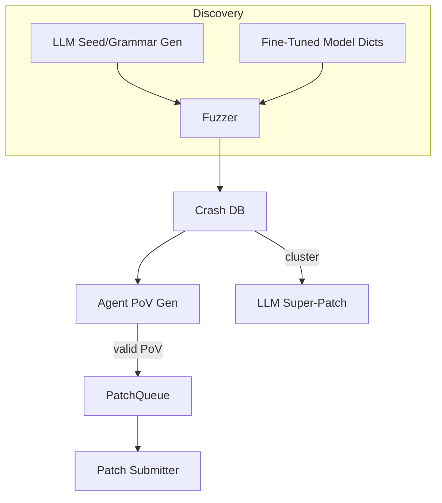

# AI 지원 Fuzzing & 자동화된 취약점 발견

{{#include ../banners/hacktricks-training.md}}

## 개요
대규모 언어 모델(LLM)은 의미가 풍부한 입력을 생성하고, 문법을 발전시키며, crash 데이터를 추론하고, 여러 버그를 한꺼번에 수정하는 패치까지 제안함으로써 기존 취약점 연구 파이프라인을 크게 강화할 수 있습니다. 이 페이지에서는 DARPA의 AI Cyber Challenge(AIxCC) 결선과 그 밖의 공개 연구에서 확인된 가장 효과적인 패턴을 모았습니다.<sup>[[4]](#references)</sup><sup>[[5]](#references)</sup>

아래 내용은 특정 대회 시스템 하나를 설명하는 것이 아니라, 자체 워크플로에서 재현할 수 있도록 기법을 추상화한 것입니다.

---

## 1. LLM이 생성한 Seed 입력

기존 coverage-guided fuzzer(AFL++, libFuzzer, Honggfuzz 등)는 소량의 seed corpus로 시작해 바이트를 무작위로 변형합니다. 대상 입력 형식이 복잡한 경우(SQL, URL, 사용자 정의 바이너리 프로토콜 등), 무작위 변형은 흥미로운 분기에 도달하기 전에 대개 문법을 깨뜨립니다.

LLM은 *seed generator*를 출력해 이 초기화 문제를 해결할 수 있습니다. 이는 **문법적으로 올바르면서도 보안상 의미 있는 입력**을 출력하는 짧은 스크립트입니다. 예를 들면 다음과 같습니다.

```prompt
SYSTEM: You are a helpful security engineer.
USER:
Write a Python3 program that prints 200 unique SQL injection strings targeting common anti-pattern mistakes (missing quotes, numeric context, stacked queries).  Ensure length ≤ 256 bytes / string so they survive common length limits.
```

```python
# gen_sqli_seeds.py (truncated)
PAYLOADS = [
    "1 OR 1=1 -- ",
    "' UNION SELECT NULL,NULL--",
    "0; DROP TABLE users;--",
    ...
]
for p in PAYLOADS:
    print(p)
```

한 번 실행한 뒤 출력을 퍼저의 초기 코퍼스에 직접 넣으세요:

```bash
python3 gen_sqli_seeds.py > seeds.txt
afl-fuzz -i seeds.txt -o findings/ -- ./target @@
```

Benefits:
1. 의미적 유효성 → 초기에 더 깊은 커버리지 확보.
2. 재생성 가능: 프롬프트를 조정해 XSS, path traversal, binary blobs 등에 집중할 수 있습니다.
3. 저렴함(GPT-3.5 사용 시 1¢ 미만).

### Tips
* 모델에 페이로드 길이와 인코딩(UTF-8, URL-encoded, UTF-16-LE)을 *다양화*하도록 지시해 피상적인 필터를 우회합니다.
* *독립 실행형 스크립트 하나*를 요청하면 JSON 형식 오류를 피할 수 있습니다.

---

## 2. Grammar-Evolution Fuzzing

더 강력한 변형 방식은 구체적인 seed 대신 LLM이 **grammar를 발전**시키도록 하는 것입니다. 워크플로(“Grammar Guy” 패턴)는 다음과 같습니다.

1. 프롬프트를 사용해 초기 ANTLR/Peach/LibFuzzer grammar를 생성합니다.
2. N분 동안 fuzzing을 실행하고 커버리지 지표(적중한 edge/block)를 수집합니다.
3. 커버되지 않은 프로그램 영역을 요약하고 그 요약을 모델에 다시 입력합니다:
   ```prompt
   The previous grammar triggered 12 % of the program edges.  Functions not reached: parse_auth, handle_upload.  Add / modify rules to cover these.
   ```
4. 새 규칙을 병합하고, 다시 fuzzing을 수행한 뒤 반복합니다.

의사 코드 골격:

```python
for epoch in range(MAX_EPOCHS):
    grammar = llm.refine(grammar, feedback=coverage_stats)
    save(grammar, f"grammar_{epoch}.txt")
    coverage_stats = run_fuzzer(grammar)
```

핵심 사항:
* *budget*을 유지하세요. 각 개선 작업에는 토큰이 사용됩니다.
* 모델이 다시 작성하지 않고 편집하도록 `diff` + `patch` 지시를 사용하세요.
* Δcoverage < ε이면 중단하세요.

---

## 3. Local-LLM libFuzzer 하네스 엔지니어링

분석가의 워크스테이션 밖으로 내보낼 수 없는 소스의 경우, 로컬 코드 모델을 사용해 fuzzer 바이트와 C/C++ API 사이의 작은 어댑터 초안을 작성할 수 있습니다. 유용한 보안 경계는 명확합니다. **모델은 테스트 인프라를 작성하고 수정하며, coverage-guided mutation은 입력을 탐색하고, sanitizers는 잘못된 연산을 보고하며, 사람은 하네스를 검토하고 발견 사항을 분류합니다**.<sup>[[9]](#references)</sup>

LLM에 의존하지 않는 엔진 수준의 corpus, 피드백, snapshot, stateful-fuzzing 기법은 일반 [Fuzzing Methodology](../generic-methodologies-and-resources/fuzzing.md)를 참고하세요.

대상 헤더에서 정확한 선언을 복사하고 출력 형식을 제한하는 것으로 시작하세요. 프롬프트의 범위를 좁히면 존재하지 않는 API를 만들어 내는 일을 줄이고 결과물을 쉽게 검토할 수 있습니다.<sup>[[8]](#references)[[9]](#references)</sup>

```prompt
Write a libFuzzer target for this exact declaration:
int parse_records(const uint8_t *data, size_t size);

Output only C code. Implement LLVMFuzzerTestOneInput, include the
declaration, pass data and size unchanged, and do not use files,
network access, randomness, clocks, threads, or persistent state.
```

raw byte parser의 예상 결과는 다음보다 복잡하지 않아야 합니다:<sup>[[6]](#references)[[9]](#references)</sup>

```c
#include <stddef.h>
#include <stdint.h>

extern int parse_records(const uint8_t *, size_t);

int LLVMFuzzerTestOneInput(const uint8_t *data, size_t size) {
    (void)parse_records(data, size);
    return 0;
}
```

컴파일은 첫 번째 검증 단계일 뿐입니다. CPU 시간을 들이기 전에 생성된 모든 타깃이 다음 불변 조건을 만족하는지 검토하세요:<sup>[[6]](#references)[[8]](#references)[[9]](#references)</sup>

- **정확한 API:** 실제 헤더 및 기존 호출 코드와 타입, 소유권 규칙, 초기화, 해제, 호출 규약을 비교합니다.
- **Harness 안전성:** `data`를 읽을 때마다 경계 검사를 수행합니다. sanitizer가 발견한 문제는 생성된 glue 코드가 아니라 타깃에서 발생해야 합니다.
- **재현성:** 결과가 `data`와 `size`의 함수가 되도록 합니다. 외부 I/O, 시간, 제어되지 않는 난수, join되지 않은 스레드, 호출 간에 유지되는 상태를 제거합니다.
- **처리량:** 동작에 영향을 주지 않는 경우에만 비용이 큰 불변 상태를 한 번 초기화하고, 입력 크기를 제한하며, 로깅을 억제하고, 입력별 할당을 해제합니다.
- **도달성:** 의도한 함수와 분기가 실행되는지 확인합니다. 컴파일은 되지만 거부 경로만 실행하는 타깃은 조용한 실패입니다.

### 구조 인식 타깃: 버그를 숨기지 않고 불변 조건 유지하기

대부분의 원시 입력이 magic, 길이, 버전 또는 체크섬 검사에서 실패한다면, fuzz 바이트를 **타입이 지정된 필드 재료**로 사용해 유효한 객체를 다시 구성하세요. 형식 상수는 고정하고, 의미 필드와 페이로드 바이트는 변경 가능하게 유지하며, 재구성된 페이로드에서 무결성 메타데이터를 파생합니다. `FuzzedDataProvider`는 경계가 지정된 타입 값을 가져오는 데 유용하며, 어댑터는 생성되는 모든 할당 및 변환의 크기를 제한해야 합니다.<sup>[[9]](#references)</sup>

<details>
<summary>구조 인식 C++ 타깃 예제</summary>

```cpp
#include <fuzzer/FuzzedDataProvider.h>
#include <stddef.h>
#include <stdint.h>
#include <vector>

extern "C" int parse_message(const uint8_t *, size_t);

extern "C" int LLVMFuzzerTestOneInput(const uint8_t *data, size_t size) {
    FuzzedDataProvider fdp(data, size);
    uint8_t version = fdp.ConsumeIntegral<uint8_t>();
    auto body = fdp.ConsumeRemainingBytes<uint8_t>();
    if (body.size() > UINT16_MAX) body.resize(UINT16_MAX);
    uint16_t len = static_cast<uint16_t>(body.size());
    std::vector<uint8_t> msg = {0x8b, 'M', 'S', 'G', version,
                                static_cast<uint8_t>(len >> 8),
                                static_cast<uint8_t>(len)};
    msg.insert(msg.end(), body.begin(), body.end());
    (void)parse_message(msg.data(), msg.size());
    return 0;
}
```

</details>

모든 질문에 하나의 구조 복구 target을 사용하지 마세요. 길이와 체크섬을 계산해 깊은 유효 상태를 탐색하는 target 하나와, **선언된** 메타데이터는 fuzzer가 제어하도록 두고 하네스 자체의 읽기와 할당만 제한하는 target을 별도로 유지하세요. 두 번째 target은 자동 복구로 사라질 수 있는 길이 불일치 및 무결성 검증 실패 공격 표면을 보존합니다.<sup>[[9]](#references)</sup>

### 시드, 딕셔너리, sanitizer, coverage 피드백

모델에 바이너리를 직접 출력하라고 요청하는 대신, 바이너리 시드를 쓰는 스크립트를 생성하도록 요청하세요. 비어 있는 객체, 최소 객체, 일반적인 객체, 경계 조건을 만족하는 유효한 객체를 시드로 사용한 다음, magic 값, 태그, enum 인코딩, 파서 키워드를 추출해 검토된 딕셔너리에 추가하세요. libFuzzer는 `-dict=` 옵션으로 해당 딕셔너리를 받아들이며, 새로운 coverage를 드러내는 mutation을 corpus에 보존합니다.<sup>[[6]](#references)[[9]](#references)</sup>

```text
magic="\x8bMSG"
version_min="\x00"
version_max="\xff"
config_tag="CONFIG"
```

보완적인 instrumentation을 적용해 동일한 타깃을 빌드합니다. ASan과 UBSan은 하나의 fuzzing 바이너리를 공유할 수 있습니다. 별도의 MSan 빌드를 사용하고, 계측되지 않은 코드로 인한 보고를 방지하려면 종속성도 계측하세요.<sup>[[6]](#references)[[9]](#references)</sup>

```bash
clang++ -g -O1 -fsanitize=fuzzer,address,undefined \
  -fno-sanitize-recover=undefined target.cc harness.cc -o fuzz_target
./fuzz_target corpus -dict=msg.dict -max_len=65535

clang++ -g -O1 -fsanitize=fuzzer,memory \
  target.cc harness.cc -o fuzz_target_msan
```

각 모델 revision의 평가 기준으로 coverage를 사용하세요. libFuzzer 출력에서 `cov`/`ft`가 초반부터 정체되고 corpus도 그대로라면 잘못된 framing, 지나치게 제한적인 early return, 또는 잘못된 호출을 의미하는 경우가 많습니다. `exec/s`가 낮다면 비용이 많이 드는 setup, I/O, allocation 또는 누수된 state가 원인일 수 있습니다. `NEW`는 coverage feature가 바뀌었다는 것만 증명할 뿐, 의도한 parser에 도달했다는 뜻은 아닙니다.<sup>[[6]](#references)[[9]](#references)</sup>

소스 수준의 피드백을 얻으려면 coverage 빌드를 만들고 fuzzing한 뒤, 미커버 함수와 해당 함수의 실행을 제어하는 조건만 모델에 제공하세요. 결과 harness/seed/dictionary diff를 확인하고 다시 측정하세요:<sup>[[7]](#references)[[8]](#references)[[9]](#references)</sup>

```bash
clang++ -g -O1 -fsanitize=fuzzer \
  -fprofile-instr-generate -fcoverage-mapping target.cc harness.cc -o fuzz_cov
mkdir -p profiles
LLVM_PROFILE_FILE='profiles/%p.profraw' ./fuzz_cov -max_total_time=300 corpus
llvm-profdata merge -sparse profiles/*.profraw -o fuzz.profdata
llvm-cov report ./fuzz_cov -instr-profile=fuzz.profdata
llvm-cov show ./fuzz_cov -instr-profile=fuzz.profdata \
  --show-branches=count --region-coverage-lt=1 target.cc
```

따라서 확장 가능한 반복 과정은 **생성 → 컴파일/링크 → sanitizer를 사용해 smoke-test → target coverage 측정 → 가장 관련성 높은 최소한의 coverage/source context 제공 → 수정 → 재측정**입니다. OSS-Fuzz-Gen은 그럴듯한 코드를 액면 그대로 받아들이는 대신, 생성된 target의 컴파일 가능성, 런타임 실패, coverage, 기존 target 대비 coverage 개선 여부를 평가하여 같은 원칙을 적용합니다.<sup>[[7]](#references)[[8]](#references)</sup>

---

<a id="3-agent-based-pov-exploit-generation" hidden>3. Agent 기반 PoV (Exploit) 생성</a>

## 4. Agent 기반 PoV (Exploit) 생성

crash를 찾은 후에도 이를 결정적으로 발생시키는 **vulnerability proof (PoV)**가 필요합니다.

확장 가능한 접근 방식은 여러 경량 worker(프로세스, 스레드 또는 컨테이너)를 실행하고, 각 worker가 서로 다른 모델이나 sampling 설정을 사용하게 하는 것입니다. AIxCC finalist 설문조사에는 구체적인 규모 사례가 나와 있습니다. 한 팀은 AI 우선 PoV 생성을 위해 **수천 개의 동시 agent**를 사용했고, 다른 팀은 **300–500개의 fuzzing agent**를 조율하면서 더 높은 수준의 semantic reasoning에 LLM을 사용했습니다.<sup>[[4]](#references)</sup>

파이프라인:
1. Static/dynamic analysis로 *bug 후보*를 생성합니다(crash PC, input slice, sanitizer 메시지가 포함된 struct).
2. Orchestrator가 후보를 agent에 분배합니다.
3. Agent의 추론 단계:
   a. `gdb`와 input을 사용해 로컬에서 bug를 재현합니다.
   b. 최소한의 exploit payload를 제안합니다.
   c. sandbox에서 exploit을 검증합니다. 성공하면 제출합니다.
4. 실패한 시도는 coverage fuzzing을 위한 **새 seed로 다시 대기열에 추가됩니다**(feedback loop).

장점:
* 병렬화로 단일 agent의 낮은 신뢰성을 보완합니다.
* 관찰된 성공률에 따라 temp/model size를 자동 조정합니다.

---

<a id="4-directed-fuzzing-with-fine-tuned-code-models" hidden>4. Fine-tuned Code Model을 사용한 Directed Fuzzing</a>

## 5. Fine-tuned Code Model을 사용한 Directed Fuzzing

취약점 패턴(integer overflow, buffer copy, format string)이 표시된 C/C++ 소스 코드로 open-weight model(예: Llama-7B)을 fine-tune합니다. 그런 다음:

1. Static analysis를 실행해 함수 목록과 AST를 가져옵니다.
2. 모델에 다음과 같이 prompt를 입력합니다. *“함수 X에서 memory safety를 깨뜨릴 가능성이 높은 mutation dictionary 항목을 제안해 주세요.”*
3. 해당 token을 커스텀 `AFL_CUSTOM_MUTATOR`에 삽입합니다.

`sprintf` wrapper의 출력 예시:
```
{"pattern":"%99999999s"}
{"pattern":"AAAAAAAA....<1024>....%n"}
```

실제 타깃에서 실험한 결과, crash까지 걸리는 시간이 2배 이상 단축됩니다.

---

<a id="5-ai-guided-patching-strategies" hidden>5. AI 기반 패치 전략</a>

## 6. AI 기반 패치 전략

<a id="51-super-patches" hidden>5.1 슈퍼 패치</a>

### 6.1 슈퍼 패치
모델에 crash 시그니처를 *클러스터링*하고 공통 근본 원인을 제거하는 **단일 패치**를 제안하도록 요청하세요. 한 번 제출해 여러 버그를 수정하면, 잘못된 패치 하나마다 점수가 깎이는 환경에서 정확도 페널티를 줄일 수 있습니다.

프롬프트 개요:
```
Here are 10 stack traces + file snippets.  Identify the shared mistake and generate a unified diff fixing all occurrences.
```

{{#ref}}
../generic-methodologies-and-resources/fuzzing.md
{{#endref}}

<a id="52-speculative-patch-ratio" hidden>5.2 추측성 패치 비율</a>

### 6.2 추측성 패치 비율
확인된 PoV 검증 패치와 *추측성* 패치(PoV 없음)를 점수 규칙에 맞춰 조정한 1:​N 비율(예: 추측성 2개 : 확인된 패치 1개)로 교차 배치하는 큐를 구현합니다. 비용 모델은 페널티와 점수를 모니터링하고 N을 자동 조정합니다.

---

결정론적 파일 단위 소스 검토, 모바일 진입점 taskflow, 커널 패턴 감사, 증거 기반 취약점 검증에 대해서는 [AI 지원 소스 검토 및 취약점 검증](AI-Assisted-Source-Review-and-Vulnerability-Validation.md)을 참조하세요.

---

## 디버거 지원 크래시 분류

크래시 분류, 함수 분석, 제어된 힙 청크 도달 가능성 확인을 위한 Mona v3 워크플로는 [익스플로잇 도구](../binary-exploitation/basic-stack-binary-exploitation-methodology/tools/#mona-v3-debugger-context-requests-for-crash-triage)에 있습니다.

---

## 모든 요소 통합하기
엔드투엔드 CRS(Cyber Reasoning System)는 다음과 같이 구성할 수 있습니다:



---

## References

- [4] [Trail of Bits – AIxCC 결승전: 실전 기록](https://blog.trailofbits.com/2025/08/07/aixcc-finals-tale-of-the-tape/)
- [5] [CTF Radiooo AIxCC 결승 진출자 인터뷰](https://www.youtube.com/@ctfradiooo)
- [6] [LLVM — libFuzzer: 커버리지 기반 퍼징 테스트 라이브러리](https://llvm.org/docs/LibFuzzer.html)
- [7] [Google — OSS-Fuzz-Gen](https://github.com/google/oss-fuzz-gen)
- [8] [Google Online Security Blog — 퍼징 수준 높이기: AI로 더 많은 취약점 찾기](https://security.googleblog.com/2024/11/leveling-up-fuzzing-finding-more.html)
- [9] [8kSec — 로컬 LLM을 이용한 AI 지원 퍼징 하네스 생성](https://8ksec.io/ai-assisted-fuzzing-harness-local-llm)
{{#include ../banners/hacktricks-training.md}}
