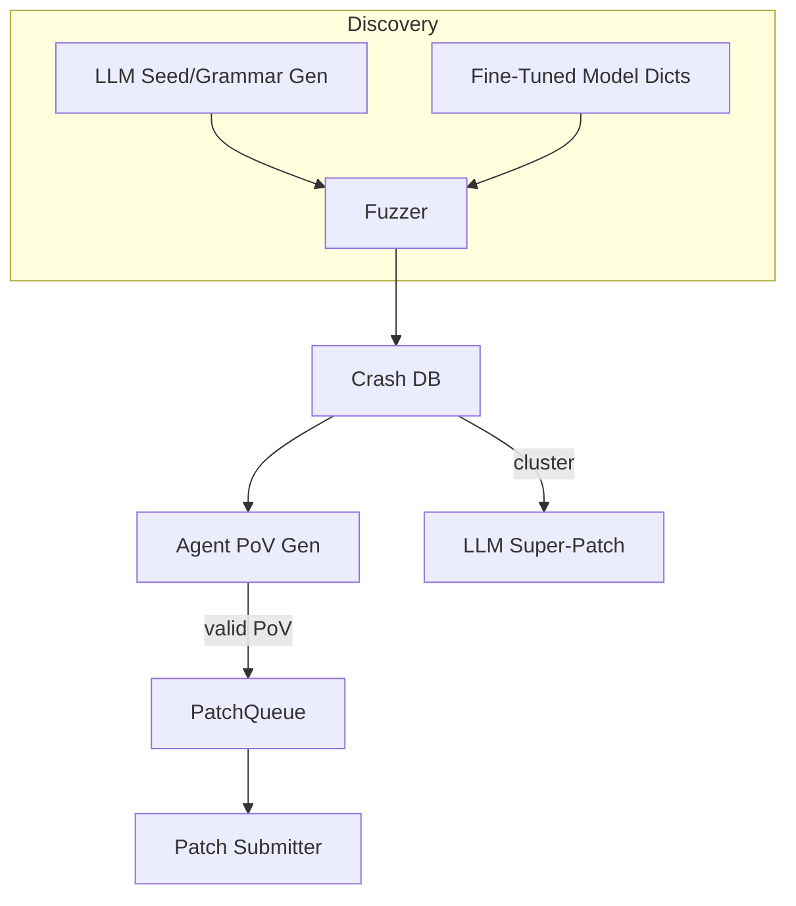

# Fuzzing uz pomoć AI-ja i automatizovano otkrivanje ranjivosti

{{#include ../banners/hacktricks-training.md}}

## Pregled
Veliki jezički modeli (LLM-ovi) mogu znatno da unaprede tradicionalne procese istraživanja ranjivosti tako što generišu semantički bogate ulaze, razvijaju gramatike, analiziraju podatke o padovima, pa čak i predlažu zakrpe za više grešaka. Ova stranica objedinjuje najefikasnije obrasce uočene tokom finala DARPA-inog AI Cyber Challenge-a (AIxCC) i drugih javnih istraživanja.<sup>[[4]](#references)</sup><sup>[[5]](#references)</sup>

Ovo nije opis jednog konkretnog takmičarskog sistema, već prikaz tehnika koje možete da ponovite u sopstvenim radnim procesima.

---

## 1. Ulazni seed-ovi generisani pomoću LLM-a

Tradicionalni fuzzers vođeni pokrivenošću (AFL++, libFuzzer, Honggfuzz…) počinju s malim korpusom seed-ova i nasumično menjaju bajtove. Kada je format ulaza za cilj složen (SQL, URL-ovi, prilagođeni binarni protokoli), nasumične izmene obično naruše sintaksu pre nego što se dođe do zanimljivih grana.

LLM-ovi mogu da reše ovaj problem početnog podešavanja tako što generišu *generatore seed-ova* – kratke skripte koje ispisuju **ulaze sa ispravnom sintaksom, ali relevantne za bezbednost**. Na primer:

```prompt
SYSTEM: You are a helpful security engineer.
USER:
Write a Python3 program that prints 200 unique SQL injection strings targeting common anti-pattern mistakes (missing quotes, numeric context, stacked queries).  Ensure length ≤ 256 bytes / string so they survive common length limits.
```

```python
# gen_sqli_seeds.py (truncated)
PAYLOADS = [
    "1 OR 1=1 -- ",
    "' UNION SELECT NULL,NULL--",
    "0; DROP TABLE users;--",
    ...
]
for p in PAYLOADS:
    print(p)
```

Pokrenite jednom i prosledite izlaz direktno u početni korpus fuzzera:

```bash
python3 gen_sqli_seeds.py > seeds.txt
afl-fuzz -i seeds.txt -o findings/ -- ./target @@
```

Benefits:
1. Semantička validnost → dublja pokrivenost u ranoj fazi.
2. Može ponovo da se generiše: prilagodite prompt tako da se fokusira na XSS, path traversal, binarne blobove itd.
3. Jeftino (< 1 ¢ uz GPT-3.5).

### Tips
* Uputite model da *diversify* dužinu i kodiranje payload-a (UTF-8, URL-encoded, UTF-16-LE) kako bi zaobišao površne filtere.
* Zatražite *single self-contained script* – time se izbegavaju problemi s formatiranjem JSON-a.

---

## 2. Grammar-Evolution Fuzzing

Moćnija varijanta je da LLM **evoluira gramatiku** umesto konkretnih seed-ova.  Workflow („Grammar Guy“ obrazac) je sledeći:

1. Generišite početnu ANTLR/Peach/LibFuzzer gramatiku pomoću prompt-a.
2. Fuzz-ujte N minuta i prikupite metrike pokrivenosti (pogodjene ivice / blokovi).
3. Sažmite nepokrivene delove programa i prosledite sažetak nazad modelu:
   ```prompt
   The previous grammar triggered 12 % of the program edges.  Functions not reached: parse_auth, handle_upload.  Add / modify rules to cover these.
   ```
4. Spojite nova pravila, ponovo pokrenite fuzzing i ponavljajte.

Kostur pseudokoda:

```python
for epoch in range(MAX_EPOCHS):
    grammar = llm.refine(grammar, feedback=coverage_stats)
    save(grammar, f"grammar_{epoch}.txt")
    coverage_stats = run_fuzzer(grammar)
```

Ključne tačke:
* Držite se *budžeta* – svako usavršavanje troši tokene.
* Koristite instrukcije `diff` + `patch` kako bi model uređivao, umesto da prepisuje.
* Zaustavite se kada je Δcoverage < ε.

---

## 3. Inženjering lokalnog LLM libFuzzer harness-a

Za izvorni kod koji ne sme da napusti analitičarevu radnu stanicu, lokalni code model može da napravi mali adapter između bajtova fuzzera i C/C++ API-ja. Bezbednosna granica je jasna: **model piše i dorađuje testnu infrastrukturu; mutacija vođena pokrivenošću istražuje ulaze; sanitizatori prijavljuju nevažeće operacije; čovek pregleda harness i trijažira nalaze**.<sup>[[9]](#references)</sup>

Za tehnike na nivou engine-a za korpus, povratne informacije, snapshot i stateful fuzzing, koje ne zavise od LLM-a, pogledajte opštu [Metodologiju fuzzing-a](../generic-methodologies-and-resources/fuzzing.md).

Počnite od tačne deklaracije prepisane iz zaglavlja ciljnog programa i ograničite format izlaza. Usko postavljen prompt smanjuje broj izmišljenih API-ja i olakšava pregled rezultata:<sup>[[8]](#references)[[9]](#references)</sup>

```prompt
Write a libFuzzer target for this exact declaration:
int parse_records(const uint8_t *data, size_t size);

Output only C code. Implement LLVMFuzzerTestOneInput, include the
declaration, pass data and size unchanged, and do not use files,
network access, randomness, clocks, threads, or persistent state.
```

Za parser sirovih bajtova, očekivani rezultat ne bi trebalo da bude složeniji od:<sup>[[6]](#references)[[9]](#references)</sup>

```c
#include <stddef.h>
#include <stdint.h>

extern int parse_records(const uint8_t *, size_t);

int LLVMFuzzerTestOneInput(const uint8_t *data, size_t size) {
    (void)parse_records(data, size);
    return 0;
}
```

Kompilacija je samo prva kapija validacije. Pre nego što potrošite CPU vreme, proverite svaki generisani target u odnosu na ove invarijante:<sup>[[6]](#references)[[8]](#references)[[9]](#references)</sup>

- **Tačan API:** uporedite tipove, pravila vlasništva, inicijalizaciju, razgradnju i konvenciju pozivanja sa stvarnim zaglavljem i postojećim pozivaocima.
- **Bezbednost harness-a:** zaštitite svako čitanje iz `data`; nalazi sanitizer-a moraju poticati iz targeta, a ne iz generisanog glue koda.
- **Ponovljivost:** neka rezultat zavisi od `data` i `size`; uklonite spoljašnji I/O, vreme, nekontrolisanu nasumičnost, nezavršene niti i stanje koje opstaje između poziva.
- **Propusnost:** inicijalizujte skupo nepromenljivo stanje samo jednom, ali samo ako to ne može da utiče na ponašanje; ograničite veličinu ulaza, potisnite logovanje i oslobodite alokacije za svaki ulaz.
- **Dostižnost:** proverite da li se izvršavaju predviđene funkcije i grane. Target koji se kompajlira, ali izvršava samo putanje odbijanja, predstavlja neprimetan neuspeh.

### Targeti koji uvažavaju strukturu: očuvajte invarijante bez prikrivanja bagova

Ako većina sirovih ulaza ne prođe proveru magic vrednosti, dužine, verzije ili kontrolne sume, koristite bajtove za fuzzing kao **materijal za tipizirana polja** i ponovo sastavite ispravan objekat. Fiksirajte konstante formata, ostavite semantička polja i bajtove payload-a promenljivim i izračunajte metapodatke integriteta na osnovu rekonstruisanog payload-a. `FuzzedDataProvider` je koristan za preuzimanje ograničenih tipiziranih vrednosti, dok je adapter i dalje odgovoran za ograničavanje svake generisane alokacije i konverzije.<sup>[[9]](#references)</sup>

<details>
<summary>Primer C++ targeta koji uvažava strukturu</summary>

```cpp
#include <fuzzer/FuzzedDataProvider.h>
#include <stddef.h>
#include <stdint.h>
#include <vector>

extern "C" int parse_message(const uint8_t *, size_t);

extern "C" int LLVMFuzzerTestOneInput(const uint8_t *data, size_t size) {
    FuzzedDataProvider fdp(data, size);
    uint8_t version = fdp.ConsumeIntegral<uint8_t>();
    auto body = fdp.ConsumeRemainingBytes<uint8_t>();
    if (body.size() > UINT16_MAX) body.resize(UINT16_MAX);
    uint16_t len = static_cast<uint16_t>(body.size());
    std::vector<uint8_t> msg = {0x8b, 'M', 'S', 'G', version,
                                static_cast<uint8_t>(len >> 8),
                                static_cast<uint8_t>(len)};
    msg.insert(msg.end(), body.begin(), body.end());
    (void)parse_message(msg.data(), msg.size());
    return 0;
}
```

</details>

Nemojte koristiti jedan target koji popravlja strukturu za svako pitanje. Održavajte jedan target koji izvodi dužine/s kontrolne sume kako bi istraživao duboka validna stanja, a drugi u kojem fuzzer kontroliše **deklarisane** metapodatke, dok se ograničavaju samo čitanja i alokacije koje obavlja sam harness. Drugi target čuva površine za napade sa neusklađenim dužinama i neispravnim integritetom, koje bi automatska popravka inače uklonila.<sup>[[9]](#references)</sup>

### Seed-ovi, rečnici, sanitizatori i povratne informacije o pokrivenosti

Zatražite od modela da generiše skriptu koja upisuje binarne seed-ove, umesto da od njega tražite da direktno ispiše binarne podatke. Napravite seed-ove za prazne, minimalne, tipične i granične validne objekte; zatim izdvojite magične vrednosti, oznake, kodiranja enum-a i ključne reči parsera u pregledani rečnik. libFuzzer prihvata taj rečnik pomoću opcije `-dict=`, a u korpusu zadržava mutacije koje otkrivaju novu pokrivenost.<sup>[[6]](#references)[[9]](#references)</sup>

```text
magic="\x8bMSG"
version_min="\x00"
version_max="\xff"
config_tag="CONFIG"
```

Izgradite isti cilj uz komplementarnu instrumentaciju. ASan i UBSan mogu da dele isti fuzzing binarni fajl; koristite zasebnu MSan verziju i instrumentirajte njene zavisnosti da biste izbegli izveštaje izazvane neinstrumentiranim kodom.<sup>[[6]](#references)[[9]](#references)</sup>

```bash
clang++ -g -O1 -fsanitize=fuzzer,address,undefined \
  -fno-sanitize-recover=undefined target.cc harness.cc -o fuzz_target
./fuzz_target corpus -dict=msg.dict -max_len=65535

clang++ -g -O1 -fsanitize=fuzzer,memory \
  target.cc harness.cc -o fuzz_target_msan
```

Tretirajte pokrivenost kao merilo za svaku reviziju modela. U izlazu libFuzzer-a, rano ravne vrednosti `cov`/`ft` i statički korpus obično ukazuju na loše uokviravanje, previše restriktivan rani povratak ili pogrešan poziv; nizak `exec/s` ukazuje na skupu pripremu, I/O, alokaciju ili stanje koje se ne oslobađa. `NEW` samo dokazuje da se promenila neka funkcija pokrivenosti, a ne i da je dostignut željeni parser.<sup>[[6]](#references)[[9]](#references)</sup>

Za povratne informacije na nivou izvornog koda napravite build sa instrumentacijom pokrivenosti, fuzz-ujte ga i modelu dajte samo nepokrivene funkcije i uslove koji ih štite. Proverite razlike u harness-u, seed-u i rečniku, pa ponovo izmerite:<sup>[[7]](#references)[[8]](#references)[[9]](#references)</sup>

```bash
clang++ -g -O1 -fsanitize=fuzzer \
  -fprofile-instr-generate -fcoverage-mapping target.cc harness.cc -o fuzz_cov
mkdir -p profiles
LLVM_PROFILE_FILE='profiles/%p.profraw' ./fuzz_cov -max_total_time=300 corpus
llvm-profdata merge -sparse profiles/*.profraw -o fuzz.profdata
llvm-cov report ./fuzz_cov -instr-profile=fuzz.profdata
llvm-cov show ./fuzz_cov -instr-profile=fuzz.profdata \
  --show-branches=count --region-coverage-lt=1 target.cc
```

Skalabilna petlja je zato **generiši → kompajliraj/poveži → pokreni smoke-test pod sanitizerima → izmeri coverage cilja → obezbedi najmanji relevantni kontekst coverage/source → revidiraj → ponovo izmeri**. OSS-Fuzz-Gen primenjuje isti princip tako što procenjuje generisane ciljeve prema tome da li mogu da se kompajliraju, da li dolazi do grešaka u izvršavanju, kakav im je coverage i koliko poboljšavaju coverage u odnosu na postojeće ciljeve, umesto da prihvata uverljiv kod zdravo za gotovo.<sup>[[7]](#references)[[8]](#references)</sup>

---

## 4. Generisanje PoV-a (Exploita) pomoću agenata

Nakon što se pronađe crash, i dalje vam je potreban **dokaz ranjivosti (PoV)** koji ga deterministički izaziva.

Skalabilan pristup je pokretanje velikog broja laganih worker-a (procesa, niti ili kontejnera), pri čemu svaki koristi drugi model ili konfiguraciju uzorkovanja. Pregled finalista AIxCC-a navodi konkretne primere: jedan tim je koristio **hiljade istovremeno aktivnih agenata** za generisanje PoV-a prvenstveno pomoću AI-ja, dok je drugi koordinisao **300–500 fuzzing agenata** i koristio LLM-ove za semantičko rezonovanje višeg nivoa.<sup>[[4]](#references)</sup>

Pipeline:
1. Statička/dinamička analiza daje *kandidate za bagove* (strukturu sa crash PC-jem, isečkom ulaza i porukom sanitizera).
2. Orkestrator distribuira kandidate agentima.
3. Koraci rezonovanja agenta:
   a. Lokalno reprodukuje bag pomoću `gdb` + ulaza.
   b. Predlaže minimalni exploit payload.
   c. Validira exploit u sandbox-u. Ako uspe → šalje ga.
4. Neuspešni pokušaji se **ponovo stavljaju u red kao novi seeds** za coverage fuzzing (povratna sprega).

Prednosti:
* Paralelizacija ublažava nepouzdanost pojedinačnog agenta.
* Automatsko podešavanje temp-a/modela na osnovu uočene stope uspešnosti.

---

## 5. Directed Fuzzing pomoću fino podešenih modela koda

Fino podesite model otvorenih težina (npr. Llama-7B) na C/C++ kodu označenom obrascima ranjivosti (prekoračenje celog broja, kopiranje bafera, format string). Zatim:

1. Pokrenite statičku analizu da biste dobili spisak funkcija + AST.
2. Zadajte modelu prompt: *„Navedite unose za mutation dictionary koji će verovatno narušiti bezbednost memorije u funkciji X“*.
3. Ubacite te tokene u prilagođeni `AFL_CUSTOM_MUTATOR`.

Primer izlaza za `sprintf` wrapper:
```
{"pattern":"%99999999s"}
{"pattern":"AAAAAAAA....<1024>....%n"}
```

Empirijski, ovo skraćuje vreme do crash-a za više od 2× na stvarnim ciljevima.

---

## 6. Strategije patchovanja uz AI smernice

### 6.1 Super patch-evi
Zatražite od modela da *grupiše* potpise crash-eva i predloži **jedan patch** koji uklanja zajednički osnovni uzrok.  Pošaljite ga jednom, rešite nekoliko bagova → manje kazni za tačnost u okruženjima u kojima se za svaki pogrešan patch gube poeni.

Okvir prompta:
```
Here are 10 stack traces + file snippets.  Identify the shared mistake and generate a unified diff fixing all occurrences.
```

### 6.2 Odnos spekulativnih zakrpa
Implementirajte red čekanja u kome se smenjuju zakrpe potvrđene pomoću PoV-a i *spekulativne* zakrpe (bez PoV-a), u odnosu 1:​N podešenom prema pravilima bodovanja (npr. 2 spekulativne : 1 potvrđena). Model troškova prati kazne i poene i samostalno prilagođava N.

---

## 7. Deterministički AI pregled koda, datoteku po datoteku

Čest razlog neuspeha pri pregledu uz pomoć AI-ja jeste to što se od jednog agenta traži da pregleda čitav repozitorijum, uz očekivanje da će izabrati prave datoteke i izraze za grep. Pouzdaniji pristup je da se **obuhvati ceo repozitorijum**:<sup>[[1]](#references)</sup>

1. Popišite izvorne datoteke.
2. Šaljite **jednu po jednu datoteku** uz minimalni kontekst (ulazna tačka, uvozi, obližnje rute/pozivaoci).
3. Zahtevajte **strukturiran izveštaj** za svaku datoteku: izvori, sink, nedostajuća validacija, preduslovi za eksploataciju i pouzdanost.<sup>[[3]](#references)</sup>
4. Uklonite duplikate izveštaja prema **obrascu source→sink** i ručno proverite one s visokim rizikom.

Ovaj pristup troši mnogo tokena i stvara šum, ali je veoma efikasan u otkrivanju **jednostavnih source/sink grešaka s velikim uticajem** koje široki agentni pregledi često propuštaju.

### Obrasci za trijažu koje vredi staviti u prioritet

- **Dinamički PHP include/dispatch**: nazivi ruta/kontrolera/modula pod kontrolom napadača prosleđuju se u `require_once()`, `include()` ili `include_once()` bez stroge allowlist provere i kanonikalizacije putanje.
- **Izvršavanje shell komandi u administratorskim/naložnim tokovima rada**: korisnička imena, domeni, FTP nalozi ili drugi identifikatori dospevaju do `exec()`, `system()`, `shell_exec()`, `passthru()`, `proc_open()` ili `popen()`.
- **Više ulaza za strukturirane podatke**: isti parametar prihvata se iz `$_GET`, `$_POST`, JSON-a, XML-a ili parsera tela zahteva u okviru, a kasnije se ponovo koristi u sinkovima za datotečni sistem ili OS komande.

### Dve praktične klase grešaka koje ova metoda dobro pronalazi

- **PHP LFI/RCE pri izboru kontrolera**: ako se naziv kontrolera iz zahteva konkatenira u `require_once()` bez allowlist provere/normalizacije putanje, sekvence za prolazak kroz direktorijume kao što je `../` mogu navesti PHP da uključi nenamernu lokalnu `.php` datoteku. Ako napadač može da usmeri include na podmetnutu ili na drugi način korisnu PHP datoteku, LFI prerasta u izvršavanje koda. Pogledajte [Uključivanje datoteka / prolazak kroz putanje](../pentesting-web/file-inclusion/README.md).<sup>[[1]](#references)</sup>
- **Ubrizgavanje komandi u hosting/administratorske panele uz autentifikaciju**: ako se polja za upravljanje nalozima, poput korisničkih imena, ugrađuju u shell komande, korisnik s niskim privilegijama koji je autentifikovan može da pretvori uobičajenu radnju kreiranja/brisanja u RCE. Uticaj je veći kada panel izvršava komandu kao servisni nalog s višim privilegijama. Pogledajte [Ubrizgavanje komandi](../pentesting-web/command-injection.md).<sup>[[1]](#references)</sup>

### Praktične napomene za pregled

- Koristite LLM prvo kao **pregledača source/sink obrazaca**, a ne kao generatora eksploita.
- Zatražite da izričito navede **polje pod kontrolom napadača**, **propust u normalizaciji/validaciji** i **opasan sink**.
- U velikim repozitorijumima deterministički pregled datoteku po datoteku često je pouzdaniji od jednog pokretanja autonomnog agenta, čak i kada se za potonje koristi jači model.<sup>[[2]](#references)</sup>
- Očekujte slabije rezultate za **Broken Access Control** i druge greške poslovne logike kod kojih mogućnost eksploatacije zavisi od pretpostavki koje se protežu kroz više datoteka, semantike uloga ili modela pretnji specifičnog za proizvod.

---

## 8. Revizija kernela vođena obrascima uz instrumentirani oracle

Za cilj veličine kernela, nemojte tražiti od agenta da pronađe proizvoljne greške u celom stablu koda. Tok rada koji efikasnije troši tokene pretvara istorijsko znanje o ranjivostima u statičke upite, rangira rezultate prema izloženoj površini napada i koristi instrumentirani kernel kao oracle za izvršavanje.<sup>[[11]](#references)</sup>

### Baza obrazaca → CodeQL/Semgrep → fokusirani pregled

Napravite malu bazu znanja koja sadrži opasne API-je, obrasce nedostajuće validacije, rizične tokove source-to-sink i oblike ranije ispravljenih grešaka. Zatražite od modela da prevede **jedan po jedan obrazac** u heuristike za pregled i pravila CodeQL/Semgrep, a zatim pokrenite ta deterministička pravila nad celim stablom koda. Grupišite i uklonite duplikate iz podudaranja pre nego što modelu prosledite kod; sirovi izlaz skenera može da sadrži hiljade kandidata male vrednosti. Pre korišćenja ovog pristupa izvan prihvatljivih istraživačkih ili open-source ciljeva proverite trenutnu licencu za CodeQL.<sup>[[11]](#references)</sup>

Dajte prioritet podsistemima na osnovu **gustine pogodaka pravila** i **dostupnosti napadaču**, a ne samo broja pogodaka. Interfejsi kernela dostupni neprivilegovanim procesima, sandboxovima, kontejnerima, jail-ovima ili gostujućim kontekstima zaslužuju veću težinu od koda dostupnog samo interno. Neka jedinica pregleda bude dovoljno mala da agent može da uzme u obzir pozivaoce, validatore i pravila životnog ciklusa, a u upitu navedite konkretnu klasu ranjivosti ili obrazac toka kontrole umesto „pronađi bilo koju ranjivost“. Zastareli privilegovani interfejsi posebno su zanimljivi kada ih novija granica izolacije učini dostupnim root korisniku u namespaced okruženju ili jail-u.<sup>[[11]](#references)</sup>

Za svakog kandidata zahtevajte eksplicitan zapis toka polja pre pokušaja eksploatacije.<sup>[[11]](#references)</sup>

```text
entrypoint -> privilege check -> parser -> validation/normalization
           -> later rewrite -> dangerous sink
attacker controls: <fields and lengths>
constraints:       <values rewritten, rejected, or preserved>
observable result: <sanitizer report, assertion, panic, or clean exit>
```

### Koristite KASAN telemetriju kao oracle za hipoteze

Pokrenite ciljni kernel u privremenoj VM mašini sa uključenim KASAN-om i korisnim dijagnostičkim proverama. Agent treba da ponavlja ciklus **hipoteza o izvoru → minimalni userland trigger → izvršavanje u VM-u → KASAN/assertion trag → revidirana hipoteza** sve dok se sumnjiva korupcija ne reprodukuje ili opovrgne. Pri svakom ciklusu vratite samo relevantan stack trace i okolni izvorni kod; tako se čuva kontekst za zaključivanje, a kriterijum prihvatanja postaju dokazi iz izvršavanja, a ne pouzdanost modela.<sup>[[11]](#references)</sup>

Instrumentisana verzija nije konačno okruženje za procenu mogućnosti iskorišćavanja. Provere mogu zaustaviti izvršavanje pre operacije koja izaziva korupciju, док иста провера може бити искључена из продукционог кернела. Поново тестирајте непромењени trigger са тачном продукционом конфигурацијом, забележите верзију и конфигурацију израде кернела и одвојено наведите **досегљивост**, **корупцију меморије**, **контролисани примитив** и **безбедносни утицај**.<sup>[[11]](#references)[[12]](#references)</sup>

CVE-2026-3038 је користан пример за валидацију, а не шаблон за exploit. Неауторизовани FreeBSD `RTM_GET` захтев могао је да задржи предимензионирани `RTAX_AUTHOR` sockaddr кроз селективну валидацију и преписивање одговора, све док `rtsock_msg_buffer()` не би копирао кориснички контролисани `sa_len` у `sockaddr_storage` од 128 бајтова на стеку. Максимална копија од 255 бајтова изазивала је преписивање од 127 бајтова; дијагностичка провера је откривала неисправну дужину у инструментованој верзији, док је GENERIC kernel стизао до копирања, а затим изазивао panic приликом провере оштећеног canary-ја. Ово доказује ускраћивање услуге од стране неауторизованог корисника, а не самостално повећање привилегија: поуздана контрола би најпре захтевала други примитив, као што је откривање canary-ја. Погледајте [Stack Canaries](../binary-exploitation/common-binary-protections-and-bypasses/stack-canaries/index.html) за одговарајућу границу binary exploitation-а.<sup>[[11]](#references)[[12]](#references)[[13]](#references)</sup>

### Одбаците варање са предусловима за exploit

Пре прихватања PoV-а или exploit-а, затражите од независног рецензента/агента да покуша да га оповргне на основу унапред задатих критеријума. Рецензија мора да потврди све следеће услове.<sup>[[11]](#references)</sup>

- Изворни код циља, kernel и рањиви модул нису измењени да би путања постала досегљива.
- Нису уведени помоћни модул, синтетички gadget, искључена ублажавајућа мера, додатна привилегија или недоступан интерфејс.
- Trigger почиње са наведеним идентитетом позиваоца и ограничењима изолације на чистом snapshot-у.
- Наведени резултат и даље зависи од грешке: уклањање неисправног поља или примена само исправке грешке мора да прекине ланац.
- Crash, overread или overwrite пријављује се само као тај примитив; за извршавање кода или повећање привилегија потребни су независни докази.

Ова последња контрафактуална провера открива кружне демонстрације: ако предуслови већ обезбеђују тражени утицај (на пример, извршавање SUID садржаја који је доставио нападач са система датотека монтираног без `nosuid`), грешка безбедности меморије није створила тај утицај.<sup>[[11]](#references)</sup>

---

## Истраживање непознатих база кода уз помоћ агента и могућност ревизије

[Workflow за избор fuzz циљева по принципу graph-first](../generic-methodologies-and-resources/fuzzing.md#graph-first-fuzz-target-selection-and-mutation-triage) већ обрађује досегљивост улазних тачака, док [agentic SAST pipelines](../network-services-pentesting/pentesting-web/code-review-tools.md#agentic-sast-pipelines) обрађују фазну рецензију и доказне контролне тачке. Те детерминистичке резултате држите одвојено од хипотеза модела како би сваки унапређени налаз задржао локације у изворном коду, доказе о путањи и динамичко мерење.<sup>[[10]](#references)</sup>

### Повежите доказе о животном веку објекта без измишљања тока података

Статичка анализа може да пронађе дужину под контролом нападача која се чува у једној функцији и исто поље објекта које много касније стиже до одредишта копирања, а да притом не успе да докаже везу кроз callback-ове, поновна повезивања или животни век објекта. Сачувајте оба налаза засебно, групишите их по објекту/пољу и јасно означите недостајућу везу као питање за тријажу. Агент може да предложи везу, али преглед изворног кода или runtime инструментација морају да је докажу.<sup>[[10]](#references)</sup>

За сваког кандидата забележите:

- конкретну улазну тачку и бајтове под контролом нападача;
- сваког произвођача релевантног поља, укључујући валидацију специфичну за сваког произвођача;
- одредиште, капацитет одредишта и услове израде/runtime-а потребне да би се до њега стигло;
- стварни call stack из изложене улазне тачке, а не само директно позивање harness-а;
- најмањи динамички резултат који потврђује или одбацује хипотезу.

Наизглед безбедна путања не потврђује безбедност поља у целини. Други произвођач може да попуни исто поље без ограничења из прве путање. Тестирајте путање независно и покрените harness са опцијама израде еквивалентним продукционом окружењу, јер debug провере могу да претворе продукциону корупцију меморије у рано прекидање које се јавља само у тестирању.<sup>[[10]](#references)</sup>

### Контролне тачке мерења за откривање података и exploitation

Код сумње на откривање неиницијализоване меморије, попуните свеже алокације препознатљивим бајтом и проверите да ли тачно та ознака стиже до послатог пакета. За exploitation захтевајте измерене контролне тачке попут **контролисаног overwrite-а → корисног victim објекта → откривања података → опоравка показивача/базе → hijack-а тока контроле → састављеног payload-а**. Агент наставља тек када harness докаже тренутно својство; уверљиво објашњење не значи да је контролна тачка прошла. [FreeRDP случај](../binary-exploitation/libc-heap/heap-overflow.md#cross-path-length-reuse-and-stale-output-disclosure) показује путању и ограничења израде која морају да се очувају током валидације.<sup>[[10]](#references)</sup>

---

## Све заједно
Систем за сајбер резоновање (CRS) од почетка до краја може да повеже компоненте на следећи начин:



---

## References

- [1] [Project Black - Lokalni AI za sajber-bezbednost: pronalaženje phpIPAM LFI i myVesta autentifikovanog RCE-a](https://projectblack.io/blog/local-ai-for-cyber-security)
- [2] [Strix](https://github.com/usestrix/strix)
- [3] [GitHub Copilot community security-review veština](https://github.com/github/awesome-copilot/blob/main/skills/security-review/SKILL.md)
- [4] [Trail of Bits – AIxCC finale: poređenje rezultata](https://blog.trailofbits.com/2025/08/07/aixcc-finals-tale-of-the-tape/)
- [5] [Intervjui sa finalistima AIxCC-a na CTF Radiooo](https://www.youtube.com/@ctfradiooo)
- [6] [LLVM — libFuzzer: biblioteka za fuzz testiranje vođeno pokrivenošću](https://llvm.org/docs/LibFuzzer.html)
- [7] [Google — OSS-Fuzz-Gen](https://github.com/google/oss-fuzz-gen)
- [8] [Google Online Security Blog — Unapređenje fuzzinga: pronalaženje više ranjivosti pomoću AI-ja](https://security.googleblog.com/2024/11/leveling-up-fuzzing-finding-more.html)
- [9] [8kSec — Generisanje fuzzing harness-a uz pomoć AI-ja i lokalnog LLM-a](https://8ksec.io/ai-assisted-fuzzing-harness-local-llm)
- [10] [Quarkslab — Od AI agenata do RCE-a: izgradnja radnog procesa za istraživanje ranjivosti](https://blog.quarkslab.com/from-ai-agents-to-rce-building-a-vulnerability-research-workflow.html)
- [11] [Praetorian — FreeBSoD: korišćenje jezičkih modela za pronalaženje i iskorišćavanje grešaka u kernelu (1. deo od 2)](https://praetorian.com/blog/ai-vulnerability-research-freebsd-kernel)
- [12] [FreeBSD-SA-26:05.route — Lokalni DoS i moguće podizanje privilegija putem routing soketa](https://www.freebsd.org/security/advisories/FreeBSD-SA-26:05.route.asc)
- [13] [Izvorna zakrpa za FreeBSD-SA-26:05.route](https://security.FreeBSD.org/patches/SA-26:05/route.patch)
{{#include ../banners/hacktricks-training.md}}
