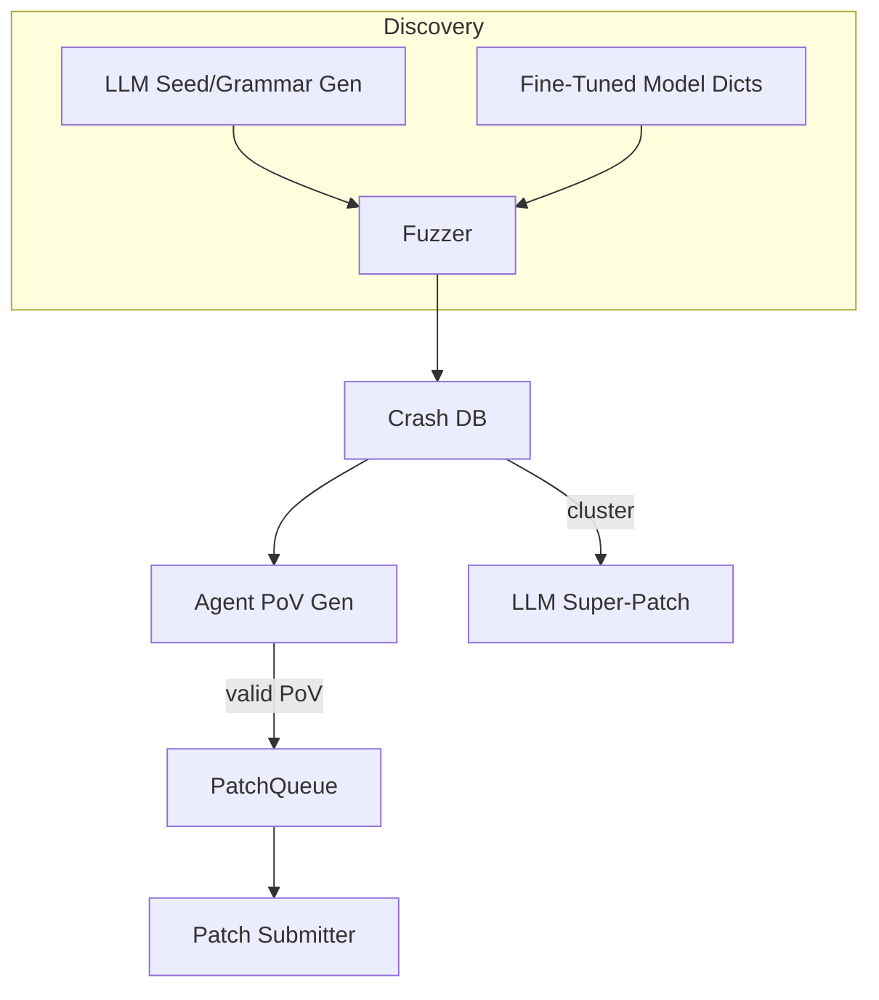

# AI支援Fuzzingと自動脆弱性発見

{{#include ../banners/hacktricks-training.md}}

## 概要
大規模言語モデル（LLM）は、意味的に豊かな入力の生成、文法の進化、クラッシュデータの推論、さらには複数のバグに対応するパッチの提案まで行うことで、従来の脆弱性調査パイプラインを大幅に強化できます。このページでは、DARPAのAI Cyber Challenge（AIxCC）最終戦やその他の公開研究で確認された、特に効果的なパターンをまとめます。<sup>[[4]](#references)</sup><sup>[[5]](#references)</sup>

以下では、特定の競技システムについて説明するのではなく、独自のワークフローで再現できるよう、手法を抽象化して紹介します。

---

## 1. LLMによるシード入力の生成

従来のカバレッジガイド型fuzzer（AFL++、libFuzzer、Honggfuzzなど）は、小さなシードコーパスから始め、バイト列を無作為に変異させます。対象の入力形式が複雑（SQL、URL、独自のバイナリプロトコルなど）な場合、無作為な変異では通常、興味深い分岐に到達する前に構文が壊れてしまいます。

LLMは、*シードジェネレーター*、つまり**構文的に正しく、セキュリティ上重要な入力**を出力する短いスクリプトを作成することで、このブートストラップの問題を解決できます。たとえば、以下のようになります。

```prompt
SYSTEM: You are a helpful security engineer.
USER:
Write a Python3 program that prints 200 unique SQL injection strings targeting common anti-pattern mistakes (missing quotes, numeric context, stacked queries).  Ensure length ≤ 256 bytes / string so they survive common length limits.
```

```python
# gen_sqli_seeds.py (truncated)
PAYLOADS = [
    "1 OR 1=1 -- ",
    "' UNION SELECT NULL,NULL--",
    "0; DROP TABLE users;--",
    ...
]
for p in PAYLOADS:
    print(p)
```

1回実行し、その出力を fuzzer の初期コーパスに直接渡します:

```bash
python3 gen_sqli_seeds.py > seeds.txt
afl-fuzz -i seeds.txt -o findings/ -- ./target @@
```

Benefits:
1. Semantic validity → より早い段階で、より深くカバレッジを獲得できる。
2. 再生成可能: プロンプトを調整して、XSS、path traversal、binary blobs などに焦点を当てられる。
3. 低コスト（GPT-3.5 なら 1 ¢ 未満）。

### Tips
* 表面的なフィルターを回避できるよう、payload の長さやエンコーディング（UTF-8、URL-encoded、UTF-16-LE）に*変化をつける*ようモデルに指示する。
* *単一の自己完結型スクリプト*を生成するよう求める。JSON のフォーマット崩れを防げる。

---

## 2. Grammar-Evolution Fuzzing

より強力な方法として、具体的な seed の代わりに LLM に**grammar を進化**させることができる。ワークフロー（「Grammar Guy」パターン）は次のとおり。

1. プロンプトを使って、初期の ANTLR/Peach/LibFuzzer grammar を生成する。
2. N 分間 fuzzing を実行し、カバレッジ指標（ヒットした edge / block）を収集する。
3. 未カバーのプログラム領域を要約し、その要約をモデルにフィードバックする:
   ```prompt
   The previous grammar triggered 12 % of the program edges.  Functions not reached: parse_auth, handle_upload.  Add / modify rules to cover these.
   ```
4. 新しいルールをマージし、再度 fuzz し、繰り返す。

擬似コードの骨格:

```python
for epoch in range(MAX_EPOCHS):
    grammar = llm.refine(grammar, feedback=coverage_stats)
    save(grammar, f"grammar_{epoch}.txt")
    coverage_stats = run_fuzzer(grammar)
```

要点:
* *budget*を維持する – refinementごとにtokensを消費します。
* モデルに書き直しではなく編集をさせるため、`diff` + `patch`の指示を使います。
* Δcoverage < εになったら停止します。

---

## 3. Local-LLM libFuzzer Harnessの設計

アナリストのワークステーションから持ち出せないソースコードの場合、ローカルのコードモデルを使って、fuzzerのバイト列とC/C++ APIの間をつなぐ小さなadapterを作成できます。重要なセキュリティ境界は明確です。**モデルがテスト用インフラストラクチャを作成・修正し、coverage-guided mutationが入力を探索し、sanitizerが無効な操作を報告し、人間がharnessをレビューして発見事項をトリアージします**。<sup>[[9]](#references)</sup>

LLMに依存しない、engineレベルのcorpus、feedback、snapshot、stateful-fuzzingの手法については、一般的な[Fuzzing Methodology](../generic-methodologies-and-resources/fuzzing.md)を参照してください。

対象のheaderから正確な宣言をコピーし、出力形式を指定して始めます。範囲を絞ったpromptにすることで、APIの捏造を減らし、結果をレビューしやすくできます。<sup>[[8]](#references)[[9]](#references)</sup>

```prompt
Write a libFuzzer target for this exact declaration:
int parse_records(const uint8_t *data, size_t size);

Output only C code. Implement LLVMFuzzerTestOneInput, include the
declaration, pass data and size unchanged, and do not use files,
network access, randomness, clocks, threads, or persistent state.
```

raw byte parser の期待される結果は、次のように単純であるべきです:<sup>[[6]](#references)[[9]](#references)</sup>

```c
#include <stddef.h>
#include <stdint.h>

extern int parse_records(const uint8_t *, size_t);

int LLVMFuzzerTestOneInput(const uint8_t *data, size_t size) {
    (void)parse_records(data, size);
    return 0;
}
```

Compilation は最初の検証ゲートにすぎません。CPU 時間を費やす前に、生成されたすべての target が次の不変条件を満たすか確認してください:<sup>[[6]](#references)[[8]](#references)[[9]](#references)</sup>

- **Exact API:** 実際のヘッダーや既存の caller と、型、所有権のルール、初期化、teardown、呼び出し規約を比較します。
- **Harness safety:** `data` からのすべての読み取りにガードを設けます。sanitizer の検出結果は、生成された glue ではなく target に由来する必要があります。
- **Repeatability:** 結果が `data` と `size` のみによって決まるようにします。外部 I/O、時刻、制御されていない乱数、join されていない thread、呼び出し間で残る状態を取り除きます。
- **Throughput:** 動作に影響しない場合に限り、高コストな不変状態を一度だけ初期化し、入力サイズに上限を設け、ログ出力を抑え、入力ごとの allocation を解放します。
- **Reachability:** 意図した関数や分岐が実行されることを確認します。コンパイルできても拒否パスしか実行しない target は、気づかれにくい失敗です。

### Structure-aware target: バグを隠さず不変条件を維持する

raw input の大半が magic、長さ、version、checksum のゲートで失敗する場合は、fuzz bytes を**型付きフィールドのデータ**として使い、有効な object を再構築します。format 定数は固定し、意味的なフィールドと payload bytes は変更可能なままにして、再構築した payload から整合性 metadata を導出します。`FuzzedDataProvider` は、上限付きの型付き値を消費するのに便利ですが、生成される allocation や変換の上限を設ける責任は adapter にあります。<sup>[[9]](#references)</sup>

<details>
<summary>Structure-aware な C++ target の例</summary>

```cpp
#include <fuzzer/FuzzedDataProvider.h>
#include <stddef.h>
#include <stdint.h>
#include <vector>

extern "C" int parse_message(const uint8_t *, size_t);

extern "C" int LLVMFuzzerTestOneInput(const uint8_t *data, size_t size) {
    FuzzedDataProvider fdp(data, size);
    uint8_t version = fdp.ConsumeIntegral<uint8_t>();
    auto body = fdp.ConsumeRemainingBytes<uint8_t>();
    if (body.size() > UINT16_MAX) body.resize(UINT16_MAX);
    uint16_t len = static_cast<uint16_t>(body.size());
    std::vector<uint8_t> msg = {0x8b, 'M', 'S', 'G', version,
                                static_cast<uint8_t>(len >> 8),
                                static_cast<uint8_t>(len)};
    msg.insert(msg.end(), body.begin(), body.end());
    (void)parse_message(msg.data(), msg.size());
    return 0;
}
```

</details>

すべての質問に対して、構造を修復するターゲットを1つだけ使わないでください。長さやチェックサムを導出して、深い有効状態を探索するターゲットと、ハーネス自身の読み取りと割り当てのみを制限しつつ、**宣言された**メタデータはfuzzerに制御させるターゲットを別々に用意してください。2つ目のターゲットは、不一致の長さや不正な整合性情報に対する攻撃対象を保ちます。自動修復では、こうした攻撃対象が失われてしまいます。<sup>[[9]](#references)</sup>

### Seeds、辞書、sanitizer、coverageフィードバック

モデルには、バイナリを直接出力させるのではなく、バイナリのseedを書き込むスクリプトを生成させてください。空のオブジェクト、最小限のオブジェクト、一般的なオブジェクト、境界条件を満たす有効なオブジェクトをseedにします。その後、マジック値、タグ、enumのエンコーディング、parserのキーワードを抽出し、レビュー済みの辞書にまとめます。libFuzzerは`-dict=`でその辞書を受け取り、新しいcoverageをもたらすmutationをcorpusに保持します。<sup>[[6]](#references)[[9]](#references)</sup>

```text
magic="\x8bMSG"
version_min="\x00"
version_max="\xff"
config_tag="CONFIG"
```

相補的な instrumentation を使って同じ target をビルドします。ASan と UBSan は同じ fuzzing binary で併用できます。未計測コードによる報告を避けるため、MSan は別途ビルドし、その依存関係にも instrumentation を適用します。<sup>[[6]](#references)[[9]](#references)</sup>

```bash
clang++ -g -O1 -fsanitize=fuzzer,address,undefined \
  -fno-sanitize-recover=undefined target.cc harness.cc -o fuzz_target
./fuzz_target corpus -dict=msg.dict -max_len=65535

clang++ -g -O1 -fsanitize=fuzzer,memory \
  target.cc harness.cc -o fuzz_target_msan
```

各モデルのリビジョンは、カバレッジを評価指標として扱います。libFuzzerの出力で`cov`/`ft`が早い段階で横ばいになり、corpusも変化しない場合は、フレーミングの不備、早すぎるreturn条件の過度な制限、または呼び出し先の誤りが考えられます。`exec/s`が低い場合は、セットアップ、I/O、割り当て、または漏れた状態にコストがかかっていることを示します。`NEW`が証明するのはカバレッジ機能に変化があったことだけで、意図したパーサーに到達したことではありません。<sup>[[6]](#references)[[9]](#references)</sup>

ソースレベルのフィードバックを得るには、カバレッジ計測用ビルドを作成してfuzzし、未カバーの関数とそのガード条件だけをモデルに渡します。生成されたharness/seed/dictionaryの差分を検証し、再度計測します。<sup>[[7]](#references)[[8]](#references)[[9]](#references)</sup>

```bash
clang++ -g -O1 -fsanitize=fuzzer \
  -fprofile-instr-generate -fcoverage-mapping target.cc harness.cc -o fuzz_cov
mkdir -p profiles
LLVM_PROFILE_FILE='profiles/%p.profraw' ./fuzz_cov -max_total_time=300 corpus
llvm-profdata merge -sparse profiles/*.profraw -o fuzz.profdata
llvm-cov report ./fuzz_cov -instr-profile=fuzz.profdata
llvm-cov show ./fuzz_cov -instr-profile=fuzz.profdata \
  --show-branches=count --region-coverage-lt=1 target.cc
```

スケーラブルなループは、したがって **生成 → compile/link → sanitizer 下で smoke-test → target coverage を測定 → 関連する最小限の coverage/source context を提供 → 修正 → 再測定** となります。OSS-Fuzz-Gen も同じ原則を適用し、生成されたコードを見た目だけで評価するのではなく、生成 target のコンパイル可否、runtime failure、coverage、および既存 target に対する coverage の改善を評価します。<sup>[[7]](#references)[[8]](#references)</sup>

---

<a id="3-agent-based-pov-exploit-generation" hidden>3. Agent-Based PoV (Exploit) Generation</a>

## 4. Agent-Based PoV (Exploit) Generation

crash が見つかった後も、それを決定論的に発生させる**proof-of-vulnerability (PoV)** が必要です。

スケーラブルなアプローチでは、多数の軽量 worker（process、thread、または container）を起動し、それぞれ異なる model や sampling configuration を使います。AIxCC の finalist survey では、具体的な規模の例が示されています。ある team は AI-first PoV generation に**数千の同時稼働 agent**を使い、別の team は**300～500 の fuzzing agent**を連携させ、LLM はより高度な semantic reasoning に使用しました。<sup>[[4]](#references)</sup>

Pipeline:
1. Static/dynamic analysis により *bug candidate* を生成（crash PC、input slice、sanitizer message を含む struct）。
2. Orchestrator が candidate を agent に配布。
3. Agent の reasoning 手順:
   a. `gdb` + input を使い、bug をローカルで再現。
   b. 最小限の exploit payload を提案。
   c. sandbox で exploit を検証。成功した場合は submit。
4. 失敗した試行は、coverage fuzzing の**新たな seed として再キュー**される（feedback loop）。

利点:
* 並列化により、単一 agent の信頼性の低さを補える。
* 観測された成功率に基づき、temp / model size を自動調整できる。

---

<a id="4-directed-fuzzing-with-fine-tuned-code-models" hidden>4. Directed Fuzzing with Fine-Tuned Code Models</a>

## 5. Directed Fuzzing with Fine-Tuned Code Models

vulnerability pattern（integer overflow、buffer copy、format string など）をラベル付けした C/C++ source で、open-weight model（例: Llama-7B）を fine-tune します。その後:

1. Static analysis を実行し、function list と AST を取得。
2. Model に prompt を入力: *“Give mutation dictionary entries that are likely to break memory safety in function X”*
3. その token を custom `AFL_CUSTOM_MUTATOR` に挿入。

`sprintf` wrapper の出力例:
```
{"pattern":"%99999999s"}
{"pattern":"AAAAAAAA....<1024>....%n"}
```

実際のターゲットでは、クラッシュまでの時間が2倍以上短縮されます。

---

<a id="5-ai-guided-patching-strategies" hidden>5. AI誘導型パッチ戦略</a>

## 6. AI誘導型パッチ戦略

<a id="51-super-patches" hidden>5.1 Super Patches</a>

### 6.1 Super Patches
モデルにクラッシュシグネチャを*クラスタリング*させ、共通の根本原因を取り除く**単一のパッチ**を提案させます。一度の提出で複数のバグを修正できるため、誤ったパッチごとに減点される環境では、精度によるペナルティを減らせます。

プロンプトの概要：
```
Here are 10 stack traces + file snippets.  Identify the shared mistake and generate a unified diff fixing all occurrences.
```

{{#ref}}
../generic-methodologies-and-resources/fuzzing.md
{{#endref}}

<a id="52-speculative-patch-ratio" hidden>5.2 Speculative Patch Ratio</a>

### 6.2 Speculative Patch Ratio
PoVで検証済みのパッチと、PoVのない*推測的な*パッチを、スコアリングルールに合わせた1:Nの比率（例：推測的パッチ2件に対して検証済みパッチ1件）で交互に処理するキューを実装します。コストモデルがペナルティとポイントを監視し、Nを自動調整します。

---

<a id="6-deterministic-file-by-file-ai-code-review" hidden>6. Deterministic File-by-File AI Code Review</a>

## 7. Deterministic File-by-File AI Code Review

AI支援レビューでよくある失敗パターンは、エージェント1つにリポジトリ全体の調査を依頼し、適切なファイルやgrep用語を選んでくれることを期待することです。より信頼性の高い手法は、**リポジトリ全体を漏れなく調査するよう強制する**ことです。<sup>[[1]](#references)</sup>

1. ソースファイルを列挙します。
2. 最小限のコンテキスト（エントリーポイント、import、近接するルートや呼び出し元）とともに、**一度に1ファイル**を送ります。
3. 各ファイルについて、source、sink、欠落している検証、攻撃の前提条件、信頼度を含む**構造化レポート**を要求します。<sup>[[3]](#references)</sup>
4. **source→sinkパターン**でレポートを重複排除し、リスクの高いものを手動で検証します。

この方法はトークンを多く消費し、ノイズも多い一方で、広範なagentic reviewでは見逃されがちな**単純で影響の大きいsource/sinkバグ**を見つけるのに非常に効果的です。

### 優先度を上げる価値のあるトリアージパターン

- **動的なPHPのinclude/dispatch**: 攻撃者が制御するルート、controller、module名が、厳密なallowlistやパスのcanonicalizationなしに`require_once()`、`include()`、`include_once()`へ渡される。
- **管理者/アカウント関連ワークフローでのシェル実行**: ユーザー名、ドメイン、FTPアカウントなどの識別子が`exec()`、`system()`、`shell_exec()`、`passthru()`、`proc_open()`、`popen()`に渡される。
- **構造化入力の合流**: 同じパラメーターが`$_GET`、`$_POST`、JSON、XML、またはフレームワークのbody parserから受け取られ、後にファイルシステムやOSコマンドのsinkで再利用される。

### この方法で見つけやすい、実用的な2種類のバグ

- **PHPのcontroller-dispatchにおけるLFI/RCE**: リクエストで制御されるcontroller名がallowlistやパスの正規化なしに`require_once()`へ連結されている場合、`../`などのtraversal文字列によって、意図しないローカル`.php`ファイルをPHPに読み込ませることができます。攻撃者が配置した、または他の方法で利用価値のあるPHPファイルをincludeさせられる場合、LFIはコード実行につながります。[File Inclusion / Path Traversal](../pentesting-web/file-inclusion/README.md)を参照してください。<sup>[[1]](#references)</sup>
- **ホスティング/管理パネルにおける認証済みコマンドインジェクション**: ユーザー名などのアカウント管理フィールドがシェルコマンドに埋め込まれている場合、権限の低い認証済みユーザーでも、通常の作成/削除操作をRCEにつなげられる可能性があります。パネルがより高い権限を持つサービスアカウントとしてコマンドを実行すると、影響はさらに大きくなります。[Command Injection](../pentesting-web/command-injection.md)を参照してください。<sup>[[1]](#references)</sup>

### 実践的なレビューの注意点

- LLMはまず**source/sinkレビュー担当**として使い、exploitの生成には使わないでください。
- **攻撃者が制御するフィールド**、**正規化/検証の不備**、**危険なsink**を明示するよう求めます。
- 大規模なリポジトリでは、より強力なモデルを使う場合でも、単一の自律エージェント実行より、決定論的なファイル単位のレビューのほうが信頼性が高いことがよくあります。<sup>[[2]](#references)</sup>
- exploitabilityの判断が複数ファイルにまたがる前提、ロールの意味、製品固有の脅威モデルに依存する**Broken Access Control**やその他のビジネスロジックバグでは、結果が弱くなることを想定してください。

---

## 8. Pattern-Guided Kernel Auditing with an Instrumented Oracle

kernel規模のターゲットでは、ツリー全体から任意のバグを探すようエージェントに依頼しないでください。よりトークン効率の高いワークフローでは、過去の脆弱性に関する知識を静的クエリに変換し、攻撃対象領域への露出度で結果を順位付けして、計測済みkernelを実行オラクルとして使用します。<sup>[[11]](#references)</sup>

### Pattern database → CodeQL/Semgrep → focused review

危険なAPI、検証不足のパターン、リスクのあるsource-to-sinkフロー、過去に修正されたバグの形を含む小規模な知識ベースを構築します。モデルには、**一度に1つのパターン**をレビュー用ヒューリスティックとCodeQL/Semgrepルールに変換させ、その後、決定論的なルールをツリー全体で実行します。モデルにコードを渡す前に、一致結果をグループ化して重複排除してください。scannerの生出力には、価値の低い候補が何千件も含まれることがあります。対象が利用条件を満たす研究またはopen-sourceプロジェクト以外の場合は、この方法を使う前にCodeQLの現行ライセンスを確認してください。<sup>[[11]](#references)</sup>

一致数だけでなく、**ルールのヒット密度**と**攻撃者の到達可能性**の両方を使ってsubsystemの優先順位を決めます。非特権プロセス、sandbox、container、jail、guest環境から到達できるkernel interfaceには、内部専用コードより高い重みを与えてください。エージェントが呼び出し元、validator、ライフタイムルールを把握できるよう、レビュー単位を十分に小さく保ち、「脆弱性を何でも見つけて」ではなく、脆弱性クラスや制御フローパターンを指定してpromptします。新しい隔離境界によってnamespace内またはjail内のrootユーザーから到達可能になった、古い特権interfaceは特に注目に値します。<sup>[[11]](#references)</sup>

各候補について、exploitを試みる前に、明示的なフィールドフローの記録を必須としてください。<sup>[[11]](#references)</sup>

```text
entrypoint -> privilege check -> parser -> validation/normalization
           -> later rewrite -> dangerous sink
attacker controls: <fields and lengths>
constraints:       <values rewritten, rejected, or preserved>
observable result: <sanitizer report, assertion, panic, or clean exit>
```

### KASAN telemetryを仮説オラクルとして使う

KASANと有用な診断アサーションを有効にした使い捨てVMで、ターゲットカーネルを実行します。エージェントは、疑われる破損が再現または否定されるまで、**ソースコード上の仮説 → 最小限のuserlandトリガー → VMでの実行 → KASAN/アサーションのトレース → 仮説の修正**を繰り返します。各イテレーションでは、関連するスタックトレースとその周辺のソースコードだけを返します。これにより、推論に必要なコンテキストを保ちつつ、モデルの確信度ではなく実行時の証拠を合格基準にできます。<sup>[[11]](#references)</sup>

計測用ビルドは、最終的なexploitability環境ではありません。アサーションにより破損を引き起こす操作の前に実行が停止することがありますが、同じアサーションがproduction kernelではコンパイル時に無効化されている場合もあります。変更していないトリガーを、実際のproduction設定に対して再テストし、カーネルのビルドと設定を記録してください。また、**到達可能性**、**メモリ破損**、**制御可能なプリミティブ**、**セキュリティへの影響**を、それぞれ別個の主張として区別してください。<sup>[[11]](#references)[[12]](#references)</sup>

CVE-2026-3038は、exploitのテンプレートではなく、有用な検証例です。非特権のFreeBSD `RTM_GET`リクエストは、選択的な検証と応答の書き換えをすり抜け、サイズ超過の`RTAX_AUTHOR` sockaddrを保持したまま、`rtsock_msg_buffer()`がユーザー制御の`sa_len`を128バイトのスタック上の`sockaddr_storage`にコピーできる状態にしました。最大255バイトのコピーにより127バイトの上書きが発生しました。計測用ビルドでは診断アサーションが不正な長さを検出しましたが、GENERICカーネルではコピーが実行され、その後、破損したcanaryの検査時にpanicが発生しました。これは非特権のサービス拒否を証明するものであり、単独での権限昇格を証明するものではありません。信頼性の高い制御には、まずcanary disclosureなどの別のプリミティブが必要です。対応するbinary exploitationの境界については、[Stack Canaries](../binary-exploitation/common-binary-protections-and-bypasses/stack-canaries/index.html)を参照してください。<sup>[[11]](#references)[[12]](#references)[[13]](#references)</sup>

### exploitの前提条件を不正に満たす方法を排除する

PoVやexploitを受け入れる前に、別のreviewer/agentに、固定された基準に照らしてその主張を反証させます。レビューでは、以下のすべての条件を確認する必要があります。<sup>[[11]](#references)</sup>

- 経路を到達可能にするために、ターゲットのソースコード、カーネル、脆弱なモジュールが変更されていない。
- helper module、合成gadget、無効化されたmitigation、追加の権限、利用できないインターフェースが導入されていない。
- クリーンなsnapshot上で、主張されているcaller identityと隔離制限からトリガーを開始している。
- 主張された結果が依然としてバグに依存している。不正なフィールドを削除するか、バグだけを修正すると、攻撃の連鎖が成立しなくなる。
- クラッシュ、overread、上書きはそれぞれ該当するプリミティブとしてのみ報告されている。コード実行や権限昇格には独立した証拠が必要である。

最後の反実仮想チェックで、循環した実証を見抜けます。たとえば、前提条件の時点ですでに主張された影響が可能になっている（`nosuid`なしでマウントされたファイルシステム上の、攻撃者が提供したSUIDコンテンツを実行できるなど）場合、メモリ安全性のバグがその影響を引き起こしたわけではありません。<sup>[[11]](#references)</sup>

---

## 未知のコードベースにおける監査可能なエージェント支援型リサーチ

[graph-first fuzz-target workflow](../generic-methodologies-and-resources/fuzzing.md#graph-first-fuzz-target-selection-and-mutation-triage)では、すでにエントリーポイントへの到達可能性を扱っています。また、[agentic SAST pipelines](../network-services-pentesting/pentesting-web/code-review-tools.md#agentic-sast-pipelines)では、段階的なレビューと証拠ゲートを扱っています。モデルの仮説と、それらの決定論的な結果は分けて管理し、採用するすべての手がかりにソースコード上の位置、経路の証拠、動的な測定結果が残るようにしてください。<sup>[[10]](#references)</sup>

### データフローを捏造せずにオブジェクトのライフタイムに関する証拠を関連付ける

静的解析では、ある関数で攻撃者制御の長さが保存され、ずっと後に同じオブジェクトフィールドがcopy sinkに到達することを検出できても、callback、再接続、オブジェクトのライフタイムをまたいだつながりを証明できない場合があります。両方の検出結果を別々に保持し、オブジェクト/フィールドごとにクラスタリングして、欠けているつながりを明示的なトリアージ項目にしてください。エージェントは関連性を提案できますが、ソースコードのレビューまたはランタイム計測で証明する必要があります。<sup>[[10]](#references)</sup>

各候補について、以下を記録してください。

- 具体的なエントリーポイントと攻撃者制御のバイト列。
- 該当フィールドのすべてのproducerと、producerごとに固有の検証。
- sink、宛先の容量、それに到達するために必要なビルド/ランタイム条件。
- 直接のharness呼び出しだけではなく、公開されたエントリーポイントからの実際のcall stack。
- 仮説を確認または否定できる最小限の動的な結果。

一見安全な経路が確認できても、そのフィールドが全体として安全だとは限りません。別のproducerが、最初の経路の境界チェックなしで同じフィールドに値を設定する可能性があります。経路は個別にテストし、deploymentと同等のビルドオプションでharnessを実行してください。debug assertionによって、productionではメモリ破損になるものが、テスト時だけ早期にabortする可能性があります。<sup>[[10]](#references)</sup>

### 情報漏えいとexploitに対する測定ゲート

未初期化メモリの情報漏えいが疑われる場合は、新しいallocationを識別しやすいバイトで埋め、まさにそのマーカーが送出されたpacketに到達することを確認してください。exploitでは、**制御可能な上書き → 有用なvictim object → 情報開示 → pointer/baseの特定 → control-flow hijack → payloadの組み合わせ**といった、測定可能なゲートを要求します。harnessが現在の特性を証明した場合にのみ、エージェントは次に進みます。もっともらしい説明だけでは、ゲートを通過したことにはなりません。[FreeRDPの事例](../binary-exploitation/libc-heap/heap-overflow.md#cross-path-length-reuse-and-stale-output-disclosure)では、検証中に保持すべき経路とビルド上の制約が示されています。<sup>[[10]](#references)</sup>

---

LLM支援型exploit開発に段階的なL0–L4検証を適用したカーネルのケーススタディについては、以下を参照してください。

{{#ref}}
../binary-exploitation/freebsd-kernel-exploitation-vnet-jail-escape.md
{{#endref}}

## 全体の統合
エンドツーエンドのCRS（Cyber Reasoning System）は、以下のようにコンポーネントを接続できます。



---

## References

- [1] [Project Black - サイバーセキュリティ向けローカルAI：phpIPAMのLFIとmyVestaの認証済みRCEを発見](https://projectblack.io/blog/local-ai-for-cyber-security)
- [2] [Strix](https://github.com/usestrix/strix)
- [3] [GitHub Copilotコミュニティのsecurity-reviewスキル](https://github.com/github/awesome-copilot/blob/main/skills/security-review/SKILL.md)
- [4] [Trail of Bits – AIxCC決勝：勝負の記録](https://blog.trailofbits.com/2025/08/07/aixcc-finals-tale-of-the-tape/)
- [5] [CTF RadioooによるAIxCCファイナリストへのインタビュー](https://www.youtube.com/@ctfradiooo)
- [6] [LLVM — libFuzzer：カバレッジ誘導型fuzz testing用ライブラリ](https://llvm.org/docs/LibFuzzer.html)
- [7] [Google — OSS-Fuzz-Gen](https://github.com/google/oss-fuzz-gen)
- [8] [Google Online Security Blog — Fuzzingのレベルアップ：AIでより多くの脆弱性を発見](https://security.googleblog.com/2024/11/leveling-up-fuzzing-finding-more.html)
- [9] [8kSec — ローカルLLMを使ったAI支援によるfuzzing harnessの生成](https://8ksec.io/ai-assisted-fuzzing-harness-local-llm)
- [10] [Quarkslab — AIエージェントからRCEへ：脆弱性調査ワークフローの構築](https://blog.quarkslab.com/from-ai-agents-to-rce-building-a-vulnerability-research-workflow.html)
- [11] [Praetorian — FreeBSoD：言語モデルを活用したカーネルバグの発見と悪用（全2回の第1回）](https://praetorian.com/blog/ai-vulnerability-research-freebsd-kernel)
- [12] [FreeBSD-SA-26:05.route — routing socket経由のローカルDoSと権限昇格の可能性](https://www.freebsd.org/security/advisories/FreeBSD-SA-26:05.route.asc)
- [13] [FreeBSD-SA-26:05.routeのソースパッチ](https://security.FreeBSD.org/patches/SA-26:05/route.patch)
{{#include ../banners/hacktricks-training.md}}
