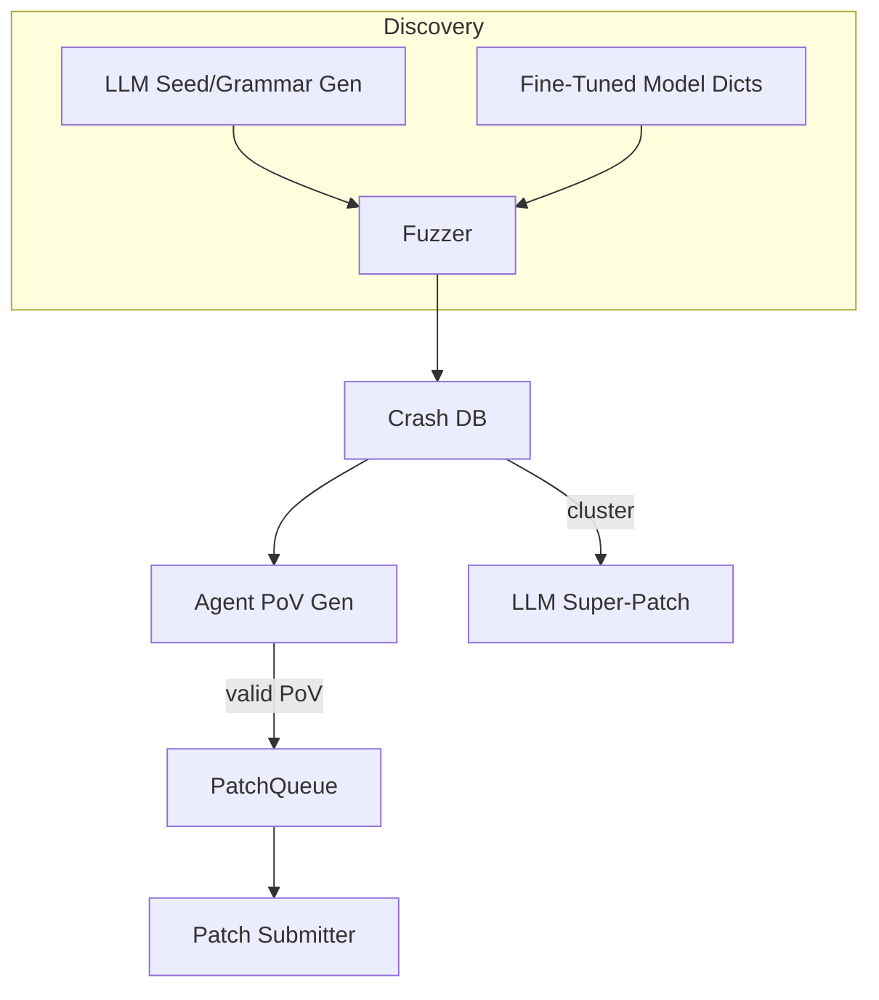

# AI-सहायित Fuzzing और स्वचालित Vulnerability Discovery

{{#include ../banners/hacktricks-training.md}}

## अवलोकन
Large-language models (LLMs), semantically rich inputs जनरेट करके, grammars को विकसित करके, crash data पर तर्क करके और यहाँ तक कि कई bugs वाले patches प्रस्तावित करके, पारंपरिक vulnerability-research pipelines को बहुत बेहतर बना सकते हैं। इस पृष्ठ में DARPA के AI Cyber Challenge (AIxCC) के finals और अन्य सार्वजनिक research में देखे गए सबसे प्रभावी patterns संकलित किए गए हैं।<sup>[[4]](#references)</sup><sup>[[5]](#references)</sup>

आगे किसी एक विशिष्ट competition system का विवरण नहीं है, बल्कि techniques का एक सामान्यीकृत रूप दिया गया है, ताकि आप इन्हें अपने workflows में दोहरा सकें।

---

## 1. LLM-जनरेटेड Seed Inputs

पारंपरिक coverage–guided fuzzers (AFL++, libFuzzer, Honggfuzz…) seeds के एक छोटे corpus से शुरू होते हैं और bytes को बिना सोचे-समझे mutate करते हैं। जब target input format जटिल होता है (SQL, URLs, custom binary protocols), तो random mutations आमतौर पर दिलचस्प branches तक पहुँचने से पहले ही syntax को तोड़ देती हैं।

LLMs seed generators—यानी ऐसे छोटे scripts जो **syntax-correct लेकिन security-relevant inputs** आउटपुट करते हैं—बनाकर इस शुरुआती समस्या को हल कर सकते हैं। उदाहरण के लिए:

```prompt
SYSTEM: You are a helpful security engineer.
USER:
Write a Python3 program that prints 200 unique SQL injection strings targeting common anti-pattern mistakes (missing quotes, numeric context, stacked queries).  Ensure length ≤ 256 bytes / string so they survive common length limits.
```

```python
# gen_sqli_seeds.py (truncated)
PAYLOADS = [
    "1 OR 1=1 -- ",
    "' UNION SELECT NULL,NULL--",
    "0; DROP TABLE users;--",
    ...
]
for p in PAYLOADS:
    print(p)
```

एक बार चलाएँ और आउटपुट को सीधे fuzzer के शुरुआती corpus में दें:

```bash
python3 gen_sqli_seeds.py > seeds.txt
afl-fuzz -i seeds.txt -o findings/ -- ./target @@
```

लाभ:
1. अर्थगत वैधता → शुरुआती चरण में अधिक गहरा कवरेज।
2. दोबारा जनरेट किया जा सकता है: XSS, path traversal, binary blobs आदि पर ध्यान केंद्रित करने के लिए prompt में बदलाव करें।
3. सस्ता (< GPT-3.5 के साथ 1 ¢)।

### सुझाव
* सतही फ़िल्टरों को बायपास करने के लिए मॉडल को payload की लंबाई और encoding (UTF-8, URL-encoded, UTF-16-LE) में *विविधता लाने* का निर्देश दें।
* एक *स्वयं में पूर्ण script* माँगें – इससे JSON formatting की समस्याएँ नहीं आतीं।

---

## 2. Grammar-Evolution Fuzzing

एक अधिक शक्तिशाली तरीका है कि ठोस seeds के बजाय LLM से **grammar विकसित** करवाया जाए। वर्कफ़्लो (“Grammar Guy” पैटर्न) यह है:

1. prompt के ज़रिए शुरुआती ANTLR/Peach/LibFuzzer grammar जनरेट करें।
2. N मिनट तक Fuzzing करें और कवरेज मेट्रिक्स (हिट हुए edges / blocks) इकट्ठा करें।
3. प्रोग्राम के उन क्षेत्रों का सारांश बनाएँ जिनका कवरेज नहीं हुआ और उस सारांश को मॉडल को वापस दें:
   ```prompt
   The previous grammar triggered 12 % of the program edges.  Functions not reached: parse_auth, handle_upload.  Add / modify rules to cover these.
   ```
4. नए नियम merge करें, फिर से fuzz करें, दोहराएँ।

Pseudo-code ढांचा:

```python
for epoch in range(MAX_EPOCHS):
    grammar = llm.refine(grammar, feedback=coverage_stats)
    save(grammar, f"grammar_{epoch}.txt")
    coverage_stats = run_fuzzer(grammar)
```

मुख्य बिंदु:
* *बजट* बनाए रखें – हर refinement में tokens खर्च होते हैं।
* मॉडल से दोबारा लिखवाने के बजाय संपादन करवाने के लिए `diff` + `patch` निर्देशों का उपयोग करें।
* जब Δcoverage < ε हो जाए, तो रुक जाएँ।

---

## 3. Local-LLM libFuzzer Harness का निर्माण

ऐसे source के लिए जिसे analyst के workstation से बाहर नहीं भेजा जा सकता, एक local code model fuzzer bytes और C/C++ API के बीच छोटा adapter तैयार कर सकता है। उपयोगी security boundary स्पष्ट है: **मॉडल test infrastructure लिखता और संशोधित करता है; coverage-guided mutation inputs को explore करता है; sanitizers अमान्य operations की रिपोर्ट करते हैं; और एक मानव harness की समीक्षा करके findings को triage करता है**।<sup>[[9]](#references)</sup>

ऐसी engine-level corpus, feedback, snapshot और stateful-fuzzing तकनीकों के लिए जो LLM पर निर्भर नहीं करतीं, सामान्य [Fuzzing Methodology](../generic-methodologies-and-resources/fuzzing.md) देखें।

Target header से सटीक declaration कॉपी करके शुरू करें और output format को सीमित करें। संकीर्ण prompt से गढ़े हुए APIs कम होते हैं और परिणाम की समीक्षा करना आसान होता है:<sup>[[8]](#references)[[9]](#references)</sup>

```prompt
Write a libFuzzer target for this exact declaration:
int parse_records(const uint8_t *data, size_t size);

Output only C code. Implement LLVMFuzzerTestOneInput, include the
declaration, pass data and size unchanged, and do not use files,
network access, randomness, clocks, threads, or persistent state.
```

एक raw byte parser के लिए, अपेक्षित परिणाम इससे अधिक जटिल नहीं होना चाहिए:<sup>[[6]](#references)[[9]](#references)</sup>

```c
#include <stddef.h>
#include <stdint.h>

extern int parse_records(const uint8_t *, size_t);

int LLVMFuzzerTestOneInput(const uint8_t *data, size_t size) {
    (void)parse_records(data, size);
    return 0;
}
```

Compilation केवल पहला validation gate है। CPU time खर्च करने से पहले इन invariants के विरुद्ध हर generated target की समीक्षा करें:<sup>[[6]](#references)[[8]](#references)[[9]](#references)</sup>

- **Exact API:** types, ownership rules, initialization, teardown और calling convention की तुलना वास्तविक header और मौजूदा callers से करें।
- **Harness safety:** `data` से हर read को guard करें; sanitizer findings का स्रोत target होना चाहिए, generated glue नहीं।
- **Repeatability:** परिणाम को `data` और `size` का function बनाएं; external I/O, time, uncontrolled randomness, unjoined threads और calls के बीच बने रहने वाले state को हटाएं।
- **Throughput:** महंगे immutable state को केवल तभी एक बार initialize करें, जब इससे behavior प्रभावित न हो; input size सीमित रखें, logging बंद करें और हर input के लिए किए गए allocations को free करें।
- **Reachability:** सत्यापित करें कि इच्छित functions और branches execute होते हैं। ऐसा target जो compile तो होता है, लेकिन केवल rejection paths exercise करता है, एक छिपी हुई विफलता है।

### Structure-aware targets: bugs छिपाए बिना invariants बनाए रखें

अगर ज़्यादातर raw inputs किसी magic, length, version या checksum gate पर fail हो जाते हैं, तो fuzz bytes को **typed field material** की तरह इस्तेमाल करें और एक valid object फिर से बनाएं। Format constants को स्थिर रखें, semantic fields और payload bytes को mutable छोड़ें, और फिर से बनाए गए payload से integrity metadata derive करें। `FuzzedDataProvider` सीमित typed values को consume करने के लिए उपयोगी है, जबकि adapter की ज़िम्मेदारी किसी भी generated allocation और conversion को सीमित करने की रहती है।<sup>[[9]](#references)</sup>

<details>
<summary>Structure-aware C++ target का उदाहरण</summary>

```cpp
#include <fuzzer/FuzzedDataProvider.h>
#include <stddef.h>
#include <stdint.h>
#include <vector>

extern "C" int parse_message(const uint8_t *, size_t);

extern "C" int LLVMFuzzerTestOneInput(const uint8_t *data, size_t size) {
    FuzzedDataProvider fdp(data, size);
    uint8_t version = fdp.ConsumeIntegral<uint8_t>();
    auto body = fdp.ConsumeRemainingBytes<uint8_t>();
    if (body.size() > UINT16_MAX) body.resize(UINT16_MAX);
    uint16_t len = static_cast<uint16_t>(body.size());
    std::vector<uint8_t> msg = {0x8b, 'M', 'S', 'G', version,
                                static_cast<uint8_t>(len >> 8),
                                static_cast<uint8_t>(len)};
    msg.insert(msg.end(), body.begin(), body.end());
    (void)parse_message(msg.data(), msg.size());
    return 0;
}
```

</details>

हर प्रश्न के लिए एक ही structure-repairing target का उपयोग न करें। एक target ऐसा रखें जो deep valid states को explore करने के लिए lengths/checksums derive करे, और दूसरा ऐसा जो **declared** metadata को fuzzer-controlled रखे और केवल harness की अपनी reads और allocations को सीमित करे। दूसरा target mismatched-length और bad-integrity attack surfaces को बनाए रखता है, जिन्हें automatic repair अन्यथा मिटा देता।<sup>[[9]](#references)</sup>

### Seeds, dictionaries, sanitizers, और coverage feedback

Model से सीधे binary प्रिंट करने के बजाय ऐसा script बनाने को कहें जो binary seeds लिखे। Empty, minimal, typical, और boundary-valid objects से seed करें; फिर magic values, tags, enum encodings, और parser keywords को निकालकर एक reviewed dictionary में रखें। libFuzzer इस dictionary को `-dict=` के साथ स्वीकार करता है, और corpus में उन mutations को रखता है जो नई coverage उजागर करते हैं।<sup>[[6]](#references)[[9]](#references)</sup>

```text
magic="\x8bMSG"
version_min="\x00"
version_max="\xff"
config_tag="CONFIG"
```

पूरक instrumentation के साथ उसी target को build करें। ASan और UBSan एक fuzzing binary साझा कर सकते हैं; uninstrumented code के कारण रिपोर्ट्स से बचने के लिए अलग MSan build का उपयोग करें और उसकी dependencies को instrument करें।<sup>[[6]](#references)[[9]](#references)</sup>

```bash
clang++ -g -O1 -fsanitize=fuzzer,address,undefined \
  -fno-sanitize-recover=undefined target.cc harness.cc -o fuzz_target
./fuzz_target corpus -dict=msg.dict -max_len=65535

clang++ -g -O1 -fsanitize=fuzzer,memory \
  target.cc harness.cc -o fuzz_target_msan
```

हर model revision के लिए coverage को evaluator मानें। libFuzzer output में, शुरुआत से सपाट `cov`/`ft` और static corpus का आमतौर पर मतलब है खराब framing, बहुत ज़्यादा प्रतिबंधित early return, या गलत call; कम `exec/s` का मतलब है महँगा setup, I/O, allocation, या leaked state। `NEW` सिर्फ़ यह साबित करता है कि कोई coverage feature बदला है, यह नहीं कि इच्छित parser तक पहुँचा गया।<sup>[[6]](#references)[[9]](#references)</sup>

Source-level feedback के लिए, coverage build बनाएँ, उसे fuzz करें, और model को सिर्फ़ वे uncovered functions तथा उनकी guarding conditions दें। बने हुए harness/seed/dictionary diff की जाँच करें और फिर से मापें:<sup>[[7]](#references)[[8]](#references)[[9]](#references)</sup>

```bash
clang++ -g -O1 -fsanitize=fuzzer \
  -fprofile-instr-generate -fcoverage-mapping target.cc harness.cc -o fuzz_cov
mkdir -p profiles
LLVM_PROFILE_FILE='profiles/%p.profraw' ./fuzz_cov -max_total_time=300 corpus
llvm-profdata merge -sparse profiles/*.profraw -o fuzz.profdata
llvm-cov report ./fuzz_cov -instr-profile=fuzz.profdata
llvm-cov show ./fuzz_cov -instr-profile=fuzz.profdata \
  --show-branches=count --region-coverage-lt=1 target.cc
```

इसलिए scalable loop है **generate → compile/link → sanitizers के तहत smoke-test → target coverage मापें → सबसे छोटा प्रासंगिक coverage/source context दें → संशोधित करें → फिर से मापें**। OSS-Fuzz-Gen भी यही सिद्धांत अपनाता है: generated targets को compilability, runtime failures, coverage और मौजूदा targets की तुलना में coverage improvement के आधार पर परखता है, न कि केवल ऊपर से सही दिखने वाले code को स्वीकार करता है।<sup>[[7]](#references)[[8]](#references)</sup>

---

<a id="3-agent-based-pov-exploit-generation" hidden>3. Agent-Based PoV (Exploit) Generation</a>

## 4. Agent-Based PoV (Exploit) Generation

Crash मिलने के बाद भी आपको **proof-of-vulnerability (PoV)** चाहिए, जो उसे हर बार नियत रूप से trigger करे।

एक scalable तरीका है कई lightweight workers (processes, threads या containers) शुरू करना, जिनमें से हर एक अलग model या sampling configuration इस्तेमाल करे। AIxCC finalist survey में scale के ठोस उदाहरण दिए गए हैं: एक team ने AI-first PoV generation के लिए **हज़ारों concurrent agents** इस्तेमाल किए, जबकि दूसरी ने **300–500 fuzzing agents** को orchestrate किया और उच्च-स्तरीय semantic reasoning के लिए LLMs का उपयोग किया।<sup>[[4]](#references)</sup>

Pipeline:
1. Static/dynamic analysis से *bug candidates* मिलते हैं (crash PC, input slice और sanitizer msg वाला struct)।
2. Orchestrator candidates को agents में बाँटता है।
3. Agent के reasoning steps:
   a. `gdb` + input की मदद से bug को locally reproduce करें।
   b. न्यूनतम exploit payload सुझाएँ।
   c. Sandbox में exploit को validate करें। सफल होने पर → submit करें।
4. असफल प्रयासों को coverage fuzzing के लिए नए seeds के रूप में **फिर से queue में डाला जाता है** (feedback loop)।

फायदे:
* Parallelisation से किसी एक agent की अविश्वसनीयता का असर कम होता है।
* देखी गई success-rate के आधार पर temp/model size की auto-tuning।

---

<a id="4-directed-fuzzing-with-fine-tuned-code-models" hidden>4. Directed Fuzzing with Fine-Tuned Code Models</a>

## 5. Directed Fuzzing with Fine-Tuned Code Models

Vulnerability patterns (integer overflow, buffer copy, format string) के साथ label किए गए C/C++ source पर open-weight model (जैसे Llama-7B) को fine-tune करें। फिर:

1. Function list + AST पाने के लिए static analysis चलाएँ।
2. Model को prompt दें: *“Function X में memory safety को तोड़ने की संभावना वाले mutation dictionary entries सुझाएँ”*।
3. उन tokens को custom `AFL_CUSTOM_MUTATOR` में डालें।

`sprintf` wrapper के लिए उदाहरण output:
```
{"pattern":"%99999999s"}
{"pattern":"AAAAAAAA....<1024>....%n"}
```

अनुभवजन्य तौर पर, इससे वास्तविक targets पर crash होने में लगने वाला समय >2× घट जाता है।

---

<a id="5-ai-guided-patching-strategies" hidden>5. AI के मार्गदर्शन में Patching Strategies</a>

## 6. AI के मार्गदर्शन में Patching Strategies

<a id="51-super-patches" hidden>5.1 Super Patches</a>

### 6.1 Super Patches
मॉडल से crash signatures को *क्लस्टर* करने और ऐसा **एक patch** सुझाने को कहें जो सामान्य root cause को दूर करे। एक बार सबमिट करें, कई bugs ठीक करें → ऐसे environments में accuracy penalties कम होंगी जहाँ हर गलत patch पर points कटते हैं।

Prompt की रूपरेखा:
```
Here are 10 stack traces + file snippets.  Identify the shared mistake and generate a unified diff fixing all occurrences.
```

{{#ref}}
../generic-methodologies-and-resources/fuzzing.md
{{#endref}}

<a id="52-speculative-patch-ratio" hidden>5.2 अनुमानित Patch Ratio</a>

### 6.2 अनुमानित Patch Ratio
एक queue लागू करें, जिसमें पुष्टि किए गए PoV-validated patches और *अनुमानित* patches (बिना PoV) को 1:​N अनुपात में बारी-बारी से रखा जाए। यह अनुपात scoring rules के अनुसार समायोजित हो (जैसे, 2 अनुमानित : 1 पुष्टि किया हुआ)। एक cost model, penalties बनाम points पर नज़र रखता है और N को अपने-आप समायोजित करता है।

---

<a id="6-deterministic-file-by-file-ai-code-review" hidden>6. नियतात्मक, फ़ाइल-दर-फ़ाइल AI Code Review</a>

## 7. नियतात्मक, फ़ाइल-दर-फ़ाइल AI Code Review

AI-सहायता प्राप्त review में एक आम विफलता यह है कि एक agent से पूरा repository जाँचने को कहा जाता है और उम्मीद की जाती है कि वह सही फ़ाइलें और grep terms चुनेगा। इससे अधिक भरोसेमंद तरीका है **repository coverage को अनिवार्य करना**:<sup>[[1]](#references)</sup>

1. Source files की सूची बनाएँ।
2. हर बार **एक फ़ाइल** के साथ न्यूनतम context (entrypoint, imports, आसपास के routes/callers) भेजें।
3. हर फ़ाइल के लिए **structured report** माँगें: sources, sink, अनुपस्थित validation, exploit preconditions और confidence।<sup>[[3]](#references)</sup>
4. Reports को **source→sink pattern** के आधार पर deduplicate करें और अधिक जोखिम वाले मामलों को manually validate करें।

इसमें बहुत tokens लगते हैं और शोर भी अधिक होता है, लेकिन यह **सरल और अधिक प्रभाव वाले source/sink bugs** ढूँढ़ने में बहुत प्रभावी है, जिन्हें व्यापक agentic reviews अक्सर चूक जाते हैं।

### Triage के वे patterns जिन्हें प्राथमिकता देनी चाहिए

- **Dynamic PHP include/dispatch**: attacker-नियंत्रित route/controller/module names का `require_once()`, `include()` या `include_once()` तक पहुँचना, जबकि strict allowlisting और path canonicalisation न हो।
- **Admin/account workflows में shell execution**: usernames, domains, FTP accounts या अन्य identifiers का `exec()`, `system()`, `shell_exec()`, `passthru()`, `proc_open()` या `popen()` तक पहुँचना।
- **Structured input fan-in**: एक ही parameter का `$_GET`, `$_POST`, JSON, XML या framework body parsers से स्वीकार होना और बाद में filesystem या OS-command sinks में दोबारा इस्तेमाल होना।

### दो व्यावहारिक bug classes जिन्हें यह तरीका अच्छी तरह ढूँढ़ता है

- **PHP controller-dispatch LFI/RCE**: यदि request-नियंत्रित controller name को बिना allowlist/path normalisation के `require_once()` में जोड़ा जाता है, तो `../` जैसे traversal sequences PHP से अनचाही local `.php` फ़ाइल शामिल करवा सकते हैं। यदि attacker किसी तैयार की गई या अन्यथा उपयोगी PHP फ़ाइल को include करवा सके, तो LFI code execution में बदल जाता है। देखें [File Inclusion / Path Traversal](../pentesting-web/file-inclusion/README.md)।<sup>[[1]](#references)</sup>
- **Hosting/admin panels में authenticated command injection**: यदि usernames जैसे account-management fields को shell commands में शामिल किया जाता है, तो कम विशेषाधिकार वाला authenticated user सामान्य create/delete कार्रवाई को RCE में बदल सकता है। जब panel command को अधिक विशेषाधिकार वाले service account के रूप में चलाता है, तो प्रभाव बढ़ जाता है। देखें [Command Injection](../pentesting-web/command-injection.md)।<sup>[[1]](#references)</sup>

### व्यावहारिक review नोट्स

- LLM का इस्तेमाल पहले **source/sink reviewer** के रूप में करें, exploit generator के रूप में नहीं।
- उससे स्पष्ट रूप से **attacker-नियंत्रित field**, **normalization/validation की कमी** और **खतरनाक sink** की सूची माँगें।
- बड़े repos में, एक मजबूत model का इस्तेमाल करने वाले एकल autonomous agent run की तुलना में नियतात्मक per-file review अक्सर अधिक भरोसेमंद होता है।<sup>[[2]](#references)</sup>
- **Broken Access Control** और अन्य business-logic bugs पर कमजोर परिणामों की अपेक्षा रखें, जहाँ exploitability cross-file assumptions, role semantics या product-specific threat models पर निर्भर करती है।

---

## Mobile entry-point taskflows

एक repository-wide prompt अक्सर अलग-अलग threat models को मिला देता है और externally reachable component से sensitive sink तक का रास्ता खो देता है। इससे बेहतर workflow audit को stateful taskflows में बाँटता है: पहले applications/components को classify करें, फिर attacker-नियंत्रित entry points की सूची बनाएँ, हर entry point में reachability metadata जोड़ें, और अंत में platform-specific vulnerability classes के आधार पर उनकी समीक्षा करें। GitHub Security Lab के mobile taskflows Android, iOS और cross-platform repositories के लिए इस pattern को लागू करते हैं।<sup>[[14]](#references)[[15]](#references)</sup>

Android के लिए, कम-से-कम यह दर्ज करें:<sup>[[14]](#references)[[15]](#references)</sup>

- exported Activities, Services, Receivers और Providers, permissions सहित;
- intent actions, deep-link schemes/hosts/paths, MIME filters और App Links;
- attacker-नियंत्रित actions, data URIs, `ClipData`, extras और URI-grant flags;
- WebView navigation inputs और `addJavascriptInterface` bridges;
- downstream privileged operations, imported resources और network destinations।

फिर हर entry point को उसके context में classify करें। Caller authorization/confused-deputy behavior, intent redirection, broadcast spoofing या disclosure, unsafe imports, WebView scripting और bridge exposure, तथा origins के बीच credentials या cookies के स्थानांतरण के बारे में स्पष्ट रूप से पूछें। **Strict checklist pass** और **व्यापक adversarial pass**, दोनों चलाएँ। Exploitation की जानकारी दोहराने के बजाय findings को [Intent Injection](../mobile-pentesting/android-app-pentesting/intent-injection.md) और [WebView Attacks](../mobile-pentesting/android-app-pentesting/webview-attacks.md) से जोड़ें।<sup>[[15]](#references)</sup>

मौजूदा open-source taskflows को उनके Codespace से इस तरह launch किया जा सकता है:<sup>[[14]](#references)</sup>

```bash
./scripts/audit/run_audit.sh owner/repository
```

परिणाम SQLite की `audit_result` table में लिखे जाते हैं।<sup>[[14]](#references)</sup> जिन rows को vulnerable के रूप में चिह्नित किया गया है, उन्हें सत्यापित निष्कर्ष नहीं, बल्कि **leads** मानें। हर lead के लिए मॉडल से attacker-controlled source, sensitive sink, preconditions और अपेक्षित impact बताने को कहें, फिर उससे एक minimal PoC बनाने को कहें। उस PoC को debugger या instrumentation के तहत original build पर चलाएँ। इससे static analysis की आम गलतियाँ पकड़ में आती हैं, जैसे unreachable branches, अवास्तविक application state, external-storage data का private data के मुकाबले precedence खो देना, और severity को काफी कम करने वाले mitigations।<sup>[[15]](#references)</sup>

---

## 8. Instrumented Oracle के साथ Pattern-Guided Kernel Auditing

Kernel के आकार वाले target के लिए, agent से पूरे tree में मनमाने bugs खोजने को न कहें। अधिक token-efficient workflow में ऐतिहासिक vulnerability के ज्ञान को static queries में बदला जाता है, exposed attack surface के आधार पर नतीजों को rank किया जाता है, और instrumented kernel को execution oracle के रूप में इस्तेमाल किया जाता है।<sup>[[11]](#references)</sup>

### Pattern database → CodeQL/Semgrep → केंद्रित समीक्षा

एक छोटा knowledge base बनाएँ जिसमें dangerous APIs, missing-validation patterns, जोखिमपूर्ण source-to-sink flows और पहले ठीक किए गए bug shapes शामिल हों। मॉडल से **एक बार में एक pattern** को review heuristics और CodeQL/Semgrep rules में बदलने को कहें, फिर उन deterministic rules को पूरे tree पर चलाएँ। कोड मॉडल को देने से पहले matches को समूहित करें और duplicates हटाएँ; scanner का raw output हज़ारों कम-मूल्य वाले candidates दे सकता है। इस तरीके को eligible research या open-source targets से बाहर इस्तेमाल करने से पहले CodeQL का मौजूदा license जाँचें।<sup>[[11]](#references)</sup>

केवल hit count के बजाय **rule-hit density** और **attacker reachability**, दोनों के आधार पर subsystems को प्राथमिकता दें। Unprivileged processes, sandboxes, containers, jails या guest contexts से पहुँच योग्य kernel interfaces को internal-only code से अधिक महत्व दें। समीक्षा की इकाई इतनी छोटी रखें कि agent callers, validators और lifetime rules को याद रख सके, और “कोई भी vulnerability खोजो” कहने के बजाय किसी नामित vulnerability class या control-flow pattern के लिए prompt करें। Legacy privileged interfaces खास तौर पर दिलचस्प होते हैं, जब कोई नया containment boundary उन्हें namespaced या jailed root user के लिए पहुँच योग्य बना देता है।<sup>[[11]](#references)</sup>

हर candidate के लिए exploitation की कोशिश से पहले एक स्पष्ट field-flow record माँगें।<sup>[[11]](#references)</sup>

```text
entrypoint -> privilege check -> parser -> validation/normalization
           -> later rewrite -> dangerous sink
attacker controls: <fields and lengths>
constraints:       <values rewritten, rejected, or preserved>
observable result: <sanitizer report, assertion, panic, or clean exit>
```

### Hypothesis oracle के रूप में KASAN telemetry का उपयोग करें

लक्ष्य kernel को disposable VM में KASAN और उपयोगी diagnostic assertions सक्षम करके चलाएँ। Agent को **source hypothesis → minimal userland trigger → VM execution → KASAN/assertion trace → revised hypothesis** के चक्र में तब तक आगे बढ़ना चाहिए, जब तक संदिग्ध corruption दोबारा न हो जाए या खारिज न हो जाए। हर iteration में केवल संबंधित stack trace और उसके पास का source लौटाएँ; इससे reasoning के लिए context बना रहता है और acceptance का आधार model confidence के बजाय runtime evidence होता है।<sup>[[11]](#references)</sup>

Instrumented build, exploitability जाँचने का अंतिम environment नहीं है। Assertions, corrupting operation से पहले execution रोक सकते हैं, जबकि वही assertion production kernel में compile out हो सकता है। बिना बदलाव वाला trigger, exact production configuration के विरुद्ध फिर से चलाएँ, kernel build और configuration दर्ज करें, और **reachability**, **memory corruption**, **controlled primitive**, तथा **security impact** को अलग-अलग दावों के रूप में रखें।<sup>[[11]](#references)[[12]](#references)</sup>

CVE-2026-3038, exploit template के बजाय validation के उपयोगी उदाहरण के रूप में काम आता है। एक unprivileged FreeBSD `RTM_GET` request, चुनिंदा validation और reply rewriting के दौरान oversized `RTAX_AUTHOR` sockaddr को बनाए रख सकती थी, जब तक कि `rtsock_msg_buffer()` ने उसका user-controlled `sa_len`, 128-byte stack `sockaddr_storage` में copy नहीं कर दिया। अधिकतम 255-byte copy से 127-byte overwrite हुआ; instrumented build में diagnostic assertion ने गलत length पकड़ ली, जबकि GENERIC kernel copy तक पहुँचा और फिर corrupted canary की जाँच के समय panic हो गया। यह unprivileged denial of service साबित करता है, standalone privilege escalation नहीं: भरोसेमंद control के लिए पहले किसी दूसरे primitive, जैसे canary disclosure, की ज़रूरत होगी। संबंधित binary-exploitation सीमा के लिए [Stack Canaries](../binary-exploitation/common-binary-protections-and-bypasses/stack-canaries/index.html) देखें।<sup>[[11]](#references)[[12]](#references)[[13]](#references)</sup>

### Exploit की prerequisites को गलत तरीके से पूरा करने वाले PoV को खारिज करें

किसी PoV या exploit को स्वीकार करने से पहले, अलग reviewer/agent से तय मानदंडों के आधार पर उसे गलत साबित करने की कोशिश करवाएँ। समीक्षा में निम्नलिखित सभी स्थितियों की पुष्टि होनी चाहिए।<sup>[[11]](#references)</sup>

- Path को reachable बनाने के लिए target source, kernel या vulnerable module में बदलाव नहीं किया गया।
- कोई helper module, synthetic gadget, disabled mitigation, अतिरिक्त privilege या अनुपलब्ध interface शामिल नहीं किया गया।
- Trigger, साफ snapshot पर दावे वाले caller identity और containment restrictions के साथ शुरू होता है।
- दावे वाला परिणाम अब भी bug पर निर्भर है: malformed field हटाने या केवल bug patch करने से chain टूटनी चाहिए।
- Crash, overread या overwrite को केवल उसी primitive के रूप में रिपोर्ट किया गया है; code execution या privilege escalation के लिए स्वतंत्र evidence चाहिए।

यह अंतिम counterfactual जाँच circular demonstrations पकड़ती है: अगर prerequisites पहले से ही दावा किया गया impact दे देती हैं (उदाहरण के लिए, `nosuid` के बिना mount किए गए filesystem से attacker द्वारा दी गई SUID सामग्री चलाना), तो memory-safety bug ने वह impact पैदा नहीं किया।<sup>[[11]](#references)</sup>

---

## अपरिचित Codebase पर Auditable Agent-Assisted Research

[Graph-first fuzz-target workflow](../generic-methodologies-and-resources/fuzzing.md#graph-first-fuzz-target-selection-and-mutation-triage) में entrypoint reachability पहले से शामिल है, जबकि [agentic SAST pipelines](../network-services-pentesting/pentesting-web/code-review-tools.md#agentic-sast-pipelines) staged review और evidence gates को शामिल करते हैं। इन deterministic नतीजों को model की hypotheses से अलग रखें, ताकि आगे बढ़ाए गए हर lead के साथ source locations, path evidence और dynamic measurement मौजूद रहें।<sup>[[10]](#references)</sup>

### Data flow गढ़े बिना object-lifetime evidence का मिलान करें

Static analysis में attacker-controlled length को एक function में store होते और उसी object field को काफी बाद में copy sink तक पहुँचते पाया जा सकता है, लेकिन callbacks, reconnects या object lifetime के पार उनका संबंध साबित न हो पाए। दोनों findings को अलग-अलग रखें, object/field के आधार पर समूहित करें और missing edge को स्पष्ट triage question बनाएँ। Agent इस संबंध का सुझाव दे सकता है, लेकिन इसे source review या runtime instrumentation से साबित करना होगा।<sup>[[10]](#references)</sup>

हर candidate के लिए दर्ज करें:

- ठोस entrypoint और attacker-controlled bytes;
- संबंधित field के हर producer, जिसमें हर producer के लिए विशिष्ट validation शामिल हो;
- sink, destination capacity और उसे reachable बनाने के लिए ज़रूरी build/runtime conditions;
- exposed entrypoint से मिला वास्तविक call stack, केवल direct harness invocation नहीं;
- सबसे छोटा dynamic result, जो hypothesis की पुष्टि या उसे खारिज करे।

एक path का सुरक्षित दिखना, field को globally सुरक्षित साबित नहीं करता। दूसरा producer उसी field को पहले path की bound के बिना भर सकता है। Paths को स्वतंत्र रूप से जाँचें और deployment-equivalent build options के साथ harness चलाएँ, क्योंकि debug assertions production memory corruption को शुरुआती test-only abort में बदल सकते हैं।<sup>[[10]](#references)</sup>

### Disclosure और exploitation के लिए measurement gates

Uninitialized-memory disclosure के संदेह में, नई allocations को पहचानने योग्य byte से भरें और सत्यापित करें कि वही marker emitted packet तक पहुँचता है। Exploitation के लिए **controlled overwrite → उपयोगी victim object → disclosure → pointer/base recovery → control-flow hijack → composed payload** जैसे मापे गए gates अनिवार्य करें। Agent तभी आगे बढ़े, जब harness मौजूदा property को साबित करे; विश्वसनीय लगने वाली कहानी gate पास नहीं होती। [FreeRDP case](../binary-exploitation/libc-heap/heap-overflow.md#cross-path-length-reuse-and-stale-output-disclosure) में validation के दौरान बनाए रखने योग्य path और build constraints दिखाए गए हैं।<sup>[[10]](#references)</sup>

---

LLM-सहायता प्राप्त exploit development पर staged L0–L4 validation लागू करने वाले kernel case study के लिए देखें:

{{#ref}}
../binary-exploitation/freebsd-kernel-exploitation-vnet-jail-escape.md
{{#endref}}

## Debugger-सहायता प्राप्त crash triage

Crash triage, function analysis और controlled heap-chunk reachability के लिए Mona v3 workflows [Exploiting Tools](../binary-exploitation/basic-stack-binary-exploitation-methodology/tools/#mona-v3-debugger-context-requests-for-crash-triage) में हैं।

---

## सब कुछ एक साथ जोड़ना
End-to-end CRS (Cyber Reasoning System) के components को इस तरह जोड़ा जा सकता है:



---

## References

- [1] [Project Black - Cyber Security के लिए Local AI: phpIPAM LFI और myVesta Authenticated RCE की खोज](https://projectblack.io/blog/local-ai-for-cyber-security)
- [2] [Strix](https://github.com/usestrix/strix)
- [3] [GitHub Copilot community security-review skill](https://github.com/github/awesome-copilot/blob/main/skills/security-review/SKILL.md)
- [4] [Trail of Bits – AIxCC फाइनल: मुकाबले का लेखा-जोखा](https://blog.trailofbits.com/2025/08/07/aixcc-finals-tale-of-the-tape/)
- [5] [CTF Radiooo AIxCC फाइनलिस्ट के इंटरव्यू](https://www.youtube.com/@ctfradiooo)
- [6] [LLVM — libFuzzer: coverage-guided fuzz testing के लिए एक लाइब्रेरी](https://llvm.org/docs/LibFuzzer.html)
- [7] [Google — OSS-Fuzz-Gen](https://github.com/google/oss-fuzz-gen)
- [8] [Google Online Security Blog — Fuzzing को बेहतर बनाना: AI से अधिक vulnerabilities खोजना](https://security.googleblog.com/2024/11/leveling-up-fuzzing-finding-more.html)
- [9] [8kSec — Local LLM की मदद से AI-Assisted Fuzzing Harness जनरेट करना](https://8ksec.io/ai-assisted-fuzzing-harness-local-llm)
- [10] [Quarkslab — AI Agents से RCE तक: Vulnerability Research Workflow बनाना](https://blog.quarkslab.com/from-ai-agents-to-rce-building-a-vulnerability-research-workflow.html)
- [11] [Praetorian — FreeBSoD: Kernel Bugs खोजने और Exploit करने के लिए Language Models का उपयोग (2 में से भाग 1)](https://praetorian.com/blog/ai-vulnerability-research-freebsd-kernel)
- [12] [FreeBSD-SA-26:05.route — Routing Sockets के ज़रिए Local DoS और संभावित Privilege Escalation](https://www.freebsd.org/security/advisories/FreeBSD-SA-26:05.route.asc)
- [13] [FreeBSD-SA-26:05.route source patch](https://security.FreeBSD.org/patches/SA-26:05/route.patch)
- [14] [GitHub Security Lab - SecLab Taskflows](https://github.com/GitHubSecurityLab/seclab-taskflows)
- [15] [GitHub Security Lab - Open-source AI security agent का उपयोग करके हमने Android की 24 vulnerabilities कैसे खोजीं](https://github.blog/security/how-we-found-24-android-vulnerabilities-using-our-open-source-ai-security-agent)
{{#include ../banners/hacktricks-training.md}}
