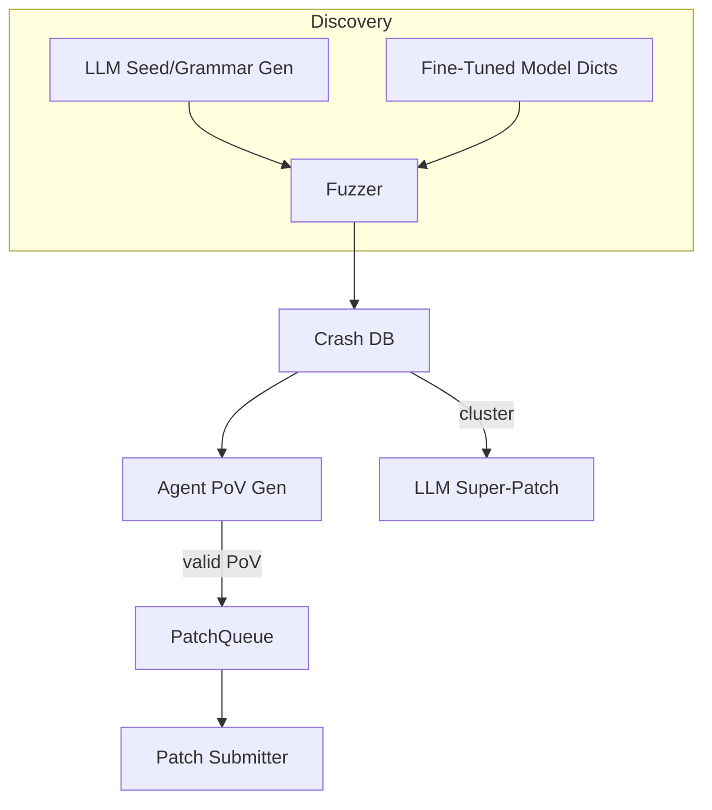

# KI-gestütztes Fuzzing & automatisierte Schwachstellensuche

{{#include ../banners/hacktricks-training.md}}

## Überblick
Large Language Models (LLMs) können herkömmliche Vulnerability-Research-Pipelines deutlich leistungsfähiger machen, indem sie semantisch reichhaltige Eingaben generieren, Grammatiken weiterentwickeln, Crash-Daten analysieren und sogar Patches für mehrere Bugs vorschlagen. Diese Seite fasst die effektivsten Muster zusammen, die sich im Finale der DARPA AI Cyber Challenge (AIxCC) und in anderen öffentlichen Forschungsarbeiten gezeigt haben.<sup>[[4]](#references)</sup><sup>[[5]](#references)</sup>

Im Folgenden wird kein bestimmtes Wettbewerbssystem beschrieben, sondern eine Zusammenfassung der Techniken, damit du sie in deinen eigenen Workflows nachbilden kannst.

---

## 1. Von LLMs generierte Seed-Eingaben

Herkömmliche coverage-guided Fuzzer (AFL++, libFuzzer, Honggfuzz …) starten mit einem kleinen Corpus von Seeds und mutieren Bytes blind. Wenn das Eingabeformat des Ziels komplex ist (SQL, URLs, benutzerdefinierte Binärprotokolle), zerstören zufällige Mutationen meist die Syntax, bevor interessante Branches erreicht werden.

LLMs können dieses Bootstrap-Problem lösen, indem sie *Seed-Generatoren* erstellen – kurze Skripte, die **syntaktisch korrekte, aber sicherheitsrelevante Eingaben** ausgeben. Zum Beispiel:

```prompt
SYSTEM: You are a helpful security engineer.
USER:
Write a Python3 program that prints 200 unique SQL injection strings targeting common anti-pattern mistakes (missing quotes, numeric context, stacked queries).  Ensure length ≤ 256 bytes / string so they survive common length limits.
```

```python
# gen_sqli_seeds.py (truncated)
PAYLOADS = [
    "1 OR 1=1 -- ",
    "' UNION SELECT NULL,NULL--",
    "0; DROP TABLE users;--",
    ...
]
for p in PAYLOADS:
    print(p)
```

Einmal ausführen und die Ausgabe direkt in den initialen Corpus des Fuzzers einspeisen:

```bash
python3 gen_sqli_seeds.py > seeds.txt
afl-fuzz -i seeds.txt -o findings/ -- ./target @@
```

Vorteile:
1. Semantische Gültigkeit → frühzeitig tiefere Abdeckung.
2. Erneut generierbar: Passe den Prompt an, um den Fokus auf XSS, Path Traversal, Binary Blobs usw. zu legen.
3. Günstig (< 1 ¢ mit GPT-3.5).

### Tipps
* Weise das Modell an, Payload-Länge und Encoding (UTF-8, URL-encoded, UTF-16-LE) zu *variieren*, um oberflächliche Filter zu umgehen.
* Bitte um ein *einzelnes, eigenständiges Script* – so vermeidest du Probleme mit dem JSON-Format.

---

## 2. Grammar-Evolution Fuzzing

Eine leistungsfähigere Variante besteht darin, das LLM eine Grammar **weiterentwickeln** zu lassen, anstatt konkrete Seeds zu verwenden. Der Workflow (Muster „Grammar Guy“) sieht so aus:

1. Generiere per Prompt eine anfängliche ANTLR-/Peach-/LibFuzzer-Grammar.
2. Führe N Minuten lang Fuzzing aus und erfasse Coverage-Metriken (getroffene Edges / Blocks).
3. Fasse nicht abgedeckte Programmbereiche zusammen und gib die Zusammenfassung an das Modell zurück:
   ```prompt
   The previous grammar triggered 12 % of the program edges.  Functions not reached: parse_auth, handle_upload.  Add / modify rules to cover these.
   ```
4. Führe die neuen Regeln zusammen, fuzz erneut und wiederhole den Vorgang.

Pseudo-Code-Skelett:

```python
for epoch in range(MAX_EPOCHS):
    grammar = llm.refine(grammar, feedback=coverage_stats)
    save(grammar, f"grammar_{epoch}.txt")
    coverage_stats = run_fuzzer(grammar)
```

Wichtige Punkte:
* Ein *Budget* einhalten – jede Verfeinerung verbraucht Tokens.
* `diff`- und `patch`-Anweisungen verwenden, damit das Modell Änderungen vornimmt, statt alles neu zu schreiben.
* Beenden, wenn Δcoverage < ε.

---

## 3. Entwicklung von Local-LLM-libFuzzer-Harnesses

Wenn Quellcode den Rechner eines Analysten nicht verlassen darf, kann ein lokales Code-Modell den kleinen Adapter zwischen Fuzzer-Bytes und einer C/C++-API entwerfen. Die Sicherheitsgrenze ist klar definiert: **Das Modell schreibt und überarbeitet die Testinfrastruktur; Coverage-guided Mutation untersucht Eingaben; Sanitizer melden ungültige Operationen; ein Mensch prüft das Harness und sortiert die Befunde ein**.<sup>[[9]](#references)</sup>

Techniken für Corpus, Feedback, Snapshots und Stateful Fuzzing auf Engine-Ebene, die nicht von einem LLM abhängen, finden Sie unter [Fuzzing Methodology](../generic-methodologies-and-resources/fuzzing.md).

Beginnen Sie mit der exakten Deklaration aus dem Ziel-Header und legen Sie das Ausgabeformat fest. Ein eng gefasster Prompt verringert die Wahrscheinlichkeit erfundener APIs und macht das Ergebnis leicht überprüfbar:<sup>[[8]](#references)[[9]](#references)</sup>

```prompt
Write a libFuzzer target for this exact declaration:
int parse_records(const uint8_t *data, size_t size);

Output only C code. Implement LLVMFuzzerTestOneInput, include the
declaration, pass data and size unchanged, and do not use files,
network access, randomness, clocks, threads, or persistent state.
```

Bei einem Parser für Rohbytes sollte das erwartete Ergebnis nicht komplizierter sein als:<sup>[[6]](#references)[[9]](#references)</sup>

```c
#include <stddef.h>
#include <stdint.h>

extern int parse_records(const uint8_t *, size_t);

int LLVMFuzzerTestOneInput(const uint8_t *data, size_t size) {
    (void)parse_records(data, size);
    return 0;
}
```

Die Kompilierung ist nur die erste Validierungsstufe. Prüfe jedes generierte Target anhand dieser Invarianten, bevor du CPU-Zeit dafür aufwendest:<sup>[[6]](#references)[[8]](#references)[[9]](#references)</sup>

- **Exakte API:** Vergleiche Typen, Ownership-Regeln, Initialisierung, Teardown und Calling Convention mit dem tatsächlichen Header und bestehenden Aufrufern.
- **Harness-Sicherheit:** Sichere jeden Lesezugriff auf `data` ab; Sanitizer-Befunde müssen im Target entstehen, nicht im generierten Glue-Code.
- **Reproduzierbarkeit:** Das Ergebnis muss eine Funktion von `data` und `size` sein; entferne externe I/O, Zeitabhängigkeiten, unkontrollierte Zufallswerte, nicht verbundene Threads und Zustände, die Aufrufe überdauern.
- **Durchsatz:** Initialisiere teuren unveränderlichen Zustand nur dann einmalig, wenn dies das Verhalten nicht beeinflussen kann, begrenze die Eingabegröße, unterdrücke Logging und gib pro Eingabe belegten Speicher frei.
- **Erreichbarkeit:** Prüfe, ob die vorgesehenen Funktionen und Branches ausgeführt werden. Ein Target, das kompiliert, aber nur Ablehnungspfade durchläuft, ist ein unbemerkter Fehlschlag.

### Struktur-aware Targets: Invarianten bewahren, ohne Bugs zu verbergen

Wenn die meisten Rohdaten an einer Magic-, Längen-, Versions- oder Prüfsummenprüfung scheitern, verwende die Fuzz-Bytes als typisiertes Feldmaterial und baue ein gültiges Objekt neu auf. Setze Formatkonstanten fest, lasse semantische Felder und Payload-Bytes veränderbar und leite Integritätsmetadaten aus der rekonstruierten Payload ab. `FuzzedDataProvider` eignet sich zum Abrufen begrenzter typisierter Werte; der Adapter bleibt dafür verantwortlich, jede generierte Allokation und Konvertierung zu begrenzen.<sup>[[9]](#references)</sup>

<details>
<summary>Beispiel für ein struktur-aware C++-Target</summary>

```cpp
#include <fuzzer/FuzzedDataProvider.h>
#include <stddef.h>
#include <stdint.h>
#include <vector>

extern "C" int parse_message(const uint8_t *, size_t);

extern "C" int LLVMFuzzerTestOneInput(const uint8_t *data, size_t size) {
    FuzzedDataProvider fdp(data, size);
    uint8_t version = fdp.ConsumeIntegral<uint8_t>();
    auto body = fdp.ConsumeRemainingBytes<uint8_t>();
    if (body.size() > UINT16_MAX) body.resize(UINT16_MAX);
    uint16_t len = static_cast<uint16_t>(body.size());
    std::vector<uint8_t> msg = {0x8b, 'M', 'S', 'G', version,
                                static_cast<uint8_t>(len >> 8),
                                static_cast<uint8_t>(len)};
    msg.insert(msg.end(), body.begin(), body.end());
    (void)parse_message(msg.data(), msg.size());
    return 0;
}
```

</details>

Verwenden Sie nicht für jede Frage dasselbe strukturreparierende Target. Nutzen Sie ein Target, das Längen und Prüfsummen ableitet, um tiefe gültige Zustände zu erkunden, und ein weiteres, bei dem die **deklarierten** Metadaten vom Fuzzer gesteuert werden, während nur die Lese- und Allokationsvorgänge des Harness begrenzt werden. Das zweite Target bewahrt Angriffsflächen mit nicht übereinstimmenden Längen und fehlerhafter Integrität, die durch automatische Reparatur sonst beseitigt würden.<sup>[[9]](#references)</sup>

### Seeds, Wörterbücher, Sanitizer und Coverage-Feedback

Lassen Sie das Modell ein Skript erstellen, das binäre Seeds schreibt, statt es aufzufordern, Binärdaten direkt auszugeben. Erzeugen Sie Seeds für leere, minimale, typische und gültige Objekte an den Grenzwerten. Extrahieren Sie anschließend Magic Values, Tags, Enum-Kodierungen und Parser-Schlüsselwörter in ein geprüftes Wörterbuch. libFuzzer akzeptiert dieses Wörterbuch mit `-dict=` und behält Mutationen, die neue Coverage im Corpus erschließen.<sup>[[6]](#references)[[9]](#references)</sup>

```text
magic="\x8bMSG"
version_min="\x00"
version_max="\xff"
config_tag="CONFIG"
```

Baue dasselbe Ziel mit ergänzender Instrumentierung. ASan und UBSan können sich eine Fuzzing-Binärdatei teilen; verwende einen separaten MSan-Build und instrumentiere dessen Abhängigkeiten, um Meldungen zu vermeiden, die durch nicht instrumentierten Code verursacht werden.<sup>[[6]](#references)[[9]](#references)</sup>

```bash
clang++ -g -O1 -fsanitize=fuzzer,address,undefined \
  -fno-sanitize-recover=undefined target.cc harness.cc -o fuzz_target
./fuzz_target corpus -dict=msg.dict -max_len=65535

clang++ -g -O1 -fsanitize=fuzzer,memory \
  target.cc harness.cc -o fuzz_target_msan
```

Behandle die Abdeckung als Bewertungsmaßstab für jede Modellrevision. In der libFuzzer-Ausgabe deuten ein frühzeitig stagnierendes `cov`/`ft` und ein statischer Korpus meist auf falsches Framing, eine zu restriktive frühzeitige Rückgabe oder den falschen Aufruf hin; ein niedriges `exec/s` deutet auf aufwendiges Setup, I/O, Speicherzuweisungen oder durchgesickerten Zustand hin. `NEW` beweist lediglich, dass sich ein Coverage-Feature geändert hat, nicht, dass der beabsichtigte Parser erreicht wurde.<sup>[[6]](#references)[[9]](#references)</sup>

Erzeuge für Feedback auf Quelltextebene einen Coverage-Build, fuzz ihn und gib dem Modell nur die nicht abgedeckten Funktionen samt ihren einschränkenden Bedingungen. Überprüfe die resultierenden Änderungen an Harness, Seed und Dictionary und miss erneut:<sup>[[7]](#references)[[8]](#references)[[9]](#references)</sup>

```bash
clang++ -g -O1 -fsanitize=fuzzer \
  -fprofile-instr-generate -fcoverage-mapping target.cc harness.cc -o fuzz_cov
mkdir -p profiles
LLVM_PROFILE_FILE='profiles/%p.profraw' ./fuzz_cov -max_total_time=300 corpus
llvm-profdata merge -sparse profiles/*.profraw -o fuzz.profdata
llvm-cov report ./fuzz_cov -instr-profile=fuzz.profdata
llvm-cov show ./fuzz_cov -instr-profile=fuzz.profdata \
  --show-branches=count --region-coverage-lt=1 target.cc
```

Die skalierbare Schleife lautet daher **generieren → kompilieren/linken → unter Sanitizern einem Smoke-Test unterziehen → Target-Abdeckung messen → den kleinsten relevanten Abdeckungs-/Quelltextkontext bereitstellen → überarbeiten → erneut messen**. OSS-Fuzz-Gen wendet dasselbe Prinzip an und bewertet generierte Targets anhand ihrer Kompilierbarkeit, Laufzeitfehler, Abdeckung und Abdeckungsverbesserung gegenüber bestehenden Targets, statt plausibel wirkenden Code einfach für bare Münze zu nehmen.<sup>[[7]](#references)[[8]](#references)</sup>

---

<a id="3-agent-based-pov-exploit-generation" hidden>3. Agentenbasierte PoV-Generierung (Exploit)</a>

## 4. Agentenbasierte PoV-Generierung (Exploit)

Nachdem ein Crash gefunden wurde, brauchst du immer noch einen **Proof of Vulnerability (PoV)**, der ihn deterministisch auslöst.

Ein skalierbarer Ansatz besteht darin, viele leichtgewichtige Worker (Prozesse, Threads oder Container) zu starten, die jeweils ein anderes Modell oder eine andere Sampling-Konfiguration verwenden. Die Umfrage unter den AIxCC-Finalisten liefert konkrete Beispiele für den Umfang: Ein Team setzte **Tausende parallele Agents** zur PoV-Generierung mit AI-first-Ansatz ein, während ein anderes **300–500 Fuzzing-Agents** koordinierte und LLMs für übergeordnete semantische Schlussfolgerungen reservierte.<sup>[[4]](#references)</sup>

Pipeline:
1. Statische/dynamische Analyse erzeugt *Bug-Kandidaten* (struct mit Crash-PC, Input-Slice, Sanitizer-Meldung).
2. Der Orchestrator verteilt Kandidaten an Agents.
3. Schritte der Schlussfolgerung des Agents:
   a. Bug lokal mit `gdb` + Input reproduzieren.
   b. Minimalen Exploit-Payload vorschlagen.
   c. Exploit in einer Sandbox validieren. Bei Erfolg → einreichen.
4. Fehlgeschlagene Versuche werden als neue Seeds für Coverage-Fuzzing **erneut in die Warteschlange gestellt** (Feedback-Schleife).

Vorteile:
* Parallelisierung gleicht die Unzuverlässigkeit einzelner Agents aus.
* Automatische Anpassung von temp / Modellgröße anhand der beobachteten Erfolgsrate.

---

<a id="4-directed-fuzzing-with-fine-tuned-code-models" hidden>4. Gerichtetes Fuzzing mit feinabgestimmten Code-Modellen</a>

## 5. Gerichtetes Fuzzing mit feinabgestimmten Code-Modellen

Ein Open-Weight-Modell (z. B. Llama-7B) anhand von C/C++-Quellcode mit gekennzeichneten Vulnerability-Mustern (Integer Overflow, Buffer Copy, Format String) feinabstimmen. Dann:

1. Statische Analyse ausführen, um eine Funktionsliste + AST zu erhalten.
2. Das Modell prompten: *„Gib Einträge für ein Mutationswörterbuch an, die wahrscheinlich die Memory Safety in Funktion X verletzen“*.
3. Diese Tokens in einen benutzerdefinierten `AFL_CUSTOM_MUTATOR` einfügen.

Beispielausgabe für einen `sprintf`-Wrapper:
```
{"pattern":"%99999999s"}
{"pattern":"AAAAAAAA....<1024>....%n"}
```

Empirisch verkürzt dies die Zeit bis zum Crash bei realen Zielen um mehr als das 2-Fache.

---

<a id="5-ai-guided-patching-strategies" hidden>5. KI-gestützte Patch-Strategien</a>

## 6. KI-gestützte Patch-Strategien

<a id="51-super-patches" hidden>5.1 Super-Patches</a>

### 6.1 Super-Patches
Bitte das Modell, Crash-Signaturen zu *gruppieren* und einen **einzigen Patch** vorzuschlagen, der die gemeinsame Ursache beseitigt. Einmal einreichen, mehrere Bugs beheben → weniger Genauigkeitsabzüge in Umgebungen, in denen jeder falsche Patch Punkte kostet.

Grundgerüst für den Prompt:
```
Here are 10 stack traces + file snippets.  Identify the shared mistake and generate a unified diff fixing all occurrences.
```

{{#ref}}
../generic-methodologies-and-resources/fuzzing.md
{{#endref}}

<a id="52-speculative-patch-ratio" hidden>5.2 Spekulatives Patch-Verhältnis</a>

### 6.2 Spekulatives Patch-Verhältnis
Implementieren Sie eine Queue, in der durch PoV bestätigte Patches und *spekulative* Patches (ohne PoV) in einem an die Bewertungsregeln angepassten Verhältnis von 1:​N abgewechselt werden (z. B. 2 spekulative : 1 bestätigter Patch). Ein Kostenmodell überwacht Strafen im Verhältnis zu Punkten und passt N automatisch an.

---

<a id="6-deterministic-file-by-file-ai-code-review" hidden>6. Deterministische dateiweise KI-Codeprüfung</a>

## 7. Deterministische dateiweise KI-Codeprüfung

Ein häufiges Fehlermuster bei KI-gestützten Reviews besteht darin, einen Agenten mit der Prüfung eines gesamten Repositorys zu beauftragen und darauf zu hoffen, dass er die richtigen Dateien und grep-Begriffe auswählt. Ein zuverlässigeres Muster besteht darin, eine **vollständige Abdeckung des Repositorys zu erzwingen**:<sup>[[1]](#references)</sup>

1. Quelldateien auflisten.
2. **Jeweils eine Datei** mit minimalem Kontext übergeben (Entrypoint, Imports, benachbarte Routen/Aufrufer).
3. Für jede Datei einen **strukturierten Bericht** verlangen: Quellen, Sink, fehlende Validierung, Exploit-Voraussetzungen und Konfidenz.<sup>[[3]](#references)</sup>
4. Berichte nach **Source→Sink-Muster** deduplizieren und die risikoreichen Fälle manuell validieren.

Das verbraucht viele Tokens und erzeugt Rauschen, ist aber sehr effektiv darin, **einfache, schwerwiegende Source/Sink-Bugs** aufzudecken, die bei breit angelegten agentischen Reviews oft übersehen werden.

### Triage-Muster, die Priorität verdienen

- **Dynamisches PHP-Include/Dispatch**: Vom Angreifer kontrollierte Routen-/Controller-/Modulnamen fließen ohne strikte Allowlist und Pfadkanonisierung in `require_once()`, `include()` oder `include_once()`.
- **Shell-Ausführung in Admin-/Account-Workflows**: Benutzernamen, Domains, FTP-Accounts oder andere Bezeichner erreichen `exec()`, `system()`, `shell_exec()`, `passthru()`, `proc_open()` oder `popen()`.
- **Zusammenführung strukturierter Eingaben**: Derselbe Parameter wird über `$_GET`, `$_POST`, JSON, XML oder Framework-Body-Parser akzeptiert und später in Datei- oder Betriebssystembefehl-Sinks wiederverwendet.

### Zwei praktische Bug-Klassen, die diese Methode gut findet

- **LFI/RCE durch PHP-Controller-Dispatch**: Wenn ein request-gesteuerter Controllername ohne Allowlist/Pfadnormalisierung an `require_once()` angehängt wird, können Traversal-Sequenzen wie `../` dazu führen, dass PHP eine unbeabsichtigte lokale `.php`-Datei einbindet. Kann der Angreifer das Include auf eine eingeschleuste oder anderweitig nützliche PHP-Datei richten, wird aus der LFI eine Codeausführung. Siehe [File Inclusion / Path Traversal](../pentesting-web/file-inclusion/README.md).<sup>[[1]](#references)</sup>
- **Authentifizierte Command Injection in Hosting-/Admin-Panels**: Werden Account-Verwaltungsfelder wie Benutzernamen in Shell-Befehle eingebettet, kann ein authentifizierter Benutzer mit geringen Berechtigungen eine normale Erstellungs-/Löschaktion in RCE verwandeln. Die Auswirkungen sind größer, wenn das Panel den Befehl als privilegierteres Servicekonto ausführt. Siehe [Command Injection](../pentesting-web/command-injection.md).<sup>[[1]](#references)</sup>

### Praktische Hinweise zur Prüfung

- Verwenden Sie das LLM zunächst als **Source/Sink-Prüfer**, nicht als Exploit-Generator.
- Bitten Sie es, ausdrücklich das **vom Angreifer kontrollierte Feld**, die **Lücke bei Normalisierung/Validierung** und den **gefährlichen Sink** aufzulisten.
- Bei großen Repositories ist eine deterministische Prüfung einzelner Dateien oft zuverlässiger als ein einzelner autonomer Agentenlauf, selbst wenn dieser ein leistungsfähigeres Modell verwendet.<sup>[[2]](#references)</sup>
- Bei **Broken Access Control** und anderen Business-Logic-Bugs sind schwächere Ergebnisse zu erwarten, wenn die Ausnutzbarkeit von dateiübergreifenden Annahmen, Rollenbedeutungen oder produktspezifischen Threat Models abhängt.

---

## Mobile-Entry-Point-Taskflows

Ein einzelner Prompt für das gesamte Repository vermischt häufig Threat Models und verliert den Pfad von einer extern erreichbaren Komponente zu einem sensiblen Sink. Ein besserer Workflow unterteilt das Audit in zustandsbehaftete Taskflows: Zuerst werden Anwendungen/Komponenten klassifiziert, dann vom Angreifer kontrollierte Entry Points erfasst, anschließend wird jeder Entry Point um Erreichbarkeitsmetadaten ergänzt und schließlich anhand plattformspezifischer Vulnerability-Klassen geprüft. Die Mobile-Taskflows von GitHub Security Lab setzen dieses Muster für Android-, iOS- und plattformübergreifende Repositories um.<sup>[[14]](#references)[[15]](#references)</sup>

Für Android sollten mindestens folgende Punkte erfasst werden:<sup>[[14]](#references)[[15]](#references)</sup>

- exportierte Activities, Services, Receivers und Providers einschließlich Berechtigungen;
- Intent-Actions, Deep-Link-Schemes/Hosts/Pfade, MIME-Filter und App Links;
- vom Angreifer kontrollierte Actions, Data URIs, `ClipData`, Extras und URI-Grant-Flags;
- WebView-Navigationseingaben und `addJavascriptInterface`-Bridges;
- nachgelagerte privilegierte Operationen, importierte Ressourcen und Netzwerkziele.

Klassifizieren Sie anschließend jeden Entry Point im jeweiligen Kontext. Fragen Sie ausdrücklich nach der Autorisierung des Aufrufers bzw. Confused-Deputy-Verhalten, Intent-Redirection, Broadcast-Spoofing oder -Offenlegung, unsicheren Imports, WebView-Scripting und Bridge-Exposition sowie der Weitergabe von Zugangsdaten oder Cookies zwischen Origins. Führen Sie sowohl eine **strikte Checklistenprüfung** als auch eine **breitere adversariale Prüfung** durch. Verknüpfen Sie Befunde mit [Intent Injection](../mobile-pentesting/android-app-pentesting/intent-injection.md) und [WebView Attacks](../mobile-pentesting/android-app-pentesting/webview-attacks.md), statt die Details zur Ausnutzung zu duplizieren.<sup>[[15]](#references)</sup>

Die aktuellen Open-Source-Taskflows können über ihren Codespace gestartet werden:<sup>[[14]](#references)</sup>

```bash
./scripts/audit/run_audit.sh owner/repository
```

Ergebnisse werden in SQLite in der Tabelle `audit_result` geschrieben.<sup>[[14]](#references)</sup> Behandle als anfällig markierte Zeilen als **Hinweise**, nicht als verifizierte Findings. Fordere das Modell für jeden Hinweis auf, die vom Angreifer kontrollierte Quelle, den sensiblen Sink, die Voraussetzungen und die erwarteten Auswirkungen zu nennen, und bitte es anschließend, einen minimalen PoC zu erstellen. Führe diesen PoC unter einem Debugger oder mit Instrumentierung gegen den ursprünglichen Build aus. So lassen sich häufige Fehler statischer Analysen erkennen, etwa nicht erreichbare Verzweigungen, unrealistische Anwendungszustände, der Verlust des Vorrangs von Daten aus externem Speicher gegenüber privaten Daten sowie Mitigations, die den Schweregrad wesentlich reduzieren.<sup>[[15]](#references)</sup>

---

## 8. Mustergeleitete Kernel-Prüfung mit einem instrumentierten Oracle

Bei einem Kernel-großen Ziel solltest du einen Agenten nicht damit beauftragen, beliebige Fehler im gesamten Quellbaum zu finden. Ein token-effizienterer Workflow wandelt Wissen über historische Schwachstellen in statische Abfragen um, stuft die Ergebnisse anhand der exponierten Angriffsfläche ein und verwendet einen instrumentierten Kernel als Ausführungsorakel.<sup>[[11]](#references)</sup>

### Musterdatenbank → CodeQL/Semgrep → gezielte Prüfung

Erstelle eine kleine Wissensdatenbank mit gefährlichen APIs, Mustern fehlender Validierung, riskanten Source-to-Sink-Flows und Formen bereits behobener Fehler. Bitte das Modell, **jeweils ein Muster** in Prüfkriterien und CodeQL-/Semgrep-Regeln zu übersetzen, und führe diese deterministischen Regeln anschließend über den gesamten Quellbaum aus. Gruppiere die Treffer und entferne Duplikate, bevor du dem Modell Code vorlegst; rohe Scanner-Ausgaben können Tausende wenig aussagekräftige Kandidaten enthalten. Prüfe die aktuelle Lizenz von CodeQL, bevor du diesen Ansatz außerhalb zulässiger Forschungs- oder Open-Source-Ziele verwendest.<sup>[[11]](#references)</sup>

Priorisiere Subsysteme anhand der **Trefferdichte der Regeln** und der **Erreichbarkeit durch Angreifer**, nicht allein anhand der Trefferzahl. Kernel-Schnittstellen, die für unprivilegierte Prozesse, Sandboxes, Container, Jails oder Gastkontexte erreichbar sind, sollten stärker gewichtet werden als ausschließlich interner Code. Halte die Prüfeinheit klein genug, damit der Agent Aufrufer, Validatoren und Lebensdauerregeln berücksichtigen kann, und bitte um die Prüfung einer konkret benannten Schwachstellenklasse oder eines Kontrollflussmusters statt um „das Finden beliebiger Schwachstellen“. Ältere privilegierte Schnittstellen sind besonders interessant, wenn eine neuere Containment-Grenze sie für einen Root-Benutzer in einem Namespace oder Jail erreichbar macht.<sup>[[11]](#references)</sup>

Verlange für jeden Kandidaten eine explizite Aufzeichnung des Datenflusses, bevor du einen Exploit-Versuch unternimmst.<sup>[[11]](#references)</sup>

```text
entrypoint -> privilege check -> parser -> validation/normalization
           -> later rewrite -> dangerous sink
attacker controls: <fields and lengths>
constraints:       <values rewritten, rejected, or preserved>
observable result: <sanitizer report, assertion, panic, or clean exit>
```

### KASAN-Telemetrie als Hypothesen-Orakel verwenden

Führe den Zielkernel in einer entbehrlichen VM mit aktiviertem KASAN und nützlichen Diagnose-Assertions aus. Der Agent sollte die Schleife **Quellenhypothese → minimaler userland-Trigger → VM-Ausführung → KASAN-/Assertion-Trace → überarbeitete Hypothese** durchlaufen, bis die vermutete Beschädigung reproduziert oder widerlegt ist. Gib bei jeder Iteration nur den relevanten Stack-Trace und den Quellcode im unmittelbaren Umfeld zurück. So bleibt der Kontext für die Schlussfolgerungen erhalten, während Laufzeitbelege – nicht das Vertrauen in das Modell – als Maßstab für die Annahme dienen.<sup>[[11]](#references)</sup>

Ein instrumentierter Build ist nicht die endgültige Umgebung zur Bewertung der Exploitbarkeit. Assertions können die Ausführung vor dem Vorgang stoppen, der die Beschädigung verursacht; dieselbe Assertion kann in einem Produktionskernel deaktiviert sein. Teste den unveränderten Trigger erneut mit der exakten Produktionskonfiguration, dokumentiere Kernel-Build und Konfiguration und behandle **Erreichbarkeit**, **Speicherbeschädigung**, **kontrolliertes Primitiv** und **Sicherheitsauswirkung** als getrennte Aussagen.<sup>[[11]](#references)[[12]](#references)</sup>

CVE-2026-3038 eignet sich als Validierungsbeispiel, nicht als Exploit-Vorlage. Eine nicht privilegierte FreeBSD-`RTM_GET`-Anfrage konnte eine übergroße `RTAX_AUTHOR`-Sockaddr durch selektive Validierung und eine Antwortumschreibung hindurch erhalten, bis `rtsock_msg_buffer()` den benutzerkontrollierten Wert `sa_len` in eine 128 Byte große Stack-`sockaddr_storage` kopierte. Die maximale Kopie von 255 Byte verursachte einen 127 Byte großen Overwrite; im instrumentierten Build erkannte eine Diagnose-Assertion die ungültige Länge, während ein GENERIC-Kernel die Kopie ausführte und anschließend beim Prüfen des beschädigten Canarys panikte. Das belegt einen nicht privilegierten Denial of Service, keine eigenständige Rechteausweitung: Zuverlässige Kontrolle würde zunächst ein weiteres Primitiv erfordern, etwa die Offenlegung des Canarys. Unter [Stack Canaries](../binary-exploitation/common-binary-protections-and-bypasses/stack-canaries/index.html) findest du die entsprechende Grenze der Binary-Exploitation.<sup>[[11]](#references)[[12]](#references)[[13]](#references)</sup>

### Exploit-Voraussetzungen nicht manipulieren

Lass vor der Annahme eines PoV oder Exploits einen separaten Reviewer/Agent versuchen, ihn anhand fester Kriterien zu widerlegen. Die Prüfung muss alle folgenden Bedingungen bestätigen.<sup>[[11]](#references)</sup>

- Zielquellcode, Kernel und verwundbares Modul wurden nicht geändert, um den Pfad erreichbar zu machen.
- Es wurden weder ein Hilfsmodul, ein synthetisches Gadget, eine deaktivierte Mitigation, zusätzliche Berechtigungen noch eine nicht verfügbare Schnittstelle eingeführt.
- Der Trigger startet auf einem sauberen Snapshot mit der angegebenen Identität des Aufrufers und den geltenden Containment-Beschränkungen.
- Das behauptete Ergebnis hängt weiterhin vom Bug ab: Das Entfernen des fehlerhaften Felds oder das Beheben ausschließlich des Bugs muss die Angriffskette unterbrechen.
- Ein Crash, ein Overread oder ein Overwrite wird nur als das jeweilige Primitiv gemeldet; Codeausführung oder Rechteausweitung erfordern unabhängige Belege.

Diese letzte kontrafaktische Prüfung deckt zirkuläre Demonstrationen auf: Wenn die Voraussetzungen die behauptete Auswirkung bereits ermöglichen (zum Beispiel die Ausführung von angreiferkontrolliertem SUID-Inhalt auf einem Dateisystem, das ohne `nosuid` eingehängt ist), hat der Memory-Safety-Bug diese Auswirkung nicht herbeigeführt.<sup>[[11]](#references)</sup>

---

## Nachvollziehbare agentengestützte Forschung an unbekannten Codebasen

Der [graph-first-Workflow zur Auswahl von Fuzz-Zielen](../generic-methodologies-and-resources/fuzzing.md#graph-first-fuzz-target-selection-and-mutation-triage) behandelt bereits die Erreichbarkeit von Einstiegspunkten, während [agentische SAST-Pipelines](../network-services-pentesting/pentesting-web/code-review-tools.md#agentic-sast-pipelines) gestufte Prüfungen und Evidenzschwellen abdecken. Halte diese deterministischen Ergebnisse getrennt von den Hypothesen des Modells, damit jeder weiterverfolgte Hinweis Quellcodepositionen, Pfadbelege und eine dynamische Messung enthält.<sup>[[10]](#references)</sup>

### Hinweise auf Objektlebensdauer abgleichen, ohne Datenflüsse zu erfinden

Eine statische Analyse kann feststellen, dass eine angreiferkontrollierte Länge in einer Funktion gespeichert wird und dass dasselbe Objektfeld viel später einen Copy-Sink erreicht, ohne jedoch die Verbindung über Callbacks, Reconnects oder die Lebensdauer des Objekts hinweg nachweisen zu können. Bewahre beide Befunde getrennt auf, gruppiere sie nach Objekt/Feld und formuliere die fehlende Verbindung als explizite Triage-Frage. Der Agent darf einen Zusammenhang vorschlagen, aber eine Codeprüfung oder Laufzeitinstrumentierung muss ihn belegen.<sup>[[10]](#references)</sup>

Halte für jeden Kandidaten Folgendes fest:

- den konkreten Einstiegspunkt und die angreiferkontrollierten Bytes;
- alle Erzeuger des relevanten Felds, einschließlich der für jeden Erzeuger spezifischen Validierung;
- den Sink, die Kapazität des Ziels sowie die Build- und Laufzeitbedingungen, die für seine Erreichbarkeit erforderlich sind;
- einen echten Call-Stack vom exponierten Einstiegspunkt, nicht nur den direkten Aufruf durch einen Harness;
- das kleinste dynamische Ergebnis, das die Hypothese bestätigt oder widerlegt.

Ein scheinbar sicherer Pfad macht ein Feld nicht grundsätzlich unbedenklich. Ein zweiter Erzeuger kann dasselbe Feld ohne die Längenbegrenzung des ersten Pfads befüllen. Teste die Pfade unabhängig voneinander und führe den Harness mit Build-Optionen aus, die der Deployment-Umgebung entsprechen, da Debug-Assertions eine Speicherbeschädigung in der Produktion in einen vorzeitigen, nur beim Test auftretenden Abbruch verwandeln können.<sup>[[10]](#references)</sup>

### Messschwellen für Offenlegung und Exploitation

Fülle bei Verdacht auf eine Offenlegung nicht initialisierten Speichers frische Allokationen mit einem erkennbaren Byte und prüfe, ob genau dieser Marker im ausgegebenen Paket erscheint. Verlange für die Exploitation messbare Schwellen, etwa **kontrollierter Overwrite → geeignetes Opferobjekt → Offenlegung → Wiederherstellung von Zeiger/Basisadresse → Hijacking des Kontrollflusses → zusammengesetzte Payload**. Ein Agent kommt nur dann weiter, wenn der Harness die aktuelle Eigenschaft nachweist; eine plausible Darstellung erfüllt keine Prüfschwelle. Der [FreeRDP-Fall](../binary-exploitation/libc-heap/heap-overflow.md#cross-path-length-reuse-and-stale-output-disclosure) zeigt den Pfad und die Build-Bedingungen, die bei der Validierung erhalten bleiben müssen.<sup>[[10]](#references)</sup>

---

Ein Kernel-Fallbeispiel, das eine gestufte L0–L4-Validierung auf die LLM-gestützte Exploit-Entwicklung anwendet, findest du hier:

{{#ref}}
../binary-exploitation/freebsd-kernel-exploitation-vnet-jail-escape.md
{{#endref}}

## Crash-Triage mit Debugger-Unterstützung

Mona-v3-Workflows für Crash-Triage, Funktionsanalyse und kontrollierte Erreichbarkeit von Heap-Chunks findest du unter [Exploiting Tools](../binary-exploitation/basic-stack-binary-exploitation-methodology/tools/#mona-v3-debugger-context-requests-for-crash-triage).

---

## Alles zusammenführen
Ein durchgängiges CRS (Cyber Reasoning System) könnte die Komponenten beispielsweise wie folgt verbinden:



---

## References

- [1] [Project Black – Lokale KI für Cybersicherheit: phpIPAM LFI und myVesta Authenticated RCE finden](https://projectblack.io/blog/local-ai-for-cyber-security)
- [2] [Strix](https://github.com/usestrix/strix)
- [3] [GitHub Copilot Community-Skill für Sicherheitsüberprüfungen](https://github.com/github/awesome-copilot/blob/main/skills/security-review/SKILL.md)
- [4] [Trail of Bits – AIxCC-Finale: Ein Blick auf die Fakten](https://blog.trailofbits.com/2025/08/07/aixcc-finals-tale-of-the-tape/)
- [5] [CTF Radiooo – Interviews mit AIxCC-Finalisten](https://www.youtube.com/@ctfradiooo)
- [6] [LLVM — libFuzzer: eine Bibliothek für coverage-guided fuzz testing](https://llvm.org/docs/LibFuzzer.html)
- [7] [Google — OSS-Fuzz-Gen](https://github.com/google/oss-fuzz-gen)
- [8] [Google Online Security Blog — Fuzzing verbessern: Mit KI mehr Schwachstellen finden](https://security.googleblog.com/2024/11/leveling-up-fuzzing-finding-more.html)
- [9] [8kSec — KI-gestützte Fuzzing-Harness-Generierung mit einem lokalen LLM](https://8ksec.io/ai-assisted-fuzzing-harness-local-llm)
- [10] [Quarkslab — Von KI-Agenten zu RCE: Aufbau eines Workflows für Schwachstellenforschung](https://blog.quarkslab.com/from-ai-agents-to-rce-building-a-vulnerability-research-workflow.html)
- [11] [Praetorian — FreeBSoD: Sprachmodelle nutzen, um Kernel-Bugs zu finden und auszunutzen (Teil 1 von 2)](https://praetorian.com/blog/ai-vulnerability-research-freebsd-kernel)
- [12] [FreeBSD-SA-26:05.route — Lokaler DoS und mögliche Rechteausweitung über Routing-Sockets](https://www.freebsd.org/security/advisories/FreeBSD-SA-26:05.route.asc)
- [13] [FreeBSD-SA-26:05.route-Quellcode-Patch](https://security.FreeBSD.org/patches/SA-26:05/route.patch)
- [14] [GitHub Security Lab - SecLab Taskflows](https://github.com/GitHubSecurityLab/seclab-taskflows)
- [15] [GitHub Security Lab – Wie wir mithilfe eines Open-Source-KI-Sicherheitsagenten 24 Android-Schwachstellen gefunden haben](https://github.blog/security/how-we-found-24-android-vulnerabilities-using-our-open-source-ai-security-agent)
{{#include ../banners/hacktricks-training.md}}
