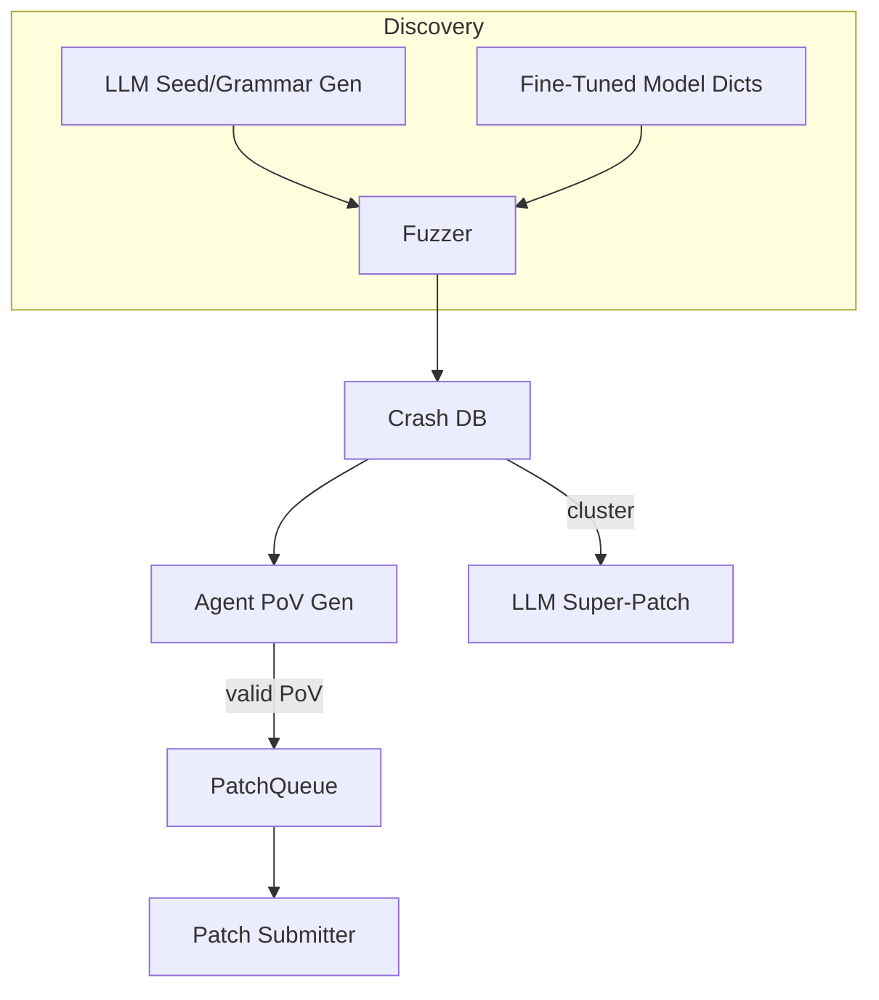

# AI支援 Fuzzing と自動脆弱性発見

{{#include ../banners/hacktricks-training.md}}

## 概要
大規模言語モデル（LLM）は、意味的に豊かな入力の生成、文法の進化、クラッシュデータの推論、さらには複数のバグに対応するパッチの提案まで行い、従来の脆弱性調査パイプラインを大幅に強化できます。このページでは、DARPAのAI Cyber Challenge（AIxCC）決勝戦やその他の公開研究で確認された、最も効果的なパターンを紹介します。<sup>[[4]](#references)</sup><sup>[[5]](#references)</sup>

以下は特定の競技システムの説明ではなく、独自のワークフローで再現できるよう、手法を抽象化したものです。

---

## 1. LLMが生成するシード入力

従来のカバレッジガイド型fuzzer（AFL++、libFuzzer、Honggfuzzなど）は、小さなシードコーパスから始め、バイト列を無作為に変異させます。対象の入力形式が複雑な場合（SQL、URL、独自のバイナリプロトコルなど）、無作為な変異では、興味深い分岐に到達する前に構文が壊れてしまうことがよくあります。

LLMは、*シードジェネレーター*（**構文的に正しく、セキュリティ上重要な入力**を出力する短いスクリプト）を生成することで、この初期化の問題を解決できます。例えば：

```prompt
SYSTEM: You are a helpful security engineer.
USER:
Write a Python3 program that prints 200 unique SQL injection strings targeting common anti-pattern mistakes (missing quotes, numeric context, stacked queries).  Ensure length ≤ 256 bytes / string so they survive common length limits.
```

```python
# gen_sqli_seeds.py (truncated)
PAYLOADS = [
    "1 OR 1=1 -- ",
    "' UNION SELECT NULL,NULL--",
    "0; DROP TABLE users;--",
    ...
]
for p in PAYLOADS:
    print(p)
```

一度実行し、出力をファザーの初期コーパスに直接投入する:

```bash
python3 gen_sqli_seeds.py > seeds.txt
afl-fuzz -i seeds.txt -o findings/ -- ./target @@
```

Benefits:
1. セマンティック妥当性 → 早期により深いカバレッジを実現。
2. 再生成可能: promptを調整して、XSS、path traversal、binary blobsなどに焦点を当てられる。
3. 低コスト（GPT-3.5なら1 ¢未満）。

### Tips
* 表面的なフィルターを回避するため、payloadの長さやエンコーディング（UTF-8、URLエンコード、UTF-16-LE）を*多様化*するようモデルに指示する。
* *単一の自己完結型スクリプト*を求めると、JSONのフォーマットで問題が起きにくい。

---

## 2. Grammar-Evolution Fuzzing

より強力な手法は、具体的なseedではなく、LLMに**grammarを進化**させることです。ワークフロー（「Grammar Guy」パターン）は次のとおりです。

1. promptを使って、初期のANTLR/Peach/LibFuzzer grammarを生成する。
2. N分間fuzzingを実行し、カバレッジ指標（ヒットしたedge / block）を収集する。
3. 未カバーのプログラム領域を要約し、その要約をモデルにフィードバックする:
   ```prompt
   The previous grammar triggered 12 % of the program edges.  Functions not reached: parse_auth, handle_upload.  Add / modify rules to cover these.
   ```
4. 新しいルールをマージし、再度 fuzzing して、繰り返す。

擬似コードの骨格:

```python
for epoch in range(MAX_EPOCHS):
    grammar = llm.refine(grammar, feedback=coverage_stats)
    save(grammar, f"grammar_{epoch}.txt")
    coverage_stats = run_fuzzer(grammar)
```

要点:
* *budget* を維持する – 改良のたびにトークンを消費する。
* モデルに書き直しではなく編集をさせるため、`diff` + `patch` の指示を使う。
* Δcoverage < ε になったら停止する。

---

## 3. ローカルLLM libFuzzerハーネスの設計

分析者のワークステーションから持ち出せないソースコードでは、ローカルのコードモデルを使って、fuzzerのバイト列とC/C++ APIをつなぐ小さなアダプターを作成できます。重要なのは、セキュリティ境界を明確にすることです。**モデルがテスト基盤を書いて修正し、カバレッジ誘導型ミューテーションが入力を探索し、sanitizerが不正な操作を報告し、人間がハーネスをレビューして発見事項をトリアージします**。<sup>[[9]](#references)</sup>

LLMに依存しないエンジンレベルのコーパス、フィードバック、スナップショット、ステートフルファジングの手法については、一般的な [Fuzzing Methodology](../generic-methodologies-and-resources/fuzzing.md) を参照してください。

対象のヘッダーから正確な宣言をコピーし、出力形式を制約して始めます。範囲を絞ったプロンプトにより、存在しないAPIが作られるのを抑え、生成結果をレビューしやすくできます。<sup>[[8]](#references)[[9]](#references)</sup>

```prompt
Write a libFuzzer target for this exact declaration:
int parse_records(const uint8_t *data, size_t size);

Output only C code. Implement LLVMFuzzerTestOneInput, include the
declaration, pass data and size unchanged, and do not use files,
network access, randomness, clocks, threads, or persistent state.
```

生バイトパーサーでは、期待される結果は次の程度にとどまるべきです：<sup>[[6]](#references)[[9]](#references)</sup>

```c
#include <stddef.h>
#include <stdint.h>

extern int parse_records(const uint8_t *, size_t);

int LLVMFuzzerTestOneInput(const uint8_t *data, size_t size) {
    (void)parse_records(data, size);
    return 0;
}
```

コンパイルは最初の検証ゲートにすぎません。CPU時間を費やす前に、生成された各ターゲットが次の不変条件を満たしているか確認してください:<sup>[[6]](#references)[[8]](#references)[[9]](#references)</sup>

- **APIの正確性:** 型、所有権ルール、初期化、終了処理、呼び出し規約を、実際のヘッダーおよび既存の呼び出し元と照合します。
- **ハーネスの安全性:** `data` から読み取る箇所すべてにガードを設けます。sanitizerの検出結果は、生成されたグルーコードではなくターゲットに起因するものでなければなりません。
- **再現性:** 結果が `data` と `size` だけで決まるようにします。外部I/O、時刻、制御されていない乱数、joinされていないスレッド、呼び出し間で残る状態を取り除きます。
- **スループット:** 動作に影響しない場合に限り、高コストな不変状態を一度だけ初期化し、入力サイズを制限し、ログ出力を抑え、入力ごとの割り当てを解放します。
- **到達可能性:** 意図した関数と分岐が実行されることを確認します。コンパイルはできても拒否パスしか実行しないターゲットは、気づかれにくい失敗です。

### 構造認識型ターゲット: バグを隠さず不変条件を維持する

ほとんどの生入力がマジック値、長さ、バージョン、チェックサムのゲートで失敗する場合は、fuzz bytesを**型付きフィールドの素材**として使い、有効なオブジェクトを再構築します。フォーマット定数は固定し、意味のあるフィールドとペイロードのバイト列は変更可能なままにし、再構築したペイロードから整合性メタデータを導出します。`FuzzedDataProvider` は上限付きの型付き値を消費するのに便利ですが、生成する割り当てと変換を制限する責任は引き続きアダプターにあります。<sup>[[9]](#references)</sup>

<details>
<summary>構造認識型 C++ ターゲットの例</summary>

```cpp
#include <fuzzer/FuzzedDataProvider.h>
#include <stddef.h>
#include <stdint.h>
#include <vector>

extern "C" int parse_message(const uint8_t *, size_t);

extern "C" int LLVMFuzzerTestOneInput(const uint8_t *data, size_t size) {
    FuzzedDataProvider fdp(data, size);
    uint8_t version = fdp.ConsumeIntegral<uint8_t>();
    auto body = fdp.ConsumeRemainingBytes<uint8_t>();
    if (body.size() > UINT16_MAX) body.resize(UINT16_MAX);
    uint16_t len = static_cast<uint16_t>(body.size());
    std::vector<uint8_t> msg = {0x8b, 'M', 'S', 'G', version,
                                static_cast<uint8_t>(len >> 8),
                                static_cast<uint8_t>(len)};
    msg.insert(msg.end(), body.begin(), body.end());
    (void)parse_message(msg.data(), msg.size());
    return 0;
}
```

</details>

すべての質問に対して、構造を修復する同じターゲットを使わないでください。長さやチェックサムを導出して、深い有効状態を探索するターゲットと、ハーネス自体の読み取りと割り当てだけに上限を設け、**宣言された**メタデータはfuzzerの制御下に置く別のターゲットを用意します。2つ目のターゲットは、自動修復によって失われてしまう、長さの不一致や整合性検証の不備という攻撃対象領域を維持します。<sup>[[9]](#references)</sup>

### シード、辞書、sanitizer、カバレッジフィードバック

バイナリを直接出力させるのではなく、バイナリシードを書き出すスクリプトをモデルに生成させます。空、最小、典型的、境界条件を満たすオブジェクトをシードし、magic value、タグ、enumのエンコード、parserのキーワードを抽出して、レビュー済みの辞書にまとめます。libFuzzerは`-dict=`でその辞書を受け付け、新しいカバレッジを明らかにするミューテーションをコーパスに保持します。<sup>[[6]](#references)[[9]](#references)</sup>

```text
magic="\x8bMSG"
version_min="\x00"
version_max="\xff"
config_tag="CONFIG"
```

補完的な計装を使って同じターゲットをビルドします。ASanとUBSanは同じfuzzingバイナリで併用できます。未計装コードが原因の報告を避けるため、MSanは別途ビルドし、その依存関係も計装してください。<sup>[[6]](#references)[[9]](#references)</sup>

```bash
clang++ -g -O1 -fsanitize=fuzzer,address,undefined \
  -fno-sanitize-recover=undefined target.cc harness.cc -o fuzz_target
./fuzz_target corpus -dict=msg.dict -max_len=65535

clang++ -g -O1 -fsanitize=fuzzer,memory \
  target.cc harness.cc -o fuzz_target_msan
```

各モデルの改訂を評価する指標としてcoverageを扱います。libFuzzerの出力で、初期段階から`cov`/`ft`が横ばいで、corpusも変化しない場合は、framingの不備、制約が厳しすぎるearly return、または誤った関数呼び出しが原因であることが多く、`exec/s`が低い場合は、セットアップ、I/O、allocationのコストが高いか、stateがリークしている可能性があります。`NEW`が示すのはcoverage featureが変化したことだけで、意図したparserに到達したことではありません。<sup>[[6]](#references)[[9]](#references)</sup>

ソースレベルのフィードバックを得るには、coverage buildを作成してfuzzし、未カバーの関数と、それらを保護する条件だけをモデルに渡します。生成されたharness/seed/dictionaryのdiffを確認し、再度測定します。<sup>[[7]](#references)[[8]](#references)[[9]](#references)</sup>

```bash
clang++ -g -O1 -fsanitize=fuzzer \
  -fprofile-instr-generate -fcoverage-mapping target.cc harness.cc -o fuzz_cov
mkdir -p profiles
LLVM_PROFILE_FILE='profiles/%p.profraw' ./fuzz_cov -max_total_time=300 corpus
llvm-profdata merge -sparse profiles/*.profraw -o fuzz.profdata
llvm-cov report ./fuzz_cov -instr-profile=fuzz.profdata
llvm-cov show ./fuzz_cov -instr-profile=fuzz.profdata \
  --show-branches=count --region-coverage-lt=1 target.cc
```

したがって、スケーラブルなループは **生成 → compile/link → sanitizer の下でスモークテスト → 対象のカバレッジを測定 → 関連性の高い最小限のカバレッジ／ソースコンテキストを提供 → 改訂 → 再測定** となります。OSS-Fuzz-Gen も同じ原則を適用し、生成したコードをもっともらしいという理由だけで受け入れるのではなく、コンパイル可能性、実行時の失敗、カバレッジ、既存ターゲットに対するカバレッジの改善を評価します。<sup>[[7]](#references)[[8]](#references)</sup>

---

<a id="3-agent-based-pov-exploit-generation" hidden>3. Agent-Based PoV（Exploit）生成</a>

## 4. Agent-Based PoV（Exploit）生成

crash が見つかった後も、それを確実に発生させる **proof-of-vulnerability（PoV）** が必要です。

スケーラブルな方法は、多数の軽量ワーカー（プロセス、スレッド、コンテナ）を起動し、それぞれで異なるモデルやサンプリング設定を使用することです。AIxCC の finalist survey には、具体的な規模の例が示されています。あるチームは AI-first の PoV 生成に **数千の並行エージェント** を使用し、別のチームは **300～500 の fuzzing エージェント** をオーケストレーションし、LLM はより高度な意味的推論に利用していました。<sup>[[4]](#references)</sup>

パイプライン：
1. Static/dynamic analysis により *bug candidates*（crash PC、input slice、sanitizer メッセージを含む構造体）を生成する。
2. Orchestrator が候補をエージェントに配布する。
3. エージェントの推論手順：
   a. `gdb` と input を使ってローカルでバグを再現する。
   b. 最小限の exploit payload を提案する。
   c. sandbox 内で exploit を検証する。成功した場合は submit する。
4. 失敗した試行は、coverage fuzzing 用の新しい seed として **再キューイング** される（フィードバックループ）。

利点：
* 並列化により、単一エージェントの信頼性の低さを補える。
* 観測された成功率に基づいて、temp／モデルサイズを自動調整できる。

---

<a id="4-directed-fuzzing-with-fine-tuned-code-models" hidden>4. Fine-Tuned Code Models による Directed Fuzzing</a>

## 5. Fine-Tuned Code Models による Directed Fuzzing

脆弱性パターン（integer overflow、buffer copy、format string）のラベルを付けた C/C++ ソースで、open-weight モデル（例：Llama-7B）を fine-tune します。その後：

1. static analysis を実行して、関数リストと AST を取得する。
2. モデルに次のように prompt する：*「関数 X の memory safety を破壊しそうな mutation dictionary のエントリを提示してください」*
3. それらのトークンをカスタム `AFL_CUSTOM_MUTATOR` に挿入する。

`sprintf` wrapper に対する出力例：
```
{"pattern":"%99999999s"}
{"pattern":"AAAAAAAA....<1024>....%n"}
```

実際のターゲットでは、クラッシュまでの時間を2倍以上短縮できます。

---

<a id="5-ai-guided-patching-strategies" hidden>5. AIによるパッチ適用戦略</a>

## 6. AIによるパッチ適用戦略

<a id="51-super-patches" hidden>5.1 スーパーパッチ</a>

### 6.1 スーパーパッチ
クラッシュシグネチャを*クラスタリング*し、共通の根本原因を取り除く**単一のパッチ**を提案するようモデルに依頼します。一度の提出で複数のバグを修正できるため、誤ったパッチごとに減点される環境では、精度に対するペナルティを減らせます。

プロンプトの概要：
```
Here are 10 stack traces + file snippets.  Identify the shared mistake and generate a unified diff fixing all occurrences.
```

{{#ref}}
../generic-methodologies-and-resources/fuzzing.md
{{#endref}}

<a id="52-speculative-patch-ratio" hidden>5.2 推測的パッチ比率</a>

### 6.2 推測的パッチ比率
PoVで検証済みのパッチと、PoVのない*推測的*なパッチを、スコアリングルールに合わせて調整した1:​Nの比率（例: 推測的パッチ2件 : 検証済みパッチ1件）で交互に処理するキューを実装します。コストモデルでペナルティとポイントを監視し、Nを自動調整します。

---

<a id="6-deterministic-file-by-file-ai-code-review" hidden>6. 決定論的なファイル単位のAIコードレビュー</a>

## 7. 決定論的なファイル単位のAIコードレビュー

AI支援レビューでよくある失敗パターンは、エージェントにリポジトリ全体を調査させ、適切なファイルやgrep用語を選ぶことに期待することです。より信頼性の高い方法は、**リポジトリ全体を網羅するよう強制する**ことです:<sup>[[1]](#references)</sup>

1. ソースファイルを列挙する。
2. **一度に1ファイルずつ**、最小限のコンテキスト（エントリポイント、import、近くのルートや呼び出し元）とともに渡す。
3. ファイルごとに、source、sink、検証不足、悪用の前提条件、確信度を含む**構造化レポート**を必須にする。<sup>[[3]](#references)</sup>
4. **source→sinkパターン**ごとにレポートを重複排除し、リスクの高いものを手動で検証する。

この方法はトークン消費が多く、ノイズもありますが、広範なエージェント型レビューでは見逃されがちな**単純で影響の大きいsource/sinkのバグ**を見つけるうえで非常に効果的です。

### 優先してトリアージすべきパターン

- **動的なPHP include/dispatch**: 攻撃者が制御するルート名、コントローラー名、モジュール名が、厳格なallowlistとパスの正規化なしに`require_once()`、`include()`、`include_once()`へ渡される。
- **admin/accountのワークフローにおけるシェル実行**: ユーザー名、ドメイン、FTPアカウントなどの識別子が`exec()`、`system()`、`shell_exec()`、`passthru()`、`proc_open()`、`popen()`に渡される。
- **構造化入力の合流**: 同じパラメーターが`$_GET`、`$_POST`、JSON、XML、またはフレームワークのbody parserから受け付けられ、後にfilesystemやOSコマンドのsinkで再利用される。

### この方法で見つけやすい、実践的なバグクラス2つ

- **PHPのcontroller-dispatchによるLFI/RCE**: リクエストで制御可能なcontroller名が、allowlistやパスの正規化なしに`require_once()`へ連結されると、`../`などのtraversalシーケンスによって、意図しないローカルの`.php`ファイルをPHPにincludeさせられます。攻撃者が配置した、または他の点で有用なPHPファイルをincludeさせられる場合、LFIはコード実行につながります。[File Inclusion / Path Traversal](../pentesting-web/file-inclusion/README.md)を参照してください。<sup>[[1]](#references)</sup>
- **hosting/admin panelにおける認証済みコマンドインジェクション**: ユーザー名などのアカウント管理フィールドがシェルコマンドに埋め込まれていると、低権限の認証済みユーザーが通常の作成・削除操作をRCEにつなげる可能性があります。パネルがより高い権限を持つサービスアカウントとしてコマンドを実行する場合、影響はさらに大きくなります。[Command Injection](../pentesting-web/command-injection.md)を参照してください。<sup>[[1]](#references)</sup>

### 実践的なレビューのポイント

- LLMはまず、exploitの生成ではなく**source/sinkのレビュー担当**として使う。
- **攻撃者が制御するフィールド**、**正規化・検証の不足**、**危険なsink**を明示的に列挙するよう指示する。
- 大規模なリポジトリでは、より強力なモデルを使う場合でも、単一の自律エージェント実行より、決定論的なファイル単位のレビューのほうが信頼性が高いことが多い。<sup>[[2]](#references)</sup>
- exploitabilityが複数ファイルにまたがる前提、roleの意味、または製品固有の脅威モデルに依存する**Broken Access Control**やその他のビジネスロジックのバグでは、結果が弱くなることを想定する。

---

## モバイルのエントリポイント別タスクフロー

リポジトリ全体を対象とした単一のプロンプトでは、脅威モデルが混在し、外部から到達可能なコンポーネントから機密性の高いsinkまでの経路が失われがちです。より効果的なワークフローでは、監査を状態を保つタスクフローに分割します。まずアプリケーションとコンポーネントを分類し、次に攻撃者が制御できるエントリポイントを一覧化し、各エントリポイントに到達可能性のメタデータを付与してから、プラットフォーム固有の脆弱性クラスに照らして個別にレビューします。GitHub Security Labのモバイルタスクフローは、Android、iOS、クロスプラットフォームのリポジトリ向けにこのパターンを実装しています。<sup>[[14]](#references)[[15]](#references)</sup>

Androidでは、少なくとも以下を記録します:<sup>[[14]](#references)[[15]](#references)</sup>

- exported Activities、Services、Receivers、Providersと、それぞれに設定された権限。
- intent action、deep-linkのscheme/host/path、MIME filter、App Links。
- 攻撃者が制御できるaction、data URI、`ClipData`、extras、URI grant flag。
- WebViewのナビゲーション入力と`addJavascriptInterface` bridge。
- 後続の特権操作、importされたリソース、ネットワーク接続先。

次に、各エントリポイントをコンテキストに沿って分類します。呼び出し元の認可やconfused deputyの挙動、intent redirection、broadcastのspoofingや情報開示、安全でないimport、WebViewのスクリプト実行やbridgeの公開、origin間でのcredentialやcookieの移動について、明示的に確認します。**厳格なチェックリストによるレビュー**と**より広範な敵対的レビュー**の両方を実施します。exploitの詳細を重複して記載するのではなく、検出事項を[Intent Injection](../mobile-pentesting/android-app-pentesting/intent-injection.md)や[WebView Attacks](../mobile-pentesting/android-app-pentesting/webview-attacks.md)にリンクします。<sup>[[15]](#references)</sup>

現在のopen-sourceタスクフローは、Codespaceから次のように起動できます:<sup>[[14]](#references)</sup>

```bash
./scripts/audit/run_audit.sh owner/repository
```

結果は SQLite の `audit_result` テーブルに書き込まれます。<sup>[[14]](#references)</sup> 脆弱と判定された行は、検証済みの発見事項ではなく**手がかり**として扱ってください。各手がかりについて、モデルに攻撃者が制御する source、機密性の高い sink、前提条件、想定される影響を明示させてから、最小限の PoC を作成するよう依頼してください。その PoC を debugger または instrumentation のもとで元の build に対して実行します。これにより、到達不能な分岐、非現実的なアプリケーション状態、external storage のデータが private data に優先されないこと、深刻度を実質的に下げる緩和策など、一般的な static analysis の誤りを検出できます。<sup>[[15]](#references)</sup>

---

## 8. Instrumented Oracle を使ったパターン誘導型 Kernel 監査

kernel 規模の対象では、ツリー全体から任意のバグを見つけるよう agent に依頼しないでください。より token 効率の高いワークフローでは、過去の脆弱性に関する知識を static query に変換し、露出した攻撃対象領域に基づいて結果を順位付けし、instrumented kernel を実行時の oracle として使用します。<sup>[[11]](#references)</sup>

### Pattern database → CodeQL/Semgrep → 対象を絞ったレビュー

危険な API、検証不足のパターン、リスクのある source-to-sink flow、過去に修正されたバグの形状を含む小規模なナレッジベースを構築します。モデルには、**一度に 1 つのパターン**をレビュー用ヒューリスティックと CodeQL/Semgrep のルールに変換させ、その後、決定論的なルールをツリー全体で実行します。モデルにコードを渡す前に、一致結果をグループ化して重複を除去してください。scanner の生出力には、価値の低い候補が何千件も含まれる場合があります。対象が適格な research または open-source でない場合、この方法を使う前に CodeQL の現在の license を確認してください。<sup>[[11]](#references)</sup>

ヒット数だけでなく、**ルールへの該当密度**と**攻撃者からの到達可能性**の両方を使って subsystem の優先順位を決めます。非特権プロセス、sandbox、container、jail、guest context から到達可能な kernel interface は、内部専用コードよりも高く評価すべきです。agent が caller、validator、ライフタイムのルールを保持できる程度にレビュー単位を小さくし、「脆弱性を何でも探す」のではなく、脆弱性クラスまたは制御フローパターンを指定して依頼します。新しい containment boundary によって namespaced または jailed の root user から到達可能になった場合、古い特権 interface は特に注目に値します。<sup>[[11]](#references)</sup>

各候補について、exploit を試みる前に、明示的な field-flow の記録を必須にしてください。<sup>[[11]](#references)</sup>

```text
entrypoint -> privilege check -> parser -> validation/normalization
           -> later rewrite -> dangerous sink
attacker controls: <fields and lengths>
constraints:       <values rewritten, rejected, or preserved>
observable result: <sanitizer report, assertion, panic, or clean exit>
```

### 仮説オラクルとして KASAN テレメトリを使う

KASAN と有用な診断アサーションを有効にした使い捨て VM で、対象の kernel を実行します。エージェントは、疑われる破損が再現または否定されるまで、**ソースコード上の仮説 → 最小限の userland トリガー → VM での実行 → KASAN/アサーションのトレース → 仮説の修正**を繰り返します。各イテレーションでは、関連するスタックトレースとその周辺のソースコードだけを返します。これにより、推論に必要なコンテキストを保ちながら、モデルの確信度ではなく実行時の証拠を合格基準にできます。<sup>[[11]](#references)</sup>

計装ビルドは、最終的な exploitability の検証環境ではありません。アサーションによって破壊操作の前に実行が停止する一方、本番 kernel では同じアサーションがコンパイル時に除外されることがあります。変更していないトリガーを、正確な本番設定に対して再テストし、kernel のビルドと設定を記録してください。また、**到達可能性**、**メモリ破損**、**制御可能なプリミティブ**、**セキュリティへの影響**を、それぞれ別個の主張として区別します。<sup>[[11]](#references)[[12]](#references)</sup>

CVE-2026-3038 は、exploit のテンプレートではなく、有用な検証例です。権限のない FreeBSD `RTM_GET` リクエストは、選択的な検証と応答の書き換えを通じて、サイズ超過の `RTAX_AUTHOR` sockaddr を保持したまま `rtsock_msg_buffer()` まで到達し、そこで user-controlled な `sa_len` が、スタック上の 128 バイトの `sockaddr_storage` にコピーされる可能性がありました。最大 255 バイトのコピーは 127 バイトの上書きを引き起こします。計装ビルドでは、診断アサーションが不正な長さを検出しました。一方、GENERIC kernel ではコピーが実行され、その後、破損した canary の検査時に panic が発生しました。これは権限のない DoS を証明しますが、単独での権限昇格を証明するものではありません。確実な制御には、まず canary の leak など、別のプリミティブが必要です。対応する binary-exploitation 上の境界については、[Stack Canaries](../binary-exploitation/common-binary-protections-and-bypasses/stack-canaries/index.html) を参照してください。<sup>[[11]](#references)[[12]](#references)[[13]](#references)</sup>

### exploit の前提条件を不正に満たす行為を排除する

PoV または exploit を受け入れる前に、別のレビュアー/エージェントに、固定された基準に照らしてその主張を反証させます。レビューでは、以下の条件がすべて満たされていることを確認します。<sup>[[11]](#references)</sup>

- 対象のソースコード、kernel、脆弱な module が、経路を到達可能にするために変更されていない。
- helper module、合成 gadget、無効化された緩和策、追加の権限、または利用できないインターフェースが導入されていない。
- クリーンな snapshot 上で、主張されている呼び出し元の ID と制限を維持したままトリガーが開始される。
- 主張されている結果が、依然としてバグに依存している。つまり、不正なフィールドを削除するか、バグだけを修正すると、攻撃チェーンが成立しなくなる。
- クラッシュ、overread、上書きは、それぞれのプリミティブとしてのみ報告される。コード実行や権限昇格には、独立した証拠が必要である。

この最後の反実仮想チェックは、循環論法による実証を見抜きます。たとえば、前提条件だけですでに主張されている影響が得られる場合（`nosuid` なしでマウントされたファイルシステム上で、攻撃者が用意した SUID コンテンツを実行するなど）、メモリ安全性のバグがその影響を生み出したわけではありません。<sup>[[11]](#references)</sup>

---

## 未知のコードベースにおける、監査可能なエージェント支援型リサーチ

[graph-first fuzz-target workflow](../generic-methodologies-and-resources/fuzzing.md#graph-first-fuzz-target-selection-and-mutation-triage) ではエントリポイントへの到達可能性を扱い、[agentic SAST pipelines](../network-services-pentesting/pentesting-web/code-review-tools.md#agentic-sast-pipelines) では段階的なレビューと証拠ゲートを扱っています。これらの決定論的な結果はモデルの仮説と分けて管理し、採用されたすべての手掛かりに、ソースコード上の位置、経路の証拠、動的な測定結果が残るようにします。<sup>[[10]](#references)</sup>

### データフローを捏造せずにオブジェクトのライフタイムに関する証拠を関連付ける

静的解析では、ある関数で attacker-controlled な長さが保存され、かなり後になって同じオブジェクトのフィールドがコピー先に到達することを見つけても、コールバック、再接続、オブジェクトのライフタイムをまたぐつながりを証明できない場合があります。両方の検出結果を別々に保持し、オブジェクト/フィールドごとにクラスタリングして、不足しているつながりを明示的なトリアージの確認事項にします。エージェントは関係性を提案できますが、ソースコードのレビューまたは実行時の計測による証明が必要です。<sup>[[10]](#references)</sup>

各候補について、以下を記録します。

- 具体的なエントリポイントと、攻撃者が制御するバイト列。
- 関連フィールドのすべての生成元。それぞれの生成元固有の検証も含める。
- シンク、宛先の容量、到達に必要なビルド/実行時の条件。
- 公開されたエントリポイントからの実際のコールスタック。直接の harness 呼び出しだけでは不十分。
- 仮説を裏付ける、または否定する最小限の動的な結果。

一見安全な経路があっても、フィールド全体が安全だとは言えません。別の生成元が、最初の経路で適用された上限を経ずに同じフィールドに値を設定する可能性があります。経路を個別にテストし、デプロイ環境相当のビルドオプションで harness を実行してください。デバッグ用アサーションがあると、本番環境では発生するメモリ破損が、テスト環境でのみ起きる早期 abort に変わることがあります。<sup>[[10]](#references)</sup>

### 情報漏えいと exploitability の測定ゲート

未初期化メモリの漏えいが疑われる場合は、新しい allocation を識別しやすいバイトで埋め、その正確なマーカーが出力パケットに到達することを確認します。exploitability の検証では、**制御可能な上書き → 有用な victim object → 情報開示 → ポインター/ベースアドレスの復元 → 制御フローの乗っ取り → ペイロードの合成**など、測定可能なゲートを要求します。harness が現在の特性を証明した場合に限り、エージェントは次へ進みます。もっともらしい説明は、ゲートを通過した証拠にはなりません。[FreeRDP の事例](../binary-exploitation/libc-heap/heap-overflow.md#cross-path-length-reuse-and-stale-output-disclosure)では、検証時に維持すべき経路とビルド上の制約を示しています。<sup>[[10]](#references)</sup>

---

LLM 支援型 exploit 開発に段階的な L0–L4 検証を適用した kernel の事例については、以下を参照してください。

{{#ref}}
../binary-exploitation/freebsd-kernel-exploitation-vnet-jail-escape.md
{{#endref}}

## デバッガ支援によるクラッシュのトリアージ

クラッシュのトリアージ、関数解析、制御可能な heap chunk への到達性を扱う Mona v3 のワークフローについては、[Exploiting Tools](../binary-exploitation/basic-stack-binary-exploitation-methodology/tools/#mona-v3-debugger-context-requests-for-crash-triage) を参照してください。

---

## すべてを統合する
エンドツーエンドの CRS (Cyber Reasoning System) は、次のように各コンポーネントを接続できます。



---

## References

- [1] [Project Black - サイバーセキュリティ向けローカルAI：phpIPAMのLFIとmyVestaの認証済みRCEの発見](https://projectblack.io/blog/local-ai-for-cyber-security)
- [2] [Strix](https://github.com/usestrix/strix)
- [3] [GitHub Copilotコミュニティのsecurity-reviewスキル](https://github.com/github/awesome-copilot/blob/main/skills/security-review/SKILL.md)
- [4] [Trail of Bits – AIxCC決勝戦：テープの記録](https://blog.trailofbits.com/2025/08/07/aixcc-finals-tale-of-the-tape/)
- [5] [CTF RadioooによるAIxCCファイナリストへのインタビュー](https://www.youtube.com/@ctfradiooo)
- [6] [LLVM — libFuzzer：カバレッジガイド型ファズテスト用ライブラリ](https://llvm.org/docs/LibFuzzer.html)
- [7] [Google — OSS-Fuzz-Gen](https://github.com/google/oss-fuzz-gen)
- [8] [Google Online Security Blog — ファジングの強化：AIでより多くの脆弱性を発見](https://security.googleblog.com/2024/11/leveling-up-fuzzing-finding-more.html)
- [9] [8kSec — ローカルLLMを用いたAI支援型ファジングハーネス生成](https://8ksec.io/ai-assisted-fuzzing-harness-local-llm)
- [10] [Quarkslab — AIエージェントからRCEへ：脆弱性調査ワークフローの構築](https://blog.quarkslab.com/from-ai-agents-to-rce-building-a-vulnerability-research-workflow.html)
- [11] [Praetorian — FreeBSoD：言語モデルを活用したカーネルバグの発見と悪用（全2部の第1部）](https://praetorian.com/blog/ai-vulnerability-research-freebsd-kernel)
- [12] [FreeBSD-SA-26:05.route — ルーティングソケット経由のローカルDoSおよび権限昇格の可能性](https://www.freebsd.org/security/advisories/FreeBSD-SA-26:05.route.asc)
- [13] [FreeBSD-SA-26:05.routeのソースパッチ](https://security.FreeBSD.org/patches/SA-26:05/route.patch)
- [14] [GitHub Security Lab - SecLab Taskflows](https://github.com/GitHubSecurityLab/seclab-taskflows)
- [15] [GitHub Security Lab - オープンソースAIセキュリティエージェントを使ってAndroidの脆弱性を24件発見した方法](https://github.blog/security/how-we-found-24-android-vulnerabilities-using-our-open-source-ai-security-agent)
{{#include ../banners/hacktricks-training.md}}
