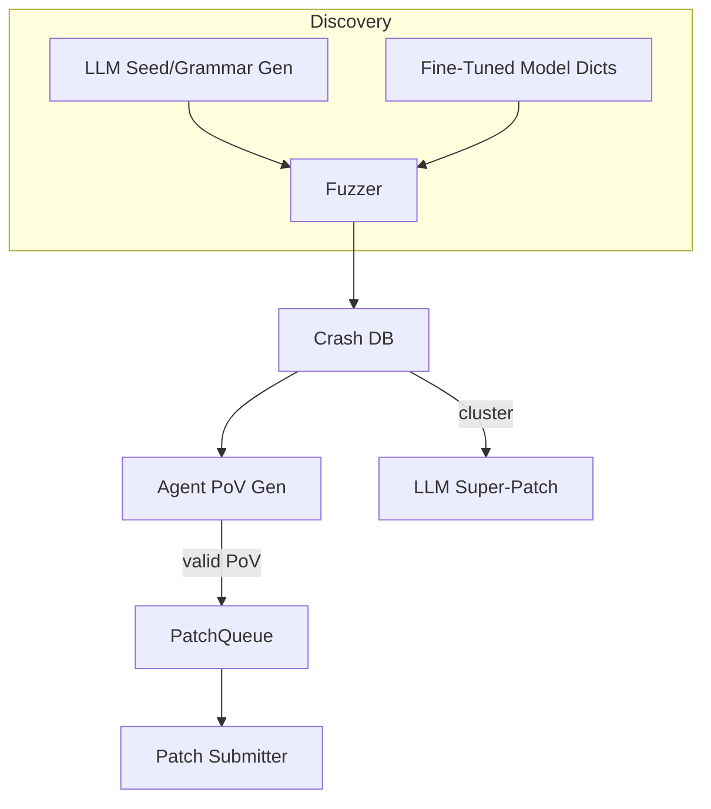

# Fuzzing με υποβοήθηση AI και αυτοματοποιημένη ανακάλυψη ευπαθειών

{{#include ../banners/hacktricks-training.md}}

## Επισκόπηση
Τα μεγάλα γλωσσικά μοντέλα (LLM) μπορούν να ενισχύσουν σημαντικά τις παραδοσιακές ροές εργασίας έρευνας ευπαθειών, δημιουργώντας εισόδους πλούσιες σε σημασιολογικό περιεχόμενο, εξελίσσοντας γραμματικές, συλλογίζοντας πάνω σε δεδομένα από crashes και προτείνοντας ακόμη και patches για πολλαπλά bugs. Αυτή η σελίδα συγκεντρώνει τα πιο αποτελεσματικά μοτίβα που παρατηρήθηκαν στους τελικούς του DARPA AI Cyber Challenge (AIxCC) και σε άλλες δημόσιες έρευνες.<sup>[[4]](#references)</sup><sup>[[5]](#references)</sup>

Αυτό που ακολουθεί δεν περιγράφει ένα συγκεκριμένο σύστημα διαγωνισμού, αλλά συνοψίζει τις τεχνικές, ώστε να μπορείτε να τις αναπαράγετε στις δικές σας ροές εργασίας.

---

## 1. Είσοδοι Seed που δημιουργούνται από LLM

Οι παραδοσιακοί fuzzers με καθοδήγηση από την κάλυψη (AFL++, libFuzzer, Honggfuzz…) ξεκινούν με ένα μικρό corpus από seeds και μεταλλάσσουν bytes στα τυφλά. Όταν η μορφή εισόδου του στόχου είναι σύνθετη (SQL, URLs, custom δυαδικά πρωτόκολλα), οι τυχαίες μεταλλάξεις συνήθως καταστρέφουν τη σύνταξη πριν φτάσουν σε ενδιαφέροντα branches.

Τα LLM μπορούν να λύσουν αυτό το αρχικό πρόβλημα δημιουργώντας *seed generators* — σύντομα scripts που παράγουν **συντακτικά έγκυρες εισόδους σχετικές με την ασφάλεια**. Για παράδειγμα:

```prompt
SYSTEM: You are a helpful security engineer.
USER:
Write a Python3 program that prints 200 unique SQL injection strings targeting common anti-pattern mistakes (missing quotes, numeric context, stacked queries).  Ensure length ≤ 256 bytes / string so they survive common length limits.
```

```python
# gen_sqli_seeds.py (truncated)
PAYLOADS = [
    "1 OR 1=1 -- ",
    "' UNION SELECT NULL,NULL--",
    "0; DROP TABLE users;--",
    ...
]
for p in PAYLOADS:
    print(p)
```

Εκτελέστε το μία φορά και δώστε απευθείας την έξοδο στο αρχικό corpus του fuzzer:

```bash
python3 gen_sqli_seeds.py > seeds.txt
afl-fuzz -i seeds.txt -o findings/ -- ./target @@
```

Benefits:
1. Σημασιολογική εγκυρότητα → βαθύτερη κάλυψη από νωρίς.
2. Δυνατότητα επαναδημιουργίας: τροποποιήστε το prompt ώστε να εστιάζει σε XSS, path traversal, binary blobs κ.λπ.
3. Χαμηλό κόστος (< 1 ¢ με GPT-3.5).

### Tips
* Ζητήστε από το μοντέλο να *διαφοροποιεί* το μήκος και την κωδικοποίηση των payload (UTF-8, URL-encoded, UTF-16-LE), ώστε να παρακάμπτονται επιφανειακά φίλτρα.
* Ζητήστε ένα *αυτόνομο script* – έτσι αποφεύγονται προβλήματα μορφοποίησης JSON.

---

## 2. Grammar-Evolution Fuzzing

Μια ισχυρότερη παραλλαγή είναι να αφήσετε το LLM να **εξελίξει μια γραμματική** αντί για συγκεκριμένα seeds. Η ροή εργασίας (μοτίβο «Grammar Guy») είναι η εξής:

1. Δημιουργήστε μέσω prompt μια αρχική γραμματική ANTLR/Peach/LibFuzzer.
2. Εκτελέστε fuzzing για N λεπτά και συλλέξτε μετρικές κάλυψης (edges / blocks που επιτεύχθηκαν).
3. Συνοψίστε τις περιοχές του προγράμματος που δεν καλύφθηκαν και δώστε τη σύνοψη πίσω στο μοντέλο:
   ```prompt
   The previous grammar triggered 12 % of the program edges.  Functions not reached: parse_auth, handle_upload.  Add / modify rules to cover these.
   ```
4. Συγχώνευσε τους νέους κανόνες, εκτέλεσε ξανά fuzzing και επανάλαβε.

Σκελετός ψευδοκώδικα:

```python
for epoch in range(MAX_EPOCHS):
    grammar = llm.refine(grammar, feedback=coverage_stats)
    save(grammar, f"grammar_{epoch}.txt")
    coverage_stats = run_fuzzer(grammar)
```

Σημεία-κλειδιά:
* Διατήρησε έναν *προϋπολογισμό* – κάθε βελτίωση χρησιμοποιεί tokens.
* Χρησιμοποίησε οδηγίες `diff` + `patch`, ώστε το μοντέλο να κάνει αλλαγές αντί να ξαναγράφει.
* Σταμάτησε όταν Δcoverage < ε.

---

## 3. Μηχανική Harness του libFuzzer με Local-LLM

Για πηγαίο κώδικα που δεν μπορεί να φύγει από τον σταθμό εργασίας ενός αναλυτή, ένα τοπικό μοντέλο κώδικα μπορεί να συντάξει τον μικρό adapter ανάμεσα στα bytes του fuzzer και σε ένα API C/C++. Το ουσιαστικό όριο ασφαλείας είναι σαφές: **το μοντέλο γράφει και αναθεωρεί την υποδομή δοκιμών· η coverage-guided mutation εξερευνά εισόδους· οι sanitizers αναφέρουν μη έγκυρες λειτουργίες· ένας άνθρωπος εξετάζει το harness και αξιολογεί τα ευρήματα**.<sup>[[9]](#references)</sup>

Για τεχνικές corpus, feedback, snapshot και stateful-fuzzing σε επίπεδο engine, που δεν εξαρτώνται από LLM, δείτε τη γενική [Fuzzing Methodology](../generic-methodologies-and-resources/fuzzing.md).

Ξεκινήστε με την ακριβή δήλωση που αντιγράψατε από το header του στόχου και περιορίστε τη μορφή εξόδου. Ένα στενά ορισμένο prompt μειώνει τις επινοημένες API και κάνει το αποτέλεσμα εύκολο στην εξέταση:<sup>[[8]](#references)[[9]](#references)</sup>

```prompt
Write a libFuzzer target for this exact declaration:
int parse_records(const uint8_t *data, size_t size);

Output only C code. Implement LLVMFuzzerTestOneInput, include the
declaration, pass data and size unchanged, and do not use files,
network access, randomness, clocks, threads, or persistent state.
```

Για έναν parser ακατέργαστων bytes, το αναμενόμενο αποτέλεσμα δεν θα πρέπει να είναι πιο περίπλοκο από:<sup>[[6]](#references)[[9]](#references)</sup>

```c
#include <stddef.h>
#include <stdint.h>

extern int parse_records(const uint8_t *, size_t);

int LLVMFuzzerTestOneInput(const uint8_t *data, size_t size) {
    (void)parse_records(data, size);
    return 0;
}
```

Η μεταγλώττιση είναι μόνο το πρώτο στάδιο επικύρωσης. Ελέγξτε κάθε παραγόμενο target ως προς τα παρακάτω αμετάβλητα πριν αφιερώσετε χρόνο CPU σε αυτό:<sup>[[6]](#references)[[8]](#references)[[9]](#references)</sup>

- **Ακριβές API:** συγκρίνετε τους τύπους, τους κανόνες ιδιοκτησίας, την αρχικοποίηση, τον τερματισμό λειτουργίας και τη σύμβαση κλήσης με την πραγματική κεφαλίδα και τους υπάρχοντες callers.
- **Ασφάλεια harness:** προστατεύστε κάθε ανάγνωση από το `data`· τα ευρήματα των sanitizers πρέπει να προέρχονται από το target και όχι από τον παραγόμενο κώδικα σύνδεσης.
- **Επαναληψιμότητα:** κάντε το αποτέλεσμα συνάρτηση των `data` και `size`· αφαιρέστε την εξωτερική είσοδο/έξοδο, τον χρόνο, την ανεξέλεγκτη τυχαιότητα, τα threads που δεν έχουν γίνει join και την κατάσταση που διατηρείται μεταξύ κλήσεων.
- **Ρυθμαπόδοση:** αρχικοποιήστε την αμετάβλητη κατάσταση υψηλού κόστους μόνο μία φορά και μόνο όταν αυτό δεν μπορεί να επηρεάσει τη συμπεριφορά, περιορίστε το μέγεθος εισόδου, καταργήστε την καταγραφή και αποδεσμεύστε τις κατανομές μνήμης ανά είσοδο.
- **Προσπελασιμότητα:** επαληθεύστε ότι εκτελούνται οι επιδιωκόμενες συναρτήσεις και διακλαδώσεις. Ένα target που μεταγλωττίζεται αλλά ασκεί μόνο διαδρομές απόρριψης αποτελεί σιωπηλή αποτυχία.

### Targets με επίγνωση της δομής: διατηρήστε τα αμετάβλητα χωρίς να αποκρύπτετε σφάλματα

Αν οι περισσότερες ακατέργαστες είσοδοι αποτυγχάνουν σε ελέγχους magic, μήκους, έκδοσης ή checksum, χρησιμοποιήστε τα bytes του fuzzing ως **υλικό τυποποιημένων πεδίων** και ανακατασκευάστε ένα έγκυρο αντικείμενο. Ορίστε σταθερές μορφότυπου, αφήστε τα σημασιολογικά πεδία και τα bytes του payload μεταβλητά και υπολογίστε τα μεταδεδομένα ακεραιότητας από το ανακατασκευασμένο payload. Το `FuzzedDataProvider` είναι χρήσιμο για την κατανάλωση τυποποιημένων τιμών με όρια, ενώ ο adapter παραμένει υπεύθυνος για τον περιορισμό κάθε παραγόμενης κατανομής μνήμης και μετατροπής.<sup>[[9]](#references)</sup>

<details>
<summary>Παράδειγμα C++ target με επίγνωση της δομής</summary>

```cpp
#include <fuzzer/FuzzedDataProvider.h>
#include <stddef.h>
#include <stdint.h>
#include <vector>

extern "C" int parse_message(const uint8_t *, size_t);

extern "C" int LLVMFuzzerTestOneInput(const uint8_t *data, size_t size) {
    FuzzedDataProvider fdp(data, size);
    uint8_t version = fdp.ConsumeIntegral<uint8_t>();
    auto body = fdp.ConsumeRemainingBytes<uint8_t>();
    if (body.size() > UINT16_MAX) body.resize(UINT16_MAX);
    uint16_t len = static_cast<uint16_t>(body.size());
    std::vector<uint8_t> msg = {0x8b, 'M', 'S', 'G', version,
                                static_cast<uint8_t>(len >> 8),
                                static_cast<uint8_t>(len)};
    msg.insert(msg.end(), body.begin(), body.end());
    (void)parse_message(msg.data(), msg.size());
    return 0;
}
```

</details>

Μη χρησιμοποιείτε έναν στόχο που επιδιορθώνει τις δομές για κάθε ερώτημα. Διατηρήστε έναν στόχο που υπολογίζει μήκη/checksum για να εξερευνά βαθιές, έγκυρες καταστάσεις, και έναν άλλο που αφήνει τα **δηλωμένα** metadata υπό τον έλεγχο του fuzzer, περιορίζοντας μόνο τις αναγνώσεις και τις δεσμεύσεις μνήμης που κάνει το ίδιο το harness. Ο δεύτερος στόχος διατηρεί επιφάνειες επίθεσης με ασύμφωνο μήκος και εσφαλμένη ακεραιότητα, τις οποίες η αυτόματη επιδιόρθωση θα εξαφάνιζε διαφορετικά.<sup>[[9]](#references)</sup>

### Seeds, dictionaries, sanitizers και feedback κάλυψης

Ζητήστε από το μοντέλο να δημιουργήσει ένα script που γράφει δυαδικά seeds, αντί να του ζητήσετε να τα εκτυπώσει απευθείας. Δημιουργήστε seeds για κενά, ελάχιστα, τυπικά και έγκυρα αντικείμενα οριακών τιμών· έπειτα εξαγάγετε magic values, tags, κωδικοποιήσεις enum και λέξεις-κλειδιά του parser σε ένα dictionary που έχει ελεγχθεί. Το libFuzzer δέχεται αυτό το dictionary με `-dict=`, και διατηρεί στο corpus τις μεταλλάξεις που αποκαλύπτουν νέα κάλυψη.<sup>[[6]](#references)[[9]](#references)</sup>

```text
magic="\x8bMSG"
version_min="\x00"
version_max="\xff"
config_tag="CONFIG"
```

Δημιουργήστε τον ίδιο στόχο με συμπληρωματική instrumentation. Τα ASan και UBSan μπορούν να χρησιμοποιούν το ίδιο fuzzing binary· χρησιμοποιήστε ξεχωριστό MSan build και κάντε instrumentation στις εξαρτήσεις του, ώστε να αποφύγετε αναφορές που προκαλούνται από μη instrumented κώδικα.<sup>[[6]](#references)[[9]](#references)</sup>

```bash
clang++ -g -O1 -fsanitize=fuzzer,address,undefined \
  -fno-sanitize-recover=undefined target.cc harness.cc -o fuzz_target
./fuzz_target corpus -dict=msg.dict -max_len=65535

clang++ -g -O1 -fsanitize=fuzzer,memory \
  target.cc harness.cc -o fuzz_target_msan
```

Αντιμετώπισε την κάλυψη ως κριτήριο αξιολόγησης για κάθε αναθεώρηση του μοντέλου. Στην έξοδο του libFuzzer, τα `cov`/`ft` που παραμένουν από νωρίς σταθερά και ένα στατικό corpus συνήθως υποδεικνύουν κακή διαμόρφωση εισόδου, υπερβολικά περιοριστικό early return ή λανθασμένη κλήση· το χαμηλό `exec/s` υποδεικνύει ακριβό setup, I/O, κατανομές μνήμης ή διαρροή κατάστασης. Το `NEW` αποδεικνύει μόνο ότι άλλαξε ένα χαρακτηριστικό κάλυψης, όχι ότι προσεγγίστηκε ο επιδιωκόμενος parser.<sup>[[6]](#references)[[9]](#references)</sup>

Για ανατροφοδότηση σε επίπεδο πηγαίου κώδικα, δημιούργησε έκδοση με coverage, εκτέλεσε fuzzing και δώσε στο μοντέλο μόνο τις συναρτήσεις που δεν έχουν καλυφθεί, μαζί με τις συνθήκες που τις προστατεύουν. Επαλήθευσε τις αλλαγές σε harness/seed/dictionary και μέτρησε ξανά:<sup>[[7]](#references)[[8]](#references)[[9]](#references)</sup>

```bash
clang++ -g -O1 -fsanitize=fuzzer \
  -fprofile-instr-generate -fcoverage-mapping target.cc harness.cc -o fuzz_cov
mkdir -p profiles
LLVM_PROFILE_FILE='profiles/%p.profraw' ./fuzz_cov -max_total_time=300 corpus
llvm-profdata merge -sparse profiles/*.profraw -o fuzz.profdata
llvm-cov report ./fuzz_cov -instr-profile=fuzz.profdata
llvm-cov show ./fuzz_cov -instr-profile=fuzz.profdata \
  --show-branches=count --region-coverage-lt=1 target.cc
```

Ο κλιμακώσιμος κύκλος είναι επομένως **generate → compile/link → smoke-test υπό sanitizers → μέτρηση της κάλυψης του στόχου → παροχή του ελάχιστου σχετικού context κάλυψης/πηγαίου κώδικα → αναθεώρηση → νέα μέτρηση**. Το OSS-Fuzz-Gen εφαρμόζει την ίδια αρχή, αξιολογώντας τους παραγόμενους στόχους ως προς τη δυνατότητα μεταγλώττισης, τις αποτυχίες κατά την εκτέλεση, την κάλυψη και τη βελτίωση της κάλυψης σε σχέση με τους υπάρχοντες στόχους, αντί να αποδέχεται απλώς εύλογο κώδικα.<sup>[[7]](#references)[[8]](#references)</sup>

---

<a id="3-agent-based-pov-exploit-generation" hidden>3. Δημιουργία PoV (Exploit) με χρήση agents</a>

## 4. Δημιουργία PoV (Exploit) με χρήση agents

Αφού εντοπιστεί ένα crash, χρειάζεσαι ακόμη ένα **proof-of-vulnerability (PoV)** που το προκαλεί με ντετερμινιστικό τρόπο.

Μια κλιμακώσιμη προσέγγιση είναι να ξεκινήσεις πολλούς ελαφρείς workers (processes, threads ή containers), καθέναν με διαφορετικό model ή sampling configuration. Η έρευνα των φιναλίστ του AIxCC δίνει συγκεκριμένα παραδείγματα κλίμακας: μία ομάδα χρησιμοποίησε **χιλιάδες agents ταυτόχρονα** για δημιουργία PoV με AI-first προσέγγιση, ενώ μια άλλη συντόνιζε **300–500 fuzzing agents** και χρησιμοποιούσε LLMs για συλλογισμό υψηλότερου επιπέδου σχετικά με τη σημασιολογία.<sup>[[4]](#references)</sup>

Pipeline:
1. Η στατική/δυναμική ανάλυση παράγει *υποψήφια bugs* (struct με crash PC, input slice, μήνυμα sanitizer).
2. Ο orchestrator διανέμει τα υποψήφια bugs στους agents.
3. Βήματα συλλογισμού του agent:
   a. Αναπαράγει το bug τοπικά με `gdb` + input.
   b. Προτείνει ένα ελάχιστο exploit payload.
   c. Επικυρώνει το exploit σε sandbox. Αν πετύχει → υποβολή.
4. Οι αποτυχημένες προσπάθειες **επανεισάγονται στην ουρά ως νέα seeds** για fuzzing κάλυψης (feedback loop).

Πλεονεκτήματα:
* Η παραλληλοποίηση αντισταθμίζει την αναξιοπιστία ενός μεμονωμένου agent.
* Αυτόματη ρύθμιση της θερμοκρασίας / του μεγέθους του model βάσει του παρατηρούμενου ποσοστού επιτυχίας.

---

<a id="4-directed-fuzzing-with-fine-tuned-code-models" hidden>4. Κατευθυνόμενο fuzzing με fine-tuned μοντέλα κώδικα</a>

## 5. Κατευθυνόμενο fuzzing με fine-tuned μοντέλα κώδικα

Κάνε fine-tune ένα μοντέλο με ανοιχτά weights (π.χ. Llama-7B) με C/C++ source code επισημασμένο με μοτίβα ευπαθειών (integer overflow, buffer copy, format string). Έπειτα:

1. Εκτέλεσε στατική ανάλυση για να πάρεις τη λίστα συναρτήσεων + AST.
2. Δώσε στο model το prompt: *“Δώσε καταχωρίσεις λεξικού μεταλλάξεων που είναι πιθανό να παραβιάσουν την ασφάλεια μνήμης στη συνάρτηση X”*.
3. Εισήγαγε αυτά τα tokens σε ένα προσαρμοσμένο `AFL_CUSTOM_MUTATOR`.

Παράδειγμα εξόδου για ένα wrapper της `sprintf`:
```
{"pattern":"%99999999s"}
{"pattern":"AAAAAAAA....<1024>....%n"}
```

Εμπειρικά, αυτό μειώνει τον χρόνο μέχρι το crash κατά >2× σε πραγματικούς στόχους.

---

<a id="5-ai-guided-patching-strategies" hidden>5. Στρατηγικές επιδιόρθωσης με καθοδήγηση AI</a>

## 6. Στρατηγικές επιδιόρθωσης με καθοδήγηση AI

<a id="51-super-patches" hidden>5.1 Super Patches</a>

### 6.1 Super Patches
Ζητήστε από το μοντέλο να *ομαδοποιήσει* τις υπογραφές crash και να προτείνει ένα **ενιαίο patch** που εξαλείφει την κοινή βασική αιτία. Υποβολή μία φορά, διόρθωση πολλών bugs → λιγότερες ποινές ακρίβειας σε περιβάλλοντα όπου κάθε λανθασμένο patch κοστίζει βαθμούς.

Περίγραμμα prompt:
```
Here are 10 stack traces + file snippets.  Identify the shared mistake and generate a unified diff fixing all occurrences.
```

{{#ref}}
../generic-methodologies-and-resources/fuzzing.md
{{#endref}}

<a id="52-speculative-patch-ratio" hidden>5.2 Αναλογία εικαστικών patches</a>

### 6.2 Αναλογία εικαστικών patches
Υλοποιήστε μια ουρά όπου τα επιβεβαιωμένα patches με επικύρωση PoV και τα *εικαστικά* patches (χωρίς PoV) εναλλάσσονται σε αναλογία 1:​N, προσαρμοσμένη στους κανόνες βαθμολόγησης (π.χ. 2 εικαστικά : 1 επιβεβαιωμένο). Ένα μοντέλο κόστους παρακολουθεί τις ποινές σε σχέση με τους πόντους και προσαρμόζει αυτόματα το N.

---

<a id="6-deterministic-file-by-file-ai-code-review" hidden>6. Ντετερμινιστική ανασκόπηση κώδικα AI, αρχείο προς αρχείο</a>

## 7. Ντετερμινιστική ανασκόπηση κώδικα AI, αρχείο προς αρχείο

Ένα συχνό σημείο αποτυχίας στην υποβοηθούμενη από AI ανασκόπηση είναι να ζητηθεί από έναν agent να επιθεωρήσει ολόκληρο το repository, με την ελπίδα ότι θα επιλέξει τα σωστά αρχεία και όρους grep. Μια πιο αξιόπιστη προσέγγιση είναι να **επιβάλλεται η κάλυψη του repository**:<sup>[[1]](#references)</sup>

1. Καταγράψτε τα αρχεία πηγαίου κώδικα.
2. Στείλτε **ένα αρχείο κάθε φορά** μαζί με ελάχιστο πλαίσιο (entrypoint, imports, κοντινά routes/callers).
3. Απαιτήστε **δομημένη αναφορά** για κάθε αρχείο: sources, sink, ελλιπής επικύρωση, προϋποθέσεις exploit και βαθμό βεβαιότητας.<sup>[[3]](#references)</sup>
4. Αφαιρέστε τις διπλότυπες αναφορές βάσει του **μοτίβου source→sink** και επικυρώστε χειροκίνητα τις αναφορές υψηλού κινδύνου.

Απαιτεί πολλά tokens και παράγει θόρυβο, αλλά είναι πολύ αποτελεσματική μέθοδος για τον εντοπισμό **απλών bugs source/sink με σοβαρό αντίκτυπο**, τα οποία συχνά διαφεύγουν από ευρείες agentic ανασκοπήσεις.

### Μοτίβα διαλογής που αξίζει να δοθεί προτεραιότητα

- **Δυναμικό PHP include/dispatch**: ονόματα route/controller/module που ελέγχονται από τον επιτιθέμενο και καταλήγουν στα `require_once()`, `include()` ή `include_once()` χωρίς αυστηρή allowlist και κανονικοποίηση διαδρομής.
- **Εκτέλεση shell σε ροές εργασιών διαχείρισης/λογαριασμών**: usernames, domains, FTP accounts ή άλλα αναγνωριστικά που καταλήγουν στα `exec()`, `system()`, `shell_exec()`, `passthru()`, `proc_open()` ή `popen()`.
- **Συγχώνευση δομημένων εισόδων**: η ίδια παράμετρος γίνεται αποδεκτή από τα `$_GET`, `$_POST`, JSON, XML ή parsers του body του framework και χρησιμοποιείται αργότερα σε sinks συστήματος αρχείων ή εντολών OS.

### Δύο πρακτικές κατηγορίες bugs που εντοπίζονται αποτελεσματικά με αυτή τη μέθοδο

- **LFI/RCE μέσω PHP controller-dispatch**: αν ένα όνομα controller που ελέγχεται από το request συνενώνεται με το `require_once()` χωρίς allowlist/κανονικοποίηση διαδρομής, ακολουθίες traversal όπως `../` μπορούν να κάνουν την PHP να συμπεριλάβει ένα ακούσιο τοπικό αρχείο `.php`. Αν ο επιτιθέμενος μπορεί να κατευθύνει το include σε ένα φυτεμένο ή με άλλο τρόπο χρήσιμο αρχείο PHP, το LFI μετατρέπεται σε εκτέλεση κώδικα. Δείτε [File Inclusion / Path Traversal](../pentesting-web/file-inclusion/README.md).<sup>[[1]](#references)</sup>
- **Authenticated command injection σε hosting/admin panels**: αν πεδία διαχείρισης λογαριασμών, όπως τα usernames, ενσωματώνονται σε εντολές shell, ένας αυθεντικοποιημένος χρήστης με χαμηλά προνόμια μπορεί να μετατρέψει μια συνηθισμένη ενέργεια δημιουργίας/διαγραφής σε RCE. Ο αντίκτυπος αυξάνεται όταν το panel εκτελεί την εντολή ως service account με περισσότερα προνόμια. Δείτε [Command Injection](../pentesting-web/command-injection.md).<sup>[[1]](#references)</sup>

### Πρακτικές σημειώσεις ανασκόπησης

- Χρησιμοποιήστε πρώτα το LLM ως **reviewer source/sink**, όχι ως εργαλείο δημιουργίας exploit.
- Ζητήστε να αναφέρει ρητά το **πεδίο που ελέγχεται από τον επιτιθέμενο**, το **κενό κανονικοποίησης/επικύρωσης** και το **επικίνδυνο sink**.
- Σε μεγάλα repos, η ντετερμινιστική ανασκόπηση ανά αρχείο είναι συχνά πιο αξιόπιστη από μία αυτόνομη εκτέλεση agent, ακόμα κι αν η τελευταία χρησιμοποιεί ισχυρότερο μοντέλο.<sup>[[2]](#references)</sup>
- Αναμένετε ασθενέστερα αποτελέσματα σε **Broken Access Control** και άλλα bugs επιχειρησιακής λογικής, όπου η δυνατότητα εκμετάλλευσης εξαρτάται από υποθέσεις μεταξύ αρχείων, σημασιολογία ρόλων ή μοντέλα απειλών ειδικά για το προϊόν.

---

## Ροές εργασιών για mobile entry points

Ένα ενιαίο prompt για ολόκληρο το repository συχνά συγχέει τα μοντέλα απειλών και χάνει τη διαδρομή από ένα εξωτερικά προσβάσιμο στοιχείο σε ένα ευαίσθητο sink. Μια ισχυρότερη ροή εργασιών χωρίζει τον έλεγχο σε stateful taskflows: πρώτα ταξινομεί εφαρμογές/στοιχεία, έπειτα καταγράφει τα attacker-controlled entry points, εμπλουτίζει κάθε entry point με μεταδεδομένα προσβασιμότητας και τέλος ελέγχει το καθένα βάσει κατηγοριών ευπαθειών που αφορούν την πλατφόρμα. Τα mobile taskflows του GitHub Security Lab εφαρμόζουν αυτό το μοτίβο σε repositories Android, iOS και cross-platform.<sup>[[14]](#references)[[15]](#references)</sup>

Για Android, καταγράψτε τουλάχιστον τα εξής:<sup>[[14]](#references)[[15]](#references)</sup>

- exported Activities, Services, Receivers και Providers, συμπεριλαμβανομένων των permissions·
- intent actions, deep-link schemes/hosts/paths, MIME filters και App Links·
- attacker-controlled actions, data URIs, `ClipData`, extras και URI-grant flags·
- εισόδους πλοήγησης WebView και γέφυρες `addJavascriptInterface`·
- προνομιούχες λειτουργίες που ακολουθούν, εισαγόμενους πόρους και προορισμούς δικτύου.

Στη συνέχεια, ταξινομήστε κάθε entry point στο κατάλληλο πλαίσιο. Ρωτήστε ρητά για εξουσιοδότηση caller/συμπεριφορά confused deputy, ανακατεύθυνση intent, πλαστογράφηση ή αποκάλυψη broadcast, μη ασφαλή imports, scripting και έκθεση γεφυρών WebView, καθώς και μεταφορά διαπιστευτηρίων ή cookies μεταξύ origins. Εκτελέστε τόσο έναν **αυστηρό έλεγχο βάσει checklist** όσο και έναν **ευρύτερο adversarial έλεγχο**. Συνδέστε τα ευρήματα με τα [Intent Injection](../mobile-pentesting/android-app-pentesting/intent-injection.md) και [WebView Attacks](../mobile-pentesting/android-app-pentesting/webview-attacks.md), αντί να επαναλάβετε τις λεπτομέρειες εκμετάλλευσης.<sup>[[15]](#references)</sup>

Τα τρέχοντα open-source taskflows μπορούν να εκκινηθούν από το Codespace τους με:<sup>[[14]](#references)</sup>

```bash
./scripts/audit/run_audit.sh owner/repository
```

Τα αποτελέσματα εγγράφονται στη SQLite, στον πίνακα `audit_result`.<sup>[[14]](#references)</sup> Αντιμετωπίστε τις εγγραφές που έχουν επισημανθεί ως ευάλωτες ως **ενδείξεις**, όχι ως επαληθευμένα ευρήματα. Για κάθε ένδειξη, ζητήστε από το μοντέλο να προσδιορίσει την πηγή που ελέγχει ο επιτιθέμενος, τον ευαίσθητο sink, τις προϋποθέσεις και τον αναμενόμενο αντίκτυπο και, στη συνέχεια, ζητήστε του να δημιουργήσει ένα ελάχιστο PoC. Εκτελέστε αυτό το PoC στην αρχική έκδοση, χρησιμοποιώντας debugger ή instrumentation. Έτσι εντοπίζονται συνηθισμένα σφάλματα της στατικής ανάλυσης, όπως μη προσπελάσιμοι κλάδοι, μη ρεαλιστική κατάσταση εφαρμογής, δεδομένα από εξωτερικό αποθηκευτικό χώρο που υποχωρούν έναντι ιδιωτικών δεδομένων και μέτρα μετριασμού που μειώνουν ουσιαστικά τη σοβαρότητα.<sup>[[15]](#references)</sup>

---

## 8. Έλεγχος Kernel με καθοδήγηση από μοτίβα και instrumented oracle

Για έναν στόχο μεγέθους kernel, μην ζητάτε από έναν agent να εντοπίσει αυθαίρετα σφάλματα σε ολόκληρο το δέντρο. Μια πιο αποδοτική ως προς τα tokens ροή εργασίας μετατρέπει την ιστορική γνώση για ευπάθειες σε στατικά queries, κατατάσσει τα αποτελέσματα με βάση την εκτεθειμένη επιφάνεια επίθεσης και χρησιμοποιεί έναν instrumented kernel ως oracle εκτέλεσης.<sup>[[11]](#references)</sup>

### Βάση δεδομένων μοτίβων → CodeQL/Semgrep → στοχευμένη ανασκόπηση

Δημιουργήστε μια μικρή βάση γνώσεων που περιλαμβάνει επικίνδυνα APIs, μοτίβα ελλιπούς επικύρωσης, επικίνδυνες ροές source-to-sink και μορφές σφαλμάτων που έχουν διορθωθεί στο παρελθόν. Ζητήστε από το μοντέλο να μεταφράζει **ένα μοτίβο κάθε φορά** σε ευρετικές ανασκόπησης και κανόνες CodeQL/Semgrep και, στη συνέχεια, εκτελέστε αυτούς τους ντετερμινιστικούς κανόνες σε ολόκληρο το δέντρο. Ομαδοποιήστε και αποδιπλοποιήστε τα αποτελέσματα πριν δώσετε τον κώδικα στο μοντέλο· η ακατέργαστη έξοδος του scanner μπορεί να περιέχει χιλιάδες υποψήφια ευρήματα χαμηλής αξίας. Ελέγξτε την τρέχουσα άδεια χρήσης του CodeQL πριν χρησιμοποιήσετε αυτή την προσέγγιση εκτός επιλέξιμων στόχων έρευνας ή ανοικτού κώδικα.<sup>[[11]](#references)</sup>

Ιεραρχήστε τα υποσυστήματα με βάση τόσο την **πυκνότητα ευρημάτων κανόνων** όσο και την **προσβασιμότητα από επιτιθέμενο**, όχι μόνο τον αριθμό ευρημάτων. Οι διεπαφές του kernel που είναι προσβάσιμες από μη προνομιούχες διεργασίες, sandboxes, containers, jails ή περιβάλλοντα guest αξίζουν μεγαλύτερη βαρύτητα από τον κώδικα που είναι προσβάσιμος μόνο εσωτερικά. Διατηρήστε τη μονάδα ανασκόπησης αρκετά μικρή, ώστε ο agent να μπορεί να λαμβάνει υπόψη τους callers, τους validators και τους κανόνες διάρκειας ζωής, και ζητήστε να ελέγξει μια συγκεκριμένη κατηγορία ευπάθειας ή ένα μοτίβο ροής ελέγχου, αντί να του πείτε «βρες οποιαδήποτε ευπάθεια». Οι παλαιές προνομιούχες διεπαφές παρουσιάζουν ιδιαίτερο ενδιαφέρον όταν ένα νεότερο όριο απομόνωσης τις καθιστά προσβάσιμες σε χρήστη root με namespace ή jail.<sup>[[11]](#references)</sup>

Για κάθε υποψήφιο εύρημα, απαιτήστε ρητή καταγραφή της ροής δεδομένων πριν επιχειρήσετε εκμετάλλευση.<sup>[[11]](#references)</sup>

```text
entrypoint -> privilege check -> parser -> validation/normalization
           -> later rewrite -> dangerous sink
attacker controls: <fields and lengths>
constraints:       <values rewritten, rejected, or preserved>
observable result: <sanitizer report, assertion, panic, or clean exit>
```

### Χρησιμοποιήστε την τηλεμετρία KASAN ως oracle για υποθέσεις

Εκτελέστε τον kernel-στόχο σε disposable VM με ενεργοποιημένα τα KASAN και χρήσιμα διαγνωστικά assertions. Ο agent πρέπει να επαναλαμβάνει τη διαδικασία **υπόθεση για τον κώδικα → ελάχιστο userland trigger → εκτέλεση σε VM → trace από KASAN/assertion → αναθεωρημένη υπόθεση**, μέχρι να αναπαραχθεί ή να απορριφθεί η ύποπτη αλλοίωση. Σε κάθε επανάληψη, επιστρέψτε μόνο το σχετικό stack trace και το κοντινό source· έτσι διατηρείται το πλαίσιο για τη συλλογιστική, ενώ κριτήριο αποδοχής αποτελούν τα runtime στοιχεία και όχι η βεβαιότητα του μοντέλου.<sup>[[11]](#references)</sup>

Ένα instrumented build δεν είναι το τελικό περιβάλλον αξιολόγησης exploitability. Τα assertions μπορεί να σταματήσουν την εκτέλεση πριν από τη λειτουργία που προκαλεί την αλλοίωση, ενώ το ίδιο assertion μπορεί να έχει αφαιρεθεί από production kernel. Επαναλάβετε τη δοκιμή με το ίδιο trigger στην ακριβή production configuration, καταγράψτε το kernel build και την configuration και διακρίνετε τη **δυνατότητα προσέγγισης**, την **αλλοίωση μνήμης**, το **ελεγχόμενο primitive** και τον **αντίκτυπο στην ασφάλεια** ως ξεχωριστούς ισχυρισμούς.<sup>[[11]](#references)[[12]](#references)</sup>

Το CVE-2026-3038 είναι χρήσιμο παράδειγμα επικύρωσης και όχι πρότυπο exploit. Ένα αίτημα `RTM_GET` από μη προνομιούχο χρήστη στο FreeBSD μπορούσε να διατηρήσει ένα υπερμεγέθες sockaddr `RTAX_AUTHOR` μέσω επιλεκτικής επικύρωσης και επανεγγραφής απάντησης, μέχρι που η `rtsock_msg_buffer()` αντέγραψε το `sa_len`, ελεγχόμενο από τον χρήστη, σε `sockaddr_storage` 128 byte στη στοίβα. Η μέγιστη αντιγραφή των 255 byte προκάλεσε overwrite 127 byte· ένα diagnostic assertion εντόπισε το λανθασμένο μήκος στο instrumented build, ενώ ένας GENERIC kernel έφτασε στην αντιγραφή και κατόπιν έκανε panic κατά τον έλεγχο του αλλοιωμένου canary. Αυτό αποδεικνύει denial of service από μη προνομιούχο χρήστη, όχι αυτοτελή κλιμάκωση προνομίων: για αξιόπιστο έλεγχο θα απαιτούνταν πρώτα κάποιο άλλο primitive, όπως διαρροή canary. Δείτε το [Stack Canaries](../binary-exploitation/common-binary-protections-and-bypasses/stack-canaries/index.html) για το αντίστοιχο όριο του binary exploitation.<sup>[[11]](#references)[[12]](#references)[[13]](#references)</sup>

### Απορρίψτε την παράκαμψη προϋποθέσεων exploit

Πριν αποδεχτείτε PoV ή exploit, ζητήστε από ξεχωριστό reviewer/agent να προσπαθήσει να το διαψεύσει βάσει σταθερών κριτηρίων. Η ανασκόπηση πρέπει να επιβεβαιώσει όλες τις ακόλουθες συνθήκες.<sup>[[11]](#references)</sup>

- Ο κώδικας-στόχος, ο kernel και το ευάλωτο module δεν τροποποιήθηκαν για να καταστεί προσβάσιμη η διαδρομή.
- Δεν προστέθηκαν helper module, synthetic gadget, απενεργοποιημένο mitigation, επιπλέον προνόμιο ή μη διαθέσιμο interface.
- Το trigger ξεκινά με την υποστηριζόμενη ταυτότητα καλούντος και τους περιορισμούς απομόνωσης σε καθαρό snapshot.
- Το υποστηριζόμενο αποτέλεσμα εξακολουθεί να εξαρτάται από το bug: η αφαίρεση του κακοσχηματισμένου πεδίου ή η διόρθωση μόνο του bug πρέπει να διακόπτει την αλυσίδα.
- Ένα crash, overread ή overwrite αναφέρεται μόνο ως το αντίστοιχο primitive· για εκτέλεση κώδικα ή κλιμάκωση προνομίων απαιτούνται ανεξάρτητα στοιχεία.

Αυτός ο τελευταίος αντιπαραθετικός έλεγχος εντοπίζει κυκλικές αποδείξεις: αν οι προϋποθέσεις παρέχουν ήδη τον ισχυριζόμενο αντίκτυπο (για παράδειγμα, εκτέλεση περιεχομένου SUID που παρέχεται από τον επιτιθέμενο, από filesystem που είναι προσαρτημένο χωρίς `nosuid`), τότε το bug ασφάλειας μνήμης δεν προκάλεσε αυτόν τον αντίκτυπο.<sup>[[11]](#references)</sup>

---

## Ελέγξιμη έρευνα με τη βοήθεια agent σε άγνωστες βάσεις κώδικα

Η [ροή εργασίας fuzz-target με προτεραιότητα στο γράφημα](../generic-methodologies-and-resources/fuzzing.md#graph-first-fuzz-target-selection-and-mutation-triage) καλύπτει ήδη την προσβασιμότητα των entrypoint, ενώ τα [agentic SAST pipelines](../network-services-pentesting/pentesting-web/code-review-tools.md#agentic-sast-pipelines) καλύπτουν τη σταδιακή ανασκόπηση και τα evidence gates. Διατηρήστε αυτά τα ντετερμινιστικά αποτελέσματα ξεχωριστά από τις υποθέσεις του μοντέλου, ώστε κάθε προαγόμενη ένδειξη να διατηρεί τις θέσεις στον κώδικα, τα στοιχεία για τη διαδρομή και μια δυναμική μέτρηση.<sup>[[10]](#references)</sup>

### Συσχετίστε στοιχεία διάρκειας ζωής αντικειμένων χωρίς να επινοείτε ροή δεδομένων

Η static analysis μπορεί να εντοπίσει ένα μήκος ελεγχόμενο από τον επιτιθέμενο, το οποίο αποθηκεύεται σε μία συνάρτηση, και το ίδιο πεδίο αντικειμένου να φτάνει σε ένα sink αντιγραφής πολύ αργότερα, χωρίς όμως να αποδεικνύει τη σύνδεση μέσω callbacks, reconnects ή του κύκλου ζωής του αντικειμένου. Διατηρήστε τα δύο ευρήματα ξεχωριστά, ομαδοποιήστε τα ανά αντικείμενο/πεδίο και καταγράψτε το ελλείπον edge ως ρητό ερώτημα διαλογής. Ο agent μπορεί να προτείνει τη σχέση, αλλά πρέπει να αποδειχθεί με ανασκόπηση του κώδικα ή runtime instrumentation.<sup>[[10]](#references)</sup>

Για κάθε υποψήφιο εύρημα, καταγράψτε:

- το συγκεκριμένο entrypoint και τα ελεγχόμενα από τον επιτιθέμενο bytes·
- κάθε producer του σχετικού πεδίου, μαζί με την επικύρωση που ισχύει για κάθε producer·
- το sink, τη χωρητικότητα του προορισμού και τις συνθήκες build/runtime που απαιτούνται για να προσεγγιστεί·
- πραγματικό call stack από το εκτεθειμένο entrypoint, όχι μόνο άμεση κλήση harness·
- το μικρότερο δυναμικό αποτέλεσμα που επιβεβαιώνει ή απορρίπτει την υπόθεση.

Μια φαινομενικά ασφαλής διαδρομή δεν καθιστά συνολικά ασφαλές ένα πεδίο. Ένας δεύτερος producer μπορεί να συμπληρώνει το ίδιο πεδίο χωρίς το όριο της πρώτης διαδρομής. Δοκιμάστε τις διαδρομές ανεξάρτητα και εκτελέστε το harness με build options ισοδύναμα της ανάπτυξης, επειδή τα debug assertions μπορούν να μετατρέψουν αλλοίωση μνήμης στην παραγωγή σε πρόωρο abort που συμβαίνει μόνο στη δοκιμή.<sup>[[10]](#references)</sup>

### Measurement gates για disclosure και exploitation

Για ύποπτο disclosure μη αρχικοποιημένης μνήμης, γεμίστε φρέσκες allocations με ένα αναγνωρίσιμο byte και επαληθεύστε ότι ο συγκεκριμένος marker φτάνει στο πακέτο που εκπέμπεται. Για exploitation, απαιτήστε μετρημένα gates όπως **ελεγχόμενο overwrite → χρήσιμο victim object → disclosure → ανάκτηση pointer/base → hijack ροής ελέγχου → συνδυασμένο payload**. Ο agent προχωρά μόνο όταν το harness αποδεικνύει την τρέχουσα ιδιότητα· μια εύλογη αφήγηση δεν σημαίνει ότι πέρασε το gate. Η [περίπτωση FreeRDP](../binary-exploitation/libc-heap/heap-overflow.md#cross-path-length-reuse-and-stale-output-disclosure) δείχνει τη διαδρομή και τους περιορισμούς build που πρέπει να διατηρηθούν κατά την επικύρωση.<sup>[[10]](#references)</sup>

---

Για μια μελέτη περίπτωσης kernel που εφαρμόζει σταδιακή επικύρωση L0–L4 σε ανάπτυξη exploit με τη βοήθεια LLM, δείτε:

{{#ref}}
../binary-exploitation/freebsd-kernel-exploitation-vnet-jail-escape.md
{{#endref}}

## Συνδυάζοντάς τα όλα
Ένα CRS (Cyber Reasoning System) από άκρο σε άκρο μπορεί να συνδέει τα στοιχεία ως εξής:



---

## References

- [1] [Project Black - Τοπικό AI για την Κυβερνοασφάλεια: Εντοπισμός LFI στο phpIPAM και αυθεντικοποιημένου RCE στο myVesta](https://projectblack.io/blog/local-ai-for-cyber-security)
- [2] [Strix](https://github.com/usestrix/strix)
- [3] [GitHub Copilot community skill για security review](https://github.com/github/awesome-copilot/blob/main/skills/security-review/SKILL.md)
- [4] [Trail of Bits – Τελικοί AIxCC: Η αποτίμηση των αποτελεσμάτων](https://blog.trailofbits.com/2025/08/07/aixcc-finals-tale-of-the-tape/)
- [5] [Συνεντεύξεις με φιναλίστ του AIxCC από το CTF Radiooo](https://www.youtube.com/@ctfradiooo)
- [6] [LLVM — libFuzzer: βιβλιοθήκη για fuzz testing με καθοδήγηση βάσει κάλυψης](https://llvm.org/docs/LibFuzzer.html)
- [7] [Google — OSS-Fuzz-Gen](https://github.com/google/oss-fuzz-gen)
- [8] [Google Online Security Blog — Αναβαθμίζοντας το fuzzing: Εντοπισμός περισσότερων ευπαθειών με AI](https://security.googleblog.com/2024/11/leveling-up-fuzzing-finding-more.html)
- [9] [8kSec — Δημιουργία harness για fuzzing με τη βοήθεια AI και τοπικό LLM](https://8ksec.io/ai-assisted-fuzzing-harness-local-llm)
- [10] [Quarkslab — Από AI agents σε RCE: Δημιουργία ροής εργασίας για έρευνα ευπαθειών](https://blog.quarkslab.com/from-ai-agents-to-rce-building-a-vulnerability-research-workflow.html)
- [11] [Praetorian — FreeBSoD: Αξιοποίηση γλωσσικών μοντέλων για τον εντοπισμό και την εκμετάλλευση σφαλμάτων στον kernel (Μέρος 1 από 2)](https://praetorian.com/blog/ai-vulnerability-research-freebsd-kernel)
- [12] [FreeBSD-SA-26:05.route — Τοπική DoS και πιθανή κλιμάκωση προνομίων μέσω routing sockets](https://www.freebsd.org/security/advisories/FreeBSD-SA-26:05.route.asc)
- [13] [Πηγαίο patch του FreeBSD-SA-26:05.route](https://security.FreeBSD.org/patches/SA-26:05/route.patch)
- [14] [GitHub Security Lab - Ροές εργασιών SecLab](https://github.com/GitHubSecurityLab/seclab-taskflows)
- [15] [GitHub Security Lab - Πώς εντοπίσαμε 24 ευπάθειες Android με έναν open-source AI agent ασφάλειας](https://github.blog/security/how-we-found-24-android-vulnerabilities-using-our-open-source-ai-security-agent)
{{#include ../banners/hacktricks-training.md}}
